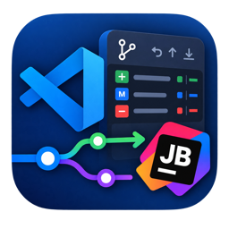
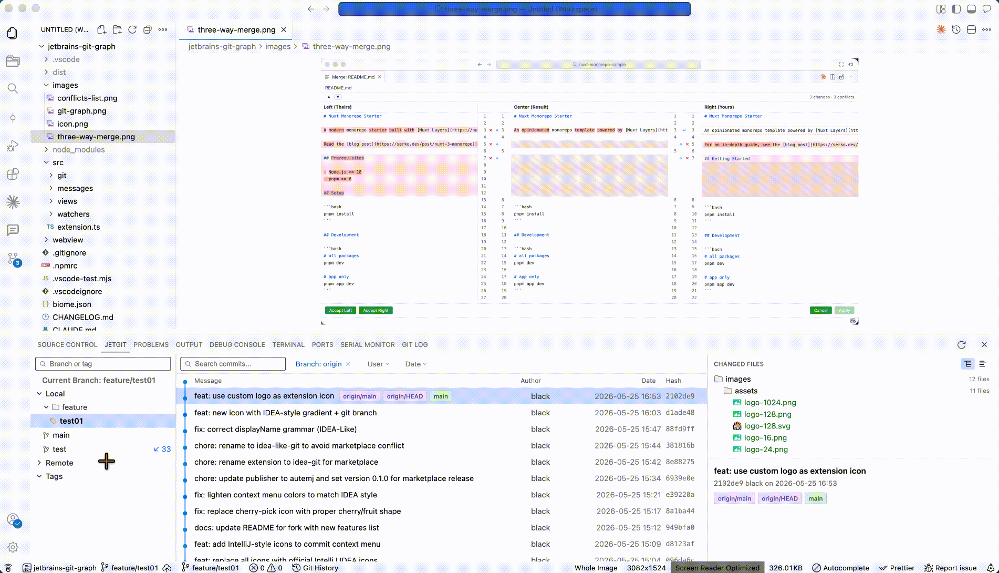
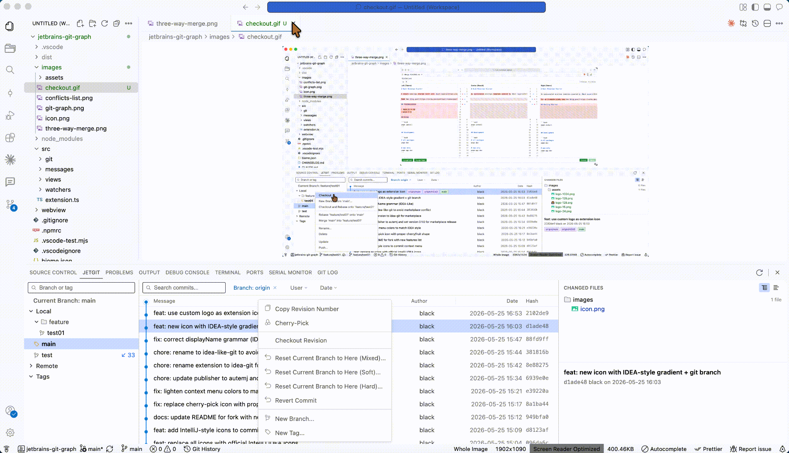
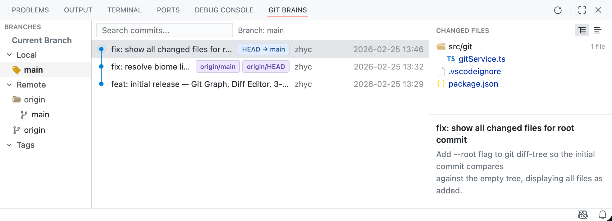
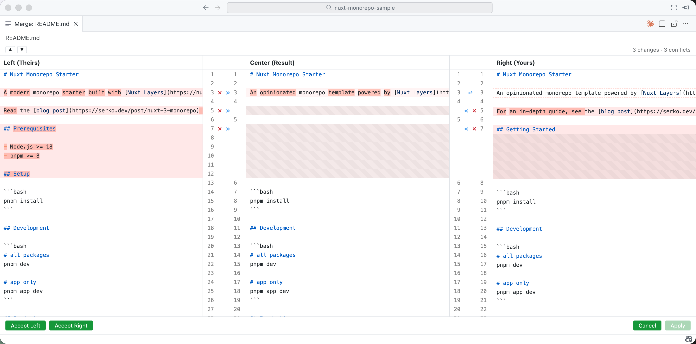
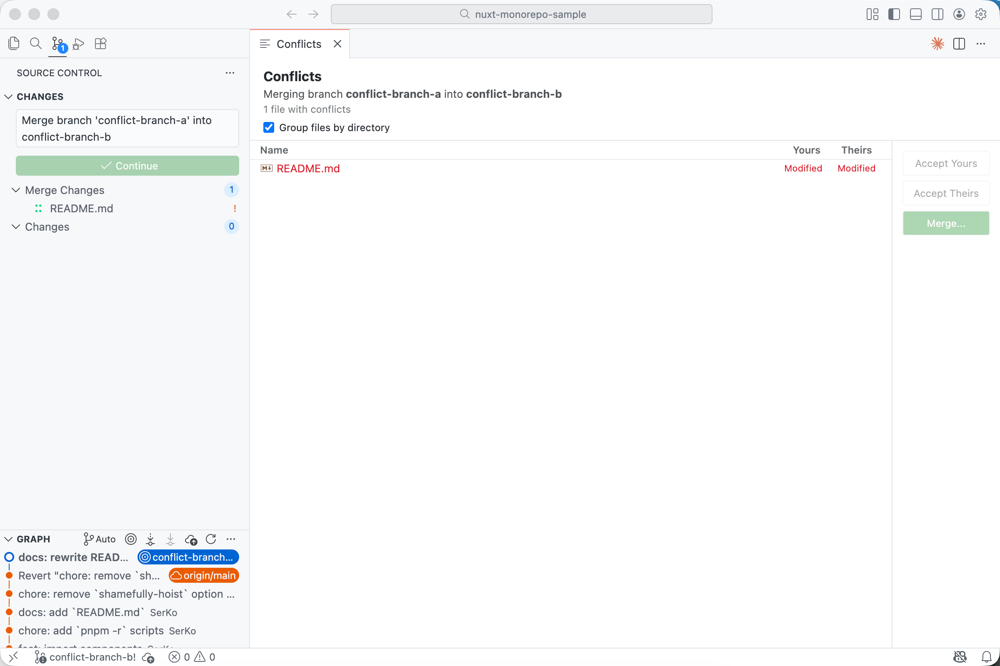

# JetBrains Git Control 完整源码
仓库：https://github.com/witt-bit/jetbrains-version-control
提交：`d27522ca852e5556524dbad606cb5ec86be3e5be`（main，2026-10-25）
本地：`/Users/saku/Desktop/jetbrains-version-control`
范围：`git ls-files` 跟踪的文本文件，不含 `node_modules` 和构建产物。
文本文件 154 个已全文收录。图片、SVG、两份 `pnpm-lock.yaml` 共 50 个只列路径（二进制或超大锁文件）。

## 未全文收录

- `images/assets/logo-1024.png`
- `images/assets/logo-128.png`
- `images/assets/logo-16.png`
- `images/assets/logo-24.png`
- `images/assets/logo-256.png`
- `images/assets/logo-32.png`
- `images/assets/logo-48.png`
- `images/assets/logo-512.png`
- `images/assets/logo-64.png`
- `images/checkout.gif`
- `images/commit-context-menu.gif`
- `images/commit-icon.svg`
- `images/conflicts-list.png`
- `images/git-graph.png`
- `images/icon-128.png`
- `images/icon.png`
- `images/icons/commit.svg`
- `images/icons/commit_dark.svg`
- `images/icons/copy.svg`
- `images/icons/copy_dark.svg`
- `images/icons/diff.svg`
- `images/icons/diff_dark.svg`
- `images/icons/next-change.svg`
- `images/icons/next-change_dark.svg`
- `images/icons/previous-change.svg`
- `images/icons/previous-change_dark.svg`
- `images/icons/rollback.svg`
- `images/icons/rollback_dark.svg`
- `images/logo.png`
- `images/three-way-merge.png`
- `pnpm-lock.yaml`
- `webview/pnpm-lock.yaml`
- `webview/src/commit/icons/add.svg`
- `webview/src/commit/icons/changelist.svg`
- `webview/src/commit/icons/chevronDown.svg`
- `webview/src/commit/icons/chevronRight.svg`
- `webview/src/commit/icons/collapseAll.svg`
- `webview/src/commit/icons/commit.svg`
- `webview/src/commit/icons/delete.svg`
- `webview/src/commit/icons/diff.svg`
- `webview/src/commit/icons/expandAll.svg`
- `webview/src/commit/icons/groupByDirectory.svg`
- `webview/src/commit/icons/history.svg`
- `webview/src/commit/icons/patch.svg`
- `webview/src/commit/icons/push.svg`
- `webview/src/commit/icons/refresh.svg`
- `webview/src/commit/icons/remove.svg`
- `webview/src/commit/icons/rollback.svg`
- `webview/src/commit/icons/shelve.svg`
- `webview/src/commit/icons/unshelve.svg`

## 目录

1. `.gitignore`
2. `.idea/.gitignore`
3. `.idea/jetbrains-git-graph.iml`
4. `.idea/modules.xml`
5. `.idea/vcs.xml`
6. `.npmrc`
7. `.vscode-test.mjs`
8. `.vscodeignore`
9. `CHANGELOG.md`
10. `LICENSE`
11. `README.md`
12. `README.zh_CN.md`
13. `biome.json`
14. `docs/ai-commit-message-research.md`
15. `esbuild.js`
16. `package.json`
17. `pnpm-workspace.yaml`
18. `src/ai/commitMessage.ts`
19. `src/ai/prompt.test.ts`
20. `src/ai/prompt.ts`
21. `src/blame/blameManager.ts`
22. `src/blame/caretBlame.ts`
23. `src/blame/caretBlameText.test.ts`
24. `src/blame/caretBlameText.ts`
25. `src/builtinGitPrompt.ts`
26. `src/commands/jumpToSource.ts`
27. `src/commands/markerActions.ts`
28. `src/decorations/box.ts`
29. `src/decorations/fileDecorations.ts`
30. `src/decorations/gutterMarkers.ts`
31. `src/decorations/lineDiff.test.ts`
32. `src/decorations/lineDiff.ts`
33. `src/decorations/markerCard.test.ts`
34. `src/decorations/markerCard.ts`
35. `src/decorations/markerHover.ts`
36. `src/decorations/markerHoverProvider.ts`
37. `src/decorations/markerPopup.ts`
38. `src/decorations/palette.ts`
39. `src/decorations/png.test.ts`
40. `src/decorations/png.ts`
41. `src/decorations/statusColors.test.ts`
42. `src/decorations/statusColors.ts`
43. `src/dev/aiProbe.ts`
44. `src/extension.ts`
45. `src/git/cache.ts`
46. `src/git/gitService.ts`
47. `src/git/graphLayout.ts`
48. `src/git/pathUtils.test.ts`
49. `src/git/pathUtils.ts`
50. `src/git/types.ts`
51. `src/messages/messageRouter.ts`
52. `src/messages/protocol.ts`
53. `src/statusBar.ts`
54. `src/views/commitViewProvider.ts`
55. `src/views/conflictsManager.ts`
56. `src/views/diffEditorManager.ts`
57. `src/views/gitContentProvider.ts`
58. `src/views/gitLogViewProvider.ts`
59. `src/views/html.ts`
60. `src/views/mergeEditorManager.ts`
61. `src/views/pushPanel.ts`
62. `src/views/rollbackPanel.ts`
63. `src/views/worktreeViewProvider.ts`
64. `src/watchers/gitWatcher.ts`
65. `tsconfig.json`
66. `webview/.gitignore`
67. `webview/index.html`
68. `webview/package.json`
69. `webview/pnpm-workspace.yaml`
70. `webview/src/commit/App.tsx`
71. `webview/src/commit/commit.css`
72. `webview/src/commit/components/CommitFileContextMenu.tsx`
73. `webview/src/commit/components/CommitMessageArea.tsx`
74. `webview/src/commit/components/CommitTab.tsx`
75. `webview/src/commit/components/FileItem.tsx`
76. `webview/src/commit/components/IdeaShelfContextMenu.tsx`
77. `webview/src/commit/components/IdeaShelfFileContextMenu.tsx`
78. `webview/src/commit/components/IdeaShelfTab.tsx`
79. `webview/src/commit/components/ShelfContextMenu.tsx`
80. `webview/src/commit/components/ShelfFileContextMenu.tsx`
81. `webview/src/commit/components/ShelfTab.tsx`
82. `webview/src/commit/components/Toolbar.tsx`
83. `webview/src/commit/utils/file-icon.tsx`
84. `webview/src/conflicts/App.tsx`
85. `webview/src/conflicts/MergeStandaloneApp.tsx`
86. `webview/src/conflicts/components/MergeColumn.tsx`
87. `webview/src/conflicts/components/MergeContainer.tsx`
88. `webview/src/conflicts/components/MergeGutter.tsx`
89. `webview/src/conflicts/utils/inline-diff.ts`
90. `webview/src/conflicts/utils/merge-logic.ts`
91. `webview/src/icons.d.ts`
92. `webview/src/main.tsx`
93. `webview/src/panel/App.tsx`
94. `webview/src/panel/components/BranchSidebar.tsx`
95. `webview/src/panel/components/BranchTree.tsx`
96. `webview/src/panel/components/CommitContextMenu.tsx`
97. `webview/src/panel/components/CommitDetail.tsx`
98. `webview/src/panel/components/CommitList.tsx`
99. `webview/src/panel/components/CommitRow.tsx`
100. `webview/src/panel/components/CreateBranchDialog.tsx`
101. `webview/src/panel/components/DetailPanel.tsx`
102. `webview/src/panel/components/FileChangeTree.tsx`
103. `webview/src/panel/components/FileContextMenu.tsx`
104. `webview/src/panel/components/GitGraphPanel.tsx`
105. `webview/src/panel/components/GitGraphSvg.tsx`
106. `webview/src/panel/components/PushDialog.tsx`
107. `webview/src/panel/components/Toolbar.tsx`
108. `webview/src/panel/utils/file-icons.tsx`
109. `webview/src/push/App.tsx`
110. `webview/src/push/components/RemoteBranchSelector.tsx`
111. `webview/src/push/hooks/useDraggableDivider.test.ts`
112. `webview/src/push/hooks/useDraggableDivider.ts`
113. `webview/src/push/push.css`
114. `webview/src/push/utils/branchUtils.ts`
115. `webview/src/push/utils/dividerUtils.test.ts`
116. `webview/src/push/utils/dividerUtils.ts`
117. `webview/src/push/utils/setup.test.ts`
118. `webview/src/rollback/App.tsx`
119. `webview/src/rollback/rollback.css`
120. `webview/src/shared/bridge/index.ts`
121. `webview/src/shared/bridge/types.ts`
122. `webview/src/shared/bridge/vscode-bridge.ts`
123. `webview/src/shared/components/CommitInfo.tsx`
124. `webview/src/shared/components/FileTree.tsx`
125. `webview/src/shared/components/Tooltip.css`
126. `webview/src/shared/components/Tooltip.tsx`
127. `webview/src/shared/hooks/useConfig.ts`
128. `webview/src/shared/hooks/useFocusContextKey.ts`
129. `webview/src/shared/hooks/useModifierClickSelection.ts`
130. `webview/src/shared/hooks/useMultiClick.test.ts`
131. `webview/src/shared/hooks/useMultiClick.ts`
132. `webview/src/shared/hooks/usePreventSelect.ts`
133. `webview/src/shared/hooks/useShiki.ts`
134. `webview/src/shared/hooks/useSuppressContextMenu.ts`
135. `webview/src/shared/keyboard.test.ts`
136. `webview/src/shared/keyboard.ts`
137. `webview/src/shared/models/merge.ts`
138. `webview/src/shared/shortcuts.ts`
139. `webview/src/shared/store/commit-store.ts`
140. `webview/src/shared/store/merge-store.ts`
141. `webview/src/shared/store/panel-store.ts`
142. `webview/src/shared/store/worktree-store.ts`
143. `webview/src/shared/theme/variables.css`
144. `webview/src/shared/types/git.ts`
145. `webview/src/vite-env.d.ts`
146. `webview/src/worktree/NewWorktreeDialog.tsx`
147. `webview/src/worktree/SearchableSelect.tsx`
148. `webview/src/worktree/WorktreeApp.tsx`
149. `webview/src/worktree/WorktreeList.tsx`
150. `webview/src/worktree/worktree.css`
151. `webview/test-diff.ts`
152. `webview/tsconfig.json`
153. `webview/vite.config.ts`
154. `webview/vitest.config.ts`

---


# 文件 `.gitignore`

```
.DS_Store
out
dist
node_modules

.vscode-test/
.vscode/
!.vscode/launch.json
!.vscode/task.json

.idea/
.kiro/
.omc/
*.vsix
webview/node_modules
CLAUDE.md
.claude/
.history/
*.vsix
```


# 文件 `.idea/.gitignore`

```
# Default ignored files
/shelf/
/workspace.xml
# Editor-based HTTP Client requests
/httpRequests/
```


# 文件 `.idea/jetbrains-git-graph.iml`

```
<?xml version="1.0" encoding="UTF-8"?>
<module type="WEB_MODULE" version="4">
  <component name="NewModuleRootManager">
    <content url="file://$MODULE_DIR$" />
    <orderEntry type="inheritedJdk" />
    <orderEntry type="sourceFolder" forTests="false" />
  </component>
</module>
```


# 文件 `.idea/modules.xml`

```
<?xml version="1.0" encoding="UTF-8"?>
<project version="4">
  <component name="ProjectModuleManager">
    <modules>
      <module fileurl="file://$PROJECT_DIR$/.idea/jetbrains-git-graph.iml" filepath="$PROJECT_DIR$/.idea/jetbrains-git-graph.iml" />
    </modules>
  </component>
</project>
```


# 文件 `.idea/vcs.xml`

```
<?xml version="1.0" encoding="UTF-8"?>
<project version="4">
  <component name="VcsDirectoryMappings">
    <mapping directory="" vcs="Git" />
  </component>
</project>
```


# 文件 `.npmrc`

```
enable-pre-post-scripts = true
```


# 文件 `.vscode-test.mjs`

```js
import { defineConfig } from '@vscode/test-cli';

export default defineConfig({
	files: 'out/test/**/*.test.js',
});
```


# 文件 `.vscodeignore`

```
.vscode/**
.vscode-test/**
.claude/**
.kiro/**
.omc/**
out/**
node_modules/**
src/**
webview/**
docs/**
.gitignore
.git/**
.npmrc
.yarnrc
esbuild.js
vsc-extension-quickstart.md
biome.json
pnpm-lock.yaml
pnpm-workspace.yaml
CLAUDE.md
**/tsconfig.json
**/eslint.config.mjs
**/*.map
**/*.ts
**/.vscode-test.*
**/.DS_Store

# Local editor / IDE cruft. Not in .gitignore's reach for vsce, which only
# reads this file — these were shipping stale copies of package.json.
.history/**
.idea/**

# Already-built release artifacts must never end up inside the next package.
*.vsix

# Unreferenced: nothing in README.md, README.zh_CN.md, package.json or the
# webview points at these. logo.png alone was ~1.1MB of the package.
images/logo.png
images/icon-128.png
images/assets/**
images/*.gif
```


# 文件 `CHANGELOG.md`

```md
# Changelog / 更新日志

## [Unreleased]

### Added / 新增
- **Offer to disable the built-in Git extension** — while `jgc.onboarding.builtinGitPrompt` is `ask` (the default), JGC shows a dialog offering to set `git.enabled` to false globally, since two Git UIs running together duplicate the status bar, decorations and file watchers. Confirming disables it and offers a one-click reload. The Source Control view then shows an empty state, and VS Code keeps its activity-bar icon (the built-in Changes view stays active without providers), so the dialog also explains how to remove the icon: right-click the activity bar and uncheck Source Control. Either answer writes the setting to `never`; change it back to `ask` and the dialog returns without a reload / 当 `jgc.onboarding.builtinGitPrompt` 为 `ask`（默认）时，JGC 弹窗询问是否全局禁用 VS Code 内置 Git 扩展（`git.enabled=false`）：两套 Git 界面并存会让状态栏、装饰和文件监听重复。确认后即禁用并引导一键重载窗口。重载后"源代码管理"视图为空状态，活动栏图标 VS Code 会保留（内置 Changes 视图没有 provider 也保持激活），弹窗会说明移除方法：右键活动栏，取消勾选"源代码管理"。任一明确答复都会把设置写为 `never`；改回 `ask` 弹窗立即重现，无需重载
- **Caret line-end blame** — the line the caret sits on shows `Who, date * summary` after the code, JetBrains-style line blame that follows the caret instead of annotating every line. Your own commits read `You, …`; uncommitted (new) lines show nothing. The message is capped at 50 characters (`jgc.caretBlame.messageMaxLength`) and the hash at 8, with an ellipsis when cut. The blame snapshot is cached per document version and refreshed on save and Git changes. Settings follow GitLens: `jgc.caretBlame.enabled`, `…format` (a template with ${who} ${date} ${message} ${hash} tokens) and `…messageMaxLength` / 光标所在行的行尾显示 `Who, 日期 * 摘要`，JetBrains 式行级 blame，但跟随光标而非全量标注。本人提交显示 `You, …`；未提交（新增）的行不显示。message 最多 50 字符（`jgc.caretBlame.messageMaxLength`）、hash 最多 8 位，超出以省略号结尾，其余不限长。blame 快照按文档版本缓存，保存与 Git 变化时刷新。设置仿 GitLens：`jgc.caretBlame.enabled`、`…format`（支持 ${who} ${date} ${message} ${hash} 令牌的模板）、`…messageMaxLength`
- **AI commit message generation** — a sparkle button next to **Commit** writes the commit message for exactly the files you checked: the prompt carries only their diffs (staged entries against the index, unstaged against worktree, untracked files as content) plus the repository's recent commit subjects as a style reference, and the result streams into our own input box where you can edit it before committing / **Commit** 按钮旁新增 ✨ 按钮，只为**你勾选的文件**生成提交信息：prompt 只携带这些文件的 diff（已暂存对比 index、未暂存对比工作区、未跟踪文件取内容）和本仓库最近的提交主题作为风格参考，结果流式写入我们自己的输入框，提交前可任意编辑
  - Runs on the VS Code Language Model API (`vscode.lm`): every model you have configured works, GitHub Copilot out of the box, anything added under **Chat: Manage Language Models** (OpenRouter, Ollama, OpenAI-compatible endpoints, …), and models contributed by other extensions. JGC itself has no configuration / 基于 VS Code 的语言模型 API（`vscode.lm`）：已配置的模型都可用，GitHub Copilot 开箱即用，也可以在 **Chat: Manage Language Models**（OpenRouter、Ollama、OpenAI 兼容端点等）里添加，或使用其它扩展贡献的模型；JGC 自身没有配置项
  - Multiple models installed: the first generation asks once which to use and remembers the choice; the chevron next to the sparkle reopens the model picker any time / 装有多个模型时首次生成会询问一次并记住选择；✨ 旁的下拉箭头可随时重新选择模型
  - The style reference takes the committer's own recent commits first, falling back to the repository's latest history when this person has not committed here yet; the generated message follows the reference's language / 风格参照先取当前提交人本人的最近提交，本人尚无提交时回退到仓库最近历史；生成信息的语言跟随参照提交
  - Generating again mid-flight cancels the request; clicking with no model configured shows where to add one / 生成中再次点击即取消；未配置任何模型时点击会提示添加模型的入口
  - Requires VS Code 1.91+ (raised from 1.85), the version where the Language Model API became stable / 要求 VS Code 1.91+（从 1.85 提升），语言模型 API 自该版本起稳定可用

### Fixed / 修复
- **No stray context menu on blank areas** — right-clicking empty space in the Commit, Git Log and Git Worktree panels no longer pops the raw webview menu; rows and items keep their own custom menus, and editable text fields keep copy/paste / Commit、Git Log、Git Worktree 面板的空白处右键不再弹出 webview 原生菜单；列表行仍使用各自的自定义菜单，文本输入框保留复制/粘贴

## [1.1.3] - 2026-10-25

### Changed / 变更
- **Everything lives under the Git context menu** — the editor's right-click menu has one top-level **Git** submenu: **Show File History** moved into it, and **Manage Selection...** floats the marker card over the editor's first line of the change block at the cursor, with the six actions left to right: Prev Change, Next Change, Rollback Lines, Show Diff for Lines, Copy, Commit this change / 编辑器右键菜单收敛为一个一级 **Git** 子菜单：**Show File History** 移入其中，**Manage Selection...** 则在编辑器内浮动弹出胶囊卡片，锚定光标所在变更块的首行行首，从左到右依次是 Prev Change、Next Change、Rollback Lines、Show Diff for Lines、Copy、Commit this change 六个按钮
- **Manage Selection... on the line number** — right-clicking a line number (or the gutter marker area) now offers **Manage Selection...** right next to the blame entries, opening the same floating card for the block that line belongs to / 在行号（或行号右侧的标记区域）上右键，菜单里紧挨 blame 两项就是 **Manage Selection...**，点击后为该行所属的变更块打开同一张浮动卡片
- **Jump to Source keeps your selection** — in a diff editor, **Jump to Source** now carries over the whole selection and pins the scroll position, so text you selected stays selected after the jump instead of collapsing to a bare cursor line / diff 编辑器中的 **Jump to Source** 现在会保留完整选区并固定滚动位置，之前选中的文字跳转后仍然处于选中状态，而不是收缩成一个光标点
- **Status bar shows the current branch** — the status bar item now displays the branch of the repository you are working in, with incoming/outgoing commit counts, replacing VS Code's built-in Git status bar item / 状态栏现在显示当前仓库的分支名与待推送/待拉取提交数，替代 VS Code 内置 git 的状态栏项
  - Click it for a menu of common actions: Update Project, Commit, Push, New Branch, Switch Branch and the Git Log view / 点击可打开常用操作菜单：更新项目、提交、推送、新建分支、切换分支、Git Log
  - Follows the folder of the active editor in multi-root workspaces, and refreshes on Git changes in every workspace folder / 多根工作区下自动跟随当前编辑器所在文件夹，并在各工作区的 Git 状态变化时刷新
  - A detached HEAD shows up instead of disappearing, and checking out a remote branch warns before leaving you detached / 处于 detached HEAD 时状态栏会显示提示而不是消失；检出远程分支前会先警告

### Added / 新增
- **Marker hover card (IDEA-style)** — hovering a change marker or any changed line shows a card of exactly that block: modified lines are word-diffed with the changed words highlighted in the editor's diff colors, a deleted block shows the content as it reads in `HEAD`, an insertion shows just the actions; the six action buttons are the bundled JetBrains UI icons (light and dark theme variants), and **Manage Selection...** in the Git context menu floats the same card over the block, staying open until you act on it / 悬停变更标记或任意变更行会显示该块的改动卡片：修改行按词级高亮变化的部分（取编辑器 diff 主题色），删除块直接显示 `HEAD` 中的内容，新增块只有操作按钮；六个操作按钮用打包的 JetBrains UI 图标（浅色/深色两套），右键 Git 菜单的 **Manage Selection...** 会把同一张卡片浮在该块上方，保持显示直到你操作它
  - **Prev Change / Next Change** walk between blocks in the file, wrapping around / 在文件的变更块之间循环跳转
  - **Rollback Lines** reverts exactly this block to `HEAD`, keeping unsaved-buffer semantics / 只回滚该块到 `HEAD`，支持未保存的缓冲内容
  - **Show Diff for Lines** opens the `HEAD ↔ Working Tree` diff and lands on the block / 打开 `HEAD ↔ Working Tree` 的 diff 并定位到该块
  - **Copy** takes the current lines (or the deleted content from `HEAD`) / 复制当前内容（删除块复制 `HEAD` 中的内容）
  - **Commit this change** commits only this block through a throwaway index, leaving the rest of the file — staged or not — exactly as it was / 通过临时 index 只提交该块，文件其余的暂存与未暂存状态原样保留
- **Turn the decorations off** — `JGC Decorations › Enabled`, `… › File Colors` and `… › Gutter Markers` switch off the Explorer colors and the gutter markers independently, so either layer can fall back to VS Code's built-in Git decorations / `JGC Decorations › Enabled`、`… › File Colors`、`… › Gutter Markers` 可分别关闭资源管理器着色与行号槽标记，某一层可退回使用 VS Code 内置 Git 的装饰
- **Explorer file colors by Git status** — file names in the Explorer are tinted by their Git status (added, modified, deleted, untracked, ignored, conflict), so built-in Git can be disabled without losing them / 资源管理器中的文件名按 Git 状态着色（新增、修改、删除、未跟踪、已忽略、冲突），禁用内置 git 后依然保留
- **Gutter change markers** — the line-number gutter shows a colored bar next to every added or modified line, and a short marker at the position where lines were deleted / 行号槽中为每个新增或修改的行显示彩色小竖条，删除位置显示较短的标记
  - With inline blame annotations on, every marker keeps the same column to the right of the blame text — lines without a label reserve that column too, so markers never slide left / 开启行内 blame 注释时，所有标记保持在注释文字右侧的同一列；无标签的行同样保留该列宽度，标记不会向左滑动
  - Files Git ignores get no markers at all, and neither do folders that are not a repository / 被 Git 忽略的文件不显示任何标记，非 Git 仓库的文件夹同样不显示
- **File and line colors follow your palette** — the six Git status colors (added, modified, deleted, untracked, ignored, conflict) are declared as `jgc.decoration.*` color IDs and can be changed in **Settings** or under `workbench.colorCustomizations`. Both the Explorer file colors and the gutter markers follow the change; the defaults are taken from IDEA's File Status Colors / 六种 Git 状态颜色（新增、修改、删除、未跟踪、已忽略、冲突）以 `jgc.decoration.*` 颜色 ID 声明，可在**设置**中或通过 `workbench.colorCustomizations` 修改，资源管理器文件色与行号槽标记会同步变化；默认取色参照 IDEA 的 File Status Colors

### Fixed / 修复
- **Each line-number column toggles its own blame** — in a diff editor, the blame menu entries used `activeTextEditor`, which does not reliably follow the pane you interacted with, so both columns' entries drove the same side: annotating one side and then closing from the other column killed the first side's blame. The gutter menu now has a single **Toggle Git Blame Annotations** entry that acts on the editor the menu was opened on — VS Code forwards the clicked editor's URI (`{ lineNumber, uri }`) and the command annotates or clears exactly that editor, so each column, and each diff side, opens and closes its own blame independently / diff 编辑器里 blame 菜单项此前取的是 `activeTextEditor`（并不总是跟随你实际操作的栏），两列的菜单因此控制同一侧：给一侧打开 blame 后从另一列关闭，会关掉第一侧的 blame。现在行号菜单只有一个 **Toggle Git Blame Annotations** 入口，作用于菜单打开时所在的那一列——VS Code 会转发被点击编辑器的 URI（`{ lineNumber, uri }`），命令只对该编辑器做打开或关闭——每一列、diff 的每一侧都独立开关自己的 blame
  - Blame works on both sides of a diff: virtual sides are blamed at the revision they display (`git blame <ref> -- <path>`), so line numbers match that side; sides without a git revision (empty placeholder, index, shelf content) say so instead of failing silently / diff 两列都能打开 blame：虚拟侧按其显示的版本执行 blame（`git blame <ref> -- <path>`），行号与该侧一致；没有 git 版本的侧（空占位、index、shelve 内容）会明确提示而不是无响应
- **Commit badge shows without opening the panel** — two things conspired to keep the pending-changes badge on the activity bar's Commit icon hidden until the first click on it. The extension declared no `activationEvents`, so VS Code activated it only through contributions (`onView`, `onCommand`) — meaning the badge code did not run at all until some JGC UI was touched; the extension now activates with `onStartupFinished`, so it comes alive with the window. And a `WebviewView` is resolved lazily, so `WebviewView.badge` does not exist until the view has been opened once (microsoft/vscode#146330); the badge now rides a hidden tree view in the same container, whose `TreeView.badge` reaches the container icon without any resolution. The count now shows on window load and tracks every change, click or no click / 活动栏 Commit 图标上的待提交数角标此前只有第一次点击后才会出现，两个原因叠加：其一，扩展没有声明 `activationEvents`，VS Code 只按贡献点隐式激活（`onView`、`onCommand`）——没碰过任何 JGC 界面之前角标代码根本没运行；现在扩展以 `onStartupFinished` 随窗口启动激活。其二，`WebviewView` 是懒解析的，首次打开前 `WebviewView.badge` 不存在（microsoft/vscode#146330）；现在角标由同容器内一个隐藏的 TreeView 承载，`TreeView.badge` 无需解析即可作用到容器图标。窗口一加载就显示数量，并随每次变更更新
- **Committing respects your checkboxes** — files that were staged but UNchecked still landed in the commit, because `git commit -m` swept the whole index in. Unchecked staged files are now unstaged for the commit and re-staged afterwards, so only the checked files are committed; Commit and Commit & Push behave the same / Commit 面板中已暂存但未勾选的文件此前仍会被提交（`git commit -m` 会带入整个暂存区）。现在提交前先对这些文件取消暂存、提交后再恢复，只有勾选的文件进入提交；Commit 与 Commit & Push 行为一致
- **Saving a file no longer resets the Git Log panel** — every Git state event rebuilt the graph, so a plain file save (a `status` event) cleared the selected commit, the collapsed sequences and scrolled the list back to the first 200 commits. The panel now ignores `status` and `mergeState` events and only rebuilds when commits, branches or tags can actually change / 此前任意 Git 状态事件都会重建提交图——单纯保存文件（status 事件）也会清空选中的提交、折叠的提交序列，并把列表卷回前 200 条。现在面板忽略 status 与 mergeState 事件，只在提交/分支/标签真正变化时刷新
- **Compare with Current shows the real diff** — the branch sidebar action opened two empty virtual documents because the URIs carried no `ref`. It now shows the merge-base patch of the selected branch against the current one / 分支侧边栏的 Compare with Current 此前打开的是两个空虚拟文档（URI 缺少 `ref`）。现在显示所选分支相对当前分支基于 merge-base 的 patch 内容
- **Worktree panel refresh works again** — the Refresh Worktrees command invoked itself, looping forever when triggered. It now tells the panel to refetch / Worktree 面板的刷新命令此前会无限调用自身；现在改为通知面板重新拉取数据
- **Rollback keeps new files on disk when you ask** — a new file that also had unstaged edits was classified as "modified" by the rollback panel, so it was deleted from disk even with delete-local-copies unchecked. Rollback now classifies by whether the file exists in `HEAD`; keeping the file only unstages it / 回滚面板此前会把「已暂存新增且又有未暂存修改」的文件误判为 modified，即使不勾选删除本地副本也会将其从磁盘删除。现在按文件是否存在于 `HEAD` 判定，保留文件时仅将其移出暂存区
- **Drop Commit no longer fakes a timeout** — the operation reported "Operation timed out" after 30 seconds while the rebase kept running in the background. The fake timeout is gone (the progress indicator runs until the rebase actually finishes), and commits that are not on the current branch are rejected up front / Drop Commit 超过 30 秒会报「Operation timed out」，但 rebase 仍在后台继续。现在移除假超时（进度指示等待 rebase 真正结束），且不属于当前分支历史的提交会被提前拒绝
- **Rollback Lines keeps your other unsaved edits unsaved** — rolling back one block force-saved the whole file, silently publishing unrelated edits with it. Only a previously clean document is written through now / 卡片中的 Rollback Lines 此前会保存整个文件，把同文件里其它未保存的修改一并写盘。现在只有回滚前没有未保存修改的文件才会自动保存
- **IDEA shelves restore text containing backslash escapes** — the base revision was unescaped with sequential replaces, so a literal `\n` inside the shelved file (e.g. inside string literals) turned into a real newline. Unescaping is now a single pass / IDEA Shelf 恢复时，shelved 文件中的字面 `\n` 序列（如字符串字面量里）会被错误解码成真实换行。现在改为单遍转义解析
- **Unshelving untracked files no longer appends a blank line** — the generated patch counted the phantom line after the trailing newline, so the restored file ended with an extra empty line; empty files now produce a valid patch too / 恢复包含 untracked 文件的 shelf 时，文件末尾会多出一个空行（patch 行数把末尾换行多算了一行）；空文件现在也能生成合法 patch
- **Local branches with a slash are local again** — ref badges guessed remote-vs-local from a hardcoded prefix list, so branches like `dev/sub` or `user/feature` showed as remote branches. Classification now checks the first segment against the actually configured remotes / 带斜杠的本地分支（如 `dev/sub`、`user/feature`）此前基于硬编码前缀被误判为远程分支。现在用实际配置的 remote 名单判定
- **Continue flows stage only the resolved conflicts** — cherry-pick, rebase and merge "Continue" used `git add -u`, staging every modified file including changes you never meant to commit. Only still-unmerged paths are staged now / cherry-pick、rebase、merge 的 Continue 此前使用 `git add -u`，会把所有已修改文件（包括并不想提交的改动）一起暂存。现在只暂存仍未合并的冲突文件
- **Block commit keeps the executable bit** — committing a single change block always recorded mode `100644`, silently un-executing executable files; the mode now comes from `HEAD` / 单块提交（Commit this change）此前固定写入 100644 权限，可执行文件会丢失可执行位；现在从 `HEAD` 继承文件 mode
- **Amend keeps the message you typed** — enabling Amend overwrote whatever message was already in the box with the last commit message / 勾选 Amend 会用上一次提交信息覆盖输入框中已输入的内容；现在仅在输入框为空时填入
- **Commit file lists no longer race** — clicking commit B while commit A's changed-files request was still loading could show A's file list under B / 快速切换选中提交时，旧请求晚返回可能把 A 的文件列表显示在 B 之下
- **Faster blame on large files** — the per-line label lookup rescanned the whole blame output linearly; it now uses a prebuilt line→index map / 大文件 blame 的逐行标签查找由线性重扫改为预建的行号映射
- **Deleted files open a diff again** — clicking a deleted (`D`) entry in the Commit panel failed the whole diff editor with "cannot open editor: file not found", because the diff always used the on-disk working-tree file as its right side, and a deleted file is no longer on disk. Deleted entries now render as *content before deletion → empty*, the same way IDEA's Git UI and VS Code's built-in Git show them / 在 Commit 面板点击删除（`D`）条目时，整个 diff 编辑器报「由于找不到该文件，因此无法打开编辑器」——diff 右侧固定取磁盘上的工作区文件，而已删除的文件已不在磁盘上。现在删除条目按「删除前内容 → 空」展示，与 IDEA 的 Git UI 和 VS Code 内置 Git 一致
  - Staged deletions diff against the index revision, unstaged ones against an empty virtual document / 已暂存的删除对比 index 版本，未暂存的删除对比空虚拟文档
  - The `HEAD ↔ Staged` diff now really compares against the index instead of the working tree, so the title matches the content / `HEAD ↔ Staged` 的 diff 右侧现在真正对比暂存区（index）而非工作区，标题与内容一致
  - Fixed by @dunlingzi in #8, reported in #7 / 由 @dunlingzi 在 #8 中修复，#7 报告
- **Gutter markers now read your edits, not the diff's alignment** — line classification was rewritten around jsdiff's block semantics (`removed+added` runs pair into one modified block), replacing the old node-diff3 + per-line similarity heuristics that lost track of line identity when lines were inserted above an edit, turning whole regions green / 行号槽标记的行分类改为基于 jsdiff 的块语义（`removed+added` 区块配对为一个修改块），替换原先 node-diff3 加逐行相似度推断的方案——插入新行后整片修改行被误判为新增（绿色）的问题由此解决
  - Blocks that only a blank line separates join into one modification when either side is large enough (more than 5 lines), the same rule VS Code's own quick diff applies — without it, a rewrite whose old and new lines happen to straddle a blank line would split into a green insertion and a gray deletion / 两个变更块之间仅隔空行时，任一侧超过 5 行即合并为一个修改块——与 VS Code 原生 quick diff 的启发式一致，否则跨空行的改写会被拆成绿色新增加灰色删除
  - The classification ships with regression tests built from the original failing scenarios / 分类逻辑附带由原始出错场景提炼的回归测试
- **All-caps headings** — headings across the Commit, Push and Git Log panels were forced to all caps: the Commit panel's file group headers and their file counts, the section headers in the Commit toolbar, Git Log list and branch sidebar context menus, and the Push panel's remote branch sections. `UNVERSIONED FILES` and `12 FILES` now read `Unversioned Files` and `12 files`, `ON SINGLE CLICK` reads `On Single Click`, `REMOTE` and `BRANCH` read `Remote` and `Branch` / Commit、Push、Git Log 面板的标题此前被强制转为全大写：Commit 面板的文件分组标题及文件计数、Commit 工具栏与 Git Log 列表与分支侧边栏右键菜单的分节标题、Push 面板的远程分支分节标题。`UNVERSIONED FILES` 与 `12 FILES` 现显示为 `Unversioned Files` 与 `12 files`，`ON SINGLE CLICK` 显示为 `On Single Click`，`REMOTE`、`BRANCH` 显示为 `Remote`、`Branch`
- **Non-ASCII filenames** — Chinese and other non-ASCII filenames were shown as octal escape sequences such as `\344\270\255\346\226\207.txt` instead of `中文.txt`, and every Git operation on them (open diff, stage, discard, shelve) failed. Reported by @dunlingzi in #3, fixed in #4 / 中文等非 ASCII 文件名会显示成八进制转义串（如 `\344\270\255\346\226\207.txt`）而非文件名本身，且对这些文件的 Git 操作（打开 diff、暂存、撤销、shelve）全部失败 - 由 @dunlingzi 在 #3 中报告，#4 修复
  - Paths are now decoded before use, so Git receives the real filename / 路径在使用前会先解码，Git 收到的是真实文件名
  - Filenames containing a space, a double quote or an arrow are handled too, including a file literally named `a -> b` / 同时也能正确处理含空格、双引号或箭头的文件名，包括名字里就带 `a -> b` 的文件
- **Files missing from an IDEA shelf** — a shelf could omit files whose name forced Git to quote the path, so restoring it left those changes behind / IDEA Shelf 的文件列表可能漏掉路径被 Git 加引号的文件，恢复后这些改动会丢失

## [1.1.2] - 2026-10-08

### Added / 新增
- **Triple-click jumps to source** — in the Commit panel file list: single click selects, double click opens the diff, triple click opens the file / Commit 面板文件列表支持三击跳转源码：单击选中，双击打开 diff，三击打开文件
- **Shift-click range selection** — select a contiguous run of files in the Commit panel / Commit 面板支持按住 Shift 连续选择多个文件
- **Jump to Source shortcut** — `F4`, plus `Cmd+↓` on macOS and `Ctrl+↓` on Windows/Linux / 跳转源码快捷键：`F4`，macOS 额外支持 `Cmd+↓`，Windows/Linux 支持 `Ctrl+↓`
  - Works in the Commit panel, the Git Log Changed Files list, and inside a diff editor / Commit 面板、Git Log 的 Changed Files 列表、diff 编辑器内均可用
  - In a diff editor it opens the file on disk and jumps to the line the cursor is on / 在 diff 编辑器中会打开磁盘上的文件并定位到光标所在行
  - Can be rebound in **Preferences: Open Keyboard Shortcuts** / 可在 **Preferences: Open Keyboard Shortcuts** 中重新绑定
  - Context menus show the shortcut beside **Jump to Source** and **Edit Source** / 右键菜单中 **Jump to Source** 与 **Edit Source** 旁显示快捷键
- **Commit badge** — the Commit entry in the activity bar shows how many files are pending, matching the count in VS Code's own Source Control view / Commit 侧边栏图标显示待处理的文件数量，与 VS Code 自带源代码管理视图的数字一致
- **New setting** `jgc.shortcut.jumpToSourceLabel` — text shown beside the shortcut in context menus; leave empty to hide it / 新增设置 `jgc.shortcut.jumpToSourceLabel`，控制右键菜单中快捷键的显示文案，留空则隐藏

### Changed / 变更
- **Smaller extension package** — the VSIX shrank from 3.69 MB to 2.48 MB, a 33% reduction, so download and install are faster / 扩展包体积从 3.69 MB 缩减到 2.48 MB，减少 33%，下载与安装更快
  - Editor and IDE working files that were being packaged by mistake are no longer shipped / 不再打包误混入的编辑器与 IDE 工作文件
  - Two unused images were dropped / 移除两张未被引用的图片

### Fixed / 修复
- The **Changed Files** header was shown in all caps / **Changed Files** 标题显示为全大写
- Double-clicking a file in **Changed Files** highlighted its name as text / 双击 **Changed Files** 里的文件会把文件名选成文字
- Newly created, renamed or deleted untracked files did not appear in the Commit panel until an unrelated action triggered a refresh / 新建、重命名或删除未追踪文件后，Commit 面板不会立即刷新，需要其他操作触发
- Pressing Shift showed a stray border around the Commit file list / 按 Shift 会在 Commit 文件列表周围出现多余边框
- Selection could keep referring to files that no longer existed after a refresh / 刷新后选中状态会残留已不存在的文件

## [1.1.1] - 2026-09-12

### Added / 新增
- **Commit hash search** — search commits by hash in the search bar / 搜索栏支持按 commit hash 搜索提交

### Fixed / 修复
- **Commit panel text selection** — disabled mouse text selection in commit panel file list / 禁用 commit 面板文件列表的文字选中
- **Worktree table header uppercase** — removed `text-transform: uppercase` from worktree table header / 移除 worktree 表头的全大写样式

## [1.1.0] - 2026-08-29
### Added / 新增
- **Git Worktree** — sidebar panel for managing Git worktrees (JetBrains-style) / Git Worktree 侧边栏面板（JetBrains 风格）
  - Worktree list with branch, path columns; main worktree protection / 工作树列表显示分支和路径列，主工作树受保护不可删除
  - New Worktree dialog: searchable branch/tag dropdown (local + origin/* + tags), input filtering, auto-fill project name / 新建工作树对话框：可搜索分支/标签下拉、输入过滤、自动填充项目名
  - Branch name validation: real-time duplicate check with red border / 分支名校验：实时检查重名并红框提示
  - Open Project dialog (native VS Code): Cancel / This Window / New Window / 打开项目对话框（原生 VS Code API）
  - `jgc.worktree.openBehavior` setting: ask (default) / thisWindow / newWindow / 配置项控制打开行为
  - Prune button with JetBrains clearCash icon / 清理按钮使用 JetBrains clearCash 图标
  - Sidebar collapse/expand toggle / 侧边栏折叠/展开切换
  - Location defaults to repo root, remembers per-repo preference / Location 默认为仓库根目录，按仓库记忆上次选择

## [1.0.0] - 2026-08-28
### Added / 新增
- **Annotate with Git Blame** — WebStorm-style inline blame annotations for every line, with click-to-jump to the Git Log commit graph / WebStorm 风格的行内 blame 注释，点击注释跳转到 Git Log 提交图并定位提交
  - Gutter (line number) right-click menu: `Annotate with Git Blame` / `Close Annotations` / 行号右键菜单触发，菜单项互斥切换
  - **Annotation View** submenu (nested under gutter menu): multi-select columns Revision / Date (default on) / Author (default on) / Commit Number, plus nested **Colors** (Author / Order (default) / Hide) and **Names** (Initials / Last Name / First Name / Full Name / Email) radio submenus; at least one column must stay enabled / 注释视图子菜单：Revision、Date（默认选）、Author（默认选）、Commit Number 多选；内嵌 Colors（Author / Order（默认）/ Hide 单选）与 Names（作者名显示方式单选）子菜单；至少保留一列
  - JetBrains-style age-based coloring, configurable via `jgc.blame.colorMode` / 按提交新旧程度渐变着色（新→蓝、中→绿、旧→灰）
  - Display scope config: whole file / cursor line only / N lines around cursor (`jgc.blame.displayMode`) / 展示范围可配置：全文件 / 仅光标行 / 光标前后 N 行
  - Date format config (`jgc.blame.dateFormat`, default `yyyy-MM-dd HH:mm`), hash off by default / 日期格式可配置，默认不显示 hash

### Changed / 变更
- Renamed extension to **JetBrains Git Control** (short brand: JGC); extension ID changed from `idea-like-git-graph` to `jetbrains-git-control` / 插件更名为 JetBrains Git Control（短标识 JGC），扩展 ID 由 `idea-like-git-graph` 改为 `jetbrains-git-control`

### Fixed / 修复
- **GitLog panel text selection** — disabled mouse text selection in GitLog panel file list / 禁用 Git Log 面板文件列表的文字选中

## [0.4.17] - 2026-06-20

### Added / 新增
- **Push Panel: multi-remote switching** — push panel now supports switching between multiple remotes (e.g. origin, fork) via a dropdown selector, with separate branch input / Push 面板支持多 remote 切换，remote 下拉选择和 branch 输入框独立

### Fixed / 修复
- **Push Panel: stale remote list** — uses `git remote` directly; deleted remotes no longer appear / 修复已删除的 remote 仍显示的问题
- **Push Panel: default remote detection** — auto-detects correct default remote from upstream tracking config / 自动检测正确的默认 remote
- **Push Panel: ahead commits respect selected remote** — commit list updates dynamically when switching remotes / 切换 remote 后 commit 列表动态更新
- **Dark theme: commit panel** — fixed tabs, toolbar buttons, textarea border, checkboxes, buttons (Cancel/Commit and Push) all using hardcoded light colors / 修复 commit 面板深色主题下各组件颜色不正确
- **Dark theme: file name colors** — commit panel and FileTree now use IDEA Dark Island palette (blue for modified, green for added, etc.) instead of invisible dark-on-dark colors / 文件名颜色改为 IDEA Dark Island 风格，深色主题下清晰可见
- **Dark theme: dropdown menus** — all dropdown/context menu backgrounds, borders, hover states, separators fixed across git log, commit panel, push panel / 所有下拉菜单和右键菜单深色主题适配
- **Dark theme: push/rollback panels** — Cancel button, menu items, checkbox styling all fixed / Push/Rollback 面板按钮和 checkbox 深色适配

## [0.4.16] - 2026-06-20

### Added / 新增
- **Push Panel: multi-remote switching** — push panel now supports switching between multiple remotes (e.g. origin, fork) via a dropdown selector / Push 面板支持切换多个 remote（如 origin、fork）
- **Push Panel: separate remote selector & branch input** — remote is selected from a list, branch name is typed in a text input, independent of each other / Remote 下拉选择和 Branch 输入框分离，互不影响

### Fixed / 修复
- **Push Panel: stale remote list** — remote list now uses `git remote` directly and invalidates cache, deleted remotes no longer appear / 修复已删除的 remote 仍显示在列表中的问题
- **Push Panel: default remote detection** — opening push panel now detects the correct default remote from upstream tracking config instead of hardcoding "origin" / 打开 Push 面板时自动检测正确的默认 remote，不再硬编码 origin
- **Push Panel: ahead commits respect selected remote** — commit list updates dynamically when switching remotes, comparing against the correct remote tracking branch / 切换 remote 后 commit 列表会根据所选 remote 重新计算

## [0.4.15] - 2026-06-10

### Fixed / 修复
- **Revert Selected Changes for added files** — no longer fails with "pathspec did not match" when reverting a file that was newly added in a commit / 修复 Revert Selected Changes 对新增文件报 pathspec 错误
- **Rollback for staged new files** — correctly removes file from index and disk for files not yet in HEAD (untracked → staged → rollback) / 修复已暂存的新文件 Rollback 报 ENOENT 错误
- **Remote branch checkout** — "Checkout" on a remote branch (e.g. `origin/dev`) now creates a local tracking branch (`dev`) instead of entering detached HEAD / 远程分支 Checkout 现在创建本地跟踪分支而非 detached HEAD
- **New Branch default name** — "New Branch from 'origin/stg'" dialog now defaults to `stg` instead of `origin/stg` / 从远程分支创建新分支时默认名去掉 remote 前缀
- **Ref tag/branch labels truncated** — commit message now properly shrinks with ellipsis so tag/branch labels always display fully / 修复 tag/branch 标签被 commit message 挤压截断的问题

## [0.4.14] - 2026-06-09

### Added / 新增
- **Drop Commit** — right-click a commit in git log to drop it from history while preserving its changes as unstaged modifications (IDEA-style) / 右键 commit 支持 Drop Commit，移除 commit 但保留变更到工作区
- **Push Panel: editable remote branch target** — click "origin : main" label to type a custom push target branch name / Push 面板支持点击编辑远程分支目标
- **Push Panel: draggable split divider** — drag the vertical divider between commit list and file changes to resize panes / Push 面板分割线支持拖拽调整宽度
- **Push Panel: progress bar + native notification** — indeterminate progress bar during push, VS Code notification on completion / Push 时显示进度条，完成后弹出原生通知
- **Push Panel: reuse FileTree + CommitInfo** — right side now uses the same FileTree (with tree/flat toggle) and CommitInfo components as git log / Push 面板右侧复用 git log 的文件树和 commit 详情组件
- **Rollback Panel** — dedicated confirmation tab (like Push Panel) with file tree, checkboxes, "Delete local copies of added files" option, and Rollback/Cancel buttons / 全新 Rollback 确认面板，类似 Push 面板，带文件树 + checkbox + 删除选项
- **(JetGit) Edit Source** — right-click in diff editor to jump to the source file at the same line / Diff 编辑器右键跳转到源文件
- **Ref tag icons: dual icons for merged labels** — "origin & dev" now shows both remote (purple) + local (green) overlapping tag icons / 合并标签显示双色重叠图标

### Changed / 变更
- **Rollback uses highlighted files** — rollback button now operates on mouse-click selected (highlighted) files, not checkbox-selected files / Rollback 按钮根据鼠标点击高亮的文件操作
- **No default checkbox selection** — commit panel no longer auto-selects all files on load / Commit 面板不再默认全选文件
- **(JetGit) Show File History** — renamed from "Show File History" to clearly indicate plugin origin, focuses git log panel before filtering / 文案改为 (JetGit) Show File History，点击时先聚焦 git log 面板
- **Ref icon styling** — 16px icons, 5px overlap spacing, white-fill with 1.2px colored stroke for IDEA-like layered effect / 图标调大到 16px，间距 5px，白色填充+彩色描边

### Fixed / 修复
- **Pull --rebase with unstaged changes** — added `--autostash` flag so rebase works even with uncommitted changes (matches IDEA behavior) / pull --rebase 加 --autostash，有未提交变更时也能正常 rebase
- **Edit Source path resolution** — correctly resolves `git-brains:/` URI paths to workspace files / Edit Source 正确解析 diff URI 到工作区文件

## [0.4.11] - 2026-06-06

### Changed / 变更
- **IDEA-style graph colors** — lane colors updated to match IntelliJ IDEA's softer, professional palette (blue, red, green, golden, purple, teal, orange, light teal) / Git graph 配色更新为 IDEA 风格的柔和专业色系
- **IDEA-style angular lines** — graph lines changed from Bézier curves to IDEA-style diagonal transitions (vertical → diagonal → vertical) / 分支线从贝塞尔曲线改为 IDEA 风格的斜线过渡
- **Stub lines with arrows** — branch tips whose parents are beyond the loaded range now show a solid line with a downward arrow (matching IDEA) instead of dashed stubs / 超出加载范围的分支末端改为实线+向下箭头
- **Branch ahead/behind indicators** — shows green ↗ for ahead and teal ↙ for behind on branch names in the tree (IDEA style) / 分支树显示绿色 ↗ ahead 和青色 ↙ behind 标记
- **Ref icon colors** — remote-branch and tag icon colors updated to match the new graph palette / Ref 图标颜色与 graph 配色统一

### Fixed / 修复
- **Graph hidden by header** — git graph SVG no longer renders above the column header when scrolling; header properly clips the graph / 滚动时 graph 不再穿过表头
- **Node-text overlap** — improved per-row max column tracking to prevent graph nodes from overlapping commit message text / 改进每行最大列计算，防止节点与文字重叠
- **Date-order sorting** — git log now uses `--date-order` for commit ordering consistent with IDEA / git log 使用 `--date-order` 排序，与 IDEA 一致

## [0.4.10] - 2026-06-04

### Added / 新增
- **Create Branch dialog** — replaced native input box with a custom dialog featuring "Checkout branch" and "Overwrite existing branch" checkboxes, matching JetBrains style / 创建分支改为自定义对话框，支持 "Checkout branch" 和 "Overwrite existing branch" 选项
- **Inline error in Create Branch dialog** — shows git error message (e.g. branch already exists) directly in the dialog instead of only logging to console / 创建分支失败时在对话框内显示错误提示

### Fixed / 修复
- **Rollback toolbar button** — the Rollback button in the commit panel toolbar now works (was missing onClick handler) / Commit 面板工具栏的 Rollback 按钮现在可以正常使用

## [0.4.9] - 2026-06-03

### Added / 新增
- **Tooltip on truncated branch names** — hover over ellipsized branch names to see full name via custom Tooltip / 悬浮被截断的分支名显示完整名称（使用自定义 Tooltip）
- **Tooltip on truncated commit messages** — hover over ellipsized commit subjects to see full message / 悬浮被截断的 commit message 显示完整内容
- **Tooltip on ref/tag labels** — hover over branch/tag labels in commit rows to see full ref names / 悬浮 commit 行的 ref/tag 标签显示完整名称
- **Directory rollback** — added "Rollback..." option to folder context menu to revert all files in directory / 文件夹右键菜单新增 "Rollback..." 选项

### Fixed / 修复
- **Tooltip renders via portal** — tooltips now render to document.body, preventing clipping by overflow:hidden containers / Tooltip 通过 portal 渲染到 body，不再被父容器裁剪
- **Tooltip auto-flip** — when near viewport top edge, tooltip automatically flips to bottom / Tooltip 靠近顶部时自动翻转到下方显示
- **Context menu viewport overflow** — file and folder context menus auto-adjust position near viewport edges / 右键菜单靠近边缘时自动调整位置
- **Context menu dismiss on blur** — clicking outside webview now closes context menus / 点击 webview 外部关闭右键菜单
- **Preserve file selection on refresh** — refresh no longer resets checkbox state, preserves user selections / 刷新不再重置勾选状态
- **Behind count font size** — reduced to 0.85em to match branch name size / behind 数字字体缩小匹配分支名
- **Thin scrollbar** — 6px scrollbar that doesn't expand on hover / 6px 细滚动条，悬浮不变宽

## [0.4.8] - 2026-06-02

### Added / 新增
- **Column visibility toggle** — right-click the column header or use the eye icon (View Options) in the toolbar to show/hide Author, Date, Hash columns, similar to IntelliJ IDEA / 右键表头或点击工具栏眼睛图标可切换显示/隐藏 Author、Date、Hash 列，类似 IDEA 的 Columns 菜单
- **View Options button** — eye icon button on the far right of the toolbar with a dropdown for column visibility / 工具栏最右侧新增眼睛图标按钮，下拉菜单控制列显示
- **Branch panel collapse button in sidebar** — the "<" collapse button is now at the top of the left toolbar (BranchSidebar), matching JetBrains layout / 分支面板收起按钮移到左侧工具栏顶部，与 JetBrains 布局一致
- **New Branch input pre-filled** — "New Branch from..." now pre-fills the input with the source branch name (fully selected) / "New Branch from..." 现在预填源分支名称并全选

### Fixed / 修复
- **Diff icon** — replaced with official JetBrains `expui/vcs/diff.svg` icon (two offset arrows → ←) across all context menus and toolbars / 所有右键菜单和工具栏的 diff 图标替换为 JetBrains 官方 `expui/vcs/diff.svg`
- **Compare with Current icon** — now uses the official diff icon instead of the external-link style / "Compare with Current" 按钮改用官方 diff 图标
- **Group By Directory icon** — replaced with JetBrains `groupByPackage` icon (folder inside brackets) / "Group By Directory" 图标改为 JetBrains `groupByPackage` 风格（方括号内文件夹）
- **Settings icon** — replaced with stroke-based gear icon for better clarity / 设置图标替换为描边齿轮，更清晰
- **Ref badges right-aligned** — tag/branch labels in the git log are now right-aligned within the message column / Git log 中的 tag/分支名标签现在右对齐
- **Context menu viewport overflow** — file and directory context menus now auto-adjust position when near viewport edges / 文件和文件夹右键菜单现在在靠近视口边缘时自动调整位置
- **Context menu dismiss on blur** — clicking outside the webview (editor, other panels) now correctly closes context menus / 点击 webview 外部（编辑器、其他面板）现在能正确关闭右键菜单
- **Directory rollback** — added "Rollback..." option to folder context menu to revert all files in the directory / 文件夹右键菜单新增 "Rollback..." 选项，可还原目录内所有文件

### Changed / 变更
- **Panel layout** — uses `proportionalLayout={false}` so collapsing left/right panels gives all space to the center git log / 面板布局改为非等比分配，收起侧面板时空间全部给中间 git log
- **All buttons have tooltips** — enforced tooltip on every interactive button / 所有按钮强制添加 tooltip

## [0.4.7] - 2026-05-31

### Added / 新增
- **Merge conflict banner** — displays "Merging {branch}" with continue/abort buttons when merge conflicts are detected, matching IntelliJ IDEA behavior / 合并冲突时显示 "Merging {branch}" 横幅，带继续/终止按钮，与 IDEA 行为一致
- **Merge Conflicts file group** — conflicted files are separated into a dedicated "Merge Conflicts" group with a "Resolve" link / 冲突文件单独分组为 "Merge Conflicts"，带 "Resolve" 链接
- **Rebase banner** — displays "Rebasing {branch} (step/total)" with continue/abort buttons during rebase / Rebase 时显示进度横幅和操作按钮
- **Custom fast Tooltip** — 300ms delay tooltip component replacing slow native browser tooltips across all buttons / 自定义 300ms 快速 Tooltip 组件，替换所有按钮的原生浏览器提示

### Fixed / 修复
- **Merge editor Apply button** — accepting a single side now auto-resolves the conflict block, enabling the Apply button immediately / 合并编辑器中接受单侧变更后立即启用 Apply 按钮
- **Rebase/Merge continue button** — opens conflict resolution panel when unresolved conflicts exist, commits only when all resolved / 有未解决冲突时打开冲突面板，全部解决后才执行 commit

### Changed / 变更
- **Rebase continue/abort icons** — replaced with JetBrains official expui-style icons (double chevron >> and ×) / 替换为 JetBrains 官方 expui 风格图标
- **Merge editor buttons** — restyled to match plugin design (rounded corners, hover effects) / 合并编辑器按钮样式统一为插件风格（圆角、hover 效果）
- **Tooltip unified** — all toolbar, merge editor, and gutter buttons now use the custom Tooltip component / 所有工具栏、合并编辑器和 gutter 按钮统一使用自定义 Tooltip

## [0.4.6] - 2026-05-30

### Added / 新增
- **Current branch sorted to top** — the checked-out branch (or folder containing it) is always shown first in the Local branch tree / 当前分支（或包含它的文件夹）始终排在 Local 分支树最顶部
- **Commit message history dropdown** — click the clock icon next to "Amend" to pick from recent commit messages / 点击 Amend 旁的时钟图标可选择最近的 commit message
- **Refresh syncs both panels** — the refresh button in the commit panel now also refreshes the git log view / Commit 面板的刷新按钮现在同时刷新 Git Log 视图

### Fixed / 修复
- History dropdown opens upward to avoid being clipped by panel boundary / 历史下拉菜单向上弹出，避免被面板边界裁剪
- History dropdown dismisses on outside click / 点击外部区域关闭历史下拉菜单

## [0.4.4] - 2026-05-28

### Added / 新增
- **IDEA-style compact Git Graph** — narrower lanes, smaller nodes, thinner lines / IDEA 风格紧凑 Git 图 — 更窄的通道、更小的节点、更细的线条
- **Per-row text indent** — commit message starts right after the graph for that row, not global max width / 每行文字缩进基于该行 graph 宽度，不再使用全局最大宽度
- **IDEA-style ref tag icons** — outline tag icons with overlapping layout, color-coded / IDEA 风格标签图标 — 线条轮廓标签重叠显示，颜色区分
- **Ref merge rules** — local + remote same-name branches merge as "origin & branchName" / 同名本地+远程分支合并显示为 "origin & branchName"
- **Detail panel email** — author email shown as clickable mailto link / 详情面板显示作者邮箱（可点击）
- **URL highlighting** — links in commit messages are clickable / 提交信息中的链接可点击
- **Mailmap support** — uses %aN/%aE for consistent author identity / 支持 .mailmap 统一作者身份
- **Delete files** — right-click file or directory to delete (with confirmation) / 右键删除文件或目录（带确认）
- **Default directory view** — commit panel defaults to directory tree mode / Commit 面板默认使用目录树视图

### Fixed / 修复
- origin/HEAD filtered from ref display / 过滤 origin/HEAD 不显示
- HEAD shows only icon in list row (no text) / HEAD 在列表行只显示图标
- Local branches with slashes (feat/xxx) correctly classified / 带斜杠的本地分支正确分类
- Empty email no longer shows `<>` / 空邮箱不再显示 `<>`
- Graph-to-text gap increased for readability / 增加 graph 和文字间距
- Per-row indent considers all lanes passing through each row / 每行缩进考虑所有经过该行的 lane

### Changed / 变更
- Git graph COLUMN_WIDTH: 16→10, line stroke: 1.6→1.2, node radius reduced / Git 图列宽、线粗、节点半径缩小
- Ref display: background badges → outline tag icons / 标签显示从背景色方块改为轮廓图标

## [0.4.3] - 2026-05-27

### Fixed / 修复
- Larger checkboxes (16px) for better visibility / 更大的复选框（16px）提升可见性
- Removed yellow/orange focus outline on unchecked checkboxes / 移除取消选中时的黄色聚焦边框
- Checkbox accent color uses IDEA blue (#3574f0) / 复选框选中颜色使用 IDEA 蓝色
- "Commit and Push" button hover color matches toolbar style (#ededed) / "Commit and Push" 按钮悬浮颜色与工具栏一致

## [0.4.2] - 2026-05-27

### Added / 新增
- Clicking Commit icon in Activity Bar now opens both sidebar and bottom Git Log panel simultaneously / 点击 Activity Bar 的 Commit 图标同时打开侧边栏和底部 Git Log 面板
- Clicking again to collapse also closes the bottom panel / 再次点击收起时同时关闭底部面板
- Custom larger SVG icon for Commit in Activity Bar / Activity Bar 使用更大的自定义 SVG 图标

## [0.4.1] - 2026-05-26

### Added / 新增
- **Next/Previous File Diff Navigation** — jump between file diffs with keyboard shortcuts
  **下一个/上一个文件 Diff 导航** — 用快捷键在文件 diff 之间跳转
  - Cmd+F7: next file diff / 下一个文件 diff
  - Cmd+Shift+F7: previous file diff / 上一个文件 diff
  - Status bar shows current position (e.g. "File 2/5: filename.tsx") / 状态栏显示当前位置
  - Commands: `git-brains.nextDiff` / `git-brains.prevDiff` (rebindable in Keyboard Shortcuts) / 可在键盘快捷键设置中自定义绑定
- **Directory node checkboxes** in tree view / 目录树视图中的文件夹复选框
  - Check/uncheck recursively selects/deselects all files under a directory / 勾选/取消勾选递归选中/取消目录下所有文件
  - Indeterminate state when partially selected / 部分选中时显示半选状态
- **Keyboard arrow navigation** — Up/Down arrows move highlight between files / 上下箭头键在文件间移动高亮

### Fixed / 修复
- Directory tree expanded state now persists across tab switches / 目录树展开状态在切换标签页后保持不变
- Show all individual untracked files (use `git status -uall`) instead of directory summaries / 显示所有未跟踪文件而非目录摘要
- Directory tree indentation matches IDEA style with proper nesting / 目录树缩进匹配 IDEA 风格
- Chevron arrow placed before checkbox in directory rows (matches IDEA) / 文件夹行中箭头在复选框前面

## [0.4.0] - 2026-05-26

### Added / 新增
- **IDEA-style Commit Panel** — new sidebar panel (Activity Bar) replicating IntelliJ's commit workflow
  **IDEA 风格 Commit 面板** — 新增侧边栏面板，复刻 IntelliJ 的提交工作流
  - File changes grouped by Changes / Staged / Unversioned Files / 文件变更按 Changes / Staged / Unversioned Files 分组
  - Checkbox-based file selection for partial commits / 基于复选框的文件选择，支持部分提交
  - Commit message input with Ctrl+Enter shortcut / 提交信息输入框，支持 Ctrl+Enter 快捷提交
  - Commit / Commit and Push buttons / Commit 和 Commit and Push 按钮
  - Amend commit support (auto-loads previous message) / Amend 提交支持（自动加载上次提交信息）
  - Right-click context menu: Show Diff, Jump to Source, Add to VCS/Unstage, Rollback, Shelve Changes / 右键菜单：查看差异、跳转源码、暂存/取消暂存、回滚、搁置变更
  - Cmd+Click multi-select for batch operations / Cmd+点击多选，支持批量操作
  - Group by Directory toggle with tree view (collapsible folders) / 按目录分组切换，支持树形视图（可折叠文件夹）
  - View Options menu (eye icon): Group By Directory, Show Unversioned Files / 视图选项菜单（眼睛图标）：按目录分组、显示未跟踪文件
  - Expand All / Collapse All toolbar buttons / 展开全部/折叠全部工具栏按钮
- **IDEA-compatible Shelf** — real shelf stored in `.idea/shelf/` (compatible with IntelliJ IDEA)
  **IDEA 兼容 Shelf** — 真正的 shelf 功能，存储在 `.idea/shelf/`（与 IntelliJ IDEA 完全兼容）
  - Patch-based storage format matching IDEA's XML + unified diff / 基于 patch 的存储格式，匹配 IDEA 的 XML + unified diff
  - Expandable shelf entries showing individual file changes / 可展开的 shelf 条目，显示每个文件的变更
  - Right-click context menu: Unshelve, Restore, Create Patch, Copy as Patch to Clipboard, Import Patches, Delete / 右键菜单：取消搁置、恢复、创建补丁、复制补丁到剪贴板、导入补丁、删除
  - Show Diff opens side-by-side diff editor (base vs modified) / Show Diff 打开左右对比差异编辑器（原始 vs 修改后）
  - Import Patches from external .patch/.diff files / 从外部 .patch/.diff 文件导入补丁
  - Right-click on empty area to Import Patches / 空白区域右键可导入补丁
- **Stash Tab** — git stash management (renamed from previous "Shelf")
  **Stash 标签页** — git stash 管理（从之前的 "Shelf" 重命名）
  - Expandable stash entries with file details / 可展开的 stash 条目，显示文件详情
  - Right-click context menu: Unshelve, Restore, Delete / 右键菜单：弹出、应用、删除
  - Per-file context menu: Show Diff, Jump to Source, Copy Path / 单文件右键菜单：查看差异、跳转源码、复制路径
- All icons sourced from [JetBrains IntelliJ Icons](https://intellij-icons.jetbrains.design/) (Apache 2.0)
  所有图标来源于 [JetBrains IntelliJ Icons](https://intellij-icons.jetbrains.design/)（Apache 2.0 许可）
- Unified design language: 6px border-radius, consistent hover colors (#ededed), IDEA blue focus (#3574f0)
  统一设计语言：6px 圆角、一致的悬浮颜色（#ededed）、IDEA 蓝色聚焦（#3574f0）
- File status colors matching IDEA: green (added), blue (modified), red (unversioned), gray (deleted)
  文件状态颜色匹配 IDEA：绿色（新增）、蓝色（修改）、红色（未跟踪）、灰色（删除）
- Unknown file types use IDEA-style three-line text icon / 未知文件类型使用 IDEA 风格三横线文本图标

### Changed / 变更
- Tab order: Commit | Shelf | Stash (matches IDEA layout) / 标签页顺序：Commit | Shelf | Stash（匹配 IDEA 布局）
- Global button/input border-radius unified to 6px via `--radius` CSS variable / 全局按钮/输入框圆角统一为 6px
- Tab hover/active styles match IDEA (rounded, light blue active state #dfe7f5) / 标签页悬浮/选中样式匹配 IDEA（圆角、淡蓝色选中状态）
- Context menu hover color matches existing branch panel (#e8f0fe) / 右键菜单悬浮颜色与分支面板一致
- Commit message textarea focus border uses IDEA blue (#3574f0) / 提交信息输入框聚焦边框使用 IDEA 蓝色

### Fixed / 修复
- Binary files (zip, png) now open correctly via Jump to Source / 二进制文件（zip、png）现在可以通过"跳转源码"正确打开
- Single-file shelve no longer pulls in unrelated staged files / 单文件搁置不再连带其他已暂存文件
- Shelf/Stash lists auto-refresh after operations / Shelf/Stash 列表在操作后自动刷新

## [0.3.5] - 2025-05-25

### Added
- Status bar button "IDEA Git" at the bottom to quickly open/focus the Git Graph panel

## [0.3.4] - 2025-05-25

### Fixed
- Input hover/focus border now uses hardcoded IDEA blue (#3574f0) instead of VS Code theme variable which was overriding it

## [0.3.3] - 2025-05-25

### Changed
- User and Date filter dropdowns now also have search input (same as Branch)
- Removed unused FilterDropdown component

## [0.3.2] - 2025-05-25

### Added
- Branch filter dropdown now has a search input for quick filtering when there are many branches

## [0.3.1] - 2025-05-25

### Fixed
- Filter dropdowns (Branch/User/Date) now close when clicking anywhere outside, scrolling, or window blur

## [0.3.0] - 2025-05-25

### Changed
- Input border colors match IDEA: default `#c4c4c4`, focus/hover `#3574f0`

## [0.2.9] - 2025-05-25

### Fixed
- Refresh button (built-in) also respects minimum 1s progress bar display

## [0.2.8] - 2025-05-25

### Fixed
- Progress bar shows for minimum 1 second, ensuring animation is always visible even for fast operations

## [0.2.7] - 2025-05-25

### Fixed
- Remove duplicate refresh button from panel title (keep VS Code's built-in one)

## [0.2.6] - 2025-05-25

### Fixed
- Progress bar animation improved: thicker (3px), faster (1s), gradient glow effect for better visibility

## [0.2.5] - 2025-05-25

### Fixed
- Progress bar now shows immediately when clicking git operations (checkout, push, pull, merge, rebase, cherry-pick, reset, revert, delete) instead of waiting for server response

## [0.2.4] - 2025-05-25

### Added
- Auto-maximize editor when opening Diff viewer (same as Merge editor)

## [0.2.3] - 2025-05-25

### Added
- Auto-maximize editor when opening 3-Way Merge Editor for full-screen experience

## [0.2.2] - 2025-05-25

### Added
- IDEA-style blue progress bar during async git operations (checkout, push, pull, merge, rebase, cherry-pick, reset, revert)

## [0.2.1] - 2025-05-25

### Added
- **Show File History command** — right-click a file in editor or Explorer → "IDEA Git: Show File History"
- Also available from Command Palette
- Triggers file history view in the Git Log panel

### Changed
- Command category renamed to "IDEA Git" for easy recognition

## [0.1.9] - 2025-05-25

### Added
- **Show in Git Log** — when viewing file history, right-click a commit to jump back to full log view at that commit
- **Tab-style file history** — file filter displays as a closeable tab (`History: filename.tsx ×`)

## [0.1.8] - 2025-05-25

### Fixed
- Changed Files panel now only shows the filtered file when "History Up to Here" is active

## [0.1.7] - 2025-05-25

### Added
- **History Up to Here** — right-click a file → show only commits that modified it (`git log -- <file>`)
- File filter indicator in toolbar with clear button

## [0.1.6] - 2025-05-25

### Added
- SEO keywords for Marketplace discoverability
- Improved description with more searchable terms

## [0.1.4] - 2025-05-25

### Fixed
- Repository URL now points to the correct fork

## [0.1.3] - 2025-05-25

### Added
- Chinese README (简体中文文档)
- GIF demos for branch checkout and commit context menu

## [0.1.1] - 2025-05-25

### Added
- **Branch Context Menu** — Checkout, New Branch, Checkout and Rebase, Rebase, Merge, Rename, Delete, Update, Push
- **Commit Context Menu** — Copy Revision Number, Cherry-Pick, Checkout Revision, Reset (Mixed/Soft/Hard), Revert, New Branch, New Tag
- **Changed Files Context Menu** — Show Diff, Edit Source, Open Repository Version, Revert Selected Changes, Cherry-Pick Selected Changes, Copy Path, Copy File Name
- **Branch search** — filter branches and tags by name
- **Commit filters** — filter by Branch, User, Date range
- **Resizable columns** — drag to adjust Author, Date, Hash column widths
- **Hash column** — short commit hash in dedicated column
- **Current branch indicator** — shows name next to "Current Branch"
- **IntelliJ IDEA icons** — official SVG icons from intellij-icons.jetbrains.design (Apache 2.0)
- **Context menu icons** — Cherry-Pick (cherry), Revert (undo arrow), Copy, Edit, Diff, Branch, Tag
- **IDEA-style menu colors** — light background, soft shadow, subtle borders

### Changed
- Search inputs match IDEA style with search icon and clear button
- Filter dropdowns use stroke-based chevron icons
- Folder icons use official IntelliJ folder SVG (light fill + stroke)
- Context menus render via React portal for proper positioning
- Menu auto-adjusts position to stay within viewport
- Menu dismisses on outside click, scroll, blur, and resize

## [0.0.4] - Original

- Git Graph visualization
- 3-Way Merge Editor
- Conflict List management
- Diff Editor
```


# 文件 `LICENSE`

```
MIT License

Copyright (c) 2026 Congcong Zhang
Copyright (c) 2026 black (autemj)
Copyright (c) 2026 witt

Permission is hereby granted, free of charge, to any person obtaining a copy
of this software and associated documentation files (the "Software"), to deal
in the Software without restriction, including without limitation the rights
to use, copy, modify, merge, publish, distribute, sublicense, and/or sell
copies of the Software, and to permit persons to whom the Software is
furnished to do so, subject to the following conditions:

The above copyright notice and this permission notice shall be included in all
copies or substantial portions of the Software.

THE SOFTWARE IS PROVIDED "AS IS", WITHOUT WARRANTY OF ANY KIND, EXPRESS OR
IMPLIED, INCLUDING BUT NOT LIMITED TO THE WARRANTIES OF MERCHANTABILITY,
FITNESS FOR A PARTICULAR PURPOSE AND NONINFRINGEMENT. IN NO EVENT SHALL THE
AUTHORS OR COPYRIGHT HOLDERS BE LIABLE FOR ANY CLAIM, DAMAGES OR OTHER
LIABILITY, WHETHER IN AN ACTION OF CONTRACT, TORT OR OTHERWISE, ARISING FROM,
OUT OF OR IN CONNECTION WITH THE SOFTWARE OR THE USE OR OTHER DEALINGS IN THE
SOFTWARE.
```


# 文件 `README.md`

````md
<a name="readme-top"></a>

<div align="center">



<h1>JetBrains Git Control</h1>

The **IntelliJ IDEA / JetBrains Git** experience for **VS Code** and **Cursor**: Git graph visualization, IDEA-style commit panel with shelf and stash, branch management with context menus, cherry-pick, rebase, merge, a 3-way merge editor, and WebStorm-style **Annotate with Git Blame** inline annotations.

> **Note**: This project is a fork of [JetBrains Git - IntelliJ IDEA Git Graph, Commit & Shelf for VS Code](https://github.com/aotemj/jetbrains-git-graph), extended with inline git blame annotations and commit-graph navigation.

> Fork of [zhyc9de/jet-git](https://github.com/zhyc9de/jet-git) with full IntelliJ IDEA-style context menus and UI enhancements.

**English** · [简体中文](./README.zh_CN.md)

</div>

---

## Features

### Inline Git Blame Annotations

WebStorm-style inline blame annotations for every line, with click-to-jump to the Git Log commit graph.

- **Display modes**: whole file / cursor line only / N lines around cursor
- **Configurable columns**: revision, date, author, commitNumber (select what you need)
- **Name styles**: initials, last name, first name, full name, email
- **Age-based coloring**: gradient colors based on commit age (new→blue, mid→green, old→gray)
- **Left alignment**: all lines right-aligned, even without blame annotations

### Caret Line-End Blame

`Who, date * summary` at the end of the line the caret is on, JetBrains-style line blame that follows the caret instead of annotating every line.

- **Own commits read `You`**; uncommitted (new) lines show nothing
- **Template** (`jgc.caretBlame.format`): `${who}`, `${date}`, `${message}`, `${hash}` tokens
- **Caps**: message at 50 characters (`jgc.caretBlame.messageMaxLength`), hash at 8, cut with an ellipsis
- Toggle with `jgc.caretBlame.enabled`

### AI Commit Message

A sparkle button next to **Commit** writes the message for exactly the files you checked, streaming into the input box so you can edit before committing.

- Runs on the VS Code Language Model API (`vscode.lm`): GitHub Copilot out of the box, plus models added under **Chat: Manage Language Models** (OpenRouter, Ollama, OpenAI-compatible endpoints) or contributed by other extensions; JGC itself has no configuration
- Only the checked files: staged entries diff against the index, unstaged against the worktree, untracked files contribute content
- Style reference: the committer's own recent commits first, falling back to the repository's latest history; the message follows the reference's language
- Several models installed: asked once and remembered; the chevron beside the sparkle reopens the picker; clicking again cancels a running generation

### Branch Context Menu

Right-click any branch to checkout, create, merge, rebase, rename, delete, push, or pull — just like IntelliJ IDEA.



### Commit Context Menu

Right-click any commit to copy hash, cherry-pick, checkout revision, reset, revert, create branch or tag.



### Changed Files Context Menu

Right-click files in the Changed Files panel: show diff, edit source, open repository version, revert/cherry-pick file changes, copy path.

### Git Graph



- **Branch Tree** — branches organized by Local / Remote / Tags with search filter
- **Commit List** — color-coded branch lines, resizable columns (Message, Author, Date, Hash)
- **Detail Panel** — commit message and changed file tree
- **Filters** — filter by Branch, User, Date range

### 3-Way Merge Editor



- Three-column layout: Theirs | Result | Yours
- Conflict highlighting with per-block action buttons
- Full syntax highlighting

### Conflict Management



- Quick actions: Accept Yours / Accept Theirs / Merge
- Integration with VS Code Source Control panel

### Git Worktree

JetBrains-style worktree management panel in the Activity Bar sidebar.

- **Worktree list** — view all worktrees with branch and path columns
- **New Worktree** — searchable dropdown for branches (local + origin/*) and tags, with input validation and auto-fill
- **Open Project** — double-click to open with native VS Code dialog (This Window / New Window)
- **Prune** — clean up stale worktree metadata with JetBrains clearCash icon
- **Sidebar collapse** — toggle toolbar visibility
- **Settings** — `jgc.worktree.openBehavior`: ask (default) / thisWindow / newWindow

---

## All Context Menu Actions

<details>
<summary><b>Branch (right-click)</b></summary>

- Checkout
- New Branch from...
- Checkout and Rebase onto current
- Rebase current onto branch
- Merge into current
- Rename (local only)
- Delete (with force-delete fallback)
- Update (pull)
- Push

</details>

<details>
<summary><b>Commit (right-click)</b></summary>

- Copy Revision Number
- Cherry-Pick
- Checkout Revision
- Reset Current Branch to Here (Mixed/Soft/Hard)
- Revert Commit
- New Branch...
- New Tag...

</details>

<details>
<summary><b>Changed Files (right-click)</b></summary>

- Show Diff
- Edit Source
- Open Repository Version
- Revert Selected Changes
- Cherry-Pick Selected Changes
- Copy Path
- Copy File Name

</details>

---

## Configuration

Configure in VS Code Settings under `JGC`:

| Setting | Description | Default |
|---------|-------------|---------|
| `jgc.blame.displayMode` | Display scope | `all` |
| `jgc.blame.aroundLines` | Context lines (around mode) | `3` |
| `jgc.blame.columns` | Columns to display | `["date", "author"]` |
| `jgc.blame.colorMode` | Coloring mode | `order` |
| `jgc.blame.nameStyle` | Name display style | `fullName` |
| `jgc.blame.dateFormat` | Date format | `yyyy-MM-dd HH:mm` |
| `jgc.caretBlame.enabled` | Caret line-end blame | `true` |
| `jgc.caretBlame.format` | Caret blame template | `${who}, ${date} * ${message}` |
| `jgc.caretBlame.messageMaxLength` | Max characters of the summary part | `50` |
| `jgc.decorations.enabled` | Explorer colors + gutter markers | `true` |
| `jgc.decorations.fileColors` | Explorer file colors | `true` |
| `jgc.decorations.gutterMarkers` | Gutter change markers | `true` |
| `jgc.worktree.openBehavior` | How to open projects from worktrees | `ask` |

---

## Installation

**From Marketplace:**

Search for **"JetBrains Git Control"** or **"JGC"** in VS Code Extensions.

**From .vsix:**

1. Download the latest `.vsix` from [releases](https://github.com/witt-bit/jetbrains-version-control/releases)
2. `Cmd+Shift+P` → "Extensions: Install from VSIX..."

## Requirements

- VS Code 1.91.0+
- Git installed and in PATH

## Local Development

```bash
git clone https://github.com/witt-bit/jetbrains-version-control.git
cd jetbrains-version-control
pnpm install
cd webview && pnpm install && cd ..
```

Press **F5** to launch Extension Development Host.

```bash
pnpm run watch          # Watch mode
pnpm run build          # Production build
pnpm run vsce:package   # Package as .vsix
```

## Credits

- Original: [aotemj/jetbrains-git-graph](https://github.com/aotemj/jetbrains-git-graph)
- Fork from: [zhyc9de/jet-git](https://github.com/zhyc9de/jet-git)
- Icons: [IntelliJ IDEA Icons](https://intellij-icons.jetbrains.design/) (Apache 2.0)

## License

[MIT](./LICENSE)
````


# 文件 `README.zh_CN.md`

````md
<a name="readme-top"></a>

<div align="center">


<h1>JetBrains Git Control</h1>

<strong>IntelliJ IDEA / JetBrains Git 体验，适用于 VS Code 和 Cursor</strong>

[](./LICENSE)
[](https://code.visualstudio.com/)
[](./package.json)

> **注意**：本项目 fork 自 [JetBrains Git - IntelliJ IDEA Git Graph, Commit & Shelf for VS Code](https://github.com/aotemj/jetbrains-git-graph)，新增了 inline git blame 注解和提交图导航功能。

> Fork 自 [zhyc9de/jet-git](https://github.com/zhyc9de/jet-git)，包含完整的 IntelliJ IDEA 风格右键菜单和 UI 增强。

[English](./README.md) · **简体中文**

</div>

---

## 功能特性

### 内联 Git Blame 注解

WebStorm 风格的行内 blame 注解，支持点击跳转到 Git Log 提交图。

- **显示模式**：全文件 / 仅光标行 / 光标前后 N 行
- **可配置列**：revision、date、author、commitNumber（按需选择）
- **命名风格**：缩写、姓氏、名字、全名、邮箱
- **年龄着色**：按提交新旧程度渐变着色（新→蓝、中→绿、旧→灰）
- **左对齐**：未注解行也向右对齐

### 光标行尾 Blame

光标所在行的行尾显示 `Who, 日期 * 摘要`，JetBrains 式行级 blame，跟随光标而非全量标注。

- **本人提交显示 `You`**；未提交（新增）的行不显示
- **模板**（`jgc.caretBlame.format`）：支持 `${who}`、`${date}`、`${message}`、`${hash}` 令牌
- **长度上限**：message 最多 50 字符（`jgc.caretBlame.messageMaxLength`）、hash 最多 8 位，超出以省略号结尾
- 开关：`jgc.caretBlame.enabled`

### AI 提交信息

Commit 按钮旁的 ✨ 按钮只为勾选的文件生成提交信息，结果流式写入输入框，提交前可编辑。

- 基于 VS Code 语言模型 API（`vscode.lm`）：GitHub Copilot 开箱即用，也可用 **Chat: Manage Language Models**（OpenRouter、Ollama、OpenAI 兼容端点等）里添加的或其它扩展贡献的模型；JGC 自身没有配置项
- 只描述勾选的文件：已暂存对比 index、未暂存对比工作区、未跟踪文件取内容
- 风格参照先取当前提交人本人的最近提交，本人尚无提交时回退到仓库最近历史；信息语言跟随参照提交
- 装有多个模型时询问一次并记住；✨ 旁的下拉箭头随时重选；生成中再点一次取消

### 分支右键菜单

右键任意分支即可执行 Checkout、创建、合并、Rebase、重命名、删除、Push、Pull 等操作，与 IntelliJ IDEA 体验一致。


### 提交右键菜单

右键任意提交即可复制 Hash、Cherry-Pick、Checkout、Reset、Revert、创建分支或标签。


### 变更文件右键菜单

右键变更文件面板中的文件：查看 Diff、编辑源文件、打开仓库版本、还原/Cherry-Pick 文件变更、复制路径。

### Git 提交图


- **分支树** — 按 Local / Remote / Tags 分组，支持搜索过滤
- **提交列表** — 彩色分支线，可调整列宽（Message、Author、Date、Hash）
- **详情面板** — 提交信息和变更文件树
- **过滤器** — 按分支、作者、日期范围过滤

### 三路合并编辑器


- 三栏布局：Theirs | Result | Yours
- 冲突高亮 + 逐块操作按钮
- 完整语法高亮

### 冲突管理


- 快捷操作：接受 Yours / 接受 Theirs / 合并
- 与 VS Code 源代码管理面板集成

### Git Worktree

JetBrains 风格的工作树管理面板，位于 Activity Bar 侧边栏。

- **工作树列表** — 查看所有工作树，显示分支和路径列
- **新建工作树** — 可搜索的分支/标签下拉（本地 + origin/*），支持输入校验和自动填充
- **打开项目** — 双击打开，弹出原生 VS Code 对话框（当前窗口 / 新窗口）
- **清理** — 使用 JetBrains clearCash 图标清理过期工作树元数据
- **侧边栏折叠** — 切换工具栏可见性
- **配置项** — `jgc.worktree.openBehavior`：ask（默认）/ thisWindow / newWindow

---

## 所有右键菜单操作

<details>
<summary><b>分支（右键）</b></summary>

- Checkout — 切换分支
- New Branch from... — 从选中分支创建新分支
- Checkout and Rebase onto current — 切换并 Rebase 到当前分支
- Rebase current onto branch — 将当前分支 Rebase 到选中分支
- Merge into current — 合并到当前分支
- Rename — 重命名（仅本地分支）
- Delete — 删除（未合并时提示强制删除）
- Update — 拉取远程更新
- Push — 推送到远程

</details>

<details>
<summary><b>提交（右键）</b></summary>

- Copy Revision Number — 复制完整 Hash
- Cherry-Pick — Cherry-Pick 该提交
- Checkout Revision — 切换到该提交（Detached HEAD）
- Reset Current Branch to Here — 重置当前分支（Mixed/Soft/Hard）
- Revert Commit — 创建 Revert 提交
- New Branch... — 从该提交创建分支
- New Tag... — 在该提交创建标签

</details>

<details>
<summary><b>变更文件（右键）</b></summary>

- Show Diff — 打开 Diff 编辑器
- Edit Source — 在编辑器中打开文件
- Open Repository Version — 查看该提交时的文件版本
- Revert Selected Changes — 还原文件到父提交状态
- Cherry-Pick Selected Changes — 将文件变更应用到工作区
- Copy Path — 复制文件路径
- Copy File Name — 复制文件名

</details>

---

## 配置

在 VS Code 设置中搜索 `JGC`：

| 配置项 | 说明 | 默认值 |
|--------|------|--------|
| `jgc.blame.displayMode` | 显示范围 | `all` |
| `jgc.blame.aroundLines` | 上下文行数（around 模式） | `3` |
| `jgc.blame.columns` | 显示的列 | `["date", "author"]` |
| `jgc.blame.colorMode` | 着色模式 | `order` |
| `jgc.blame.nameStyle` | 名称显示风格 | `fullName` |
| `jgc.blame.dateFormat` | 日期格式 | `yyyy-MM-dd HH:mm` |
| `jgc.caretBlame.enabled` | 光标行尾 blame | `true` |
| `jgc.caretBlame.format` | 行尾 blame 模板 | `${who}, ${date} * ${message}` |
| `jgc.caretBlame.messageMaxLength` | 摘要部分的最大字符数 | `50` |
| `jgc.decorations.enabled` | 资源管理器着色 + 行号槽标记 | `true` |
| `jgc.decorations.fileColors` | 资源管理器文件着色 | `true` |
| `jgc.decorations.gutterMarkers` | 行号槽变更标记 | `true` |
| `jgc.worktree.openBehavior` | 从工作树打开项目的方式 | `ask` |

---

## 安装

**从 Marketplace 安装：**

在 VS Code 扩展中搜索 **"JetBrains Git Control"** 或 **"JGC"** 即可安装。

**从 .vsix 安装：**

1. 从 [Releases](https://github.com/witt-bit/jetbrains-version-control/releases) 下载最新 `.vsix`
2. `Cmd+Shift+P` → "Extensions: Install from VSIX..."

## 环境要求

- VS Code 1.91.0+
- Git 已安装并在 PATH 中

## 本地开发

```bash
git clone https://github.com/witt-bit/jetbrains-version-control.git
cd jetbrains-version-control
pnpm install
cd webview && pnpm install && cd ..
```

按 **F5** 启动扩展开发宿主。

```bash
pnpm run watch          # 监听模式
pnpm run build          # 生产构建
pnpm run vsce:package   # 打包为 .vsix
```

## 致谢

- 原项目：[aotemj/jetbrains-git-graph](https://github.com/aotemj/jetbrains-git-graph)
- Fork 来源：[zhyc9de/jet-git](https://github.com/zhyc9de/jet-git)
- 图标：[IntelliJ IDEA Icons](https://intellij-icons.jetbrains.design/)（Apache 2.0 许可）

## 许可证

[MIT](./LICENSE)
````


# 文件 `biome.json`

```json
{
  "$schema": "https://biomejs.dev/schemas/2.3.15/schema.json",
  "files": {
    "includes": ["src/**", "webview/src/**"]
  },
  "formatter": {
    "enabled": true,
    "indentStyle": "space"
  },
  "assist": { "actions": { "source": { "organizeImports": "on" } } },
  "linter": {
    "enabled": true,
    "rules": {
      "recommended": true,
      "correctness": {
        "useParseIntRadix": "off"
      },
      "suspicious": {
        "noArrayIndexKey": "off"
      },
      "a11y": "off"
    }
  },
  "javascript": {
    "formatter": {
      "quoteStyle": "double",
      "trailingCommas": "all"
    }
  }
}
```


# 文件 `docs/ai-commit-message-research.md`

````md
# AI Commit Message 生成 — 调研记录与结论

> 状态：**已暂停**，等待后续决策
> 最后更新：2026-10-08
> 调研者：JGC 维护者 + AI 助手

---

## 1. 需求陈述

在 Commit 面板（JetBrains 风格）加一个 ✨ 按钮，一键用 AI 生成 commit message 并自动填入输入框。

**核心诉求（用户明确的三条硬性要求）：**

| # | 要求 | 说明 |
|---|---|---|
| 1 | 不依赖 VS Code 原生 Git | 我们的插件就是用来**替代**原生能力的，不能要求用户开着原生 git |
| 2 | 按用户勾选的文件生成 | 用户改了 10 个文件只提交 3 个，message 就该只描述这 3 个 |
| 3 | 结果进我们自己的输入框 | 劫持输出后填入 JGC 的输入框，原生 git 的 message 输入框不再需要 |

**附加约束：**
- 不做「用户填 API Key / 填模型 URL」这类配置
- 希望复用用户**已安装的 AI 插件**（Qoder、CodeGeeX、Copilot），用谁家就调谁家

---

## 2. 调研环境

```
macOS
VS Code 1.141.0 (commit 已内置 Copilot Chat v0.69.0)
```

**已安装的 AI 扩展：**

| 扩展 ID | 版本 | 位置 |
|---|---|---|
| `alibaba-cloud.tongyi-lingma`（即 Qoder，view id 为 `QoderCN`） | 2.6.10 | `~/.vscode/extensions/` |
| `aminer.codegeex` | 2.27.6 | `~/.vscode/extensions/` |
| `deepgenx.codegenx` | 0.1.8 | `~/.vscode/extensions/` |
| `GitHub.copilot-chat` | 0.69.0 | VS Code 应用包内置 |

**重要：** Copilot 是 VS Code 内置的，**不在** `~/.vscode/extensions/` 里。早期调研时只扫了用户扩展目录，漏掉了它，导致一度误判「本机没有任何可用 AI 通路」。排查任何 VS Code 内置能力时务必同时扫：
- `~/.vscode/extensions/`
- `~/.cursor/extensions/`
- `/Applications/Visual Studio Code.app/Contents/Resources/app/extensions/` ← 内置扩展在这

---

## 3. 各厂商 commit message 能力拆解

### 3.1 命令清单（已逐个核实存在）

| 命令 | 提供方 | 贡献位置 |
|---|---|---|
| `tongyi.command.generateCommitMessage` | `Alibaba-Cloud.tongyi-lingma` | `scm/title` `navigation@-1002` |
| `tongyi.command.abort.generateCommitMessage` | 同上 | 同上 |
| `codegeex.commit.message` | `AMiner.codegeex` | `scm/title` `navigation` |
| `github.copilot.git.generateCommitMessage` | `GitHub.copilot-chat` | `scm/inputBox` |

注：`github.copilot.git.generateCommitMessage` 来自 `github.copilot-chat`，**不是** `github.codespaces`。

VS Code **内置 git 扩展自身不生成** commit message，只有：
- `git.commitMessageAccept`（when:false）
- `git.commitMessageDiscard`（when:false）

它们用于编辑 AI 内联建议，`scm/inputBox` 贡献为 `NONE`。

Copilot 还有 4 个 sessions 相关命令（agent 自动提交，非 message 生成，**待调研**）：
```
github.copilot.cli.sessions.commitToWorktree
github.copilot.cli.sessions.commitToRepository
github.copilot.sessions.commit
github.copilot.sessions.commitAndSync
```

### 3.2 返回值实测

| 命令 | 返回 | 耗时 | 文字去向 |
|---|---|---|---|
| `github.copilot.git.generateCommitMessage` | `undefined` | ~1700-1900ms | VS Code 原生 SCM 输入框 |
| `tongyi.command.generateCommitMessage` | `undefined` | **0ms** | 同上 |

**两个厂商都不返回值。** 命令的职责就是「把文字填进原生输入框」。

Qoder 返回 0ms 的原因：其 `when` 含 `QoderCN.Chat.active`，该 context key 仅在 Qoder 聊天面板打开时为 true，handler 直接 return。**需要先打开 Qoder 面板才真正执行。**

### 3.3 各家内部实现（从 bundle 逆向后还原）

#### Qoder / 通义灵码

调用链：
```
tongyi.command.generateCommitMessage
  → authStatus() 登录校验
  → initGitApi()          → extensions.getAPI("vscode.git")
  → getContextFilesFromGitDiff()
  → getContextFilesFromGitLog()
  → LSP: commitMsg/generate
  → 流式写 inputBox.value
```

请求参数（`CommitMsgParams`）：
```ts
{
  stream: true,
  requestId: UUID,
  codeDiffs: string[],        // 切分后的 diff 数组
  commitMessages: string[],   // git log 最近 3 条完整 message
  preferredLanguage: string   // "简体中文" | "English" | 默认
}
```

diff 策略（值得借鉴的双重上限设计）：
```js
const [indexFiles, diff] = await Promise.all([r.diffIndexWithHEAD(), r.diffWithHEAD()]);
diff.split(/(?=diff --git a\/.+ b\/.+\n)/).filter(Boolean);
// 文件数 ≤ 50，累计字符 ≤ 70000
if (s.length > 50) break;
if (total > 7e4) break;
```

传输：自建 WebSocket + LSP JSON-RPC
- 请求 `commitMsg/generate`
- 流式 `commitMsg/answer`（增量 text）→ `commitMsg/finish`（statusCode：200 成功 / 403 / 408）
- 超时 120 秒

相关设置：
```
QoderCN.PreferredLanguage forCommitMessage   默认/简体中文/English
QoderCN.CommitMessageStyle
```

#### CodeGeeX

调用链：
```
codegeex.commit.message
  → tE(context, true)  取仓库路径
  → Fi(cwd, {staged:true}) || Fi(cwd)   有 staged 就只用 staged
  → ao.queryNonStream(payload)
  → A.inputBox.value = I.data.text
```

请求参数（比 Qoder 干净）：
```ts
{
  prompt: "", code: "",
  commit_message: {
    git_diff: string,        // 整段 diff
    commit_history: string,  // git log --no-merges --pretty="%s" -10
    commit_type: "default" | "auto" | "conventional"
  },
  machineId: env.machineId,
  locale: <界面语言>,
  command: "commit_message_v1"
}
```

**它的 diff 命令本身就支持按文件过滤：**
```js
["diff", staged ? "--cached" : "", file ? `-- ${file}` : ""].filter(Boolean).join(" ")
// → git diff --cached -- <file>
```
> ⚠️ **待验证**：`codegeex.commit.message` 的命令参数 `A` 是否真的只用了 `rootUri`，能否传入自定义 diff。这是唯一可能改变结论的线索。

三种风格（设置 `Codegeex.CommitMessageStyle`）：

| 值 | commit_type |
|---|---|
| `Default` | `default` |
| `Auto` | `auto`（附 10 条 log 让 AI 自判风格） |
| `ConventionalCommits` | `conventional` |

传输：普通 HTTP
```
POST https://api.codegeex.cn:8443{prefix}/code/chatCodeSseV3/chat?stream=false
header: code-token
```
diff 截断上限 1000 行。

#### Copilot

源码在 `microsoft/vscode` 仓库（非打包版）：
`extensions/copilot/src/extension/prompt/vscode-node/gitCommitMessageServiceImpl.ts`

```ts
const resources = repository.state.indexChanges.length > 0
  ? repository.state.indexChanges
  : [...repository.state.workingTreeChanges, ...repository.state.untrackedChanges];
```

参数：`repositoryName, branchName, changes, recentCommitMessages, attemptCount`

**三个值得借鉴的设计：**

1. **近期 message 分两份**—— 仓库最近 5 条 + **用户自己**最近 5 条（`git log --author`）
   ```ts
   const commits = await repository.log({ maxEntries: 5 });
   const userCommits = await repository.log({ maxEntries: 5, author });
   ```
   「仓库风格」和「个人措辞习惯」是两回事，分开喂效果更好。
   > 我们已有 `getRecentCommitMessages` bridge，但只返回一份，可升级为两份。

2. **重试计数带 diff 指纹** —— diff 未变才 +1，变了归零，避免反复点得到同一句话。

3. **存活率追踪** —— 提交时用 4-gram 相似度比对生成内容与实际提交内容（仅 telemetry）。

---

## 4. 关键机制：Git API 在 VS Code 10.0 被拆分了

```
vscode.git-base v10.0.0   ← 真正的实现
vscode.git       v10.0.0   ← UI 层
```

`vscode.git` 的 `exports` 只是 enablement 开关：

```js
// vscode.git/dist/main.js
getAPI() {
  if (!this._gitBaseApi) {
    let e = extensions.getExtension("vscode.git-base").exports;
    t = r => { this._gitBaseApi = r ? e.getAPI(1) : void 0 };
    if (e.onDidChangeEnablement(t), t(e.enabled), !this._gitBaseApi)
      throw new Error("vscode.git-base extension is not enabled.");
  }
  return this._gitBaseApi;
}
```

**正确用法：**
```ts
const api = await vscode.extensions.getExtension("vscode.git").activate();
const gitApi = api.getAPI(1);   // ← 这一步极易遗漏
gitApi.repositories;             // Repository[]
gitApi.openRepository(uri);     // 也在这一层
```

`git.enabled: false` 会让 `getAPI(1)` 直接 throw。

`Repository.inputBox` 有 **getter + setter**：
```js
var Av = class { set value(e){ this.#e.value = e } get value(){ return this.#e.value } }
```
即：**inputBox.value 可读，也可写回。**

---

## 5. 已排除的方案

### 5.1 劫持原生输入框（读取 vendor 命令结果）

**原理：** 订阅 `inputBox.onDidChange`，调 vendor 命令，取走文字填入我们的框，再清空原生框（有 setter，可清）。

**为什么否决：**

| 要求 | 劫持方案 |
|---|---|
| 1. 不依赖原生 Git | ❌ 依赖 `vscode.git-base` 启用 + SCM 面板打开；`git.enabled:false` 直接死 |
| 2. 按勾选文件生成 | ❌ **死结**，见 5.2 |
| 3. 结果进我们的框 | ✅ 可行 |

### 5.2 要求 2 是所有 vendor 封装的死结

Qoder 和 Copilot 的 diff 上下文都**写死在实现里，无参数入口**：

```ts
repository.state.indexChanges.length > 0
  ? repository.state.indexChanges                              // 全部 staged
  : [...repository.state.workingTreeChanges, ...repository.state.untrackedChanges];  // 全部工作区
```

用户勾 3 个文件提交，message 却描述 10 个文件 —— **这是错误的 message，比没有更糟。**

绕过方案（临时改 index）已评估并否决：
```
保存 .git/index → git reset → git add 勾选文件 → 调 vendor → 还原 index
```
- 会让所有 vendor 的面板 UI 短暂出错（CodeGeeX 检查 `A.rootUri`，Qoder 走 LSP）
- 崩溃会留下脏 index
- 为一个便利功能动用户 git 状态，风险收益比不合适

### 5.3 直接封装 vendor 的内部 HTTP/WebSocket

请求格式和提示词组织都能 100% 照抄，但**鉴权过不去**：

| 厂商 | Token 存储 | 可获取性 |
|---|---|---|
| CodeGeeX | `context.secrets`（`secrets.get(c)`） | ❌ |
| Qoder | 登录 token，自建 WS | ❌ |
| Copilot | OAuth，私有服务 | ❌ |

三层封锁：
1. `SecretStorage` 是 **per-extension 隔离**的，无跨扩展接口
2. 两家的 `activate()` **未导出任何 API 对象**（无 `createApiProxy`/`registerApi`）
3. 磁盘上加密存储，绕过等于偷取凭据

且用他人 token 调他人服务违反服务条款；私有协议随时可能变更。

### 5.4 国内厂商不会注册 `vscode.lm`（已全量验证）

| 检查项 | Qoder | CodeGeeX | CodeGenX |
|---|---|---|---|
| `languageModelChatProviders` | ❌ | ❌ | ❌ |
| `languageModelTools` | ❌ | ❌ | ❌ |
| `chatParticipants` | ❌ | ❌ | ❌ |
| `chatViews` | ❌ | ❌ | ❌ |
| `enabledApiProposals` | 0 个 | 0 个 | 0 个 |

VS Code 给第三方 AI 扩展的**全部**接入点，他们一个都没接。完全不接标准，等于自愿放弃被所有第三方扩展调用。

---

## 6. 剩余的三个真实选项

### A. `vscode.lm`（仅 Copilot 可用）

```ts
const models = await vscode.lm.selectChatModels();
// 本机实测返回 7 个：copilot vendor 下 gpt-4o-mini / auto / copilot-utility
// / copilot-utility-small / gpt-5.6-luna / copilot-dictation-cleanup-luna
// / copilotcli:auto
const model = models.find(m => m.id === "auto") ?? models[0];
const res = await model.sendRequest(messages, {}, token);
for await (const frag of res.text) { /* 流式 */ }
```

✅ 满足全部三条技术要求：上下文可控（我们自己拼 diff）、流式、不碰原生输入框
❌ 国内用户基本用不了
❌ `engines.vscode` 须从 `^1.85.0` 提到 `^1.104.0`（`vscode.lm` 在此之前是 proposed API，Marketplace 禁止）

Copilot consent 要求：`selectChatModels` 必须在用户主动操作（命令/按钮）时调用 —— ✨ 按钮天然满足。

### B. 自建后端（用户配一次 base URL）

✅ 上下文可控、流式、不碰原生框
✅ **国内用户真正可用** —— 指向任何 OpenAI 兼容服务，或本地 Ollama（零 key）
❌ 用户需配置一次

### C. 不做，仅提示

在 Commit 面板给提示：「使用 AI 生成 commit message 请安装 GitHub Copilot」。

---

## 7. 上下文构造要点（无论选哪个都要做）

**diff 范围 = `selectedFiles`（复选框勾选），不是全量。** 我们的 store 已有 `selectedFiles: Set<string>`，key 为 `${path}:${staged}`。

三态 diff：
| 文件状态 | 命令 | 语义 |
|---|---|---|
| staged | `git diff --cached -- <file>` | HEAD → index |
| unstaged | `git diff -- <file>` | index → 工作区 |
| untracked | `git diff --no-index /dev/null <file>` | 整文件新增 |

> `gitService.getDiff(ref1, ref2, file?)` 已支持 pathspec，但区分不了 staged/unstaged，需加一个方法。

**「diff 太多」在源头解决**：用户勾 3 个就只有 3 个文件的 diff。剩下的预算问题只有单文件超大，用单文件字节上限 + **明确告知模型哪些被截断**。

**提示词调教要点（按重要性）：**
1. **语言跟随** —— 明确要求「与近期 commit message 使用相同语言」（中文仓库最容易被生成英文）
2. **风格靠推断** —— 喂近期 message 让它模仿，不要硬编码「用 Conventional Commits」
3. **输出契约** —— 单行、≤72 字符、祈使句、无句末句号、纯文本
4. **明确禁止** —— 不要 markdown / 代码围栏 / 「Here is your commit message:」类前言
5. **输出清洗层独立于 prompt** —— LLM 不可靠，必须代码兜底剥离围栏、引号、前言

**UI：** ✨ 按钮放在 `CommitMessageArea.tsx:108` 的 `commit-amend-row`；流式写入让用户看到文字在生成；**只填入不自动提交**；加重试。

---

## 8. 待验证事项（下轮优先做这个）

1. **`codegeex.commit.message` 的命令参数 `A` 到底能传什么？**
   源码里 handler 是 `async generateCommitMessage(A)`，内部只用了 `A.rootUri`。但 `Fi(cwd, {staged, file})` 这个 helper **支持传 file** —— 如果命令参数能一路传下去，或存在其他注入 diff 的入口，方案可能不同。
   **这是唯一可能改变结论的线索。**

2. **用户实际使用的 VS Code 版本分布** —— 量化「升 engine 到 1.104 到底损失多少用户」。

3. **Copilot sessions 的 4 个命令** —— `github.copilot.sessions.commit` 等，可能有可借鉴的 agent 提交流程。

---

## 9. 附：代码现状

已提交的探测代码（**dev-only，不进发布包**）：

```
src/dev/aiProbe.ts     ← 探测工具，ExtensionMode.Development 才注册
```

package.json 中注册的调试命令（发布前需删除）：

```
JGC: Test AI Model Availability        jgc.dev.aiProbe.test
JGC: Test AI Commit Message Generation jgc.dev.aiProbe.generate
JGC: Test Vendor: Qoder                jgc.dev.aiProbe.vendor.tongyi.command.generateCommitMessage
JGC: Test Vendor: Copilot              jgc.dev.aiProbe.vendor.github.copilot.git.generateCommitMessage
JGC: Test Vendor: CodeGeeX             jgc.dev.aiProbe.vendor.codegeex.commit.message
JGC: Test Hijack: Qoder                jgc.dev.aiProbe.hijack.tongyi.command.generateCommitMessage
JGC: Test Hijack: Copilot              jgc.dev.aiProbe.hijack.github.copilot.git.generateCommitMessage
JGC: Test Hijack: CodeGeeX             jgc.dev.aiProbe.hijack.codegeex.commit.message
```

> ⚠️ **发布 1.1.3+ 前必须清理** `src/dev/aiProbe.ts` 及上述 package.json 命令条目。
> （`extensionMode !== Development` 的守卫已确保它们不会在正式环境注册。）

---

## 10. 结论摘要

在当前 VS Code 生态下，「入口自己做、背后委托给用户已装的国内 AI 插件」**技术上无解** —— 不是封装能力问题，而是：

1. 厂商完全封闭，只暴露命令不暴露 API
2. 要求 2（按勾选文件生成）与「vendor 自己算全量 diff」根本冲突
3. 唯一官方委托机制 `vscode.lm` 他们不接

**现实选择是 A（仅 Copilot）或 B（用户配一次 endpoint，能覆盖国内用户）。**

需求已暂停，等待后续决策。
````


# 文件 `esbuild.js`

```js
const esbuild = require("esbuild");

const production = process.argv.includes('--production');
const watch = process.argv.includes('--watch');

/**
 * @type {import('esbuild').Plugin}
 */
const esbuildProblemMatcherPlugin = {
	name: 'esbuild-problem-matcher',

	setup(build) {
		build.onStart(() => {
			console.log('[watch] build started');
		});
		build.onEnd((result) => {
			result.errors.forEach(({ text, location }) => {
				console.error(`✘ [ERROR] ${text}`);
				console.error(`    ${location.file}:${location.line}:${location.column}:`);
			});
			console.log('[watch] build finished');
		});
	},
};

async function main() {
	const ctx = await esbuild.context({
		entryPoints: [
			'src/extension.ts'
		],
		bundle: true,
		format: 'cjs',
		minify: production,
		sourcemap: !production,
		sourcesContent: false,
		platform: 'node',
		outfile: 'dist/extension.js',
		external: ['vscode'],
		logLevel: 'silent',
		plugins: [
			/* add to the end of plugins array */
			esbuildProblemMatcherPlugin,
		],
	});
	if (watch) {
		await ctx.watch();
	} else {
		await ctx.rebuild();
		await ctx.dispose();
	}
}

main().catch(e => {
	console.error(e);
	process.exit(1);
});
```


# 文件 `package.json`

```json
{
  "name": "jetbrains-git-control",
  "displayName": "JetBrains Git Control",
  "publisher": "witt-bit",
  "description": "Bring IntelliJ IDEA / JetBrains Git experience to VS Code & Cursor: Git graph visualization, IDEA-style commit panel with shelf/stash, branch management, cherry-pick, rebase, merge, 3-way merge editor, inline git blame annotations, and context menus. The best JetBrains Git alternative for Visual Studio Code.",
  "version": "1.1.3",
  "license": "MIT",
  "icon": "images/icon.png",
  "repository": {
    "type": "git",
    "url": "https://github.com/witt-bit/jetbrains-version-control"
  },
  "engines": {
    "vscode": "^1.91.0"
  },
  "activationEvents": [
    "onStartupFinished"
  ],
  "categories": [
    "SCM Providers",
    "Other"
  ],
  "keywords": [
    "git",
    "intellij",
    "jetbrains",
    "idea",
    "git graph",
    "commit",
    "shelf",
    "stash",
    "branch",
    "merge",
    "cherry-pick",
    "rebase",
    "git log",
    "context menu",
    "diff",
    "3-way merge",
    "webstorm",
    "pycharm",
    "goland",
    "rider",
    "version control"
  ],
  "main": "./dist/extension.js",
  "contributes": {
    "viewsContainers": {
      "panel": [
        {
          "id": "git-brains-panel",
          "title": "JetBrains Git Control",
          "icon": "$(git-branch)"
        }
      ],
      "activitybar": [
        {
          "id": "git-brains-commit",
          "title": "Commit",
          "icon": "images/commit-icon.svg"
        }
      ]
    },
    "views": {
      "git-brains-panel": [
        {
          "type": "webview",
          "id": "git-brains.gitLog",
          "name": "Git Log"
        },
        {
          "type": "webview",
          "id": "git-brains.worktrees",
          "name": "Worktrees"
        }
      ],
      "git-brains-commit": [
        {
          "type": "webview",
          "id": "git-brains.commitPanel",
          "name": "Commit"
        },
        {
          "type": "tree",
          "id": "git-brains.commitBadge",
          "name": "Commit",
          "visibility": "hidden"
        }
      ]
    },
    "commands": [
      {
        "command": "jgc.marker.prevChange",
        "title": "Previous Change",
        "category": "JGC"
      },
      {
        "command": "jgc.marker.nextChange",
        "title": "Next Change",
        "category": "JGC"
      },
      {
        "command": "jgc.marker.rollbackLines",
        "title": "Rollback Lines",
        "category": "JGC"
      },
      {
        "command": "jgc.marker.showDiffForLines",
        "title": "Show Diff for Lines",
        "category": "JGC"
      },
      {
        "command": "jgc.marker.copyBlock",
        "title": "Copy Change Block",
        "category": "JGC"
      },
      {
        "command": "jgc.marker.commitBlock",
        "title": "Commit this Change",
        "category": "JGC"
      },
      {
        "command": "jgc.marker.manageSelection",
        "title": "Manage Selection...",
        "category": "JGC"
      },
      {
        "command": "jgc.marker.closePopup",
        "title": "Close Change Popup",
        "category": "JGC"
      },
      {
        "command": "git-brains.status.menu",
        "title": "Git Actions",
        "icon": "$(git-branch)",
        "category": "JGC"
      },
      {
        "command": "git-brains.refreshLog",
        "title": "Refresh Git Log",
        "icon": "$(refresh)",
        "category": "JGC"
      },
      {
        "command": "git-brains.openMergeEditor",
        "title": "Open Merge Editor",
        "category": "JGC"
      },
      {
        "command": "git-brains.openConflicts",
        "title": "Conflicts",
        "icon": "$(git-merge)",
        "category": "JGC"
      },
      {
        "command": "git-brains.openMergeEditorFromSCM",
        "title": "Open in JGC Merge Editor",
        "icon": "$(git-merge)",
        "category": "JGC"
      },
      {
        "command": "git-brains.showFileHistory",
        "title": "Show File History",
        "icon": "$(history)",
        "category": "JGC"
      },
      {
        "command": "git-brains.nextDiff",
        "title": "Next File Diff",
        "icon": "$(arrow-down)",
        "category": "JGC"
      },
      {
        "command": "git-brains.prevDiff",
        "title": "Previous File Diff",
        "icon": "$(arrow-up)",
        "category": "JGC"
      },
      {
        "command": "git-brains.commitPanel.refresh",
        "title": "Refresh Changes",
        "icon": "$(refresh)",
        "category": "JGC"
      },
      {
        "command": "git-brains.commitPanel.commit",
        "title": "Commit",
        "icon": "$(check)",
        "category": "JGC"
      },
      {
        "command": "git-brains.commitPanel.commitAndPush",
        "title": "Commit and Push",
        "icon": "$(cloud-upload)",
        "category": "JGC"
      },
      {
        "command": "git-brains.commitPanel.shelve",
        "title": "Shelve Changes",
        "icon": "$(archive)",
        "category": "JGC"
      },
      {
        "command": "git-brains.commitPanel.unshelve",
        "title": "Unshelve Changes",
        "icon": "$(package)",
        "category": "JGC"
      },
      {
        "command": "git-brains.commit.jumpToSource",
        "title": "Jump to Source",
        "icon": "$(go-to-file)",
        "category": "JGC"
      },
      {
        "command": "jgc.dev.aiProbe.hijack.tongyi.command.generateCommitMessage",
        "title": "Test Hijack: Qoder",
        "category": "JGC"
      },
      {
        "command": "jgc.dev.aiProbe.hijack.github.copilot.git.generateCommitMessage",
        "title": "Test Hijack: Copilot",
        "category": "JGC"
      },
      {
        "command": "jgc.dev.aiProbe.hijack.codegeex.commit.message",
        "title": "Test Hijack: CodeGeeX",
        "category": "JGC"
      },
      {
        "command": "jgc.dev.aiProbe.generate",
        "title": "Test AI Commit Message Generation",
        "category": "JGC"
      },
      {
        "command": "jgc.dev.aiProbe.vendor.tongyi.command.generateCommitMessage",
        "title": "Test Vendor: Qoder",
        "category": "JGC"
      },
      {
        "command": "jgc.dev.aiProbe.vendor.github.copilot.git.generateCommitMessage",
        "title": "Test Vendor: Copilot",
        "category": "JGC"
      },
      {
        "command": "jgc.dev.aiProbe.vendor.codegeex.commit.message",
        "title": "Test Vendor: CodeGeeX",
        "category": "JGC"
      },
      {
        "command": "git-brains.openPushPanel",
        "title": "Push...",
        "icon": "$(cloud-upload)",
        "category": "JGC"
      },
      {
        "command": "git-brains.editSource",
        "title": "Edit Source",
        "icon": "$(go-to-file)",
        "category": "JGC"
      },
      {
        "command": "git-brains.annotateWithGitBlame",
        "title": "Toggle Git Blame Annotations",
        "category": "JGC"
      },
      {
        "command": "git-brains.worktrees.new",
        "title": "New Worktree...",
        "icon": "$(add)",
        "category": "JGC"
      },
      {
        "command": "git-brains.worktrees.refresh",
        "title": "Refresh Worktrees",
        "icon": "$(refresh)",
        "category": "JGC"
      }
    ],
    "submenus": [
      {
        "id": "jgc.editorGit",
        "label": "Git"
      }
    ],
    "menus": {
      "view/title": [],
      "editor/title": [
        {
          "command": "git-brains.commit.jumpToSource",
          "when": "inDiffEditor",
          "group": "navigation@2"
        }
      ],
      "scm/title": [
        {
          "command": "git-brains.openConflicts",
          "when": "scmProvider == git",
          "group": "navigation"
        }
      ],
      "scm/resourceState/context": [
        {
          "command": "git-brains.openMergeEditorFromSCM",
          "when": "scmProvider == git && scmResourceGroup == merge",
          "group": "inline@10"
        }
      ],
      "editor/context": [
        {
          "submenu": "jgc.editorGit",
          "when": "editorTextFocus",
          "group": "git@1"
        }
      ],
      "jgc.editorGit": [
        {
          "command": "git-brains.showFileHistory",
          "when": "editorTextFocus",
          "group": "1_history@1"
        },
        {
          "command": "git-brains.editSource",
          "when": "isInDiffEditor && resourceScheme != file",
          "group": "1_history@2"
        },
        {
          "command": "jgc.marker.manageSelection",
          "group": "2_selection@1"
        }
      ],
      "editor/lineNumber/context": [
        {
          "command": "git-brains.annotateWithGitBlame",
          "group": "git@1"
        },
        {
          "command": "jgc.marker.manageSelection",
          "group": "git@2"
        }
      ],
      "comments/commentThread/context": [
        {
          "command": "jgc.marker.commitBlock",
          "group": "inline@1",
          "when": "commentThread == jgc.markerPopup"
        }
      ],
      "commandPalette": [],
      "explorer/context": [
        {
          "command": "git-brains.showFileHistory",
          "when": "!explorerResourceIsFolder",
          "group": "git@1"
        }
      ]
    },
    "keybindings": [
      {
        "command": "jgc.marker.closePopup",
        "key": "escape",
        "when": "jgc.markerPopupVisible"
      },
      {
        "command": "git-brains.openPushPanel",
        "key": "ctrl+shift+k",
        "mac": "cmd+shift+k"
      },
      {
        "command": "git-brains.nextDiff",
        "key": "ctrl+f7",
        "mac": "cmd+f7",
        "when": "editorFocus"
      },
      {
        "command": "git-brains.prevDiff",
        "key": "ctrl+shift+f7",
        "mac": "cmd+shift+f7",
        "when": "editorFocus"
      },
      {
        "command": "git-brains.commit.jumpToSource",
        "key": "f4",
        "when": "jgc.commitPanelFocused || jgc.gitLogPanelFocused || inDiffEditor"
      },
      {
        "command": "git-brains.commit.jumpToSource",
        "key": "ctrl+down",
        "mac": "cmd+down",
        "when": "jgc.commitPanelFocused || jgc.gitLogPanelFocused || inDiffEditor"
      },
      {
        "command": "-cursorBottom",
        "key": "ctrl+down",
        "mac": "cmd+down",
        "when": "jgc.commitPanelFocused || jgc.gitLogPanelFocused"
      }
    ],
    "colors": [
      {
        "id": "jgc.decoration.added",
        "description": "Color of added files and lines (File Status: Added)",
        "defaults": {
          "dark": "#6bae71",
          "light": "#6bae71",
          "highContrast": "#6bae71",
          "highContrastLight": "#6bae71"
        }
      },
      {
        "id": "jgc.decoration.modified",
        "description": "Color of modified files and lines (File Status: Modified)",
        "defaults": {
          "dark": "#6da9f8",
          "light": "#6da9f8",
          "highContrast": "#6da9f8",
          "highContrastLight": "#6da9f8"
        }
      },
      {
        "id": "jgc.decoration.deleted",
        "description": "Color of deleted files and lines (File Status: Deleted)",
        "defaults": {
          "dark": "#6f737a",
          "light": "#6f737a",
          "highContrast": "#6f737a",
          "highContrastLight": "#6f737a"
        }
      },
      {
        "id": "jgc.decoration.untracked",
        "description": "Color of files not yet tracked by Git (File Status: unversioned)",
        "defaults": {
          "dark": "#6bae71",
          "light": "#6bae71",
          "highContrast": "#6bae71",
          "highContrastLight": "#6bae71"
        }
      },
      {
        "id": "jgc.decoration.ignored",
        "description": "Color of Git-ignored files (File Status: Ignored)",
        "defaults": {
          "dark": "#a17554",
          "light": "#a17554",
          "highContrast": "#a17554",
          "highContrastLight": "#a17554"
        }
      },
      {
        "id": "jgc.decoration.conflict",
        "description": "Color of files with unresolved merge conflicts (File Status: Merged with conflicts)",
        "defaults": {
          "dark": "#de6b66",
          "light": "#de6b66",
          "highContrast": "#de6b66",
          "highContrastLight": "#de6b66"
        }
      }
    ],
    "configuration": {
      "title": "JetBrains Git Control",
      "properties": {
        "jgc.shortcut.jumpToSourceLabel": {
          "type": "string",
          "default": "F4",
          "markdownDescription": "Text shown next to **Jump to Source** / **Edit Source** in context menus. Webview menus are drawn by the extension, so this label cannot be derived from your keybindings automatically — update it (or set it to empty to hide) if you rebind the shortcut under **Preferences: Open Keyboard Shortcuts**."
        },
        "jgc.decorations.enabled": {
          "type": "boolean",
          "default": true,
          "markdownDescription": "Show Git decorations: file colors in the Explorer and change markers in the line-number gutter. Turn this off to fall back to VS Code's built-in Git decorations alone."
        },
        "jgc.decorations.fileColors": {
          "type": "boolean",
          "default": true,
          "markdownDescription": "Color file names in the Explorer by Git status. Colors are the `jgc.decoration.*` entries under **Color Customizations**."
        },
        "jgc.decorations.gutterMarkers": {
          "type": "boolean",
          "default": true,
          "markdownDescription": "Draw a colored marker in the line-number gutter for every added, modified or deleted line."
        },
        "jgc.blame.displayMode": {
          "type": "string",
          "enum": [
            "all",
            "cursor",
            "around"
          ],
          "enumDescriptions": [
            "Annotate every line of the file",
            "Only the line under the cursor",
            "The cursor line plus N lines of context (see #jgc.blame.aroundLines#)"
          ],
          "default": "all",
          "description": "Controls which lines show inline Git blame annotations."
        },
        "jgc.blame.aroundLines": {
          "type": "number",
          "default": 3,
          "minimum": 0,
          "description": "Lines of context above/below the cursor when jgc.blame.displayMode is 'around'."
        },
        "jgc.blame.columns": {
          "type": "array",
          "items": {
            "type": "string",
            "enum": [
              "revision",
              "date",
              "author",
              "commitNumber"
            ],
            "enumDescriptions": [
              "Short commit hash",
              "Author date",
              "Author name",
              "Commit number (1 = newest)"
            ]
          },
          "uniqueItems": true,
          "default": [
            "date",
            "author"
          ],
          "description": "Which columns to show in inline Git blame annotations. Display order is always: Revision → Date → Author → Commit Number."
        },
        "jgc.blame.colorMode": {
          "type": "string",
          "enum": [
            "author",
            "order",
            "hide"
          ],
          "enumDescriptions": [
            "A distinct color per author",
            "JetBrains-style coloring by commit age: recent commits stand out, old ones fade",
            "Hide coloring: fixed foreground colors (#jgc.blame.foregroundColorLight# / #jgc.blame.foregroundColorDark#)"
          ],
          "default": "order",
          "description": "How inline Git blame annotations are colored."
        },
        "jgc.blame.nameStyle": {
          "type": "string",
          "enum": [
            "initials",
            "lastName",
            "firstName",
            "fullName",
            "email"
          ],
          "enumDescriptions": [
            "Author initials (e.g. ZS)",
            "Last name only",
            "First name only",
            "Full name",
            "Author email"
          ],
          "default": "fullName",
          "description": "How the author name is displayed in inline Git blame annotations."
        },
        "jgc.blame.dateFormat": {
          "type": "string",
          "default": "yyyy-MM-dd HH:mm",
          "description": "Date format for inline blame annotations. Tokens: yyyy MM dd HH mm ss."
        },
        "jgc.blame.foregroundColorLight": {
          "type": "string",
          "default": "#57606a",
          "description": "Inline blame annotation color for light themes."
        },
        "jgc.blame.foregroundColorDark": {
          "type": "string",
          "default": "#8b949e",
          "description": "Inline blame annotation color for dark themes."
        },
        "jgc.caretBlame.enabled": {
          "type": "boolean",
          "default": true,
          "description": "Enable the caret line-end blame: `Who, date * summary` at the end of the line the caret is on. Turn off to hide it and keep the full inline blame annotations."
        },
        "jgc.caretBlame.format": {
          "type": "string",
          "default": "${who}, ${date} * ${message}",
          "description": "Template for the caret blame text. Tokens: ${who} (author name, or You for your own commits and uncommitted lines), ${date} (YYYY/MM/DD), ${message} (commit summary), ${hash} (short hash)."
        },
        "jgc.caretBlame.messageMaxLength": {
          "type": "number",
          "default": 50,
          "description": "Maximum number of characters of the commit summary (${message}); longer summaries end with an ellipsis. Other parts of the template are never truncated."
        },
        "jgc.worktree.openBehavior": {
          "type": "string",
          "enum": [
            "ask",
            "thisWindow",
            "newWindow"
          ],
          "enumDescriptions": [
            "Always ask which window to open in",
            "Always open in the current window",
            "Always open in a new window"
          ],
          "default": "ask",
          "description": "Controls how projects are opened from Git worktrees."
        },
        "jgc.onboarding.builtinGitPrompt": {
          "type": "string",
          "enum": [
            "ask",
            "never"
          ],
          "default": "ask",
          "enumDescriptions": [
            "Show the dialog offering to disable VS Code's built-in Git extension",
            "Never show the built-in Git dialog"
          ],
          "description": "Whether JGC may offer, via one dialog, to disable VS Code's built-in Git extension (git.enabled = false). Answering the dialog sets this to \"never\"; change it back to \"ask\" to see the dialog again."
        }
      }
    }
  },
  "scripts": {
    "vscode:prepublish": "pnpm run package",
    "compile": "pnpm run check-types && pnpm run lint && node esbuild.js",
    "watch": "npm-run-all -p watch:*",
    "watch:esbuild": "node esbuild.js --watch",
    "watch:tsc": "tsc --noEmit --watch --project tsconfig.json",
    "watch:webview": "cd webview && pnpm run watch",
    "package": "pnpm run check-types && pnpm run lint && node esbuild.js --production",
    "vsce:package": "pnpm run package && pnpm run build:web && vsce package --no-dependencies",
    "vsce:publish": "pnpm run package && pnpm run build:web && vsce publish --no-dependencies",
    "compile-tests": "tsc -p . --outDir out",
    "watch-tests": "tsc -p . -w --outDir out",
    "pretest": "pnpm run compile-tests && pnpm run compile && pnpm run lint",
    "check-types": "tsc --noEmit",
    "lint": "biome check src webview/src",
    "test": "vscode-test",
    "test:unit": "node --test --disable-warning=MODULE_TYPELESS_PACKAGE_JSON \"src/**/*.test.ts\"",
    "build:web": "cd webview && pnpm run build",
    "build": "pnpm run compile && pnpm run build:web",
    "dev:web": "cd webview && pnpm run dev"
  },
  "devDependencies": {
    "@biomejs/biome": "^2.3.15",
    "@types/diff": "^8.0.0",
    "@types/mocha": "^10.0.10",
    "@types/node": "22.x",
    "@types/vscode": "^1.91.0",
    "@vscode/test-cli": "^0.0.12",
    "@vscode/test-electron": "^2.5.2",
    "@vscode/vsce": "^3.7.1",
    "esbuild": "^0.27.2",
    "npm-run-all": "^4.1.5",
    "typescript": "^5.9.3"
  },
  "packageManager": "pnpm@10.18.2+sha512.9fb969fa749b3ade6035e0f109f0b8a60b5d08a1a87fdf72e337da90dcc93336e2280ca4e44f2358a649b83c17959e9993e777c2080879f3801e6f0d999ad3dd",
  "dependencies": {
    "diff": "^9.0.0",
    "node-diff3": "^3.2.0"
  }
}
```


# 文件 `pnpm-workspace.yaml`

```yaml
onlyBuiltDependencies:
  - esbuild
```


# 文件 `src/ai/commitMessage.ts`

```ts
import * as vscode from "vscode";
import {
  buildCommitPrompt,
  type PromptFile,
  type StyleReference,
} from "./prompt";

export {
  buildCommitPrompt,
  type PromptFile,
  type StyleReference,
} from "./prompt";

/**
 * AI-generated commit messages, built on the neutral `vscode.lm` layer:
 * `selectChatModels()` enumerates every model the user has made available —
 * GitHub Copilot, VS Code's native BYOK ("Chat: Manage Language Models"),
 * or any extension-contributed provider such as Unify Chat Provider. JGC adds
 * no settings of its own; the only configuration surface is VS Code's.
 */

const MODEL_STATE_KEY = "jgc.ai.commitModel";

/**
 * Owns model selection and one in-flight generation. The last accepted model
 * is remembered per workspace; with several models installed the first
 * generation asks once via QuickPick.
 */
export class AiCommitMessageController implements vscode.Disposable {
  private cancellation: vscode.CancellationTokenSource | undefined;

  constructor(private readonly workspaceState: vscode.Memento) {}

  get busy(): boolean {
    return this.cancellation !== undefined;
  }

  /** Every model currently available to us; empty means the ✨ flow is off. */
  async listModels(): Promise<vscode.LanguageModelChat[]> {
    const lm = (vscode as typeof vscode & { lm?: typeof vscode.lm }).lm;
    if (!lm) {
      return [];
    }
    try {
      return await lm.selectChatModels({});
    } catch {
      return [];
    }
  }

  cancel(): void {
    this.cancellation?.cancel();
  }

  /** The model reference currently remembered, if any. */
  getCurrentModelRef(): { vendor: string; id: string } | null {
    return (
      this.workspaceState.get<{ vendor: string; id: string }>(
        MODEL_STATE_KEY,
      ) ?? null
    );
  }

  /** Persist (or, with undefined, clear) the model to use for generation. */
  rememberModel(ref?: { vendor: string; id: string }): void {
    void this.workspaceState.update(MODEL_STATE_KEY, ref);
  }

  /**
   * Open the model picker on demand (the ✨ neighbor chevron). The current
   * choice is marked; picking one persists it. Returns the chosen ref, or
   * null when dismissed / no models exist.
   */
  async chooseModel(): Promise<{ vendor: string; id: string } | null> {
    const models = await this.listModels();
    if (models.length === 0) {
      void vscode.window.showInformationMessage(
        "JGC: No language model available. Add one via 'Chat: Manage Language Models', or install and sign into GitHub Copilot.",
      );
      return null;
    }
    const current = this.getCurrentModelRef();
    const picked = await vscode.window.showQuickPick(
      models.map((m) => ({
        label: `${m.vendor} · ${m.name || m.id}`,
        description:
          current && current.vendor === m.vendor && current.id === m.id
            ? "current"
            : undefined,
        model: m,
      })),
      { placeHolder: "Choose the model for commit message generation" },
    );
    if (!picked) {
      return null;
    }
    const ref = { vendor: picked.model.vendor, id: picked.model.id };
    this.rememberModel(ref);
    return ref;
  }

  /**
   * Generate a commit message describing exactly `files`. `onDelta` receives
   * the text as it streams so the webview can fill the input box live.
   * Rejects with `vscode.CancellationError` when cancelled.
   */
  async generate(
    files: PromptFile[],
    style: StyleReference,
    onDelta: (text: string) => void,
  ): Promise<string> {
    if (this.cancellation) {
      throw new Error("A generation is already in progress");
    }
    const models = await this.listModels();
    const model = await this.resolveModel(models);
    if (!model) {
      throw new vscode.CancellationError();
    }

    const source = new vscode.CancellationTokenSource();
    this.cancellation = source;
    try {
      const message = vscode.LanguageModelChatMessage.User(
        buildCommitPrompt(files, style),
      );
      const response = await model.sendRequest([message], {}, source.token);
      let text = "";
      for await (const chunk of response.text) {
        if (source.token.isCancellationRequested) {
          throw new vscode.CancellationError();
        }
        text += chunk;
        onDelta(chunk);
      }
      return text.trim();
    } finally {
      source.dispose();
      this.cancellation = undefined;
    }
  }

  dispose(): void {
    this.cancellation?.dispose();
    this.cancellation = undefined;
  }
  /**
   * Remembered model → sole model → one-time QuickPick. Returns undefined
   * when there are no models or the user dismissed the picker.
   */
  private async resolveModel(
    models: vscode.LanguageModelChat[],
  ): Promise<vscode.LanguageModelChat | undefined> {
    if (models.length === 0) {
      // Enumeration can legitimately be empty even for Copilot users: models
      // are hidden until the per-extension consent is granted, and consent can
      // only be granted from a request — so guide instead of staying silent.
      void vscode.window.showInformationMessage(
        "JGC: No language model available. Add one via 'Chat: Manage Language Models', or install and sign into GitHub Copilot (the model appears after the first consent).",
      );
      return undefined;
    }
    const remembered = this.workspaceState.get<{ vendor: string; id: string }>(
      MODEL_STATE_KEY,
    );
    if (remembered) {
      const found = models.find(
        (m) => m.vendor === remembered.vendor && m.id === remembered.id,
      );
      if (found) {
        return found;
      }
    }
    if (models.length === 1) {
      const only = models[0];
      this.remember(only);
      return only;
    }
    const picked = await vscode.window.showQuickPick(
      models.map((m) => ({
        label: `${m.vendor} · ${m.name || m.id}`,
        model: m,
      })),
      { placeHolder: "Choose the model for commit message generation" },
    );
    if (!picked) {
      return undefined;
    }
    this.remember(picked.model);
    return picked.model;
  }

  private remember(model: vscode.LanguageModelChat): void {
    void this.workspaceState.update(MODEL_STATE_KEY, {
      vendor: model.vendor,
      id: model.id,
    });
  }
}
```


# 文件 `src/ai/prompt.test.ts`

```ts
import assert from "node:assert/strict";
import { describe, it } from "node:test";
import {
  buildCommitPrompt,
  MAX_FILE_DIFF_CHARS,
  MAX_TOTAL_DIFF_CHARS,
  type PromptFile,
} from "./prompt.ts";

function file(overrides: Partial<PromptFile> = {}): PromptFile {
  return {
    path: "src/a.ts",
    staged: false,
    status: "modified",
    diff: "@@ -1 +1 @@\n-old\n+new",
    ...overrides,
  };
}

describe("buildCommitPrompt", () => {
  it("includes the checked file's path, staging state and diff", () => {
    const prompt = buildCommitPrompt(
      [file({ path: "中文/文档.md", staged: true, status: "added" })],
      { subjects: [], source: "repository" },
    );
    assert.ok(prompt.includes("--- file: 中文/文档.md (staged, added) ---"));
    assert.ok(prompt.includes("+new"));
  });

  it("lists recent commit subjects as the style reference", () => {
    const prompt = buildCommitPrompt([file()], {
      subjects: ["fix: a", "feat: b"],
      source: "author",
    });
    assert.ok(prompt.includes("- fix: a"));
    assert.ok(prompt.includes("- feat: b"));
  });

  it("falls back to an English instruction when there is no history", () => {
    const prompt = buildCommitPrompt([file()], {
      subjects: [],
      source: "repository",
    });
    assert.ok(prompt.includes("Write the message in English."));
  });

  it("caps a single file's diff at the per-file limit", () => {
    const prompt = buildCommitPrompt(
      [file({ diff: "x".repeat(MAX_FILE_DIFF_CHARS + 500) })],
      { subjects: [], source: "repository" },
    );
    assert.ok(prompt.includes("(diff truncated)"));
    assert.ok(!prompt.includes("x".repeat(MAX_FILE_DIFF_CHARS + 500)));
  });

  it("omits files once the total budget is exhausted, keeping the header", () => {
    // Each big file is first truncated to MAX_FILE_DIFF_CHARS, so it takes
    // ceil(MAX_TOTAL_DIFF_CHARS / MAX_FILE_DIFF_CHARS) files to exhaust the
    // total budget and push the next one into the omitted branch.
    const bigCount = Math.ceil(MAX_TOTAL_DIFF_CHARS / MAX_FILE_DIFF_CHARS);
    const bigs = Array.from({ length: bigCount }, (_, i) =>
      file({
        path: `big-${i}.ts`,
        diff: "y".repeat(MAX_FILE_DIFF_CHARS + 500),
      }),
    );
    const prompt = buildCommitPrompt(
      [...bigs, file({ path: "small.ts", diff: "z" })],
      { subjects: [], source: "repository" },
    );
    assert.ok(prompt.includes("--- file: small.ts (unstaged, modified) ---"));
    assert.ok(prompt.includes("(diff truncated)"));
    assert.ok(prompt.includes("(omitted: context budget exhausted)"));
    assert.ok(!prompt.includes("modified) ---\nz"));
  });

  it("trims whitespace inside style subjects", () => {
    const prompt = buildCommitPrompt([file()], {
      subjects: ["fix:  broken\nmulti line"],
      source: "author",
    });
    assert.ok(prompt.includes("- fix: broken multi line"));
  });

  it("labels the style source: author vs repository fallback", () => {
    const byAuthor = buildCommitPrompt([file()], {
      subjects: ["fix: a"],
      source: "author",
    });
    assert.ok(byAuthor.includes("Reference commits (by the same author):"));
    assert.ok(byAuthor.includes("WRITE IN THE SAME LANGUAGE"));

    const byRepo = buildCommitPrompt([file()], {
      subjects: ["fix: a"],
      source: "repository",
    });
    assert.ok(
      byRepo.includes("Reference commits (most recent in this repository):"),
    );
  });
});
```


# 文件 `src/ai/prompt.ts`

```ts
/**
 * Prompt construction for AI commit messages. Kept free of the `vscode`
 * module so the logic is unit-testable.
 */

/** Per-file cap on the diff text handed to the model. */
export const MAX_FILE_DIFF_CHARS = 8_000;
/** Total cap across all files, so one huge selection cannot blow the context. */
export const MAX_TOTAL_DIFF_CHARS = 32_000;
/** Reference commit subjects shown to the model as the style source. */
export const MAX_STYLE_SUBJECTS = 10;

/** Whose commits the style reference comes from. */
export type StyleSource = "author" | "repository";

export interface StyleReference {
  subjects: string[];
  source: StyleSource;
}

/** One checked file and the diff text the model should describe. */
export interface PromptFile {
  path: string;
  staged: boolean;
  status: string;
  diff: string;
}

/**
 * Compose the prompt for one generation. Pure and capped: each file's diff is
 * trimmed to `MAX_FILE_DIFF_CHARS` and the total to `MAX_TOTAL_DIFF_CHARS`, so
 * a huge selection degrades to "describe the first changes" instead of blowing
 * the model's context window.
 */
export function buildCommitPrompt(
  files: PromptFile[],
  style: StyleReference,
): string {
  const recentSubjects = style.subjects;
  const styleLines = recentSubjects
    .slice(0, MAX_STYLE_SUBJECTS)
    .map((s) => `  - ${s.replace(/\s+/g, " ").trim()}`)
    .join("\n");

  const sections: string[] = [];
  let budget = MAX_TOTAL_DIFF_CHARS;
  for (const file of files) {
    let diff = file.diff.trim();
    if (diff.length > MAX_FILE_DIFF_CHARS) {
      diff = `${diff.slice(0, MAX_FILE_DIFF_CHARS)}\n… (diff truncated)`;
    }
    if (budget <= 0) {
      sections.push(
        `--- file: ${file.path} (${file.staged ? "staged" : "unstaged"}, ${file.status}) ---\n(omitted: context budget exhausted)`,
      );
      continue;
    }
    if (diff.length > budget) {
      diff = `${diff.slice(0, budget)}\n… (diff truncated)`;
    }
    budget -= diff.length;
    sections.push(
      `--- file: ${file.path} (${file.staged ? "staged" : "unstaged"}, ${file.status}) ---\n${diff}`,
    );
  }

  return [
    "Write a git commit message for the changes below.",
    "",
    "Rules:",
    "- Reply with the commit message text ONLY — no markdown fences, no commentary.",
    "- First line: a concise subject, at most 72 characters, imperative mood.",
    "- Then (only if it adds value) a blank line and a short body explaining the why.",
    "- Describe ONLY the changes listed below; ignore anything not shown.",
    styleLines
      ? `- Match the phrasing style of the reference commits below, and WRITE IN THE SAME LANGUAGE they use:\n${styleLines}`
      : "- Write the message in English.",
    "",
    styleLines
      ? `Reference commits (${style.source === "author" ? "by the same author" : "most recent in this repository"}):`
      : "Reference commits:",
    "",
    "Changes:",
    sections.join("\n\n"),
  ].join("\n");
}
```


# 文件 `src/blame/blameManager.ts`

```ts
import * as path from "node:path";
import * as vscode from "vscode";
import { blameBoxStyle, blankBlameBox } from "../decorations/box";
import type { GitService } from "../git/gitService";
import type { BlameLine } from "../git/types";
import type { MessageRouter } from "../messages/messageRouter";
import { GIT_BRAINS_SCHEME } from "../views/gitContentProvider";

interface BlameState {
  decorationType: vscode.TextEditorDecorationType;
  /** working-tree line number (1-based) → full commit hash (uncommitted lines omitted) */
  lineToHash: Map<number, string>;
  /** Pre-rendered options for every blamed line, filtered per display mode */
  allOptions: vscode.DecorationOptions[];
  maxWidth: number;
  /**
   * Document lines as of the moment the annotation was built. Diffed against
   * the live document to tell which lines still carry a label: the annotation
   * only decorates non-empty lines, and lines added since carry nothing.
   */
  annotatedLines: string[];
  /** Last line around which decorations were rendered (skip redundant renders) */
  lastRenderedLine: number;
}

type DisplayMode = "all" | "cursor" | "around";
/** author = color per author; order = by commit age (IDEA-like); hide = fixed fg */
type ColorMode = "author" | "order" | "hide";
type NameStyle = "initials" | "lastName" | "firstName" | "fullName" | "email";
type ColumnId = "revision" | "date" | "author" | "commitNumber";

const COLUMN_ORDER: readonly ColumnId[] = [
  "revision",
  "date",
  "author",
  "commitNumber",
];

interface BlameConfig {
  displayMode: DisplayMode;
  aroundLines: number;
  columns: ColumnId[];
  colorMode: ColorMode;
  nameStyle: NameStyle;
  dateFormat: string;
  colorLight: string;
  colorDark: string;
}

interface GitServiceEntry {
  root: string;
  service: GitService;
}

/**
 * Virtual-document `ref` values that name content no git revision holds, so
 * `git blame` cannot run against them: the empty placeholder for added /
 * deleted diff sides, the index (`:0`), and the shelf-side content keys.
 */
const NON_BLAMABLE_REFS = new Set([
  "empty",
  ":0",
  "base",
  "modified",
  "external",
]);

// Heat-map gradient stops by commit age (t: 0 = newest, 1 = oldest),
// IDEA-annotate style: recent commits pop out, old ones fade away.
type Rgb = readonly [number, number, number];
interface HeatStop {
  t: number;
  c: Rgb;
}
const HEAT_STOPS_DARK: HeatStop[] = [
  { t: 0, c: [92, 155, 255] }, // vivid blue
  { t: 0.5, c: [126, 231, 135] }, // green
  { t: 1, c: [139, 148, 158] }, // gray
];
const HEAT_STOPS_LIGHT: HeatStop[] = [
  { t: 0, c: [5, 80, 174] }, // strong blue
  { t: 0.5, c: [26, 127, 55] }, // green
  { t: 1, c: [110, 119, 129] }, // gray
];

function lerp(a: number, b: number, ratio: number): number {
  return Math.round(a + (b - a) * ratio);
}

/**
 * Build a colorizer mapping commit timestamps to hex colors.
 * t is normalized between the newest and oldest commit in the file.
 */
function createHeatColorizer(
  lines: BlameLine[],
  darkTheme: boolean,
): (line: BlameLine) => string {
  const stops = darkTheme ? HEAT_STOPS_DARK : HEAT_STOPS_LIGHT;

  let minTime = Number.POSITIVE_INFINITY;
  let maxTime = Number.NEGATIVE_INFINITY;
  for (const line of lines) {
    if (line.uncommitted || line.authorTime <= 0) continue;
    if (line.authorTime < minTime) minTime = line.authorTime;
    if (line.authorTime > maxTime) maxTime = line.authorTime;
  }
  const span = maxTime - minTime;

  return (line) => {
    if (
      line.uncommitted ||
      line.authorTime <= 0 ||
      !Number.isFinite(span) ||
      span === 0
    ) {
      // Uncommitted / degenerate: dimmest tone
      const fallback = stops[stops.length - 1].c;
      return rgbToHex(fallback);
    }
    const t = (maxTime - line.authorTime) / span;
    let upper = 0;
    while (upper < stops.length - 2 && t > stops[upper + 1].t) {
      upper++;
    }
    const left = stops[upper];
    const right = stops[upper + 1] ?? left;
    const segRatio = right.t === left.t ? 0 : (t - left.t) / (right.t - left.t);
    return rgbToHex([
      lerp(left.c[0], right.c[0], segRatio),
      lerp(left.c[1], right.c[1], segRatio),
      lerp(left.c[2], right.c[2], segRatio),
    ]);
  };
}

function rgbToHex(rgb: Rgb): string {
  return `#${rgb.map((v) => v.toString(16).padStart(2, "0")).join("")}`;
}

/** Convert `#rrggbb` to `rgba(...)` so commit backgrounds can stay subtle. */
function withAlpha(hex: string, alpha: number): string {
  const value = hex.replace("#", "");
  const full =
    value.length === 3
      ? value
          .split("")
          .map((c) => c + c)
          .join("")
      : value;
  const r = parseInt(full.slice(0, 2), 16);
  const g = parseInt(full.slice(2, 4), 16);
  const b = parseInt(full.slice(4, 6), 16);
  if ([r, g, b].some(Number.isNaN)) {
    return hex;
  }
  return `rgba(${r}, ${g}, ${b}, ${alpha})`;
}

function hslToHex(h: number, s: number, l: number): string {
  const a = s * Math.min(l, 1 - l);
  const f = (n: number) => {
    const k = (n + h / 30) % 12;
    return Math.round(255 * (l - a * Math.max(-1, Math.min(k - 3, 9 - k, 1))));
  };
  return rgbToHex([f(0), f(8), f(4)]);
}

/** Distinct color per author, stable via golden-angle hue distribution */
function createAuthorColorizer(
  lines: BlameLine[],
  darkTheme: boolean,
): (line: BlameLine) => string {
  const authorIndex = new Map<string, number>();
  for (const line of lines) {
    if (line.uncommitted) continue;
    const key = line.authorEmail || line.authorName;
    if (key && !authorIndex.has(key)) {
      authorIndex.set(key, authorIndex.size);
    }
  }
  return (line) => {
    if (line.uncommitted) {
      return darkTheme ? "#8b949e" : "#6e7781";
    }
    const key = line.authorEmail || line.authorName;
    const idx = (authorIndex.get(key) ?? 0) * 137.508;
    return hslToHex(idx % 360, 0.6, darkTheme ? 0.62 : 0.4);
  };
}

/** Format unix seconds with yyyy/MM/dd/HH/mm/ss tokens */
function formatBlameDate(unixSeconds: number, pattern: string): string {
  const date = new Date(unixSeconds * 1000);
  if (Number.isNaN(date.getTime())) {
    return "";
  }
  const p2 = (n: number) => String(n).padStart(2, "0");
  return pattern
    .replace(/yyyy/g, String(date.getFullYear()))
    .replace(/MM/g, p2(date.getMonth() + 1))
    .replace(/dd/g, p2(date.getDate()))
    .replace(/HH/g, p2(date.getHours()))
    .replace(/mm/g, p2(date.getMinutes()))
    .replace(/ss/g, p2(date.getSeconds()));
}

function renderAuthorName(line: BlameLine, style: NameStyle): string {
  const tokens = line.authorName.split(/\s+/).filter(Boolean);
  switch (style) {
    case "initials":
      return tokens.map((t) => t[0].toUpperCase()).join("");
    case "lastName":
      return tokens[tokens.length - 1] ?? "";
    case "firstName":
      return tokens[0] ?? "";
    case "email":
      return line.authorEmail || line.authorName;
    default:
      return line.authorName;
  }
}

function readConfig(): BlameConfig {
  const cfg = vscode.workspace.getConfiguration("jgc.blame");
  const rawColumns = cfg.get<ColumnId[]>("columns", ["date", "author"]);
  const columns = COLUMN_ORDER.filter((c) => rawColumns.includes(c));
  return {
    displayMode: cfg.get<DisplayMode>("displayMode", "all"),
    aroundLines: Math.max(0, cfg.get<number>("aroundLines", 3)),
    columns: columns.length > 0 ? columns : ["date", "author"],
    colorMode: cfg.get<ColorMode>("colorMode", "order"),
    nameStyle: cfg.get<NameStyle>("nameStyle", "fullName"),
    dateFormat: cfg.get<string>("dateFormat", "yyyy-MM-dd HH:mm"),
    colorLight: cfg.get<string>("foregroundColorLight", "#57606a"),
    colorDark: cfg.get<string>("foregroundColorDark", "#8b949e"),
  };
}

/**
 * Box that reserves the blame column on a line that gets no label.
 *
 * The label is what pushes the line change markers past the blame column, so
 * a line rendered without one would let its marker slide left out of alignment
 * with the surrounding rows. Any line the annotation leaves bare qualifies:
 * empty when it ran, or added since.
 *
 * The metrics are the label boxes', so a marker placed after either box lands
 * on the same column.
 */
function blankPadBox(
  maxWidth: number,
): vscode.ThemableDecorationAttachmentRenderOptions {
  return blankBlameBox(maxWidth);
}

/**
 * WebStorm-style inline blame annotations ("Annotate with Git Blame").
 *
 * Renders `hash date author` before column 0 of every line. Clicking the
 * annotation region (mouse click landing at character 0) jumps to the
 * Git Log graph panel and selects the commit.
 */
export class BlameManager implements vscode.Disposable {
  private readonly states = new Map<string, BlameState>();
  private readonly disposables: vscode.Disposable[] = [];
  /** hash → commit number (1 = newest); rebuilt per annotate() */
  private commitNumberByHash = new Map<string, number>();
  /** The editor of the most recent selection event, across all editors. */
  private lastSelectionEditor: vscode.TextEditor | undefined;

  constructor(
    private readonly services: GitServiceEntry[],
    private readonly messageRouter: MessageRouter,
    /**
     * Fired after blame decorations are (re)written or removed. Marker
     * attachments render in creation order, so the marker layer must
     * re-create its own attachments afterwards to stay to the right of the
     * blame column.
     */
    private readonly onDecorationsChanged?: () => void,
  ) {}

  register(): void {
    this.disposables.push(
      // ONE global listener delegated to annotated editors only
      vscode.window.onDidChangeTextEditorSelection((e) => {
        this.handleSelectionChange(e);
      }),
      // Re-render when switching between editors
      vscode.window.onDidChangeActiveTextEditor((editor) => {
        if (editor) {
          const state = this.states.get(editor.document.uri.toString());
          if (state) {
            // Re-render decorations when switching to a blamed file
            this.renderDecorations(editor, state, true);
          }
        }
      }),
      // blame of the working tree changes on save; refresh labels
      vscode.workspace.onDidSaveTextDocument((doc) => {
        void this.refreshIfAnnotated(doc.uri);
      }),
      vscode.workspace.onDidCloseTextDocument((doc) => {
        this.removeState(doc.uri);
      }),
      vscode.workspace.onDidChangeConfiguration((e) => {
        if (e.affectsConfiguration("jgc.blame")) {
          void this.refreshAll();
        }
      }),
      // order/author colors depend on the active theme kind
      vscode.window.onDidChangeActiveColorTheme(() => {
        // Backgrounds on empty blame placeholders also depend on theme.
        void this.refreshAll();
      }),
    );
  }

  async annotate(editor?: vscode.TextEditor): Promise<void> {
    // In a diff editor `activeTextEditor` does not reliably follow the pane
    // the user interacted with (right-clicking the original side's line
    // numbers often leaves the modified side active), which made both
    // columns' menu entries drive the same side. The editor of the last
    // selection event is the one the user is actually looking at.
    const target =
      editor ?? this.lastSelectionEditor ?? vscode.window.activeTextEditor;
    if (!target || !this.isSupported(target.document.uri)) {
      return;
    }
    const entry = this.resolveService(target.document.uri);
    if (!entry) {
      void vscode.window.showInformationMessage(
        "JGC: File is outside any workspace folder.",
      );
      return;
    }

    const revision = this.revisionOf(target.document.uri);
    if (revision === null) {
      void vscode.window.showInformationMessage(
        "JGC: This side of the diff has no git revision to blame.",
      );
      return;
    }

    const relativePath =
      target.document.uri.scheme === "file"
        ? path.relative(entry.root, target.document.uri.fsPath)
        : target.document.uri.path.replace(/^\//, "");

    let blameLines: BlameLine[];
    try {
      blameLines =
        revision === undefined
          ? await entry.service.blame(relativePath)
          : await entry.service.blameAt(revision, relativePath);
    } catch {
      void vscode.window.showInformationMessage(
        "JGC: File has no Git blame history (untracked, ignored, or not in this revision).",
      );
      return;
    }
    if (blameLines.length === 0) {
      return;
    }

    // Reuse the existing decoration type when re-annotating (save, theme
    // change, config change). Attachment order follows type creation order, so
    // recreating it here would move the blame label to the right of the line
    // change markers on every save. Only the per-line options are rebuilt.
    const existing = this.states.get(target.document.uri.toString());

    const config = readConfig();
    const labels = blameLines.map((line) => this.renderLabel(line, config));
    const maxWidth = Math.max(...labels.map((label) => label.length));

    // Commit numbers: newest commit = 1, oldest = N
    const commitNumberByHash = new Map<string, number>();
    const uniqueCommits = [
      ...new Map(
        blameLines
          .filter((l) => !l.uncommitted && l.authorTime > 0)
          .map((l) => [l.hash, l] as const),
      ).values(),
    ].sort((a, b) => b.authorTime - a.authorTime);
    for (const [i, c] of uniqueCommits.entries()) {
      commitNumberByHash.set(c.hash, i + 1);
    }
    this.commitNumberByHash = commitNumberByHash;

    const darkTheme =
      vscode.window.activeColorTheme.kind === vscode.ColorThemeKind.Dark;
    const colorizer =
      config.colorMode === "order"
        ? createHeatColorizer(blameLines, darkTheme)
        : config.colorMode === "author"
          ? createAuthorColorizer(blameLines, darkTheme)
          : null;

    // Reusing the type is what keeps the marker/blame order stable across
    // saves; a fresh type would sort after the marker types and flip them.
    const decorationType =
      existing?.decorationType ??
      vscode.window.createTextEditorDecorationType({
        before: {},
        ...(colorizer
          ? {}
          : {
              light: { before: { color: config.colorLight } },
              dark: { before: { color: config.colorDark } },
            }),
      });

    // Build decoration options for ALL lines to ensure consistent left alignment
    const allOptions: vscode.DecorationOptions[] = [];
    const lineToHash = new Map<number, string>();

    // Create a map for quick lookup of blame info by line number
    const blameMap = new Map<number, BlameLine>();
    for (let i = 0; i < blameLines.length; i++) {
      const line = blameLines[i];
      if (line.lineNumber <= target.document.lineCount) {
        blameMap.set(line.lineNumber, line);
        if (!line.uncommitted) {
          lineToHash.set(line.lineNumber, line.hash);
        }
      }
    }
    // 1-based line number → index in `blameLines`, so the per-document loop
    // below stays linear instead of re-scanning the blame array per line.
    const labelIndexByLine = new Map<number, number>();
    for (const [index, line] of blameLines.entries()) {
      if (!labelIndexByLine.has(line.lineNumber)) {
        labelIndexByLine.set(line.lineNumber, index);
      }
    }

    // Generate decorations for ALL lines in the document
    const annotatedLines: string[] = [];
    const totalLines = target.document.lineCount;
    for (let lineNum = 1; lineNum <= totalLines; lineNum++) {
      const line = target.document.lineAt(lineNum - 1);
      annotatedLines.push(line.text);
      const blameLine = blameMap.get(lineNum);

      // An empty line gets no attachment at all: a `before` attachment on a
      // line without text is a position the caret can land on. The marker
      // layer pads such lines instead (see `padBoxFor`) so their change
      // markers still line up with the labelled rows.
      if (line.text.length === 0) {
        continue;
      }

      if (blameLine && blameMap.has(lineNum)) {
        // Line has blame info - show blame text
        const labelIndex = labelIndexByLine.get(lineNum) ?? -1;
        if (labelIndex >= 0) {
          const hover = blameLine.uncommitted
            ? undefined
            : new vscode.MarkdownString(
                [
                  `**${blameLine.shortHash}** ${blameLine.authorName}`,
                  blameLine.summary ?? "",
                ]
                  .filter(Boolean)
                  .join("\n\n"),
              );
          const textColor = blameLine.uncommitted
            ? darkTheme
              ? "#8b949e"
              : "#6e7781"
            : colorizer
              ? colorizer(blameLine)
              : darkTheme
                ? config.colorDark
                : config.colorLight;
          const backgroundColor = blameLine.uncommitted
            ? darkTheme
              ? "#8b949e22"
              : "#6e778122"
            : colorizer
              ? withAlpha(textColor, darkTheme ? 0.16 : 0.18)
              : darkTheme
                ? "#1b2027"
                : "#eef1f5";
          allOptions.push({
            range: new vscode.Range(line.range.start, line.range.start),
            ...(hover ? { hoverMessage: hover } : {}),
            renderOptions: {
              before: {
                // A line without history (added / uncommitted) keeps the label's
                // box metrics but shows no text, so the column still lines up.
                ...(blameLine.uncommitted
                  ? blankBlameBox(maxWidth)
                  : { contentText: labels[labelIndex].padEnd(maxWidth) }),
                color: textColor,
                backgroundColor,
                fontStyle: "italic",
                textDecoration: blameBoxStyle(maxWidth),
              },
            },
          });
        }
      } else {
        // Line has no blame history: reserve the column with an empty box, so
        // it keeps the same width as the labelled rows.
        allOptions.push({
          range: new vscode.Range(line.range.start, line.range.start),
          renderOptions: { before: blankBlameBox(maxWidth) },
        });
      }
    }

    const state: BlameState = {
      decorationType,
      lineToHash,
      allOptions,
      maxWidth,
      annotatedLines,
      lastRenderedLine: -1,
    };
    this.states.set(target.document.uri.toString(), state);
    this.renderDecorations(target, state);
    this.onDecorationsChanged?.();
  }

  clear(editor?: vscode.TextEditor): void {
    const target =
      editor ?? this.lastSelectionEditor ?? vscode.window.activeTextEditor;
    if (!target) {
      if (this.states.size === 0) {
        void vscode.window.showInformationMessage(
          "JGC: No active annotation to clear.",
        );
      }
      return;
    }
    if (this.removeState(target.document.uri)) {
      this.onDecorationsChanged?.();
    } else {
      void vscode.window.showInformationMessage(
        "JGC: No active annotation to clear.",
      );
    }
  }

  /**
   * Annotate the given editor if it has no blame yet, clear it if it does.
   * State is per document URI, so the two sides of a diff editor — and every
   * other editor — toggle independently; annotating one side never touches
   * another.
   */
  async toggle(editor?: vscode.TextEditor): Promise<void> {
    const target =
      editor ?? this.lastSelectionEditor ?? vscode.window.activeTextEditor;
    if (!target) {
      return;
    }
    if (this.states.has(target.document.uri.toString())) {
      this.clear(target);
      return;
    }
    await this.annotate(target);
  }

  /**
   * Everything the marker layer needs to reserve the blame column on the lines
   * the annotation leaves bare, or undefined when the document is not
   * annotated. `unlabeled[i]` marks a line without a label: it was empty when
   * the annotation was built, or it was added since. The marker layer draws
   * `box` in front of its own marker for those lines, so every marker stays in
   * the column the labels reserve.
   */
  async padFor(
    uri: vscode.Uri,
    doc: vscode.TextDocument,
  ): Promise<
    | {
        box: vscode.ThemableDecorationAttachmentRenderOptions;
        unlabeled: boolean[];
      }
    | undefined
  > {
    const state = this.states.get(uri.toString());
    if (!state) {
      return undefined;
    }

    const current: string[] = [];
    for (let i = 0; i < doc.lineCount; i++) {
      current.push(doc.lineAt(i).text);
    }

    // Which snapshot lines carry an attachment right now. This mirrors
    // `renderDecorations` rather than assuming every line is labelled: in
    // `cursor` and `around` mode only a window around the caret is painted, so
    // treating the rest as labelled would leave their markers unreserved.
    const { displayMode, aroundLines } = readConfig();
    const activeLine =
      vscode.window.visibleTextEditors.find(
        (editor) => editor.document.uri.toString() === uri.toString(),
      )?.selection.active.line ?? 0;
    const isPainted = (snapshotLine: number): boolean => {
      if (state.annotatedLines[snapshotLine].length === 0) return false;
      if (displayMode === "all") return true;
      const line = snapshotLine + 1;
      return displayMode === "cursor"
        ? line === activeLine
        : Math.abs(line - activeLine) <= aroundLines;
    };

    // The annotation attached a box to every non-empty line of its snapshot;
    // lines it skipped and lines created since carry nothing. Matching the live
    // document against the snapshot line by line keeps shifted and edited lines
    // labelled, so only genuinely bare lines need a pad.
    const unlabeled = new Array<boolean>(current.length).fill(true);
    const { diffIndices } = await import("node-diff3");
    let oldPos = 0;
    let newPos = 0;
    for (const chunk of diffIndices(state.annotatedLines, current)) {
      const [oldStart, oldCount] = chunk.buffer1;
      const [newStart, newCount] = chunk.buffer2;
      // Unchanged lines ahead of the chunk keep their label if the snapshot
      // line had one.
      while (oldPos < oldStart && newPos < newStart) {
        unlabeled[newPos] = !isPainted(oldPos);
        oldPos++;
        newPos++;
      }
      // Within a chunk the lines pair up by position; a painted snapshot line
      // means the line kept its label. Extra live lines stay unlabeled.
      const paired = Math.min(oldCount, newCount);
      for (let i = 0; i < paired; i++) {
        unlabeled[newStart + i] = !isPainted(oldStart + i);
      }
      oldPos = oldStart + oldCount;
      newPos = newStart + newCount;
    }
    while (oldPos < state.annotatedLines.length && newPos < current.length) {
      unlabeled[newPos] = !isPainted(oldPos);
      oldPos++;
      newPos++;
    }

    return { box: blankPadBox(state.maxWidth), unlabeled };
  }

  handleSelectionChange(e: vscode.TextEditorSelectionChangeEvent): void {
    // The editor the user last interacted with drives the annotate/clear
    // commands, so the line-number menu acts on the column it was opened
    // from — including both sides of a diff editor.
    this.lastSelectionEditor = e.textEditor;
    const state = this.states.get(e.textEditor.document.uri.toString());
    if (state) {
      // Cursor/around modes follow the caret on any selection change
      this.renderDecorations(e.textEditor, state);
    }

    // Only real mouse clicks landing at character 0 count as "annotation click"
    if (e.kind !== vscode.TextEditorSelectionChangeKind.Mouse) return;
    const position = e.selections[0]?.active;
    if (!position || position.character !== 0) return;

    const hash = state?.lineToHash.get(position.line + 1);
    if (!hash) return;
    void this.jumpToGraph(hash);
  }

  dispose(): void {
    for (const state of this.states.values()) {
      state.decorationType.dispose();
    }
    this.states.clear();
    for (const d of this.disposables) {
      d.dispose();
    }
    this.disposables.length = 0;
  }

  /** Re-apply decorations according to the current display mode & cursor */
  private renderDecorations(
    editor: vscode.TextEditor,
    state: BlameState,
    forceRender = false,
  ): void {
    const { displayMode, aroundLines } = readConfig();

    // For "all" mode, apply all options once
    if (displayMode === "all") {
      if (forceRender || state.lastRenderedLine === -1) {
        state.lastRenderedLine = -2; // mark as fully rendered
        editor.setDecorations(state.decorationType, state.allOptions);
      }
      return;
    }

    const activeLine = editor.selection.active.line + 1; // 1-based
    if (!forceRender && activeLine === state.lastRenderedLine) return;
    state.lastRenderedLine = activeLine;

    let options: vscode.DecorationOptions[];
    if (displayMode === "cursor") {
      options = state.allOptions.filter(
        (o) => o.range.start.line + 1 === activeLine,
      );
    } else {
      options = state.allOptions.filter((o) => {
        const lineNo = o.range.start.line + 1;
        return Math.abs(lineNo - activeLine) <= aroundLines;
      });
    }
    editor.setDecorations(state.decorationType, options);
  }

  private async jumpToGraph(hash: string): Promise<void> {
    // Ensure the Git Log panel is visible before sending the event
    await vscode.commands.executeCommand("git-brains.gitLog.focus");
    this.messageRouter.broadcastEvent("focusCommitInGraph", { hash });
  }

  private async refreshIfAnnotated(uri: vscode.Uri): Promise<void> {
    if (!this.states.has(uri.toString())) {
      return;
    }
    const editor = vscode.window.visibleTextEditors.find(
      (e) => e.document.uri.toString() === uri.toString(),
    );
    if (editor) {
      await this.annotate(editor);
    }
  }

  private async refreshAll(): Promise<void> {
    for (const editor of vscode.window.visibleTextEditors) {
      if (this.states.has(editor.document.uri.toString())) {
        await this.annotate(editor);
      }
    }
  }

  /** Returns true when a state existed and was removed */
  private removeState(uri: vscode.Uri): boolean {
    const key = uri.toString();
    const state = this.states.get(key);
    if (!state) {
      return false;
    }
    state.decorationType.dispose();
    this.states.delete(key);
    return true;
  }

  private renderLabel(line: BlameLine, config: BlameConfig): string {
    if (line.uncommitted) {
      // New (uncommitted) lines have no revision to show; leave the label empty
      // instead of printing a placeholder.
      return "";
    }
    const parts: string[] = [];
    const commitNumber = this.commitNumberByHash.get(line.hash);
    for (const col of config.columns) {
      switch (col) {
        case "revision":
          parts.push(line.shortHash);
          break;
        case "date":
          if (line.authorTime > 0) {
            parts.push(formatBlameDate(line.authorTime, config.dateFormat));
          }
          break;
        case "author": {
          const name = renderAuthorName(line, config.nameStyle);
          if (name) {
            parts.push(name);
          }
          break;
        }
        case "commitNumber":
          if (commitNumber !== undefined) {
            parts.push(String(commitNumber));
          }
          break;
      }
    }
    return parts.join(" ");
  }

  private isSupported(uri: vscode.Uri): boolean {
    return uri.scheme === "file" || uri.scheme === GIT_BRAINS_SCHEME;
  }

  /**
   * The git revision whose content a document shows.
   *
   * - `undefined` — the working tree (`file:` scheme): blame runs against the
   *   on-disk file so line numbers match editor lines.
   * - a revision string — a virtual `git-brains` document fetched from
   *   `git show <ref>:<path>`: blame runs against that revision, whose line
   *   numbers are the ones this side displays.
   * - `null` — a virtual document with no git revision behind it (the empty
   *   placeholder, the index, shelf-side content): nothing to blame.
   */
  private revisionOf(uri: vscode.Uri): string | null | undefined {
    if (uri.scheme === "file") {
      return undefined;
    }
    if (uri.scheme !== GIT_BRAINS_SCHEME) {
      return null;
    }
    const ref = new URLSearchParams(uri.query).get("ref") ?? "";
    if (!ref || NON_BLAMABLE_REFS.has(ref)) {
      return null;
    }
    return ref;
  }

  private resolveService(uri: vscode.Uri): GitServiceEntry | null {
    const fsPath = uri.fsPath;
    const match = this.services.find(
      (entry) =>
        fsPath === entry.root ||
        fsPath.startsWith(
          entry.root.endsWith(path.sep) ? entry.root : entry.root + path.sep,
        ),
    );
    return match ?? this.services[0] ?? null;
  }
}
```


# 文件 `src/blame/caretBlame.ts`

```ts
import * as path from "node:path";
import * as vscode from "vscode";
import type { GitService } from "../git/gitService";
import type { BlameLine } from "../git/types";
import type { MessageRouter } from "../messages/messageRouter";
import {
  CARET_BLAME_DEFAULT_FORMAT,
  CARET_BLAME_MAX_MESSAGE_CHARS,
  type CaretBlameIdentity,
  caretBlameText,
  isOwnCommit,
} from "./caretBlameText";

interface GitServiceEntry {
  root: string;
  service: GitService;
}

/** Per-document blame snapshot, keyed by uri. */
interface BlameSnapshot {
  lines: BlameLine[];
  docVersion: number;
}

/**
 * End-of-line caret blame: while the caret moves through a file, the line it
 * sits on shows `Who, YYYY/MM/DD * summary` after the code — JetBrains' line
 * blame, but following the caret instead of annotating every line.
 *
 * Blame runs once per document (cached against the document version) and is
 * invalidated on save and on Git state changes; cursor movement then costs
 * nothing but a decoration update.
 */
export class CaretBlameController implements vscode.Disposable {
  private readonly decoration: vscode.TextEditorDecorationType;
  private readonly cache = new Map<string, BlameSnapshot>();
  /** Cached committer identity per repo root, for the "You" display. */
  private readonly identities = new Map<string, CaretBlameIdentity | null>();
  private readonly disposables: vscode.Disposable[] = [];
  private decoratedEditor: vscode.TextEditor | undefined;
  private enabled: boolean;
  private format: string;
  private messageMaxLength: number;

  constructor(
    private readonly services: GitServiceEntry[],
    private readonly messageRouter: MessageRouter,
  ) {
    const config = vscode.workspace.getConfiguration("jgc.caretBlame");
    this.enabled = config.get<boolean>("enabled", true);
    this.format = config.get<string>("format", CARET_BLAME_DEFAULT_FORMAT);
    this.messageMaxLength = config.get<number>(
      "messageMaxLength",
      CARET_BLAME_MAX_MESSAGE_CHARS,
    );

    this.decoration = vscode.window.createTextEditorDecorationType({
      after: {
        fontStyle: "italic",
        color: new vscode.ThemeColor("descriptionForeground"),
        margin: "0 0 0 1.5em",
      },
    });

    this.disposables.push(
      vscode.window.onDidChangeTextEditorSelection((e) => {
        if (e.textEditor.document.uri.scheme === "file") {
          void this.render(e.textEditor);
        }
      }),
      vscode.window.onDidChangeActiveTextEditor((editor) => {
        if (editor) {
          void this.render(editor);
        }
      }),
      vscode.workspace.onDidSaveTextDocument((doc) => {
        this.cache.delete(doc.uri.toString());
        const editor = vscode.window.activeTextEditor;
        if (editor && editor.document === doc) {
          void this.render(editor);
        }
      }),
      vscode.workspace.onDidCloseTextDocument((doc) => {
        this.cache.delete(doc.uri.toString());
      }),
      vscode.workspace.onDidChangeConfiguration((e) => {
        if (e.affectsConfiguration("jgc.caretBlame")) {
          const config = vscode.workspace.getConfiguration("jgc.caretBlame");
          this.enabled = config.get<boolean>("enabled", true);
          this.format = config.get<string>(
            "format",
            CARET_BLAME_DEFAULT_FORMAT,
          );
          this.messageMaxLength = config.get<number>(
            "messageMaxLength",
            CARET_BLAME_MAX_MESSAGE_CHARS,
          );
          if (!this.enabled) {
            this.clear();
          } else {
            const editor = vscode.window.activeTextEditor;
            if (editor) {
              void this.render(editor);
            }
          }
        }
      }),
      this.messageRouter.onBroadcast((event) => {
        if (event === "gitStateChanged") {
          // HEAD may have moved; every snapshot is potentially stale.
          this.cache.clear();
          const editor = vscode.window.activeTextEditor;
          if (editor) {
            void this.render(editor);
          }
        }
      }),
    );
  }

  dispose(): void {
    this.clear();
    this.decoration.dispose();
    for (const d of this.disposables) {
      d.dispose();
    }
    this.disposables.length = 0;
  }

  private clear(): void {
    if (this.decoratedEditor) {
      this.decoratedEditor.setDecorations(this.decoration, []);
      this.decoratedEditor = undefined;
    }
  }

  private async render(editor: vscode.TextEditor): Promise<void> {
    if (!this.enabled || editor.document.uri.scheme !== "file") {
      return;
    }
    if (this.decoratedEditor && this.decoratedEditor !== editor) {
      this.decoratedEditor.setDecorations(this.decoration, []);
    }
    this.decoratedEditor = editor;

    const line = editor.selection.active.line;
    const snapshot = await this.getBlame(editor.document);
    if (this.decoratedEditor !== editor) {
      return;
    }
    const blame = snapshot.lines.find((l) => l.lineNumber === line + 1);
    // New (uncommitted) lines have no commit to describe — show nothing.
    if (!blame || blame.uncommitted) {
      editor.setDecorations(this.decoration, []);
      return;
    }
    const end = editor.document.lineAt(line).range.end;
    const self = isOwnCommit(blame, await this.identity(editor.document));
    editor.setDecorations(
      this.decoration,
      blame
        ? [
            {
              range: new vscode.Range(end, end),
              renderOptions: {
                after: {
                  contentText: caretBlameText(blame, {
                    self,
                    format: this.format,
                    messageMaxLength: this.messageMaxLength,
                  }),
                },
              },
            },
          ]
        : [],
    );
  }

  /** The repo's committer identity, cached per root (git config rarely changes). */
  private async identity(
    doc: vscode.TextDocument,
  ): Promise<CaretBlameIdentity | undefined> {
    const entry = this.resolveService(doc.uri);
    if (!entry) {
      return undefined;
    }
    const cached = this.identities.get(entry.root);
    if (cached !== undefined) {
      return cached ?? undefined;
    }
    const fetched = await entry.service.getCurrentUser();
    this.identities.set(entry.root, fetched);
    return fetched ?? undefined;
  }

  private async getBlame(doc: vscode.TextDocument): Promise<BlameSnapshot> {
    const key = doc.uri.toString();
    const cached = this.cache.get(key);
    if (cached && cached.docVersion === doc.version) {
      return cached;
    }
    const entry = this.resolveService(doc.uri);
    let lines: BlameLine[] = [];
    const relative = entry ? path.relative(entry.root, doc.uri.fsPath) : "";
    if (entry && relative && !relative.startsWith("..")) {
      try {
        lines = await entry.service.blame(relative);
      } catch {
        lines = [];
      }
    }
    const snapshot: BlameSnapshot = { lines, docVersion: doc.version };
    this.cache.set(key, snapshot);
    return snapshot;
  }

  private resolveService(uri: vscode.Uri): GitServiceEntry | null {
    const fsPath = uri.fsPath;
    const match = this.services.find((entry) =>
      fsPath.startsWith(
        entry.root.endsWith(path.sep) ? entry.root : entry.root + path.sep,
      ),
    );
    return match ?? this.services[0] ?? null;
  }
}
```


# 文件 `src/blame/caretBlameText.test.ts`

```ts
import assert from "node:assert/strict";
import { describe, it } from "node:test";
import type { BlameLine } from "../git/types.ts";
import {
  CARET_BLAME_DEFAULT_FORMAT,
  CARET_BLAME_MAX_MESSAGE_CHARS,
  caretBlameText,
  isOwnCommit,
} from "./caretBlameText.ts";

function line(overrides: Partial<BlameLine> = {}): BlameLine {
  return {
    hash: "a1b2c3d4e5f6a7b8c9d0e1f2a3b4c5d6e7f8a9b0",
    shortHash: "a1b2c3d4",
    authorName: "Alice",
    authorEmail: "alice@x.com",
    authorTime: 1761350000,
    authorDate: "2026/10/25",
    lineNumber: 3,
    summary: "fix: guard against null user",
    uncommitted: false,
    ...overrides,
  };
}

describe("caretBlameText", () => {
  it("formats committed lines as Who, date * summary", () => {
    assert.equal(
      caretBlameText(line()),
      "Alice, 2026/10/25 * fix: guard against null user",
    );
  });

  it("falls back to the short hash when the commit has no summary", () => {
    const text = caretBlameText(line({ summary: undefined }));
    assert.equal(text, "Alice, 2026/10/25 * a1b2c3d4");
  });

  it("never leaves an empty author", () => {
    assert.equal(
      caretBlameText(line({ authorName: "" })),
      "unknown, 2026/10/25 * fix: guard against null user",
    );
  });

  it("shows You for the current committer's own commits", () => {
    const text = caretBlameText(line(), { self: true });
    assert.equal(text, "You, 2026/10/25 * fix: guard against null user");
  });

  it("caps the message at 50 characters with an ellipsis, prefix untouched", () => {
    const text = caretBlameText(line({ summary: "x".repeat(120) }), {
      self: true,
    });
    // "You, 2026/10/25 * " prefix is intact; the message is 50 chars total.
    assert.ok(text.startsWith("You, 2026/10/25 * "));
    const message = text.slice("You, 2026/10/25 * ".length);
    assert.equal(message.length, CARET_BLAME_MAX_MESSAGE_CHARS);
    assert.ok(message.endsWith("…"));
  });

  it("keeps a message at or under the cap untouched", () => {
    const summary = "s".repeat(CARET_BLAME_MAX_MESSAGE_CHARS);
    const text = caretBlameText(line({ summary }), { self: true });
    assert.ok(text.endsWith(summary));
    assert.ok(!text.endsWith("…"));
  });

  it("renders from a custom GitLens-style template", () => {
    const text = caretBlameText(line(), {
      // biome-ignore lint/suspicious/noTemplateCurlyInString: template tokens are the feature
      format: "${message} — ${who} (${hash}, ${date})",
      messageMaxLength: Number.POSITIVE_INFINITY,
    });
    assert.equal(
      text,
      "fix: guard against null user — Alice (a1b2c3d4, 2026/10/25)",
    );
  });

  it("defaults to the Who, date * message format", () => {
    const text = caretBlameText(line(), { format: CARET_BLAME_DEFAULT_FORMAT });
    assert.equal(text, "Alice, 2026/10/25 * fix: guard against null user");
  });

  it("caps the hash token at 8 characters", () => {
    const text = caretBlameText(line({ summary: undefined }), {
      // biome-ignore lint/suspicious/noTemplateCurlyInString: template tokens are the feature
      format: "${hash}",
      messageMaxLength: Number.POSITIVE_INFINITY,
    });
    assert.equal(text.length, 8);
  });

  it("honors a custom messageMaxLength with the default template", () => {
    const text = caretBlameText(line(), { messageMaxLength: 10 });
    assert.ok(text.startsWith("Alice, 2026/10/25 * "));
    const message = text.slice("Alice, 2026/10/25 * ".length);
    assert.equal(message.length, 10);
    assert.ok(message.endsWith("…"));
  });

  it("isOwnCommit matches email or name case-insensitively", () => {
    const identity = { name: "alice", email: "a@x.com" };
    assert.ok(isOwnCommit(line({ authorEmail: "A@X.com" }), identity));
    assert.ok(isOwnCommit(line({ authorName: "Alice" }), identity));
    assert.ok(!isOwnCommit(line({ authorName: "Bob" }), identity));
    assert.ok(!isOwnCommit(line({ uncommitted: true }), identity));
    assert.ok(!isOwnCommit(line(), undefined));
  });
});
```


# 文件 `src/blame/caretBlameText.ts`

```ts
import type { BlameLine } from "../git/types";

/** Cap on the ${message} part; longer summaries end with an ellipsis. */
export const CARET_BLAME_MAX_MESSAGE_CHARS = 50;
/** Cap on the ${hash} part. */
export const CARET_BLAME_MAX_HASH_CHARS = 8;

/** GitLens-style default template: `Who, 时间 * message`. */
// biome-ignore lint/suspicious/noTemplateCurlyInString: ${token} templates are the feature
export const CARET_BLAME_DEFAULT_FORMAT = "${who}, ${date} * ${message}";

export interface CaretBlameIdentity {
  name: string;
  email: string;
}

export interface CaretBlameRenderOptions {
  /** GitLens-style template with ${who} ${date} ${message} ${hash} tokens. */
  format?: string;
  /** Cap on the ${message} part; other parts are never truncated. */
  messageMaxLength?: number;
  /** The line is authored by the current committer — ${who} resolves to "You". */
  self?: boolean;
}

/**
 * The end-of-line caret blame text, rendered from a GitLens-style template.
 * Pure so it is unit-testable without the vscode module. Called only for
 * committed lines — uncommitted (new) lines show no end-of-line blame at all.
 */
export function caretBlameText(
  line: BlameLine,
  options: CaretBlameRenderOptions = {},
): string {
  const {
    format = CARET_BLAME_DEFAULT_FORMAT,
    messageMaxLength = CARET_BLAME_MAX_MESSAGE_CHARS,
    self = false,
  } = options;

  const who = line.uncommitted || self ? "You" : line.authorName || "unknown";
  const date = line.uncommitted ? "now" : line.authorDate;
  const rawMessage = line.uncommitted
    ? "uncommitted changes"
    : line.summary || line.shortHash;
  const message = truncate(rawMessage, messageMaxLength);
  const hash = truncate(line.shortHash, CARET_BLAME_MAX_HASH_CHARS);

  return (
    format
      // biome-ignore lint/suspicious/noTemplateCurlyInString: template tokens are the feature
      .replaceAll("${who}", who)
      // biome-ignore lint/suspicious/noTemplateCurlyInString: template tokens are the feature
      .replaceAll("${date}", date)
      // biome-ignore lint/suspicious/noTemplateCurlyInString: template tokens are the feature
      .replaceAll("${message}", message)
      // biome-ignore lint/suspicious/noTemplateCurlyInString: template tokens are the feature
      .replaceAll("${hash}", hash)
  );
}

/** Cut `text` down to `max` characters, ending with an ellipsis when cut. */
function truncate(text: string, max: number): string {
  if (max <= 0) {
    return "";
  }
  if (text.length > max) {
    return `${text.slice(0, max - 1)}…`;
  }
  return text;
}

/** Whether a blame line was authored by the given identity. */
export function isOwnCommit(
  line: BlameLine,
  identity: CaretBlameIdentity | undefined,
): boolean {
  if (line.uncommitted || !identity) {
    return false;
  }
  const email = line.authorEmail.toLowerCase();
  const name = line.authorName.toLowerCase();
  return (
    (!!identity.email && email === identity.email.toLowerCase()) ||
    (!!identity.name && name === identity.name.toLowerCase())
  );
}
```


# 文件 `src/builtinGitPrompt.ts`

```ts
import * as vscode from "vscode";

/**
 * One-time prompt to disable VS Code's built-in Git extension, driven by a
 * user-visible setting so the behaviour can be inspected and flipped:
 *
 *   jgc.onboarding.builtinGitPrompt = "ask" | "never"   (default: "ask")
 *
 * While the setting reads "ask" and the built-in Git is enabled, JGC shows
 * the dialog once per session start (and immediately when the user flips the
 * setting back to "ask"). Any explicit answer — disable or keep — writes
 * "never" back into the setting, which the user can always change again.
 */

const CONFIG_SECTION = "jgc.onboarding";
const CONFIG_KEY = "builtinGitPrompt";

type PromptMode = "ask" | "never";

export class BuiltinGitPrompt implements vscode.Disposable {
  private readonly disposables: vscode.Disposable[] = [];
  private asking = false;

  constructor(private readonly log?: (message: string) => void) {
    // A workspace usually settles (folders, git repos) a beat after startup;
    // asking too early can surface before the window is even interactive.
    const timer = setTimeout(() => void this.maybePrompt(), 1_500);
    this.disposables.push(
      { dispose: () => clearTimeout(timer) },
      // Flipping the setting back to "ask" re-triggers the dialog at once —
      // no window reload needed.
      vscode.workspace.onDidChangeConfiguration((e) => {
        if (e.affectsConfiguration(`${CONFIG_SECTION}.${CONFIG_KEY}`)) {
          void this.maybePrompt();
        }
      }),
    );
  }

  dispose(): void {
    for (const d of this.disposables) {
      d.dispose();
    }
    this.disposables.length = 0;
  }

  private mode(): PromptMode {
    return vscode.workspace
      .getConfiguration(CONFIG_SECTION)
      .get<PromptMode>(CONFIG_KEY, "ask");
  }

  private async settle(): Promise<void> {
    await vscode.workspace
      .getConfiguration(CONFIG_SECTION)
      .update(CONFIG_KEY, "never", vscode.ConfigurationTarget.Global);
  }

  private async maybePrompt(): Promise<void> {
    if (this.mode() !== "ask") {
      this.log?.("builtin git prompt: skipped, setting is 'never'");
      return;
    }
    const builtin = vscode.extensions.getExtension("vscode.git");
    if (!builtin) {
      this.log?.("builtin git prompt: skipped, vscode.git not installed");
      return;
    }
    const enabled = vscode.workspace
      .getConfiguration("git")
      .get<boolean>("enabled", true);
    if (!enabled) {
      this.log?.("builtin git prompt: skipped, git.enabled is already false");
      return;
    }
    if (this.asking) {
      return;
    }
    this.asking = true;
    this.log?.("builtin git prompt: asking");
    try {
      const choice = await vscode.window.showInformationMessage(
        "JetBrains Git Control can replace the built-in Git UI. Disable VS Code's built-in Git extension (git.enabled = false)?",
        "Disable built-in Git",
        "Keep both",
      );
      if (choice === undefined) {
        // Dismissed without deciding — the setting stays "ask" and the
        // dialog returns with the next session (or the next flip).
        return;
      }
      // Either explicit answer settles the prompt.
      await this.settle();
      if (choice === "Disable built-in Git") {
        await vscode.workspace
          .getConfiguration("git")
          .update("enabled", false, vscode.ConfigurationTarget.Global);
        const reload = await vscode.window.showInformationMessage(
          "Built-in Git is now disabled. Reload the window to apply it. To remove the Source Control icon from the activity bar, right-click the activity bar and uncheck Source Control.",
          "Reload Now",
        );
        if (reload === "Reload Now") {
          await vscode.commands.executeCommand("workbench.action.reloadWindow");
        }
      }
    } finally {
      this.asking = false;
    }
  }
}
```


# 文件 `src/commands/jumpToSource.ts`

```ts
import * as vscode from "vscode";
import { GIT_BRAINS_SCHEME } from "../views/gitContentProvider";

/**
 * Diff sides are served by our `git-brains:` content provider, so opening a side
 * directly would show a read-only snapshot instead of the file on disk. Map the
 * virtual URI back to the real workspace file.
 */
function toRealFileUri(uri: vscode.Uri): vscode.Uri | undefined {
  if (uri.scheme === "file") return uri;
  if (uri.scheme !== GIT_BRAINS_SCHEME) return undefined;

  const folder = vscode.workspace.workspaceFolders?.[0];
  if (!folder) return undefined;

  const relative = uri.path.startsWith("/") ? uri.path.slice(1) : uri.path;
  if (!relative) return undefined;
  return vscode.Uri.joinPath(folder.uri, relative);
}

/**
 * Open the file under the cursor in a normal editor, keeping the view intact.
 *
 * Mirrors the built-in git extension's `git.openFile` (the diff editor's
 * "Open File" button we replace): it carries the full selection over and pins
 * the viewport to the ranges that were visible in the diff, so a multi-line
 * selection stays selected and the scroll position does not jump to the top.
 *
 * VS Code's own `workbench.action.compareEditor.openSide` calls
 * `openEditor(editor)` with no selection, which loses both.
 *
 * @returns false when no usable diff/editor was found, so the caller can fall
 *   back to another behaviour.
 */
export async function jumpToSourceFromDiffEditor(): Promise<boolean> {
  const tabInput = vscode.window.tabGroups.activeTabGroup?.activeTab?.input;
  if (!(tabInput instanceof vscode.TabInputTextDiff)) return false;

  const editor = vscode.window.activeTextEditor;
  if (!editor) return false;

  const { original, modified } = tabInput;
  // Prefer whichever side has focus; otherwise fall back to the modified side.
  const side =
    editor.document.uri.toString() === original.toString()
      ? original
      : modified;

  const target = toRealFileUri(side);
  if (!target) return false;

  // Snapshot before opening: after `vscode.open` the diff editor is gone.
  const { selection, visibleRanges } = editor;

  await vscode.commands.executeCommand("vscode.open", target, {
    preview: false,
    viewColumn: vscode.ViewColumn.Active,
  });

  const opened = vscode.window.activeTextEditor?.document;
  // Opening can move focus elsewhere (e.g. a preview pane), in which case we
  // must not pretend the selection was applied.
  if (!opened || opened.uri.toString() !== target.toString()) {
    return true;
  }

  const shown = await vscode.window.showTextDocument(opened, {
    selection,
    preview: false,
    viewColumn: vscode.ViewColumn.Active,
  });

  if (visibleRanges.length > 0) {
    // Pin the viewport back to where the user was: prefer the range that
    // overlaps the selection (that is what they were looking at), else the
    // first visible one.
    const anchor =
      visibleRanges.length > 1
        ? (visibleRanges.find((r) => r.intersection(selection)) ??
          visibleRanges[0])
        : visibleRanges[0];
    shown.revealRange(anchor);
  }
  return true;
}
```


# 文件 `src/commands/markerActions.ts`

```ts
import * as path from "node:path";
import * as vscode from "vscode";
import type { BlockPeek, GutterMarkers } from "../decorations/gutterMarkers";
import type { ChangeBlock } from "../decorations/lineDiff.ts";
import {
  blockAtLine,
  buildCard,
  committedContent,
  nextBlock,
  prevBlock,
  rollbackEdit,
} from "../decorations/markerCard";
import { hoverFor } from "../decorations/markerHover";
import type { MarkerPopup } from "../decorations/markerPopup";

/** Command ids, as contributed in `package.json`. */
export const MARKER_COMMANDS = {
  prev: "jgc.marker.prevChange",
  next: "jgc.marker.nextChange",
  rollback: "jgc.marker.rollbackLines",
  showDiff: "jgc.marker.showDiffForLines",
  copy: "jgc.marker.copyBlock",
  commit: "jgc.marker.commitBlock",
  manage: "jgc.marker.manageSelection",
  close: "jgc.marker.closePopup",
} as const;

/**
 * The actions behind the gutter-marker hover cards: block navigation,
 * rollback, scoped diff, copy and single-block commit. Every command receives
 * `(line, uri)` from the card link and falls back to the caret line when
 * invoked from the command palette.
 */
export function registerMarkerActions(deps: {
  /** Lazy so registration may happen before the controller is constructed. */
  markers: () => GutterMarkers | undefined;
  log?: (message: string) => void;
  /** Called after the repository state changed (a block was committed). */
  onMutated?: () => void;
  /** The extension-wide floating card, shared with the Manage Selection flow. */
  popup?: () => MarkerPopup | undefined;
}): vscode.Disposable[] {
  const log = deps.log ?? (() => {});
  const getMarkers = () => deps.markers();

  /** Open the floating card anchored to one block's first line. */
  const showPopup = (
    editor: vscode.TextEditor,
    peek: BlockPeek,
    block: ChangeBlock,
  ): void => {
    const popup = deps.popup?.();
    if (!popup) return;
    const end =
      block.curCount > 0 ? block.curStart + block.curCount - 1 : block.curStart;
    popup.show(
      peek.uri,
      block.curStart,
      Math.min(end, peek.now.length - 1),
      hoverFor(
        buildCard(block, peek.base ?? [], peek.now, editor.document.languageId),
        peek.uri,
      ),
    );
  };

  /**
   * Resolve the block the command targets. Card links pass the line they were
   * rendered on; palette calls use the caret. The document may have changed
   * since the card was drawn, so blocks are recomputed, and the command simply
   * does nothing when the line is no longer part of a change.
   */
  const withBlock = async (
    rawLine: unknown,
    rawUri: unknown,
    fn: (ctx: {
      editor: vscode.TextEditor;
      block: ChangeBlock;
      peek: BlockPeek;
    }) => Promise<void>,
  ): Promise<void> => {
    const markers = getMarkers();
    if (!markers) return;
    const editor = vscode.window.activeTextEditor;
    if (!editor) return;
    const cardUri =
      typeof rawUri === "string" ? vscode.Uri.parse(rawUri, true) : undefined;
    // A card from another editor must not act on the active one.
    if (cardUri && cardUri.toString() !== editor.document.uri.toString())
      return;
    const line =
      typeof rawLine === "number" ? rawLine : editor.selection.active.line;

    const peek = await markers.peek(editor);
    if (!peek) {
      void vscode.window.showInformationMessage(
        "This file is not in a Git repository.",
      );
      return;
    }
    const block = blockAtLine(peek.blocks, line);
    if (!block) {
      log(`marker action: no change block at line ${line + 1}`);
      void vscode.window.showInformationMessage(
        "No change block at the cursor.",
      );
      return;
    }
    await fn({ editor, block, peek });
  };

  const selectBlock = (editor: vscode.TextEditor, block: ChangeBlock): void => {
    const count = editor.document.lineCount;
    const start = Math.min(block.curStart, count - 1);
    const end =
      block.curCount > 0
        ? Math.min(block.curStart + block.curCount - 1, count - 1)
        : start;
    const range = new vscode.Range(
      start,
      0,
      end,
      editor.document.lineAt(end).text.length,
    );
    editor.selection = new vscode.Selection(range.start, range.end);
    editor.revealRange(
      range,
      vscode.TextEditorRevealType.InCenterIfOutsideViewport,
    );
  };

  /**
   * Park the caret on one block's first line and scroll it into view: both
   * the floating card and the block jumps anchor at the caret, so jumps keep
   * the caret on the target's first line instead of selecting the block.
   */
  const focusBlock = (editor: vscode.TextEditor, block: ChangeBlock): void => {
    const line = Math.min(block.curStart, editor.document.lineCount - 1);
    editor.selection = new vscode.Selection(line, 0, line, 0);
    editor.revealRange(
      new vscode.Range(line, 0, line, 1),
      vscode.TextEditorRevealType.InCenterIfOutsideViewport,
    );
  };

  return [
    vscode.commands.registerCommand(
      MARKER_COMMANDS.prev,
      async (line?: unknown) =>
        withBlock(line, undefined, async ({ editor, block, peek }) => {
          const target = prevBlock(peek.blocks, block.curStart);
          if (target) focusBlock(editor, target);
          showPopup(editor, peek, target ?? block);
        }),
    ),
    vscode.commands.registerCommand(
      MARKER_COMMANDS.next,
      async (line?: unknown) =>
        withBlock(line, undefined, async ({ editor, block, peek }) => {
          const target = nextBlock(peek.blocks, block.curStart);
          if (target) focusBlock(editor, target);
          showPopup(editor, peek, target ?? block);
        }),
    ),
    vscode.commands.registerCommand(
      MARKER_COMMANDS.rollback,
      async (line?: unknown, uri?: unknown) =>
        withBlock(line, uri, async ({ editor, block, peek }) => {
          if (peek.base === undefined && block.curCount === 0) return;
          // Saving publishes the WHOLE buffer: when the user had unrelated
          // unsaved edits, silently saving them along with the rollback would
          // lose their unsaved state. Only a previously clean document —
          // dirtied by this rollback itself — is written through.
          const wasDirty = editor.document.isDirty;
          const edit = rollbackEdit(block, peek.base ?? []);
          const workspaceEdit = new vscode.WorkspaceEdit();
          // Position (lineCount, 0) does not exist; the end of the document is
          // the end of its last line's line break.
          const end =
            edit.end < editor.document.lineCount
              ? new vscode.Position(edit.end, 0)
              : editor.document.lineAt(editor.document.lineCount - 1)
                  .rangeIncludingLineBreak.end;
          workspaceEdit.replace(
            editor.document.uri,
            new vscode.Range(edit.start, 0, end.line, end.character),
            edit.replacement.join("\n"),
          );
          if (!(await vscode.workspace.applyEdit(workspaceEdit))) {
            void vscode.window.showErrorMessage(
              "Rollback failed: the document was modified.",
            );
            return;
          }
          if (!wasDirty) {
            await editor.document.save();
          }
          deps.popup?.()?.close();
          log(
            `marker rollback: ${editor.document.uri.fsPath} lines ${edit.start + 1}-${edit.end}`,
          );
        }),
    ),
    vscode.commands.registerCommand(
      MARKER_COMMANDS.showDiff,
      async (line?: unknown, uri?: unknown) =>
        withBlock(line, uri, async ({ block, peek }) => {
          const relativePath = path.relative(peek.repo.root, peek.uri.fsPath);
          const leftUri = vscode.Uri.parse(
            `git-brains:/${relativePath}?ref=HEAD`,
          );
          await vscode.commands.executeCommand(
            "vscode.diff",
            leftUri,
            peek.uri,
            `${relativePath} (HEAD ↔ Working Tree)`,
            { preview: true },
          );
          // The diff editor opens asynchronously; reveal the block once its
          // modified side is visible.
          for (let attempt = 0; attempt < 10; attempt++) {
            const diffEditor = vscode.window.visibleTextEditors.find(
              (candidate) =>
                candidate.document.uri.toString() === peek.uri.toString(),
            );
            if (diffEditor) {
              selectBlock(diffEditor, block);
              return;
            }
            await new Promise((resolve) => setTimeout(resolve, 50));
          }
        }),
    ),
    vscode.commands.registerCommand(
      MARKER_COMMANDS.copy,
      async (line?: unknown, uri?: unknown) =>
        withBlock(line, uri, async ({ block, peek }) => {
          const source =
            block.curCount > 0
              ? peek.now.slice(block.curStart, block.curStart + block.curCount)
              : (peek.base ?? []).slice(
                  block.baseStart,
                  block.baseStart + block.baseCount,
                );
          await vscode.env.clipboard.writeText(source.join("\n"));
        }),
    ),
    vscode.commands.registerCommand(
      MARKER_COMMANDS.commit,
      async (arg?: unknown) => {
        // Invoked from the card's reply box, the argument is a `CommentReply`
        // carrying the typed message and the thread the card rides on; its
        // single-line range names the block to commit.
        const reply =
          arg && typeof arg === "object" && "thread" in arg && "text" in arg
            ? (arg as vscode.CommentReply)
            : undefined;
        if (!reply) return;
        const message = reply.text.trim();
        if (!message) {
          void vscode.window.showWarningMessage(
            "Type a commit message before committing this change.",
          );
          return;
        }
        const uri = reply.thread.uri;
        const line = reply.thread.range?.start.line ?? 0;
        const editor = vscode.window.visibleTextEditors.find(
          (candidate) => candidate.document.uri.toString() === uri.toString(),
        );
        const markers = getMarkers();
        if (!editor || !markers) return;
        // The committed content is read from the buffer, so unsaved edits are
        // saved first — the same thing IDEA does before its block commit.
        if (editor.document.isDirty && !(await editor.document.save())) return;
        const fresh = await markers.peek(editor);
        if (!fresh) return;
        const freshBlock = blockAtLine(fresh.blocks, line);
        if (!freshBlock) return;

        const content = committedContent(
          freshBlock,
          fresh.base ?? [],
          fresh.now,
          fresh.trailingNewline,
        );
        const basename = path.basename(fresh.uri.fsPath);
        try {
          const commit = await fresh.repo.service.commitBlockChange(
            path.relative(fresh.repo.root, fresh.uri.fsPath),
            content,
            message,
          );
          log(`marker commit: ${commit} (${basename})`);
          deps.popup?.()?.close();
          deps.onMutated?.();
          void vscode.window.showInformationMessage(
            `Committed this change: ${commit.slice(0, 7)} — ${basename}`,
          );
        } catch (error) {
          void vscode.window.showErrorMessage(
            `Committing this change failed: ${error instanceof Error ? error.message : String(error)}`,
          );
        }
      },
    ),
    vscode.commands.registerCommand(
      MARKER_COMMANDS.manage,
      async (
        arg?: { lineNumber?: number; uri?: string | vscode.Uri } | number,
      ) => {
        // From the line-number menu the clicked line arrives as a 1-based
        // `lineNumber` (with the clicked file's uri); from the editor context
        // menu it arrives as a bare number or nothing at all. The block model
        // is 0-based, so the menu's line is shifted down by one.
        const line =
          typeof arg === "number"
            ? arg
            : typeof arg?.lineNumber === "number"
              ? arg.lineNumber - 1
              : undefined;
        // The menu forwards its target as a `Uri`; `withBlock` compares
        // strings, so it is flattened here.
        const uri =
          typeof arg === "object" && arg?.uri ? `${arg.uri}` : undefined;
        await withBlock(line, uri, async ({ editor, block, peek }) => {
          // The comment-widget card is the popup: it stays open until the user
          // acts on it, where the summoned hover gets reaped by the focus and
          // mouse logic — flaky enough to be unreadable. Its frame width is
          // VS Code chrome and cannot be styled; the content inside hugs.
          focusBlock(editor, block);
          log(`manage selection: popup at line ${block.curStart + 1}`);
          showPopup(editor, peek, block);
        });
      },
    ),
    vscode.commands.registerCommand(MARKER_COMMANDS.close, () =>
      deps.popup?.()?.close(),
    ),
  ];
}
```


# 文件 `src/decorations/box.ts`

```ts
import * as vscode from "vscode";
import { solidColorPng } from "./png";

let pixelUri: vscode.Uri | undefined;

/**
 * A cached 1×1 fully transparent PNG.
 *
 * Used as the content of a decoration that must occupy space without showing
 * anything. An icon is a replaced element: it contributes no text nodes, so the
 * caret cannot move into it — which `contentText` (even a run of spaces) can do,
 * and which is how the gutter markers used to become reachable with the arrow
 * keys. Together with an explicit width it is a reliable invisible box.
 */
export function transparentPixelUri(): vscode.Uri {
  if (!pixelUri) {
    pixelUri = vscode.Uri.parse(
      `data:image/png;base64,${Buffer.from(solidColorPng(1, 1, "transparent")).toString("base64")}`,
    );
  }
  return pixelUri;
}

/**
 * The CSS that turns a blame attachment into the fixed-width inline block the
 * blame column is built from.
 *
 * Labels and the marker layer's pads share it so a change marker lands on the
 * same column after either of them. The width is what reserves the column; the
 * padding and margin only position the box.
 */
export function blameBoxStyle(maxWidth: number): string {
  return `none; display:inline-block; min-width:${maxWidth}ch; padding:0 0.4ch; margin-right:1ch; cursor:pointer;`;
}

/**
 * An invisible box exactly as wide as the widest blame label, i.e. the space a
 * label would have reserved.
 *
 * Used for the lines the annotation leaves bare (uncommitted lines, lines
 * without blame history) and for the pads the marker layer draws on them. The
 * metrics are the label box's, so both occupy identical horizontal space.
 */
export function blankBlameBox(
  maxWidth: number,
): vscode.ThemableDecorationAttachmentRenderOptions {
  const darkTheme =
    vscode.window.activeColorTheme.kind === vscode.ColorThemeKind.Dark ||
    vscode.window.activeColorTheme.kind === vscode.ColorThemeKind.HighContrast;
  return {
    contentIconPath: transparentPixelUri(),
    width: `${Math.max(maxWidth, 1)}ch`,
    height: "1lh",
    // Keep empty / newly added blame rows visibly inside the blame column.
    // Match the neutral background used by fixed-color blame labels.
    backgroundColor: darkTheme ? "#1b2027" : "#eef1f5",
    textDecoration: blameBoxStyle(maxWidth),
  };
}
```


# 文件 `src/decorations/fileDecorations.ts`

```ts
import * as path from "node:path";
import * as vscode from "vscode";
import type { GitService } from "../git/gitService";
import type { FileStatus } from "../git/types";
import type { DecoState } from "./palette";
import { normalizeRelative, relativeKey, stateOf } from "./statusColors";

/**
 * Paints the Explorer's file names by Git state, so disabling VS Code's
 * built-in Git does not leave the tree without the colours users expect.
 *
 * `FileDecoration.color` only accepts a `ThemeColor`, so the values configured
 * under `jgc.decoration.color.*` are mirrored into
 * `workbench.colorCustomizations` (keys `jgc.decoration.<state>`) by
 * `DecorationController`. The colors themselves are also declared under
 * `contributes.colors` with the same defaults.
 */
export class FileDecorationController
  implements vscode.FileDecorationProvider, vscode.Disposable
{
  private readonly changeEmitter = new vscode.EventEmitter<
    vscode.Uri | vscode.Uri[] | undefined
  >();
  readonly onDidChangeFileDecorations = this.changeEmitter.event;

  private readonly registration: vscode.Disposable;
  private states = new Map<string, FileDecorationState>();
  private enabled = true;

  constructor(
    private readonly root: string,
    private readonly service: GitService,
    private readonly log?: (message: string) => void,
  ) {
    this.registration = vscode.window.registerFileDecorationProvider(this);
  }

  /** Re-read the status of the whole tree. Cheap: one Git call, debounced. */
  async refresh(): Promise<void> {
    if (!this.enabled) {
      // Nothing to report: clear what the Explorer still shows.
      const previous = [...this.states.keys()];
      this.states.clear();
      if (previous.length > 0) {
        this.changeEmitter.fire(
          previous.map((key) => vscode.Uri.file(path.join(this.root, key))),
        );
      }
      return;
    }

    let statuses: FileStatus[] = [];
    try {
      statuses = await this.service.getStatus({ ignored: true });
    } catch {
      statuses = [];
    }

    const next = new Map<string, FileDecorationState>();
    for (const status of statuses) {
      const state = stateOf(status);
      if (state) {
        // `git status` marks directory entries (untracked and ignored folders)
        // with a trailing slash. Explorer queries them without it, so the
        // slash must be stripped from the key and the entry remembered as a
        // directory: coloring one only helps if it propagates to children.
        const isDirectory = status.path.endsWith("/");
        next.set(normalizeRelative(status.path), {
          state,
          propagate: isDirectory,
        });
      }
    }

    const changed: vscode.Uri[] = [];
    for (const key of next.keys()) {
      if (this.states.get(key) !== next.get(key)) {
        changed.push(vscode.Uri.file(path.join(this.root, key)));
      }
    }
    for (const key of this.states.keys()) {
      if (!next.has(key)) {
        changed.push(vscode.Uri.file(path.join(this.root, key)));
      }
    }

    this.states = next;
    this.log?.(
      `file decorations: ${next.size} file(s), ${changed.length} changed`,
    );
    if (changed.length > 0) {
      this.changeEmitter.fire(changed);
    }
  }

  /**
   * Turn the colouring on or off. Switching off clears the states and tells the
   * Explorer to re-query, so the names lose their tint immediately.
   */
  setEnabled(enabled: boolean): void {
    if (this.enabled === enabled) return;
    this.enabled = enabled;
  }

  provideFileDecoration(uri: vscode.Uri): vscode.FileDecoration | undefined {
    if (!this.enabled || uri.scheme !== "file") return undefined;
    const found = this.states.get(relativeKey(this.root, uri.fsPath));
    if (!found) return undefined;
    return {
      color: new vscode.ThemeColor(`jgc.decoration.${found.state}`),
      // Folders (gitignored / untracked directories) should carry the color to
      // the files inside, otherwise only the folder label changes.
      propagate: found.propagate,
    };
  }

  dispose(): void {
    this.registration.dispose();
    this.changeEmitter.dispose();
  }
}

/** A resolved decoration for one path. */
interface FileDecorationState {
  state: DecoState;
  /** True for directory entries, which must colour their children too. */
  propagate: boolean;
}

/** Match a status entry to one of our palette keys, or undefined to ignore. */
```


# 文件 `src/decorations/gutterMarkers.ts`

```ts
import * as path from "node:path";
import * as vscode from "vscode";
import type { GitService } from "../git/gitService";
import { type ChangeBlock, changeBlocks, classifyFromBlocks } from "./lineDiff";
import type { GutterState } from "./palette";
import { readStateColor } from "./palette";

/** A repository root together with the service that talks to it. */
export interface RepoEntry {
  root: string;
  service: GitService;
}

/** The four icons needed to make adjacent same-state gutter rows join. */
interface SegmentStyles {
  single: vscode.TextEditorDecorationType;
  first: vscode.TextEditorDecorationType;
  middle: vscode.TextEditorDecorationType;
  last: vscode.TextEditorDecorationType;
}

/** What one diff pass yields: the painted ranges plus the block model. */
interface Computed {
  added: vscode.Range[];
  modified: vscode.Range[];
  deleted: vscode.Range[];
  blocks: ChangeBlock[];
  /** The file's lines in `HEAD`; `undefined` when the path is new. */
  base: string[] | undefined;
  now: string[];
  /** Whether the `HEAD` file (or, for a new file, the buffer) ends with `\n`. */
  trailingNewline: boolean;
}

/**
 * The block model for the commands behind the marker hover cards: what the
 * painted markers show, plus the base/current lines and block spans.
 */
export interface BlockPeek {
  repo: RepoEntry;
  uri: vscode.Uri;
  base: string[] | undefined;
  now: string[];
  blocks: ChangeBlock[];
  trailingNewline: boolean;
}

// Recompute on the next short UI beat after edits. A long debounce leaves the
// old line-by-line gutter icons visible while the user is typing.
const DEBOUNCE_MS = 16;

/**
 * Per-line change markers (added / modified / deleted) drawn as a thin colored
 * bar in front of the line, the way the IDE Git plugin does.
 */
export class GutterMarkers implements vscode.Disposable {
  private readonly disposables: vscode.Disposable[] = [];
  /** Per-state segment styles: a run of N lines needs different corners. */
  private types:
    | {
        added: SegmentStyles;
        modified: SegmentStyles;
        deleted: vscode.TextEditorDecorationType;
        pad: vscode.TextEditorDecorationType;
      }
    | undefined;
  private timer: ReturnType<typeof setTimeout> | undefined;
  private tracked = new Set<vscode.TextEditor>();
  /**
   * Bumped by `rebuild()`. An `apply()` that is still awaiting diffs when the
   * styles are rebuilt holds references to disposed decoration types, so it
   * drops its results instead of writing them (and possibly overwriting a newer
   * run) through types that no longer exist.
   */
  private generation = 0;
  /** Prevents an older async diff from painting over a newer document state. */
  private applySequence = 0;
  /**
   * Caches that keep a run from spawning Git per file per keystroke. All of
   * them are dropped when the repository state changes, which is also when
   * `HEAD` may have moved.
   */
  private readonly headCommitByRoot = new Map<string, string | null>();
  private readonly headContent = new Map<string, string | undefined>();
  private readonly ignoredPaths = new Map<string, boolean>();
  private enabled = true;

  constructor(
    private readonly repos: RepoEntry[],
    private readonly log?: (message: string) => void,
    private readonly blamePad?: (
      uri: vscode.Uri,
      doc: vscode.TextDocument,
    ) => Promise<
      | {
          box: vscode.ThemableDecorationAttachmentRenderOptions;
          unlabeled: boolean[];
        }
      | undefined
    >,
  ) {
    this.disposables.push(
      vscode.window.onDidChangeActiveTextEditor(() => this.schedule()),
      vscode.window.onDidChangeVisibleTextEditors(() => this.schedule()),
      vscode.workspace.onDidChangeTextDocument((event) => {
        // Only a visible editor's own text can change its markers. Output
        // channels, terminals and background documents would otherwise make
        // every visible file re-diff.
        const visible = vscode.window.visibleTextEditors.some(
          (editor) => editor.document === event.document,
        );
        if (visible) this.schedule();
      }),
      vscode.window.onDidChangeTextEditorSelection(() => {
        // In `cursor` / `around` blame mode the annotated window follows the
        // caret, so which lines carry a label — and which need a pad —
        // changes without any edit to the document.
        if (blameFollowsCursor()) this.schedule();
      }),
    );
  }

  /** Build the marker styles from the configured palette. */
  rebuild(): void {
    // Any in-flight `apply()` is now writing to styles that are about to be
    // disposed; the generation bump tells it to throw its results away.
    this.generation++;
    for (const type of this.types ? allStyles(this.types) : []) {
      type.dispose();
    }
    this.types = {
      added: {
        single: segmentStyle("added", "both"),
        first: segmentStyle("added", "top"),
        middle: segmentStyle("added", "none"),
        last: segmentStyle("added", "bottom"),
      },
      modified: {
        single: segmentStyle("modified", "both"),
        first: segmentStyle("modified", "top"),
        middle: segmentStyle("modified", "none"),
        last: segmentStyle("modified", "bottom"),
      },
      deleted: gutterStyle(readStateColor("deleted"), "both"),
      // Keep the blame column reserved on lines that have no blame label.
      // This is only an invisible spacer; change markers remain in the gutter.
      pad: vscode.window.createTextEditorDecorationType({ before: {} }),
    };
    this.log?.(
      `gutter markers rebuilt: ${Object.values(this.types).length} group(s)`,
    );
    this.apply();
  }

  schedule(): void {
    if (this.timer) clearTimeout(this.timer);
    this.timer = setTimeout(() => {
      this.timer = undefined;
      void this.apply();
    }, DEBOUNCE_MS);
  }

  /**
   * Drop what is known about the repositories themselves: whether they have a
   * `HEAD` and what it contains. Call this when Git state changes, so a commit,
   * a new repository or a changed ignore list is picked up without a reload.
   */
  invalidateRepoState(): void {
    this.headCommitByRoot.clear();
    this.headContent.clear();
    this.ignoredPaths.clear();
  }

  /**
   * Turn the markers on or off. Switching off removes every decoration they
   * carry, including the reserved columns, so the text goes back to column 0.
   */
  setEnabled(enabled: boolean): void {
    if (this.enabled === enabled) return;
    this.enabled = enabled;
    if (enabled) {
      this.apply();
    } else {
      this.clear();
    }
  }

  /** Drop the markers from every editor they were applied to. */
  private clear(): void {
    const types = this.types;
    if (!types) return;
    for (const editor of this.tracked) {
      for (const type of allStyles(types)) {
        editor.setDecorations(type, []);
      }
    }
    this.tracked.clear();
  }

  private async apply(): Promise<void> {
    if (!this.enabled) {
      this.clear();
      return;
    }
    const types = this.types;
    if (!types) return;
    const generation = this.generation;
    const sequence = ++this.applySequence;
    /** True once the styles were rebuilt under us and this run is stale. */
    const stale = () =>
      generation !== this.generation || sequence !== this.applySequence;

    const visible = vscode.window.visibleTextEditors.filter(
      (editor) => editor.document.uri.scheme === "file",
    );

    for (const editor of this.tracked) {
      if (!visible.includes(editor)) {
        const t = types;
        editor.setDecorations(t.deleted, []);
        editor.setDecorations(t.pad, []);
        for (const group of [t.added, t.modified]) {
          for (const style of Object.values(group)) {
            editor.setDecorations(style, []);
          }
        }
        this.tracked.delete(editor);
      }
    }

    for (const editor of visible) {
      const repo = this.repoFor(editor.document.uri);
      if (!repo) {
        this.log?.(`gutter: no repo for ${editor.document.uri.fsPath}`);
        continue;
      }
      this.tracked.add(editor);

      const computed = await this.compute(repo, editor.document);
      if (stale()) return;
      this.log?.(
        `gutter: ${editor.document.uri.fsPath} -> a=${computed.added.length} m=${computed.modified.length} d=${computed.deleted.length}`,
      );

      // Overlapping buckets are resolved so preference is given to a full
      // height added/modified marker over a deletion marker.
      const byLine = new Map<number, GutterState>();
      const add = (line: number, state: GutterState) => {
        const existing = byLine.get(line);
        if (!existing || rank(existing) < rank(state)) {
          byLine.set(line, state);
        }
      };
      for (const range of computed.deleted) {
        add(range.start.line, "deleted");
      }
      for (const range of computed.modified) {
        add(range.start.line, "modified");
      }
      for (const range of computed.added) {
        add(range.start.line, "added");
      }

      // Gutter icons are independent of editor text and cursor positions. Each
      // line receives an icon with matching square edges when its neighbour
      // has the same state, so contiguous rows appear as one capsule.
      const buckets = {
        addedSingle: [] as vscode.Range[],
        addedFirst: [] as vscode.Range[],
        addedMiddle: [] as vscode.Range[],
        addedLast: [] as vscode.Range[],
        modifiedSingle: [] as vscode.Range[],
        modifiedFirst: [] as vscode.Range[],
        modifiedMiddle: [] as vscode.Range[],
        modifiedLast: [] as vscode.Range[],
        deleted: [] as vscode.Range[],
      } satisfies Record<string, vscode.Range[]>;

      const stateAt = (line: number): GutterState | undefined =>
        byLine.get(line);

      const pad = await this.blamePad?.(editor.document.uri, editor.document);
      if (stale()) return;
      const pads: vscode.DecorationOptions[] = [];
      const lineCount = editor.document.lineCount;
      for (let line = 0; line < lineCount; line++) {
        if (pad?.unlabeled[line]) {
          pads.push({
            range: new vscode.Range(line, 0, line, 1),
            renderOptions: { before: pad.box },
          });
        }
        const state = stateAt(line);
        const prev = line > 0 ? stateAt(line - 1) : undefined;
        const next = line + 1 < lineCount ? stateAt(line + 1) : undefined;

        if (state === "added" || state === "modified") {
          const sameAbove = prev === state;
          const sameBelow = next === state;
          const shape =
            !sameAbove && !sameBelow
              ? "single"
              : !sameAbove
                ? "first"
                : !sameBelow
                  ? "last"
                  : "middle";
          const key =
            `${state}${shape[0].toUpperCase()}${shape.slice(1)}` as keyof typeof buckets;
          buckets[key].push(new vscode.Range(line, 0, line, 1));
          continue;
        }
        if (state === "deleted") {
          buckets.deleted.push(new vscode.Range(line, 0, line, 1));
        }
      }

      const t = types;
      editor.setDecorations(t.pad, pads);
      editor.setDecorations(t.added.single, buckets.addedSingle);
      editor.setDecorations(t.added.first, buckets.addedFirst);
      editor.setDecorations(t.added.middle, buckets.addedMiddle);
      editor.setDecorations(t.added.last, buckets.addedLast);
      editor.setDecorations(t.modified.single, buckets.modifiedSingle);
      editor.setDecorations(t.modified.first, buckets.modifiedFirst);
      editor.setDecorations(t.modified.middle, buckets.modifiedMiddle);
      editor.setDecorations(t.modified.last, buckets.modifiedLast);
      editor.setDecorations(t.deleted, buckets.deleted);
    }
  }

  /**
   * The commit to compare against, cached per root. `null` means the folder is
   * not a repository (or has no commits), in which case there is nothing to
   * diff against and no file is painted.
   */
  private async headCommit(repo: RepoEntry): Promise<string | null> {
    if (this.headCommitByRoot.has(repo.root)) {
      return this.headCommitByRoot.get(repo.root) ?? null;
    }
    let commit: string | null = null;
    try {
      commit = await repo.service.headCommit();
    } catch {
      commit = null;
    }
    this.headCommitByRoot.set(repo.root, commit);
    return commit;
  }

  /**
   * The file's contents in `HEAD`, cached per commit so that a keystroke costs
   * no Git process at all: the base only changes when `HEAD` moves, which
   * invalidates the cache.
   */
  private async headText(
    repo: RepoEntry,
    commit: string,
    relative: string,
  ): Promise<string | undefined> {
    const key = `${repo.root}\0${commit}\0${relative}`;
    if (this.headContent.has(key)) {
      return this.headContent.get(key);
    }
    let text: string | undefined;
    try {
      text = await repo.service.showFileAtHead(relative);
    } catch {
      text = undefined;
    }
    this.headContent.set(key, text);
    return text;
  }

  /** Whether Git ignores the path, cached until the repository state changes. */
  private async isIgnored(repo: RepoEntry, relative: string): Promise<boolean> {
    const key = `${repo.root}\0${relative}`;
    const cached = this.ignoredPaths.get(key);
    if (cached !== undefined) return cached;
    let ignored: boolean;
    try {
      ignored = await repo.service.isIgnored(relative);
    } catch {
      ignored = false;
    }
    this.ignoredPaths.set(key, ignored);
    return ignored;
  }

  private repoFor(uri: vscode.Uri): RepoEntry | undefined {
    let best: RepoEntry | undefined;
    for (const repo of this.repos) {
      const prefix = repo.root.endsWith(path.sep)
        ? repo.root
        : repo.root + path.sep;
      if (
        uri.fsPath.startsWith(prefix) &&
        (!best || repo.root.length > best.root.length)
      ) {
        best = repo;
      }
    }
    return best;
  }

  /**
   * The block model for the commands behind the marker hover cards: what the
   * painted markers show, plus the base/current lines and block spans. Cheap
   * on repeat calls — `HEAD` content and ignore checks are cached.
   */
  async peek(editor: vscode.TextEditor): Promise<BlockPeek | undefined> {
    return this.peekDoc(editor.document);
  }

  /** The document variant of `peek`, for hover providers and commands. */
  async peekDoc(doc: vscode.TextDocument): Promise<BlockPeek | undefined> {
    const repo = this.repoFor(doc.uri);
    if (!repo) return undefined;
    return {
      repo,
      uri: doc.uri,
      ...(await this.compute(repo, doc)),
    };
  }

  /**
   * Compute per-line change markers by diffing the document text (including
   * unsaved edits) against `HEAD`, so an unsaved buffer shows markers the same
   * way a saved file does.
   */
  private async compute(
    repo: RepoEntry,
    doc: vscode.TextDocument,
  ): Promise<Computed> {
    const relative = path.relative(repo.root, doc.uri.fsPath);
    const limit = doc.lineCount;
    const at = (line: number) => Math.max(0, Math.min(line, limit - 1));

    const added: vscode.Range[] = [];
    const modified: vscode.Range[] = [];
    const deleted: vscode.Range[] = [];
    const empty = {
      added,
      modified,
      deleted,
      blocks: [] as ChangeBlock[],
      base: undefined,
      now: [] as string[],
      trailingNewline: true,
    };

    if (doc.uri.scheme !== "file") {
      return empty;
    }

    // Without a HEAD there is no base to diff against. Marking every line as
    // added would paint whole files green in a folder that is not a repository
    // at all, or in a repository that has no commit yet.
    const commit = await this.headCommit(repo);
    if (!commit) {
      return empty;
    }

    // An ignored file is not tracked, so every line would read as added.
    if (await this.isIgnored(repo, relative)) {
      return empty;
    }

    const rawBase = (await this.headText(repo, commit, relative))?.split("\n");

    const nowLines = doc.getText().split("\n");
    const nowFlag = nowLines.length > 1 && nowLines[nowLines.length - 1] === "";
    const now = nowFlag ? nowLines.slice(0, -1) : nowLines;

    // The repository has a HEAD and this path is not in it: a new file, whose
    // every line is one added block.
    if (rawBase === undefined) {
      const block: ChangeBlock = {
        baseStart: 0,
        baseCount: 0,
        curStart: 0,
        curCount: now.length,
      };
      for (let i = 0; i < limit; i++) {
        added.push(new vscode.Range(i, 0, i, 0));
      }
      return {
        ...empty,
        added,
        blocks: [block],
        now,
        trailingNewline: nowFlag,
      };
    }

    // A trailing newline in the file would otherwise diff as a phantom empty
    // last line; drop it so only real content lines are compared.
    const baseFlag = rawBase.length > 1 && rawBase[rawBase.length - 1] === "";
    const base = baseFlag ? rawBase.slice(0, -1) : rawBase;

    // Block semantics (see `changeBlocks`): a paired removed+added run is a
    // modification of every replaced line, a lone added run an insertion, a
    // lone removed run a deletion — with the editor's own quick-diff
    // heuristics for joining blocks that a blank line happens to separate.
    const blocks = changeBlocks(base, now);
    const classification = classifyFromBlocks(blocks, now);
    for (const line of classification.added) {
      added.push(new vscode.Range(at(line), 0, at(line), 0));
    }
    for (const line of classification.modified) {
      modified.push(new vscode.Range(at(line), 0, at(line), 0));
    }
    for (const line of classification.deleted) {
      deleted.push(new vscode.Range(at(line), 0, at(line), 0));
    }

    return {
      added,
      modified,
      deleted,
      blocks,
      base,
      now,
      trailingNewline: baseFlag,
    };
  }

  dispose(): void {
    if (this.timer) clearTimeout(this.timer);
    for (const type of allStyles(this.types)) {
      type.dispose();
    }
    for (const disposable of this.disposables) {
      disposable.dispose();
    }
  }
}

/** Flatten the nested style groups into a disposable list. */
function allStyles(
  types:
    | {
        added: SegmentStyles;
        modified: SegmentStyles;
        deleted: vscode.TextEditorDecorationType;
        pad: vscode.TextEditorDecorationType;
      }
    | undefined,
): vscode.TextEditorDecorationType[] {
  if (!types) return [];
  return [
    ...Object.values(types.added),
    ...Object.values(types.modified),
    types.deleted,
    types.pad,
  ];
}

/**
 * A colored segment of a change run, rendered in the editor gutter.
 */
function segmentStyle(
  state: "added" | "modified",
  ends: "both" | "top" | "bottom" | "none",
): vscode.TextEditorDecorationType {
  const color = readStateColor(state);
  return gutterStyle(color, ends);
}

function gutterStyle(
  color: string,
  ends: "both" | "top" | "bottom" | "none",
): vscode.TextEditorDecorationType {
  return vscode.window.createTextEditorDecorationType({
    gutterIconPath: gutterIcon(color, ends),
    gutterIconSize: "contain",
  });
}

function gutterIcon(
  color: string,
  ends: "both" | "top" | "bottom" | "none",
): vscode.Uri {
  const top = ends === "both" || ends === "top" ? 3 : 0;
  const bottom = ends === "both" || ends === "bottom" ? 3 : 0;
  const svg = `<svg xmlns="http://www.w3.org/2000/svg" width="6" height="20" viewBox="0 0 6 20"><path fill="${color}" d="M${top} 0H${6 - top}Q6 0 6 ${top}V${20 - bottom}Q6 20 ${6 - bottom} 20H${bottom}Q0 20 0 ${20 - bottom}V${top}Q0 0 ${top} 0Z"/></svg>`;
  return vscode.Uri.parse(`data:image/svg+xml,${encodeURIComponent(svg)}`);
}

/**
 * Whether the blame annotation paints only a window around the caret, in which
 * case moving the caret changes which lines the marker layer has to pad.
 */
function blameFollowsCursor(): boolean {
  const mode = vscode.workspace
    .getConfiguration("jgc.blame")
    .get<string>("displayMode", "all");
  return mode === "cursor" || mode === "around";
}

/** When two buckets claim a line, the full-height bar wins over the short one. */
function rank(state: GutterState): number {
  return state === "added" || state === "modified" ? 2 : 1;
}
```


# 文件 `src/decorations/lineDiff.test.ts`

```ts
import assert from "node:assert/strict";
import { describe, it } from "node:test";
import { classifyLines } from "./lineDiff.ts";

describe("classifyLines", () => {
  it("marks a changed line as modified", () => {
    const base = ["line one", "line two", "line three"];
    const current = ["line one", "line two CHANGED", "line three"];
    assert.deepEqual(classifyLines(base, current), {
      added: [],
      modified: [1],
      deleted: [],
    });
  });

  it("merges an insertion adjacent to an edit into one modified block", () => {
    // No unchanged line separates the inserted lines from the edit, so the
    // diff pairs the removed `line two` with all three new lines: one
    // replacement block, painted blue as a whole — the same thing the editor's
    // own gutter does. The original bug (the run reading as added / green and
    // spreading) is gone: only the block itself is painted.
    const base = ["line one", "line two", "line three"];
    const current = [
      "line one",
      "NEW LINE A",
      "NEW LINE B",
      "line two CHANGED",
      "line three",
    ];
    assert.deepEqual(classifyLines(base, current), {
      added: [],
      modified: [1, 2, 3],
      deleted: [],
    });
  });

  it("keeps an edit blue when an insertion above it is separated by an unchanged line", () => {
    // The unchanged `line three` splits the two changes, so they classify
    // independently: the insertion reads as added, the edit as modified.
    const base = ["line one", "line two", "line three", "line four"];
    const current = [
      "line one",
      "NEW LINE A",
      "NEW LINE B",
      "line two",
      "line three",
      "line four CHANGED",
    ];
    assert.deepEqual(classifyLines(base, current), {
      added: [1, 2],
      modified: [5],
      deleted: [],
    });
  });

  it("keeps the classification when the edits sit in separate runs", () => {
    // Two independent replacement blocks; neither leaks into the untouched
    // `c`, `d` lines between them.
    const base = ["a", "b", "c", "d", "e"];
    const current = ["a", "X", "b CHANGED", "c", "d", "Y", "Z", "e CHANGED"];
    const result = classifyLines(base, current);
    assert.deepEqual(result.added, []);
    assert.deepEqual(result.modified, [1, 2, 5, 6, 7]);
    assert.deepEqual(result.deleted, []);
  });

  it("marks a pure insertion as added", () => {
    const base = ["a", "b"];
    const current = ["a", "INSERTED", "b"];
    assert.deepEqual(classifyLines(base, current), {
      added: [1],
      modified: [],
      deleted: [],
    });
  });

  it("marks a pure deletion on the line after the gap", () => {
    const base = ["a", "b", "c"];
    const current = ["a", "c"];
    assert.deepEqual(classifyLines(base, current), {
      added: [],
      modified: [],
      deleted: [1],
    });
  });

  it("clamps a deletion at the end of the file to the last line", () => {
    const base = ["a", "b", "c"];
    const current = ["a", "b"];
    assert.deepEqual(classifyLines(base, current), {
      added: [],
      modified: [],
      deleted: [1],
    });
  });

  it("marks every line of a replacement block as modified", () => {
    const base = ["a", "b", "c"];
    const current = ["a", "x", "y", "c"];
    assert.deepEqual(classifyLines(base, current), {
      added: [],
      modified: [1, 2],
      deleted: [],
    });
  });

  it("marks a new file as entirely added", () => {
    const result = classifyLines([], ["a", "b", "c"]);
    assert.deepEqual(result.added, [0, 1, 2]);
    assert.deepEqual(result.modified, []);
    assert.deepEqual(result.deleted, []);
  });

  it("reports nothing for identical texts", () => {
    const base = ["a", "b", "c"];
    assert.deepEqual(classifyLines(base, [...base]), {
      added: [],
      modified: [],
      deleted: [],
    });
  });

  it("reports nothing for two empty texts", () => {
    assert.deepEqual(classifyLines([], []), {
      added: [],
      modified: [],
      deleted: [],
    });
  });

  it("handles a file emptied down to one line", () => {
    const result = classifyLines(["a", "b", "c"], ["a"]);
    assert.deepEqual(result.added, []);
    assert.deepEqual(result.modified, []);
    assert.deepEqual(result.deleted, [0]);
  });

  it("joins an edit and its new lines when a blank line sits between them", () => {
    // Real-world shape (30-rockets.py): the diff keeps the unchanged blank as
    // context between the old lines and the rewritten ones, splitting one
    // replacement into a deletion and an insertion. The editor's own gutter
    // joins changes across blank separators, so the rewritten lines must read
    // as modified, not added.
    const base = ["}", "prod = blue", "prd = blue", "gray = hd", "", "# log"];
    const current = [
      "}",
      "",
      "prod = blue1",
      "prd = blue1",
      "gray = hd1",
      "1",
      "",
      "1",
      "# log",
    ];
    const result = classifyLines(base, current);
    assert.deepEqual(result.added, []);
    assert.deepEqual(result.modified, [1, 2, 3, 4, 5, 6, 7]);
    assert.deepEqual(result.deleted, []);
  });

  it("does not join changes separated by a content line", () => {
    // The unchanged separator carries real code, so the insertion and the
    // edit stay independent: green insertion, blue edit.
    const base = ["a", "b", "c", "d", "e"];
    const current = ["a", "b", "NEW1", "NEW2", "c", "d", "e CHANGED"];
    const result = classifyLines(base, current);
    assert.deepEqual(result.added, [2, 3]);
    assert.deepEqual(result.modified, [6]);
    assert.deepEqual(result.deleted, []);
  });

  it("does not join two small changes across a blank line", () => {
    // Both changes are below the size threshold, so a blank separator keeps
    // them apart: one insertion, one edit.
    const base = ["a", "b", "c"];
    const current = ["a", "NEW", "b", "c CHANGED"];
    const result = classifyLines(base, current);
    assert.deepEqual(result.added, [1]);
    assert.deepEqual(result.modified, [3]);
    assert.deepEqual(result.deleted, []);
  });

  it("treats an interleaved edit as one modified block", () => {
    // `old2, tail1` vs `ins, new2`: one removed run paired with one added run,
    // so the whole replacement reads as modified — no phantom deletion.
    const base = ["keep", "old1", "mid", "old2", "tail1", "tail2"];
    const current = ["keep", "new1", "mid", "ins", "new2", "tail2"];
    const result = classifyLines(base, current);
    assert.deepEqual(result.added, []);
    assert.deepEqual(result.modified, [1, 3, 4]);
    assert.deepEqual(result.deleted, []);
  });
});
```


# 文件 `src/decorations/lineDiff.ts`

```ts
import { diffArrays } from "diff";

/** Per-line change classification, in 0-based indices of the current text. */
export interface LineClassification {
  added: number[];
  modified: number[];
  /**
   * Lines a deletion marker sits on: the first line after the gap in the
   * current text, so the half-height bar straddles the boundary.
   */
  deleted: number[];
}

/** One contiguous change: a span of base lines mapped to a span of current lines. */
export interface ChangeBlock {
  baseStart: number;
  baseCount: number;
  curStart: number;
  curCount: number;
}

/**
 * The contiguous change blocks behind the per-line classification, in the same
 * order the diff produces them. Consumers that need whole edits (gutter-click
 * cards, block navigation, block rollback) use this; `classifyLines` itself is
 * a thin flatten of it.
 */
export function changeBlocks(base: string[], current: string[]): ChangeBlock[] {
  if (base.length === 0 && current.length === 0) return [];
  const changes = diffToChanges(base, current);
  joinChangesAcrossShortGaps(changes, base);
  return changes;
}

/**
 * Flatten blocks into per-line classification. Split from `classifyLines` so
 * callers that need the blocks too (gutter-click cards) diff only once.
 */
export function classifyFromBlocks(
  blocks: ChangeBlock[],
  current: string[],
): LineClassification {
  const result: LineClassification = {
    added: [],
    modified: [],
    deleted: [],
  };
  const lastCurrent = Math.max(current.length - 1, 0);
  for (const change of blocks) {
    if (change.baseCount > 0 && change.curCount > 0) {
      for (let i = 0; i < change.curCount; i++) {
        result.modified.push(change.curStart + i);
      }
    } else if (change.curCount > 0) {
      for (let i = 0; i < change.curCount; i++) {
        result.added.push(change.curStart + i);
      }
    } else {
      // Pure deletion: anchor the short bar on the line after the gap.
      result.deleted.push(Math.min(change.curStart, lastCurrent));
    }
  }
  return result;
}

/**
 * Classify changed lines with block semantics, the way the editor's own
 * quick-diff does: a change block is a pair of a removed and an added part;
 * removed-only is a deletion, added-only an insertion, and a paired
 * removed+added block is a modification of *every* replaced line.
 *
 * There is deliberately no per-line similarity pairing inside a block: when an
 * insertion above an edit re-runs the diff, the edit stays inside its own
 * modified block instead of being re-matched against the fresh lines, which is
 * what used to turn modified lines green.
 *
 * The diff runs on line arrays rather than joined text: `diffLines` folds the
 * trailing newline into each line's token, so a line that survives to become
 * the new last line (`a\n` vs `a`) would read as changed.
 */
export function classifyLines(
  base: string[],
  current: string[],
): LineClassification {
  if (base.length === 0 && current.length === 0) {
    return { added: [], modified: [], deleted: [] };
  }
  return classifyFromBlocks(changeBlocks(base, current), current);
}

/** Walk the diff blocks into contiguous change spans on both sides. */
function diffToChanges(base: string[], current: string[]): ChangeBlock[] {
  const changes: ChangeBlock[] = [];
  let basePos = 0;
  let curPos = 0;
  for (const part of diffArrays(base, current)) {
    const count = part.count ?? 0;
    if (part.added || part.removed) {
      const change: ChangeBlock = {
        baseStart: basePos,
        baseCount: part.removed ? count : 0,
        curStart: curPos,
        curCount: part.added ? count : 0,
      };
      const last = changes[changes.length - 1];
      if (
        last &&
        last.baseStart + last.baseCount === change.baseStart &&
        last.curStart + last.curCount === change.curStart
      ) {
        // Adjacent removed/added blocks are one replacement (one hunk), not
        // two changes separated by nothing.
        last.baseCount += change.baseCount;
        last.curCount += change.curCount;
      } else {
        changes.push(change);
      }
      if (part.removed) basePos += count;
      if (part.added) curPos += count;
    } else {
      basePos += count;
      curPos += count;
    }
  }
  return changes;
}

/**
 * Line-level port of the editor's `removeVeryShortMatchingLinesBetweenDiffs`:
 * two changes separated only by unchanged lines that carry almost no content
 * (a blank line, a brace) are one edit, so they join into a single change —
 * this is what makes an edit blue instead of green+gray when a blank line
 * happens to sit between the old and new lines. Without it the diff is free to
 * keep the blank as context, splitting one replacement into a deletion and an
 * insertion.
 */
function joinChangesAcrossShortGaps(
  changes: ChangeBlock[],
  base: string[],
): void {
  for (let round = 0; round < 10; round++) {
    let merged = false;
    const joined: ChangeBlock[] = [];
    for (const change of changes) {
      const prev = joined[joined.length - 1];
      if (prev && shouldJoin(prev, change, base)) {
        joined[joined.length - 1] = {
          baseStart: prev.baseStart,
          baseCount: change.baseStart + change.baseCount - prev.baseStart,
          curStart: prev.curStart,
          curCount: change.curStart + change.curCount - prev.curStart,
        };
        merged = true;
      } else {
        joined.push(change);
      }
    }
    changes.length = 0;
    changes.push(...joined);
    if (!merged) break;
  }
}

function shouldJoin(
  prev: ChangeBlock,
  next: ChangeBlock,
  base: string[],
): boolean {
  const gapStart = prev.baseStart + prev.baseCount;
  const gapEnd = next.baseStart;
  let nonWhitespace = 0;
  for (let i = gapStart; i < gapEnd; i++) {
    nonWhitespace += base[i].replace(/\s/g, "").length;
    if (nonWhitespace > 4) return false;
  }
  return (
    prev.baseCount + prev.curCount > 5 || next.baseCount + next.curCount > 5
  );
}
```


# 文件 `src/decorations/markerCard.test.ts`

```ts
import assert from "node:assert/strict";
import { describe, it } from "node:test";
import { changeBlocks } from "./lineDiff.ts";
import {
  blockAtLine,
  buildCard,
  committedContent,
  nextBlock,
  prevBlock,
  rollbackEdit,
} from "./markerCard.ts";

describe("changeBlocks", () => {
  it("pairs a removed+added run into one modified block", () => {
    const blocks = changeBlocks(["a", "b", "c"], ["a", "x", "y", "c"]);
    assert.equal(blocks.length, 1);
    assert.deepEqual(blocks[0], {
      baseStart: 1,
      baseCount: 1,
      curStart: 1,
      curCount: 2,
    });
  });

  it("splits a lone insertion and a lone deletion into two blocks", () => {
    const blocks = changeBlocks(["a", "old", "b", "c"], ["a", "b", "c", "new"]);
    assert.equal(blocks.length, 2);
    assert.deepEqual(blocks[0], {
      baseStart: 1,
      baseCount: 1,
      curStart: 1,
      curCount: 0,
    });
    assert.deepEqual(blocks[1], {
      baseStart: 4,
      baseCount: 0,
      curStart: 3,
      curCount: 1,
    });
  });
});

describe("blockAtLine", () => {
  const blocks = changeBlocks(
    ["a", "old", "b", "c", "d"],
    ["a", "x", "y", "b", "c", "d"],
  );

  it("finds a modified block by any line it spans", () => {
    const block = blockAtLine(blocks, 2);
    assert.ok(block);
    assert.equal(block.baseCount, 1);
    assert.equal(block.curCount, 2);
  });

  it("finds a deletion block on its anchor line", () => {
    const deleted = changeBlocks(["a", "gone", "b"], ["a", "b"]);
    const block = blockAtLine(deleted, 1);
    assert.ok(block);
    assert.equal(block.baseCount, 1);
    assert.equal(block.curCount, 0);
  });

  it("returns undefined on unchanged lines", () => {
    assert.equal(blockAtLine(blocks, 3), undefined);
  });
});

describe("block navigation", () => {
  const blocks = changeBlocks(
    ["a", "one", "b", "two", "c", "three", "d"],
    ["a", "1", "2", "b", "c", "3", "d"],
  );

  it("walks forward from an unchanged line", () => {
    const target = nextBlock(blocks, 0);
    assert.ok(target);
    assert.equal(target.curStart, 1);
  });

  it("walks backward from a block start", () => {
    const target = prevBlock(blocks, 5);
    assert.ok(target);
    assert.equal(target.curStart, 1);
  });

  it("wraps around at both ends", () => {
    const last = nextBlock(blocks, 5);
    assert.ok(last);
    assert.equal(last.curStart, 1);
    const first = prevBlock(blocks, 1);
    assert.ok(first);
    assert.equal(first.curStart, 5);
  });
});

describe("buildCard", () => {
  it("keeps the two sides of a modified block apart", () => {
    const base = ["const value = compute(1);"];
    const now = ["const value = compute(42);"];
    const card = buildCard(changeBlocks(base, now)[0], base, now, "typescript");
    assert.equal(card.state, "modified");
    assert.deepEqual(card.removed, ["const value = compute(1);"]);
    assert.deepEqual(card.added, ["const value = compute(42);"]);
    assert.equal(card.languageId, "typescript");
  });

  it("shows the removed side for a deletion and only the added side for an insertion", () => {
    const deleted = buildCard(
      changeBlocks(["a", "gone", "b"], ["a", "b"])[0],
      ["a", "gone", "b"],
      ["a", "b"],
      "plaintext",
    );
    assert.equal(deleted.state, "deleted");
    assert.deepEqual(deleted.removed, ["gone"]);
    assert.deepEqual(deleted.added, []);

    const added = buildCard(
      changeBlocks(["a", "b"], ["a", "new", "b"])[0],
      ["a", "b"],
      ["a", "new", "b"],
      "plaintext",
    );
    assert.equal(added.state, "added");
    assert.deepEqual(added.removed, []);
    assert.deepEqual(added.added, ["new"]);
  });

  it("reports a one-based line span", () => {
    const base = ["l0", "l1", "l2", "l3"];
    const now = ["l0", "x", "y", "l3"];
    const card = buildCard(changeBlocks(base, now)[0], base, now, "plaintext");
    assert.deepEqual([card.from, card.to], [2, 3]);
  });
});

describe("rollbackEdit", () => {
  it("replaces exactly the block's current span with its base lines", () => {
    const base = ["a", "old", "b"];
    const now = ["a", "x", "y", "b"];
    const edit = rollbackEdit(changeBlocks(base, now)[0], base);
    assert.deepEqual(edit, { start: 1, end: 3, replacement: ["old"] });
  });
});

describe("committedContent", () => {
  it("applies only this block to the HEAD content", () => {
    const base = ["a", "old", "b", "tail-old"];
    const now = ["a", "x", "y", "b", "tail-new"];
    const content = committedContent(changeBlocks(base, now)[0], base, now);
    assert.equal(content, "a\nx\ny\nb\ntail-old\n");
  });

  it("keeps the HEAD file's trailing newline decision", () => {
    const base = ["a", "old"];
    const now = ["a", "new"];
    const withNewline = committedContent(
      changeBlocks(base, now)[0],
      base,
      now,
      true,
    );
    const without = committedContent(
      changeBlocks(base, now)[0],
      base,
      now,
      false,
    );
    assert.equal(withNewline, "a\nnew\n");
    assert.equal(without, "a\nnew");
  });

  it("commits the whole buffer for a new file", () => {
    const now = ["hello", "world"];
    const block = { baseStart: 0, baseCount: 0, curStart: 0, curCount: 2 };
    assert.equal(committedContent(block, [], now), "hello\nworld\n");
  });
});
```


# 文件 `src/decorations/markerCard.ts`

```ts
import { type ChangeBlock, changeBlocks } from "./lineDiff.ts";

/**
 * Everything the gutter-marker hover card and the marker commands need,
 * computed from the two line arrays the gutter itself already diffs. Kept free
 * of the `vscode` module so the logic is unit-testable and the rendering layer
 * stays thin.
 */

/**
 * The toolbar actions the card offers, in display order. Commit is not here:
 * it lives in the card's reply box, whose text becomes the commit message.
 */
export type CardAction = "prev" | "next" | "rollback" | "showDiff" | "copy";

/** A block's full card: the code to preview and the commands it triggers. */
export interface MarkerCard {
  state: "added" | "modified" | "deleted";
  /** 1-based, user-facing line span in the current text. */
  from: number;
  to: number;
  /** HEAD lines shown as the removed side; empty for an insertion. */
  removed: string[];
  /** Current lines shown as the added side; empty for a deletion. */
  added: string[];
  /** The document's language id, so the preview's fence highlights correctly. */
  languageId: string;
  actions: CardAction[];
}

/** The block containing `line`, if any; a deletion owns the line it anchors on. */
export function blockAtLine(
  blocks: ChangeBlock[],
  line: number,
): ChangeBlock | undefined {
  return blocks.find(
    (block) =>
      line >= block.curStart &&
      (line < block.curStart + block.curCount ||
        // A deletion has no current lines; it owns only its anchor line.
        (block.curCount === 0 && line === block.curStart)),
  );
}

/**
 * The nearest block after `line` (wrapping around the file end), or `undefined`
 * when the file has none.
 */
export function nextBlock(
  blocks: ChangeBlock[],
  line: number,
): ChangeBlock | undefined {
  const after = blocks
    .filter((block) => block.curStart > line && block.curCount > 0)
    .sort((a, b) => a.curStart - b.curStart);
  if (after.length > 0) return after[0];
  const first = blocks.filter((block) => block.curCount > 0);
  return first[0];
}

/** The mirror image of `nextBlock`: nearest before `line`, wrapping around. */
export function prevBlock(
  blocks: ChangeBlock[],
  line: number,
): ChangeBlock | undefined {
  const before = blocks
    .filter((block) => block.curStart < line && block.curCount > 0)
    .sort((a, b) => b.curStart - a.curStart);
  if (before.length > 0) return before[0];
  const last = blocks.filter((block) => block.curCount > 0);
  return last[last.length - 1];
}

/**
 * How many lines the card's preview shows per side before it is cut off.
 * IDEA's card scrolls; a hover tooltip is a poor scroller, so long edits trim.
 */
const MAX_PREVIEW_LINES = 8;

/**
 * Build the card for one block. The preview keeps the two sides apart — the
 * removed HEAD lines and the current lines — so the renderer can show them as
 * the code they are. An insertion carries only its current lines, which the
 * card leaves out (they sit right there in the editor).
 */
export function buildCard(
  block: ChangeBlock,
  base: string[],
  now: string[],
  languageId: string,
): MarkerCard {
  const state: MarkerCard["state"] =
    block.baseCount > 0 && block.curCount > 0
      ? "modified"
      : block.curCount > 0
        ? "added"
        : "deleted";

  return {
    state,
    from: block.curStart + 1,
    to: block.curStart + Math.max(block.curCount, 1),
    removed: trimPreview(
      base.slice(block.baseStart, block.baseStart + block.baseCount),
    ),
    added: trimPreview(
      now.slice(block.curStart, block.curStart + block.curCount),
    ),
    languageId,
    actions: ["prev", "next", "rollback", "showDiff", "copy"],
  };
}

/**
 * Cut a side from both ends around the middle so its first and last changes
 * stay visible; the elision line reads as part of the code.
 */
function trimPreview(lines: string[]): string[] {
  if (lines.length <= MAX_PREVIEW_LINES) return lines;
  const half = Math.floor(MAX_PREVIEW_LINES / 2);
  return [...lines.slice(0, half), "…", ...lines.slice(lines.length - half)];
}

/** A replacement of a span of current lines, 0-based, end-exclusive. */
export interface SpanEdit {
  start: number;
  end: number;
  replacement: string[];
}

/**
 * Undo one block: the workspace edit that turns the current text back into
 * the base text at exactly that block, leaving every other change alone.
 */
export function rollbackEdit(block: ChangeBlock, base: string[]): SpanEdit {
  return {
    start: block.curStart,
    end: block.curStart + block.curCount,
    replacement: base.slice(block.baseStart, block.baseStart + block.baseCount),
  };
}

/**
 * The whole file as it would be if only this one block were applied to `HEAD`:
 * the content "Commit this change" puts in the committed tree. Everything the
 * user changed elsewhere stays out of the commit but keeps living in the
 * working tree.
 */
export function committedContent(
  block: ChangeBlock,
  base: string[],
  now: string[],
  trailingNewline = true,
): string {
  const head = base.slice();
  head.splice(
    block.baseStart,
    block.baseCount,
    ...now.slice(block.curStart, block.curStart + block.curCount),
  );
  return head.join("\n") + (trailingNewline ? "\n" : "");
}

/**
 * All blocks at once — the shape the gutter consumes and the commands reuse.
 */
export { changeBlocks };
```


# 文件 `src/decorations/markerHover.ts`

```ts
import * as fs from "node:fs";
import * as path from "node:path";
import * as vscode from "vscode";
import type { MarkerCard } from "./markerCard";

/**
 * Turns a `MarkerCard` into the markdown carried by the gutter-marker hover
 * cards and the floating popup. The preview is a fenced code block, so the
 * editor tokenizes it with the file's own grammar and font and the card reads
 * like the code it came from; the buttons are ordinary command links.
 */

/** The command-link label for a card action. */
const ACTION_LABELS: Record<MarkerCard["actions"][number], string> = {
  prev: "Prev Change",
  next: "Next Change",
  rollback: "Rollback Lines",
  showDiff: "Show Diff for Lines",
  copy: "Copy",
};

const COMMANDS: Record<MarkerCard["actions"][number], string> = {
  prev: "jgc.marker.prevChange",
  next: "jgc.marker.nextChange",
  rollback: "jgc.marker.rollbackLines",
  showDiff: "jgc.marker.showDiffForLines",
  copy: "jgc.marker.copyBlock",
};

const STATE_LABELS: Record<MarkerCard["state"], string> = {
  added: "Added",
  modified: "Modified",
  deleted: "Deleted",
};

/** The git-decoration theme token that colors each state, as in the gutter. */
const STATE_COLORS: Record<MarkerCard["state"], string> = {
  added: "addedResourceForeground",
  modified: "modifiedResourceForeground",
  deleted: "deletedResourceForeground",
};

/**
 * Inline SVG fallbacks for the card's action icons, 16×16, in a neutral gray
 * that reads on both themes — used only if the bundled JetBrains icons in
 * `images/icons` could not be loaded.
 */
const ICON_FALLBACKS: Record<MarkerCard["actions"][number], string> = {
  prev: '<svg xmlns="http://www.w3.org/2000/svg" width="16" height="16" viewBox="0 0 16 16" fill="none" stroke="#9aa0a6" stroke-width="1.8" stroke-linecap="round" stroke-linejoin="round"><path d="M3.5 3h9M8 12.5V6M4.5 9.5L8 6l3.5 3.5"/></svg>',
  next: '<svg xmlns="http://www.w3.org/2000/svg" width="16" height="16" viewBox="0 0 16 16" fill="none" stroke="#9aa0a6" stroke-width="1.8" stroke-linecap="round" stroke-linejoin="round"><path d="M3.5 13h9M8 3.5V10M4.5 6.5L8 10l3.5-3.5"/></svg>',
  rollback:
    '<svg xmlns="http://www.w3.org/2000/svg" width="16" height="16" viewBox="0 0 16 16" fill="none" stroke="#9aa0a6" stroke-width="1.8" stroke-linecap="round" stroke-linejoin="round"><path d="M3.5 3v4h4"/><path d="M3.7 7a5 5 0 1 1 .5 4"/></svg>',
  showDiff:
    '<svg xmlns="http://www.w3.org/2000/svg" width="16" height="16" viewBox="0 0 16 16" fill="none" stroke="#9aa0a6" stroke-width="1.8" stroke-linecap="round" stroke-linejoin="round"><rect x="2" y="2.5" width="12" height="11" rx="1"/><path d="M8 2.5v11"/></svg>',
  copy: '<svg xmlns="http://www.w3.org/2000/svg" width="16" height="16" viewBox="0 0 16 16" fill="none" stroke="#9aa0a6" stroke-width="1.8" stroke-linecap="round" stroke-linejoin="round"><rect x="5.5" y="5.5" width="8.5" height="8.5" rx="1.2"/><path d="M10.5 3.5v-.8A1.2 1.2 0 0 0 9.3 1.5h-6A1.3 1.3 0 0 0 2 2.8v6a1.2 1.2 0 0 0 1.2 1.2h.8"/></svg>',
};

/** Bundled JetBrains icons per action, light and dark in one file pair. */
const ICON_FILES: Record<MarkerCard["actions"][number], string> = {
  prev: "previous-change",
  next: "next-change",
  rollback: "rollback",
  showDiff: "diff",
  copy: "copy",
};

/** Rendered as data URIs so the icons stay self-contained. */
type IconPair = { light: string; dark: string };

const ICONS: Partial<Record<MarkerCard["actions"][number], IconPair>> = {};

/**
 * Read the bundled icon files once at activation. Markdown images in editor
 * widgets render data URIs only, so the file contents are inlined on load.
 */
export function loadMarkerIcons(extensionPath: string): void {
  for (const [action, name] of Object.entries(ICON_FILES)) {
    try {
      const dir = path.join(extensionPath, "images", "icons");
      const read = (file: string): string =>
        fs.readFileSync(path.join(dir, file)).toString("base64");
      ICONS[action as MarkerCard["actions"][number]] = {
        light: `data:image/svg+xml;base64,${read(`${name}.svg`)}`,
        dark: `data:image/svg+xml;base64,${read(`${name}_dark.svg`)}`,
      };
    } catch (error) {
      console.error("loading marker icons failed", error);
    }
  }
}

/** The icon data URI for the active theme, falling back to the inline set. */
function iconFor(action: MarkerCard["actions"][number]): string {
  const loaded = ICONS[action];
  const kind = vscode.window.activeColorTheme.kind;
  const lightish =
    kind === vscode.ColorThemeKind.Light ||
    kind === vscode.ColorThemeKind.HighContrastLight;
  if (loaded) return lightish ? loaded.light : loaded.dark;
  return iconUri(ICON_FALLBACKS[action]);
}

/** A self-contained URI for one icon SVG. */
function iconUri(svg: string): string {
  return `data:image/svg+xml,${encodeURIComponent(svg)}`;
}

/**
 * The top row of the card: each action is an icon-only button, i.e. an
 * image nested inside a command link, so the whole icon is clickable. The
 * groups are separated by a hairline bar, the way IDEA splits its toolbar.
 */
function iconRow(card: MarkerCard, args: string): string {
  return card.actions
    .map(
      (action) =>
        `[![${ACTION_LABELS[action]}](${iconFor(action)})](command:${COMMANDS[action]}?${args})`,
    )
    .join("&#8195;");
}

/** The longest backtick run in the code, so the fence outruns it. */
function fenceFor(lines: string[]): string {
  let longest = 0;
  for (const line of lines) {
    for (const run of line.match(/`+/g) ?? []) {
      if (run.length > longest) longest = run.length;
    }
  }
  return "`".repeat(Math.max(3, longest + 1));
}

/**
 * The code preview as a fenced block. The editor tokenizes it with the file's
 * own grammar and font, so the card reads like the code it came from.
 */
function codeBlock(lines: string[], languageId: string): string {
  const fence = fenceFor(lines);
  return `${fence}${languageId}\n${lines.join("\n")}\n${fence}`;
}

/**
 * The preview below the toolbar. An insertion repeats nothing — its lines sit
 * right there in the editor — while a modification or deletion shows the code
 * as a highlighted block, the way the file renders it.
 */
function preview(card: MarkerCard): string {
  if (card.state === "added") return "";
  const blocks: string[] = [];
  if (card.removed.length > 0) {
    blocks.push(codeBlock(card.removed, card.languageId));
  }
  if (card.state === "modified" && card.added.length > 0) {
    blocks.push(codeBlock(card.added, card.languageId));
  }
  return blocks.length > 0 ? `\n\n${blocks.join("\n\n")}` : "";
}

/**
 * The hover for one change block: an icon-button toolbar, then the state and
 * line span, then a highlighted preview of the code (nothing for insertions,
 * like IDEA's card).
 */
export function hoverFor(
  card: MarkerCard,
  uri: vscode.Uri,
): vscode.MarkdownString {
  const span =
    card.to > card.from ? `lines ${card.from}–${card.to}` : `line ${card.from}`;
  const title =
    `<span style="color:var(--vscode-gitDecoration-${STATE_COLORS[card.state]});">${STATE_LABELS[card.state]}</span>` +
    ` · ${span}${card.state === "deleted" ? " (in HEAD)" : ""}`;

  const args = encodeURIComponent(
    JSON.stringify([card.from - 1, uri.toString()]),
  );

  const md = new vscode.MarkdownString(
    `${iconRow(card, args)}\n\n${title}${preview(card)}`,
  );
  md.isTrusted = true;
  md.supportHtml = true;
  return md;
}
```


# 文件 `src/decorations/markerHoverProvider.ts`

```ts
import * as vscode from "vscode";
import type { GutterMarkers } from "./gutterMarkers";
import { blockAtLine, buildCard } from "./markerCard";
import { hoverFor } from "./markerHover";

/**
 * Serves the change-marker hover cards: hovering anywhere on a changed line
 * returns the card for the block that line belongs to.
 *
 * A hover provider instead of decoration `hoverMessage` — the decoration one
 * proved unreliable next to the blame annotations, and providers are the
 * standard dynamic mechanism. The card itself is cheap: the diff underneath
 * the gutter already ran, and `HEAD` content is cached.
 */
export function registerMarkerHoverProvider(
  markers: () => GutterMarkers | undefined,
  log?: (message: string) => void,
): vscode.Disposable {
  return vscode.languages.registerHoverProvider(
    { scheme: "file" },
    {
      async provideHover(document, position) {
        const controller = markers();
        if (!controller) return undefined;

        const peek = await controller.peekDoc(document);
        if (!peek || peek.blocks.length === 0) return undefined;

        const block = blockAtLine(peek.blocks, position.line);
        if (!block) return undefined;

        log?.(
          `marker hover: ${document.uri.fsPath} line ${position.line + 1} -> block ` +
            `${block.curStart + 1}-${block.curStart + Math.max(block.curCount, 1)}`,
        );

        const endLine =
          block.curCount > 0
            ? block.curStart + block.curCount - 1
            : block.curStart;
        const range = new vscode.Range(
          block.curStart,
          0,
          Math.min(endLine, document.lineCount - 1),
          0,
        );
        return new vscode.Hover(
          hoverFor(
            buildCard(block, peek.base ?? [], peek.now, document.languageId),
            document.uri,
          ),
          range,
        );
      },
    },
  );
}
```


# 文件 `src/decorations/markerPopup.ts`

```ts
import * as vscode from "vscode";

/**
 * A floating card over the editor, anchored to a change block's first line.
 * The comment-thread widget is the only floating surface an extension can
 * create and dismiss at will — the popup rides on a lightweight comment
 * controller while its content (icon toolbar, change preview) is entirely
 * ours. Opening it needs no mouse hover, so it also works as the
 * Manage Selection summoner.
 */
export interface MarkerPopup {
  show(
    uri: vscode.Uri,
    start: number,
    end: number,
    body: vscode.MarkdownString,
  ): void;
  close(): void;
  dispose(): void;
}

export function createMarkerPopup(): MarkerPopup {
  const controller = vscode.comments.createCommentController(
    "jgc.markerPopup",
    "Manage Selection",
  );
  // The reply box doubles as the commit-message field: its prompt labels the
  // collapsed button and its placeholder guides the expanded input.
  controller.options = {
    prompt: "Commit message…",
    placeHolder: "Commit message for this change",
  };

  let thread: vscode.CommentThread | undefined;
  let uri: vscode.Uri | undefined;
  let firstLine = 0;
  let lastLine = 0;

  const setVisible = (visible: boolean): void => {
    void vscode.commands.executeCommand(
      "setContext",
      "jgc.markerPopupVisible",
      visible,
    );
  };

  const close = (): void => {
    if (!thread) return;
    thread.dispose();
    thread = undefined;
    uri = undefined;
    setVisible(false);
  };

  // The card is computed once; once its document changes it is stale, so it
  // goes away instead of showing outdated content against new code.
  const changeListener = vscode.workspace.onDidChangeTextDocument((event) => {
    if (!thread) return;
    if (event.document.uri.toString() === uri?.toString()) close();
  });
  // A click anywhere outside the card's block closes it; clicks inside the
  // widget move no editor caret, so they do not reach this listener.
  const selectionListener = vscode.window.onDidChangeTextEditorSelection(
    (event) => {
      if (!thread || !uri) return;
      if (event.textEditor.document.uri.toString() !== uri.toString()) return;
      const line = event.selections[0]?.active.line;
      if (line === undefined) return;
      if (line < firstLine || line > lastLine) close();
    },
  );

  return {
    show(newUri, start, end, body) {
      close();
      uri = newUri;
      firstLine = start;
      lastLine = end;
      thread = controller.createCommentThread(
        newUri,
        // A single-line range renders the widget directly under the caret's
        // line, the way IDEA floats its change toolbar under the marker.
        new vscode.Range(start, 0, start, 1),
        [{ body, author: { name: "" }, mode: vscode.CommentMode.Preview }],
      );
      // The reply box is the card's commit-message field: keeping it open lets
      // the user type the message, and its submit button runs the Commit
      // action contributed to `comments/commentThread/context`. The context
      // value scopes that action to this popup's threads.
      thread.canReply = true;
      thread.contextValue = "jgc.markerPopup";
      thread.collapsibleState = vscode.CommentThreadCollapsibleState.Expanded;
      setVisible(true);
    },
    close,
    dispose() {
      close();
      changeListener.dispose();
      selectionListener.dispose();
      controller.dispose();
    },
  };
}
```


# 文件 `src/decorations/palette.ts`

```ts
import * as vscode from "vscode";
import { parseHex } from "./png";

/** Git states a file can be painted with; mirror IDEA's File Status Colors. */
export type DecoState =
  | "added"
  | "modified"
  | "deleted"
  | "untracked"
  | "ignored"
  | "conflict";

/** Fallbacks declared in `contributes.colors`, used when nothing is configured. */
const DEFAULT_COLORS: Record<DecoState, string> = {
  added: "#6bae71",
  modified: "#6da9f8",
  deleted: "#6f737a",
  untracked: "#6bae71",
  ignored: "#a17554",
  conflict: "#de6b66",
};

/**
 * `workbench.colorCustomizations` as a flat map.
 *
 * Theme-scoped entries (`"[Dark+]": { ... }`) are flattened in, but a top-level
 * value always wins over a scoped one, mirroring how VS Code merges them.
 */
function readColorCustomizations(): Record<string, string> {
  const resource = vscode.window.activeTextEditor?.document.uri;
  const config = resource
    ? vscode.workspace.getConfiguration("workbench", resource)
    : vscode.workspace.getConfiguration("workbench");
  const raw = config.get<Record<string, unknown>>("colorCustomizations") ?? {};

  const flat: Record<string, string> = {};
  const nested: Record<string, string> = {};
  for (const [key, value] of Object.entries(raw)) {
    if (typeof value === "string") {
      flat[key] = value;
    } else if (value && typeof value === "object") {
      for (const [innerKey, innerValue] of Object.entries(
        value as Record<string, unknown>,
      )) {
        if (typeof innerValue === "string" && !nested[innerKey]) {
          nested[innerKey] = innerValue;
        }
      }
    }
  }
  for (const key of Object.keys(nested)) {
    flat[key] ??= nested[key] as string;
  }
  return flat;
}

/**
 * The color for a state: what the user configured, else the declared default.
 *
 * Reading `colorCustomizations` is the only way for an extension to learn a
 * configured color — `ThemeColor` is a reference and VS Code exposes no API for
 * resolving one, so the Explorer color (a ThemeColor) and the gutter bars
 * (drawn pixels) both have to source it here.
 */
export function readStateColor(state: DecoState): string {
  const configured = readColorCustomizations()[`jgc.decoration.${state}`];
  return configured && parseHex(configured)
    ? configured
    : DEFAULT_COLORS[state];
}

export type GutterState = "added" | "modified" | "deleted";
```


# 文件 `src/decorations/png.test.ts`

```ts
import assert from "node:assert/strict";
import { describe, it } from "node:test";
import { parseHex, solidColorPng } from "./png.ts";

describe("parseHex", () => {
  it("parses #rrggbb", () => {
    assert.deepEqual(parseHex("#6bae71"), [107, 174, 113]);
  });

  it("expands #rgb", () => {
    assert.deepEqual(parseHex("#abc"), [170, 187, 204]);
  });

  it("tolerates surrounding whitespace and case", () => {
    assert.deepEqual(parseHex("  #6BAE71 "), [107, 174, 113]);
  });

  it("rejects anything else", () => {
    assert.equal(parseHex(undefined), undefined);
    assert.equal(parseHex("red"), undefined);
    assert.equal(parseHex("#12345"), undefined);
  });
});

describe("solidColorPng", () => {
  it("writes a PNG signature", () => {
    const png = solidColorPng(1, 1, "#6bae71");
    assert.deepEqual(
      [...png.subarray(0, 8)],
      [0x89, 0x50, 0x4e, 0x47, 0x0d, 0x0a, 0x1a, 0x0a],
    );
  });

  it("accepts the transparent keyword", () => {
    assert.ok(solidColorPng(1, 1, "transparent").length > 0);
  });
});
```


# 文件 `src/decorations/png.ts`

```ts
import { deflateSync } from "node:zlib";

/**
 * Minimal PNG encoder. Needed because the gutter marker icons must be
 * regenerated whenever the user changes the palette, so fixed-color image
 * files shipped in the package would not do.
 */

const CRC_TABLE = (() => {
  const table = new Uint32Array(256);
  for (let n = 0; n < 256; n++) {
    let c = n;
    for (let k = 0; k < 8; k++) {
      c = c & 1 ? 0xedb88320 ^ (c >>> 1) : c >>> 1;
    }
    table[n] = c >>> 0;
  }
  return table;
})();

function crc32(buf: Buffer): number {
  let c = 0xffffffff;
  for (const byte of buf) {
    c = CRC_TABLE[(c ^ byte) & 0xff] ^ (c >>> 8);
  }
  return (c ^ 0xffffffff) >>> 0;
}

function chunk(type: string, data: Buffer): Buffer {
  const length = Buffer.alloc(4);
  length.writeUInt32BE(data.length, 0);
  const typeBuf = Buffer.from(type, "latin1");
  const crcBuf = Buffer.alloc(4);
  crcBuf.writeUInt32BE(crc32(Buffer.concat([typeBuf, data])), 0);
  return Buffer.concat([length, typeBuf, data, crcBuf]);
}

const SIGNATURE = Buffer.from([0x89, 0x50, 0x4e, 0x47, 0x0d, 0x0a, 0x1a, 0x0a]);

export type Rgba = readonly [number, number, number, number];

export type Rgb = readonly [number, number, number];

/** Parse `#rgb`/`#rrggbb`; returns undefined for anything else. */
export function parseHex(value: string | undefined): Rgb | undefined {
  if (!value) return undefined;
  const text = value.trim();
  const short = /^#([0-9a-f])([0-9a-f])([0-9a-f])$/i.exec(text);
  if (short) {
    return [
      parseInt(short[1] + short[1], 16),
      parseInt(short[2] + short[2], 16),
      parseInt(short[3] + short[3], 16),
    ];
  }
  const long = /^#([0-9a-f]{6})$/i.exec(text);
  if (!long) return undefined;
  return [
    parseInt(long[1].slice(0, 2), 16),
    parseInt(long[1].slice(2, 4), 16),
    parseInt(long[1].slice(4, 6), 16),
  ];
}

/**
 * A solid-color PNG, accepting `#rgb`/`#rrggbb` or the literal `transparent`.
 * The image is 1×1 and stretched via decoration width/height, so one cache
 * entry per color is enough.
 */
export function solidColorPng(
  width: number,
  height: number,
  color: string,
): Buffer {
  const rgba = toRgba(color);
  return encodePng(width, height, () => rgba);
}

function toRgba(color: string): Rgba {
  if (color === "transparent") return [0, 0, 0, 0];
  const rgb = parseHex(color) ?? [128, 128, 128];
  return [rgb[0], rgb[1], rgb[2], 255];
}

/** Encode an image as an 8-bit RGBA PNG. */
export function encodePng(
  width: number,
  height: number,
  paint: (x: number, y: number) => Rgba,
): Buffer {
  const stride = width * 4;
  const raw = Buffer.alloc((stride + 1) * height);
  let offset = 0;
  for (let y = 0; y < height; y++) {
    raw[offset++] = 0; // no per-scanline filter
    for (let x = 0; x < width; x++) {
      const [r, g, b, a] = paint(x, y);
      raw[offset++] = r;
      raw[offset++] = g;
      raw[offset++] = b;
      raw[offset++] = a;
    }
  }
  const ihdr = Buffer.alloc(13);
  ihdr.writeUInt32BE(width, 0);
  ihdr.writeUInt32BE(height, 4);
  ihdr[8] = 8; // bit depth
  ihdr[9] = 6; // colour type: RGBA
  return Buffer.concat([
    SIGNATURE,
    chunk("IHDR", ihdr),
    chunk("IDAT", deflateSync(raw, { level: 9 })),
    chunk("IEND", Buffer.alloc(0)),
  ]);
}
```


# 文件 `src/decorations/statusColors.test.ts`

```ts
import assert from "node:assert/strict";
import { describe, it } from "node:test";
import type { FileStatus } from "../git/types.ts";
import { normalizeRelative, relativeKey, stateOf } from "./statusColors.ts";

/** A porcelain entry with only the two status columns set. */
function entry(
  indexStatus: string,
  workTreeStatus: string,
  extra: Partial<FileStatus> = {},
): FileStatus {
  return {
    indexStatus,
    workTreeStatus,
    path: "src/app.ts",
    oldPath: undefined,
    ...extra,
  } as FileStatus;
}

describe("stateOf", () => {
  it("maps untracked and ignored", () => {
    assert.equal(stateOf(entry("?", " ")), "untracked");
    assert.equal(stateOf(entry("!", " ")), "ignored");
  });

  it("maps modified and staged changes", () => {
    assert.equal(stateOf(entry(" ", "M")), "modified");
    assert.equal(stateOf(entry("M", " ")), "modified");
  });

  it("maps a type change on either side to modified", () => {
    assert.equal(stateOf(entry("T", " ")), "modified");
    assert.equal(stateOf(entry(" ", "T")), "modified");
  });

  it("maps deletions and additions", () => {
    assert.equal(stateOf(entry("D", " ")), "deleted");
    assert.equal(stateOf(entry(" ", "D")), "deleted");
    assert.equal(stateOf(entry("A", " ")), "added");
  });

  it("treats a rename as added content", () => {
    assert.equal(stateOf(entry("R", " ", { oldPath: "src/old.ts" })), "added");
  });

  it("maps unmerged entries to conflict", () => {
    assert.equal(stateOf(entry("U", " ")), "conflict");
    assert.equal(stateOf(entry(" ", "U")), "conflict");
    assert.equal(stateOf(entry("A", "A")), "conflict");
    assert.equal(stateOf(entry("D", "D")), "conflict");
  });

  it("ignores clean entries", () => {
    assert.equal(stateOf(entry(" ", " ")), undefined);
  });
});

describe("relativeKey", () => {
  it("produces a repo-relative, slash-separated key", () => {
    assert.equal(relativeKey("/repo", "/repo/src/app.ts"), "src/app.ts");
  });
});

describe("normalizeRelative", () => {
  it("drops the trailing slash Git puts on directory entries", () => {
    assert.equal(normalizeRelative("dist/"), "dist");
    assert.equal(normalizeRelative("dist/app.js"), "dist/app.js");
  });
});
```


# 文件 `src/decorations/statusColors.ts`

```ts
import * as path from "node:path";
import type { FileStatus } from "../git/types";
import type { DecoState } from "./palette";

/**
 * Mapping from `git status --porcelain=v1` to the palette, kept free of
 * `vscode` imports so it can be unit tested.
 */

/** Match a status entry to one of our palette keys, or undefined to ignore. */
export function stateOf(status: FileStatus): DecoState | undefined {
  const index = status.indexStatus;
  const workTree = status.workTreeStatus;
  const both = index + workTree;

  if (index === "?") return "untracked";
  if (index === "!") return "ignored";
  if (both.includes("U") || both === "DD" || both === "AA") {
    return "conflict";
  }
  if (index === "D" || workTree === "D") return "deleted";
  // A rename (`R`, reported with the old path) or a staged add (`A`) is new
  // content from the user's point of view.
  if (status.oldPath || index === "A") return "added";
  // `T` on either side is a file-type change (file ↔ symlink), i.e. the file
  // was rewritten in place.
  if (index === "M" || workTree === "M" || index === "T" || workTree === "T") {
    return "modified";
  }
  return undefined;
}

/** Repo-relative path of `filePath` in stable `/`-separated form. */
export function relativeKey(root: string, filePath: string): string {
  return normalizeRelative(path.relative(root, filePath));
}

/** Normalize a repo-relative path from Git into stable `/`-separated form. */
export function normalizeRelative(filePath: string): string {
  const normalized = filePath.split(path.sep).join("/");
  return normalized.endsWith("/") ? normalized.slice(0, -1) : normalized;
}
```


# 文件 `src/dev/aiProbe.ts`

```ts
import { execFile } from "node:child_process";
import * as vscode from "vscode";

/**
 * TEMP dev probe. Three questions:
 *  1. Does `vscode.lm.selectChatModels()` return models?
 *  2. Can we send our own request and get a commit message back?
 *  3. Can we invoke Qoder's / Copilot's commit-message commands, and do they
 *     return the text to us?
 * Dev-only, never ships.
 */

type LooseModel = {
  vendor?: string;
  id?: string;
  name?: string;
  sendRequest: (
    messages: unknown[],
    options?: unknown,
    token?: vscode.CancellationToken,
  ) => Promise<{ text: AsyncIterable<string> }>;
};

/** Minimal shape of the built-in `vscode.git` extension API we need. */
type GitAPI = {
  repositories: {
    inputBox: { value: string; onDidChange: vscode.Event<void> };
  }[];
  openRepository: (uri: vscode.Uri) => Promise<unknown>;
};

const VENDOR_COMMANDS = [
  "tongyi.command.generateCommitMessage",
  "github.copilot.git.generateCommitMessage",
  "codegeex.commit.message",
];

function getLm() {
  return (
    vscode as unknown as {
      lm?: {
        selectChatModels: (sel?: unknown) => Promise<LooseModel[]>;
        LanguageModelChatMessage?: { User: (t: string) => unknown };
      };
    }
  ).lm;
}

function git(cwd: string, args: string[]): Promise<string> {
  return new Promise((resolve, reject) => {
    execFile("git", args, { cwd, maxBuffer: 32 * 1024 * 1024 }, (e, out) =>
      e ? reject(e) : resolve(out),
    );
  });
}

function describe(v: unknown): string {
  if (v === undefined) return "undefined  ← text NOT returned to us";
  if (v === null) return "null";
  if (typeof v === "string") {
    return `string(${v.length}) = ${JSON.stringify(v.slice(0, 400))}`;
  }
  try {
    return `${typeof v} = ${JSON.stringify(v).slice(0, 400)}`;
  } catch {
    return `${typeof v} (unserialisable)`;
  }
}

export function registerAiProbe(context: vscode.ExtensionContext): void {
  if (context.extensionMode !== vscode.ExtensionMode.Development) return;

  const channel = vscode.window.createOutputChannel("JGC AI Probe");
  context.subscriptions.push(channel);
  const log = (s: string) => channel.appendLine(s);

  // 1. enumerate models
  context.subscriptions.push(
    vscode.commands.registerCommand("jgc.dev.aiProbe.test", async () => {
      channel.show(true);
      const lm = getLm();
      if (!lm) return void log("vscode.lm NOT available");
      const models = await lm.selectChatModels();
      log(`${models.length} model(s)`);
      for (const m of models) {
        log(`  vendor=${m.vendor} id=${m.id} name=${m.name}`);
      }
    }),
  );

  // 2. our own request
  context.subscriptions.push(
    vscode.commands.registerCommand("jgc.dev.aiProbe.generate", async () => {
      channel.show(true);
      const lm = getLm();
      const folder = vscode.workspace.workspaceFolders?.[0];
      if (!lm?.LanguageModelChatMessage || !folder) {
        return void log("lm or workspace unavailable");
      }

      const model =
        (await lm.selectChatModels()).find((m) => m.id === "auto") ??
        (await lm.selectChatModels())[0];
      if (!model) return void log("no models");

      const cwd = folder.uri.fsPath;
      const diff = (await git(cwd, ["diff", "HEAD"])).slice(0, 6000);
      const recent = await git(cwd, ["log", "-5", "--pretty=%s"]);
      log(`model=${model.vendor}/${model.id}  diff=${diff.length} chars`);

      const started = Date.now();
      try {
        const res = await model.sendRequest(
          [
            lm.LanguageModelChatMessage.User(
              [
                "Write a git commit message for this diff.",
                "Rules: ONE line, imperative, no trailing period, no markdown, no code fences, no preamble.",
                "",
                "Recent commit messages:",
                recent.trim(),
                "",
                "Diff:",
                diff,
              ].join("\n"),
            ),
          ],
          {},
          undefined,
        );
        let full = "";
        for await (const frag of res.text) full += frag;
        log(`--- response (${Date.now() - started}ms) ---`);
        log(full);
        void vscode.window.showInformationMessage(
          `AI Probe: generated ${full.length} chars`,
        );
      } catch (err) {
        const msg = err instanceof Error ? err.message : String(err);
        log(`sendRequest threw after ${Date.now() - started}ms: ${msg}`);
        void vscode.window.showErrorMessage(`AI Probe: ${msg}`);
      }
    }),
  );

  // 4. hijack: invoke the vendor command, then read the text it injected into
  //    the built-in Git extension's SCM input box.
  for (const id of VENDOR_COMMANDS) {
    context.subscriptions.push(
      vscode.commands.registerCommand(
        `jgc.dev.aiProbe.hijack.${id}`,
        async () => {
          channel.show(true);
          try {
            const gitExt = vscode.extensions.getExtension<GitAPI>("vscode.git");
            log(`vscode.git found: ${Boolean(gitExt)}`);
            if (!gitExt) return;

            let api = gitExt.exports;
            log(`  isActive=${gitExt.isActive}  exports=${typeof api}`);
            if (!api) {
              log("  exports undefined -> activating...");
              api = await gitExt.activate();
              log(`  after activate: exports=${typeof api}`);
            }
            if (!api) {
              log("  ABORT: vscode.git exposes no API object");
              return;
            }
            log(`  api keys: ${Object.keys(api).join(", ")}`);
            log(
              `  repositories=${api.repositories?.length ?? "n/a"}  openRepository=${typeof api.openRepository}`,
            );

            const folder = vscode.workspace.workspaceFolders?.[0];
            let repo = api.repositories?.[0];
            if (!repo && folder && typeof api.openRepository === "function") {
              log("  calling openRepository()...");
              await api.openRepository(folder.uri);
              repo = api.repositories?.[0];
            }
            if (!repo) {
              log("  ABORT: no repository available");
              return;
            }

            const box = repo.inputBox as
              | { value: string; onDidChange?: vscode.Event<void> }
              | undefined;
            log(
              `  repo.inputBox=${typeof box}  onDidChange=${typeof box?.onDidChange}`,
            );
            log(`  value before = ${JSON.stringify(box?.value)}`);
            const onChange = box?.onDidChange;
            if (typeof onChange !== "function") {
              log("  ABORT: inputBox.onDidChange is not a function");
              return;
            }

            const captured = await new Promise<string>((resolve) => {
              let done = false;
              const finish = (v: string) => {
                if (done) return;
                done = true;
                sub.dispose();
                resolve(v);
              };
              const sub = onChange(() => {
                log("  (onDidChange fired)");
                finish(box?.value ?? "");
              });
              void vscode.commands.executeCommand(id).then(
                (r) => log(`  executeCommand resolved: ${typeof r}`),
                (e) => log(`  executeCommand rejected: ${String(e)}`),
              );
              setTimeout(
                () => finish("<<TIMEOUT: input box never changed>>"),
                25000,
              );
            });

            log(`--- captured from ${id} ---`);
            log(JSON.stringify(captured));
          } catch (err) {
            const msg =
              err instanceof Error ? (err.stack ?? err.message) : String(err);
            log(`EXCEPTION: ${msg}`);
          }
        },
      ),
    );
  }

  // 3. invoke vendor commands -- one command per vendor, so a hang or throw in
  //    one does not hide the other vendors' results.
  for (const id of VENDOR_COMMANDS) {
    context.subscriptions.push(
      vscode.commands.registerCommand(
        `jgc.dev.aiProbe.vendor.${id}`,
        async () => {
          channel.show(true);
          const registered = new Set(await vscode.commands.getCommands(true));
          log(`--- ${id} ---`);
          if (!registered.has(id)) {
            log("  NOT REGISTERED (extension missing or not activated)");
            void vscode.window.showWarningMessage(`${id} not registered`);
            return;
          }

          log("  registered, executing... watch the UI as well");
          const started = Date.now();
          try {
            const r = await vscode.commands.executeCommand(id);
            log(`  returned after ${Date.now() - started}ms:`);
            log(`  ${describe(r)}`);
            void vscode.window.showInformationMessage(
              `AI Probe: returned ${typeof r}`,
            );
          } catch (err) {
            const msg = err instanceof Error ? err.message : String(err);
            log(`  threw after ${Date.now() - started}ms: ${msg}`);
            void vscode.window.showErrorMessage(msg);
          }
          log("  >> did text appear in the Source Control input box?");
        },
      ),
    );
  }
}
```


# 文件 `src/extension.ts`

```ts
import * as nodefs from "node:fs/promises";
import * as vscode from "vscode";
import { AiCommitMessageController, type PromptFile } from "./ai/commitMessage";
import { BlameManager } from "./blame/blameManager";
import { CaretBlameController } from "./blame/caretBlame";
import { BuiltinGitPrompt } from "./builtinGitPrompt";
import { jumpToSourceFromDiffEditor } from "./commands/jumpToSource";
import { registerMarkerActions } from "./commands/markerActions";
import { FileDecorationController } from "./decorations/fileDecorations";
import { GutterMarkers, type RepoEntry } from "./decorations/gutterMarkers";
import { loadMarkerIcons } from "./decorations/markerHover";
import { registerMarkerHoverProvider } from "./decorations/markerHoverProvider";
import { createMarkerPopup } from "./decorations/markerPopup";
import { registerAiProbe } from "./dev/aiProbe";
import { GitService } from "./git/gitService";
import type { DiffFile, LaneSnapshot } from "./git/types";
import { MessageRouter } from "./messages/messageRouter";
import { ErrorCode } from "./messages/protocol";
import { StatusBarController } from "./statusBar";
import { CommitViewProvider } from "./views/commitViewProvider";
import { ConflictsManager } from "./views/conflictsManager";
import { DiffEditorManager } from "./views/diffEditorManager";
import {
  GIT_BRAINS_SCHEME,
  GitContentProvider,
} from "./views/gitContentProvider";
import { GitLogViewProvider } from "./views/gitLogViewProvider";
import { MergeEditorManager } from "./views/mergeEditorManager";
import { PushPanel } from "./views/pushPanel";
import type { RollbackFileInfo } from "./views/rollbackPanel";
import { RollbackPanel } from "./views/rollbackPanel";
import { WorktreeViewProvider } from "./views/worktreeViewProvider";
import { GitWatcher } from "./watchers/gitWatcher";

const NOT_GIT_REPO = { status: "not_git_repo" as const, data: null };

/** Temporary storage for shelf diff content (base/modified) */
const shelfDiffContent = new Map<string, string>();

/** Remember virtual-diff content, evicting the oldest entries past a cap. */
function rememberShelfContent(key: string, content: string): void {
  while (shelfDiffContent.size >= 100) {
    const oldest = shelfDiffContent.keys().next().value;
    if (oldest === undefined) break;
    shelfDiffContent.delete(oldest);
  }
  shelfDiffContent.set(key, content);
}

/** Wrap a git operation with progress events */
function withProgress(
  messageRouter: MessageRouter,
  fn: () => Promise<unknown>,
): Promise<unknown> {
  messageRouter.broadcastEvent("operationStart", {});
  return fn().finally(() => {
    messageRouter.broadcastEvent("operationEnd", {});
  });
}

export function activate(context: vscode.ExtensionContext) {
  const log = vscode.window.createOutputChannel("JGC", { log: true });
  context.subscriptions.push(log);
  log.info("activating");

  // One-time offer to disable VS Code's built-in Git extension — JGC
  // replaces it, and running both duplicates the status bar, SCM decorations
  // and file watching. The user decides; the answer is remembered.
  context.subscriptions.push(new BuiltinGitPrompt((m) => log.info(m)));

  /**
   * Per-decoration tracing, off unless the user raises the channel to Debug
   * ("Developer: Set Log Level…"). The decoration layers log per file and per
   * run, which is far too much for the default Info level.
   */
  const trace = (message: string): void => {
    if (log.logLevel <= vscode.LogLevel.Debug) {
      log.debug(message);
    }
  };

  // 0. Dev-only AI probe (no-op outside Extension Development Host)
  registerAiProbe(context);

  // 1. MessageRouter (always created)
  const messageRouter = new MessageRouter();

  // 2. GitLogViewProvider (always registered)
  const logProvider = new GitLogViewProvider(
    context.extensionUri,
    messageRouter,
  );
  context.subscriptions.push(
    vscode.window.registerWebviewViewProvider(
      GitLogViewProvider.viewType,
      logProvider,
      { webviewOptions: { retainContextWhenHidden: true } },
    ),
  );

  // 2b. Git services for all workspace folders
  const workspaceRoot = vscode.workspace.workspaceFolders?.[0]?.uri.fsPath;
  const allWorkspaceRoots = (vscode.workspace.workspaceFolders ?? []).map(
    (f) => f.uri.fsPath,
  );
  let gitService: GitService | null = null;
  let diffManager: DiffEditorManager | null = null;
  let gutterMarkers: GutterMarkers | undefined;

  const allGitServices: GitService[] = [];
  for (const root of allWorkspaceRoots) {
    allGitServices.push(new GitService(root));
  }

  if (workspaceRoot) {
    gitService = allGitServices[0] ?? new GitService(workspaceRoot);

    // Register virtual document provider for git file content
    const contentProvider = new GitContentProvider(gitService);
    contentProvider.setExternalContentMap(shelfDiffContent);
    context.subscriptions.push(
      vscode.workspace.registerTextDocumentContentProvider(
        GIT_BRAINS_SCHEME,
        contentProvider,
      ),
      vscode.workspace.registerFileSystemProvider(
        GIT_BRAINS_SCHEME,
        contentProvider,
        { isReadonly: true },
      ),
    );

    diffManager = new DiffEditorManager(gitService);
  }

  // 2b. AI commit-message controller (needs a repository, so inside the guard)
  const aiCommit = gitService
    ? new AiCommitMessageController(context.workspaceState)
    : null;

  // 2c. CommitViewProvider (always registered)
  // Carrier for the Commit activity-bar badge (see CommitViewProvider). The
  // view never renders — it exists only so `TreeView.badge` can push the
  // pending-changes count to the container icon before the Commit panel is
  // ever opened, which a lazily-resolved WebviewView cannot do.
  const commitBadgeView = vscode.window.createTreeView<never>(
    "git-brains.commitBadge",
    { treeDataProvider: new CommitBadgeTreeDataProvider() },
  );
  context.subscriptions.push(commitBadgeView);
  const commitProvider = new CommitViewProvider(
    context.extensionUri,
    messageRouter,
    allGitServices.map((s) => s.cache),
    allGitServices,
    commitBadgeView,
  );
  context.subscriptions.push(commitProvider);
  context.subscriptions.push(
    vscode.window.registerWebviewViewProvider(
      CommitViewProvider.viewType,
      commitProvider,
      { webviewOptions: { retainContextWhenHidden: true } },
    ),
  );

  // 2d. WorktreeViewProvider (always registered)
  const worktreeProvider = new WorktreeViewProvider(
    context.extensionUri,
    messageRouter,
  );
  context.subscriptions.push(
    vscode.window.registerWebviewViewProvider(
      WorktreeViewProvider.viewType,
      worktreeProvider,
      { webviewOptions: { retainContextWhenHidden: true } },
    ),
  );

  // 3. MergeEditorManager + ConflictsManager (always created)
  const mergeManager = new MergeEditorManager(
    context.extensionUri,
    messageRouter,
  );
  const conflictsManager = new ConflictsManager(
    context.extensionUri,
    messageRouter,
  );

  // 4. PushPanel
  const pushPanel = new PushPanel(context.extensionUri, messageRouter);

  // 4b. RollbackPanel
  const rollbackPanel = new RollbackPanel(context.extensionUri, messageRouter);

  // 4c. Inline blame annotations ("Annotate with Git Blame")
  const blameManager = new BlameManager(
    allGitServices.map((service, i) => ({
      root: allWorkspaceRoots[i],
      service,
    })),
    messageRouter,
    // Blame writes its attachments first; re-creating the pads and markers
    // afterwards keeps them on the right of the blame column.
    () => gutterMarkers?.rebuild(),
  );
  blameManager.register();
  context.subscriptions.push(blameManager);

  // End-of-line caret blame: `Who, date * summary` follows the caret.
  const caretBlame = new CaretBlameController(
    allGitServices.map((service, i) => ({
      root: allWorkspaceRoots[i],
      service,
    })),
    messageRouter,
  );
  context.subscriptions.push(caretBlame);

  /**
   * The editor a gutter menu entry was opened on. VS Code forwards
   * `{ lineNumber, uri }` from the line-number context menu, which names the
   * exact editor — in a diff, both columns then act on their own side
   * independently instead of whichever one happens to be "active".
   */
  const editorFromMenuArg = (arg?: unknown): vscode.TextEditor | undefined => {
    const uri =
      arg instanceof vscode.Uri
        ? arg
        : arg && typeof arg === "object" && "uri" in arg
          ? (arg as { uri?: vscode.Uri }).uri
          : undefined;
    if (!uri) return undefined;
    return vscode.window.visibleTextEditors.find(
      (candidate) => candidate.document.uri.toString() === uri.toString(),
    );
  };

  context.subscriptions.push(
    vscode.commands.registerCommand(
      "git-brains.annotateWithGitBlame",
      (arg?: unknown) => {
        void blameManager.toggle(editorFromMenuArg(arg));
      },
    ),
    // Jump to Source. Two sources of intent: a diff editor (resolved here, at
    // the cursor line) or the Commit panel (whose highlighted file lives in the
    // webview store, so the webview resolves it against its own state).
    vscode.commands.registerCommand(
      "git-brains.commit.jumpToSource",
      async () => {
        if (await jumpToSourceFromDiffEditor()) {
          return;
        }
        messageRouter.broadcastEvent("jumpToSourceRequested", {});
      },
    ),
  );

  // 5. Register VSCode commands (always registered)
  context.subscriptions.push(
    vscode.commands.registerCommand("git-brains.openPushPanel", async () => {
      if (!gitService) return;
      const branch = await gitService.getCurrentBranch();
      if (branch) {
        const remote = await gitService.getDefaultRemote(branch);
        pushPanel.open(branch, remote);
      }
    }),
    vscode.commands.registerCommand(
      "git-brains.openMergeEditor",
      (file?: string) => {
        mergeManager.openMergeEditor(file ?? "untitled");
      },
    ),
    vscode.commands.registerCommand(
      "git-brains.openDiffEditor",
      (commit?: string, filePath?: string) => {
        if (commit && filePath && diffManager) {
          diffManager.openDiffEditor(commit, filePath);
        }
      },
    ),
    vscode.commands.registerCommand("git-brains.refreshLog", () => {
      messageRouter.broadcastEvent("gitStateChanged", { scope: "all" });
    }),
    vscode.commands.registerCommand("git-brains.nextDiff", async () => {
      if (diffManager) {
        const result = await diffManager.nextDiff();
        if (!result) {
          void vscode.window.showInformationMessage(
            "JGC: No diff file list. Double-click a file in Changed Files first.",
          );
        }
      } else {
        void vscode.window.showInformationMessage("JGC: No workspace open.");
      }
    }),
    vscode.commands.registerCommand("git-brains.prevDiff", async () => {
      if (diffManager) {
        const result = await diffManager.prevDiff();
        if (!result) {
          void vscode.window.showInformationMessage(
            "JGC: No diff file list. Double-click a file in Changed Files first.",
          );
        }
      } else {
        void vscode.window.showInformationMessage("JGC: No workspace open.");
      }
    }),
    vscode.commands.registerCommand("git-brains.openConflicts", () => {
      conflictsManager.openConflictsPanel();
    }),
    vscode.commands.registerCommand(
      "git-brains.openMergeEditorFromSCM",
      (arg?: unknown) => {
        const filePath = getScmResourcePath(arg);
        if (!filePath) {
          void vscode.window.showWarningMessage(
            "Unable to locate conflict file from SCM item.",
          );
          return;
        }
        mergeManager.openMergeEditor(filePath);
      },
    ),
    vscode.commands.registerCommand(
      "git-brains.showFileHistory",
      async (uri?: vscode.Uri) => {
        const fileUri = uri ?? vscode.window.activeTextEditor?.document.uri;
        if (!fileUri || !workspaceRoot) return;
        const relativePath = vscode.workspace.asRelativePath(fileUri, false);
        // Ensure the Git Log panel is visible before sending the event
        await vscode.commands.executeCommand("git-brains.gitLog.focus");
        // Send file filter to webview
        messageRouter.broadcastEvent("showFileHistory", {
          file: relativePath,
        });
      },
    ),
    vscode.commands.registerCommand("git-brains.editSource", async () => {
      const editor = vscode.window.activeTextEditor;
      if (!editor) return;

      const uri = editor.document.uri;
      const line = editor.selection.active.line;
      const character = editor.selection.active.character;

      // Resolve the actual workspace file path from diff URI
      // Format: git-brains:/<relativePath>?ref=<commitHash>
      let filePath: string | undefined;

      if (uri.scheme === "file") {
        filePath = uri.fsPath;
      } else if (uri.scheme === "git-brains" || uri.scheme === "git") {
        // Extract relative path from URI path (strip leading /)
        const relativePath = uri.path.startsWith("/")
          ? uri.path.slice(1)
          : uri.path;
        if (relativePath && workspaceRoot) {
          filePath = vscode.Uri.joinPath(
            vscode.Uri.file(workspaceRoot),
            relativePath,
          ).fsPath;
        }
      } else {
        // Other schemes (e.g. vscode builtin git) — try path
        const relativePath = uri.path.startsWith("/")
          ? uri.path.slice(1)
          : uri.path;
        if (relativePath && workspaceRoot) {
          filePath = vscode.Uri.joinPath(
            vscode.Uri.file(workspaceRoot),
            relativePath,
          ).fsPath;
        }
      }

      if (!filePath) return;

      // Check if file exists before opening
      const fileUri = vscode.Uri.file(filePath);
      try {
        await vscode.workspace.fs.stat(fileUri);
      } catch {
        void vscode.window.showWarningMessage(
          "Source file does not exist in the working directory.",
        );
        return;
      }

      const doc = await vscode.workspace.openTextDocument(fileUri);
      await vscode.window.showTextDocument(doc, {
        selection: new vscode.Range(line, character, line, character),
        preview: false,
      });
    }),
  );

  // 5b. Worktree commands
  context.subscriptions.push(
    vscode.commands.registerCommand("git-brains.worktrees.new", () => {
      vscode.commands.executeCommand("git-brains.worktrees.focus");
    }),
  );
  context.subscriptions.push(
    vscode.commands.registerCommand("git-brains.worktrees.refresh", () => {
      // The Worktree webview refetches on gitStateChanged; invoking this
      // command's own id here would recurse forever.
      messageRouter.broadcastEvent("gitStateChanged", { scope: "all" });
    }),
  );

  // 6. Register command handlers to MessageRouter
  // If GitService is unavailable, handlers return { status: 'not_git_repo' }

  messageRouter.handle("openMergeEditor", async (params) => {
    const file = (params.file as string) ?? "untitled";
    mergeManager.openMergeEditor(file);
    return undefined;
  });

  messageRouter.handle("openDiffEditor", async (params) => {
    if (!diffManager) return undefined;
    const commit = params.commit as string;
    const filePathParam = params.filePath as string | undefined;
    const fileParam = params.file as string | DiffFile | undefined;
    const baseRef = params.baseRef as string | undefined;
    const cherryPickHashes = params.cherryPickHashes as string[] | undefined;
    const fileList = params.fileList as DiffFile[] | undefined;
    const fileMeta =
      typeof fileParam === "object" && fileParam !== null
        ? (fileParam as DiffFile)
        : undefined;
    const filePath =
      filePathParam ??
      (typeof fileParam === "string" ? fileParam : undefined) ??
      fileMeta?.newPath ??
      fileMeta?.oldPath;

    if (commit && filePath) {
      // Set file list for next/prev navigation
      if (fileList && fileList.length > 0) {
        diffManager.setDiffFileList(
          fileList,
          commit,
          baseRef,
          cherryPickHashes,
        );
        // Set current index to the file being opened
        const idx = fileList.findIndex(
          (f) => (f.newPath || f.oldPath) === filePath,
        );
        if (idx >= 0) {
          diffManager.setCurrentIndex(idx);
        }
      }

      await diffManager.openDiffEditor(
        commit,
        filePath,
        fileMeta,
        baseRef,
        cherryPickHashes,
      );
    }
    return undefined;
  });

  messageRouter.handle("getGraphData", async (params) => {
    if (!gitService) {
      return NOT_GIT_REPO;
    }
    const options = {
      maxCount: (params.maxCount as number) ?? 200,
      skip: params.skip as number | undefined,
      branch: params.branch as string | undefined,
      search: params.search as string | undefined,
      author: params.author as string | undefined,
      file: params.file as string | undefined,
    };
    const snapshot = params.snapshot as LaneSnapshot | undefined;
    const result = await gitService.getGraphTopology(options, snapshot);
    return result;
  });

  messageRouter.handle("getLog", async (params) => {
    if (!gitService) {
      return NOT_GIT_REPO;
    }
    return gitService.getLog(
      params as Record<string, unknown> & { maxCount?: number },
    );
  });

  messageRouter.handle("loadMoreLog", async (params) => {
    if (!gitService) {
      return NOT_GIT_REPO;
    }
    const options = {
      maxCount: (params.count as number) ?? 200,
      skip: (params.skip as number) ?? 0,
      branch: params.branch as string | undefined,
      search: params.search as string | undefined,
      author: params.author as string | undefined,
    };
    const snapshot = params.snapshot as LaneSnapshot | undefined;
    const result = await gitService.getGraphTopology(options, snapshot);
    return result;
  });

  messageRouter.handle("getBranches", async () => {
    if (!gitService) {
      return NOT_GIT_REPO;
    }
    return gitService.getBranches();
  });

  messageRouter.handle("getRemoteBranches", async () => {
    if (!gitService) {
      return NOT_GIT_REPO;
    }
    // Invalidate branch cache to reflect latest remote changes
    gitService.cache.invalidate("branches");
    return gitService.getRemoteBranches();
  });

  messageRouter.handle("getTags", async () => {
    if (!gitService) {
      return NOT_GIT_REPO;
    }
    return gitService.getTags();
  });

  messageRouter.handle("getDiff", async (params) => {
    if (!gitService) {
      return NOT_GIT_REPO;
    }
    const ref1 = params.ref1 as string;
    const ref2 = params.ref2 as string;
    const file = params.file as string | undefined;
    return gitService.getDiff(ref1, ref2, file);
  });

  messageRouter.handle("getFileContent", async (params) => {
    if (!gitService) {
      return NOT_GIT_REPO;
    }
    const ref = params.ref as string;
    const filePath = params.filePath as string;
    return gitService.getFileContent(ref, filePath);
  });

  messageRouter.handle("getCommitFiles", async (params) => {
    if (!gitService) {
      return NOT_GIT_REPO;
    }
    const hash = params.hash as string;
    return gitService.getCommitFiles(hash);
  });

  messageRouter.handle("getCommitRangeFiles", async (params) => {
    if (!gitService) {
      return NOT_GIT_REPO;
    }
    const hashes = params.hashes as string[];
    return gitService.getCommitRangeFiles(hashes);
  });

  messageRouter.handle("getStatus", async () => {
    if (!gitService) {
      return NOT_GIT_REPO;
    }
    return gitService.getStatus();
  });

  messageRouter.handle("getMergeState", async () => {
    if (!gitService) return NOT_GIT_REPO;
    return gitService.getMergeState();
  });

  messageRouter.handle("getCherryPickState", async () => {
    if (!gitService) return { isCherryPicking: false };
    return gitService.getCherryPickState();
  });

  messageRouter.handle("cherryPickAction", async (params) => {
    if (!gitService) return NOT_GIT_REPO;
    const action = params.action as "continue" | "abort" | "skip";
    return withProgress(messageRouter, async () => {
      await gitService.cherryPickAction(action);
      messageRouter.broadcastEvent("gitStateChanged", { scope: "all" });
      messageRouter.broadcastEvent("commitStateChanged", {});
      return { success: true };
    });
  });

  messageRouter.handle("getRebaseState", async () => {
    if (!gitService) return { isRebasing: false };
    return gitService.getRebaseState();
  });

  messageRouter.handle("rebaseAction", async (params) => {
    if (!gitService) return NOT_GIT_REPO;
    const action = params.action as "continue" | "abort" | "skip";
    return withProgress(messageRouter, async () => {
      await gitService.rebaseAction(action);
      messageRouter.broadcastEvent("gitStateChanged", { scope: "all" });
      messageRouter.broadcastEvent("commitStateChanged", {});
      return { success: true };
    });
  });

  messageRouter.handle("mergeAction", async (params) => {
    if (!gitService) return NOT_GIT_REPO;
    const action = params.action as "continue" | "abort";
    return withProgress(messageRouter, async () => {
      if (action === "continue") {
        await gitService.mergeContinue();
      } else {
        await gitService.mergeAbort();
      }
      messageRouter.broadcastEvent("gitStateChanged", { scope: "all" });
      messageRouter.broadcastEvent("commitStateChanged", {});
      return { success: true };
    });
  });

  messageRouter.handle("getConflictFiles", async () => {
    if (!gitService) return NOT_GIT_REPO;
    return gitService.getConflictFiles();
  });

  messageRouter.handle("openConflictsPanel", async () => {
    await vscode.commands.executeCommand("git-brains.openConflicts");
    return { success: true };
  });

  messageRouter.handle("getFileVersions", async (params) => {
    if (!gitService) return NOT_GIT_REPO;
    const filePath = params.filePath as string;
    const versions = await gitService.getFileVersions(filePath);
    const mergeState = await gitService.getMergeState();
    const ext = filePath.split(".").pop() ?? "";
    return {
      ...versions,
      language: extToLanguage(ext),
      mergeMsg: mergeState.mergeMsg,
    };
  });

  messageRouter.handle("saveMergedContent", async (params) => {
    if (!gitService) return NOT_GIT_REPO;
    await gitService.saveMergedContent(
      params.filePath as string,
      params.content as string,
    );
    return { success: true };
  });

  messageRouter.handle("stageFile", async (params) => {
    if (!gitService) return NOT_GIT_REPO;
    await gitService.stageFile(params.filePath as string);
    messageRouter.broadcastEvent("commitStateChanged", {});
    return { success: true };
  });

  messageRouter.handle("acceptOurs", async (params) => {
    if (!gitService) return NOT_GIT_REPO;
    await gitService.acceptOurs(params.filePath as string);
    return { success: true };
  });

  messageRouter.handle("acceptTheirs", async (params) => {
    if (!gitService) return NOT_GIT_REPO;
    await gitService.acceptTheirs(params.filePath as string);
    return { success: true };
  });

  messageRouter.handle("confirmCancelMerge", async (params) => {
    const hasChanges = params.hasChanges as boolean;
    if (!hasChanges) return { confirmed: true };
    const choice = await vscode.window.showWarningMessage(
      "You have unsaved merge changes. Discard them?",
      { modal: true },
      "Discard",
    );
    return { confirmed: choice === "Discard" };
  });

  messageRouter.handle("closeMergeEditor", async (params) => {
    const filePath = params.filePath as string;
    mergeManager.closeMergeEditor(filePath);
    return { success: true };
  });

  messageRouter.handle("openFile", async (params) => {
    const filePath = params.filePath as string;
    const absPath = workspaceRoot
      ? vscode.Uri.joinPath(vscode.Uri.file(workspaceRoot), filePath)
      : vscode.Uri.file(filePath);
    try {
      await vscode.commands.executeCommand("vscode.open", absPath);
    } catch {
      // Fallback for files that can't be opened in any editor
      await vscode.env.openExternal(absPath);
    }
    return { success: true };
  });

  messageRouter.handle("showInputBox", async (params) => {
    const prompt = params.prompt as string | undefined;
    const value = params.value as string | undefined;
    const placeHolder = params.placeHolder as string | undefined;
    const result = await vscode.window.showInputBox({
      prompt,
      value,
      placeHolder,
    });
    return { value: result ?? null };
  });

  messageRouter.handle("showConfirmMessage", async (params) => {
    const message = params.message as string;
    const confirmLabel = (params.confirmLabel as string) || "OK";
    const result = await vscode.window.showWarningMessage(
      message,
      { modal: true },
      confirmLabel,
    );
    return { confirmed: result === confirmLabel };
  });

  messageRouter.handle("showErrorNotification", async (params) => {
    const message = params.message as string;
    void vscode.window.showErrorMessage(message);
    return { success: true };
  });

  messageRouter.handle("showInfoNotification", async (params) => {
    const message = params.message as string;
    void vscode.window.showInformationMessage(message);
    return { success: true };
  });

  messageRouter.handle("checkoutBranch", async (params) => {
    if (!gitService) return NOT_GIT_REPO;
    const branchName = params.branchName as string;
    return withProgress(messageRouter, async () => {
      await gitService.checkout(branchName);
      messageRouter.broadcastEvent("gitStateChanged", { scope: "all" });
      return { success: true };
    });
  });

  messageRouter.handle("createBranch", async (params) => {
    if (!gitService) return NOT_GIT_REPO;
    const newBranchName = params.newBranchName as string;
    const startPoint = params.startPoint as string;
    const checkout = params.checkout as boolean | undefined;
    const force = params.force as boolean | undefined;
    await gitService.createBranch(newBranchName, startPoint, force ?? false);
    if (checkout) {
      await gitService.checkout(newBranchName);
    }
    messageRouter.broadcastEvent("gitStateChanged", { scope: "all" });
    return { success: true };
  });

  messageRouter.handle("deleteBranch", async (params) => {
    if (!gitService) return NOT_GIT_REPO;
    const branchName = params.branchName as string;
    const isRemote = params.isRemote as boolean;
    const force = params.force as boolean | undefined;
    if (isRemote) {
      await gitService.deleteRemoteBranch(branchName);
    } else {
      await gitService.deleteBranch(branchName, force ?? false);
    }
    messageRouter.broadcastEvent("gitStateChanged", { scope: "all" });
    return { success: true };
  });

  messageRouter.handle("renameBranch", async (params) => {
    if (!gitService) return NOT_GIT_REPO;
    const oldName = params.oldName as string;
    const newName = params.newName as string;
    await gitService.renameBranch(oldName, newName);
    messageRouter.broadcastEvent("gitStateChanged", { scope: "all" });
    return { success: true };
  });

  messageRouter.handle("mergeBranch", async (params) => {
    if (!gitService) return NOT_GIT_REPO;
    const branchName = params.branchName as string;
    return withProgress(messageRouter, async () => {
      await gitService.merge(branchName);
      messageRouter.broadcastEvent("gitStateChanged", { scope: "all" });
      return { success: true };
    });
  });

  messageRouter.handle("rebaseBranch", async (params) => {
    if (!gitService) return NOT_GIT_REPO;
    const onto = params.onto as string;
    return withProgress(messageRouter, async () => {
      await gitService.rebase(onto);
      messageRouter.broadcastEvent("gitStateChanged", { scope: "all" });
      return { success: true };
    });
  });

  messageRouter.handle("checkoutAndRebase", async (params) => {
    if (!gitService) return NOT_GIT_REPO;
    const branchToCheckout = params.branchToCheckout as string;
    const rebaseOnto = params.rebaseOnto as string;
    return withProgress(messageRouter, async () => {
      await gitService.checkoutAndRebase(branchToCheckout, rebaseOnto);
      messageRouter.broadcastEvent("gitStateChanged", { scope: "all" });
      return { success: true };
    });
  });

  messageRouter.handle("pushBranch", async (params) => {
    if (!gitService) return NOT_GIT_REPO;
    const branchName = params.branchName as string;
    const force = params.force as boolean | undefined;
    return withProgress(messageRouter, async () => {
      await gitService.push(branchName, force ?? false);
      messageRouter.broadcastEvent("gitStateChanged", { scope: "all" });
      return { success: true };
    });
  });

  messageRouter.handle("getAheadCommits", async (params) => {
    if (!gitService) return NOT_GIT_REPO;
    const branchName = params.branchName as string;
    const remote = params.remote as string | undefined;
    const commits = await gitService.getAheadCommits(branchName, remote);
    return { commits };
  });

  messageRouter.handle("executePush", async (params) => {
    if (!gitService) return NOT_GIT_REPO;
    const branchName = params.branchName as string;
    const force = params.force as boolean | undefined;
    const remote = (params.remote as string) || "origin";
    const targetBranch = (params.targetBranch as string) || branchName;
    return withProgress(messageRouter, async () => {
      const output = await gitService.push(
        branchName,
        force ?? false,
        remote,
        targetBranch,
      );
      messageRouter.broadcastEvent("gitStateChanged", { scope: "all" });
      messageRouter.broadcastEvent("commitStateChanged", {});
      // Return push output so webview can show result toast before closing
      const isUpToDate =
        output?.includes("Everything up-to-date") ||
        output?.includes("up to date");
      return { success: true, data: { output: output ?? "", isUpToDate } };
    });
  });

  messageRouter.handle("closePushPanel", async () => {
    pushPanel.close();
    return { success: true };
  });

  messageRouter.handle("openPushPanel", async () => {
    if (!gitService) return NOT_GIT_REPO;
    const branch = await gitService.getCurrentBranch();
    if (!branch) return { error: "No current branch" };
    const remote = await gitService.getDefaultRemote(branch);
    pushPanel.open(branch, remote);
    return { success: true };
  });

  // ─── Rollback Panel Handlers ───────────────────────────────────────

  messageRouter.handle("openRollbackPanel", async (params) => {
    const files = params.files as RollbackFileInfo[];
    rollbackPanel.open(files);
    return { success: true };
  });

  messageRouter.handle("executeRollback", async (params) => {
    if (!gitService) return NOT_GIT_REPO;
    const filePaths = params.filePaths as string[];
    const deleteLocalCopies = params.deleteLocalCopies as boolean;

    try {
      // Classify by whether the path exists in HEAD, not by the working-tree
      // status list: a file with both a staged add and unstaged edits yields
      // two status entries and the unstaged "modified" one used to win the
      // map, sending new files down the tracked-file path where rollback
      // deleted them from disk regardless of `deleteLocalCopies`.
      for (const filePath of filePaths) {
        const existsInHead = await gitService
          .fileExistsInHead(filePath)
          .catch(() => true);
        if (existsInHead) {
          // Tracked file: restore the HEAD version (index and working tree).
          await gitService.rollbackFile(filePath);
        } else if (deleteLocalCopies && workspaceRoot) {
          // New file: drop it from index and disk entirely.
          await gitService.rollbackFile(filePath);
        } else {
          // New file kept on disk: still take it out of the commit by
          // unstaging, leaving it as a plain untracked file.
          await gitService.unstageFile(filePath).catch(() => {
            // Untracked file — nothing in the index to remove.
          });
        }
      }

      messageRouter.broadcastEvent("commitStateChanged", {});
      rollbackPanel.close();
      return { success: true };
    } catch (err: unknown) {
      const message = err instanceof Error ? err.message : String(err);
      return { success: false, error: message };
    }
  });

  messageRouter.handle("closeRollbackPanel", async () => {
    rollbackPanel.close();
    return { success: true };
  });

  messageRouter.handle("pullBranch", async (params) => {
    if (!gitService) return NOT_GIT_REPO;
    const branchName = params.branchName as string | undefined;
    return withProgress(messageRouter, async () => {
      await gitService.pull(branchName);
      messageRouter.broadcastEvent("gitStateChanged", { scope: "all" });
      return { success: true };
    });
  });

  messageRouter.handle("pullRebase", async (params) => {
    if (!gitService) return NOT_GIT_REPO;
    const branchName = params.branchName as string | undefined;
    return withProgress(messageRouter, async () => {
      await gitService.pullRebase(branchName);
      messageRouter.broadcastEvent("gitStateChanged", { scope: "all" });
      return { success: true };
    });
  });

  messageRouter.handle("pullMerge", async (params) => {
    if (!gitService) return NOT_GIT_REPO;
    const branchName = params.branchName as string | undefined;
    return withProgress(messageRouter, async () => {
      await gitService.pull(branchName);
      messageRouter.broadcastEvent("gitStateChanged", { scope: "all" });
      return { success: true };
    });
  });

  messageRouter.handle("fetchBranch", async () => {
    if (!gitService) return NOT_GIT_REPO;
    return withProgress(messageRouter, async () => {
      await gitService.fetch();
      messageRouter.broadcastEvent("gitStateChanged", { scope: "all" });
      return { success: true };
    });
  });

  messageRouter.handle("cherryPick", async (params) => {
    if (!gitService) return NOT_GIT_REPO;
    const hash = params.hash as string;
    return withProgress(messageRouter, async () => {
      await gitService.cherryPick(hash);
      messageRouter.broadcastEvent("gitStateChanged", { scope: "all" });
      return { success: true };
    });
  });

  messageRouter.handle("checkoutCommit", async (params) => {
    if (!gitService) return NOT_GIT_REPO;
    const hash = params.hash as string;
    await gitService.checkoutCommit(hash);
    messageRouter.broadcastEvent("gitStateChanged", { scope: "all" });
    return { success: true };
  });

  messageRouter.handle("revertFileChanges", async (params) => {
    if (!gitService) return NOT_GIT_REPO;
    const hash = params.hash as string;
    const filePath = params.filePath as string;
    const status = params.status as string | undefined;
    await gitService.checkoutFileFromParent(hash, filePath, status);
    messageRouter.broadcastEvent("gitStateChanged", { scope: "all" });
    return { success: true };
  });

  messageRouter.handle("cherryPickFileChanges", async (params) => {
    if (!gitService) return NOT_GIT_REPO;
    const hash = params.hash as string;
    const filePath = params.filePath as string;
    await gitService.checkoutFileFromCommit(hash, filePath);
    messageRouter.broadcastEvent("gitStateChanged", { scope: "all" });
    return { success: true };
  });

  messageRouter.handle("resetToCommit", async (params) => {
    if (!gitService) return NOT_GIT_REPO;
    const hash = params.hash as string;
    const mode = params.mode as "soft" | "mixed" | "hard";
    return withProgress(messageRouter, async () => {
      await gitService.resetToCommit(hash, mode);
      messageRouter.broadcastEvent("gitStateChanged", { scope: "all" });
      return { success: true };
    });
  });

  messageRouter.handle("revertCommit", async (params) => {
    if (!gitService) return NOT_GIT_REPO;
    const hash = params.hash as string;
    return withProgress(messageRouter, async () => {
      await gitService.revertCommit(hash);
      messageRouter.broadcastEvent("gitStateChanged", { scope: "all" });
      return { success: true };
    });
  });

  messageRouter.handle("dropCommit", async (params) => {
    if (!gitService) return NOT_GIT_REPO;

    const hash = params.hash as string;

    // Validate hash format (40-char hex)
    if (!hash || !/^[0-9a-f]{40}$/i.test(hash)) {
      return {
        success: false,
        error: { code: ErrorCode.INVALID_REF, message: "Invalid commit hash" },
      };
    }

    // Check if merge commit (reject before emitting operationStart)
    const parents = await gitService.getCommitParents(hash);
    if (parents.length > 1) {
      return {
        success: false,
        error: {
          code: ErrorCode.GIT_COMMAND_FAILED,
          message: "Merge commits cannot be dropped",
        },
      };
    }

    // Only a commit the current branch contains can be rebased out; dropping
    // a foreign commit would otherwise fail mid-rebase.
    const isAncestor = await gitService
      .isAncestorOfHead(hash)
      .catch(() => false);
    if (!isAncestor) {
      return {
        success: false,
        error: {
          code: ErrorCode.GIT_COMMAND_FAILED,
          message:
            "This commit is not on the current branch, so it cannot be dropped",
        },
      };
    }

    return withProgress(messageRouter, async () => {
      await gitService.dropCommit(hash);
      messageRouter.broadcastEvent("gitStateChanged", { scope: "all" });
      messageRouter.broadcastEvent("commitStateChanged", {});
      return { success: true };
    });
  });

  messageRouter.handle("createBranchFromCommit", async (params) => {
    if (!gitService) return NOT_GIT_REPO;
    const branchName = params.branchName as string;
    const hash = params.hash as string;
    const checkout = params.checkout as boolean | undefined;
    const force = params.force as boolean | undefined;
    await gitService.createBranchFromCommit(branchName, hash, force ?? false);
    if (checkout) {
      await gitService.checkout(branchName);
    }
    messageRouter.broadcastEvent("gitStateChanged", { scope: "all" });
    return { success: true };
  });

  messageRouter.handle("createTag", async (params) => {
    if (!gitService) return NOT_GIT_REPO;
    const tagName = params.tagName as string;
    const hash = params.hash as string;
    const message = params.message as string | undefined;
    await gitService.createTag(tagName, hash, message);
    messageRouter.broadcastEvent("gitStateChanged", { scope: "all" });
    return { success: true };
  });

  messageRouter.handle("copyToClipboard", async (params) => {
    const text = params.text as string;
    await vscode.env.clipboard.writeText(text);
    return { success: true };
  });

  messageRouter.handle("openFileAtRevision", async (params) => {
    if (!gitService) return NOT_GIT_REPO;
    const filePath = params.filePath as string;
    const ref = params.ref as string;
    const uri = vscode.Uri.parse(
      `${GIT_BRAINS_SCHEME}:/${filePath}?ref=${ref}`,
    );
    await vscode.window.showTextDocument(uri, { preview: true });
    return { success: true };
  });

  // ─── Commit Panel Handlers ───────────────────────────────────────

  // Lets a webview drive a when-clause context key. VS Code exposes no context
  // key for "this webview view has focus", which keybindings fired from inside a
  // webview need in order to stay scoped to their own panel.
  messageRouter.handle("setContext", async (params) => {
    const key = params.key as string | undefined;
    if (!key) return;
    await vscode.commands.executeCommand(
      "setContext",
      key,
      params.value as unknown,
    );
    return { success: true };
  });

  // Webviews have no direct access to the configuration service, so expose the
  // values they need to reflect user customisation (e.g. shortcut labels).
  messageRouter.handle("getConfig", async (params) => {
    const key = params.key as string | undefined;
    if (!key) return undefined;
    const [section, ...rest] = key.split(".");
    return vscode.workspace
      .getConfiguration(section)
      .get<unknown>(rest.join("."));
  });

  messageRouter.handle("getWorkingTreeChanges", async () => {
    if (allGitServices.length === 0) return NOT_GIT_REPO;

    // Aggregate changes from all workspace folders
    const allChanges: import("./git/types").WorkingTreeFile[] = [];
    for (const svc of allGitServices) {
      try {
        const changes = await svc.getWorkingTreeChanges();
        allChanges.push(...changes);
      } catch {
        // Skip folders that aren't git repos
      }
    }
    return allChanges;
  });

  messageRouter.handle("unstageFile", async (params) => {
    if (!gitService) return NOT_GIT_REPO;
    await gitService.unstageFile(params.filePath as string);
    messageRouter.broadcastEvent("commitStateChanged", {});
    return { success: true };
  });

  messageRouter.handle("stageAll", async () => {
    if (!gitService) return NOT_GIT_REPO;
    await gitService.stageAll();
    messageRouter.broadcastEvent("commitStateChanged", {});
    return { success: true };
  });

  messageRouter.handle("unstageAll", async () => {
    if (!gitService) return NOT_GIT_REPO;
    await gitService.unstageAll();
    messageRouter.broadcastEvent("commitStateChanged", {});
    return { success: true };
  });

  /**
   * Commit exactly the files the webview checked. `filePaths` are selected
   * unstaged files to stage; `keepStagedPaths` are staged files the user
   * UNchecked — a plain `git commit` would sweep them in, so they are
   * unstaged first and re-staged afterwards (best effort: re-adding stages
   * the working-tree content, which equals the previously staged content
   * unless the file was edited again after staging).
   */
  const commitWithSelection = async (
    service: GitService,
    filePaths: string[] | undefined,
    keepStagedPaths: string[] | undefined,
    commitFn: () => Promise<void>,
  ): Promise<void> => {
    if (filePaths && filePaths.length > 0) {
      await service.stageFiles(filePaths);
    }
    const excluded = keepStagedPaths ?? [];
    for (const filePath of excluded) {
      try {
        await service.unstageFile(filePath);
      } catch {
        // Not in the index (e.g. raced with another process) — nothing to skip.
      }
    }
    try {
      await commitFn();
    } catch (err) {
      // Restore the user's staged grouping before surfacing the failure.
      if (excluded.length > 0) {
        await service.stageFiles(excluded).catch(() => {});
      }
      throw err;
    }
    if (excluded.length > 0) {
      await service.stageFiles(excluded).catch(() => {
        // Files may have been deleted by the commit flow; leave them unstaged.
      });
    }
  };

  messageRouter.handle("commitChanges", async (params) => {
    if (!gitService) return NOT_GIT_REPO;
    const message = params.message as string;
    const amend = params.amend as boolean | undefined;
    const filePaths = params.filePaths as string[] | undefined;
    const keepStagedPaths = params.keepStagedPaths as string[] | undefined;

    await commitWithSelection(gitService, filePaths, keepStagedPaths, () =>
      gitService.commit(message, amend ?? false),
    );
    messageRouter.broadcastEvent("commitStateChanged", {});
    messageRouter.broadcastEvent("gitStateChanged", { scope: "all" });
    return { success: true };
  });

  messageRouter.handle("commitAndPush", async (params) => {
    if (!gitService) return NOT_GIT_REPO;
    const message = params.message as string;
    const amend = params.amend as boolean | undefined;
    const filePaths = params.filePaths as string[] | undefined;
    const keepStagedPaths = params.keepStagedPaths as string[] | undefined;

    return withProgress(messageRouter, async () => {
      await commitWithSelection(gitService, filePaths, keepStagedPaths, () =>
        gitService.commitAndPush(message, amend ?? false),
      );
      messageRouter.broadcastEvent("commitStateChanged", {});
      messageRouter.broadcastEvent("gitStateChanged", { scope: "all" });
      return { success: true };
    });
  });

  messageRouter.handle("amendCommit", async (params) => {
    if (!gitService) return NOT_GIT_REPO;
    const message = params.message as string;
    await gitService.commit(message, true);
    messageRouter.broadcastEvent("commitStateChanged", {});
    messageRouter.broadcastEvent("gitStateChanged", { scope: "all" });
    return { success: true };
  });

  // ─── AI Commit Message Handlers ────────────────────────────────────
  // Generation runs on the neutral vscode.lm layer; the checked files and
  // their diffs are the only context, so the message describes exactly what
  // the user is about to commit.

  /** Per-file cap on untracked file content handed to the model. */
  const MAX_UNTRACKED_CHARS = 8_000;

  messageRouter.handle("generateCommitMessage", async (params) => {
    if (!gitService || !aiCommit) return NOT_GIT_REPO;
    if (aiCommit.busy) {
      return { success: false, error: "A generation is already in progress" };
    }
    const files =
      (params.files as
        | { path: string; staged: boolean; status: string }[]
        | undefined) ?? [];
    if (files.length === 0) {
      return { success: false, error: "No files are checked" };
    }

    try {
      const promptFiles: PromptFile[] = [];
      for (const file of files) {
        let diff: string;
        if (file.status === "untracked") {
          try {
            diff = await nodefs.readFile(
              vscode.Uri.joinPath(vscode.Uri.file(gitService.root), file.path)
                .fsPath,
              "utf-8",
            );
          } catch {
            diff = "(unreadable file)";
          }
          if (diff.length > MAX_UNTRACKED_CHARS) {
            diff = `${diff.slice(0, MAX_UNTRACKED_CHARS)}\n… (content truncated)`;
          }
        } else if (file.staged) {
          diff = await gitService.getStagedFileDiff(file.path);
        } else {
          diff = await gitService.getUnstagedFileDiff(file.path);
        }
        promptFiles.push({
          path: file.path,
          staged: file.staged,
          status: file.status,
          diff,
        });
      }

      // Style reference: the committer's OWN recent commits first — their
      // phrasing and message language are the best predictor of what they
      // expect — falling back to the repository's latest history when this
      // person has not committed here yet.
      const user = await gitService.getCurrentUser();
      let styleSubjects: string[] = [];
      let styleSource: "author" | "repository" = "repository";
      const author = user ? user.email || user.name : "";
      if (author) {
        styleSubjects = await gitService.getRecentCommitSubjectsByAuthor(
          author,
          10,
        );
        if (styleSubjects.length > 0) {
          styleSource = "author";
        }
      }
      if (styleSubjects.length === 0) {
        styleSubjects = await gitService.getRecentCommitMessages(10);
      }

      const message = await aiCommit.generate(
        promptFiles,
        { subjects: styleSubjects, source: styleSource },
        (chunk) =>
          messageRouter.broadcastEvent("aiCommitMessageDelta", { text: chunk }),
      );
      return { success: true, message };
    } catch (err: unknown) {
      if (err instanceof vscode.CancellationError) {
        return { success: false, cancelled: true };
      }
      const text = err instanceof Error ? err.message : String(err);
      // Surface failures (consent denied, quota, model gone) visibly — the
      // webview only resets its spinner.
      void vscode.window.showErrorMessage(
        `JGC: AI commit message failed: ${text}`,
      );
      return { success: false, error: text };
    }
  });

  messageRouter.handle("cancelCommitMessage", async () => {
    aiCommit?.cancel();
    return { success: true };
  });

  /** The ✨ neighbor chevron: open the model picker and remember the choice. */
  messageRouter.handle("chooseAiModel", async () => {
    if (!aiCommit) return NOT_GIT_REPO;
    const chosen = await aiCommit.chooseModel();
    return { success: true, chosen };
  });

  messageRouter.handle("getAmendMessage", async () => {
    if (!gitService) return NOT_GIT_REPO;
    const message = await gitService.getLastCommitMessage();
    return { message };
  });

  messageRouter.handle("getRecentCommitMessages", async () => {
    if (!gitService) return NOT_GIT_REPO;
    return gitService.getRecentCommitMessages(20);
  });

  messageRouter.handle("refreshGitState", async () => {
    if (gitService) {
      gitService.invalidateCache();
    }
    messageRouter.broadcastEvent("gitStateChanged", { scope: "all" });
    return { success: true };
  });

  messageRouter.handle("rollbackFile", async (params) => {
    if (!gitService) return NOT_GIT_REPO;
    const filePath = params.filePath as string;
    const choice = await vscode.window.showWarningMessage(
      `Rollback changes to "${filePath}"? This cannot be undone.`,
      { modal: true },
      "Rollback",
    );
    if (choice !== "Rollback") return { success: false };
    await gitService.rollbackFile(filePath);
    messageRouter.broadcastEvent("commitStateChanged", {});
    return { success: true };
  });

  messageRouter.handle("rollbackFiles", async (params) => {
    if (!gitService) return NOT_GIT_REPO;
    const filePaths = params.filePaths as string[];
    if (!filePaths || filePaths.length === 0) return { success: false };
    const choice = await vscode.window.showWarningMessage(
      `Rollback changes to ${filePaths.length} file(s)? This cannot be undone.`,
      { modal: true },
      "Rollback",
    );
    if (choice !== "Rollback") return { success: false };
    for (const filePath of filePaths) {
      await gitService.rollbackFile(filePath);
    }
    messageRouter.broadcastEvent("commitStateChanged", {});
    return { success: true };
  });

  messageRouter.handle("revealInSystemExplorer", async (params) => {
    const filePath = params.filePath as string;
    if (!filePath || !workspaceRoot) return { success: false };
    const absPath = vscode.Uri.joinPath(
      vscode.Uri.file(workspaceRoot),
      filePath,
    );
    await vscode.commands.executeCommand("revealFileInOS", absPath);
    return { success: true };
  });

  messageRouter.handle("deleteFiles", async (params) => {
    if (!workspaceRoot) return NOT_GIT_REPO;
    const filePaths = params.filePaths as string[];
    if (!filePaths || filePaths.length === 0) return { success: false };

    const fileCount = filePaths.length;
    const message =
      fileCount === 1
        ? `Delete "${filePaths[0]}"? This cannot be undone.`
        : `Delete ${fileCount} files? This cannot be undone.`;

    const choice = await vscode.window.showWarningMessage(
      message,
      { modal: true },
      "Delete",
    );
    if (choice !== "Delete") return { success: false };

    for (const filePath of filePaths) {
      const fullPath = vscode.Uri.joinPath(
        vscode.Uri.file(workspaceRoot),
        filePath,
      );
      try {
        await vscode.workspace.fs.delete(fullPath, { recursive: true });
      } catch {
        // File may already be deleted, ignore
      }
    }
    messageRouter.broadcastEvent("commitStateChanged", {});
    return { success: true };
  });

  messageRouter.handle("showDiffForWorkingFile", async (params) => {
    if (!gitService || !workspaceRoot) return NOT_GIT_REPO;
    const filePath = params.filePath as string;
    const staged = params.staged as boolean | undefined;

    const diskUri = vscode.Uri.joinPath(
      vscode.Uri.file(workspaceRoot),
      filePath,
    );

    // Deleted files have no working-tree content and a staged deletion has
    // no index entry either; both sides must then come from virtual documents
    // (which resolve to empty content), otherwise vscode.diff fails with
    // ENOENT on the missing disk file.
    let rightUri: vscode.Uri;
    let rightLabel: string;
    if (staged) {
      rightUri = vscode.Uri.parse(`${GIT_BRAINS_SCHEME}:/${filePath}?ref=:0`);
      rightLabel = "Staged";
    } else {
      rightLabel = "Working Tree";
      try {
        await vscode.workspace.fs.stat(diskUri);
        rightUri = diskUri;
      } catch {
        rightUri = vscode.Uri.parse(`${GIT_BRAINS_SCHEME}:/${filePath}?ref=`);
      }
    }

    const leftUri = vscode.Uri.parse(
      `${GIT_BRAINS_SCHEME}:/${filePath}?ref=HEAD`,
    );
    await vscode.commands.executeCommand(
      "vscode.diff",
      leftUri,
      rightUri,
      `${filePath} (HEAD ↔ ${rightLabel})`,
    );
    return { success: true };
  });

  // ─── Shelf Handlers ───────────────────────────────────────────────

  messageRouter.handle("getShelves", async () => {
    if (!gitService) return NOT_GIT_REPO;
    return gitService.getShelves();
  });

  messageRouter.handle("shelveChanges", async (params) => {
    if (!gitService) return NOT_GIT_REPO;
    const message = params.message as string | undefined;
    const filePaths = params.filePaths as string[] | undefined;
    await gitService.shelveChanges(message ?? "", filePaths);
    messageRouter.broadcastEvent("commitStateChanged", {});
    return { success: true };
  });

  messageRouter.handle("unshelveChanges", async (params) => {
    if (!gitService) return NOT_GIT_REPO;
    const stashId = params.stashId as string;
    const drop = (params.drop as boolean) ?? true;
    await gitService.unshelveChanges(stashId, drop);
    messageRouter.broadcastEvent("commitStateChanged", {});
    messageRouter.broadcastEvent("gitStateChanged", { scope: "all" });
    return { success: true };
  });

  messageRouter.handle("deleteShelve", async (params) => {
    if (!gitService) return NOT_GIT_REPO;
    const stashId = params.stashId as string;
    const choice = await vscode.window.showWarningMessage(
      `Delete shelved changes "${stashId}"? This cannot be undone.`,
      { modal: true },
      "Delete",
    );
    if (choice !== "Delete") return { success: false };
    await gitService.deleteShelve(stashId);
    messageRouter.broadcastEvent("commitStateChanged", {});
    return { success: true };
  });

  messageRouter.handle("showShelfFileDiff", async (params) => {
    if (!gitService || !workspaceRoot) return NOT_GIT_REPO;
    const stashId = params.stashId as string;
    const filePath = params.filePath as string;

    // Show diff between the stash version and the parent (before stash)
    const stashUri = vscode.Uri.parse(
      `${GIT_BRAINS_SCHEME}:/${filePath}?ref=${stashId}`,
    );
    const parentUri = vscode.Uri.parse(
      `${GIT_BRAINS_SCHEME}:/${filePath}?ref=${stashId}^`,
    );
    await vscode.commands.executeCommand(
      "vscode.diff",
      parentUri,
      stashUri,
      `${filePath} (Shelved: ${stashId})`,
    );
    return { success: true };
  });

  messageRouter.handle("unshelveFile", async (params) => {
    if (!gitService || !workspaceRoot) return NOT_GIT_REPO;
    const stashId = params.stashId as string;
    const filePath = params.filePath as string;

    // Checkout the single file from the stash into the working tree
    try {
      await gitService.checkoutFileFromCommit(stashId, filePath);
      messageRouter.broadcastEvent("commitStateChanged", {});
      return { success: true };
    } catch (err: unknown) {
      const message = err instanceof Error ? err.message : String(err);
      void vscode.window.showErrorMessage(
        `Failed to unshelve file: ${message}`,
      );
      return { success: false };
    }
  });

  // ─── IDEA Shelf Handlers ────────────────────────────────────────────

  messageRouter.handle("getIdeaShelves", async () => {
    if (!gitService) return NOT_GIT_REPO;
    return gitService.getIdeaShelves();
  });

  messageRouter.handle("ideaShelveChanges", async (params) => {
    if (!gitService) return NOT_GIT_REPO;
    const message = params.message as string | undefined;
    const filePaths = params.filePaths as string[] | undefined;
    await gitService.ideaShelveChanges(message ?? "", filePaths);
    messageRouter.broadcastEvent("commitStateChanged", {});
    return { success: true };
  });

  messageRouter.handle("ideaUnshelveChanges", async (params) => {
    if (!gitService) return NOT_GIT_REPO;
    const shelfName = params.shelfName as string;
    const drop = (params.drop as boolean) ?? true;
    await gitService.ideaUnshelveChanges(shelfName, drop);
    messageRouter.broadcastEvent("commitStateChanged", {});
    return { success: true };
  });

  messageRouter.handle("deleteIdeaShelf", async (params) => {
    if (!gitService) return NOT_GIT_REPO;
    const shelfName = params.shelfName as string;
    const choice = await vscode.window.showWarningMessage(
      `Delete shelf "${shelfName}"? This cannot be undone.`,
      { modal: true },
      "Delete",
    );
    if (choice !== "Delete") return { success: false };
    await gitService.deleteIdeaShelf(shelfName);
    messageRouter.broadcastEvent("commitStateChanged", {});
    return { success: true };
  });

  messageRouter.handle("showIdeaShelfFileDiff", async (params) => {
    if (!gitService || !workspaceRoot) return NOT_GIT_REPO;
    const shelfName = params.shelfName as string;
    const filePath = params.filePath as string;

    const patchFile = `${workspaceRoot}/.idea/shelf/${shelfName}/shelved.patch`;
    try {
      const patchContent = await nodefs.readFile(patchFile, "utf-8");

      // Parse IDEA patch format to extract base content and modified content
      const { baseContent, modifiedContent } = parseIdeaPatchForFile(
        patchContent,
        filePath,
      );

      // Create virtual documents for both sides and show diff
      const baseUri = vscode.Uri.parse(
        `${GIT_BRAINS_SCHEME}:/shelved/${shelfName}/${filePath}?ref=base`,
      );
      const modifiedUri = vscode.Uri.parse(
        `${GIT_BRAINS_SCHEME}:/shelved/${shelfName}/${filePath}?ref=modified`,
      );

      // Register temporary content for these URIs
      rememberShelfContent(baseUri.toString(), baseContent);
      rememberShelfContent(modifiedUri.toString(), modifiedContent);

      await vscode.commands.executeCommand(
        "vscode.diff",
        baseUri,
        modifiedUri,
        `${filePath.split("/").pop()} (Shelved in ${shelfName})`,
      );
      return { success: true };
    } catch (err: unknown) {
      const msg = err instanceof Error ? err.message : String(err);
      void vscode.window.showErrorMessage(
        `Could not show diff for "${filePath}": ${msg}`,
      );
      return { success: false };
    }
  });

  messageRouter.handle("createPatchFromShelf", async (params) => {
    if (!gitService || !workspaceRoot) return NOT_GIT_REPO;
    const shelfName = params.shelfName as string;
    const patchFile = `${workspaceRoot}/.idea/shelf/${shelfName}/shelved.patch`;

    // Ask user where to save the patch
    const saveUri = await vscode.window.showSaveDialog({
      defaultUri: vscode.Uri.file(`${workspaceRoot}/${shelfName}.patch`),
      filters: { "Patch files": ["patch", "diff"], "All files": ["*"] },
      title: "Save Patch File",
    });

    if (!saveUri) return { success: false };

    try {
      const patchContent = await nodefs.readFile(patchFile, "utf-8");
      await nodefs.writeFile(saveUri.fsPath, patchContent, "utf-8");
      void vscode.window.showInformationMessage(
        `Patch saved to ${saveUri.fsPath}`,
      );
      return { success: true };
    } catch (err: unknown) {
      const msg = err instanceof Error ? err.message : String(err);
      void vscode.window.showErrorMessage(`Failed to create patch: ${msg}`);
      return { success: false };
    }
  });

  messageRouter.handle("copyShelfPatchToClipboard", async (params) => {
    if (!gitService || !workspaceRoot) return NOT_GIT_REPO;
    const shelfName = params.shelfName as string;
    const patchFile = `${workspaceRoot}/.idea/shelf/${shelfName}/shelved.patch`;

    try {
      const patchContent = await nodefs.readFile(patchFile, "utf-8");
      await vscode.env.clipboard.writeText(patchContent);
      void vscode.window.showInformationMessage("Patch copied to clipboard");
      return { success: true };
    } catch (err: unknown) {
      const msg = err instanceof Error ? err.message : String(err);
      void vscode.window.showErrorMessage(`Failed to copy patch: ${msg}`);
      return { success: false };
    }
  });

  messageRouter.handle("importPatches", async () => {
    if (!gitService || !workspaceRoot) return NOT_GIT_REPO;

    // Ask user to select patch files
    const fileUris = await vscode.window.showOpenDialog({
      canSelectMany: true,
      filters: { "Patch files": ["patch", "diff"], "All files": ["*"] },
      title: "Import Patch Files",
    });

    if (!fileUris || fileUris.length === 0) return { success: false };

    try {
      for (const uri of fileUris) {
        const patchContent = await nodefs.readFile(uri.fsPath, "utf-8");

        // Create a shelf entry from the imported patch
        const fileName = uri.fsPath.split("/").pop() ?? "Imported";
        const shelfName = fileName.replace(/\.(patch|diff)$/, "");
        await gitService.importPatchAsShelf(shelfName, patchContent);
      }

      messageRouter.broadcastEvent("commitStateChanged", {});
      void vscode.window.showInformationMessage(
        `Imported ${fileUris.length} patch${fileUris.length > 1 ? "es" : ""}`,
      );
      return { success: true };
    } catch (err: unknown) {
      const msg = err instanceof Error ? err.message : String(err);
      void vscode.window.showErrorMessage(`Failed to import patches: ${msg}`);
      return { success: false };
    }
  });

  messageRouter.handle("importPatchFromClipboard", async () => {
    if (!gitService || !workspaceRoot) return NOT_GIT_REPO;

    try {
      const clipboardContent = await vscode.env.clipboard.readText();
      if (!clipboardContent || !clipboardContent.trim()) {
        void vscode.window.showWarningMessage(
          "Clipboard is empty or does not contain patch content.",
        );
        return { success: false };
      }

      // Validate it looks like a patch
      if (
        !clipboardContent.includes("diff ") &&
        !clipboardContent.includes("---") &&
        !clipboardContent.includes("@@")
      ) {
        void vscode.window.showWarningMessage(
          "Clipboard content does not appear to be a valid patch.",
        );
        return { success: false };
      }

      const shelfName = `Clipboard patch ${new Date().toLocaleString()}`;
      await gitService.importPatchAsShelf(shelfName, clipboardContent);

      messageRouter.broadcastEvent("commitStateChanged", {});
      void vscode.window.showInformationMessage(
        "Imported patch from clipboard as shelf entry.",
      );
      return { success: true };
    } catch (err: unknown) {
      const msg = err instanceof Error ? err.message : String(err);
      void vscode.window.showErrorMessage(
        `Failed to import patch from clipboard: ${msg}`,
      );
      return { success: false };
    }
  });

  // ─── Branch Sidebar Actions ─────────────────────────────────────────

  messageRouter.handle("createBranchPrompt", async (params) => {
    if (!gitService) return NOT_GIT_REPO;
    const name = params.branchName as string | undefined;
    const checkout = params.checkout as boolean | undefined;
    const force = params.force as boolean | undefined;
    if (!name) return { success: false };
    return withProgress(messageRouter, async () => {
      await gitService.createBranch(name, "HEAD", force ?? false);
      if (checkout) {
        await gitService.checkout(name);
      }
      messageRouter.broadcastEvent("gitStateChanged", { scope: "all" });
      return { success: true };
    });
  });

  messageRouter.handle("deleteBranchPrompt", async (params) => {
    if (!gitService) return NOT_GIT_REPO;
    const branchName = params.branchName as string;
    if (!branchName) return { success: false };
    const confirm = await vscode.window.showWarningMessage(
      `Delete branch "${branchName}"?`,
      { modal: true },
      "Delete",
    );
    if (confirm !== "Delete") return { success: false };
    return withProgress(messageRouter, async () => {
      await gitService.deleteBranch(branchName);
      messageRouter.broadcastEvent("gitStateChanged", { scope: "all" });
      return { success: true };
    });
  });

  messageRouter.handle("compareWithCurrent", async (params) => {
    if (!gitService) return NOT_GIT_REPO;
    const branchName = params.branchName as string;
    if (!branchName) return { success: false };
    const currentBranch = await gitService.getCurrentBranch();
    if (!currentBranch) return { success: false };

    // A branch has no single file to diff, so show the merge-base patch:
    // everything `branchName` carries that the current branch does not. The
    // patch rides the external content map (the same mechanism as shelf
    // diffs); a plain `git-brains:/x` URI without a `ref` would render empty.
    const patch = await gitService.getDiffBetweenBranches(
      currentBranch,
      branchName,
    );
    if (!patch.trim()) {
      void vscode.window.showInformationMessage(
        `No differences between ${currentBranch} and ${branchName}.`,
      );
      return { success: true };
    }
    const stamp = Date.now();
    const emptyUri = vscode.Uri.parse(
      `${GIT_BRAINS_SCHEME}:/empty-${stamp}.patch?ref=external`,
    );
    const patchUri = vscode.Uri.parse(
      `${GIT_BRAINS_SCHEME}:/compare-${stamp}.patch?ref=external`,
    );
    rememberShelfContent(emptyUri.toString(), "");
    rememberShelfContent(patchUri.toString(), patch);
    await vscode.commands.executeCommand(
      "vscode.diff",
      emptyUri,
      patchUri,
      `${currentBranch} ↔ ${branchName} (patch)`,
    );
    return { success: true };
  });

  messageRouter.handle("showMyBranches", async () => {
    // Filter branches by current git user
    if (!gitService) return NOT_GIT_REPO;
    void vscode.window.showInformationMessage(
      "Show My Branches: filter applied in branch tree",
    );
    return { success: true };
  });

  messageRouter.handle("fetchAll", async () => {
    if (!gitService) return NOT_GIT_REPO;
    return withProgress(messageRouter, async () => {
      await gitService.fetch();
      gitService.invalidateCache();
      messageRouter.broadcastEvent("gitStateChanged", { scope: "all" });
      return { success: true };
    });
  });

  messageRouter.handle("toggleFavorite", async (params) => {
    const branchName = params.branchName as string;
    // Favorites are a UI-only concept, handled in webview state
    void vscode.window.showInformationMessage(
      `Toggled favorite: ${branchName}`,
    );
    return { success: true };
  });

  messageRouter.handle("navigateToHead", async (params) => {
    const branchName = params.branchName as string;
    if (!branchName) return { success: false };
    // Broadcast event to scroll git log to this branch's head commit
    messageRouter.broadcastEvent("gitStateChanged", {
      scope: "navigateToHead",
      branch: branchName,
    });
    return { success: true };
  });

  messageRouter.handle("toggleBranchGroupByDirectory", async () => {
    // This is a UI-only toggle, handled in webview state
    return { success: true };
  });

  messageRouter.handle("setSingleClickAction", async () => {
    // UI preference, handled in webview state
    return { success: true };
  });

  messageRouter.handle("toggleShowTags", async () => {
    // UI preference, handled in webview state
    return { success: true };
  });

  // ── Worktree handlers ──────────────────────────────

  messageRouter.handle("getWorktrees", async () => {
    if (!gitService) return NOT_GIT_REPO;
    const worktrees = await gitService.listWorktrees();
    return { success: true, data: worktrees };
  });

  messageRouter.handle("addWorktree", async (params) => {
    if (!gitService) return NOT_GIT_REPO;
    const worktreePath = params.path as string;
    const branch = params.branch as string;
    const newBranch = params.newBranch as string | undefined;
    try {
      await gitService.addWorktree(worktreePath, branch, newBranch);
      messageRouter.broadcastEvent("gitStateChanged", { scope: "all" });
      return { success: true };
    } catch (err: unknown) {
      const message = err instanceof Error ? err.message : String(err);
      return { success: false, error: message };
    }
  });

  messageRouter.handle("removeWorktree", async (params) => {
    if (!gitService) return NOT_GIT_REPO;
    const worktreePath = params.path as string;
    const worktrees = await gitService.listWorktrees();
    const wt = worktrees.find((w) => w.path === worktreePath);
    if (wt?.isMain) {
      return { success: false, error: "Cannot delete the main worktree" };
    }
    try {
      await gitService.removeWorktree(worktreePath);
      messageRouter.broadcastEvent("gitStateChanged", { scope: "all" });
      return { success: true };
    } catch (err: unknown) {
      const message = err instanceof Error ? err.message : String(err);
      return { success: false, error: message };
    }
  });

  messageRouter.handle("pruneWorktrees", async () => {
    if (!gitService) return NOT_GIT_REPO;
    try {
      await gitService.pruneWorktrees();
      messageRouter.broadcastEvent("gitStateChanged", { scope: "all" });
      return { success: true };
    } catch (err: unknown) {
      const message = err instanceof Error ? err.message : String(err);
      return { success: false, error: message };
    }
  });

  messageRouter.handle("openWorktree", async (params) => {
    const worktreePath = params.path as string;

    // Read config
    const config = vscode.workspace.getConfiguration("jgc.worktree");
    const behavior = config.get<string>("openBehavior", "ask");

    const openFolder = async (forceNewWindow: boolean) => {
      await vscode.commands.executeCommand(
        "vscode.openFolder",
        vscode.Uri.file(worktreePath),
        { forceNewWindow },
      );
    };

    // Direct open based on config
    if (behavior === "thisWindow") {
      try {
        await openFolder(false);
        return { success: true, forceNewWindow: false };
      } catch (err: unknown) {
        const message = err instanceof Error ? err.message : String(err);
        return { success: false, error: message };
      }
    }

    if (behavior === "newWindow") {
      try {
        await openFolder(true);
        return { success: true, forceNewWindow: true };
      } catch (err: unknown) {
        const message = err instanceof Error ? err.message : String(err);
        return { success: false, error: message };
      }
    }

    // behavior === "ask"
    const worktreeName = worktreePath.split("/").pop() || worktreePath;
    const result = await vscode.window.showInformationMessage(
      `Where would you like to open the project '${worktreeName}'?`,
      { modal: true },
      "New Window",
      "This Window",
    );

    if (!result) {
      return { success: false, cancelled: true };
    }

    const openInNewWindow = result === "New Window";

    try {
      await openFolder(openInNewWindow);
      return { success: true, forceNewWindow: openInNewWindow };
    } catch (err: unknown) {
      const message = err instanceof Error ? err.message : String(err);
      return { success: false, error: message };
    }
  });

  messageRouter.handle("getWorkspaceRoot", async () => {
    return { root: workspaceRoot || null };
  });

  messageRouter.handle("pickFolder", async (params) => {
    const defaultUri = params.defaultUri as string | undefined;
    const uri = await vscode.window.showOpenDialog({
      canSelectFiles: false,
      canSelectFolders: true,
      canSelectMany: false,
      openLabel: "Select",
      defaultUri: defaultUri ? vscode.Uri.file(defaultUri) : undefined,
    });
    if (uri?.[0]) {
      return { success: true, path: uri[0].fsPath };
    }
    return { success: false };
  });

  // 7. GitWatcher (only if GitService is available)
  let watcher: GitWatcher | null = null;
  if (gitService && allWorkspaceRoots.length > 0) {
    // Every root is watched, and every root's cache is dropped on a change:
    // a multi-root workspace has one GitService per folder.
    watcher = new GitWatcher(allWorkspaceRoots, messageRouter, () => {
      for (const service of allGitServices) {
        service.cache.invalidate();
      }
    });
    context.subscriptions.push(watcher);
  }

  // 8. Git decorations: Explorer colors + gutter change markers + status bar.
  // Together they replace what VS Code's built-in Git provides, so the built-in
  // extension can be disabled (`git.enabled`) without losing either.
  const repos: RepoEntry[] = allWorkspaceRoots.map((root, index) => ({
    root,
    service: allGitServices[index] ?? new GitService(root),
  }));

  /** The three decoration switches, resolved on demand so changes take effect. */
  const decorationSettings = () => {
    const config = vscode.workspace.getConfiguration("jgc.decorations");
    const enabled = config.get<boolean>("enabled", true);
    return {
      enabled,
      fileColors: enabled && config.get<boolean>("fileColors", true),
      gutterMarkers: enabled && config.get<boolean>("gutterMarkers", true),
    };
  };

  gutterMarkers = new GutterMarkers(repos, trace, (uri, doc) =>
    blameManager.padFor(uri, doc),
  );
  const statusBar = new StatusBarController();
  const fileDecorations = repos.map(
    (repo) => new FileDecorationController(repo.root, repo.service, trace),
  );

  context.subscriptions.push(gutterMarkers, statusBar, ...fileDecorations);

  const markerPopup = createMarkerPopup();
  loadMarkerIcons(context.extensionPath);
  context.subscriptions.push(markerPopup);
  for (const action of registerMarkerActions({
    markers: () => gutterMarkers,
    log: trace,
    onMutated: () => {
      gutterMarkers?.invalidateRepoState();
      gutterMarkers?.schedule();
    },
    popup: () => markerPopup,
  })) {
    context.subscriptions.push(action);
  }
  context.subscriptions.push(
    registerMarkerHoverProvider(() => gutterMarkers, trace),
  );

  statusBar.setRepos(repos);

  /** Push the decoration switches into both layers. */
  const applyDecorationSettings = () => {
    const { fileColors, gutterMarkers: markers } = decorationSettings();
    for (const decoration of fileDecorations) {
      decoration.setEnabled(fileColors);
    }
    gutterMarkers.setEnabled(markers);
  };
  applyDecorationSettings();

  const refreshAll = () => {
    void statusBar.refresh();
    // Re-applies ranges on the existing decoration types. Rebuilding the types
    // here would reorder the marker attachments against Blame's (attachment
    // order follows type creation order), so style rebuilds stay limited to
    // color/theme changes.
    gutterMarkers.schedule();
    for (const decoration of fileDecorations) {
      void decoration.refresh();
    }
  };

  /**
   * Marker styles embed the configured colors, so they need rebuilding. Colors
   * can be bound to a theme (`"[Dark+]": { "jgc.decoration.added": ... }`), which
   * only becomes visible on a theme switch — hence this runs for theme changes
   * too, not just for edits to the settings themselves.
   */
  const redrawGutter = () => {
    gutterMarkers.rebuild();
  };

  watcher?.onDidChangeState(() => {
    // A repository may have gained its first commit since the last check.
    gutterMarkers.invalidateRepoState();
    refreshAll();
  });
  context.subscriptions.push(
    vscode.window.onDidChangeActiveTextEditor(() => {
      void statusBar.refresh();
      gutterMarkers.schedule();
    }),
    vscode.window.onDidChangeActiveColorTheme(() => {
      redrawGutter();
      refreshAll();
    }),
    vscode.workspace.onDidChangeConfiguration((event) => {
      if (event.affectsConfiguration("jgc.decorations")) {
        applyDecorationSettings();
        refreshAll();
      }
      if (event.affectsConfiguration("jgc.blame")) {
        // The blame labels (and with them the column the markers reserve) may
        // have changed width or which lines carry one; re-apply so the pads
        // follow.
        gutterMarkers.schedule();
      }
      if (!event.affectsConfiguration("workbench.colorCustomizations")) return;
      redrawGutter();
      refreshAll();
    }),
  );

  void statusBar.refresh();
  gutterMarkers.rebuild();
  for (const decoration of fileDecorations) {
    void decoration
      .refresh()
      .then(() => log.appendLine("decorations refreshed"));
  }
  log.appendLine(`decorations wired: ${repos.length} repo(s)`);
}

/**
 * Empty data provider for the hidden Commit badge view: it has no rows and is
 * never rendered; only its `TreeView.badge` matters.
 */
class CommitBadgeTreeDataProvider implements vscode.TreeDataProvider<never> {
  getTreeItem(): vscode.TreeItem {
    throw new Error("Commit badge view is never rendered");
  }
  getChildren(): never[] {
    return [];
  }
}

function extToLanguage(ext: string): string {
  const map: Record<string, string> = {
    ts: "typescript",
    tsx: "typescriptreact",
    js: "javascript",
    jsx: "javascriptreact",
    py: "python",
    rb: "ruby",
    go: "go",
    rs: "rust",
    java: "java",
    kt: "kotlin",
    swift: "swift",
    c: "c",
    cpp: "cpp",
    h: "c",
    hpp: "cpp",
    cs: "csharp",
    css: "css",
    scss: "scss",
    less: "less",
    html: "html",
    xml: "xml",
    json: "json",
    yaml: "yaml",
    yml: "yaml",
    md: "markdown",
    sql: "sql",
    sh: "shellscript",
    bash: "shellscript",
    toml: "toml",
    ini: "ini",
    vue: "vue",
    svelte: "svelte",
  };
  return map[ext.toLowerCase()] ?? "plaintext";
}

export function deactivate() {}

/**
 * Extract the patch section for a specific file from a combined patch.
 * Handles IDEA format (Index: path) and standard git format (diff --git).
 */
function _extractFilePatch(
  patchContent: string,
  filePath: string,
): string | null {
  const lines = patchContent.split("\n");
  let collecting = false;
  const result: string[] = [];

  for (const line of lines) {
    // IDEA format: "Index: <path>"
    if (line.startsWith("Index: ")) {
      if (collecting) break;
      const indexPath = line.substring(7).trim();
      if (indexPath === filePath) {
        collecting = true;
        result.push(line);
      }
      continue;
    }

    // Standard git format: "diff --git a/<path> b/<path>"
    if (line.startsWith("diff --git ")) {
      if (collecting && result.length > 1) {
        // Already collecting from Index: line, this is part of same section
        result.push(line);
        continue;
      }
      if (collecting) break;
      if (line.includes(`a/${filePath}`) || line.includes(`b/${filePath}`)) {
        collecting = true;
        result.push(line);
      }
      continue;
    }

    if (collecting) {
      result.push(line);
    }
  }

  return result.length > 0 ? result.join("\n") : null;
}

/**
 * Parse IDEA patch format to extract base and modified content for a specific file.
 * IDEA patches have:
 * - BaseRevisionTextPatchEP section with <+> containing the original file (escaped)
 * - Standard unified diff section
 */
function parseIdeaPatchForFile(
  patchContent: string,
  filePath: string,
): { baseContent: string; modifiedContent: string } {
  const lines = patchContent.split("\n");
  let inTargetFile = false;
  let inBaseRevision = false;
  let baseContentEscaped = "";
  const diffLines: string[] = [];
  let inDiff = false;

  for (let i = 0; i < lines.length; i++) {
    const line = lines[i];

    // Detect file section start
    if (line.startsWith("Index: ")) {
      if (inTargetFile) break; // hit next file
      const indexPath = line.substring(7).trim();
      if (indexPath === filePath) {
        inTargetFile = true;
      }
      continue;
    }

    if (!inTargetFile) continue;

    // Detect BaseRevisionTextPatchEP section
    if (
      line.includes(
        "com.intellij.openapi.diff.impl.patch.BaseRevisionTextPatchEP",
      )
    ) {
      inBaseRevision = true;
      continue;
    }

    // Collect base content (starts with <+>)
    if (inBaseRevision && line.startsWith("<+>")) {
      baseContentEscaped = line.substring(3);
      inBaseRevision = false;
      continue;
    }

    // Skip charset info
    if (line.includes("CharsetEP")) {
      // Next line will be <+>UTF-8 or similar, skip it
      if (i + 1 < lines.length && lines[i + 1].startsWith("<+>")) {
        i++;
      }
      continue;
    }

    // Detect diff start
    if (line.startsWith("--- ") && !inDiff) {
      inDiff = true;
      diffLines.push(line);
      continue;
    }

    if (inDiff) {
      diffLines.push(line);
    }
  }

  // Unescape base content in ONE pass (IDEA escapes \n, \t, \r and backslash
  // in the <+> section). Sequential replaces corrupt text containing literal
  // `\n`-style sequences — e.g. `\\n` in a JS string literal becomes a real
  // newline — because the first pass rewrites bytes the later passes then
  // reinterpret. A single-pass callback consumes each escape pair left to
  // right, so `\\n` correctly decodes to `\n` text.
  const baseContent = baseContentEscaped.replace(
    /\\(.)/g,
    (_, char: string) => {
      switch (char) {
        case "n":
          return "\n";
        case "t":
          return "\t";
        case "r":
          return "\r";
        case "\\":
          return "\\";
        default:
          // Unknown escape: keep both characters as-is.
          return `\\${char}`;
      }
    },
  );

  // Apply unified diff to base content to get modified content
  const modifiedContent = applyUnifiedDiff(baseContent, diffLines);

  return { baseContent, modifiedContent };
}

/**
 * Apply a unified diff to base content to produce modified content.
 */
function applyUnifiedDiff(baseContent: string, diffLines: string[]): string {
  if (diffLines.length === 0) return baseContent;

  const baseLines = baseContent.split("\n");
  const result: string[] = [];
  let baseIdx = 0;

  for (let i = 0; i < diffLines.length; i++) {
    const line = diffLines[i];

    // Parse hunk header: @@ -start,count +start,count @@
    const hunkMatch = line.match(/^@@ -(\d+)(?:,\d+)? \+(\d+)(?:,\d+)? @@/);
    if (hunkMatch) {
      const oldStart = Number.parseInt(hunkMatch[1], 10) - 1; // 0-indexed

      // Copy lines before this hunk
      while (baseIdx < oldStart) {
        result.push(baseLines[baseIdx]);
        baseIdx++;
      }

      // Process hunk lines
      for (let j = i + 1; j < diffLines.length; j++) {
        const hunkLine = diffLines[j];
        if (
          hunkLine.startsWith("@@") ||
          hunkLine.startsWith("diff ") ||
          hunkLine.startsWith("Index: ")
        ) {
          i = j - 1;
          break;
        }
        if (hunkLine.startsWith("-")) {
          // Removed line — skip in base
          baseIdx++;
        } else if (hunkLine.startsWith("+")) {
          // Added line
          result.push(hunkLine.substring(1));
        } else if (hunkLine.startsWith(" ")) {
          // Context line
          result.push(hunkLine.substring(1));
          baseIdx++;
        } else {
          // End of diff or no-newline marker
          if (hunkLine.startsWith("\\ No newline")) continue;
          i = j - 1;
          break;
        }
        if (j === diffLines.length - 1) {
          i = j;
        }
      }
      continue;
    }

    // Skip --- and +++ lines
    if (line.startsWith("--- ") || line.startsWith("+++ ")) continue;
  }

  // Copy remaining base lines
  while (baseIdx < baseLines.length) {
    result.push(baseLines[baseIdx]);
    baseIdx++;
  }

  return result.join("\n");
}

function getScmResourcePath(arg?: unknown): string | undefined {
  const value = arg as unknown;
  let uri: vscode.Uri | undefined;
  if (value instanceof vscode.Uri) {
    uri = value;
  } else if (value && typeof value === "object") {
    if ("resourceUri" in value) {
      uri = (value as { resourceUri?: vscode.Uri }).resourceUri;
    } else if ("sourceUri" in value) {
      uri = (value as { sourceUri?: vscode.Uri }).sourceUri;
    }
  }
  if (!uri) return undefined;

  return vscode.workspace.asRelativePath(uri, false);
}
```


# 文件 `src/git/cache.ts`

```ts
export class GitCache {
  private store = new Map<string, { data: unknown; timestamp: number }>();

  constructor(private ttlMs = 5000) {}

  get<T>(key: string): T | undefined {
    const entry = this.store.get(key);
    if (!entry) {
      return undefined;
    }
    if (Date.now() - entry.timestamp > this.ttlMs) {
      this.store.delete(key);
      return undefined;
    }
    return entry.data as T;
  }

  set(key: string, data: unknown): void {
    this.store.set(key, { data, timestamp: Date.now() });
  }

  invalidate(pattern?: string): void {
    if (!pattern) {
      this.store.clear();
      return;
    }
    for (const key of this.store.keys()) {
      if (key.includes(pattern)) {
        this.store.delete(key);
      }
    }
  }
}
```


# 文件 `src/git/gitService.ts`

```ts
import { execFile } from "node:child_process";
import * as fs from "node:fs/promises";
import * as os from "node:os";
import * as path from "node:path";
import { promisify } from "node:util";
import { GitCache } from "./cache";
import { computeGraphLayout } from "./graphLayout";
import {
  parseDiffGitHeader,
  parseDiffNameStatus,
  splitStatusPaths,
  unquoteGitPath,
} from "./pathUtils";
import type {
  BlameLine,
  BranchInfo,
  CherryPickState,
  CommitNode,
  DiffFile,
  FileStatus,
  GraphLayoutResult,
  IdeaShelfEntry,
  LaneSnapshot,
  LogOptions,
  MergeState,
  RefInfo,
  TagInfo,
  WorktreeInfo,
} from "./types";

const execFileAsync = promisify(execFile);

// For parsing git output (actual null byte)
const FIELD_SEP = "\x00";
const RECORD_SEP = "\x00\x00\x01";
// For git log --format (pretty-format): %x00 produces null byte
const FMT_FIELD_SEP = "%x00";
const FMT_RECORD_SEP = "%x00%x00%x01";
// For git branch/tag --format (ref-format / for-each-ref): %00 produces null byte
const REF_FMT_FIELD_SEP = "%00";
const MAX_BUFFER = 10 * 1024 * 1024; // 10MB

const LOG_FORMAT = [
  "%H", // hash
  "%h", // shortHash
  "%P", // parents (space separated)
  "%aN", // authorName (mailmap resolved)
  "%aE", // authorEmail (mailmap resolved)
  "%aI", // authorDate ISO 8601
  "%s", // subject
  "%b", // body
  "%D", // refs
].join(FMT_FIELD_SEP);

export class GitService {
  readonly cache = new GitCache();

  constructor(private readonly cwd: string) {}

  /** The repository root every git command runs against. */
  get root(): string {
    return this.cwd;
  }

  private async execGit(
    args: string[],
    maxBuffer = MAX_BUFFER,
    env?: Record<string, string | undefined>,
  ): Promise<string> {
    // core.quotepath=false keeps non-ASCII paths raw instead of \NNN escaped.
    // Callers still unquote, because git quotes for other reasons too.
    const { stdout } = await execFileAsync(
      "git",
      ["-c", "core.quotepath=false", ...args],
      {
        cwd: this.cwd,
        maxBuffer,
        env: {
          ...process.env,
          LC_ALL: "C",
          GIT_TERMINAL_PROMPT: "0",
          ...env,
        },
      },
    );
    return stdout;
  }

  async checkGitAvailable(): Promise<boolean> {
    try {
      await this.execGit(["rev-parse", "--is-inside-work-tree"]);
      return true;
    } catch {
      return false;
    }
  }

  /**
   * Names of the configured remotes, cached like the branch list: `%D` in log
   * output only prefixes remote-tracking branches with these names, so this
   * set is what tells a `origin/main`-style remote ref apart from a local
   * branch that merely contains a slash.
   */
  private async getRemoteNames(): Promise<Set<string>> {
    const cacheKey = "remotes";
    const cached = this.cache.get<Set<string>>(cacheKey);
    if (cached) {
      return cached;
    }
    const output = await this.execGit(["remote"]).catch(() => "");
    const names = new Set(
      output
        .trim()
        .split("\n")
        .map((r) => r.trim())
        .filter(Boolean),
    );
    this.cache.set(cacheKey, names);
    return names;
  }

  async getLog(options: LogOptions = {}): Promise<CommitNode[]> {
    const cacheKey = `log:${JSON.stringify(options)}`;
    const cached = this.cache.get<CommitNode[]>(cacheKey);
    if (cached) {
      return cached;
    }

    const args = [
      "log",
      `--format=${LOG_FORMAT}${FMT_RECORD_SEP}`,
      "--date-order",
    ];

    if (options.maxCount) {
      args.push(`--max-count=${options.maxCount}`);
    } else {
      args.push("--max-count=200");
    }
    if (options.skip) {
      args.push(`--skip=${options.skip}`);
    }
    if (options.author) {
      args.push(`--author=${options.author}`);
    }
    if (options.search) {
      args.push(`--grep=${options.search}`);
    }
    if (options.since) {
      args.push(`--since=${options.since}`);
    }
    if (options.until) {
      args.push(`--until=${options.until}`);
    }
    if (options.branch) {
      args.push(options.branch);
    } else {
      args.push("--all");
    }
    if (options.file) {
      args.push("--", options.file);
    }

    const output = await this.execGit(args);
    const remoteNames = await this.getRemoteNames();
    const commits = parseLogOutput(output, remoteNames);
    this.cache.set(cacheKey, commits);
    return commits;
  }

  async getGraphTopology(
    options: LogOptions = {},
    prevSnapshot?: LaneSnapshot,
  ): Promise<GraphLayoutResult> {
    const commits = await this.getLog(options);
    const breakHiddenParents = !!options.search;
    return computeGraphLayout(commits, prevSnapshot, breakHiddenParents);
  }

  async getBranches(): Promise<BranchInfo[]> {
    const cacheKey = "branches";
    const cached = this.cache.get<BranchInfo[]>(cacheKey);
    if (cached) {
      return cached;
    }

    const localFormat = [
      "%(refname:short)",
      "%(HEAD)",
      "%(upstream:short)",
      "%(upstream:track,nobracket)",
      "%(objectname:short)",
    ].join(REF_FMT_FIELD_SEP);

    const localOutput = await this.execGit([
      "branch",
      `--format=${localFormat}`,
    ]);

    const remoteOutput = await this.execGit([
      "branch",
      "-r",
      `--format=${localFormat}`,
    ]).catch(() => "");

    const branches: BranchInfo[] = [];

    for (const line of localOutput.trim().split("\n")) {
      if (!line.trim()) {
        continue;
      }
      const fields = line.split(FIELD_SEP);
      const name = fields[0]?.trim() ?? "";
      const isCurrent = fields[1]?.trim() === "*";
      const upstream = fields[2]?.trim() || undefined;
      const track = fields[3]?.trim() ?? "";
      const lastCommitHash = fields[4]?.trim() ?? "";

      const { ahead, behind } = parseTrack(track);

      branches.push({
        name,
        isRemote: false,
        isCurrent,
        upstream,
        ahead,
        behind,
        lastCommitHash,
      });
    }

    for (const line of remoteOutput.trim().split("\n")) {
      if (!line.trim()) {
        continue;
      }
      const fields = line.split(FIELD_SEP);
      const name = fields[0]?.trim() ?? "";
      const lastCommitHash = fields[4]?.trim() ?? "";

      // Skip HEAD pointers like origin/HEAD
      if (name.endsWith("/HEAD")) {
        continue;
      }

      branches.push({
        name,
        isRemote: true,
        isCurrent: false,
        ahead: 0,
        behind: 0,
        lastCommitHash,
      });
    }

    this.cache.set(cacheKey, branches);
    return branches;
  }

  async getRemoteBranches(): Promise<{ remote: string; branches: string[] }[]> {
    // Get the actual configured remotes (not inferred from tracking branches)
    const remoteOutput = await this.execGit(["remote"]).catch(() => "");
    const configuredRemotes = new Set(
      remoteOutput
        .trim()
        .split("\n")
        .map((r) => r.trim())
        .filter(Boolean),
    );

    if (configuredRemotes.size === 0) {
      return [];
    }

    const allBranches = await this.getBranches();
    const remoteBranches = allBranches.filter((b) => b.isRemote);

    const groups = new Map<string, string[]>();
    for (const branch of remoteBranches) {
      const slashIdx = branch.name.indexOf("/");
      if (slashIdx === -1) continue;
      const remote = branch.name.substring(0, slashIdx);
      // Only include branches for remotes that still exist
      if (!configuredRemotes.has(remote)) continue;
      const branchName = branch.name.substring(slashIdx + 1);
      if (!groups.has(remote)) {
        groups.set(remote, []);
      }
      groups.get(remote)?.push(branchName);
    }

    // Ensure all configured remotes appear even if they have no tracking branches yet
    for (const remote of configuredRemotes) {
      if (!groups.has(remote)) {
        groups.set(remote, []);
      }
    }

    // Sort branches alphabetically within each group (case-insensitive)
    const result: { remote: string; branches: string[] }[] = [];
    for (const [remote, branchList] of groups) {
      branchList.sort((a, b) =>
        a.localeCompare(b, undefined, { sensitivity: "base" }),
      );
      result.push({ remote, branches: branchList });
    }

    return result;
  }

  async getTags(): Promise<TagInfo[]> {
    const cacheKey = "tags";
    const cached = this.cache.get<TagInfo[]>(cacheKey);
    if (cached) {
      return cached;
    }

    const tagFormat = [
      "%(refname:short)",
      "%(objectname:short)",
      "%(objecttype)",
      "%(contents:subject)",
    ].join(REF_FMT_FIELD_SEP);

    const output = await this.execGit([
      "tag",
      "-l",
      `--format=${tagFormat}`,
    ]).catch(() => "");

    const tags: TagInfo[] = [];
    for (const line of output.trim().split("\n")) {
      if (!line.trim()) {
        continue;
      }
      const fields = line.split(FIELD_SEP);
      tags.push({
        name: fields[0]?.trim() ?? "",
        hash: fields[1]?.trim() ?? "",
        isAnnotated: fields[2]?.trim() === "tag",
        message: fields[3]?.trim() || undefined,
      });
    }

    this.cache.set(cacheKey, tags);
    return tags;
  }

  async getDiff(ref1: string, ref2: string, file?: string): Promise<string> {
    const args = ["diff", ref1, ref2];
    if (file) {
      args.push("--", file);
    }
    return this.execGit(args);
  }

  /** Unified diff of one path's staged changes (index vs HEAD). */
  async getStagedFileDiff(filePath: string): Promise<string> {
    return this.execGit(["diff", "--cached", "--", filePath]);
  }

  /** Unified diff of one path's unstaged changes (worktree vs index). */
  async getUnstagedFileDiff(filePath: string): Promise<string> {
    return this.execGit(["diff", "--", filePath]);
  }

  /**
   * Unified patch of everything `branchName` has relative to `currentBranch`
   * (diff from their merge base), the content behind the branch sidebar's
   * "Compare with Current".
   */
  async getDiffBetweenBranches(
    currentBranch: string,
    branchName: string,
  ): Promise<string> {
    return this.execGit(["diff", `${currentBranch}...${branchName}`]);
  }

  async getFileContent(ref: string, filePath: string): Promise<string> {
    if (!ref) {
      return "";
    }
    try {
      return await this.execGit(["show", `${ref}:${filePath}`]);
    } catch {
      return "";
    }
  }

  async getFileContentBuffer(ref: string, filePath: string): Promise<Buffer> {
    if (!ref) {
      return Buffer.alloc(0);
    }
    try {
      const { stdout } = await execFileAsync(
        "git",
        ["show", `${ref}:${filePath}`],
        {
          cwd: this.cwd,
          maxBuffer: MAX_BUFFER,
          encoding: "buffer",
          env: {
            ...process.env,
            LC_ALL: "C",
            GIT_TERMINAL_PROMPT: "0",
          },
        },
      );
      return stdout;
    } catch {
      return Buffer.alloc(0);
    }
  }

  async getCommitFiles(hash: string): Promise<DiffFile[]> {
    const output = await this.execGit([
      "diff-tree",
      "--root",
      "--no-commit-id",
      "-r",
      "--name-status",
      "-M",
      hash,
    ]);
    return parseDiffNameStatus(output);
  }

  async getCommitRangeFiles(hashes: string[]): Promise<DiffFile[]> {
    if (hashes.length === 0) return [];
    if (hashes.length === 1) return this.getCommitFiles(hashes[0]);

    // Cherry-pick style: get diff-tree for each commit individually, then merge
    const perCommitFiles = await Promise.all(
      hashes.map((h) => this.getCommitFiles(h)),
    );

    const merged = new Map<string, DiffFile>();
    for (const files of perCommitFiles) {
      for (const f of files) {
        const key = f.newPath || f.oldPath;
        if (!merged.has(key)) {
          merged.set(key, f);
        }
      }
    }
    return Array.from(merged.values());
  }

  async findFileRange(
    hashes: string[],
    filePath: string,
  ): Promise<{ oldest: string; newest: string } | null> {
    // From hashes (newest first), find commits that touch this file
    const touching: string[] = [];
    for (const h of hashes) {
      const files = await this.getCommitFiles(h);
      if (files.some((f) => f.newPath === filePath || f.oldPath === filePath)) {
        touching.push(h);
      }
    }
    if (touching.length === 0) return null;
    return { newest: touching[0], oldest: touching[touching.length - 1] };
  }

  /**
   * Blame the working tree copy of a file (line numbers match editor lines).
   * Not cached: output changes on every save/edit.
   */
  async blame(filePath: string): Promise<BlameLine[]> {
    const output = await this.execGit([
      "blame",
      "--porcelain",
      "-l", // full hash; we derive shortHash locally
      "-w", // ignore whitespace (IDEA-like default)
      "-M",
      "--",
      filePath,
    ]);
    return parseBlamePorcelain(output);
  }

  /**
   * Blame a file as of `ref` (a commit-ish), for annotating virtual diff
   * sides whose content is `git show ref:path` — their line numbers match
   * that revision, not the working tree. Only real revisions work here: the
   * index (`:0`) and the empty placeholder have none, callers gate on that.
   */
  async blameAt(ref: string, filePath: string): Promise<BlameLine[]> {
    const output = await this.execGit([
      "blame",
      "--porcelain",
      "-l",
      "-w",
      "-M",
      ref,
      "--",
      filePath,
    ]);
    return parseBlamePorcelain(output);
  }

  async getStatus(options: { ignored?: boolean } = {}): Promise<FileStatus[]> {
    const args = ["status", "--porcelain=v1"];
    // `matching` keeps ignored-file listing cheap on repos with big ignored
    // directories (node_modules) compared to the traditional mode.
    if (options.ignored) {
      args.push("--ignored=matching");
    }
    const output = await this.execGit(args);
    const files: FileStatus[] = [];

    for (const line of output.split("\n")) {
      if (line.length < 4) {
        continue;
      }
      const indexStatus = line[0];
      const workTreeStatus = line[1];
      const rest = line.substring(3);

      const { path: filePath, oldPath } = splitStatusPaths(rest);
      files.push({
        path: filePath,
        oldPath,
        indexStatus,
        workTreeStatus,
      });
    }
    return files;
  }

  async getCommitParents(hash: string): Promise<string[]> {
    const output = await this.execGit(["rev-parse", `${hash}^@`]).catch(
      () => "",
    );
    return output
      .trim()
      .split("\n")
      .filter((s) => s.length > 0);
  }

  /**
   * Whether `hash` is an ancestor of (or equal to) `HEAD` — i.e. whether the
   * current branch's history contains it, which rebasing operations require.
   * `merge-base --is-ancestor` signals "not an ancestor" with exit code 1,
   * which resolves to `false`; anything else is a real error and throws.
   */
  async isAncestorOfHead(hash: string): Promise<boolean> {
    try {
      await this.execGit(["merge-base", "--is-ancestor", hash, "HEAD"]);
      return true;
    } catch (err: unknown) {
      if ((err as { code?: number }).code === 1) {
        return false;
      }
      throw err;
    }
  }

  async getMergeState(): Promise<MergeState> {
    try {
      const mergeHead = (
        await fs.readFile(path.join(this.cwd, ".git", "MERGE_HEAD"), "utf-8")
      ).trim();
      let mergeMsg = "";
      try {
        mergeMsg = (
          await fs.readFile(path.join(this.cwd, ".git", "MERGE_MSG"), "utf-8")
        ).trim();
      } catch {}
      return { isMerging: true, mergeHead, mergeMsg };
    } catch {
      return { isMerging: false };
    }
  }

  async getCherryPickState(): Promise<CherryPickState> {
    try {
      const cherryPickHead = (
        await fs.readFile(
          path.join(this.cwd, ".git", "CHERRY_PICK_HEAD"),
          "utf-8",
        )
      ).trim();
      return { isCherryPicking: true, cherryPickHead };
    } catch {
      return { isCherryPicking: false };
    }
  }

  /**
   * Stage only the paths still unmerged in the index, for `--continue` flows.
   * The old `git add -u` swept every modified tracked file — including edits
   * the user never meant to commit — into the continuation commit.
   */
  private async stageUnmerged(): Promise<void> {
    const output = await this.execGit([
      "diff",
      "--name-only",
      "--diff-filter=U",
    ]);
    const files = output.trim().split("\n").filter(Boolean).map(unquoteGitPath);
    if (files.length > 0) {
      await this.execGit(["add", "--", ...files]);
    }
  }

  async cherryPickAction(action: "continue" | "abort" | "skip"): Promise<void> {
    if (action === "continue") {
      // Stage the resolved files before continuing (like IntelliJ IDEA does)
      await this.stageUnmerged();
      // Use --allow-empty to handle the case where cherry-pick becomes empty after conflict resolution
      try {
        await this.execGit(["cherry-pick", "--continue"]);
      } catch (err) {
        const msg = err instanceof Error ? err.message : String(err);
        if (msg.includes("allow-empty")) {
          await this.execGit(["commit", "--allow-empty"]);
        } else {
          throw err;
        }
      }
    } else if (action === "skip") {
      await this.execGit(["cherry-pick", "--skip"]);
    } else {
      await this.execGit(["cherry-pick", "--abort"]);
    }
    this.invalidateCache();
  }

  async getRebaseState(): Promise<{
    isRebasing: boolean;
    branchName?: string;
    step?: number;
    totalSteps?: number;
  }> {
    const rebaseMergePath = path.join(this.cwd, ".git", "rebase-merge");
    const rebaseApplyPath = path.join(this.cwd, ".git", "rebase-apply");
    try {
      await fs.access(rebaseMergePath);
      let branchName = "";
      let step = 0;
      let totalSteps = 0;
      try {
        const headName = await fs.readFile(
          path.join(rebaseMergePath, "head-name"),
          "utf-8",
        );
        branchName = headName.trim().replace("refs/heads/", "");
      } catch {}
      try {
        const msgnum = await fs.readFile(
          path.join(rebaseMergePath, "msgnum"),
          "utf-8",
        );
        step = Number.parseInt(msgnum.trim(), 10);
      } catch {}
      try {
        const end = await fs.readFile(
          path.join(rebaseMergePath, "end"),
          "utf-8",
        );
        totalSteps = Number.parseInt(end.trim(), 10);
      } catch {}
      return { isRebasing: true, branchName, step, totalSteps };
    } catch {}
    try {
      await fs.access(rebaseApplyPath);
      let branchName = "";
      let step = 0;
      let totalSteps = 0;
      try {
        const headName = await fs.readFile(
          path.join(rebaseApplyPath, "head-name"),
          "utf-8",
        );
        branchName = headName.trim().replace("refs/heads/", "");
      } catch {}
      try {
        const next = await fs.readFile(
          path.join(rebaseApplyPath, "next"),
          "utf-8",
        );
        step = Number.parseInt(next.trim(), 10);
      } catch {}
      try {
        const last = await fs.readFile(
          path.join(rebaseApplyPath, "last"),
          "utf-8",
        );
        totalSteps = Number.parseInt(last.trim(), 10);
      } catch {}
      return { isRebasing: true, branchName, step, totalSteps };
    } catch {}
    return { isRebasing: false };
  }

  async getConflictFiles(): Promise<string[]> {
    const output = await this.execGit([
      "diff",
      "--name-only",
      "--diff-filter=U",
    ]);
    return output
      .trim()
      .split("\n")
      .filter((s) => s.length > 0)
      .map(unquoteGitPath);
  }

  async getFileVersions(
    filePath: string,
  ): Promise<{ base: string; ours: string; theirs: string }> {
    const [base, ours, theirs] = await Promise.all([
      this.getFileContent(":1", filePath),
      this.getFileContent(":2", filePath),
      this.getFileContent(":3", filePath),
    ]);
    return { base, ours, theirs };
  }

  async saveMergedContent(filePath: string, content: string): Promise<void> {
    await fs.writeFile(path.join(this.cwd, filePath), content, "utf-8");
  }

  async stageFile(filePath: string): Promise<void> {
    await this.execGit(["add", filePath]);
  }

  async acceptOurs(filePath: string): Promise<void> {
    await this.execGit(["checkout", "--ours", filePath]);
    await this.execGit(["add", filePath]);
  }

  async acceptTheirs(filePath: string): Promise<void> {
    await this.execGit(["checkout", "--theirs", filePath]);
    await this.execGit(["add", filePath]);
  }

  async checkout(branchName: string): Promise<void> {
    await this.execGit(["checkout", branchName]);
    this.invalidateCache();
  }

  async createBranch(
    newBranchName: string,
    startPoint: string,
    force = false,
  ): Promise<void> {
    const args = force
      ? ["branch", "-f", newBranchName, startPoint]
      : ["branch", newBranchName, startPoint];
    await this.execGit(args);
    this.invalidateCache();
  }

  async deleteBranch(branchName: string, force = false): Promise<void> {
    const flag = force ? "-D" : "-d";
    await this.execGit(["branch", flag, branchName]);
    this.invalidateCache();
  }

  async deleteRemoteBranch(remoteBranch: string): Promise<void> {
    // remoteBranch is like "origin/feature" → push --delete origin feature
    const slashIdx = remoteBranch.indexOf("/");
    const remote = remoteBranch.substring(0, slashIdx);
    const branch = remoteBranch.substring(slashIdx + 1);
    await this.execGit(["push", remote, "--delete", branch]);
    this.invalidateCache();
  }

  async renameBranch(oldName: string, newName: string): Promise<void> {
    await this.execGit(["branch", "-m", oldName, newName]);
    this.invalidateCache();
  }

  async merge(branchName: string): Promise<void> {
    await this.execGit(["merge", branchName]);
    this.invalidateCache();
  }

  async rebase(onto: string): Promise<void> {
    await this.execGit(["rebase", onto]);
    this.invalidateCache();
  }

  async rebaseAction(action: "continue" | "abort" | "skip"): Promise<void> {
    if (action === "continue") {
      // Stage the resolved files before continuing
      await this.stageUnmerged();
    }
    await this.execGit(["rebase", `--${action}`]);
    this.invalidateCache();
  }

  async mergeAbort(): Promise<void> {
    await this.execGit(["merge", "--abort"]);
    this.invalidateCache();
  }

  async mergeContinue(): Promise<void> {
    // Stage the resolved files before committing
    await this.stageUnmerged();
    await this.execGit(["commit", "--no-edit"]);
    this.invalidateCache();
  }

  async checkoutAndRebase(
    branchToCheckout: string,
    rebaseOnto: string,
  ): Promise<void> {
    await this.execGit(["checkout", branchToCheckout]);
    await this.execGit(["rebase", rebaseOnto]);
    this.invalidateCache();
  }

  async push(
    branchName: string,
    force = false,
    remote = "origin",
    targetBranch?: string,
  ): Promise<string> {
    const args = ["push"];
    if (force) args.push("--force-with-lease");
    args.push(remote, `${branchName}:${targetBranch || branchName}`);
    const output = await this.execGit(args);
    this.invalidateCache();
    return output;
  }

  /**
   * Get commits that are ahead of the remote tracking branch.
   * Returns commits in newest-first order.
   */
  async getAheadCommits(
    branchName: string,
    remote?: string,
  ): Promise<CommitNode[]> {
    const remoteNames = await this.getRemoteNames();
    const remoteName = remote || (await this.getDefaultRemote(branchName));
    const upstream = `${remoteName}/${branchName}`;
    // Check if upstream exists
    try {
      await this.execGit(["rev-parse", "--verify", upstream]);
    } catch {
      // No upstream — all local commits are "ahead"
      const args = [
        "log",
        `--format=${LOG_FORMAT}${FMT_RECORD_SEP}`,
        branchName,
        "--max-count=50",
      ];
      const output = await this.execGit(args);
      return parseLogOutput(output, remoteNames);
    }
    const args = [
      "log",
      `--format=${LOG_FORMAT}${FMT_RECORD_SEP}`,
      `${upstream}..${branchName}`,
    ];
    const output = await this.execGit(args);
    return parseLogOutput(output, remoteNames);
  }

  async pull(branchName?: string): Promise<void> {
    const args = ["pull", "--autostash"];
    if (branchName) {
      args.push("origin", branchName);
    }
    await this.execGit(args);
    this.invalidateCache();
  }

  async pullRebase(branchName?: string): Promise<void> {
    const args = ["pull", "--rebase", "--autostash"];
    if (branchName) {
      args.push("origin", branchName);
    }
    await this.execGit(args);
    this.invalidateCache();
  }

  async fetch(remote = "origin"): Promise<void> {
    await this.execGit(["fetch", remote]);
    this.invalidateCache();
  }

  async cherryPick(hash: string): Promise<void> {
    await this.execGit(["cherry-pick", hash]);
    this.invalidateCache();
  }

  async checkoutCommit(hash: string): Promise<void> {
    await this.execGit(["checkout", hash]);
    this.invalidateCache();
  }

  async checkoutFileFromCommit(hash: string, filePath: string): Promise<void> {
    await this.execGit(["checkout", hash, "--", filePath]);
    this.invalidateCache();
  }

  async checkoutFileFromParent(
    hash: string,
    filePath: string,
    status?: string,
  ): Promise<void> {
    if (status === "added") {
      // File was newly added in this commit, revert means removing it
      // Use --cached to handle case where file may not exist on disk
      try {
        await this.execGit(["rm", "-f", "--", filePath]);
      } catch {
        // File might not exist in working tree or index, try removing from index only
        try {
          await this.execGit(["rm", "-f", "--cached", "--", filePath]);
        } catch {
          // File doesn't exist at all - nothing to revert
        }
        // Also try to remove the physical file if it exists
        try {
          await fs.unlink(path.join(this.cwd, filePath));
        } catch {
          // File already doesn't exist on disk
        }
      }
    } else if (status === "deleted") {
      // File was deleted in this commit, revert means restoring it from parent
      await this.execGit(["checkout", `${hash}~1`, "--", filePath]);
    } else {
      // File was modified/renamed/copied, revert to parent state
      await this.execGit(["checkout", `${hash}~1`, "--", filePath]);
    }
    this.invalidateCache();
  }

  async resetToCommit(
    hash: string,
    mode: "soft" | "mixed" | "hard",
  ): Promise<void> {
    await this.execGit(["reset", `--${mode}`, hash]);
    this.invalidateCache();
  }

  async revertCommit(hash: string): Promise<void> {
    await this.execGit(["revert", "--no-edit", hash]);
    this.invalidateCache();
  }

  async dropCommit(hash: string): Promise<void> {
    const headHash = (await this.execGit(["rev-parse", "HEAD"])).trim();
    const isHead = hash === headHash;

    if (isHead) {
      await this.dropHeadCommit(hash);
    } else {
      await this.dropNonHeadCommit(hash);
    }
    this.invalidateCache();
  }

  private async dropHeadCommit(hash: string): Promise<void> {
    // Verify commit has a parent
    const parents = await this.getCommitParents(hash);
    if (parents.length === 0) {
      throw new Error("Cannot drop the initial commit (no parent)");
    }
    await this.execGit(["reset", "--mixed", "HEAD~1"]);
  }

  private async dropNonHeadCommit(hash: string): Promise<void> {
    // 1. Capture the target commit's diff BEFORE rebase
    const diff = await this.execGit(["diff-tree", "-p", hash]);

    // 2. Check working directory status
    const status = await this.execGit(["status", "--porcelain"]);
    const isDirty = status.trim().length > 0;

    // 3. Stash if dirty
    if (isDirty) {
      await this.execGit([
        "stash",
        "push",
        "-u",
        "-m",
        "drop-commit-autostash",
      ]);
    }

    // 4. Execute rebase to remove the commit
    try {
      await this.execGit(["rebase", "--onto", `${hash}^`, hash]);
    } catch (rebaseErr) {
      // Abort rebase on failure
      try {
        await this.execGit(["rebase", "--abort"]);
      } catch {
        // ignore abort errors
      }

      // Restore stash if it was used
      if (isDirty) {
        try {
          await this.execGit(["stash", "pop"]);
        } catch {
          // stash pop failure is secondary
        }
      }

      throw rebaseErr;
    }

    // 5. Restore stashed changes on success
    if (isDirty) {
      await this.execGit(["stash", "pop"]);
    }

    // 6. Apply dropped commit's diff to working directory via temp file
    if (diff.trim()) {
      const tmpFile = path.join(os.tmpdir(), `drop-commit-${hash}.patch`);
      try {
        await fs.writeFile(tmpFile, diff, "utf-8");
        await this.execGit(["apply", "--3way", tmpFile]);
      } catch {
        throw new Error(
          "Commit was removed from history but its changes could not be applied to the working directory",
        );
      } finally {
        try {
          await fs.unlink(tmpFile);
        } catch {
          // ignore cleanup errors
        }
      }
    }
  }

  async createBranchFromCommit(
    branchName: string,
    hash: string,
    force = false,
  ): Promise<void> {
    const args = force
      ? ["branch", "-f", branchName, hash]
      : ["branch", branchName, hash];
    await this.execGit(args);
    this.invalidateCache();
  }

  async createTag(
    tagName: string,
    hash: string,
    message?: string,
  ): Promise<void> {
    if (message) {
      await this.execGit(["tag", "-a", tagName, hash, "-m", message]);
    } else {
      await this.execGit(["tag", tagName, hash]);
    }
    this.invalidateCache();
  }

  // ─── Commit Panel Operations ───────────────────────────────────────

  async getWorkingTreeChanges(): Promise<import("./types").WorkingTreeFile[]> {
    const output = await this.execGit(["status", "--porcelain=v1", "-uall"]);
    const files: import("./types").WorkingTreeFile[] = [];

    for (const line of output.split("\n")) {
      if (line.length < 4) continue;
      const indexStatus = line[0];
      const workTreeStatus = line[1];

      // Skip ignored files
      if (indexStatus === "!" && workTreeStatus === "!") continue;

      const rest = line.substring(3);

      const { path: filePath, oldPath } = splitStatusPaths(rest);

      // Determine if file is staged
      const staged =
        indexStatus !== " " && indexStatus !== "?" && indexStatus !== "!";

      // Determine status
      let status: import("./types").WorkingTreeFile["status"];
      if (indexStatus === "?" && workTreeStatus === "?") {
        status = "untracked";
      } else if (
        indexStatus === "U" ||
        workTreeStatus === "U" ||
        (indexStatus === "A" && workTreeStatus === "A") ||
        (indexStatus === "D" && workTreeStatus === "D")
      ) {
        status = "conflicted";
      } else if (indexStatus === "A" || workTreeStatus === "A") {
        status = "added";
      } else if (indexStatus === "D" || workTreeStatus === "D") {
        status = "deleted";
      } else if (indexStatus === "R" || workTreeStatus === "R") {
        status = "renamed";
      } else {
        status = "modified";
      }

      // For files that have both staged and unstaged changes, emit two entries
      if (
        staged &&
        workTreeStatus !== " " &&
        workTreeStatus !== "?" &&
        workTreeStatus !== "!"
      ) {
        // Staged version
        files.push({ path: filePath, oldPath, status, staged: true });
        // Unstaged version
        files.push({
          path: filePath,
          oldPath,
          status: "modified",
          staged: false,
        });
      } else {
        files.push({ path: filePath, oldPath, status, staged });
      }
    }
    return files;
  }

  async stageFiles(filePaths: string[]): Promise<void> {
    if (filePaths.length === 0) return;
    await this.execGit(["add", "--", ...filePaths]);
  }

  async unstageFile(filePath: string): Promise<void> {
    await this.execGit(["reset", "HEAD", "--", filePath]);
  }

  async unstageAll(): Promise<void> {
    await this.execGit(["reset", "HEAD"]);
  }

  async stageAll(): Promise<void> {
    await this.execGit(["add", "-A"]);
  }

  async commit(message: string, amend = false): Promise<void> {
    const args = ["commit", "-m", message];
    if (amend) args.push("--amend");
    await this.execGit(args);
    this.invalidateCache();
  }

  async commitAndPush(message: string, amend = false): Promise<void> {
    await this.commit(message, amend);
    // Push current branch
    const branch = await this.getCurrentBranch();
    if (branch) {
      const force = amend;
      await this.push(branch, force);
    }
  }

  async getCurrentBranch(): Promise<string | null> {
    try {
      const output = await this.execGit(["rev-parse", "--abbrev-ref", "HEAD"]);
      const branch = output.trim();
      return branch === "HEAD" ? null : branch;
    } catch {
      return null;
    }
  }

  /**
   * Commit a single change block of one file, leaving everything else the user
   * changed out of the commit.
   *
   * The whole-file content `content` is the file as it would read if only that
   * block were applied to `HEAD` (see `committedContent`). It goes in through
   * a throwaway index, so the user's own staged state is never touched: a
   * temp index is seeded from `HEAD`, the file's entry is swapped for a blob
   * of `content`, and the resulting tree is committed on the current branch.
   * The working tree and the real index stay exactly as they were.
   *
   * Returns the new commit id.
   */
  async commitBlockChange(
    filePath: string,
    content: string,
    message: string,
  ): Promise<string> {
    // Detached HEAD has no branch to advance; update-ref would point HEAD
    // straight at a commit and lose it on the next checkout.
    const branch = await this.getCurrentBranch();
    if (!branch) {
      throw new Error("Cannot commit a single change in detached HEAD state");
    }

    // `hash-object -w --path` applies the path's CRLF/filters, so the blob
    // matches what a plain `git add` would have stored.
    const tmp = path.join(
      os.tmpdir(),
      `jgc-block-${Date.now()}-${Math.random().toString(36).slice(2)}`,
    );
    await fs.writeFile(tmp, content, "utf8");
    try {
      const blob = (
        await this.execGit(["hash-object", "-w", "--path", filePath, tmp])
      ).trim();

      // Keep the mode `HEAD` records for the path (executable bit etc.); a
      // hardcoded 100644 would silently drop the executable bit.
      let mode = "100644";
      try {
        const lsTree = await this.execGit(["ls-tree", "HEAD", "--", filePath]);
        const modeMatch = /^(\d{6})\s/.exec(lsTree);
        if (modeMatch) {
          mode = modeMatch[1];
        }
      } catch {
        // No HEAD entry (new file) — the default regular-file mode stands.
      }

      const indexEnv = {
        GIT_INDEX_FILE: path.join(
          os.tmpdir(),
          `jgc-index-${Date.now()}-${Math.random().toString(36).slice(2)}`,
        ),
      };
      try {
        await this.execGit(["read-tree", "HEAD"], MAX_BUFFER, indexEnv);
        await this.execGit(
          [
            "update-index",
            "--add",
            "--cacheinfo",
            `${mode},${blob},${filePath}`,
          ],
          MAX_BUFFER,
          indexEnv,
        );
        const tree = (
          await this.execGit(["write-tree"], MAX_BUFFER, indexEnv)
        ).trim();
        const parent = (
          await this.execGit(["rev-parse", "--verify", "HEAD"])
        ).trim();
        const commit = (
          await this.execGit(["commit-tree", tree, "-p", parent, "-m", message])
        ).trim();
        await this.execGit(["update-ref", `refs/heads/${branch}`, commit]);
        this.invalidateCache();
        return commit;
      } finally {
        await fs.rm(indexEnv.GIT_INDEX_FILE, { force: true }).catch(() => {});
      }
    } finally {
      await fs.rm(tmp, { force: true }).catch(() => {});
    }
  }

  /**
   * The commit `HEAD` points at, or `null` when the folder is not a repository
   * or the repository has no commits yet.
   *
   * Callers that compare the working tree against `HEAD` need to tell "no HEAD
   * at all" from "this path is not in HEAD" (i.e. the file is new): the first
   * means there is nothing to compare, the second means everything is added.
   * The commit id doubles as a cache key for the base contents.
   */
  async headCommit(): Promise<string | null> {
    try {
      const output = await this.execGit(["rev-parse", "--verify", "HEAD"]);
      const commit = output.trim();
      return commit || null;
    } catch {
      return null;
    }
  }

  /**
   * Whether Git ignores this path.
   *
   * Ignored files get no change markers: they are not tracked, so painting them
   * all green would report a change the user never made — and opening a file
   * under `node_modules` would fill the editor with bars.
   */
  async isIgnored(filePath: string): Promise<boolean> {
    try {
      await this.execGit(["check-ignore", "-q", "--", filePath]);
      return true;
    } catch {
      // Exit code 1 means "not ignored"; anything else (no repository, bad
      // path) is treated the same way, so markers stay on.
      return false;
    }
  }

  /**
   * Contents of a file as recorded in `HEAD`, used as the base side when
   * computing line-level change markers.
   *
   * @returns the file text, or `undefined` when the path is not recorded in
   *   `HEAD` (untracked or newly added). Only meaningful once `hasCommits()`
   *   answered `true`.
   */
  async showFileAtHead(filePath: string): Promise<string | undefined> {
    try {
      return await this.execGit(["show", `HEAD:${filePath}`]);
    } catch {
      return undefined;
    }
  }

  /**
   * Get the default remote for the current branch.
   * Tries the upstream tracking remote first, then falls back to the first configured remote.
   */
  async getDefaultRemote(branch?: string): Promise<string> {
    // Try to get the upstream remote for the given branch
    if (branch) {
      try {
        const output = await this.execGit([
          "config",
          `branch.${branch}.remote`,
        ]);
        const remote = output.trim();
        if (remote) return remote;
      } catch {
        // No upstream configured
      }
    }

    // Fall back to first configured remote
    try {
      const output = await this.execGit(["remote"]);
      const remotes = output
        .trim()
        .split("\n")
        .map((r) => r.trim())
        .filter(Boolean);
      if (remotes.length > 0) {
        // Prefer "origin" if it exists, otherwise first remote
        return remotes.includes("origin") ? "origin" : remotes[0];
      }
    } catch {
      // ignore
    }

    return "origin";
  }

  async getLastCommitMessage(): Promise<string> {
    try {
      const output = await this.execGit(["log", "-1", "--format=%B"]);
      return output.trim();
    } catch {
      return "";
    }
  }

  async getRecentCommitMessages(count = 20): Promise<string[]> {
    try {
      const output = await this.execGit(["log", `-${count}`, "--format=%s"]);
      return output
        .trim()
        .split("\n")
        .filter((msg) => msg.length > 0);
    } catch {
      return [];
    }
  }

  /** The configured committer identity, or null when neither field is set. */
  async getCurrentUser(): Promise<{ name: string; email: string } | null> {
    try {
      const name = (await this.execGit(["config", "user.name"])).trim();
      const email = (await this.execGit(["config", "user.email"])).trim();
      if (!name && !email) {
        return null;
      }
      return { name, email };
    } catch {
      return null;
    }
  }

  /**
   * Recent commit subjects authored by `author` (an email or name, matched
   * the way `git log --author` does). Empty when the person has no commits.
   */
  async getRecentCommitSubjectsByAuthor(
    author: string,
    count = 10,
  ): Promise<string[]> {
    try {
      const output = await this.execGit([
        "log",
        `-${count}`,
        `--author=${author}`,
        "--format=%s",
      ]);
      return output
        .trim()
        .split("\n")
        .filter((msg) => msg.length > 0);
    } catch {
      return [];
    }
  }

  /**
   * Whether the path is recorded in `HEAD`. Callers deciding how to roll a
   * file back (restore vs. unstage/delete) need this distinction directly;
   * `rollbackFile` uses the same check internally.
   */
  async fileExistsInHead(filePath: string): Promise<boolean> {
    try {
      await this.execGit(["cat-file", "-e", `HEAD:${filePath}`]);
      return true;
    } catch {
      return false;
    }
  }

  async rollbackFile(filePath: string): Promise<void> {
    // Check if file exists in HEAD (i.e., was previously committed)
    const existsInHead = await this.fileExistsInHead(filePath);

    if (existsInHead) {
      // File exists in HEAD - restore to HEAD version (handles both staged and unstaged changes)
      await this.execGit(["checkout", "HEAD", "--", filePath]);
    } else {
      // File is new (not in HEAD) - remove from index and delete from disk
      try {
        await this.execGit(["rm", "-f", "--cached", "--", filePath]);
      } catch {
        // Not in index either, nothing to unstage
      }
      const fullPath = path.join(this.cwd, filePath);
      try {
        await fs.unlink(fullPath);
      } catch {
        // File already doesn't exist on disk
      }
    }
  }

  // ─── Shelf (Stash-based) Operations ───────────────────────────────

  async getShelves(): Promise<import("./types").ShelveEntry[]> {
    try {
      const output = await this.execGit([
        "stash",
        "list",
        "--format=%gd%x00%s%x00%aI%x00%D",
      ]);
      if (!output.trim()) return [];

      const entries: import("./types").ShelveEntry[] = [];
      for (const line of output.trim().split("\n")) {
        if (!line.trim()) continue;
        const parts = line.split("\x00");
        const id = parts[0] ?? "";
        const message = (parts[1] ?? "").replace(/^(WIP on|On) [^:]+:\s*/, "");
        const date = parts[2] ?? "";
        const _refs = parts[3] ?? "";
        // Extract branch from refs or message
        const branchMatch = (parts[1] ?? "").match(/^(?:WIP on|On) ([^:]+)/);
        const branch = branchMatch?.[1] ?? "";

        entries.push({ id, message, date, branch, files: [] });
      }

      // Load files for each stash
      for (const entry of entries) {
        try {
          const filesOutput = await this.execGit([
            "stash",
            "show",
            entry.id,
            "--name-only",
          ]);
          entry.files = filesOutput
            .trim()
            .split("\n")
            .filter(Boolean)
            .map(unquoteGitPath);
        } catch {
          // ignore
        }
      }

      return entries;
    } catch {
      return [];
    }
  }

  async shelveChanges(message: string, filePaths?: string[]): Promise<void> {
    if (filePaths && filePaths.length > 0) {
      // Strategy: to stash only specific files without pulling in other staged files,
      // we need to temporarily reset the index, stage only our target files, then stash.

      // 1. Save current index state by creating a temporary stash of the index
      //    We use a different approach: reset index, add targets, stash, restore index.

      // Get current status to know what's staged
      const statusBefore = await this.execGit(["status", "--porcelain=v1"]);
      const previouslyStaged: string[] = [];
      for (const line of statusBefore.split("\n")) {
        if (line.length < 4) continue;
        const indexStatus = line[0];
        if (indexStatus !== " " && indexStatus !== "?" && indexStatus !== "!") {
          const rest = line.substring(3);
          const { path: filePath } = splitStatusPaths(rest);
          previouslyStaged.push(filePath);
        }
      }

      // 2. Reset the index (unstage everything) without touching working tree
      try {
        await this.execGit(["reset", "HEAD"]);
      } catch {
        // May fail if there's no HEAD (initial commit) — that's ok
      }

      // 3. Stage only the target files
      await this.execGit(["add", "--", ...filePaths]);

      // 4. Stash only the staged files
      await this.execGit([
        "stash",
        "push",
        "--staged",
        "-m",
        message || "Shelved changes",
      ]);

      // 5. Re-stage previously staged files (that weren't stashed)
      const remainingToStage = previouslyStaged.filter(
        (f) => !filePaths.includes(f),
      );
      if (remainingToStage.length > 0) {
        try {
          await this.execGit(["add", "--", ...remainingToStage]);
        } catch {
          // Some files may no longer exist, ignore errors
        }
      }
    } else {
      // Stash all changes including untracked
      const args = ["stash", "push", "-m", message || "Shelved changes", "-u"];
      await this.execGit(args);
    }
    this.invalidateCache();
  }

  async unshelveChanges(stashId: string, drop = true): Promise<void> {
    if (drop) {
      await this.execGit(["stash", "pop", stashId]);
    } else {
      await this.execGit(["stash", "apply", stashId]);
    }
    this.invalidateCache();
  }

  async deleteShelve(stashId: string): Promise<void> {
    await this.execGit(["stash", "drop", stashId]);
  }

  // ─── IDEA Shelf (patch-file based) Operations ─────────────────────

  async getIdeaShelves(): Promise<IdeaShelfEntry[]> {
    const shelfDir = path.join(this.cwd, ".idea", "shelf");
    try {
      await fs.access(shelfDir);
    } catch {
      return [];
    }

    const entries: IdeaShelfEntry[] = [];
    const dirContents = await fs.readdir(shelfDir);

    for (const item of dirContents) {
      if (!item.endsWith(".xml")) continue;
      const xmlPath = path.join(shelfDir, item);
      try {
        const xmlContent = await fs.readFile(xmlPath, "utf-8");
        const entry = this.parseIdeaShelfXml(xmlContent, shelfDir);
        if (entry) entries.push(entry);
      } catch {
        // skip malformed entries
      }
    }

    // Sort by date descending (newest first)
    entries.sort(
      (a, b) => new Date(b.date).getTime() - new Date(a.date).getTime(),
    );
    return entries;
  }

  private parseIdeaShelfXml(
    xmlContent: string,
    shelfDir: string,
  ): IdeaShelfEntry | null {
    // Parse: <changelist name="..." date="..." recycled="...">
    const nameMatch = xmlContent.match(/changelist\s+name="([^"]*)"/);
    const dateMatch = xmlContent.match(/\bdate="(\d+)"/);
    const pathMatch = xmlContent.match(
      /option\s+name="PATH"\s+value="([^"]*)"/,
    );
    const descMatch = xmlContent.match(
      /option\s+name="DESCRIPTION"\s+value="([^"]*)"/,
    );

    if (!nameMatch || !pathMatch) return null;

    const name = nameMatch[1];
    const dateMs = dateMatch ? Number.parseInt(dateMatch[1], 10) : Date.now();
    const date = new Date(dateMs).toISOString();
    const description = descMatch?.[1] ?? "";

    // Resolve $PROJECT_DIR$ to workspace root
    const patchRelative = pathMatch[1].replace(/\$PROJECT_DIR\$/g, this.cwd);
    const patchPath = path.isAbsolute(patchRelative)
      ? patchRelative
      : path.join(shelfDir, patchRelative);

    // Parse files from patch
    const files = this.parseFilesFromPatchPath(patchPath);

    return { name, description, date, patchPath, files };
  }

  private parseFilesFromPatchPath(patchPath: string): string[] {
    try {
      const content = require("node:fs").readFileSync(patchPath, "utf-8");
      return this.parseFilesFromPatch(content);
    } catch {
      return [];
    }
  }

  private parseFilesFromPatch(patchContent: string): string[] {
    const files: string[] = [];
    const lines = patchContent.split("\n");
    for (const line of lines) {
      // Match: diff --git a/<old> b/<new> (bare or C-quoted per side)
      const diffPath = parseDiffGitHeader(line);
      if (diffPath !== null) {
        files.push(diffPath);
        continue;
      }
      // Match: Index: path
      const indexMatch = line.match(/^Index:\s+(.+)$/);
      if (indexMatch) {
        files.push(unquoteGitPath(indexMatch[1]));
      }
    }
    return [...new Set(files)];
  }

  async ideaShelveChanges(
    message: string,
    filePaths?: string[],
  ): Promise<void> {
    const shelfDir = path.join(this.cwd, ".idea", "shelf");
    await fs.mkdir(shelfDir, { recursive: true });

    const sanitizedName = this.sanitizeShelfName(message || "Changes");
    const uniqueName = await this.getUniqueShelfName(shelfDir, sanitizedName);

    // Create shelf subdirectory
    const entryDir = path.join(shelfDir, uniqueName);
    await fs.mkdir(entryDir, { recursive: true });

    // Generate patch
    let patchContent = "";
    if (filePaths && filePaths.length > 0) {
      patchContent = await this.generatePatchForFiles(filePaths);
    } else {
      patchContent = await this.generatePatchAll();
    }

    if (!patchContent.trim()) {
      // Clean up empty directory
      await fs.rm(entryDir, { recursive: true, force: true });
      throw new Error("No changes to shelve");
    }

    // Write patch file
    const patchFilePath = path.join(entryDir, "shelved.patch");
    await fs.writeFile(patchFilePath, patchContent, "utf-8");

    // Write XML metadata
    const timestamp = Date.now();
    const xmlContent = `<changelist name="${this.escapeXml(uniqueName)}" date="${timestamp}" recycled="false">\n  <option name="PATH" value="$PROJECT_DIR$/.idea/shelf/${uniqueName}/shelved.patch" />\n  <option name="DESCRIPTION" value="${this.escapeXml(message || "")}" />\n</changelist>\n`;
    const xmlPath = path.join(shelfDir, `${uniqueName}.xml`);
    await fs.writeFile(xmlPath, xmlContent, "utf-8");

    // Revert the files in working tree
    if (filePaths && filePaths.length > 0) {
      await this.revertFiles(filePaths);
    } else {
      await this.revertAllChanges();
    }

    this.invalidateCache();
  }

  async ideaUnshelveChanges(shelfName: string, drop?: boolean): Promise<void> {
    const shelfDir = path.join(this.cwd, ".idea", "shelf");
    const patchPath = path.join(shelfDir, shelfName, "shelved.patch");

    try {
      const patchContent = await fs.readFile(patchPath, "utf-8");
      if (patchContent.trim()) {
        // Apply patch using git apply
        try {
          await this.execGit(["apply", "--3way", patchPath]);
        } catch {
          // Try without --3way as fallback
          await this.execGit(["apply", patchPath]);
        }
      }
    } catch (err: unknown) {
      const message = err instanceof Error ? err.message : String(err);
      throw new Error(`Failed to apply shelf "${shelfName}": ${message}`);
    }

    if (drop) {
      await this.deleteIdeaShelf(shelfName);
    }

    this.invalidateCache();
  }

  async deleteIdeaShelf(shelfName: string): Promise<void> {
    const shelfDir = path.join(this.cwd, ".idea", "shelf");
    const entryDir = path.join(shelfDir, shelfName);
    const xmlPath = path.join(shelfDir, `${shelfName}.xml`);

    // Delete directory
    try {
      await fs.rm(entryDir, { recursive: true, force: true });
    } catch {
      // ignore
    }

    // Delete XML file
    try {
      await fs.unlink(xmlPath);
    } catch {
      // ignore
    }
  }

  private sanitizeShelfName(name: string): string {
    return name
      .replace(/[<>:"/\\|?*]/g, "_")
      .replace(/\s+/g, "_")
      .replace(/_+/g, "_")
      .replace(/^_|_$/g, "")
      .substring(0, 100);
  }

  async importPatchAsShelf(name: string, patchContent: string): Promise<void> {
    const shelfDir = path.join(this.cwd, ".idea", "shelf");
    await fs.mkdir(shelfDir, { recursive: true });

    const sanitized = this.sanitizeShelfName(name || "Imported");
    const shelfName = await this.getUniqueShelfName(shelfDir, sanitized);

    // Create shelf directory and write patch
    const entryDir = path.join(shelfDir, shelfName);
    await fs.mkdir(entryDir, { recursive: true });
    await fs.writeFile(
      path.join(entryDir, "shelved.patch"),
      patchContent,
      "utf-8",
    );

    // Write XML metadata
    const now = Date.now();
    const xml = `<changelist name="${shelfName}" date="${now}" recycled="false">\n  <option name="PATH" value="$PROJECT_DIR$/.idea/shelf/${shelfName}/shelved.patch" />\n  <option name="DESCRIPTION" value="${shelfName}" />\n</changelist>\n`;
    await fs.writeFile(path.join(shelfDir, `${shelfName}.xml`), xml, "utf-8");
  }

  private async getUniqueShelfName(
    shelfDir: string,
    baseName: string,
  ): Promise<string> {
    let candidate = baseName;
    let counter = 1;
    while (true) {
      const xmlPath = path.join(shelfDir, `${candidate}.xml`);
      try {
        await fs.access(xmlPath);
        // File exists, try next
        candidate = `${baseName}${counter}`;
        counter++;
      } catch {
        // File doesn't exist, use this name
        return candidate;
      }
    }
  }

  private async generatePatchForFiles(filePaths: string[]): Promise<string> {
    let patch = "";

    // Separate tracked and untracked files
    const tracked: string[] = [];
    const untracked: string[] = [];

    for (const filePath of filePaths) {
      try {
        await this.execGit(["ls-files", "--error-unmatch", filePath]);
        tracked.push(filePath);
      } catch {
        untracked.push(filePath);
      }
    }

    // Generate diff for tracked files (staged + unstaged)
    if (tracked.length > 0) {
      try {
        const diff = await this.execGit(["diff", "HEAD", "--", ...tracked]);
        patch += diff;
      } catch {
        // If HEAD doesn't exist (initial commit), diff against empty tree
        try {
          const diff = await this.execGit([
            "diff",
            "--cached",
            "--",
            ...tracked,
          ]);
          patch += diff;
        } catch {
          // ignore
        }
      }
    }

    // Generate patch for untracked files
    for (const filePath of untracked) {
      const fullPath = path.join(this.cwd, filePath);
      try {
        const content = await fs.readFile(fullPath, "utf-8");
        patch += untrackedFilePatch(filePath, content);
      } catch {
        // skip files that can't be read
      }
    }

    return patch;
  }

  private async generatePatchAll(): Promise<string> {
    let patch = "";

    // Get diff for all tracked changes
    try {
      const diff = await this.execGit(["diff", "HEAD"]);
      patch += diff;
    } catch {
      try {
        const diff = await this.execGit(["diff", "--cached"]);
        patch += diff;
      } catch {
        // ignore
      }
    }

    // Get untracked files
    try {
      const untrackedOutput = await this.execGit([
        "ls-files",
        "--others",
        "--exclude-standard",
      ]);
      const untrackedFiles = untrackedOutput
        .trim()
        .split("\n")
        .filter(Boolean)
        .map(unquoteGitPath);

      for (const filePath of untrackedFiles) {
        const fullPath = path.join(this.cwd, filePath);
        try {
          const content = await fs.readFile(fullPath, "utf-8");
          patch += untrackedFilePatch(filePath, content);
        } catch {
          // skip binary or unreadable files
        }
      }
    } catch {
      // ignore
    }

    return patch;
  }

  private async revertFiles(filePaths: string[]): Promise<void> {
    for (const filePath of filePaths) {
      try {
        await this.execGit(["ls-files", "--error-unmatch", filePath]);
        // Tracked file: checkout from HEAD
        await this.execGit(["checkout", "HEAD", "--", filePath]);
      } catch {
        // Untracked file: delete it
        const fullPath = path.join(this.cwd, filePath);
        try {
          await fs.unlink(fullPath);
        } catch {
          // ignore
        }
      }
    }
  }

  private async revertAllChanges(): Promise<void> {
    // Reset tracked files
    try {
      await this.execGit(["checkout", "HEAD", "--", "."]);
    } catch {
      // ignore (e.g. no HEAD yet)
    }
    // Remove untracked files
    try {
      await this.execGit(["clean", "-fd"]);
    } catch {
      // ignore
    }
  }

  private escapeXml(str: string): string {
    return str
      .replace(/&/g, "&amp;")
      .replace(/</g, "&lt;")
      .replace(/>/g, "&gt;")
      .replace(/"/g, "&quot;")
      .replace(/'/g, "&apos;");
  }

  // ────────────────────────────────────────────
  // Worktree operations
  // ────────────────────────────────────────────

  async listWorktrees(): Promise<WorktreeInfo[]> {
    const output = await this.execGit(["worktree", "list", "--porcelain"]);
    return parseWorktreeList(output, this.cwd);
  }

  async addWorktree(
    worktreePath: string,
    branch: string,
    newBranch?: string,
  ): Promise<void> {
    if (newBranch) {
      await this.execGit([
        "worktree",
        "add",
        "-b",
        newBranch,
        worktreePath,
        branch,
      ]);
    } else {
      await this.execGit(["worktree", "add", worktreePath, branch]);
    }
    this.invalidateCache();
  }

  async removeWorktree(worktreePath: string): Promise<void> {
    await this.execGit(["worktree", "remove", worktreePath]);
    this.invalidateCache();
  }

  async pruneWorktrees(): Promise<void> {
    await this.execGit(["worktree", "prune"]);
    this.invalidateCache();
  }

  invalidateCache(pattern?: string): void {
    this.cache.invalidate(pattern);
  }
}

/**
 * Parse `git blame --porcelain -l` output.
 * Records: "<sha> <origLine> <finalLine>[ <groupSize>]" header followed by
 * metadata lines (author, author-mail, author-time, summary, ...) until a
 * "\t" content line. Keyed by finalLine = working tree line number.
 */
function parseBlamePorcelain(output: string): BlameLine[] {
  const lines: BlameLine[] = [];
  const linesByHashCache = new Map<
    string,
    Pick<
      BlameLine,
      | "shortHash"
      | "authorName"
      | "authorEmail"
      | "authorTime"
      | "authorDate"
      | "summary"
    >
  >();
  let current: BlameLine | null = null;

  for (const line of output.split("\n")) {
    if (!line) {
      continue;
    }
    if (line.startsWith("\t")) {
      // Content line: end of this record's metadata
      current = null;
      continue;
    }

    const headerMatch = /^([0-9a-f]{40}) (\d+) (\d+)(?: \d+)?$/.exec(line);
    if (headerMatch) {
      const hash = headerMatch[1];
      const finalLine = Number(headerMatch[3]);
      const uncommitted = /^0{40}$/.test(hash);

      // Metadata blocks repeat per blamed line; cache per commit hash.
      let meta = linesByHashCache.get(hash);
      if (!meta) {
        meta = {
          shortHash: "",
          authorName: "",
          authorEmail: "",
          authorTime: 0,
          authorDate: "",
          summary: "",
        };
        linesByHashCache.set(hash, meta);
      }

      current = {
        hash,
        shortHash: meta.shortHash || hash.slice(0, 8),
        authorName: meta.authorName,
        authorEmail: meta.authorEmail,
        authorTime: meta.authorTime,
        authorDate: meta.authorDate,
        lineNumber: finalLine,
        summary: meta.summary || undefined,
        uncommitted,
      };
      lines.push(current);
      continue;
    }

    // Metadata key-value line belonging to the current record
    if (current && !current.uncommitted) {
      const spaceIdx = line.indexOf(" ");
      const key = spaceIdx === -1 ? line : line.slice(0, spaceIdx);
      const value = spaceIdx === -1 ? "" : line.slice(spaceIdx + 1);
      const cached = linesByHashCache.get(current.hash);
      if (!cached) {
        continue;
      }
      switch (key) {
        case "author":
          current.authorName = value;
          cached.authorName = value;
          break;
        case "author-mail":
          current.authorEmail = value.replace(/^<|>$/g, "");
          cached.authorEmail = current.authorEmail;
          break;
        case "author-time": {
          const unixSeconds = Number(value);
          current.authorTime = unixSeconds;
          cached.authorTime = unixSeconds;
          const date = new Date(unixSeconds * 1000);
          current.authorDate = formatDate(date);
          cached.authorDate = current.authorDate;
          break;
        }
        case "summary":
          current.summary = value;
          cached.summary = value;
          break;
      }
      // Uncommitted (all-zero pseudo commit) metadata is intentionally skipped:
      // placeholder fields stay empty and the UI renders an "Uncommitted" label.
    }
  }

  return lines;
}

function formatDate(date: Date): string {
  const y = date.getFullYear();
  const m = String(date.getMonth() + 1).padStart(2, "0");
  const d = String(date.getDate()).padStart(2, "0");
  return `${y}/${m}/${d}`;
}

function parseLogOutput(
  output: string,
  remoteNames: Set<string> = new Set(),
): CommitNode[] {
  const commits: CommitNode[] = [];
  const records = output.split(RECORD_SEP);

  for (const record of records) {
    const trimmed = record.trim();
    if (!trimmed) {
      continue;
    }
    const fields = trimmed.split(FIELD_SEP);
    if (fields.length < 9) {
      continue;
    }

    const refsStr = fields[8]?.trim() ?? "";
    const refs = parseRefs(refsStr, remoteNames);

    commits.push({
      hash: fields[0] ?? "",
      shortHash: fields[1] ?? "",
      parents: (fields[2] ?? "").split(" ").filter((s) => s.length > 0),
      authorName: fields[3] ?? "",
      authorEmail: fields[4] ?? "",
      authorDate: fields[5] ?? "",
      subject: fields[6] ?? "",
      body: fields[7] ?? "",
      refs,
    });
  }
  return commits;
}

function parseRefs(refsStr: string, remoteNames: Set<string>): RefInfo[] {
  if (!refsStr) {
    return [];
  }
  const refs: RefInfo[] = [];
  const parts = refsStr.split(",").map((s) => s.trim());

  for (const part of parts) {
    if (!part) {
      continue;
    }
    if (part === "HEAD") {
      refs.push({ type: "HEAD", name: "HEAD" });
    } else if (part.startsWith("HEAD -> ")) {
      refs.push({ type: "HEAD", name: "HEAD" });
      refs.push({ type: "branch", name: part.replace("HEAD -> ", "") });
    } else if (part.startsWith("tag: ")) {
      refs.push({ type: "tag", name: part.replace("tag: ", "") });
    } else if (part.includes("/")) {
      // `%D` prefixes remote-tracking branches with their configured remote
      // name, so a ref like `origin/main` is remote exactly when its first
      // segment is a real remote — a local `dev/sub` or `user/feature` no
      // longer reads as remote the way the old hardcoded prefix list made it.
      const firstSlash = part.indexOf("/");
      const prefix = part.substring(0, firstSlash);
      if (remoteNames.has(prefix)) {
        refs.push({ type: "remote-branch", name: part });
      } else {
        refs.push({ type: "branch", name: part });
      }
    } else {
      refs.push({ type: "branch", name: part });
    }
  }
  return refs;
}

/**
 * Build a "new file" patch for an untracked file's exact content. Splitting on
 * `\n` leaves a phantom trailing empty line when the file ends with a newline;
 * counting real lines (and emitting no hunk for an empty file) keeps `git
 * apply` from adding a blank last line when the shelf is unshelved.
 */
function untrackedFilePatch(filePath: string, content: string): string {
  // `"".split("\n")` is `[""]`, not `[]` — an empty file must stay empty or
  // the hunk would restore it as a single blank line. A trailing newline
  // otherwise produces a phantom last element; drop it.
  const lines = content === "" ? [] : content.split("\n");
  if (lines.length > 0 && content.endsWith("\n")) {
    lines.pop();
  }
  let patch = `diff --git a/${filePath} b/${filePath}\n`;
  patch += "new file mode 100644\n";
  patch += "--- /dev/null\n";
  patch += `+++ b/${filePath}\n`;
  if (lines.length === 0) {
    // An empty file: `git diff` emits headers without any hunk.
    return patch;
  }
  patch += `@@ -0,0 +1,${lines.length} @@\n`;
  for (const line of lines) {
    patch += `+${line}\n`;
  }
  if (!content.endsWith("\n")) {
    // Without this marker git apply appends a newline that was never there.
    patch += "\\ No newline at end of file\n";
  }
  return patch;
}

function parseTrack(track: string): { ahead: number; behind: number } {
  let ahead = 0;
  let behind = 0;
  const aheadMatch = track.match(/ahead (\d+)/);
  if (aheadMatch) {
    ahead = parseInt(aheadMatch[1], 10);
  }
  const behindMatch = track.match(/behind (\d+)/);
  if (behindMatch) {
    behind = parseInt(behindMatch[1], 10);
  }
  return { ahead, behind };
}

/**
 * Parse `git worktree list --porcelain` output.
 * Each worktree block is separated by an empty line.
 * Fields: worktree <path>, HEAD <sha>, branch <ref> (or detached)
 */
function parseWorktreeList(output: string, mainCwd: string): WorktreeInfo[] {
  const worktrees: WorktreeInfo[] = [];
  const blocks = output.split("\n\n");

  for (const block of blocks) {
    const lines = block.trim().split("\n");
    if (lines.length === 0) continue;

    let wtPath = "";
    let head = "";
    let branch = "";

    for (const line of lines) {
      if (line.startsWith("worktree ")) {
        wtPath = line.substring("worktree ".length).trim();
      } else if (line.startsWith("HEAD ")) {
        head = line.substring("HEAD ".length).trim();
      } else if (line.startsWith("branch ")) {
        // branch refs/heads/feature-x → feature-x
        const ref = line.substring("branch ".length).trim();
        branch = ref.replace(/^refs\/heads\//, "");
      }
    }

    if (wtPath) {
      worktrees.push({
        path: wtPath,
        branch,
        head,
        isMain: wtPath === mainCwd,
      });
    }
  }

  return worktrees;
}
```


# 文件 `src/git/graphLayout.ts`

```ts
import type {
  CommitNode,
  GraphLayoutResult,
  LaneInfo,
  LaneLine,
  LaneSnapshot,
} from "./types";

/**
 * Compute graph layout for a list of commits.
 * Uses a greedy lane allocation algorithm with activeLanes tracking.
 * Supports cross-page stability via LaneSnapshot.
 */
export function computeGraphLayout(
  commits: CommitNode[],
  prevSnapshot?: LaneSnapshot,
  breakHiddenParents = false,
): GraphLayoutResult {
  const activeLanes: (string | null)[] = prevSnapshot
    ? [...prevSnapshot.activeLanes]
    : [];
  const laneColors: (number | null)[] = prevSnapshot?.laneColors
    ? [...prevSnapshot.laneColors]
    : activeLanes.map(() => null);
  while (laneColors.length < activeLanes.length) {
    laneColors.push(null);
  }
  let nextColorIndex =
    prevSnapshot?.nextColorIndex ?? prevSnapshot?.colorIndex ?? 0;

  const visibleSet = breakHiddenParents
    ? new Set(commits.map((c) => c.hash))
    : null;

  const lanes = new Map<string, LaneInfo>();

  for (const commit of commits) {
    // Find the lane this commit is expected in
    let col = activeLanes.indexOf(commit.hash);

    if (col === -1) {
      // New branch: assign a free lane
      col = findFreeOrAppend(activeLanes, laneColors);
      activeLanes[col] = commit.hash;
    }

    if (laneColors[col] === null || laneColors[col] === undefined) {
      laneColors[col] = nextColorIndex % 8;
      nextColorIndex++;
    }
    const color = laneColors[col] ?? 0;
    const lines: LaneLine[] = [];

    // Process parents
    if (commit.parents.length === 0) {
      // Root commit: lane ends
      activeLanes[col] = null;
      laneColors[col] = null;
    } else {
      const firstParent = commit.parents[0];
      const firstParentHidden =
        visibleSet !== null && !visibleSet.has(firstParent);

      if (firstParentHidden) {
        // Hidden parent in filter mode: keep relation metadata but end lane.
        lines.push({
          fromColumn: col,
          toColumn: col,
          toCommit: firstParent,
          type: "straight",
          hiddenParent: true,
        });
        activeLanes[col] = null;
        laneColors[col] = null;
      } else {
        // First parent continues in the same column
        const existingFirstParentCol = activeLanes.indexOf(firstParent);
        if (existingFirstParentCol !== -1 && existingFirstParentCol !== col) {
          // First parent already has a lane elsewhere: merge into it
          lines.push({
            fromColumn: col,
            toColumn: existingFirstParentCol,
            toCommit: firstParent,
            type: existingFirstParentCol < col ? "merge-left" : "merge-right",
          });
          activeLanes[col] = null;
          laneColors[col] = null;
        } else if (existingFirstParentCol === col) {
          // Already in the right lane
          lines.push({
            fromColumn: col,
            toColumn: col,
            toCommit: firstParent,
            type: "straight",
          });
        } else {
          // First parent not yet in any lane: continues in same column
          activeLanes[col] = firstParent;
          lines.push({
            fromColumn: col,
            toColumn: col,
            toCommit: firstParent,
            type: "straight",
          });
        }
      }

      // Additional parents (merge commit)
      for (let i = 1; i < commit.parents.length; i++) {
        const parent = commit.parents[i];

        // Hidden parent in filter mode: keep relation metadata, but do not
        // allocate lanes for invisible commits.
        if (visibleSet !== null && !visibleSet.has(parent)) {
          lines.push({
            fromColumn: col,
            toColumn: col,
            toCommit: parent,
            type: "straight",
            hiddenParent: true,
          });
          continue;
        }

        const existingParentCol = activeLanes.indexOf(parent);

        if (existingParentCol !== -1) {
          // Parent already tracked: draw merge line
          lines.push({
            fromColumn: col,
            toColumn: existingParentCol,
            toCommit: parent,
            type: existingParentCol < col ? "merge-left" : "merge-right",
          });
        } else {
          // Fork: assign a new lane for this parent
          const forkCol = findFreeOrAppend(activeLanes, laneColors);
          activeLanes[forkCol] = parent;
          laneColors[forkCol] = nextColorIndex % 8;
          nextColorIndex++;
          lines.push({
            fromColumn: col,
            toColumn: forkCol,
            toCommit: parent,
            type: forkCol < col ? "fork-left" : "fork-right",
          });
        }
      }
    }

    lanes.set(commit.hash, { column: col, color: color % 8, lines });
  }

  compactLanes(activeLanes, laneColors);

  // Convert Map to Record for JSON serialization
  const lanesRecord: Record<string, LaneInfo> = {};
  for (const [key, value] of lanes) {
    lanesRecord[key] = value;
  }

  return {
    graphData: {
      commits,
      lanes: lanesRecord,
    },
    snapshot: {
      activeLanes: [...activeLanes],
      laneColors: [...laneColors],
      nextColorIndex,
    },
  };
}

/** Find the first null slot in activeLanes, or append a new slot */
function findFreeOrAppend(
  activeLanes: (string | null)[],
  laneColors: (number | null)[],
): number {
  const idx = activeLanes.indexOf(null);
  if (idx !== -1) {
    return idx;
  }
  activeLanes.push(null);
  laneColors.push(null);
  return activeLanes.length - 1;
}

/** Remove trailing null entries from activeLanes and laneColors */
function compactLanes(
  activeLanes: (string | null)[],
  laneColors: (number | null)[],
): void {
  while (
    activeLanes.length > 0 &&
    activeLanes[activeLanes.length - 1] === null
  ) {
    activeLanes.pop();
    laneColors.pop();
  }
}
```


# 文件 `src/git/pathUtils.test.ts`

```ts
import assert from "node:assert/strict";
import { describe, it } from "node:test";
import {
  parseDiffGitHeader,
  parseDiffNameStatus,
  splitStatusPaths,
  unquoteGitPath,
} from "./pathUtils.ts";

// git 的 core.quotePath 默认 true：任何含非 ASCII 字节的路径在 porcelain /
// name-status 输出里都会被 C 风格八进制转义并用双引号包裹。
// 这些用例的输入字符串就是 git 实际打印的字节。

describe("unquoteGitPath", () => {
  it("decodes octal-escaped UTF-8 Chinese path", () => {
    // "\346\226\207\346\241\243.java"
    assert.equal(
      unquoteGitPath('"\\346\\226\\207\\346\\241\\243.java"'),
      "文档.java",
    );
  });

  it("decodes a nested Chinese directory from the reported bug", () => {
    assert.equal(
      unquoteGitPath(
        '"my-project/docs/\\344\\270\\255\\346\\226\\207\\347\\233\\256\\345\\275\\225/AdminAuthService.java"',
      ),
      "my-project/docs/中文目录/AdminAuthService.java",
    );
  });

  it("leaves an already raw path untouched", () => {
    assert.equal(
      unquoteGitPath("my-project/docs/中文目录/AdminAuthService.java"),
      "my-project/docs/中文目录/AdminAuthService.java",
    );
  });

  it("strips quotes around a path containing a space", () => {
    // git status quotes space-containing paths even with core.quotepath=false
    assert.equal(unquoteGitPath('"b c.txt"'), "b c.txt");
  });

  it("decodes an escaped double quote inside the path", () => {
    assert.equal(unquoteGitPath('"f\\"g.txt"'), 'f"g.txt');
  });

  it("decodes an escaped backslash inside the path", () => {
    assert.equal(unquoteGitPath('"a\\\\b.txt"'), "a\\b.txt");
  });

  it("decodes escaped tab and newline", () => {
    assert.equal(unquoteGitPath('"a\\tb"'), "a\tb");
    assert.equal(unquoteGitPath('"a\\nb"'), "a\nb");
  });

  it("keeps an unbalanced leading quote as part of the path", () => {
    assert.equal(unquoteGitPath('"unclosed.txt'), '"unclosed.txt');
  });

  it("maps an empty quoted path to an empty string", () => {
    assert.equal(unquoteGitPath('""'), "");
  });

  it("returns an empty string unchanged", () => {
    assert.equal(unquoteGitPath(""), "");
  });
});

describe("splitStatusPaths", () => {
  it("reads a single modified path", () => {
    assert.deepEqual(splitStatusPaths("my-project/application-dev.yml"), {
      path: "my-project/application-dev.yml",
      oldPath: undefined,
    });
  });

  it("splits an unquoted rename into new and old path", () => {
    assert.deepEqual(splitStatusPaths("old/dir/a.java -> new/dir/a.java"), {
      path: "new/dir/a.java",
      oldPath: "old/dir/a.java",
    });
  });

  it("splits and decodes a quoted rename with octal escapes", () => {
    assert.deepEqual(
      splitStatusPaths(
        '"\\346\\226\\207\\344\\273\\266.java" -> "\\345\\255\\220\\347\\233\\256\\345\\275\\225/\\346\\226\\207\\344\\273\\266.java"',
      ),
      { path: "子目录/文件.java", oldPath: "文件.java" },
    );
  });

  it("does not treat a quoted file name containing an arrow as a rename", () => {
    // git prints "a -> b.txt" for a single file literally named that way;
    // splitting on the first " -> " would wrongly report a rename.
    assert.deepEqual(splitStatusPaths('"a -> b.txt"'), {
      path: "a -> b.txt",
      oldPath: undefined,
    });
  });

  it("splits a quoted rename whose paths contain spaces", () => {
    assert.deepEqual(splitStatusPaths('"b c.txt" -> "d e.txt"'), {
      path: "d e.txt",
      oldPath: "b c.txt",
    });
  });

  it("keeps a trailing escaped quote out of the rename split", () => {
    assert.deepEqual(splitStatusPaths('"a\\"b.txt" -> "\\"c.txt"'), {
      path: '"c.txt',
      oldPath: 'a"b.txt',
    });
  });
});

describe("parseDiffGitHeader", () => {
  // 以下输入都是 git 实际打印的 diff --git 头，粘贴自真实仓库输出。

  it("reads a bare header", () => {
    assert.equal(
      parseDiffGitHeader("diff --git a/plain.txt b/plain.txt"),
      "plain.txt",
    );
  });

  it("reads a bare header whose path contains a space", () => {
    assert.equal(
      parseDiffGitHeader("diff --git a/has space.txt b/has space.txt"),
      "has space.txt",
    );
  });

  it("reads a bare header with raw non-ASCII (core.quotepath=false)", () => {
    assert.equal(
      parseDiffGitHeader("diff --git a/文档.txt b/文档.txt"),
      "文档.txt",
    );
  });

  it("reads a header quoted on both sides because of a double quote", () => {
    // git 把整个 token 连 a/ b/ 前缀一起加引号，裸 a/ 开头的正则匹配不上
    assert.equal(
      parseDiffGitHeader('diff --git "a/has\\"quote.txt" "b/has\\"quote.txt"'),
      'has"quote.txt',
    );
  });

  it("reads a header quoted for octal-escaped non-ASCII", () => {
    assert.equal(
      parseDiffGitHeader(
        'diff --git "a/\\344\\270\\255\\346\\226\\207.txt" "b/\\344\\270\\255\\346\\226\\207.txt"',
      ),
      "中文.txt",
    );
  });

  it("does not split a bare path on the ' b/' inside the filename", () => {
    assert.equal(
      parseDiffGitHeader("diff --git a/foo b/bar.txt b/foo b/bar.txt"),
      "foo b/bar.txt",
    );
  });

  it("keeps the new side of a rename, where the halves differ", () => {
    assert.equal(
      parseDiffGitHeader("diff --git a/old.txt b/new.txt"),
      "new.txt",
    );
  });

  it("reads a quoted rename", () => {
    assert.equal(
      parseDiffGitHeader('diff --git "a/old.txt" "b/\\346\\226\\260.txt"'),
      "新.txt",
    );
  });

  it("returns null for lines that are not headers", () => {
    assert.equal(parseDiffGitHeader("index 1234567..89abcde 100644"), null);
    assert.equal(parseDiffGitHeader("--- a/plain.txt"), null);
    assert.equal(parseDiffGitHeader("+++ b/plain.txt"), null);
    assert.equal(parseDiffGitHeader("diff --git "), null);
    assert.equal(parseDiffGitHeader(""), null);
  });

  it("returns null for a malformed quoted header with no closing quote", () => {
    assert.equal(parseDiffGitHeader('diff --git "a/unclosed.txt'), null);
  });
});

describe("parseDiffNameStatus", () => {
  it("parses an added file with an octal-escaped path", () => {
    assert.deepEqual(
      parseDiffNameStatus('A\t"\\346\\226\\207\\344\\273\\266.java"'),
      [
        {
          oldPath: "文件.java",
          newPath: "文件.java",
          status: "added",
          isBinary: false,
        },
      ],
    );
  });

  it("parses a deleted file", () => {
    assert.deepEqual(parseDiffNameStatus("D\tdocs/gone.md"), [
      {
        oldPath: "docs/gone.md",
        newPath: "docs/gone.md",
        status: "deleted",
        isBinary: false,
      },
    ]);
  });

  it("parses a plain modification", () => {
    assert.deepEqual(parseDiffNameStatus("M\tpom.xml"), [
      {
        oldPath: "pom.xml",
        newPath: "pom.xml",
        status: "modified",
        isBinary: false,
      },
    ]);
  });

  it("parses a rename with a similarity score and decoded paths", () => {
    assert.deepEqual(
      parseDiffNameStatus(
        'R100\t"\\346\\226\\207\\344\\273\\266.java"\t"\\345\\255\\220\\347\\233\\256\\345\\275\\225/\\346\\226\\207\\344\\273\\266.java"',
      ),
      [
        {
          oldPath: "文件.java",
          newPath: "子目录/文件.java",
          status: "renamed",
          isBinary: false,
        },
      ],
    );
  });

  it("parses a copy", () => {
    assert.deepEqual(parseDiffNameStatus("C100\tsrc/a.java\tsrc/b.java"), [
      {
        oldPath: "src/a.java",
        newPath: "src/b.java",
        status: "copied",
        isBinary: false,
      },
    ]);
  });

  it("parses several entries and ignores blank lines", () => {
    assert.deepEqual(parseDiffNameStatus("M\ta.txt\n\nD\tb.txt\n"), [
      {
        oldPath: "a.txt",
        newPath: "a.txt",
        status: "modified",
        isBinary: false,
      },
      {
        oldPath: "b.txt",
        newPath: "b.txt",
        status: "deleted",
        isBinary: false,
      },
    ]);
  });

  it("returns an empty list for empty output", () => {
    assert.deepEqual(parseDiffNameStatus(""), []);
    assert.deepEqual(parseDiffNameStatus("   \n  "), []);
  });
});
```


# 文件 `src/git/pathUtils.ts`

```ts
import type { DiffFile } from "./types";

const BACKSLASH = 0x5c;
const QUOTE = 0x22;
const SINGLE_QUOTE = 0x27;

/** git's c-style escapes for control bytes, keyed by the emitted letter byte. */
const LETTER_ESCAPES: Record<number, number> = {
  97: 0x07, // \a bell
  98: 0x08, // \b backspace
  102: 0x0c, // \f form feed
  110: 0x0a, // \n newline
  114: 0x0d, // \r carriage return
  116: 0x09, // \t tab
  118: 0x0b, // \v vertical tab
};

/**
 * Decode a path as printed by git plumbing (status --porcelain, diff
 * --name-status, stash show --name-only, ...).
 *
 * git wraps such paths in C-style quotes whenever they need it: non-ASCII
 * bytes become \NNN octal escapes unless core.quotepath=false, and bytes like
 * a space, a double quote or a backslash are quoted regardless of that
 * setting. So an unquote step is required even with quoting turned off.
 *
 * Unwrapping happens at the byte level: git escapes bytes, and a quoted path
 * may still hold raw multi-byte UTF-8 (quotepath=false plus a space).
 */
export function unquoteGitPath(raw: string): string {
  if (raw.length < 2 || !raw.startsWith('"') || !raw.endsWith('"')) {
    return raw;
  }

  const bytes = Buffer.from(raw, "utf8");
  const out: number[] = [];
  const closing = bytes.length - 1;
  let i = 1;

  while (i < closing) {
    const byte = bytes[i] as number;
    if (byte !== BACKSLASH) {
      out.push(byte);
      i++;
      continue;
    }

    i++;
    if (i >= closing) {
      out.push(BACKSLASH);
      break;
    }

    const escaped = bytes[i] as number;
    if (escaped >= 0x30 && escaped <= 0x37) {
      let value = escaped - 0x30;
      for (let digits = 1; digits < 3 && i + 1 < closing; digits++) {
        const next = bytes[i + 1] as number;
        if (next < 0x30 || next > 0x37) break;
        value = value * 8 + (next - 0x30);
        i++;
      }
      out.push(value & 0xff);
      i++;
      continue;
    }

    out.push(
      escaped === QUOTE || escaped === BACKSLASH || escaped === SINGLE_QUOTE
        ? escaped
        : (LETTER_ESCAPES[escaped] ?? escaped),
    );
    i++;
  }

  return Buffer.from(out).toString("utf8");
}

/** Index of the unescaped closing quote after `start`, or -1 when unclosed. */
function findClosingQuote(text: string, start: number): number {
  for (let i = start; i < text.length; i++) {
    const code = text.charCodeAt(i);
    if (code === BACKSLASH) {
      i++;
    } else if (code === QUOTE) {
      return i;
    }
  }
  return -1;
}

/**
 * Strip a leading `a/` or `b/` prefix, reporting whether it was one of those.
 */
function stripDiffPrefix(token: string, expected: "a" | "b"): string | null {
  const prefix = `${expected}/`;
  return token.startsWith(prefix) ? token.slice(prefix.length) : null;
}

/**
 * Parse the path pair out of a `diff --git a/<old> b/<new>` header.
 *
 * git prints the header in two shapes, and the obvious
 * `/^diff --git a\/(.+?) b\/(.+)$/` only handles the first:
 *
 *   diff --git a/plain.txt b/plain.txt
 *   diff --git "a/has\"quote.txt" "b/has\"quote.txt"
 *
 * Whenever either path needs C-style quoting, git quotes the *whole* token
 * including its `a/`/`b/` prefix, so a regex anchored on a bare `a/` silently
 * drops those files. Each shape is handled separately rather than with one
 * permissive pattern, because the unquoted shape is genuinely ambiguous: a
 * path may itself contain " b/" (`a/foo b/bar.txt b/foo b/bar.txt`), so we
 * cannot just split on the first occurrence.
 *
 * Returns the new path (the `b/` side), or null when the line is not a header.
 */
export function parseDiffGitHeader(line: string): string | null {
  const rest = line.startsWith("diff --git ") ? line.slice(11) : null;
  if (rest === null || rest.length === 0) {
    return null;
  }

  // Quoted form: two independently quoted tokens, each carrying its prefix.
  if (rest.startsWith('"')) {
    const close = findClosingQuote(rest, 1);
    if (close === -1) {
      return null;
    }
    const oldPath = stripDiffPrefix(
      unquoteGitPath(rest.slice(0, close + 1)),
      "a",
    );
    const tail = rest.slice(close + 1);
    if (oldPath === null || !tail.startsWith(' "b/')) {
      return null;
    }
    // The tail has no trailing context beyond the closing quote, so unquoting
    // the whole remainder is safe: git emits exactly two tokens here.
    return stripDiffPrefix(unquoteGitPath(tail.slice(1)), "b");
  }

  // Unquoted form: split on the " b/" that makes the header symmetric. git
  // echoes the same path on both sides for every hunk except renames and
  // copies, so requiring the halves to mirror each other resolves the
  // ambiguity that a naive first-match split leaves open.
  const candidate = rest;
  for (
    let i = candidate.indexOf(" b/");
    i !== -1;
    i = candidate.indexOf(" b/", i + 1)
  ) {
    const left = candidate.slice(0, i);
    const right = candidate.slice(i + 1);
    if (!left.startsWith("a/")) {
      continue;
    }
    const newPath = stripDiffPrefix(right, "b");
    if (newPath !== null && newPath === left.slice(2)) {
      return newPath;
    }
  }

  // Renames and copies: the halves legitimately differ, so fall back to the
  // first " b/" and trust the trailing side, which is what callers want.
  const first = candidate.indexOf(" b/");
  if (first === -1 || !candidate.startsWith("a/")) {
    return null;
  }
  return stripDiffPrefix(candidate.slice(first + 1), "b");
}

/**
 * Split the path field of a `git status --porcelain` entry.
 *
 * Renames read `old -> new`, but a file literally named `a -> b` is printed
 * quoted as "a -> b", so the arrow is only a separator outside of quotes.
 */
export function splitStatusPaths(rest: string): {
  path: string;
  oldPath?: string;
} {
  if (rest.startsWith('"')) {
    const close = findClosingQuote(rest, 1);
    if (close !== -1) {
      const first = unquoteGitPath(rest.slice(0, close + 1));
      const tail = rest.slice(close + 1);
      return tail.startsWith(" -> ")
        ? { path: unquoteGitPath(tail.slice(4)), oldPath: first }
        : { path: first, oldPath: undefined };
    }
  }

  const arrowIdx = rest.indexOf(" -> ");
  if (arrowIdx !== -1) {
    return {
      path: unquoteGitPath(rest.slice(arrowIdx + 4)),
      oldPath: unquoteGitPath(rest.slice(0, arrowIdx)),
    };
  }
  return { path: unquoteGitPath(rest), oldPath: undefined };
}

/** Parse `--name-status` output (diff, diff-tree, ...). */
export function parseDiffNameStatus(output: string): DiffFile[] {
  const files: DiffFile[] = [];
  for (const line of output.trim().split("\n")) {
    if (!line.trim()) {
      continue;
    }
    const parts = line.split("\t");
    const statusCode = parts[0]?.trim() ?? "";

    if (statusCode.startsWith("R") || statusCode.startsWith("C")) {
      files.push({
        oldPath: unquoteGitPath(parts[1] ?? ""),
        newPath: unquoteGitPath(parts[2] ?? ""),
        status: statusCode.startsWith("R") ? "renamed" : "copied",
        isBinary: false,
      });
    } else {
      const filePath = unquoteGitPath(parts[1] ?? "");
      let status: DiffFile["status"] = "modified";
      if (statusCode === "A") {
        status = "added";
      } else if (statusCode === "D") {
        status = "deleted";
      }
      files.push({
        oldPath: filePath,
        newPath: filePath,
        status,
        isBinary: false,
      });
    }
  }
  return files;
}
```


# 文件 `src/git/types.ts`

```ts
export interface CommitNode {
  hash: string;
  shortHash: string;
  parents: string[];
  authorName: string;
  authorEmail: string;
  authorDate: string; // ISO 8601
  subject: string;
  body: string;
  refs: RefInfo[];
}

export interface RefInfo {
  type: "branch" | "remote-branch" | "tag" | "HEAD";
  name: string;
}

/** postMessage 传输用 Record（Map 不可 JSON 序列化） */
export interface GraphData {
  commits: CommitNode[];
  lanes: Record<string, LaneInfo>;
}

export interface LaneInfo {
  column: number;
  color: number;
  lines: LaneLine[];
}

export interface LaneLine {
  fromColumn: number;
  toColumn: number;
  toCommit: string;
  type: "straight" | "merge-left" | "merge-right" | "fork-left" | "fork-right";
  /** Parent is hidden by current filter window; keep relation for later pages. */
  hiddenParent?: boolean;
}

export interface LaneSnapshot {
  activeLanes: (string | null)[];
  laneColors: (number | null)[];
  nextColorIndex: number;
  /** legacy field for backward compatibility when reading old snapshots */
  colorIndex?: number;
}

export interface GraphLayoutResult {
  graphData: GraphData;
  snapshot: LaneSnapshot;
}

export interface BranchInfo {
  name: string;
  isRemote: boolean;
  isCurrent: boolean;
  upstream?: string;
  ahead: number;
  behind: number;
  lastCommitHash: string;
}

export interface TagInfo {
  name: string;
  hash: string;
  isAnnotated: boolean;
  message?: string;
}

export interface FileStatus {
  path: string;
  oldPath?: string;
  indexStatus: string;
  workTreeStatus: string;
}

export interface DiffFile {
  oldPath: string;
  newPath: string;
  status: "added" | "deleted" | "modified" | "renamed" | "copied";
  isBinary: boolean;
}

export interface LogOptions {
  maxCount?: number; // default 200
  skip?: number;
  branch?: string; // specific branch, default --all
  author?: string;
  search?: string; // --grep
  file?: string;
  since?: string;
  until?: string;
}

/** Single line of `git blame` output for the working tree copy of a file */
export interface BlameLine {
  hash: string; // 40-hex; all-zero when uncommitted
  shortHash: string; // hash.slice(0, 8)
  authorName: string;
  authorEmail: string; // without <>
  authorTime: number; // unix seconds
  authorDate: string; // YYYY/MM/DD (local time)
  lineNumber: number; // 1-based line in the working tree file
  summary?: string;
  uncommitted: boolean;
}

export interface MergeState {
  isMerging: boolean;
  mergeHead?: string;
  mergeMsg?: string;
}

export interface CherryPickState {
  isCherryPicking: boolean;
  cherryPickHead?: string;
}

export interface FileVersions {
  base: string;
  ours: string;
  theirs: string;
  language: string;
}

export interface MergeResult {
  merged: string;
  conflicts: ConflictRegion[];
  hasConflict: boolean;
}

export interface ConflictRegion {
  index: number;
  oursStart: number;
  oursEnd: number;
  theirsStart: number;
  theirsEnd: number;
  baseStart: number;
  baseEnd: number;
  oursContent: string;
  theirsContent: string;
  baseContent: string;
  mergedStart: number;
  mergedEnd: number;
}

/** Working tree file change for the commit panel */
export interface WorkingTreeFile {
  path: string;
  oldPath?: string;
  status:
    | "added"
    | "modified"
    | "deleted"
    | "renamed"
    | "untracked"
    | "conflicted";
  staged: boolean;
}

/** Shelf entry (git stash based) */
export interface ShelveEntry {
  id: string; // stash@{n}
  message: string;
  date: string;
  branch: string;
  files: string[];
}

/** IDEA-compatible shelf entry (patch-file based in .idea/shelf/) */
export interface IdeaShelfEntry {
  name: string;
  description: string;
  date: string; // ISO date
  patchPath: string;
  files: string[];
}

/** Git worktree information */
export interface WorktreeInfo {
  path: string; // worktree 绝对路径
  branch: string; // 关联分支名（detached 时为空）
  head: string; // HEAD commit SHA
  isMain: boolean; // 是否为主 worktree（.git 所在位置）
}
```


# 文件 `src/messages/messageRouter.ts`

```ts
import type * as vscode from "vscode";
import {
  ErrorCode,
  type EventMessage,
  type EventType,
  type RequestMessage,
  type ResponseMessage,
} from "./protocol";

export type CommandHandler = (
  params: Record<string, unknown>,
) => Promise<unknown>;

export type BroadcastListener = (event: EventType, data: unknown) => void;

export class MessageRouter {
  private webviews = new Set<vscode.Webview>();
  private handlers = new Map<string, CommandHandler>();
  private broadcastListeners = new Set<BroadcastListener>();

  /** Register a command handler */
  handle(command: string, handler: CommandHandler): void {
    this.handlers.set(command, handler);
  }

  /** Register a webview to receive events and handle requests */
  registerWebview(webview: vscode.Webview): vscode.Disposable {
    this.webviews.add(webview);

    const messageDisposable = webview.onDidReceiveMessage(
      (msg: RequestMessage) => this.handleRequest(webview, msg),
    );

    return {
      dispose: () => {
        this.webviews.delete(webview);
        messageDisposable.dispose();
      },
    };
  }

  /** Observe broadcasts on the extension-host side, not just in webviews */
  onBroadcast(listener: BroadcastListener): vscode.Disposable {
    this.broadcastListeners.add(listener);
    return {
      dispose: () => {
        this.broadcastListeners.delete(listener);
      },
    };
  }

  /** Broadcast an event to all registered webviews */
  broadcastEvent(event: EventType, data: unknown): void {
    const msg: EventMessage = { type: "event", event, data };
    for (const webview of this.webviews) {
      webview.postMessage(msg);
    }
    for (const listener of this.broadcastListeners) {
      listener(event, data);
    }
  }

  private async handleRequest(
    webview: vscode.Webview,
    msg: RequestMessage,
  ): Promise<void> {
    if (msg.type !== "request") {
      return;
    }

    const handler = this.handlers.get(msg.command);
    if (!handler) {
      this.sendResponse(webview, msg.id, false, undefined, {
        code: ErrorCode.UNKNOWN,
        message: `Unknown command: ${msg.command}`,
      });
      return;
    }

    try {
      const data = await handler(msg.params);
      this.sendResponse(webview, msg.id, true, data);
    } catch (err: unknown) {
      const message = err instanceof Error ? err.message : String(err);
      this.sendResponse(webview, msg.id, false, undefined, {
        code: ErrorCode.UNKNOWN,
        message,
      });
    }
  }

  private sendResponse(
    webview: vscode.Webview,
    id: string,
    success: boolean,
    data?: unknown,
    error?: { code: ErrorCode; message: string },
  ): void {
    const response: ResponseMessage = {
      type: "response",
      id,
      success,
      data,
      error,
    };
    webview.postMessage(response);
  }
}
```


# 文件 `src/messages/protocol.ts`

```ts
export interface RequestMessage {
  type: "request";
  id: string;
  command: CommandType;
  params: Record<string, unknown>;
}

export interface ResponseMessage {
  type: "response";
  id: string;
  success: boolean;
  data?: unknown;
  error?: {
    code: ErrorCode;
    message: string;
  };
}

export interface EventMessage {
  type: "event";
  event: EventType;
  data: unknown;
}

export type Message = RequestMessage | ResponseMessage | EventMessage;

export type CommandType =
  | "generateCommitMessage"
  | "chooseAiModel"
  | "cancelCommitMessage"
  | "getLog"
  | "getGraphData"
  | "loadMoreLog"
  | "getBranches"
  | "getTags"
  | "getDiff"
  | "getFileContent"
  | "getCommitFiles"
  | "getStatus"
  | "openDiffEditor"
  | "openMergeEditor"
  | "getMergeState"
  | "getCherryPickState"
  | "getConflictFiles"
  | "getFileVersions"
  | "saveMergedContent"
  | "stageFile"
  | "unstageFile"
  | "stageAll"
  | "unstageAll"
  | "acceptOurs"
  | "acceptTheirs"
  | "confirmCancelMerge"
  | "closeMergeEditor"
  | "openFile"
  | "checkoutBranch"
  | "createBranch"
  | "deleteBranch"
  | "renameBranch"
  | "mergeBranch"
  | "rebaseBranch"
  | "checkoutAndRebase"
  | "pushBranch"
  | "pullBranch"
  | "pullRebase"
  | "pullMerge"
  | "fetchBranch"
  | "commitChanges"
  | "commitAndPush"
  | "amendCommit"
  | "rollbackFile"
  | "rollbackFiles"
  | "getWorkingTreeChanges"
  | "getShelves"
  | "shelveChanges"
  | "unshelveChanges"
  | "deleteShelve"
  | "showDiffForWorkingFile"
  | "getAmendMessage"
  | "getIdeaShelves"
  | "ideaShelveChanges"
  | "ideaUnshelveChanges"
  | "deleteIdeaShelf"
  | "showIdeaShelfFileDiff"
  | "createPatchFromShelf"
  | "copyShelfPatchToClipboard"
  | "importPatches"
  | "deleteFiles"
  | "revealInSystemExplorer"
  | "getRecentCommitMessages"
  | "refreshGitState"
  | "getRebaseState"
  | "rebaseAction"
  | "mergeAction"
  | "cherryPickAction"
  | "openConflictsPanel"
  | "importPatchFromClipboard"
  | "createBranchPrompt"
  | "deleteBranchPrompt"
  | "compareWithCurrent"
  | "showMyBranches"
  | "fetchAll"
  | "toggleFavorite"
  | "navigateToHead"
  | "toggleBranchGroupByDirectory"
  | "setSingleClickAction"
  | "toggleShowTags"
  | "getAheadCommits"
  | "getCommitRangeFiles"
  | "executePush"
  | "openPushPanel"
  | "getRemoteBranches"
  | "dropCommit"
  | "closePushPanel"
  | "openRollbackPanel"
  | "executeRollback"
  | "closeRollbackPanel"
  | "getWorktrees"
  | "addWorktree"
  | "removeWorktree"
  | "pruneWorktrees"
  | "openWorktree"
  | "getWorkspaceRoot"
  | "pickFolder"
  | "setContext"
  | "getConfig";

export type EventType =
  | "gitStateChanged"
  | "mergeStateChanged"
  | "themeChanged"
  | "showFileHistory"
  | "operationStart"
  | "operationEnd"
  | "commitStateChanged"
  | "rollbackPanelInit"
  /** data: { hash: string } — jump the Git Log graph to a specific commit */
  | "focusCommitInGraph"
  /** Open the highlighted Commit-panel file in an editor (host → webview) */
  | "jumpToSourceRequested"
  /** data: { text: string } — a streamed chunk of the AI commit message */
  | "aiCommitMessageDelta";

export interface RemoteBranchGroup {
  remote: string;
  branches: string[];
}

export enum ErrorCode {
  GIT_NOT_FOUND = "GIT_NOT_FOUND",
  GIT_COMMAND_FAILED = "GIT_COMMAND_FAILED",
  NOT_A_GIT_REPO = "NOT_A_GIT_REPO",
  INVALID_REF = "INVALID_REF",
  FILE_NOT_FOUND = "FILE_NOT_FOUND",
  MERGE_CONFLICT = "MERGE_CONFLICT",
  UNKNOWN = "UNKNOWN",
}
```


# 文件 `src/statusBar.ts`

```ts
import * as path from "node:path";
import * as vscode from "vscode";
import type { RepoEntry } from "./decorations/gutterMarkers";
import type { GitService } from "./git/gitService";

const UPDATE_ITEM = "update";

/** Surface a failed menu action instead of letting the promise reject unseen. */
function logFailure(label: string, error: unknown): void {
  const message = error instanceof Error ? error.message : String(error);
  if (/index\.lock/.test(message)) {
    void vscode.window.showErrorMessage(
      `JGC: ${label} failed. Another Git process may hold .git/index.lock, or the lock is stale — remove it and retry.`,
      "Retry",
    );
    return;
  }
  void vscode.window.showErrorMessage(`JGC: ${label} failed: ${message}`);
}

const COMMIT_ITEM = "commit";
const PUSH_ITEM = "push";
const NEW_BRANCH_ITEM = "newBranch";
const SWITCH_ITEM = "switch";
const LOG_ITEM = "log";

/**
 * The status bar branch indicator that replaces VS Code's built-in Git one:
 * always shows the branch of the repository the current editor belongs to,
 * together with the incoming/outgoing counts, and opens the Git actions menu
 * on click.
 */
export class StatusBarController implements vscode.Disposable {
  private readonly item: vscode.StatusBarItem;
  private readonly menuDisposable: vscode.Disposable;
  private repos: RepoEntry[] = [];
  private current: RepoEntry | undefined;

  constructor() {
    this.item = vscode.window.createStatusBarItem(
      vscode.StatusBarAlignment.Left,
      100,
    );
    this.item.command = "git-brains.status.menu";
    this.menuDisposable = vscode.commands.registerCommand(
      "git-brains.status.menu",
      () => this.showMenu(),
    );
  }

  setRepos(repos: RepoEntry[]): void {
    this.repos = repos;
  }

  async refresh(): Promise<void> {
    const repo = this.resolveRepo();
    this.current = repo;
    if (!repo) {
      this.item.hide();
      return;
    }

    const branch = await repo.service.getCurrentBranch();
    if (!branch) {
      // No branch name means either a detached HEAD or a repository without
      // commits. IDEA shows the detached state rather than hiding the item, and
      // a hidden item would leave the user with no way back.
      const detached = await repo.service.headCommit().catch(() => null);
      if (!detached) {
        this.item.hide();
        return;
      }
      this.item.text = "$(git-commit) detached HEAD";
      this.item.tooltip = new vscode.MarkdownString(
        `**JetBrains Git Control**\n\nDetached HEAD at \`${detached.slice(
          0,
          7,
        )}\`\n\nClick for Git actions`,
      );
      this.item.show();
      return;
    }

    let ahead = 0;
    let behind = 0;
    try {
      const branches = await repo.service.getBranches();
      const current = branches.find((entry) => entry.isCurrent);
      ahead = current?.ahead ?? 0;
      behind = current?.behind ?? 0;
    } catch {
      // Counts are informational only; the branch name still shows.
    }

    let text = `$(git-branch) ${branch}`;
    if (ahead > 0) text += ` ↑${ahead}`;
    if (behind > 0) text += ` ↓${behind}`;

    this.item.text = text;
    const counts = [
      ahead > 0 ? `${ahead} to push` : "",
      behind > 0 ? `${behind} to pull` : "",
    ].filter(Boolean);
    this.item.tooltip = new vscode.MarkdownString(
      `**JetBrains Git Control**\n\nBranch \`${branch}\`${
        counts.length ? ` — ${counts.join(", ")}` : ""
      }\n\nClick for Git actions`,
    );
    this.item.show();
  }

  /** Repo of the active editor, else the first repository available. */
  private resolveRepo(): RepoEntry | undefined {
    const uri = vscode.window.activeTextEditor?.document.uri;
    if (uri) {
      let best: RepoEntry | undefined;
      for (const repo of this.repos) {
        const prefix = repo.root.endsWith(path.sep)
          ? repo.root
          : repo.root + path.sep;
        if (
          uri.fsPath.startsWith(prefix) &&
          (!best || repo.root.length > best.root.length)
        ) {
          best = repo;
        }
      }
      if (best) return best;
    }
    return this.repos[0];
  }

  private async showMenu(): Promise<void> {
    if (!this.current) {
      await this.refresh();
    }
    const repo = this.current;
    if (!repo) return;

    const branch = (await repo.service.getCurrentBranch()) ?? "detached HEAD";
    const pick = vscode.window.createQuickPick();
    pick.title = `JetBrains Git Control — ${branch}`;
    pick.placeholder = "Select a Git action";

    type Item = vscode.QuickPickItem & { id: string };
    const items: Item[] = [
      {
        id: UPDATE_ITEM,
        label: "$(sync) Update Project",
        description: "fetch + pull",
      },
      {
        id: COMMIT_ITEM,
        label: "$(check) Commit…",
        description: "Open the Commit panel",
      },
      {
        id: PUSH_ITEM,
        label: "$(cloud-upload) Push…",
        description: "Open the Push panel",
      },
      { id: NEW_BRANCH_ITEM, label: "$(add) New Branch…" },
      { id: SWITCH_ITEM, label: "$(git-branch) Switch Branch…" },
      {
        id: LOG_ITEM,
        label: "$(git-commit) Git Log",
        description: "Open the Git Log view",
      },
    ];
    pick.items = items;

    pick.onDidAccept(() => {
      const selected = pick.selectedItems[0] as Item | undefined;
      pick.hide();
      if (!selected) return;
      // Event handlers outside our control: never let a rejection escape.
      this.runAction(selected.id).catch((error: unknown) => {
        logFailure(selected.label, error);
      });
    });
    pick.onDidHide(() => pick.dispose());
    pick.show();
  }

  private async runAction(id: string): Promise<void> {
    const repo = this.current;
    if (!repo) return;
    const service: GitService = repo.service;

    switch (id) {
      case UPDATE_ITEM:
        await vscode.window.withProgress(
          {
            location: vscode.ProgressLocation.Window,
            title: "Updating project…",
          },
          async () => {
            await service.fetch();
            await service.pull();
          },
        );
        break;
      case COMMIT_ITEM:
        await vscode.commands.executeCommand("git-brains.commitPanel.focus");
        break;
      case PUSH_ITEM:
        await vscode.commands.executeCommand("git-brains.openPushPanel");
        break;
      case NEW_BRANCH_ITEM:
        await this.newBranch(service);
        break;
      case SWITCH_ITEM:
        await this.switchBranch(service);
        break;
      case LOG_ITEM:
        await vscode.commands.executeCommand("git-brains.gitLog.focus");
        break;
    }
    await this.refresh();
  }

  private async newBranch(service: GitService): Promise<void> {
    const name = await vscode.window.showInputBox({
      prompt: "New branch name",
      ignoreFocusOut: true,
      validateInput: (value) =>
        value.trim() ? undefined : "Branch name cannot be empty",
    });
    if (!name) return;
    const trimmed = name.trim();
    try {
      await service.createBranch(trimmed, "HEAD");
      await service.checkout(trimmed);
    } catch (error) {
      void vscode.window.showErrorMessage(
        `Could not create branch: ${(error as Error).message}`,
      );
    }
  }

  private async switchBranch(service: GitService): Promise<void> {
    let branches: Awaited<ReturnType<GitService["getBranches"]>> = [];
    try {
      branches = await service.getBranches();
    } catch (error) {
      void vscode.window.showErrorMessage(
        `Could not list branches: ${(error as Error).message}`,
      );
      return;
    }

    const local = branches.filter((entry) => !entry.isRemote);
    const remote = branches.filter((entry) => entry.isRemote);

    type BranchItem = vscode.QuickPickItem & { id: string };
    const pick = vscode.window.createQuickPick<BranchItem>();
    pick.title = "Switch Branch";
    pick.placeholder = "Type to filter branches";
    pick.matchOnDescription = true;
    pick.items = [...local, ...remote].map((branch) => ({
      label: branch.isCurrent ? `$(check) ${branch.name}` : branch.name,
      description: branch.isCurrent
        ? "current"
        : branch.isRemote
          ? "remote — checking out detaches HEAD"
          : branch.ahead > 0
            ? `↑${branch.ahead}`
            : "",
      id: branch.name,
    }));
    // The current branch is offered for orientation only: selecting it is a
    // no-op, so accepting it does nothing.
    const currentName = branches.find((entry) => entry.isCurrent)?.name;
    pick.onDidAccept(async () => {
      const selected = pick.selectedItems[0];
      pick.hide();
      if (!selected || selected.id === currentName) return;
      if (selected.description?.startsWith("remote")) {
        const answer = await vscode.window.showWarningMessage(
          `Checking out ${selected.id} leaves you on a detached HEAD.`,
          "Checkout",
          "Cancel",
        );
        if (answer !== "Checkout") return;
      }
      try {
        await service.checkout(selected.id);
      } catch (error) {
        void vscode.window.showErrorMessage(
          `Could not switch branch: ${(error as Error).message}`,
        );
      }
    });
    pick.onDidHide(() => pick.dispose());
    pick.show();
  }

  dispose(): void {
    this.item.dispose();
    this.menuDisposable.dispose();
  }
}
```


# 文件 `src/views/commitViewProvider.ts`

```ts
import * as vscode from "vscode";
import type { GitCache } from "../git/cache";
import type { GitService } from "../git/gitService";
import type { MessageRouter } from "../messages/messageRouter";
import { getWebviewHtml } from "./html";

/** Coalesces the many `commitStateChanged`/`gitStateChanged` broadcasts */
const BADGE_REFRESH_DEBOUNCE = 300;

export class CommitViewProvider implements vscode.WebviewViewProvider {
  public static readonly viewType = "git-brains.commitPanel";

  private badgeTimer: ReturnType<typeof setTimeout> | null = null;
  private readonly disposables: vscode.Disposable[] = [];

  constructor(
    private readonly extensionUri: vscode.Uri,
    private readonly messageRouter: MessageRouter,
    private readonly caches: GitCache[] = [],
    private readonly gitServices: GitService[] = [],
    /**
     * Hidden TreeView in the same container that carries the activity bar
     * badge. `WebviewView.badge` only exists once the view is resolved — the
     * first time the user opens it — so before that first click the badge
     * could never appear (microsoft/vscode#146330). `TreeView.badge` reaches
     * the container icon without any resolution, so it is the sole badge
     * source.
     */
    private readonly badgeView: vscode.TreeView<never>,
  ) {
    this.disposables.push(
      this.messageRouter.onBroadcast((event) => {
        if (event === "commitStateChanged" || event === "gitStateChanged") {
          this.scheduleBadgeRefresh();
        }
      }),
    );
    // Window load: show the pending-changes count without waiting for the
    // first broadcast or for the user to open the panel.
    this.scheduleBadgeRefresh();
  }

  /** Recomputes the badge from the same source VS Code's SCM badge uses. */
  private async refreshBadge(): Promise<void> {
    let count = 0;
    for (const service of this.gitServices) {
      try {
        const files = await service.getWorkingTreeChanges();
        // Match VS Code's own SCM badge, which sums the resource states of every
        // visible repository's groups. It counts one state per distinct path, so
        // a path that is both staged and further modified counts once — not
        // twice, and staged-only paths are counted too.
        count += new Set(files.map((f) => f.path)).size;
      } catch {
        // Folder is not a git repo — skip it.
      }
    }
    this.badgeView.badge =
      count > 0
        ? { value: count, tooltip: `${count} pending changes` }
        : undefined;
  }

  private scheduleBadgeRefresh(): void {
    if (this.badgeTimer !== null) {
      clearTimeout(this.badgeTimer);
    }
    this.badgeTimer = setTimeout(() => {
      this.badgeTimer = null;
      void this.refreshBadge();
    }, BADGE_REFRESH_DEBOUNCE);
  }

  resolveWebviewView(
    webviewView: vscode.WebviewView,
    _context: vscode.WebviewViewResolveContext,
    _token: vscode.CancellationToken,
  ): void {
    const webview = webviewView.webview;

    webview.options = {
      enableScripts: true,
      localResourceRoots: [vscode.Uri.joinPath(this.extensionUri, "dist")],
    };

    webview.html = getWebviewHtml(webview, this.extensionUri, "commit");

    const routerDisposable = this.messageRouter.registerWebview(webview);
    webviewView.onDidDispose(() => {
      if (this.badgeTimer !== null) {
        clearTimeout(this.badgeTimer);
        this.badgeTimer = null;
      }
      routerDisposable.dispose();
    });

    this.scheduleBadgeRefresh();

    // First time opening: focus git log panel after a delay
    setTimeout(() => {
      if (webviewView.visible) {
        void vscode.commands.executeCommand("git-brains.gitLog.focus");
        for (const cache of this.caches) {
          cache.invalidate();
        }
        this.messageRouter.broadcastEvent("commitStateChanged", {});
        this.messageRouter.broadcastEvent("gitStateChanged", { scope: "all" });
      }
    }, 200);

    // When commit panel becomes visible, also show the Git Log panel and refresh both
    // When hidden (clicked again to collapse), hide the Git Log panel too
    webviewView.onDidChangeVisibility(() => {
      if (webviewView.visible) {
        // Small delay to ensure panels are ready
        setTimeout(() => {
          void vscode.commands.executeCommand("git-brains.gitLog.focus");
          // Invalidate all git caches to ensure fresh data
          for (const cache of this.caches) {
            cache.invalidate();
          }
          this.messageRouter.broadcastEvent("commitStateChanged", {});
          this.messageRouter.broadcastEvent("gitStateChanged", {
            scope: "all",
          });
        }, 100);
      } else {
        void vscode.commands.executeCommand("workbench.action.closePanel");
      }
    });
  }

  dispose(): void {
    if (this.badgeTimer !== null) {
      clearTimeout(this.badgeTimer);
      this.badgeTimer = null;
    }
    for (const disposable of this.disposables) {
      disposable.dispose();
    }
    this.disposables.length = 0;
  }
}
```


# 文件 `src/views/conflictsManager.ts`

```ts
import * as vscode from "vscode";
import type { MessageRouter } from "../messages/messageRouter";
import { getWebviewHtml } from "./html";

export class ConflictsManager {
  private panel: vscode.WebviewPanel | null = null;

  constructor(
    private readonly extensionUri: vscode.Uri,
    private readonly messageRouter: MessageRouter,
  ) {}

  openConflictsPanel(): void {
    if (this.panel) {
      this.panel.reveal();
      return;
    }

    const panel = vscode.window.createWebviewPanel(
      "git-brains.conflicts",
      "Conflicts",
      vscode.ViewColumn.One,
      {
        enableScripts: true,
        retainContextWhenHidden: true,
        localResourceRoots: [vscode.Uri.joinPath(this.extensionUri, "dist")],
      },
    );

    panel.webview.html = getWebviewHtml(
      panel.webview,
      this.extensionUri,
      "conflicts",
    );

    const routerDisposable = this.messageRouter.registerWebview(panel.webview);

    this.panel = panel;
    panel.onDidDispose(() => {
      this.panel = null;
      routerDisposable.dispose();
    });
  }
}
```


# 文件 `src/views/diffEditorManager.ts`

```ts
import * as vscode from "vscode";
import type { GitService } from "../git/gitService";
import type { DiffFile } from "../git/types";
import { GIT_BRAINS_SCHEME } from "./gitContentProvider";

export class DiffEditorManager {
  /** Current diff navigation state */
  private diffFiles: DiffFile[] = [];
  private diffCommit = "";
  private diffIndex = -1;
  private diffBaseRef?: string;
  private diffCherryPickHashes?: string[];

  constructor(private readonly gitService: GitService) {}

  /** Set the file list for diff navigation */
  setDiffFileList(
    files: DiffFile[],
    commit: string,
    baseRef?: string,
    cherryPickHashes?: string[],
  ): void {
    this.diffFiles = files;
    this.diffCommit = commit;
    this.diffBaseRef = baseRef;
    this.diffCherryPickHashes = cherryPickHashes;
    this.diffIndex = -1;
  }

  /** Set current index (when opening a specific file) */
  setCurrentIndex(index: number): void {
    this.diffIndex = index;
  }

  /** Navigate to next file diff */
  async nextDiff(): Promise<boolean> {
    if (this.diffFiles.length === 0) {
      void vscode.window.setStatusBarMessage(
        "$(info) No file list available. Open a diff from Changed Files first.",
        3000,
      );
      return false;
    }
    this.diffIndex = Math.min(this.diffIndex + 1, this.diffFiles.length - 1);
    await this.openCurrentDiff();
    return true;
  }

  /** Navigate to previous file diff */
  async prevDiff(): Promise<boolean> {
    if (this.diffFiles.length === 0) {
      void vscode.window.setStatusBarMessage(
        "$(info) No file list available. Open a diff from Changed Files first.",
        3000,
      );
      return false;
    }
    this.diffIndex = Math.max(this.diffIndex - 1, 0);
    await this.openCurrentDiff();
    return true;
  }

  private async openCurrentDiff(): Promise<void> {
    const file = this.diffFiles[this.diffIndex];
    if (!file) return;
    const filePath = file.newPath || file.oldPath;

    // Show status message
    const total = this.diffFiles.length;
    const current = this.diffIndex + 1;
    void vscode.window.setStatusBarMessage(
      `$(arrow-right) File ${current}/${total}: ${filePath.split("/").pop()}  —  Press again to go to the next file`,
      5000,
    );

    await this.openDiffEditor(
      this.diffCommit,
      filePath,
      file,
      this.diffBaseRef,
      this.diffCherryPickHashes,
    );
  }

  async openDiffEditor(
    commit: string,
    filePath: string,
    fileMeta?: DiffFile,
    baseRef?: string,
    cherryPickHashes?: string[],
  ): Promise<void> {
    const status = fileMeta?.status ?? "modified";
    const oldPath = fileMeta?.oldPath ?? filePath;
    const newPath = fileMeta?.newPath ?? filePath;

    // Determine left (parent) and right (commit) refs
    let leftRef: string;
    let rightRef: string = commit;

    if (cherryPickHashes && cherryPickHashes.length > 1) {
      const range = await this.gitService.findFileRange(
        cherryPickHashes,
        newPath || oldPath,
      );
      if (range) {
        rightRef = range.newest;
        const parents = await this.gitService.getCommitParents(range.oldest);
        leftRef = parents[0] ?? "";
      } else {
        const parents = await this.gitService.getCommitParents(commit);
        leftRef = parents[0] ?? "";
      }
    } else if (baseRef) {
      leftRef = baseRef;
    } else {
      const parents = await this.gitService.getCommitParents(commit);
      leftRef = parents[0] ?? "";
    }

    // Build URIs based on file status
    let leftUri: vscode.Uri;
    let rightUri: vscode.Uri;

    switch (status) {
      case "added":
        leftUri = vscode.Uri.parse(
          `${GIT_BRAINS_SCHEME}:/${newPath}?ref=empty`,
        );
        rightUri = vscode.Uri.parse(
          `${GIT_BRAINS_SCHEME}:/${newPath}?ref=${rightRef}`,
        );
        break;
      case "deleted":
        leftUri = vscode.Uri.parse(
          `${GIT_BRAINS_SCHEME}:/${oldPath}?ref=${leftRef}`,
        );
        rightUri = vscode.Uri.parse(
          `${GIT_BRAINS_SCHEME}:/${oldPath}?ref=empty`,
        );
        break;
      case "renamed":
      case "copied":
        leftUri = vscode.Uri.parse(
          `${GIT_BRAINS_SCHEME}:/${oldPath}?ref=${leftRef}`,
        );
        rightUri = vscode.Uri.parse(
          `${GIT_BRAINS_SCHEME}:/${newPath}?ref=${rightRef}`,
        );
        break;
      default: // modified
        leftUri = vscode.Uri.parse(
          `${GIT_BRAINS_SCHEME}:/${newPath}?ref=${leftRef}`,
        );
        rightUri = vscode.Uri.parse(
          `${GIT_BRAINS_SCHEME}:/${newPath}?ref=${rightRef}`,
        );
        break;
    }

    // Build title
    const fileName = filePath.split("/").pop() ?? filePath;
    const shortHash = commit.substring(0, 7);
    const title =
      cherryPickHashes && cherryPickHashes.length > 1
        ? `${fileName} (${cherryPickHashes.length} commits)`
        : baseRef
          ? `${fileName} (${baseRef.substring(0, 7)}..${shortHash})`
          : `${fileName} (${shortHash})`;

    await vscode.commands.executeCommand(
      "vscode.diff",
      leftUri,
      rightUri,
      title,
    );
  }
}
```


# 文件 `src/views/gitContentProvider.ts`

```ts
import * as vscode from "vscode";
import type { GitService } from "../git/gitService";

export const GIT_BRAINS_SCHEME = "git-brains";

/**
 * Provides virtual file content for git file revisions.
 * Uri format: git-brains:/<filePath>?ref=<commitHash>
 *
 * Implements both TextDocumentContentProvider (for text diff) and
 * FileSystemProvider (for binary files like images).
 */
export class GitContentProvider
  implements vscode.TextDocumentContentProvider, vscode.FileSystemProvider
{
  private externalContent: Map<string, string> | null = null;

  private _onDidChangeFile = new vscode.EventEmitter<
    vscode.FileChangeEvent[]
  >();
  readonly onDidChangeFile = this._onDidChangeFile.event;

  constructor(private readonly gitService: GitService) {}

  setExternalContentMap(map: Map<string, string>): void {
    this.externalContent = map;
  }

  // ─── TextDocumentContentProvider ──────────────────────────────────

  async provideTextDocumentContent(uri: vscode.Uri): Promise<string> {
    // Check external content map first (used for shelf diffs)
    if (this.externalContent) {
      const external = this.externalContent.get(uri.toString());
      if (external !== undefined) {
        return external;
      }
    }

    const ref = new URLSearchParams(uri.query).get("ref") ?? "";
    const filePath = uri.path.startsWith("/") ? uri.path.slice(1) : uri.path;
    if (!ref || !filePath) {
      return "";
    }
    return this.gitService.getFileContent(ref, filePath);
  }

  // ─── FileSystemProvider (for binary files) ────────────────────────

  watch(): vscode.Disposable {
    return new vscode.Disposable(() => {});
  }

  async stat(_uri: vscode.Uri): Promise<vscode.FileStat> {
    return {
      type: vscode.FileType.File,
      ctime: 0,
      mtime: 0,
      size: 0,
    };
  }

  readDirectory(): Thenable<[string, vscode.FileType][]> {
    return Promise.resolve([]);
  }

  createDirectory(): void {}

  async readFile(uri: vscode.Uri): Promise<Uint8Array> {
    const ref = new URLSearchParams(uri.query).get("ref") ?? "";
    const filePath = uri.path.startsWith("/") ? uri.path.slice(1) : uri.path;
    if (!ref || !filePath) {
      return new Uint8Array(0);
    }
    const buffer = await this.gitService.getFileContentBuffer(ref, filePath);
    return new Uint8Array(buffer.buffer, buffer.byteOffset, buffer.byteLength);
  }

  writeFile(): void {
    throw vscode.FileSystemError.NoPermissions("Read-only git content");
  }

  delete(): void {
    throw vscode.FileSystemError.NoPermissions("Read-only git content");
  }

  rename(): void {
    throw vscode.FileSystemError.NoPermissions("Read-only git content");
  }
}
```


# 文件 `src/views/gitLogViewProvider.ts`

```ts
import * as vscode from "vscode";
import type { MessageRouter } from "../messages/messageRouter";
import { getWebviewHtml } from "./html";

export class GitLogViewProvider implements vscode.WebviewViewProvider {
  public static readonly viewType = "git-brains.gitLog";

  constructor(
    private readonly extensionUri: vscode.Uri,
    private readonly messageRouter: MessageRouter,
  ) {}

  resolveWebviewView(
    webviewView: vscode.WebviewView,
    _context: vscode.WebviewViewResolveContext,
    _token: vscode.CancellationToken,
  ): void {
    const webview = webviewView.webview;

    webview.options = {
      enableScripts: true,
      localResourceRoots: [vscode.Uri.joinPath(this.extensionUri, "dist")],
    };

    webview.html = getWebviewHtml(webview, this.extensionUri, "panel");

    const routerDisposable = this.messageRouter.registerWebview(webview);
    webviewView.onDidDispose(() => routerDisposable.dispose());
  }
}
```


# 文件 `src/views/html.ts`

```ts
import * as vscode from "vscode";

export function getWebviewHtml(
  webview: vscode.Webview,
  extensionUri: vscode.Uri,
  mode:
    | "panel"
    | "merge"
    | "conflicts"
    | "commit"
    | "push"
    | "rollback"
    | "worktree",
  extra?: Record<string, string>,
): string {
  const distUri = vscode.Uri.joinPath(extensionUri, "dist", "webview");
  const scriptUri = webview.asWebviewUri(
    vscode.Uri.joinPath(distUri, "assets", "main.js"),
  );
  const styleUri = webview.asWebviewUri(
    vscode.Uri.joinPath(distUri, "assets", "style.css"),
  );
  const nonce = getNonce();

  const dataAttrs = [`data-mode="${mode}"`];
  if (extra) {
    for (const [key, value] of Object.entries(extra)) {
      dataAttrs.push(`data-${key}="${escapeHtml(value)}"`);
    }
  }

  return `<!DOCTYPE html>
<html lang="en">
<head>
  <meta charset="UTF-8">
  <meta name="viewport" content="width=device-width, initial-scale=1.0">
  <meta http-equiv="Content-Security-Policy" content="
    default-src 'none';
    style-src ${webview.cspSource} 'unsafe-inline';
    script-src 'nonce-${nonce}';
    font-src ${webview.cspSource};
    img-src ${webview.cspSource} data:;
  ">
  <link rel="stylesheet" href="${styleUri}">
  <title>JGC</title>
</head>
<body>
  <div id="root" ${dataAttrs.join(" ")}></div>
  <script nonce="${nonce}" src="${scriptUri}"></script>
</body>
</html>`;
}

function getNonce(): string {
  const chars =
    "ABCDEFGHIJKLMNOPQRSTUVWXYZabcdefghijklmnopqrstuvwxyz0123456789";
  let result = "";
  for (let i = 0; i < 32; i++) {
    result += chars.charAt(Math.floor(Math.random() * chars.length));
  }
  return result;
}

function escapeHtml(str: string): string {
  return str
    .replace(/&/g, "&amp;")
    .replace(/"/g, "&quot;")
    .replace(/</g, "&lt;")
    .replace(/>/g, "&gt;");
}
```


# 文件 `src/views/mergeEditorManager.ts`

```ts
import * as vscode from "vscode";
import type { MessageRouter } from "../messages/messageRouter";
import { getWebviewHtml } from "./html";

export class MergeEditorManager {
  private panels = new Map<string, vscode.WebviewPanel>();

  constructor(
    private readonly extensionUri: vscode.Uri,
    private readonly messageRouter: MessageRouter,
  ) {}

  openMergeEditor(filePath: string, mergeMsg?: string): void {
    const existing = this.panels.get(filePath);
    if (existing) {
      existing.reveal();
      return;
    }

    const fileName = filePath.split("/").pop() ?? filePath;
    const panel = vscode.window.createWebviewPanel(
      "git-brains.mergeEditor",
      `Merge: ${fileName}`,
      vscode.ViewColumn.One,
      {
        enableScripts: true,
        retainContextWhenHidden: true,
        localResourceRoots: [vscode.Uri.joinPath(this.extensionUri, "dist")],
      },
    );

    panel.webview.html = getWebviewHtml(
      panel.webview,
      this.extensionUri,
      "merge",
      {
        file: filePath,
        "merge-msg": mergeMsg ?? "",
      },
    );

    const routerDisposable = this.messageRouter.registerWebview(panel.webview);

    this.panels.set(filePath, panel);
    panel.onDidDispose(() => {
      this.panels.delete(filePath);
      routerDisposable.dispose();
    });

    // Maximize editor area for full-screen merge experience
    void vscode.commands.executeCommand(
      "workbench.action.maximizeEditorHideSidebar",
    );
  }

  closeMergeEditor(filePath: string): void {
    const panel = this.panels.get(filePath);
    if (panel) {
      panel.dispose();
    }
  }
}
```


# 文件 `src/views/pushPanel.ts`

```ts
import * as vscode from "vscode";
import type { MessageRouter } from "../messages/messageRouter";
import { getWebviewHtml } from "./html";

/**
 * Opens a "Push Commits" webview panel in an editor tab,
 * similar to IntelliJ IDEA's push dialog.
 */
export class PushPanel {
  private panel: vscode.WebviewPanel | undefined;

  constructor(
    private readonly extensionUri: vscode.Uri,
    private readonly messageRouter: MessageRouter,
  ) {}

  open(branchName: string, remoteName = "origin"): void {
    if (this.panel) {
      this.panel.reveal();
      // Re-send init data
      this.panel.webview.postMessage({
        type: "event",
        event: "pushPanelInit",
        data: { branchName, remoteName },
      });
      return;
    }

    this.panel = vscode.window.createWebviewPanel(
      "git-brains.pushPanel",
      `Push Commits to ${branchName}`,
      vscode.ViewColumn.One,
      {
        enableScripts: true,
        localResourceRoots: [vscode.Uri.joinPath(this.extensionUri, "dist")],
        retainContextWhenHidden: false,
      },
    );

    this.panel.webview.html = getWebviewHtml(
      this.panel.webview,
      this.extensionUri,
      "push",
      { branch: branchName, remote: remoteName },
    );

    const routerDisposable = this.messageRouter.registerWebview(
      this.panel.webview,
    );

    this.panel.onDidDispose(() => {
      routerDisposable.dispose();
      this.panel = undefined;
    });
  }

  close(): void {
    this.panel?.dispose();
  }
}
```


# 文件 `src/views/rollbackPanel.ts`

```ts
import * as vscode from "vscode";
import type { MessageRouter } from "../messages/messageRouter";
import { getWebviewHtml } from "./html";

export interface RollbackFileInfo {
  path: string;
  status: string;
  staged: boolean;
}

/**
 * Opens a "Rollback Changes" webview panel in an editor tab,
 * similar to IntelliJ IDEA's rollback dialog.
 */
export class RollbackPanel {
  private panel: vscode.WebviewPanel | undefined;

  constructor(
    private readonly extensionUri: vscode.Uri,
    private readonly messageRouter: MessageRouter,
  ) {}

  open(files: RollbackFileInfo[]): void {
    const filesJson = JSON.stringify(files);

    if (this.panel) {
      this.panel.reveal();
      // Re-send init data with updated file list
      this.panel.webview.postMessage({
        type: "event",
        event: "rollbackPanelInit",
        data: { files },
      });
      return;
    }

    this.panel = vscode.window.createWebviewPanel(
      "git-brains.rollbackPanel",
      "Rollback Changes",
      vscode.ViewColumn.One,
      {
        enableScripts: true,
        localResourceRoots: [vscode.Uri.joinPath(this.extensionUri, "dist")],
        retainContextWhenHidden: false,
      },
    );

    this.panel.webview.html = getWebviewHtml(
      this.panel.webview,
      this.extensionUri,
      "rollback",
      { files: filesJson },
    );

    const routerDisposable = this.messageRouter.registerWebview(
      this.panel.webview,
    );

    this.panel.onDidDispose(() => {
      routerDisposable.dispose();
      this.panel = undefined;
    });
  }

  close(): void {
    this.panel?.dispose();
  }
}
```


# 文件 `src/views/worktreeViewProvider.ts`

```ts
import * as vscode from "vscode";
import type { MessageRouter } from "../messages/messageRouter";
import { getWebviewHtml } from "./html";

export class WorktreeViewProvider implements vscode.WebviewViewProvider {
  public static readonly viewType = "git-brains.worktrees";

  constructor(
    private readonly extensionUri: vscode.Uri,
    private readonly messageRouter: MessageRouter,
  ) {}

  resolveWebviewView(
    webviewView: vscode.WebviewView,
    _context: vscode.WebviewViewResolveContext,
    _token: vscode.CancellationToken,
  ): void {
    const webview = webviewView.webview;

    webview.options = {
      enableScripts: true,
      localResourceRoots: [vscode.Uri.joinPath(this.extensionUri, "dist")],
    };

    webview.html = getWebviewHtml(webview, this.extensionUri, "worktree");

    const routerDisposable = this.messageRouter.registerWebview(webview);
    webviewView.onDidDispose(() => routerDisposable.dispose());
  }
}
```


# 文件 `src/watchers/gitWatcher.ts`

```ts
import * as path from "node:path";
import * as vscode from "vscode";
import type { MessageRouter } from "../messages/messageRouter";

type Scope = "all" | "branches" | "status" | "mergeState" | "log";

export class GitWatcher implements vscode.Disposable {
  private disposables: vscode.Disposable[] = [];
  private debounceTimers = new Map<Scope, ReturnType<typeof setTimeout>>();
  private readonly stateEmitter = new vscode.EventEmitter<Scope>();

  /**
   * Fires for extension-host consumers (status bar, decorations) that cannot
   * subscribe to the webview-only `gitStateChanged` router event.
   */
  readonly onDidChangeState = this.stateEmitter.event;

  constructor(
    private readonly workspaceRoots: string[],
    private readonly messageRouter: MessageRouter,
    private readonly invalidateCaches: () => void,
  ) {
    this.setupFileWatchers();
    this.setupEditorWatchers();
  }

  private setupFileWatchers(): void {
    // Every workspace folder gets its own set of watchers: in a multi-root
    // workspace the single-root version missed Git state changes in every
    // folder but the first.
    for (const workspaceRoot of this.workspaceRoots) {
      this.watchRoot(workspaceRoot);
    }
  }

  private watchRoot(workspaceRoot: string): void {
    const gitBase = vscode.Uri.file(`${workspaceRoot}/.git`);

    // .git/HEAD → all
    const headWatcher = vscode.workspace.createFileSystemWatcher(
      new vscode.RelativePattern(gitBase, "HEAD"),
    );
    headWatcher.onDidChange(() => this.notify("all"));
    headWatcher.onDidCreate(() => this.notify("all"));
    headWatcher.onDidDelete(() => this.notify("all"));
    this.disposables.push(headWatcher);

    // .git/refs/heads/** → branches
    const headsWatcher = vscode.workspace.createFileSystemWatcher(
      new vscode.RelativePattern(gitBase, "refs/heads/**"),
    );
    headsWatcher.onDidChange(() => this.notify("branches"));
    headsWatcher.onDidCreate(() => this.notify("branches"));
    headsWatcher.onDidDelete(() => this.notify("branches"));
    this.disposables.push(headsWatcher);

    // .git/refs/remotes/** → branches
    const remotesWatcher = vscode.workspace.createFileSystemWatcher(
      new vscode.RelativePattern(gitBase, "refs/remotes/**"),
    );
    remotesWatcher.onDidChange(() => this.notify("branches"));
    remotesWatcher.onDidCreate(() => this.notify("branches"));
    remotesWatcher.onDidDelete(() => this.notify("branches"));
    this.disposables.push(remotesWatcher);

    // .git/refs/tags/** → branches (tags group)
    const tagsWatcher = vscode.workspace.createFileSystemWatcher(
      new vscode.RelativePattern(gitBase, "refs/tags/**"),
    );
    tagsWatcher.onDidChange(() => this.notify("branches"));
    tagsWatcher.onDidCreate(() => this.notify("branches"));
    tagsWatcher.onDidDelete(() => this.notify("branches"));
    this.disposables.push(tagsWatcher);

    // .git/index → status
    const indexWatcher = vscode.workspace.createFileSystemWatcher(
      new vscode.RelativePattern(gitBase, "index"),
    );
    indexWatcher.onDidChange(() => this.notify("status"));
    this.disposables.push(indexWatcher);

    // .git/MERGE_HEAD → mergeState
    const mergeHeadWatcher = vscode.workspace.createFileSystemWatcher(
      new vscode.RelativePattern(gitBase, "MERGE_HEAD"),
    );
    mergeHeadWatcher.onDidChange(() => this.notify("mergeState"));
    mergeHeadWatcher.onDidCreate(() => this.notify("mergeState"));
    mergeHeadWatcher.onDidDelete(() => this.notify("mergeState"));
    this.disposables.push(mergeHeadWatcher);

    // .git/CHERRY_PICK_HEAD → mergeState (cherry-pick state)
    const cherryPickHeadWatcher = vscode.workspace.createFileSystemWatcher(
      new vscode.RelativePattern(gitBase, "CHERRY_PICK_HEAD"),
    );
    cherryPickHeadWatcher.onDidChange(() => this.notify("mergeState"));
    cherryPickHeadWatcher.onDidCreate(() => this.notify("mergeState"));
    cherryPickHeadWatcher.onDidDelete(() => this.notify("mergeState"));
    this.disposables.push(cherryPickHeadWatcher);

    // .git/rebase-merge/** → mergeState (rebase state)
    const rebaseMergeWatcher = vscode.workspace.createFileSystemWatcher(
      new vscode.RelativePattern(gitBase, "rebase-merge/**"),
    );
    rebaseMergeWatcher.onDidChange(() => this.notify("mergeState"));
    rebaseMergeWatcher.onDidCreate(() => this.notify("mergeState"));
    rebaseMergeWatcher.onDidDelete(() => this.notify("mergeState"));
    this.disposables.push(rebaseMergeWatcher);

    // .git/rebase-apply/** → mergeState (rebase state)
    const rebaseApplyWatcher = vscode.workspace.createFileSystemWatcher(
      new vscode.RelativePattern(gitBase, "rebase-apply/**"),
    );
    rebaseApplyWatcher.onDidChange(() => this.notify("mergeState"));
    rebaseApplyWatcher.onDidCreate(() => this.notify("mergeState"));
    rebaseApplyWatcher.onDidDelete(() => this.notify("mergeState"));
    this.disposables.push(rebaseApplyWatcher);

    // .git/COMMIT_EDITMSG → log
    const commitMsgWatcher = vscode.workspace.createFileSystemWatcher(
      new vscode.RelativePattern(gitBase, "COMMIT_EDITMSG"),
    );
    commitMsgWatcher.onDidChange(() => this.notify("log"));
    commitMsgWatcher.onDidCreate(() => this.notify("log"));
    this.disposables.push(commitMsgWatcher);

    // Workspace file create/delete → status. Creating, renaming or deleting an
    // untracked file writes neither .git/index nor a saved text document, so
    // without this the untracked count goes stale.
    const untrackedWatcher = vscode.workspace.createFileSystemWatcher(
      new vscode.RelativePattern(workspaceRoot, "**/*"),
    );
    const inGitDir = (uri: vscode.Uri) =>
      uri.fsPath.startsWith(`${workspaceRoot}${path.sep}.git`);
    untrackedWatcher.onDidCreate((uri) => {
      if (!inGitDir(uri)) this.notify("status");
    });
    untrackedWatcher.onDidDelete((uri) => {
      if (!inGitDir(uri)) this.notify("status");
    });
    this.disposables.push(untrackedWatcher);
  }

  private setupEditorWatchers(): void {
    // Save → status refresh
    this.disposables.push(
      vscode.workspace.onDidSaveTextDocument(() => this.notify("status")),
    );
  }

  private notify(scope: Scope): void {
    // Debounce per scope, 300ms
    const existing = this.debounceTimers.get(scope);
    if (existing) {
      clearTimeout(existing);
    }

    this.debounceTimers.set(
      scope,
      setTimeout(() => {
        this.debounceTimers.delete(scope);
        this.invalidateCaches();
        this.messageRouter.broadcastEvent("gitStateChanged", { scope });
        this.stateEmitter.fire(scope);
      }, 300),
    );
  }

  dispose(): void {
    for (const timer of this.debounceTimers.values()) {
      clearTimeout(timer);
    }
    this.debounceTimers.clear();
    this.stateEmitter.dispose();
    for (const d of this.disposables) {
      d.dispose();
    }
    this.disposables = [];
  }
}
```


# 文件 `tsconfig.json`

```json
{
	"compilerOptions": {
		"module": "Node16",
		"target": "ES2022",
		"lib": [
			"ES2022"
		],
		"sourceMap": true,
		"rootDir": "src",
		"strict": true,   /* enable all strict type-checking options */
		/* node --test runs the *.test.ts files directly, so they import with a .ts extension */
		"allowImportingTsExtensions": true,
		"rewriteRelativeImportExtensions": true,
		/* Additional Checks */
		// "noImplicitReturns": true, /* Report error when not all code paths in function return a value. */
		// "noFallthroughCasesInSwitch": true, /* Report errors for fallthrough cases in switch statement. */
		// "noUnusedParameters": true,  /* Report errors on unused parameters. */
	},
	"exclude": ["node_modules", "webview", "dist", "out", "pierre"]
}
```


# 文件 `webview/.gitignore`

```
# Logs
logs
*.log
npm-debug.log*
yarn-debug.log*
yarn-error.log*
pnpm-debug.log*
lerna-debug.log*

node_modules
dist
dist-ssr
*.local

# Editor directories and files
.vscode/*
!.vscode/extensions.json
.idea
.DS_Store
*.suo
*.ntvs*
*.njsproj
*.sln
*.sw?
```


# 文件 `webview/index.html`

```html
<!DOCTYPE html>
<html lang="en">
<head>
  <meta charset="UTF-8" />
  <meta name="viewport" content="width=device-width, initial-scale=1.0" />
  <title>JGC</title>
</head>
<body>
  <div id="root" data-mode="conflicts"></div>
  <script type="module" src="/src/main.tsx"></script>
</body>
</html>
```


# 文件 `webview/package.json`

```json
{
  "name": "webview",
  "private": true,
  "version": "0.0.0",
  "type": "module",
  "scripts": {
    "dev": "vite",
    "build": "tsc && vite build",
    "watch": "vite build --watch",
    "preview": "vite preview",
    "test": "vitest --run"
  },
  "devDependencies": {
    "@iconify/json": "^2.2.439",
    "@svgr/core": "^8.1.0",
    "@svgr/plugin-jsx": "^8.1.0",
    "@testing-library/react": "^16.3.2",
    "@types/diff": "^8.0.0",
    "@types/react": "^19.2.14",
    "@types/react-dom": "^19.2.3",
    "@vitejs/plugin-react": "^5.1.4",
    "fast-check": "^4.8.0",
    "jsdom": "^29.1.1",
    "typescript": "~5.9.3",
    "unplugin-icons": "^23.0.1",
    "vite": "^7.3.1",
    "vitest": "^4.1.8"
  },
  "dependencies": {
    "@tanstack/react-virtual": "^3.13.18",
    "allotment": "^1.20.5",
    "diff": "^8.0.3",
    "node-diff3": "^3.2.0",
    "react": "^19.2.4",
    "react-dom": "^19.2.4",
    "shiki": "^3.22.0",
    "zustand": "^5.0.11"
  }
}
```


# 文件 `webview/pnpm-workspace.yaml`

```yaml
ignoredBuiltDependencies:
  - esbuild
```


# 文件 `webview/src/commit/App.tsx`

```tsx
import { useCallback, useEffect, useState } from "react";
import { bridge } from "../shared/bridge";
import { Tooltip } from "../shared/components/Tooltip";
import "../shared/components/Tooltip.css";
import { useSuppressContextMenu } from "../shared/hooks/useSuppressContextMenu";
import { useCommitStore } from "../shared/store/commit-store";
import { CommitTab } from "./components/CommitTab";
import { IdeaShelfTab } from "./components/IdeaShelfTab";
import { ShelfTab } from "./components/ShelfTab";
import "./commit.css";

function ProgressBar({ visible }: { visible: boolean }) {
  return (
    <div className={`commit-progress-bar ${visible ? "" : "hidden"}`}>
      {visible && <div className="commit-progress-bar-inner" />}
    </div>
  );
}

interface RebaseState {
  isRebasing: boolean;
  branchName?: string;
  step?: number;
  totalSteps?: number;
}

function RebaseBanner() {
  const [state, setState] = useState<RebaseState>({ isRebasing: false });
  const [loading, setLoading] = useState(false);

  const fetchState = useCallback(async () => {
    try {
      const result = (await bridge.request("getRebaseState")) as RebaseState;
      setState(result);
    } catch {
      setState({ isRebasing: false });
    }
  }, []);

  useEffect(() => {
    fetchState();
    const unsub = bridge.onEvent((event) => {
      if (event === "gitStateChanged" || event === "commitStateChanged") {
        fetchState();
      }
    });
    return unsub;
  }, [fetchState]);

  const handleAction = useCallback(
    async (action: "continue" | "abort" | "skip") => {
      setLoading(true);
      try {
        await bridge.request("rebaseAction", { action });
      } catch (err) {
        const msg = err instanceof Error ? err.message : String(err);
        bridge
          .request("showErrorNotification", { message: msg })
          .catch(() => {});
      } finally {
        setLoading(false);
        fetchState();
      }
    },
    [fetchState],
  );

  if (!state.isRebasing) return null;

  const label = state.branchName ? `Rebasing ${state.branchName}` : "Rebasing";
  const progress =
    state.step && state.totalSteps
      ? ` (${state.step}/${state.totalSteps})`
      : "";

  return (
    <div
      style={{
        display: "flex",
        alignItems: "center",
        gap: 8,
        padding: "6px 12px",
        background: "#e8f5e9",
        borderBottom: "1px solid #c8e6c9",
        fontSize: 12,
        flexShrink: 0,
      }}
    >
      <span style={{ fontSize: 14 }}>⚠️</span>
      <span style={{ fontWeight: 600, flex: 1, color: "var(--app-fg, #ccc)" }}>
        {label}
        {progress}
      </span>
      <Tooltip text="Continue Rebase (git rebase --continue)">
        <div
          role="button"
          tabIndex={0}
          aria-disabled={loading}
          onClick={() => !loading && handleAction("continue")}
          onKeyDown={(e) => {
            if (e.key === "Enter" || e.key === " ") {
              e.preventDefault();
              if (!loading) handleAction("continue");
            }
          }}
          className="rebase-action-btn rebase-continue"
        >
          {/* JetBrains official expui double chevron >> icon */}
          <svg
            width="16"
            height="16"
            viewBox="0 0 16 16"
            fill="none"
            xmlns="http://www.w3.org/2000/svg"
          >
            <path
              d="M2.5 11.5L6 8L2.5 4.5"
              stroke="#ffffff"
              strokeWidth="2"
              strokeLinecap="round"
              strokeLinejoin="round"
            />
            <path
              d="M8.5 11.5L12 8L8.5 4.5"
              stroke="#ffffff"
              strokeWidth="2"
              strokeLinecap="round"
              strokeLinejoin="round"
            />
          </svg>
        </div>
      </Tooltip>
      <Tooltip text="Abort Rebase (git rebase --abort)">
        <div
          role="button"
          tabIndex={0}
          aria-disabled={loading}
          onClick={() => !loading && handleAction("abort")}
          onKeyDown={(e) => {
            if (e.key === "Enter" || e.key === " ") {
              e.preventDefault();
              if (!loading) handleAction("abort");
            }
          }}
          className="rebase-action-btn rebase-abort"
        >
          {/* JetBrains official expui/vcs/abort × icon */}
          <svg
            width="16"
            height="16"
            viewBox="0 0 16 16"
            fill="none"
            xmlns="http://www.w3.org/2000/svg"
          >
            <path
              d="M4 12L12 4M12 12L4 4"
              stroke="#ffffff"
              strokeWidth="2"
              strokeLinecap="round"
              strokeLinejoin="round"
            />
          </svg>
        </div>
      </Tooltip>
    </div>
  );
}

interface MergeStateInfo {
  isMerging: boolean;
  mergeHead?: string;
  mergeMsg?: string;
}

interface CherryPickStateInfo {
  isCherryPicking: boolean;
  cherryPickHead?: string;
}

function CherryPickBanner() {
  const [state, setState] = useState<CherryPickStateInfo>({
    isCherryPicking: false,
  });
  const [loading, setLoading] = useState(false);

  const fetchState = useCallback(async () => {
    try {
      const result = (await bridge.request(
        "getCherryPickState",
      )) as CherryPickStateInfo;
      setState(result);
    } catch {
      setState({ isCherryPicking: false });
    }
  }, []);

  useEffect(() => {
    fetchState();
    const unsub = bridge.onEvent((event) => {
      if (event === "gitStateChanged" || event === "commitStateChanged") {
        fetchState();
      }
    });
    return unsub;
  }, [fetchState]);

  const handleAction = useCallback(
    async (action: "continue" | "abort" | "skip") => {
      setLoading(true);
      try {
        await bridge.request("cherryPickAction", { action });
      } catch (err) {
        const msg = err instanceof Error ? err.message : String(err);
        bridge
          .request("showErrorNotification", { message: msg })
          .catch(() => {});
      } finally {
        setLoading(false);
        fetchState();
      }
    },
    [fetchState],
  );

  if (!state.isCherryPicking) return null;

  const shortHash = state.cherryPickHead
    ? state.cherryPickHead.substring(0, 7)
    : "";
  const label = shortHash ? `Cherry-picking ${shortHash}` : "Cherry-picking";

  return (
    <div
      style={{
        display: "flex",
        alignItems: "center",
        gap: 8,
        padding: "6px 12px",
        background: "var(--vscode-inputValidation-warningBackground, #352a05)",
        borderBottom:
          "1px solid var(--vscode-inputValidation-warningBorder, #665500)",
        fontSize: 12,
        flexShrink: 0,
      }}
    >
      <span style={{ fontSize: 14 }}>🍒</span>
      <span style={{ fontWeight: 600, flex: 1, color: "var(--app-fg, #ccc)" }}>
        {label}
      </span>
      <Tooltip text="Continue Cherry-pick (git cherry-pick --continue)">
        <div
          role="button"
          tabIndex={0}
          aria-disabled={loading}
          onClick={() => !loading && handleAction("continue")}
          onKeyDown={(e) => {
            if (e.key === "Enter" || e.key === " ") {
              e.preventDefault();
              if (!loading) handleAction("continue");
            }
          }}
          className="rebase-action-btn rebase-continue"
        >
          <svg
            width="16"
            height="16"
            viewBox="0 0 16 16"
            fill="none"
            xmlns="http://www.w3.org/2000/svg"
          >
            <path
              d="M2.5 11.5L6 8L2.5 4.5"
              stroke="#ffffff"
              strokeWidth="2"
              strokeLinecap="round"
              strokeLinejoin="round"
            />
            <path
              d="M8.5 11.5L12 8L8.5 4.5"
              stroke="#ffffff"
              strokeWidth="2"
              strokeLinecap="round"
              strokeLinejoin="round"
            />
          </svg>
        </div>
      </Tooltip>
      <Tooltip text="Skip Cherry-pick (git cherry-pick --skip)">
        <div
          role="button"
          tabIndex={0}
          aria-disabled={loading}
          onClick={() => !loading && handleAction("skip")}
          onKeyDown={(e) => {
            if (e.key === "Enter" || e.key === " ") {
              e.preventDefault();
              if (!loading) handleAction("skip");
            }
          }}
          className="rebase-action-btn rebase-continue"
          style={{ background: "#fb8c00" }}
        >
          <svg
            width="16"
            height="16"
            viewBox="0 0 16 16"
            fill="none"
            xmlns="http://www.w3.org/2000/svg"
          >
            <path
              d="M5 4L11 8L5 12"
              stroke="#ffffff"
              strokeWidth="2"
              strokeLinecap="round"
              strokeLinejoin="round"
            />
          </svg>
        </div>
      </Tooltip>
      <Tooltip text="Abort Cherry-pick (git cherry-pick --abort)">
        <div
          role="button"
          tabIndex={0}
          aria-disabled={loading}
          onClick={() => !loading && handleAction("abort")}
          onKeyDown={(e) => {
            if (e.key === "Enter" || e.key === " ") {
              e.preventDefault();
              if (!loading) handleAction("abort");
            }
          }}
          className="rebase-action-btn rebase-abort"
        >
          <svg
            width="16"
            height="16"
            viewBox="0 0 16 16"
            fill="none"
            xmlns="http://www.w3.org/2000/svg"
          >
            <path
              d="M4 12L12 4M12 12L4 4"
              stroke="#ffffff"
              strokeWidth="2"
              strokeLinecap="round"
              strokeLinejoin="round"
            />
          </svg>
        </div>
      </Tooltip>
    </div>
  );
}

function MergeBanner() {
  const [state, setState] = useState<MergeStateInfo>({ isMerging: false });
  const [loading, setLoading] = useState(false);

  const fetchState = useCallback(async () => {
    try {
      const result = (await bridge.request("getMergeState")) as MergeStateInfo;
      setState(result);
    } catch {
      setState({ isMerging: false });
    }
  }, []);

  useEffect(() => {
    fetchState();
    const unsub = bridge.onEvent((event) => {
      if (event === "gitStateChanged" || event === "commitStateChanged") {
        fetchState();
      }
    });
    return unsub;
  }, [fetchState]);

  const handleContinue = useCallback(async () => {
    setLoading(true);
    try {
      // Check if there are unresolved conflicts
      const conflicts = (await bridge.request("getConflictFiles")) as string[];
      if (conflicts && conflicts.length > 0) {
        // Open conflicts panel to let user resolve
        await bridge.request("openConflictsPanel");
      } else {
        // All conflicts resolved, commit
        await bridge.request("mergeAction", { action: "continue" });
      }
    } catch (err) {
      const msg = err instanceof Error ? err.message : String(err);
      bridge.request("showErrorNotification", { message: msg }).catch(() => {});
    } finally {
      setLoading(false);
      fetchState();
    }
  }, [fetchState]);

  const handleAbort = useCallback(async () => {
    setLoading(true);
    try {
      await bridge.request("mergeAction", { action: "abort" });
    } catch (err) {
      const msg = err instanceof Error ? err.message : String(err);
      bridge.request("showErrorNotification", { message: msg }).catch(() => {});
    } finally {
      setLoading(false);
      fetchState();
    }
  }, [fetchState]);

  if (!state.isMerging) return null;

  // Parse branch name from merge message like "Merge branch 'feature' into main"
  let label = "Merging";
  if (state.mergeMsg) {
    const match = state.mergeMsg.match(
      /Merge (?:branch '([^']+)'|remote-tracking branch '([^']+)')/,
    );
    if (match) {
      label = `Merging ${match[1] || match[2]}`;
    }
  }

  return (
    <div
      style={{
        display: "flex",
        alignItems: "center",
        gap: 8,
        padding: "6px 12px",
        background: "#e8f5e9",
        borderBottom: "1px solid #c8e6c9",
        fontSize: 12,
        flexShrink: 0,
      }}
    >
      <span style={{ fontSize: 14 }}>⚠️</span>
      <span style={{ fontWeight: 600, flex: 1, color: "var(--app-fg, #ccc)" }}>
        {label}
      </span>
      <Tooltip text="Resolve Conflicts" position="top">
        <div
          role="button"
          tabIndex={0}
          aria-disabled={loading}
          onClick={() => !loading && handleContinue()}
          onKeyDown={(e) => {
            if (e.key === "Enter" || e.key === " ") {
              e.preventDefault();
              if (!loading) handleContinue();
            }
          }}
          className="rebase-action-btn rebase-continue"
        >
          <svg
            width="16"
            height="16"
            viewBox="0 0 16 16"
            fill="none"
            xmlns="http://www.w3.org/2000/svg"
          >
            <path
              d="M2.5 11.5L6 8L2.5 4.5"
              stroke="#ffffff"
              strokeWidth="2"
              strokeLinecap="round"
              strokeLinejoin="round"
            />
            <path
              d="M8.5 11.5L12 8L8.5 4.5"
              stroke="#ffffff"
              strokeWidth="2"
              strokeLinecap="round"
              strokeLinejoin="round"
            />
          </svg>
        </div>
      </Tooltip>
      <Tooltip text="Abort Merge (git merge --abort)" position="top">
        <div
          role="button"
          tabIndex={0}
          aria-disabled={loading}
          onClick={() => !loading && handleAbort()}
          onKeyDown={(e) => {
            if (e.key === "Enter" || e.key === " ") {
              e.preventDefault();
              if (!loading) handleAbort();
            }
          }}
          className="rebase-action-btn rebase-abort"
        >
          <svg
            width="16"
            height="16"
            viewBox="0 0 16 16"
            fill="none"
            xmlns="http://www.w3.org/2000/svg"
          >
            <path
              d="M4 12L12 4M12 12L4 4"
              stroke="#ffffff"
              strokeWidth="2"
              strokeLinecap="round"
              strokeLinejoin="round"
            />
          </svg>
        </div>
      </Tooltip>
    </div>
  );
}

export function CommitApp() {
  const {
    activeTab,
    setActiveTab,
    loading,
    fetchChanges,
    fetchShelves,
    fetchIdeaShelves,
  } = useCommitStore();

  useEffect(() => {
    fetchChanges();
    fetchShelves();
    fetchIdeaShelves();
  }, [fetchChanges, fetchShelves, fetchIdeaShelves]);

  useSuppressContextMenu();

  return (
    <div className="commit-app">
      <div className="commit-tabs">
        <button
          type="button"
          className={`commit-tab ${activeTab === "commit" ? "active" : ""}`}
          onClick={() => setActiveTab("commit")}
        >
          Commit
        </button>
        <button
          type="button"
          className={`commit-tab ${activeTab === "shelf" ? "active" : ""}`}
          onClick={() => setActiveTab("shelf")}
        >
          Shelf
        </button>
        <button
          type="button"
          className={`commit-tab ${activeTab === "stash" ? "active" : ""}`}
          onClick={() => setActiveTab("stash")}
        >
          Stash
        </button>
      </div>
      <RebaseBanner />
      <CherryPickBanner />
      <MergeBanner />
      <ProgressBar visible={loading} />
      <div className="commit-content">
        {activeTab === "commit" && <CommitTab />}
        {activeTab === "shelf" && <IdeaShelfTab />}
        {activeTab === "stash" && <ShelfTab />}
      </div>
    </div>
  );
}
```


# 文件 `webview/src/commit/commit.css`

```css
.commit-app {
  display: flex;
  flex-direction: column;
  height: 100vh;
  overflow: hidden;
  font-family: var(--vscode-font-family);
  font-size: var(--vscode-font-size);
  color: var(--vscode-foreground);
  background: var(--vscode-sideBar-background);
}

/* All checkboxes in commit panel */
.commit-app input[type="checkbox"] {
  appearance: none;
  -webkit-appearance: none;
  width: 16px;
  height: 16px;
  border: 1.5px solid var(--vscode-checkbox-border, #6b6b6b);
  border-radius: 3px;
  background: var(--vscode-checkbox-background, transparent);
  cursor: pointer;
  position: relative;
  flex-shrink: 0;
}

.commit-app input[type="checkbox"]:checked {
  background: #3574f0;
  border-color: #3574f0;
}

.commit-app input[type="checkbox"]:checked::after {
  content: "";
  position: absolute;
  left: 4px;
  top: 1px;
  width: 5px;
  height: 9px;
  border: solid #fff;
  border-width: 0 2px 2px 0;
  transform: rotate(45deg);
}

.commit-app input[type="checkbox"]:indeterminate {
  background: #3574f0;
  border-color: #3574f0;
}

.commit-app input[type="checkbox"]:indeterminate::after {
  content: "";
  position: absolute;
  left: 3px;
  top: 6px;
  width: 8px;
  height: 2px;
  background: #fff;
  border-radius: 1px;
}

.commit-app input[type="checkbox"]:focus {
  outline: none;
  box-shadow: none;
}

/* ─── Tabs ─────────────────────────────────────────────────────── */
.commit-tabs {
  display: flex;
  border-bottom: 1px solid
    var(--vscode-panel-border, var(--vscode-widget-border));
  flex-shrink: 0;
  background: var(--vscode-sideBar-background);
  padding: 4px 8px 8px;
  gap: 4px;
}

.commit-tab {
  padding: 6px 16px;
  border: 1px solid transparent;
  background: transparent;
  color: var(--vscode-foreground);
  cursor: pointer;
  font-size: 12px;
  font-weight: 500;
  opacity: 0.7;
  border-radius: 6px;
  transition:
    opacity 0.15s,
    background 0.15s;
}

.commit-tab:hover:not(:disabled) {
  opacity: 1;
  background: var(--vscode-toolbar-hoverBackground, rgba(90, 93, 94, 0.31));
}

.commit-tab.active {
  opacity: 1;
  background: var(--vscode-tab-activeBackground, rgba(255, 255, 255, 0.1));
  border: 1px solid var(--vscode-focusBorder, #007fd4);
}

/* ─── Content ──────────────────────────────────────────────────── */
.commit-content {
  flex: 1;
  overflow: hidden;
  display: flex;
  flex-direction: column;
}

/* ─── Toolbar ──────────────────────────────────────────────────── */
.commit-toolbar {
  display: flex;
  align-items: center;
  gap: 2px;
  padding: 4px 6px;
  border-bottom: 1px solid
    var(--vscode-panel-border, var(--vscode-widget-border));
  flex-shrink: 0;
}

.commit-toolbar-btn {
  display: flex;
  align-items: center;
  justify-content: center;
  width: 28px;
  height: 28px;
  border: none;
  background: transparent;
  color: var(--vscode-foreground);
  cursor: pointer;
  border-radius: 6px;
  opacity: 0.8;
  padding: 0;
  position: relative;
}

.commit-toolbar-btn:hover:not(:disabled) {
  background: var(--vscode-toolbar-hoverBackground, rgba(90, 93, 94, 0.31));
  opacity: 1;
}

.commit-toolbar-btn:active {
  background: var(--vscode-toolbar-activeBackground, rgba(99, 102, 103, 0.4));
}

.commit-toolbar-btn:disabled {
  opacity: 0.35;
  cursor: default;
  background: transparent;
}

.commit-toolbar-btn svg {
  width: 16px;
  height: 16px;
}

.commit-toolbar-spacer {
  flex: 1;
}

/* ─── File List ────────────────────────────────────────────────── */
.commit-file-list {
  flex: 1;
  overflow-y: auto;
  overflow-x: hidden;
}

.commit-dir-row {
  display: flex;
  align-items: center;
  padding: 3px 8px;
  cursor: pointer;
  font-size: 12px;
  gap: 4px;
  min-height: 26px;
  user-select: none;
  opacity: 0.85;
}

.commit-dir-row:hover {
  background: var(--vscode-list-hoverBackground);
}

.commit-dir-name {
  overflow: hidden;
  text-overflow: ellipsis;
  white-space: nowrap;
}

.commit-dir-count {
  margin-left: 6px;
  font-size: 11px;
  opacity: 0.5;
  white-space: nowrap;
  flex-shrink: 0;
}

.commit-group-header {
  display: flex;
  align-items: center;
  padding: 4px 8px;
  cursor: pointer;
  user-select: none;
  font-size: 11px;
  font-weight: 600;
  letter-spacing: 0.3px;
  color: var(--vscode-foreground);
  opacity: 0.85;
}

.commit-group-header:hover {
  background: var(--vscode-list-hoverBackground);
}

.commit-group-chevron {
  width: 16px;
  height: 16px;
  display: flex;
  align-items: center;
  justify-content: center;
  margin-right: 4px;
  transition: transform 0.15s;
  transform: rotate(90deg);
}

.commit-group-chevron.collapsed {
  transform: rotate(0deg);
}

.commit-group-count {
  margin-left: 6px;
  opacity: 0.6;
  font-weight: 400;
}

/* The file list is focusable for arrow-key navigation, which moves the row
   highlight. Suppress the UA focus ring: pressing a modifier (Shift) flips the
   :focus-visible heuristic and would otherwise pop a raw unthemed ring. */
.commit-group-files:focus,
.commit-group-files:focus-visible {
  outline: none;
}

.commit-group-checkbox {
  margin-right: 6px;
  width: 16px;
  height: 16px;
  cursor: pointer;
}

.commit-group-checkbox:focus {
  outline: none;
  box-shadow: none;
}

/* ─── File Item ────────────────────────────────────────────────── */
.commit-file-item {
  display: flex;
  align-items: center;
  padding: 3px 8px 3px 28px;
  cursor: pointer;
  font-size: 12px;
  gap: 4px;
  min-height: 26px;
  box-sizing: border-box;
  user-select: none;
}

.commit-file-item:hover {
  background: var(--vscode-list-hoverBackground);
}

.commit-file-item.highlighted {
  background: var(--vscode-list-activeSelectionBackground);
  color: var(--vscode-list-activeSelectionForeground);
}

.commit-file-checkbox {
  flex-shrink: 0;
  margin-right: 4px;
  width: 16px;
  height: 16px;
  cursor: pointer;
}

.commit-file-checkbox:focus {
  outline: none;
  box-shadow: none;
}

.commit-file-icon {
  flex-shrink: 0;
  width: 16px;
  height: 16px;
  display: flex;
  align-items: center;
  justify-content: center;
}

.commit-file-name {
  flex: 1;
  overflow: hidden;
  text-overflow: ellipsis;
  white-space: nowrap;
}

.commit-file-path {
  opacity: 0.6;
  font-size: 11px;
  margin-left: 4px;
  overflow: hidden;
  text-overflow: ellipsis;
  white-space: nowrap;
  max-width: 40%;
}

.commit-file-status {
  flex-shrink: 0;
  font-size: 10px;
  font-weight: 600;
  padding: 0 4px;
  border-radius: 2px;
  margin-left: auto;
}

/* ─── Context Menu ─────────────────────────────────────────────── */
.commit-context-menu {
  background: var(--vscode-menu-background, var(--vscode-dropdown-background));
  border: 1px solid var(--vscode-menu-border, var(--vscode-widget-border));
  border-radius: 6px;
  box-shadow: 0 4px 16px rgba(0, 0, 0, 0.3);
  min-width: 200px;
  padding: 4px 0;
  font-size: 12px;
}

.commit-context-menu-item {
  display: flex;
  align-items: center;
  gap: 8px;
  width: 100%;
  padding: 5px 12px;
  border: none;
  background: transparent;
  color: var(--vscode-menu-foreground, var(--vscode-foreground));
  font-size: 12px;
  text-align: left;
  cursor: pointer;
  white-space: nowrap;
  border-radius: 0;
}

.commit-context-menu-item:hover:not(:disabled) {
  background: var(--vscode-menu-selectionBackground, #04395e);
  color: var(--vscode-menu-selectionForeground, #fff);
}

.commit-context-menu-icon {
  flex-shrink: 0;
  width: 16px;
  height: 16px;
  opacity: 0.8;
}

.commit-context-menu-shortcut {
  margin-left: auto;
  opacity: 0.5;
  font-size: 11px;
}

.commit-context-menu-separator {
  height: 1px;
  background: var(
    --vscode-menu-separatorBackground,
    var(--vscode-widget-border)
  );
  margin: 4px 0;
}

.commit-context-menu-header {
  padding: 4px 12px;
  font-size: 11px;
  font-weight: 600;
  opacity: 0.6;
  letter-spacing: 0.3px;
}

/* ─── Commit Message Area ──────────────────────────────────────── */
.commit-message-area {
  flex-shrink: 0;
  border-top: 1px solid var(--vscode-panel-border, var(--vscode-widget-border));
  display: flex;
  flex-direction: column;
  padding: 8px;
  gap: 6px;
}

.commit-message-textarea {
  width: 100%;
  min-height: 60px;
  max-height: 150px;
  resize: vertical;
  border: 1px solid
    var(--vscode-input-border, var(--vscode-panel-border, #3c3c3c));
  background: var(--vscode-input-background);
  color: var(--vscode-input-foreground);
  font-family: var(--vscode-font-family);
  font-size: 12px;
  padding: 6px 8px;
  border-radius: 6px;
  outline: none;
  box-sizing: border-box;
}

.commit-message-textarea:focus {
  border-color: #3574f0;
}

.commit-message-textarea::placeholder {
  color: var(--vscode-input-placeholderForeground);
}

.commit-amend-row {
  display: flex;
  align-items: center;
  gap: 6px;
  font-size: 12px;
}

.commit-amend-row label {
  display: flex;
  align-items: center;
  gap: 4px;
  cursor: pointer;
}

/* ─── Commit Buttons ───────────────────────────────────────────── */
.commit-buttons {
  display: flex;
  gap: 6px;
}

.commit-btn {
  padding: 6px 16px;
  border: none;
  border-radius: 6px;
  font-size: 12px;
  font-weight: 500;
  cursor: pointer;
  transition: background 0.15s;
  height: 28px;
  line-height: 1;
  box-sizing: border-box;
}

.commit-btn-primary {
  background: var(--vscode-button-background);
  color: var(--vscode-button-foreground);
}

/* Icon-only AI generate / stop button */
.commit-ai-btn {
  padding: 0 10px;
  display: inline-flex;
  align-items: center;
  justify-content: center;
  background: transparent;
  color: var(--vscode-foreground);
  border: none;
}
/* Enabled state keeps the icon's own colors: the sparkle SVG carries its
   fills inline; the stop codicon reads the foreground below. */
.commit-ai-btn:not(:disabled) {
  color: var(--vscode-foreground);
}
.commit-ai-btn:hover:not(:disabled) {
  background: var(--vscode-toolbar-hoverBackground, rgba(128, 128, 128, 0.15));
}
.commit-ai-btn:disabled {
  /* Dimmed but clearly readable against any panel background */
  opacity: 0.6;
  cursor: default;
}

/* Compact fit inside the amend/history row above the textarea */
.commit-amend-row .commit-ai-btn {
  height: 22px;
  padding: 0 7px;
}
.commit-amend-row .commit-ai-btn svg {
  width: 14px;
  height: 14px;
}
.commit-amend-row .commit-ai-model-btn {
  padding: 0 4px;
}
.commit-amend-row .commit-ai-model-btn svg {
  width: 10px;
  height: 10px;
}

.commit-btn-primary:hover {
  background: var(--vscode-button-hoverBackground);
}

.commit-btn-primary:disabled {
  opacity: 0.5;
  cursor: not-allowed;
}

.commit-btn-secondary {
  background: var(--vscode-button-secondaryBackground, #3a3d41);
  color: var(--vscode-button-secondaryForeground, var(--vscode-foreground));
}

.commit-btn-secondary:hover:not(:disabled) {
  background: var(--vscode-button-secondaryHoverBackground, #45494e);
}

.commit-btn-secondary:disabled {
  opacity: 0.5;
  cursor: not-allowed;
}

/* ─── Shelf ────────────────────────────────────────────────────── */
.shelf-list {
  flex: 1;
  overflow-y: auto;
}

.shelf-empty {
  padding: 20px;
  text-align: center;
  opacity: 0.6;
  font-size: 12px;
}

.shelf-item-container {
  border-bottom: 1px solid
    var(--vscode-panel-border, var(--vscode-widget-border));
}

.shelf-item-row {
  display: flex;
  align-items: center;
  padding: 6px 8px;
  cursor: pointer;
  gap: 4px;
  min-height: 28px;
}

.shelf-item-row:hover {
  background: var(--vscode-list-hoverBackground);
}

.shelf-item-chevron {
  width: 16px;
  height: 16px;
  display: flex;
  align-items: center;
  justify-content: center;
  flex-shrink: 0;
  transition: transform 0.15s;
  transform: rotate(90deg);
}

.shelf-item-chevron.collapsed {
  transform: rotate(0deg);
}

.shelf-item-title {
  font-size: 12px;
  font-weight: 500;
  overflow: hidden;
  text-overflow: ellipsis;
  white-space: nowrap;
}

.shelf-item-info {
  margin-left: auto;
  font-size: 11px;
  opacity: 0.5;
  white-space: nowrap;
  flex-shrink: 0;
}

.shelf-item-file-list {
  padding: 0 0 4px 0;
}

.shelf-file-row {
  display: flex;
  align-items: center;
  padding: 2px 8px 2px 32px;
  gap: 4px;
  font-size: 12px;
  min-height: 24px;
}

.shelf-file-row:hover {
  background: var(--vscode-list-hoverBackground);
}

.shelf-file-icon {
  flex-shrink: 0;
  width: 16px;
  height: 16px;
  display: flex;
  align-items: center;
  justify-content: center;
}

.shelf-file-name {
  overflow: hidden;
  text-overflow: ellipsis;
  white-space: nowrap;
  color: var(--vscode-foreground);
}

.shelf-file-path {
  margin-left: 4px;
  font-size: 11px;
  opacity: 0.5;
  overflow: hidden;
  text-overflow: ellipsis;
  white-space: nowrap;
}

/* ─── Loading ──────────────────────────────────────────────────── */
.commit-loading {
  display: flex;
  align-items: center;
  justify-content: center;
  padding: 20px;
  opacity: 0.6;
}

/* ─── Dropdown menu ────────────────────────────────────────────── */
.commit-dropdown {
  position: relative;
  display: inline-flex;
}

.commit-split-main {
  border-top-right-radius: 0;
  border-bottom-right-radius: 0;
}

.commit-split-arrow {
  border-top-left-radius: 0;
  border-bottom-left-radius: 0;
  border-left: 1px solid rgba(255, 255, 255, 0.15);
  padding: 4px 6px;
  font-size: 10px;
  min-width: 0;
}

.commit-dropdown-menu {
  position: absolute;
  bottom: 100%;
  left: 0;
  margin-bottom: 4px;
  background: var(--vscode-menu-background, var(--vscode-dropdown-background));
  border: 1px solid var(--vscode-menu-border, var(--vscode-widget-border));
  border-radius: 6px;
  box-shadow: 0 2px 8px rgba(0, 0, 0, 0.3);
  z-index: 100;
  min-width: 160px;
  padding: 4px 0;
}

.commit-dropdown-item {
  display: block;
  width: 100%;
  padding: 6px 12px;
  border: none;
  background: none;
  color: var(--vscode-menu-foreground, var(--vscode-foreground));
  font-size: 12px;
  text-align: left;
  cursor: pointer;
  white-space: nowrap;
  border-radius: 0;
  height: auto;
}

button.commit-dropdown-item {
  height: auto;
  border-radius: 0;
  padding: 6px 12px;
}

.commit-dropdown-item:hover {
  background: var(--vscode-menu-selectionBackground, #04395e);
  color: var(--vscode-menu-selectionForeground, #fff);
}

button.commit-dropdown-item:hover:not(:disabled) {
  background: var(--vscode-menu-selectionBackground, #04395e);
  color: var(--vscode-menu-selectionForeground, #fff);
}

.commit-dropdown-separator {
  height: 1px;
  background: var(
    --vscode-menu-separatorBackground,
    var(--vscode-widget-border)
  );
  margin: 4px 0;
}

/* ─── Progress Bar ─────────────────────────────────────────────── */
.commit-progress-bar {
  position: relative;
  height: 3px;
  overflow: hidden;
  background: rgba(0, 122, 204, 0.15);
  flex-shrink: 0;
}

.commit-progress-bar.hidden {
  background: transparent;
}

.commit-progress-bar-inner {
  height: 100%;
  width: 40%;
  background: linear-gradient(
    90deg,
    transparent,
    #007acc 30%,
    #3794ff 70%,
    transparent
  );
  animation: commit-progress-slide 1s infinite linear;
}

@keyframes commit-progress-slide {
  0% {
    transform: translateX(-100%);
  }
  100% {
    transform: translateX(250%);
  }
}

/* ─── Rebase Banner Buttons ────────────────────────────────────── */
.rebase-action-btn {
  width: 28px;
  height: 28px;
  padding: 0;
  display: flex;
  align-items: center;
  justify-content: center;
  border: none;
  border-radius: 6px;
  cursor: pointer;
  color: #fff;
  user-select: none;
}

.rebase-action-btn:disabled {
  cursor: not-allowed;
}

.rebase-action-btn:hover:not(:disabled) {
  opacity: 0.85;
}

.rebase-action-btn.rebase-continue {
  background: #4a8c5c;
}

.rebase-action-btn.rebase-abort {
  background: #c75b5b;
}

/* ─── Merge Conflicts Resolve Link ─────────────────────────────── */
.commit-group-resolve-link {
  margin-left: 8px;
  color: var(--vscode-textLink-foreground, #3794ff);
  text-decoration: underline;
  cursor: pointer;
  font-weight: 500;
  font-size: 12px;
}

.commit-group-resolve-link:hover {
  color: var(--vscode-textLink-activeForeground, #3794ff);
  text-decoration: none;
}
```


# 文件 `webview/src/commit/components/CommitFileContextMenu.tsx`

```tsx
import { useCallback, useEffect, useRef, useState } from "react";
import { useJumpToSourceShortcutLabel } from "../../shared/shortcuts";
import type { WorkingTreeFile } from "../../shared/store/commit-store";
import { useCommitStore } from "../../shared/store/commit-store";

interface CommitFileContextMenuProps {
  x: number;
  y: number;
  file: WorkingTreeFile;
  onClose: () => void;
}

export function CommitFileContextMenu({
  x,
  y,
  file,
  onClose,
}: CommitFileContextMenuProps) {
  const jumpToSourceLabel = useJumpToSourceShortcutLabel();
  const menuRef = useRef<HTMLDivElement>(null);
  const {
    stageFile,
    unstageFile,
    rollbackFile,
    showDiff,
    shelveChanges,
    highlightedFiles,
    changes,
  } = useCommitStore();

  // Close on outside click, Escape, blur, or scroll
  useEffect(() => {
    const handleClick = (e: MouseEvent) => {
      if (menuRef.current && !menuRef.current.contains(e.target as Node)) {
        onClose();
      }
    };
    const handleKey = (e: KeyboardEvent) => {
      if (e.key === "Escape") onClose();
    };
    const handleBlur = () => onClose();
    const handleScroll = (e: Event) => {
      if (
        menuRef.current &&
        e.target instanceof Node &&
        !menuRef.current.contains(e.target)
      ) {
        onClose();
      }
    };
    document.addEventListener("mousedown", handleClick, true);
    document.addEventListener("keydown", handleKey);
    window.addEventListener("blur", handleBlur);
    document.addEventListener("scroll", handleScroll, true);
    window.addEventListener("resize", handleBlur);
    return () => {
      document.removeEventListener("mousedown", handleClick, true);
      document.removeEventListener("keydown", handleKey);
      window.removeEventListener("blur", handleBlur);
      document.removeEventListener("scroll", handleScroll, true);
      window.removeEventListener("resize", handleBlur);
    };
  }, [onClose]);

  // Position adjustment to keep menu in viewport
  const [position, setPosition] = useState<{
    top: number;
    left: number;
  }>({ top: y, left: x });

  useEffect(() => {
    const menu = menuRef.current;
    if (!menu) return;
    requestAnimationFrame(() => {
      const rect = menu.getBoundingClientRect();
      const viewportH = window.innerHeight;
      const viewportW = window.innerWidth;
      let top = y;
      let left = x;
      if (top + rect.height > viewportH) {
        const above = y - rect.height;
        top = above >= 4 ? above : Math.max(4, viewportH - rect.height - 4);
      }
      if (left + rect.width > viewportW) {
        left = Math.max(4, viewportW - rect.width - 4);
      }
      setPosition({ top, left });
    });
  }, [x, y]);

  const style: React.CSSProperties = {
    position: "fixed",
    left: position.left,
    top: position.top,
    zIndex: 1000,
  };

  const handleShowDiff = useCallback(() => {
    showDiff(file.path, file.staged);
    onClose();
  }, [file, showDiff, onClose]);

  const handleStage = useCallback(() => {
    stageFile(file.path);
    onClose();
  }, [file, stageFile, onClose]);

  const handleUnstage = useCallback(() => {
    unstageFile(file.path);
    onClose();
  }, [file, unstageFile, onClose]);

  const handleRollback = useCallback(() => {
    rollbackFile(file.path);
    onClose();
  }, [file, rollbackFile, onClose]);

  const handleShelve = useCallback(() => {
    // If multiple files are highlighted, shelve all of them; otherwise just this file
    const fileKey = `${file.path}:${file.staged}`;
    if (highlightedFiles.size > 1 && highlightedFiles.has(fileKey)) {
      // Shelve all highlighted files
      const paths = changes
        .filter((f) => highlightedFiles.has(`${f.path}:${f.staged}`))
        .map((f) => f.path);
      shelveChanges("Shelved changes", [...new Set(paths)]);
    } else {
      // Shelve only this file
      shelveChanges("Shelved changes", [file.path]);
    }
    onClose();
  }, [file, shelveChanges, highlightedFiles, changes, onClose]);

  const handleDelete = useCallback(() => {
    const fileKey = `${file.path}:${file.staged}`;
    if (highlightedFiles.size > 1 && highlightedFiles.has(fileKey)) {
      const paths = changes
        .filter((f) => highlightedFiles.has(`${f.path}:${f.staged}`))
        .map((f) => f.path);
      import("../../shared/bridge").then(({ bridge }) => {
        bridge.request("deleteFiles", { filePaths: [...new Set(paths)] });
      });
    } else {
      import("../../shared/bridge").then(({ bridge }) => {
        bridge.request("deleteFiles", { filePaths: [file.path] });
      });
    }
    onClose();
  }, [file, highlightedFiles, changes, onClose]);

  const handleJumpToSource = useCallback(() => {
    import("../../shared/bridge").then(({ bridge }) => {
      bridge.request("openFile", { filePath: file.path });
    });
    onClose();
  }, [file, onClose]);

  const handleOpenInSystemFolder = useCallback(() => {
    import("../../shared/bridge").then(({ bridge }) => {
      bridge.request("revealInSystemExplorer", { filePath: file.path });
    });
    onClose();
  }, [file, onClose]);

  return (
    <div className="commit-context-menu" ref={menuRef} style={style}>
      {/* Show Diff */}
      <button
        type="button"
        className="commit-context-menu-item"
        onClick={handleShowDiff}
      >
        <DiffIcon />
        <span>Show Diff</span>
        <span className="commit-context-menu-shortcut">⌘D</span>
      </button>

      {/* Jump to Source */}
      <button
        type="button"
        className="commit-context-menu-item"
        onClick={handleJumpToSource}
      >
        <JumpIcon />
        <span>Jump to Source</span>
        {jumpToSourceLabel && (
          <span className="commit-context-menu-shortcut">
            {jumpToSourceLabel}
          </span>
        )}
      </button>

      {/* Open in System Folder */}
      <button
        type="button"
        className="commit-context-menu-item"
        onClick={handleOpenInSystemFolder}
      >
        <FolderOpenIcon />
        <span>Open in System Folder</span>
      </button>

      <div className="commit-context-menu-separator" />

      {/* Stage / Unstage */}
      {file.staged ? (
        <button
          type="button"
          className="commit-context-menu-item"
          onClick={handleUnstage}
        >
          <RemoveIcon />
          <span>Unstage</span>
        </button>
      ) : (
        <button
          type="button"
          className="commit-context-menu-item"
          onClick={handleStage}
        >
          <AddIcon />
          <span>Add to VCS</span>
          <span className="commit-context-menu-shortcut">⌥⌘A</span>
        </button>
      )}

      {/* Rollback */}
      <button
        type="button"
        className="commit-context-menu-item"
        onClick={handleRollback}
      >
        <RollbackIcon />
        <span>Rollback...</span>
        <span className="commit-context-menu-shortcut">⌥⌘Z</span>
      </button>

      <div className="commit-context-menu-separator" />

      {/* Shelve */}
      <button
        type="button"
        className="commit-context-menu-item"
        onClick={handleShelve}
      >
        <ShelveIcon />
        <span>Shelve Changes...</span>
      </button>

      <div className="commit-context-menu-separator" />

      {/* Delete */}
      <button
        type="button"
        className="commit-context-menu-item"
        onClick={handleDelete}
      >
        <DeleteIcon />
        <span>Delete...</span>
        <span className="commit-context-menu-shortcut">⌫</span>
      </button>
    </div>
  );
}

/* ─── Icons ──────────────────────────────────────────────────────── */

function DiffIcon() {
  return (
    <svg
      width="16"
      height="16"
      viewBox="0 0 16 16"
      fill="none"
      className="commit-context-menu-icon"
    >
      <path
        fillRule="evenodd"
        clipRule="evenodd"
        d="M5.85355 8.14645C5.65829 7.95118 5.34171 7.95118 5.14645 8.14645C4.95118 8.34171 4.95118 8.65829 5.14645 8.85355L7.29289 11H0.5C0.223858 11 0 11.2239 0 11.5C0 11.7761 0.223858 12 0.5 12H7.29289L5.14645 14.1464C4.95118 14.3417 4.95118 14.6583 5.14645 14.8536C5.34171 15.0488 5.65829 15.0488 5.85355 14.8536L8.85355 11.8536L9.20711 11.5L8.85355 11.1464L5.85355 8.14645Z"
        fill="currentColor"
      />
      <path
        fillRule="evenodd"
        clipRule="evenodd"
        d="M10.1464 1.14645C10.3417 0.951185 10.6583 0.951185 10.8536 1.14645C11.0488 1.34171 11.0488 1.65829 10.8536 1.85355L8.70711 4H15.5C15.7761 4 16 4.22386 16 4.5C16 4.77614 15.7761 5 15.5 5H8.70711L10.8536 7.14645C11.0488 7.34171 11.0488 7.65829 10.8536 7.85355C10.6583 8.04882 10.3417 8.04882 10.1464 7.85355L7.14645 4.85355L6.79289 4.5L7.14645 4.14645L10.1464 1.14645Z"
        fill="currentColor"
      />
    </svg>
  );
}

function JumpIcon() {
  return (
    <svg
      width="16"
      height="16"
      viewBox="0 0 16 16"
      fill="none"
      className="commit-context-menu-icon"
    >
      <path
        d="M8.5 1.5V11M8.5 1.5L5 5M8.5 1.5L12 5M2 14.5h13"
        stroke="currentColor"
        strokeLinecap="round"
        strokeLinejoin="round"
      />
    </svg>
  );
}

function AddIcon() {
  return (
    <svg
      width="16"
      height="16"
      viewBox="0 0 16 16"
      fill="none"
      className="commit-context-menu-icon"
    >
      <path
        fillRule="evenodd"
        clipRule="evenodd"
        d="M7.5 1C7.77614 1 8 1.22386 8 1.5V7H13.5C13.7761 7 14 7.22386 14 7.5C14 7.77614 13.7761 8 13.5 8H8V13.5C8 13.7761 7.77614 14 7.5 14C7.22386 14 7 13.7761 7 13.5V8H1.5C1.22386 8 1 7.77614 1 7.5C1 7.22386 1.22386 7 1.5 7H7V1.5C7 1.22386 7.22386 1 7.5 1Z"
        fill="currentColor"
      />
    </svg>
  );
}

function RemoveIcon() {
  return (
    <svg
      width="16"
      height="16"
      viewBox="0 0 16 16"
      fill="none"
      className="commit-context-menu-icon"
    >
      <path
        fillRule="evenodd"
        clipRule="evenodd"
        d="M1 7.5C1 7.77614 1.22386 8 1.5 8L13.5 8C13.7761 8 14 7.77614 14 7.5C14 7.22386 13.7761 7 13.5 7L1.5 7C1.22386 7 1 7.22386 1 7.5Z"
        fill="currentColor"
      />
    </svg>
  );
}

function RollbackIcon() {
  return (
    <svg
      width="16"
      height="16"
      viewBox="0 0 16 16"
      fill="none"
      className="commit-context-menu-icon"
    >
      <path
        fillRule="evenodd"
        clipRule="evenodd"
        d="M5.85363 1.85355C6.04889 1.65829 6.04889 1.34171 5.85363 1.14645C5.65837 0.951184 5.34178 0.951184 5.14652 1.14645L1.64652 4.64645L1.29297 5L1.64652 5.35355L5.14652 8.85355C5.34178 9.04882 5.65837 9.04882 5.85363 8.85355C6.04889 8.65829 6.04889 8.34171 5.85363 8.14645L3.20718 5.5H10.5001C12.4331 5.5 14.0001 7.067 14.0001 9C14.0001 10.933 12.4331 12.5 10.5001 12.5H5.50008C5.22393 12.5 5.00008 12.7239 5.00008 13C5.00008 13.2761 5.22393 13.5 5.50008 13.5H10.5001C12.9854 13.5 15.0001 11.4853 15.0001 9C15.0001 6.51472 12.9854 4.5 10.5001 4.5H3.20718L5.85363 1.85355Z"
        fill="currentColor"
      />
    </svg>
  );
}

function ShelveIcon() {
  return (
    <svg
      width="16"
      height="16"
      viewBox="0 0 16 16"
      fill="none"
      className="commit-context-menu-icon"
    >
      <path
        d="M4.64645 5.14645C4.45118 5.34171 4.45118 5.65829 4.64645 5.85355L7.64645 8.85355C7.84171 9.04882 8.15829 9.04882 8.35355 8.85355L11.3536 5.85355C11.5488 5.65829 11.5488 5.34171 11.3536 5.14645C11.1583 4.95118 10.8417 4.95118 10.6464 5.14645L8.5 7.29289V1.5C8.5 1.22386 8.27614 1 8 1C7.72386 1 7.5 1.22386 7.5 1.5V7.29289L5.35355 5.14645C5.15829 4.95118 4.84171 4.95118 4.64645 5.14645Z"
        fill="currentColor"
      />
      <path
        fillRule="evenodd"
        clipRule="evenodd"
        d="M4.77639 8.55279L5.5 10H10.5L11.2236 8.55279C11.393 8.214 11.7393 8 12.118 8H14C14.5523 8 15 8.44772 15 9V13C15 13.5523 14.5523 14 14 14H2C1.44772 14 1 13.5523 1 13V9C1 8.44772 1.44772 8 2 8H3.88197C4.26074 8 4.607 8.214 4.77639 8.55279ZM3.88197 9L4.88197 11H11.118L12.118 9H14V13H2V9H3.88197Z"
        fill="currentColor"
      />
    </svg>
  );
}

function DeleteIcon() {
  return (
    <svg
      width="16"
      height="16"
      viewBox="0 0 16 16"
      fill="none"
      className="commit-context-menu-icon"
    >
      <path
        fillRule="evenodd"
        clipRule="evenodd"
        d="M7 2H9C9.55228 2 10 2.44772 10 3H6C6 2.44772 6.44772 2 7 2ZM5 3C5 1.89543 5.89543 1 7 1H9C10.1046 1 11 1.89543 11 3H13C13.5523 3 14 3.44772 14 4V5V6H13V13C13 14.1046 12.1046 15 11 15H5C3.89543 15 3 14.1046 3 13V6H2V5V4C2 3.44772 2.44772 3 3 3H5ZM11 4H10H6H5H3V5H4H12H13V4H11ZM4 6H12V13C12 13.5523 11.5523 14 11 14H5C4.44772 14 4 13.5523 4 13V6ZM6.5 7C6.22386 7 6 7.22386 6 7.5V11.5C6 11.7761 6.22386 12 6.5 12C6.77614 12 7 11.7761 7 11.5V7.5C7 7.22386 6.77614 7 6.5 7ZM9 7.5C9 7.22386 9.22386 7 9.5 7C9.77614 7 10 7.22386 10 7.5V11.5C10 11.7761 9.77614 12 9.5 12C9.22386 12 9 11.7761 9 11.5V7.5Z"
        fill="currentColor"
      />
    </svg>
  );
}

function FolderOpenIcon() {
  return (
    <svg
      width="16"
      height="16"
      viewBox="0 0 16 16"
      fill="none"
      className="commit-context-menu-icon"
    >
      <path
        d="M1.5 3.5C1.5 2.95 1.95 2.5 2.5 2.5H5.5L7 4H13.5C14.05 4 14.5 4.45 14.5 5V12.5C14.5 13.05 14.05 13.5 13.5 13.5H2.5C1.95 13.5 1.5 13.05 1.5 12.5V3.5Z"
        stroke="currentColor"
        strokeLinecap="round"
        strokeLinejoin="round"
      />
    </svg>
  );
}
```


# 文件 `webview/src/commit/components/CommitMessageArea.tsx`

```tsx
import React, { useCallback, useEffect, useRef, useState } from "react";
import { createPortal } from "react-dom";
import CodiconDebugStop from "~icons/codicon/debug-stop";
import { bridge } from "../../shared/bridge";
import { Tooltip } from "../../shared/components/Tooltip";
import "../../shared/components/Tooltip.css";
import { useCommitStore } from "../../shared/store/commit-store";

/**
 * The emoji-style colored sparkle. The codicon is monochrome (it inherits the
 * CSS `color`), so the AI button carries its own multicolor SVG instead: a
 * gold gradient four-pointed star with a small orange companion.
 */
function SparkleIcon() {
  return (
    <svg
      width="14"
      height="14"
      viewBox="0 0 16 16"
      fill="none"
      aria-hidden="true"
    >
      <defs>
        <linearGradient id="jgc-sparkle-gold" x1="0" y1="0" x2="1" y2="1">
          <stop offset="0" stopColor="#FFE97F" />
          <stop offset="1" stopColor="#FFB300" />
        </linearGradient>
      </defs>
      <path
        d="M7 1 Q7.9 6.1 13 7 Q7.9 7.9 7 13 Q6.1 7.9 1 7 Q6.1 6.1 7 1 Z"
        fill="url(#jgc-sparkle-gold)"
      />
      <path
        d="M12.5 9 Q12.95 11.05 15 11.5 Q12.95 11.95 12.5 14 Q12.05 11.95 10 11.5 Q12.05 11.05 12.5 9 Z"
        fill="#FF8A65"
      />
    </svg>
  );
}

export function CommitMessageArea() {
  const {
    commitMessage,
    setCommitMessage,
    amend,
    setAmend,
    commit,
    loading,
    selectedFiles,
    aiGenerating,
    generateCommitMessage,
    cancelCommitMessage,
    chooseAiModel,
  } = useCommitStore();

  const [showDropdown, setShowDropdown] = useState(false);
  const [showHistory, setShowHistory] = useState(false);
  const [recentMessages, setRecentMessages] = useState<string[]>([]);
  const dropdownRef = useRef<HTMLDivElement>(null);
  const historyBtnRef = useRef<HTMLSpanElement>(null);
  const historyDropdownRef = useRef<HTMLDivElement>(null);

  const hasSelectedFiles = selectedFiles.size > 0;
  const canCommit =
    commitMessage.trim().length > 0 && hasSelectedFiles && !loading;
  const canGenerate = hasSelectedFiles && !loading;

  const handleGenerate = useCallback(() => {
    if (aiGenerating) {
      void cancelCommitMessage();
    } else {
      void generateCommitMessage();
    }
  }, [aiGenerating, cancelCommitMessage, generateCommitMessage]);

  const handleChooseModel = useCallback(() => {
    void chooseAiModel();
  }, [chooseAiModel]);

  const handleCommit = useCallback(async () => {
    if (!canCommit) return;
    await commit();
  }, [canCommit, commit]);

  const handleCommitAndPush = useCallback(async () => {
    if (!canCommit) return;
    setShowDropdown(false);
    await commit();
    await bridge.request("openPushPanel");
  }, [canCommit, commit]);

  const handleKeyDown = useCallback(
    (e: React.KeyboardEvent) => {
      // Ctrl/Cmd + Enter to commit
      if ((e.ctrlKey || e.metaKey) && e.key === "Enter") {
        e.preventDefault();
        handleCommit();
      }
    },
    [handleCommit],
  );

  const handleHistoryClick = useCallback(async () => {
    if (showHistory) {
      setShowHistory(false);
      return;
    }
    try {
      const messages = (await bridge.request(
        "getRecentCommitMessages",
      )) as string[];
      setRecentMessages(messages ?? []);
    } catch {
      setRecentMessages([]);
    }
    setShowHistory(true);
  }, [showHistory]);

  const handleSelectMessage = useCallback(
    (msg: string) => {
      setCommitMessage(msg);
      setShowHistory(false);
    },
    [setCommitMessage],
  );

  // Close history dropdown on outside click
  useEffect(() => {
    if (!showHistory) return;
    const handleClickOutside = (e: MouseEvent) => {
      const target = e.target as Node;
      // Check if click is inside the dropdown or the button
      if (historyBtnRef.current?.contains(target)) return;
      if (historyDropdownRef.current?.contains(target)) return;
      setShowHistory(false);
    };
    // Use setTimeout to avoid the current click event triggering close immediately
    const timer = setTimeout(() => {
      document.addEventListener("mousedown", handleClickOutside, true);
    }, 0);
    return () => {
      clearTimeout(timer);
      document.removeEventListener("mousedown", handleClickOutside, true);
    };
  }, [showHistory]);

  return (
    <div className="commit-message-area">
      <div className="commit-amend-row">
        <label>
          <input
            type="checkbox"
            checked={amend}
            onChange={(e) => setAmend(e.target.checked)}
          />
          Amend
        </label>
        <Tooltip text="Recent commit messages">
          <span
            ref={historyBtnRef}
            onClick={handleHistoryClick}
            style={{
              cursor: "pointer",
              display: "inline-flex",
              alignItems: "center",
              borderRadius: 3,
              padding: 2,
              transition: "background 0.15s, opacity 0.15s",
              opacity: showHistory ? 1 : 0.6,
              background: showHistory
                ? "var(--vscode-toolbar-activeBackground, rgba(0,0,0,0.1))"
                : "transparent",
            }}
            onMouseEnter={(e) => {
              if (!showHistory)
                (e.currentTarget as HTMLElement).style.opacity = "1";
            }}
            onMouseLeave={(e) => {
              if (!showHistory)
                (e.currentTarget as HTMLElement).style.opacity = "0.6";
            }}
            onMouseDown={(e) => {
              (e.currentTarget as HTMLElement).style.background =
                "var(--vscode-toolbar-activeBackground, rgba(0,0,0,0.15))";
            }}
            onMouseUp={(e) => {
              (e.currentTarget as HTMLElement).style.background = showHistory
                ? "var(--vscode-toolbar-activeBackground, rgba(0,0,0,0.1))"
                : "transparent";
            }}
          >
            <HistoryIcon />
          </span>
        </Tooltip>
        <Tooltip text="Generate commit message with AI" delay={400}>
          <button
            type="button"
            className="commit-btn commit-ai-btn"
            disabled={!canGenerate}
            onClick={handleGenerate}
          >
            {aiGenerating ? <CodiconDebugStop /> : <SparkleIcon />}
          </button>
        </Tooltip>
        <Tooltip text="Choose AI model" delay={400}>
          <button
            type="button"
            className="commit-btn commit-ai-btn commit-ai-model-btn"
            onClick={handleChooseModel}
          >
            <svg
              width="10"
              height="10"
              viewBox="0 0 16 16"
              fill="none"
              stroke="currentColor"
              strokeWidth="2"
            >
              <polyline points="4,6 8,10 12,6" />
            </svg>
          </button>
        </Tooltip>
        {showHistory &&
          createPortal(
            <HistoryDropdown
              ref={historyDropdownRef}
              anchorRef={historyBtnRef}
              messages={recentMessages}
              onSelect={handleSelectMessage}
              onClose={() => setShowHistory(false)}
            />,
            document.body,
          )}
      </div>

      <textarea
        className="commit-message-textarea"
        placeholder="Commit message (Ctrl+Enter to commit)"
        value={commitMessage}
        onChange={(e) => setCommitMessage(e.target.value)}
        onKeyDown={handleKeyDown}
        rows={3}
      />

      <div className="commit-buttons">
        <button
          type="button"
          className="commit-btn commit-btn-primary"
          disabled={!canCommit}
          onClick={handleCommit}
        >
          Commit
        </button>

        <div className="commit-dropdown" ref={dropdownRef}>
          <button
            type="button"
            className="commit-btn commit-btn-secondary commit-split-main"
            disabled={!canCommit}
            onClick={handleCommitAndPush}
          >
            Commit and Push...
          </button>
          <button
            type="button"
            className="commit-btn commit-btn-secondary commit-split-arrow"
            disabled={!canCommit}
            onClick={() => setShowDropdown(!showDropdown)}
          >
            <svg
              width="12"
              height="12"
              viewBox="0 0 16 16"
              fill="none"
              stroke="currentColor"
              strokeWidth="2"
            >
              <polyline points="4,6 8,10 12,6" />
            </svg>
          </button>
          {showDropdown && (
            <div className="commit-dropdown-menu">
              <button
                type="button"
                className="commit-dropdown-item"
                onClick={handleCommitAndPush}
              >
                Commit and Push
              </button>
              <div className="commit-dropdown-separator" />
              <button
                type="button"
                className="commit-dropdown-item"
                onClick={() => {
                  setShowDropdown(false);
                }}
              >
                Cancel
              </button>
            </div>
          )}
        </div>
      </div>
    </div>
  );
}

interface HistoryDropdownProps {
  anchorRef: React.RefObject<HTMLSpanElement | null>;
  messages: string[];
  onSelect: (msg: string) => void;
  onClose: () => void;
}

const HistoryDropdown = React.forwardRef<HTMLDivElement, HistoryDropdownProps>(
  ({ anchorRef, messages, onSelect, onClose }, ref) => {
    const innerRef = useRef<HTMLDivElement>(null);
    const [pos, setPos] = useState<{ bottom: number; left: number } | null>(
      null,
    );

    // Combine forwarded ref and inner ref
    const setRefs = useCallback(
      (node: HTMLDivElement | null) => {
        (innerRef as React.MutableRefObject<HTMLDivElement | null>).current =
          node;
        if (typeof ref === "function") ref(node);
        else if (ref)
          (ref as React.MutableRefObject<HTMLDivElement | null>).current = node;
      },
      [ref],
    );

    useEffect(() => {
      if (anchorRef.current) {
        const rect = anchorRef.current.getBoundingClientRect();
        // Position above the button, align right edge to viewport
        const bottom = window.innerHeight - rect.top + 4;
        const left = Math.min(rect.left, window.innerWidth - 8);
        setPos({ bottom, left });
      }
    }, [anchorRef]);

    useEffect(() => {
      const handleKey = (e: KeyboardEvent) => {
        if (e.key === "Escape") onClose();
      };
      document.addEventListener("keydown", handleKey);
      return () => document.removeEventListener("keydown", handleKey);
    }, [onClose]);

    if (!pos) return null;

    return (
      <div
        ref={setRefs}
        style={{
          position: "fixed",
          bottom: pos.bottom,
          left: 4,
          right: 4,
          zIndex: 99999,
          background: "var(--vscode-menu-background, #1e1e1e)",
          border: "1px solid var(--vscode-menu-border, #454545)",
          borderRadius: 4,
          padding: "4px 0",
          maxHeight: 250,
          overflowY: "auto",
          boxShadow: "0 -3px 12px rgba(0,0,0,0.1), 0 1px 4px rgba(0,0,0,0.06)",
        }}
      >
        {messages.length === 0 ? (
          <div
            style={{
              padding: "8px 12px",
              opacity: 0.5,
              fontSize: 12,
            }}
          >
            No recent commit messages
          </div>
        ) : (
          messages.map((msg, i) => (
            <div
              key={`${i}-${msg}`}
              onClick={() => onSelect(msg)}
              style={{
                padding: "6px 12px",
                cursor: "pointer",
                fontSize: 12,
                overflow: "hidden",
                textOverflow: "ellipsis",
                whiteSpace: "nowrap",
                color: "var(--vscode-menu-foreground, #ccc)",
              }}
              onMouseEnter={(e) => {
                (e.currentTarget as HTMLElement).style.background =
                  "var(--vscode-list-hoverBackground, #2a2d2e)";
              }}
              onMouseLeave={(e) => {
                (e.currentTarget as HTMLElement).style.background =
                  "transparent";
              }}
              title={msg}
            >
              {msg}
            </div>
          ))
        )}
      </div>
    );
  },
);

function HistoryIcon() {
  return (
    <svg
      width="14"
      height="14"
      viewBox="0 0 16 16"
      fill="currentColor"
      style={{ opacity: 0.5 }}
    >
      <path d="M13.507 12.324a7 7 0 0 0 .065-8.56A7 7 0 0 0 2 4.393V2H1v3.5l.5.5H5V5H2.811a6.008 6.008 0 1 1-.135 5.77l-.887.462a7 7 0 0 0 11.718 1.092zM8 4v4.5l.5.5H12v-1H9V4H8z" />
    </svg>
  );
}
```


# 文件 `webview/src/commit/components/CommitTab.tsx`

```tsx
import { useCallback, useEffect, useMemo, useRef, useState } from "react";
import { bridge } from "../../shared/bridge";
import { useFocusContextKey } from "../../shared/hooks/useFocusContextKey";
import {
  type SelectionMode,
  useModifierClickSelection,
} from "../../shared/hooks/useModifierClickSelection";
import { isPlainArrowKey } from "../../shared/keyboard";
import {
  useCommitStore,
  type WorkingTreeFile,
} from "../../shared/store/commit-store";
import { CommitFileContextMenu } from "./CommitFileContextMenu";
import { CommitMessageArea } from "./CommitMessageArea";
import { FileItem } from "./FileItem";
import { Toolbar } from "./Toolbar";

export function CommitTab() {
  const {
    changes,
    selectedFiles,
    highlightedFiles,
    expandedGroups,
    groupByDirectory,
    showUnversioned,
    collapsedDirs,
    toggleGroup,
    toggleFileSelection,
    setFileKeys,
    highlightFile,
    showDiff,
    openSourceFile,
    fetchChanges,
    ideaShelveChanges,
  } = useCommitStore();

  const [contextMenu, setContextMenu] = useState<{
    x: number;
    y: number;
    file: WorkingTreeFile;
  } | null>(null);

  const [dirContextMenu, setDirContextMenu] = useState<{
    x: number;
    y: number;
    files: WorkingTreeFile[];
    dirName: string;
  } | null>(null);

  // Group files: staged (Changes) vs unstaged/untracked (Unversioned Files)
  const { stagedFiles, changedFiles, untrackedFiles, conflictedFiles } =
    useMemo(() => {
      const staged: WorkingTreeFile[] = [];
      const changed: WorkingTreeFile[] = [];
      const untracked: WorkingTreeFile[] = [];
      const conflicted: WorkingTreeFile[] = [];

      for (const file of changes) {
        if (file.status === "conflicted") {
          conflicted.push(file);
        } else if (file.staged) {
          staged.push(file);
        } else if (file.status === "untracked") {
          untracked.push(file);
        } else {
          changed.push(file);
        }
      }
      return {
        stagedFiles: staged,
        changedFiles: changed,
        untrackedFiles: untracked,
        conflictedFiles: conflicted,
      };
    }, [changes]);

  // Flat list of every visible file key, in the exact order the rows render.
  // Shared by Shift range selection and (via FileGroup) keyboard navigation so
  // the two can never drift apart.
  const orderedKeys = useMemo(() => {
    const base = { groupByDirectory, collapsedDirs };
    return [
      ...collectVisibleKeys(conflictedFiles, {
        ...base,
        expanded: expandedGroups.has("conflicts"),
      }),
      ...collectVisibleKeys(changedFiles, {
        ...base,
        expanded: expandedGroups.has("changes"),
      }),
      ...collectVisibleKeys(stagedFiles, {
        ...base,
        expanded: expandedGroups.has("staged"),
      }),
      ...(showUnversioned
        ? collectVisibleKeys(untrackedFiles, {
            ...base,
            expanded: expandedGroups.has("unversioned"),
          })
        : []),
    ];
  }, [
    conflictedFiles,
    changedFiles,
    stagedFiles,
    untrackedFiles,
    expandedGroups,
    groupByDirectory,
    showUnversioned,
    collapsedDirs,
  ]);

  const handleHighlightFile = useCallback(
    (key: string, mode: SelectionMode) => {
      highlightFile(key, mode, orderedKeys);
    },
    [highlightFile, orderedKeys],
  );

  const handleFileClick =
    useModifierClickSelection<string>(handleHighlightFile);

  const handleJumpToSource = useCallback(
    (filePath: string) => {
      void openSourceFile(filePath);
    },
    [openSourceFile],
  );

  // Jump to Source (F4 / Cmd+Down). Subscribed from a component rather than at
  // store module scope so the listener only exists in the Commit webview —
  // a module-level listener would also fire in the Git Log and Worktree
  // webviews and open the file three times.
  useFocusContextKey("jgc.commitPanelFocused");
  useEffect(() => {
    return bridge.onEvent((event) => {
      // The broadcast reaches every webview, so only act if this one is the one
      // the shortcut was pressed in.
      if (event !== "jumpToSourceRequested" || !document.hasFocus()) return;
      useCommitStore.getState().jumpToHighlightedSource();
    });
  }, []);

  const handleShelveSelected = useCallback(async () => {
    const selectedPaths = changes
      .filter((f) => selectedFiles.has(`${f.path}:${f.staged}`))
      .map((f) => f.path);
    if (selectedPaths.length === 0) return;
    await ideaShelveChanges("Shelved changes", [...new Set(selectedPaths)]);
  }, [changes, selectedFiles, ideaShelveChanges]);

  const handleContextMenu = useCallback(
    (e: React.MouseEvent, file: WorkingTreeFile) => {
      setContextMenu({ x: e.clientX, y: e.clientY, file });
      setDirContextMenu(null);
    },
    [],
  );

  const handleDirContextMenu = useCallback(
    (e: React.MouseEvent, files: WorkingTreeFile[], dirName: string) => {
      e.preventDefault();
      e.stopPropagation();
      setDirContextMenu({ x: e.clientX, y: e.clientY, files, dirName });
      setContextMenu(null);
    },
    [],
  );

  const closeContextMenu = useCallback(() => {
    setContextMenu(null);
  }, []);

  const closeDirContextMenu = useCallback(() => {
    setDirContextMenu(null);
  }, []);

  return (
    <div
      className="commit-tab-content"
      style={{ display: "flex", flexDirection: "column", height: "100%" }}
    >
      <Toolbar
        onRefresh={() => {
          fetchChanges();
          bridge.request("refreshGitState");
        }}
        onShelve={handleShelveSelected}
        onRollback={() => {
          // Use highlighted files (click/focus selection), not checkbox selection
          const highlightedPaths = changes
            .filter((f) => highlightedFiles.has(`${f.path}:${f.staged}`))
            .map((f) => ({ path: f.path, status: f.status, staged: f.staged }));

          if (highlightedPaths.length > 0) {
            bridge.request("openRollbackPanel", { files: highlightedPaths });
          } else {
            // No highlighted files: fall back to all working tree change files
            const allFiles = changes.map((f) => ({
              path: f.path,
              status: f.status,
              staged: f.staged,
            }));
            bridge.request("openRollbackPanel", { files: allFiles });
          }
        }}
        hasChanges={changes.length > 0}
      />

      <div className="commit-file-list">
        {/* Merge Conflicts */}
        {conflictedFiles.length > 0 && (
          <FileGroup
            label="Merge Conflicts"
            files={conflictedFiles}
            count={conflictedFiles.length}
            expanded={expandedGroups.has("conflicts")}
            groupByDirectory={groupByDirectory}
            onToggle={() => toggleGroup("conflicts")}
            selectedFiles={selectedFiles}
            highlightedFiles={highlightedFiles}
            onToggleFile={toggleFileSelection}
            onSetFileKeys={setFileKeys}
            onHighlightFile={handleHighlightFile}
            onFileClick={handleFileClick}
            onJumpToSource={handleJumpToSource}
            onShowDiff={showDiff}
            onContextMenu={handleContextMenu}
            onDirContextMenu={handleDirContextMenu}
            action={
              <span
                className="commit-group-resolve-link"
                onClick={(e) => {
                  e.stopPropagation();
                  bridge.request("openConflictsPanel");
                }}
                onKeyDown={() => {}}
                role="button"
                tabIndex={0}
              >
                Resolve
              </span>
            }
          />
        )}

        {/* Changes (tracked, modified) */}
        {changedFiles.length > 0 && (
          <FileGroup
            label="Changes"
            files={changedFiles}
            count={changedFiles.length}
            expanded={expandedGroups.has("changes")}
            groupByDirectory={groupByDirectory}
            onToggle={() => toggleGroup("changes")}
            selectedFiles={selectedFiles}
            highlightedFiles={highlightedFiles}
            onToggleFile={toggleFileSelection}
            onSetFileKeys={setFileKeys}
            onHighlightFile={handleHighlightFile}
            onFileClick={handleFileClick}
            onJumpToSource={handleJumpToSource}
            onShowDiff={showDiff}
            onContextMenu={handleContextMenu}
            onDirContextMenu={handleDirContextMenu}
          />
        )}

        {/* Staged files */}
        {stagedFiles.length > 0 && (
          <FileGroup
            label="Staged"
            files={stagedFiles}
            count={stagedFiles.length}
            expanded={expandedGroups.has("staged")}
            groupByDirectory={groupByDirectory}
            onToggle={() => toggleGroup("staged")}
            selectedFiles={selectedFiles}
            highlightedFiles={highlightedFiles}
            onToggleFile={toggleFileSelection}
            onSetFileKeys={setFileKeys}
            onHighlightFile={handleHighlightFile}
            onFileClick={handleFileClick}
            onJumpToSource={handleJumpToSource}
            onShowDiff={showDiff}
            onContextMenu={handleContextMenu}
            onDirContextMenu={handleDirContextMenu}
          />
        )}

        {/* Unversioned Files */}
        {showUnversioned && untrackedFiles.length > 0 && (
          <FileGroup
            label="Unversioned Files"
            files={untrackedFiles}
            count={untrackedFiles.length}
            expanded={expandedGroups.has("unversioned")}
            groupByDirectory={groupByDirectory}
            onToggle={() => toggleGroup("unversioned")}
            selectedFiles={selectedFiles}
            highlightedFiles={highlightedFiles}
            onToggleFile={toggleFileSelection}
            onSetFileKeys={setFileKeys}
            onHighlightFile={handleHighlightFile}
            onFileClick={handleFileClick}
            onJumpToSource={handleJumpToSource}
            onShowDiff={showDiff}
            onContextMenu={handleContextMenu}
            onDirContextMenu={handleDirContextMenu}
          />
        )}

        {changes.length === 0 && (
          <div className="shelf-empty">No changes detected</div>
        )}
      </div>

      <CommitMessageArea />

      {contextMenu && (
        <CommitFileContextMenu
          x={contextMenu.x}
          y={contextMenu.y}
          file={contextMenu.file}
          onClose={closeContextMenu}
        />
      )}
      {dirContextMenu && (
        <DirContextMenu
          x={dirContextMenu.x}
          y={dirContextMenu.y}
          files={dirContextMenu.files}
          dirName={dirContextMenu.dirName}
          onClose={closeDirContextMenu}
        />
      )}
    </div>
  );
}

interface FileGroupProps {
  label: string;
  files: WorkingTreeFile[];
  count: number;
  expanded: boolean;
  groupByDirectory: boolean;
  onToggle: () => void;
  selectedFiles: Set<string>;
  highlightedFiles: Set<string>;
  onToggleFile: (key: string) => void;
  onSetFileKeys: (keys: string[], selected: boolean) => void;
  onHighlightFile: (key: string, mode: SelectionMode) => void;
  onFileClick: (e: React.MouseEvent, key: string) => void;
  onJumpToSource: (filePath: string) => void;
  onShowDiff: (path: string, staged?: boolean) => Promise<void>;
  onContextMenu: (e: React.MouseEvent, file: WorkingTreeFile) => void;
  onDirContextMenu: (
    e: React.MouseEvent,
    files: WorkingTreeFile[],
    dirName: string,
  ) => void;
  action?: React.ReactNode;
}

function FileGroup({
  label,
  files,
  count,
  expanded,
  groupByDirectory,
  onToggle,
  selectedFiles,
  highlightedFiles,
  onToggleFile,
  onSetFileKeys,
  onHighlightFile,
  onFileClick,
  onJumpToSource,
  onShowDiff,
  onContextMenu,
  onDirContextMenu,
  action,
}: FileGroupProps) {
  const allKeys = useMemo(
    () => files.map((f) => `${f.path}:${f.staged}`),
    [files],
  );
  const allSelected = allKeys.every((k) => selectedFiles.has(k));
  const someSelected = allKeys.some((k) => selectedFiles.has(k));

  const handleGroupCheckbox = () => {
    if (allSelected) {
      onSetFileKeys(allKeys, false);
    } else {
      onSetFileKeys(allKeys, true);
    }
  };

  // Flat ordered list of visible file keys for keyboard navigation
  const { collapsedDirs } = useCommitStore();
  const visibleKeys = useMemo(
    () =>
      collectVisibleKeys(files, { expanded, groupByDirectory, collapsedDirs }),
    [expanded, groupByDirectory, files, collapsedDirs],
  );

  const handleKeyDown = useCallback(
    (e: React.KeyboardEvent) => {
      if (!isPlainArrowKey(e)) return;
      e.preventDefault();

      if (visibleKeys.length === 0) return;

      // Find current highlighted index
      let currentIdx = -1;
      for (let i = 0; i < visibleKeys.length; i++) {
        if (highlightedFiles.has(visibleKeys[i])) {
          currentIdx = i;
          break;
        }
      }

      let nextIdx: number;
      if (e.key === "ArrowDown") {
        nextIdx =
          currentIdx < visibleKeys.length - 1 ? currentIdx + 1 : currentIdx;
      } else {
        nextIdx = currentIdx > 0 ? currentIdx - 1 : 0;
      }

      onHighlightFile(visibleKeys[nextIdx], "single");
    },
    [visibleKeys, highlightedFiles, onHighlightFile],
  );

  return (
    <div className="commit-group">
      <div className="commit-group-header" onClick={onToggle}>
        <input
          type="checkbox"
          className="commit-group-checkbox"
          checked={allSelected}
          ref={(el) => {
            if (el) el.indeterminate = someSelected && !allSelected;
          }}
          onChange={(e) => {
            e.stopPropagation();
            handleGroupCheckbox();
          }}
          onClick={(e) => e.stopPropagation()}
        />
        <span className={`commit-group-chevron ${expanded ? "" : "collapsed"}`}>
          <ChevronIcon />
        </span>
        {label}
        <span className="commit-group-count">
          {count} {count === 1 ? "file" : "files"}
        </span>
        {action}
      </div>
      {expanded && (
        <div
          className="commit-group-files"
          tabIndex={0}
          onKeyDown={handleKeyDown}
        >
          {groupByDirectory ? (
            <DirectoryTree
              files={files}
              selectedFiles={selectedFiles}
              highlightedFiles={highlightedFiles}
              onToggleFile={onToggleFile}
              onSetFileKeys={onSetFileKeys}
              onHighlightFile={onHighlightFile}
              onFileClick={onFileClick}
              onJumpToSource={onJumpToSource}
              onShowDiff={onShowDiff}
              onContextMenu={onContextMenu}
              onDirContextMenu={onDirContextMenu}
            />
          ) : (
            files.map((file) => {
              const key = `${file.path}:${file.staged}`;
              return (
                <FileItem
                  key={key}
                  file={file}
                  selected={selectedFiles.has(key)}
                  highlighted={highlightedFiles.has(key)}
                  onToggle={() => onToggleFile(key)}
                  onShowDiff={() => onShowDiff(file.path, file.staged)}
                  onJumpToSource={() => onJumpToSource(file.path)}
                  onContextMenu={(e) => onContextMenu(e, file)}
                  onClick={(e) => onFileClick(e, key)}
                />
              );
            })
          )}
        </div>
      )}
    </div>
  );
}

/**
 * File keys in render order for one group: directories (sorted, skipping
 * collapsed ones) first, then this directory's files. Kept in lockstep with
 * `DirNodeView` so Shift ranges always match what the user sees.
 */
function collectVisibleKeys(
  files: WorkingTreeFile[],
  options: {
    expanded: boolean;
    groupByDirectory: boolean;
    collapsedDirs: Set<string>;
  },
): string[] {
  const { expanded, groupByDirectory, collapsedDirs } = options;
  if (!expanded) return [];
  if (!groupByDirectory) {
    return files.map((f) => `${f.path}:${f.staged}`);
  }
  const keys: string[] = [];
  const walk = (node: DirNode) => {
    for (const child of [...node.children].sort((a, b) =>
      a.name.localeCompare(b.name),
    )) {
      if (!collapsedDirs.has(child.fullPath)) {
        walk(child);
      }
    }
    for (const file of node.files) {
      keys.push(`${file.path}:${file.staged}`);
    }
  };
  walk(buildDirTree(files));
  return keys;
}

/* ─── Directory Tree View ────────────────────────────────────────── */

interface DirNode {
  name: string;
  fullPath: string;
  children: DirNode[];
  files: WorkingTreeFile[];
}

function buildDirTree(files: WorkingTreeFile[]): DirNode {
  const root: DirNode = { name: "", fullPath: "", children: [], files: [] };

  for (const file of files) {
    const parts = file.path.split("/");
    parts.pop(); // remove filename, we only need directory parts
    let current = root;

    for (const part of parts) {
      let child = current.children.find((c) => c.name === part);
      if (!child) {
        child = {
          name: part,
          fullPath: current.fullPath ? `${current.fullPath}/${part}` : part,
          children: [],
          files: [],
        };
        current.children.push(child);
      }
      current = child;
    }
    current.files.push(file);
  }

  // Compact single-child directories (src/git → src/git)
  compactDirNode(root);
  return root;
}

function compactDirNode(node: DirNode) {
  for (const child of node.children) {
    while (child.children.length === 1 && child.files.length === 0) {
      const grandchild = child.children[0];
      child.name = `${child.name}/${grandchild.name}`;
      child.fullPath = grandchild.fullPath;
      child.children = grandchild.children;
      child.files = grandchild.files;
    }
    compactDirNode(child);
  }
}

/** Collect all file keys recursively under a DirNode */
function collectFileKeys(node: DirNode): string[] {
  const keys: string[] = [];
  for (const file of node.files) {
    keys.push(`${file.path}:${file.staged}`);
  }
  for (const child of node.children) {
    keys.push(...collectFileKeys(child));
  }
  return keys;
}

function DirectoryTree({
  files,
  selectedFiles,
  highlightedFiles,
  onToggleFile,
  onSetFileKeys,
  onHighlightFile,
  onFileClick,
  onJumpToSource,
  onShowDiff,
  onContextMenu,
  onDirContextMenu,
}: {
  files: WorkingTreeFile[];
  selectedFiles: Set<string>;
  highlightedFiles: Set<string>;
  onToggleFile: (key: string) => void;
  onSetFileKeys: (keys: string[], selected: boolean) => void;
  onHighlightFile: (key: string, mode: SelectionMode) => void;
  onFileClick: (e: React.MouseEvent, key: string) => void;
  onJumpToSource: (filePath: string) => void;
  onShowDiff: (path: string, staged?: boolean) => Promise<void>;
  onContextMenu: (e: React.MouseEvent, file: WorkingTreeFile) => void;
  onDirContextMenu: (
    e: React.MouseEvent,
    files: WorkingTreeFile[],
    dirName: string,
  ) => void;
}) {
  const { collapsedDirs, toggleDir } = useCommitStore();
  const tree = useMemo(() => buildDirTree(files), [files]);

  return (
    <DirNodeView
      node={tree}
      depth={0}
      collapsed={collapsedDirs}
      toggleDir={toggleDir}
      selectedFiles={selectedFiles}
      highlightedFiles={highlightedFiles}
      onToggleFile={onToggleFile}
      onSetFileKeys={onSetFileKeys}
      onHighlightFile={onHighlightFile}
      onFileClick={onFileClick}
      onJumpToSource={onJumpToSource}
      onShowDiff={onShowDiff}
      onContextMenu={onContextMenu}
      onDirContextMenu={onDirContextMenu}
    />
  );
}

function DirNodeView({
  node,
  depth,
  collapsed,
  toggleDir,
  selectedFiles,
  highlightedFiles,
  onToggleFile,
  onSetFileKeys,
  onHighlightFile,
  onFileClick,
  onJumpToSource,
  onShowDiff,
  onContextMenu,
  onDirContextMenu,
}: {
  node: DirNode;
  depth: number;
  collapsed: Set<string>;
  toggleDir: (path: string) => void;
  selectedFiles: Set<string>;
  highlightedFiles: Set<string>;
  onToggleFile: (key: string) => void;
  onSetFileKeys: (keys: string[], selected: boolean) => void;
  onHighlightFile: (key: string, mode: SelectionMode) => void;
  onFileClick: (e: React.MouseEvent, key: string) => void;
  onJumpToSource: (filePath: string) => void;
  onShowDiff: (path: string, staged?: boolean) => Promise<void>;
  onContextMenu: (e: React.MouseEvent, file: WorkingTreeFile) => void;
  onDirContextMenu: (
    e: React.MouseEvent,
    files: WorkingTreeFile[],
    dirName: string,
  ) => void;
}) {
  return (
    <>
      {/* Render subdirectories */}
      {node.children
        .sort((a, b) => a.name.localeCompare(b.name))
        .map((child) => {
          const isCollapsed = collapsed.has(child.fullPath);
          const childKeys = collectFileKeys(child);
          const allChecked =
            childKeys.length > 0 &&
            childKeys.every((k) => selectedFiles.has(k));
          const someChecked = childKeys.some((k) => selectedFiles.has(k));

          return (
            <div key={child.fullPath}>
              <div
                className="commit-dir-row"
                style={{ paddingLeft: `${12 + depth * 16}px` }}
                onClick={() => toggleDir(child.fullPath)}
                onContextMenu={(e) => {
                  e.preventDefault();
                  e.stopPropagation();
                  const allFiles = collectDirFiles(child);
                  onDirContextMenu(e, allFiles, child.name);
                }}
              >
                <span
                  className={`commit-group-chevron ${isCollapsed ? "collapsed" : ""}`}
                >
                  <ChevronIcon />
                </span>
                <input
                  type="checkbox"
                  className="commit-dir-checkbox"
                  checked={allChecked}
                  ref={(el) => {
                    if (el) el.indeterminate = someChecked && !allChecked;
                  }}
                  onChange={(e) => {
                    e.stopPropagation();
                    if (allChecked) {
                      onSetFileKeys(childKeys, false);
                    } else {
                      onSetFileKeys(childKeys, true);
                    }
                  }}
                  onClick={(e) => e.stopPropagation()}
                />
                <FolderIcon />
                <span className="commit-dir-name">{child.name}</span>
                <span className="commit-dir-count">
                  {countFiles(child)}{" "}
                  {countFiles(child) === 1 ? "file" : "files"}
                </span>
              </div>
              {!isCollapsed && (
                <DirNodeView
                  node={child}
                  depth={depth + 1}
                  collapsed={collapsed}
                  toggleDir={toggleDir}
                  selectedFiles={selectedFiles}
                  highlightedFiles={highlightedFiles}
                  onToggleFile={onToggleFile}
                  onSetFileKeys={onSetFileKeys}
                  onHighlightFile={onHighlightFile}
                  onFileClick={onFileClick}
                  onJumpToSource={onJumpToSource}
                  onShowDiff={onShowDiff}
                  onContextMenu={onContextMenu}
                  onDirContextMenu={onDirContextMenu}
                />
              )}
            </div>
          );
        })}
      {/* Render files in this directory */}
      {node.files.map((file) => {
        const key = `${file.path}:${file.staged}`;
        return (
          <div key={key} style={{ paddingLeft: `${(depth + 1) * 16}px` }}>
            <FileItem
              file={{ ...file, path: file.path.split("/").pop() || file.path }}
              selected={selectedFiles.has(key)}
              highlighted={highlightedFiles.has(key)}
              onToggle={() => onToggleFile(key)}
              onShowDiff={() => onShowDiff(file.path, file.staged)}
              onJumpToSource={() => onJumpToSource(file.path)}
              onContextMenu={(e) => onContextMenu(e, file)}
              onClick={(e) => onFileClick(e, key)}
            />
          </div>
        );
      })}
    </>
  );
}

function countFiles(node: DirNode): number {
  let count = node.files.length;
  for (const child of node.children) {
    count += countFiles(child);
  }
  return count;
}

function collectDirFiles(node: DirNode): WorkingTreeFile[] {
  const result: WorkingTreeFile[] = [...node.files];
  for (const child of node.children) {
    result.push(...collectDirFiles(child));
  }
  return result;
}

/* ─── Directory Context Menu ─────────────────────────────────────── */

function DirContextMenu({
  x,
  y,
  files,
  dirName,
  onClose,
}: {
  x: number;
  y: number;
  files: WorkingTreeFile[];
  dirName: string;
  onClose: () => void;
}) {
  const menuRef = useRef<HTMLDivElement>(null);
  const [position, setPosition] = useState<{ top: number; left: number }>({
    top: y,
    left: x,
  });

  useEffect(() => {
    const menu = menuRef.current;
    if (!menu) return;
    requestAnimationFrame(() => {
      const rect = menu.getBoundingClientRect();
      const viewportH = window.innerHeight;
      const viewportW = window.innerWidth;
      let top = y;
      let left = x;
      if (top + rect.height > viewportH) {
        const above = y - rect.height;
        top = above >= 4 ? above : Math.max(4, viewportH - rect.height - 4);
      }
      if (left + rect.width > viewportW) {
        left = Math.max(4, viewportW - rect.width - 4);
      }
      setPosition({ top, left });
    });
  }, [x, y]);

  useEffect(() => {
    const handleClick = (e: MouseEvent) => {
      if (menuRef.current && !menuRef.current.contains(e.target as Node))
        onClose();
    };
    const handleKey = (e: KeyboardEvent) => {
      if (e.key === "Escape") onClose();
    };
    const handleScroll = (e: Event) => {
      if (
        menuRef.current &&
        e.target instanceof Node &&
        !menuRef.current.contains(e.target)
      )
        onClose();
    };
    document.addEventListener("mousedown", handleClick, true);
    document.addEventListener("keydown", handleKey);
    window.addEventListener("blur", onClose);
    document.addEventListener("scroll", handleScroll, true);
    window.addEventListener("resize", onClose);
    return () => {
      document.removeEventListener("mousedown", handleClick, true);
      document.removeEventListener("keydown", handleKey);
      window.removeEventListener("blur", onClose);
      document.removeEventListener("scroll", handleScroll, true);
      window.removeEventListener("resize", onClose);
    };
  }, [onClose]);

  const handleDelete = useCallback(() => {
    const paths = files.map((f) => f.path);
    import("../../shared/bridge").then(({ bridge }) => {
      bridge.request("deleteFiles", { filePaths: paths });
    });
    onClose();
  }, [files, onClose]);

  const handleRollback = useCallback(() => {
    const paths = files.map((f) => f.path);
    import("../../shared/bridge").then(({ bridge }) => {
      bridge.request("rollbackFiles", { filePaths: paths });
    });
    onClose();
  }, [files, onClose]);

  const handleOpenInSystemFolder = useCallback(() => {
    const firstFile = files[0];
    if (firstFile) {
      import("../../shared/bridge").then(({ bridge }) => {
        bridge.request("revealInSystemExplorer", { filePath: firstFile.path });
      });
    }
    onClose();
  }, [files, onClose]);

  return (
    <div
      className="commit-context-menu"
      ref={menuRef}
      style={{
        position: "fixed",
        left: position.left,
        top: position.top,
        zIndex: 1000,
      }}
    >
      <button
        type="button"
        className="commit-context-menu-item"
        onClick={handleRollback}
      >
        <RollbackIcon />
        <span>Rollback...</span>
      </button>

      <div className="commit-context-menu-separator" />

      <button
        type="button"
        className="commit-context-menu-item"
        onClick={handleOpenInSystemFolder}
      >
        <FolderOpenIcon />
        <span>Open in System Folder</span>
      </button>

      <div className="commit-context-menu-separator" />

      <button
        type="button"
        className="commit-context-menu-item"
        onClick={handleDelete}
      >
        <DeleteDirIcon />
        <span>Delete "{dirName}"...</span>
        <span className="commit-context-menu-shortcut">⌫</span>
      </button>
    </div>
  );
}

function FolderOpenIcon() {
  return (
    <svg
      width="16"
      height="16"
      viewBox="0 0 16 16"
      fill="none"
      className="commit-context-menu-icon"
    >
      <path
        d="M1.5 3.5C1.5 2.95 1.95 2.5 2.5 2.5H5.5L7 4H13.5C14.05 4 14.5 4.45 14.5 5V12.5C14.5 13.05 14.05 13.5 13.5 13.5H2.5C1.95 13.5 1.5 13.05 1.5 12.5V3.5Z"
        stroke="currentColor"
        strokeLinecap="round"
        strokeLinejoin="round"
      />
    </svg>
  );
}

function DeleteDirIcon() {
  return (
    <svg
      width="16"
      height="16"
      viewBox="0 0 16 16"
      fill="none"
      className="commit-context-menu-icon"
    >
      <path
        fillRule="evenodd"
        clipRule="evenodd"
        d="M7 2H9C9.55228 2 10 2.44772 10 3H6C6 2.44772 6.44772 2 7 2ZM5 3C5 1.89543 5.89543 1 7 1H9C10.1046 1 11 1.89543 11 3H13C13.5523 3 14 3.44772 14 4V5V6H13V13C13 14.1046 12.1046 15 11 15H5C3.89543 15 3 14.1046 3 13V6H2V5V4C2 3.44772 2.44772 3 3 3H5ZM11 4H10H6H5H3V5H4H12H13V4H11ZM4 6H12V13C12 13.5523 11.5523 14 11 14H5C4.44772 14 4 13.5523 4 13V6ZM6.5 7C6.22386 7 6 7.22386 6 7.5V11.5C6 11.7761 6.22386 12 6.5 12C6.77614 12 7 11.7761 7 11.5V7.5C7 7.22386 6.77614 7 6.5 7ZM9 7.5C9 7.22386 9.22386 7 9.5 7C9.77614 7 10 7.22386 10 7.5V11.5C10 11.7761 9.77614 12 9.5 12C9.22386 12 9 11.7761 9 11.5V7.5Z"
        fill="currentColor"
      />
    </svg>
  );
}

/** expui/vcs/revert.svg */
function RollbackIcon() {
  return (
    <svg
      width="16"
      height="16"
      viewBox="0 0 16 16"
      fill="none"
      className="commit-context-menu-icon"
    >
      <path
        fillRule="evenodd"
        clipRule="evenodd"
        d="M5.85363 1.85355C6.04889 1.65829 6.04889 1.34171 5.85363 1.14645C5.65837 0.951184 5.34178 0.951184 5.14652 1.14645L1.64652 4.64645L1.29297 5L1.64652 5.35355L5.14652 8.85355C5.34178 9.04882 5.65837 9.04882 5.85363 8.85355C6.04889 8.65829 6.04889 8.34171 5.85363 8.14645L3.20718 5.5H10.5001C12.4331 5.5 14.0001 7.067 14.0001 9C14.0001 10.933 12.4331 12.5 10.5001 12.5H5.50008C5.22393 12.5 5.00008 12.7239 5.00008 13C5.00008 13.2761 5.22393 13.5 5.50008 13.5H10.5001C12.9854 13.5 15.0001 11.4853 15.0001 9C15.0001 6.51472 12.9854 4.5 10.5001 4.5H3.20718L5.85363 1.85355Z"
        fill="currentColor"
      />
    </svg>
  );
}

function FolderIcon() {
  return (
    <svg
      width="16"
      height="16"
      viewBox="0 0 16 16"
      fill="none"
      style={{ flexShrink: 0 }}
    >
      <path
        d="M8.10584 4.34613L8.25344 4.5H8.46667H13C13.8284 4.5 14.5 5.17157 14.5 6V12.1333C14.5 12.9529 13.932 13.5 13.3667 13.5H2.63333C2.06804 13.5 1.5 12.9529 1.5 12.1333V3.86667C1.5 3.04707 2.06804 2.5 2.63333 2.5H6.1217C6.25792 2.5 6.38824 2.55557 6.48253 2.65387L8.10584 4.34613Z"
        fill="currentColor"
        fillOpacity={0.15}
        stroke="currentColor"
      />
    </svg>
  );
}
function ChevronIcon() {
  return (
    <svg width="16" height="16" viewBox="0 0 16 16" fill="none">
      <path
        d="M6 11.5L9.5 8L6 4.5"
        stroke="currentColor"
        strokeLinecap="round"
      />
    </svg>
  );
}
```


# 文件 `webview/src/commit/components/FileItem.tsx`

```tsx
import { useMultiClick } from "../../shared/hooks/useMultiClick";
import type { WorkingTreeFile } from "../../shared/store/commit-store";
import { getCommitFileIcon } from "../utils/file-icon";

export interface FileItemProps {
  file: WorkingTreeFile;
  selected: boolean;
  highlighted: boolean;
  onToggle: () => void;
  onContextMenu: (e: React.MouseEvent) => void;
  onShowDiff: () => void;
  onJumpToSource: () => void;
  onClick: (e: React.MouseEvent) => void;
}

export function FileItem({
  file,
  selected,
  highlighted,
  onToggle,
  onContextMenu,
  onShowDiff,
  onJumpToSource,
  onClick,
}: FileItemProps) {
  const parts = file.path.split("/");
  const fileName = parts.pop() || parts.pop() || file.path;
  const dirPath = parts.length > 0 ? parts.join("/") : "";

  const statusLabel = getStatusLabel(file.status);
  const statusColor = getStatusColor(file.status);
  const FileIcon = getCommitFileIcon(file.path);

  const handleClick = useMultiClick<React.MouseEvent>({
    1: onClick,
    2: onShowDiff,
    3: onJumpToSource,
  });

  return (
    <div
      className={`commit-file-item ${highlighted ? "highlighted" : ""}`}
      onClick={handleClick}
      onContextMenu={(e) => {
        e.preventDefault();
        e.stopPropagation();
        onContextMenu(e);
      }}
    >
      <input
        type="checkbox"
        className="commit-file-checkbox"
        checked={selected}
        onChange={onToggle}
      />
      <span className="commit-file-icon">
        <FileIcon style={{ width: 16, height: 16 }} />
      </span>
      <span
        className="commit-file-name"
        title={file.path}
        style={{ color: statusColor }}
      >
        {fileName}
      </span>
      {dirPath && (
        <span className="commit-file-path" title={dirPath}>
          {dirPath}
        </span>
      )}
      <span className="commit-file-status" style={{ color: statusColor }}>
        {statusLabel}
      </span>
    </div>
  );
}

function getStatusLabel(status: WorkingTreeFile["status"]): string {
  switch (status) {
    case "added":
      return "A";
    case "modified":
      return "M";
    case "deleted":
      return "D";
    case "renamed":
      return "R";
    case "untracked":
      return "U";
    case "conflicted":
      return "C";
    default:
      return "?";
  }
}

function getStatusColor(status: WorkingTreeFile["status"]): string {
  switch (status) {
    case "added":
      return "#6a8759";
    case "untracked":
      return "#d1675a";
    case "modified":
      return "#6897bb";
    case "deleted":
      return "#6c6c6c";
    case "renamed":
      return "#b9b462";
    case "conflicted":
      return "#d1675a";
    default:
      return "inherit";
  }
}
```


# 文件 `webview/src/commit/components/IdeaShelfContextMenu.tsx`

```tsx
import { useCallback, useEffect, useRef } from "react";
import type { IdeaShelfEntry } from "../../shared/store/commit-store";
import { useCommitStore } from "../../shared/store/commit-store";

interface IdeaShelfContextMenuProps {
  x: number;
  y: number;
  entry: IdeaShelfEntry;
  onClose: () => void;
}

export function IdeaShelfContextMenu({
  x,
  y,
  entry,
  onClose,
}: IdeaShelfContextMenuProps) {
  const menuRef = useRef<HTMLDivElement>(null);
  const { ideaUnshelveChanges, deleteIdeaShelf } = useCommitStore();

  useEffect(() => {
    const handleClick = (e: MouseEvent) => {
      if (menuRef.current && !menuRef.current.contains(e.target as Node)) {
        onClose();
      }
    };
    const handleKey = (e: KeyboardEvent) => {
      if (e.key === "Escape") onClose();
    };
    document.addEventListener("mousedown", handleClick);
    document.addEventListener("keydown", handleKey);
    return () => {
      document.removeEventListener("mousedown", handleClick);
      document.removeEventListener("keydown", handleKey);
    };
  }, [onClose]);

  const style: React.CSSProperties = {
    position: "fixed",
    left: x,
    top: y,
    zIndex: 1000,
  };

  const handleUnshelve = useCallback(() => {
    ideaUnshelveChanges(entry.name, true);
    onClose();
  }, [entry, ideaUnshelveChanges, onClose]);

  const handleApply = useCallback(() => {
    ideaUnshelveChanges(entry.name, false);
    onClose();
  }, [entry, ideaUnshelveChanges, onClose]);

  const handleCreatePatch = useCallback(() => {
    import("../../shared/bridge").then(({ bridge }) => {
      bridge.request("createPatchFromShelf", { shelfName: entry.name });
    });
    onClose();
  }, [entry, onClose]);

  const handleCopyPatch = useCallback(() => {
    import("../../shared/bridge").then(({ bridge }) => {
      bridge.request("copyShelfPatchToClipboard", { shelfName: entry.name });
    });
    onClose();
  }, [entry, onClose]);

  const handleImportPatches = useCallback(() => {
    import("../../shared/bridge").then(({ bridge }) => {
      bridge.request("importPatches");
    });
    onClose();
  }, [onClose]);

  const handleImportFromClipboard = useCallback(() => {
    import("../../shared/bridge").then(({ bridge }) => {
      bridge.request("importPatchFromClipboard");
    });
    onClose();
  }, [onClose]);

  const handleDelete = useCallback(() => {
    deleteIdeaShelf(entry.name);
    onClose();
  }, [entry, deleteIdeaShelf, onClose]);

  return (
    <div className="commit-context-menu" ref={menuRef} style={style}>
      <button
        type="button"
        className="commit-context-menu-item"
        onClick={handleUnshelve}
      >
        <UnshelveIcon />
        <span>Unshelve...</span>
        <span className="commit-context-menu-shortcut">⇧⌘U</span>
      </button>

      <button
        type="button"
        className="commit-context-menu-item"
        onClick={handleApply}
      >
        <ApplyIcon />
        <span>Restore</span>
      </button>

      <div className="commit-context-menu-separator" />

      <button
        type="button"
        className="commit-context-menu-item"
        onClick={handleCreatePatch}
      >
        <PatchIcon />
        <span>Create Patch...</span>
      </button>

      <button
        type="button"
        className="commit-context-menu-item"
        onClick={handleCopyPatch}
      >
        <CopyIcon />
        <span>Copy as Patch to Clipboard</span>
      </button>

      <button
        type="button"
        className="commit-context-menu-item"
        onClick={handleImportPatches}
      >
        <ImportIcon />
        <span>Import Patches...</span>
      </button>

      <button
        type="button"
        className="commit-context-menu-item"
        onClick={handleImportFromClipboard}
      >
        <ClipboardImportIcon />
        <span>Import Patches from Clipboard</span>
      </button>

      <div className="commit-context-menu-separator" />

      <button
        type="button"
        className="commit-context-menu-item"
        onClick={handleDelete}
      >
        <DeleteIcon />
        <span>Delete...</span>
        <span className="commit-context-menu-shortcut">⌫</span>
      </button>
    </div>
  );
}

/* ─── Icons ──────────────────────────────────────────────────────── */

function UnshelveIcon() {
  return (
    <svg
      width="16"
      height="16"
      viewBox="0 0 16 16"
      fill="none"
      className="commit-context-menu-icon"
    >
      <path
        d="M11.3536 4.85355C11.5488 4.65829 11.5488 4.34171 11.3536 4.14645L8.35355 1.14645C8.15829 0.951184 7.84171 0.951184 7.64645 1.14645L4.64645 4.14645C4.45118 4.34171 4.45118 4.65829 4.64645 4.85355C4.84171 5.04882 5.15829 5.04882 5.35355 4.85355L7.5 2.70711L7.5 8.5C7.5 8.77614 7.72386 9 8 9C8.27614 9 8.5 8.77614 8.5 8.5V2.70711L10.6464 4.85355C10.8417 5.04882 11.1583 5.04882 11.3536 4.85355Z"
        fill="currentColor"
      />
      <path
        fillRule="evenodd"
        clipRule="evenodd"
        d="M4.77639 8.55279L5.5 10H10.5L11.2236 8.55279C11.393 8.214 11.7393 8 12.118 8H14C14.5523 8 15 8.44772 15 9V13C15 13.5523 14.5523 14 14 14H2C1.44772 14 1 13.5523 1 13V9C1 8.44772 1.44772 8 2 8H3.88197C4.26074 8 4.607 8.214 4.77639 8.55279ZM4.60557 10.4472C4.77496 10.786 5.12123 11 5.5 11H10.5C10.8788 11 11.225 10.786 11.3944 10.4472L12.118 9H14V13H2V9H3.88197L4.60557 10.4472Z"
        fill="currentColor"
      />
    </svg>
  );
}

function ApplyIcon() {
  return (
    <svg
      width="16"
      height="16"
      viewBox="0 0 16 16"
      fill="none"
      className="commit-context-menu-icon"
    >
      <path
        d="M14.431 3.323l-8.47 10-.79-.036-3.35-4.77.818-.574 2.978 4.24 8.051-9.506.763.646z"
        fill="currentColor"
      />
    </svg>
  );
}

function DeleteIcon() {
  return (
    <svg
      width="16"
      height="16"
      viewBox="0 0 16 16"
      fill="none"
      className="commit-context-menu-icon"
    >
      <path
        fillRule="evenodd"
        clipRule="evenodd"
        d="M7 2H9C9.55228 2 10 2.44772 10 3H6C6 2.44772 6.44772 2 7 2ZM5 3C5 1.89543 5.89543 1 7 1H9C10.1046 1 11 1.89543 11 3H13C13.5523 3 14 3.44772 14 4V5V6H13V13C13 14.1046 12.1046 15 11 15H5C3.89543 15 3 14.1046 3 13V6H2V5V4C2 3.44772 2.44772 3 3 3H5ZM11 4H10H6H5H3V5H4H12H13V4H11ZM4 6H12V13C12 13.5523 11.5523 14 11 14H5C4.44772 14 4 13.5523 4 13V6ZM6.5 7C6.22386 7 6 7.22386 6 7.5V11.5C6 11.7761 6.22386 12 6.5 12C6.77614 12 7 11.7761 7 11.5V7.5C7 7.22386 6.77614 7 6.5 7ZM9 7.5C9 7.22386 9.22386 7 9.5 7C9.77614 7 10 7.22386 10 7.5V11.5C10 11.7761 9.77614 12 9.5 12C9.22386 12 9 11.7761 9 11.5V7.5Z"
        fill="currentColor"
      />
    </svg>
  );
}

function PatchIcon() {
  return (
    <svg
      width="16"
      height="16"
      viewBox="0 0 16 16"
      fill="none"
      className="commit-context-menu-icon"
    >
      <path
        fillRule="evenodd"
        clipRule="evenodd"
        d="M7.99998 1C7.72383 1 7.49998 1.22386 7.49998 1.5V5.5H3.5C3.22386 5.5 3 5.72386 3 6C3 6.27614 3.22386 6.5 3.5 6.5H7.49998V10.5C7.49998 10.7761 7.72383 11 7.99998 11C8.27612 11 8.49998 10.7761 8.49998 10.5V6.5H12.5C12.7761 6.5 13 6.27614 13 6C13 5.72386 12.7761 5.5 12.5 5.5H8.49998V1.5C8.49998 1.22386 8.27612 1 7.99998 1Z"
        fill="currentColor"
      />
      <rect
        x="13"
        y="13"
        width="1"
        height="10"
        rx="0.5"
        transform="rotate(90 13 13)"
        fill="currentColor"
      />
    </svg>
  );
}

function CopyIcon() {
  return (
    <svg
      width="16"
      height="16"
      viewBox="0 0 16 16"
      fill="none"
      className="commit-context-menu-icon"
    >
      <path
        fillRule="evenodd"
        clipRule="evenodd"
        d="M4 4H1V15H11V12H4V4Z"
        fill="currentColor"
        fillOpacity="0.2"
      />
      <path d="M5 1H15V11H5V1Z" stroke="currentColor" strokeLinejoin="round" />
      <path
        d="M1 4.5V15H11.5"
        stroke="currentColor"
        strokeLinecap="round"
        strokeLinejoin="round"
      />
    </svg>
  );
}

function ImportIcon() {
  return (
    <svg
      width="16"
      height="16"
      viewBox="0 0 16 16"
      fill="none"
      className="commit-context-menu-icon"
    >
      <path
        d="M8 2V10M8 10L5 7M8 10L11 7"
        stroke="currentColor"
        strokeLinecap="round"
        strokeLinejoin="round"
      />
      <path
        d="M2 12V13.5C2 14.0523 2.44772 14.5 3 14.5H13C13.5523 14.5 14 14.0523 14 13.5V12"
        stroke="currentColor"
        strokeLinecap="round"
      />
    </svg>
  );
}

function ClipboardImportIcon() {
  return (
    <svg
      width="16"
      height="16"
      viewBox="0 0 16 16"
      fill="none"
      className="commit-context-menu-icon"
    >
      <path
        d="M5 2H4C3.44772 2 3 2.44772 3 3V13C3 13.5523 3.44772 14 5 14H11C11.5523 14 12 13.5523 12 13V12"
        stroke="currentColor"
        strokeLinecap="round"
      />
      <path
        d="M6 2.5C6 1.67157 6.67157 1 7.5 1H8.5C9.32843 1 10 1.67157 10 2.5V3H6V2.5Z"
        stroke="currentColor"
      />
      <path
        d="M10 7V11M10 11L8 9M10 11L12 9"
        stroke="currentColor"
        strokeLinecap="round"
        strokeLinejoin="round"
      />
    </svg>
  );
}
```


# 文件 `webview/src/commit/components/IdeaShelfFileContextMenu.tsx`

```tsx
import { useCallback, useEffect, useRef } from "react";
import { bridge } from "../../shared/bridge";

interface IdeaShelfFileContextMenuProps {
  x: number;
  y: number;
  filePath: string;
  shelfName: string;
  onClose: () => void;
}

export function IdeaShelfFileContextMenu({
  x,
  y,
  filePath,
  shelfName,
  onClose,
}: IdeaShelfFileContextMenuProps) {
  const menuRef = useRef<HTMLDivElement>(null);

  useEffect(() => {
    const handleClick = (e: MouseEvent) => {
      if (menuRef.current && !menuRef.current.contains(e.target as Node)) {
        onClose();
      }
    };
    const handleKey = (e: KeyboardEvent) => {
      if (e.key === "Escape") onClose();
    };
    document.addEventListener("mousedown", handleClick);
    document.addEventListener("keydown", handleKey);
    return () => {
      document.removeEventListener("mousedown", handleClick);
      document.removeEventListener("keydown", handleKey);
    };
  }, [onClose]);

  const style: React.CSSProperties = {
    position: "fixed",
    left: x,
    top: y,
    zIndex: 1000,
  };

  const handleShowDiff = useCallback(() => {
    bridge.request("showIdeaShelfFileDiff", { shelfName, filePath });
    onClose();
  }, [shelfName, filePath, onClose]);

  const handleJumpToSource = useCallback(() => {
    bridge.request("openFile", { filePath });
    onClose();
  }, [filePath, onClose]);

  const handleCopyPath = useCallback(() => {
    bridge.request("copyToClipboard", { text: filePath });
    onClose();
  }, [filePath, onClose]);

  return (
    <div className="commit-context-menu" ref={menuRef} style={style}>
      <button
        type="button"
        className="commit-context-menu-item"
        onClick={handleShowDiff}
      >
        <DiffIcon />
        <span>Show Diff</span>
        <span className="commit-context-menu-shortcut">⌘D</span>
      </button>

      <button
        type="button"
        className="commit-context-menu-item"
        onClick={handleJumpToSource}
      >
        <JumpIcon />
        <span>Jump to Source</span>
      </button>

      <div className="commit-context-menu-separator" />

      <button
        type="button"
        className="commit-context-menu-item"
        onClick={handleCopyPath}
      >
        <CopyIcon />
        <span>Copy Path</span>
      </button>
    </div>
  );
}

/* ─── Icons ──────────────────────────────────────────────────────── */

function DiffIcon() {
  return (
    <svg
      width="16"
      height="16"
      viewBox="0 0 16 16"
      fill="none"
      className="commit-context-menu-icon"
    >
      <path
        fillRule="evenodd"
        clipRule="evenodd"
        d="M5.85355 8.14645C5.65829 7.95118 5.34171 7.95118 5.14645 8.14645C4.95118 8.34171 4.95118 8.65829 5.14645 8.85355L7.29289 11H0.5C0.223858 11 0 11.2239 0 11.5C0 11.7761 0.223858 12 0.5 12H7.29289L5.14645 14.1464C4.95118 14.3417 4.95118 14.6583 5.14645 14.8536C5.34171 15.0488 5.65829 15.0488 5.85355 14.8536L8.85355 11.8536L9.20711 11.5L8.85355 11.1464L5.85355 8.14645Z"
        fill="currentColor"
      />
      <path
        fillRule="evenodd"
        clipRule="evenodd"
        d="M10.1464 1.14645C10.3417 0.951185 10.6583 0.951185 10.8536 1.14645C11.0488 1.34171 11.0488 1.65829 10.8536 1.85355L8.70711 4H15.5C15.7761 4 16 4.22386 16 4.5C16 4.77614 15.7761 5 15.5 5H8.70711L10.8536 7.14645C11.0488 7.34171 11.0488 7.65829 10.8536 7.85355C10.6583 8.04882 10.3417 8.04882 10.1464 7.85355L7.14645 4.85355L6.79289 4.5L7.14645 4.14645L10.1464 1.14645Z"
        fill="currentColor"
      />
    </svg>
  );
}

function JumpIcon() {
  return (
    <svg
      width="16"
      height="16"
      viewBox="0 0 16 16"
      fill="none"
      className="commit-context-menu-icon"
    >
      <path
        d="M8.5 1.5V11M8.5 1.5L5 5M8.5 1.5L12 5M2 14.5h13"
        stroke="currentColor"
        strokeLinecap="round"
        strokeLinejoin="round"
      />
    </svg>
  );
}

function CopyIcon() {
  return (
    <svg
      width="16"
      height="16"
      viewBox="0 0 16 16"
      fill="none"
      className="commit-context-menu-icon"
    >
      <path
        fillRule="evenodd"
        clipRule="evenodd"
        d="M4 4H1V15H11V12H4V4Z"
        fill="currentColor"
        fillOpacity="0.2"
      />
      <path d="M5 1H15V11H5V1Z" stroke="currentColor" strokeLinejoin="round" />
      <path
        d="M1 4.5V15H11.5"
        stroke="currentColor"
        strokeLinecap="round"
        strokeLinejoin="round"
      />
    </svg>
  );
}
```


# 文件 `webview/src/commit/components/IdeaShelfTab.tsx`

```tsx
import { useCallback, useEffect, useState } from "react";
import {
  type IdeaShelfEntry,
  useCommitStore,
} from "../../shared/store/commit-store";
import { getCommitFileIcon } from "../utils/file-icon";
import { IdeaShelfContextMenu } from "./IdeaShelfContextMenu";
import { IdeaShelfFileContextMenu } from "./IdeaShelfFileContextMenu";

export function IdeaShelfTab() {
  const { ideaShelves, fetchIdeaShelves } = useCommitStore();
  const [expandedIds, setExpandedIds] = useState<Set<string>>(new Set());
  const [contextMenu, setContextMenu] = useState<{
    x: number;
    y: number;
    entry: IdeaShelfEntry;
  } | null>(null);
  const [fileContextMenu, setFileContextMenu] = useState<{
    x: number;
    y: number;
    filePath: string;
    shelfName: string;
  } | null>(null);
  const [bgContextMenu, setBgContextMenu] = useState<{
    x: number;
    y: number;
  } | null>(null);

  useEffect(() => {
    fetchIdeaShelves();
  }, [fetchIdeaShelves]);

  const toggleExpand = useCallback((id: string) => {
    setExpandedIds((prev) => {
      const next = new Set(prev);
      if (next.has(id)) {
        next.delete(id);
      } else {
        next.add(id);
      }
      return next;
    });
  }, []);

  const handleContextMenu = useCallback(
    (e: React.MouseEvent, entry: IdeaShelfEntry) => {
      e.preventDefault();
      e.stopPropagation();
      setFileContextMenu(null);
      setContextMenu({ x: e.clientX, y: e.clientY, entry });
    },
    [],
  );

  const handleFileContextMenu = useCallback(
    (e: React.MouseEvent, filePath: string, shelfName: string) => {
      e.preventDefault();
      e.stopPropagation();
      setContextMenu(null);
      setFileContextMenu({ x: e.clientX, y: e.clientY, filePath, shelfName });
    },
    [],
  );

  const closeContextMenu = useCallback(() => {
    setContextMenu(null);
  }, []);

  const closeFileContextMenu = useCallback(() => {
    setFileContextMenu(null);
  }, []);

  const handleBgContextMenu = useCallback((e: React.MouseEvent) => {
    // Only show if right-clicking on the background (not on an item)
    if ((e.target as HTMLElement).closest(".shelf-item-container")) return;
    e.preventDefault();
    e.stopPropagation();
    setContextMenu(null);
    setFileContextMenu(null);
    setBgContextMenu({ x: e.clientX, y: e.clientY });
  }, []);

  const closeBgContextMenu = useCallback(() => {
    setBgContextMenu(null);
  }, []);

  if (ideaShelves.length === 0) {
    return (
      <div className="shelf-list" onContextMenu={handleBgContextMenu}>
        <div className="shelf-empty">
          <p>No shelved changes</p>
          <p style={{ fontSize: 11, marginTop: 8 }}>
            Use the shelf icon in the Commit tab toolbar to shelve changes to
            .idea/shelf/ (IDEA-compatible format).
          </p>
        </div>
        {bgContextMenu && (
          <ShelfBgContextMenu
            x={bgContextMenu.x}
            y={bgContextMenu.y}
            onClose={closeBgContextMenu}
          />
        )}
      </div>
    );
  }

  return (
    <div className="shelf-list" onContextMenu={handleBgContextMenu}>
      {ideaShelves.map((entry) => (
        <IdeaShelfItem
          key={entry.name}
          entry={entry}
          expanded={expandedIds.has(entry.name)}
          onToggle={() => toggleExpand(entry.name)}
          onContextMenu={(e) => handleContextMenu(e, entry)}
          onFileContextMenu={handleFileContextMenu}
        />
      ))}
      {contextMenu && (
        <IdeaShelfContextMenu
          x={contextMenu.x}
          y={contextMenu.y}
          entry={contextMenu.entry}
          onClose={closeContextMenu}
        />
      )}
      {fileContextMenu && (
        <IdeaShelfFileContextMenu
          x={fileContextMenu.x}
          y={fileContextMenu.y}
          filePath={fileContextMenu.filePath}
          shelfName={fileContextMenu.shelfName}
          onClose={closeFileContextMenu}
        />
      )}
      {bgContextMenu && (
        <ShelfBgContextMenu
          x={bgContextMenu.x}
          y={bgContextMenu.y}
          onClose={closeBgContextMenu}
        />
      )}
    </div>
  );
}

interface IdeaShelfItemProps {
  entry: IdeaShelfEntry;
  expanded: boolean;
  onToggle: () => void;
  onContextMenu: (e: React.MouseEvent) => void;
  onFileContextMenu: (
    e: React.MouseEvent,
    filePath: string,
    shelfName: string,
  ) => void;
}

function IdeaShelfItem({
  entry,
  expanded,
  onToggle,
  onContextMenu,
  onFileContextMenu,
}: IdeaShelfItemProps) {
  const dateStr = formatDate(entry.date);

  return (
    <div className="shelf-item-container" onContextMenu={onContextMenu}>
      <div className="shelf-item-row" onClick={onToggle}>
        <span className={`shelf-item-chevron ${expanded ? "" : "collapsed"}`}>
          <ChevronIcon />
        </span>
        <span className="shelf-item-title">
          {entry.description || entry.name}
        </span>
        <span className="shelf-item-info">
          {entry.files.length} {entry.files.length === 1 ? "file" : "files"},{" "}
          {dateStr}
        </span>
      </div>

      {expanded && entry.files.length > 0 && (
        <div className="shelf-item-file-list">
          {entry.files.map((filePath) => (
            <IdeaShelfFileRow
              key={filePath}
              filePath={filePath}
              onContextMenu={(e) => onFileContextMenu(e, filePath, entry.name)}
            />
          ))}
        </div>
      )}
    </div>
  );
}

function IdeaShelfFileRow({
  filePath,
  onContextMenu,
}: {
  filePath: string;
  onContextMenu: (e: React.MouseEvent) => void;
}) {
  const parts = filePath.split("/");
  const fileName = parts.pop() || filePath;
  const dirPath = parts.length > 0 ? parts.join("/") : "";
  const FileIcon = getCommitFileIcon(filePath);

  return (
    <div
      className="shelf-file-row"
      onContextMenu={(e) => {
        e.preventDefault();
        e.stopPropagation();
        onContextMenu(e);
      }}
    >
      <span className="shelf-file-icon">
        <FileIcon style={{ width: 16, height: 16 }} />
      </span>
      <span className="shelf-file-name">{fileName}</span>
      {dirPath && <span className="shelf-file-path">{dirPath}</span>}
    </div>
  );
}

function formatDate(isoDate: string): string {
  if (!isoDate) return "";
  const date = new Date(isoDate);
  const now = new Date();
  const diffMs = now.getTime() - date.getTime();
  const diffHr = Math.floor(diffMs / 3600000);
  const diffDay = Math.floor(diffHr / 24);

  if (diffHr < 1) return "just now";
  if (diffHr < 24) return `${diffHr}h ago`;
  if (diffDay < 7) return `${diffDay}d ago`;

  const d = date.getDate();
  const m = date.getMonth() + 1;
  const y = date.getFullYear() % 100;
  const hh = String(date.getHours()).padStart(2, "0");
  const mm = String(date.getMinutes()).padStart(2, "0");
  return `${d}/${m}/${y} ${hh}:${mm}`;
}

function ChevronIcon() {
  return (
    <svg width="16" height="16" viewBox="0 0 16 16" fill="none">
      <path
        d="M6 11.5L9.5 8L6 4.5"
        stroke="currentColor"
        strokeLinecap="round"
      />
    </svg>
  );
}

/* ─── Background Context Menu (right-click on empty area) ────────── */

function ShelfBgContextMenu({
  x,
  y,
  onClose,
}: {
  x: number;
  y: number;
  onClose: () => void;
}) {
  const menuRef = useCallback(
    (node: HTMLDivElement | null) => {
      if (!node) return;
      const handleClick = (e: MouseEvent) => {
        if (!node.contains(e.target as Node)) onClose();
      };
      const handleKey = (e: KeyboardEvent) => {
        if (e.key === "Escape") onClose();
      };
      document.addEventListener("mousedown", handleClick);
      document.addEventListener("keydown", handleKey);
      return () => {
        document.removeEventListener("mousedown", handleClick);
        document.removeEventListener("keydown", handleKey);
      };
    },
    [onClose],
  );

  const handleImport = useCallback(() => {
    import("../../shared/bridge").then(({ bridge }) => {
      bridge.request("importPatches");
    });
    onClose();
  }, [onClose]);

  return (
    <div
      className="commit-context-menu"
      ref={menuRef}
      style={{ position: "fixed", left: x, top: y, zIndex: 1000 }}
    >
      <button
        type="button"
        className="commit-context-menu-item"
        onClick={handleImport}
      >
        <ImportIcon />
        <span>Import Patches...</span>
      </button>
      <button
        type="button"
        className="commit-context-menu-item"
        onClick={() => {
          import("../../shared/bridge").then(({ bridge }) => {
            bridge.request("importPatchFromClipboard");
          });
          onClose();
        }}
      >
        <ClipboardImportIcon />
        <span>Import Patches from Clipboard</span>
      </button>
    </div>
  );
}

function ImportIcon() {
  return (
    <svg
      width="16"
      height="16"
      viewBox="0 0 16 16"
      fill="none"
      className="commit-context-menu-icon"
    >
      <path
        d="M8 2V10M8 10L5 7M8 10L11 7"
        stroke="currentColor"
        strokeLinecap="round"
        strokeLinejoin="round"
      />
      <path
        d="M2 12V13.5C2 14.0523 2.44772 14.5 3 14.5H13C13.5523 14.5 14 14.0523 14 13.5V12"
        stroke="currentColor"
        strokeLinecap="round"
      />
    </svg>
  );
}

function ClipboardImportIcon() {
  return (
    <svg
      width="16"
      height="16"
      viewBox="0 0 16 16"
      fill="none"
      className="commit-context-menu-icon"
    >
      <path
        d="M5 2H4C3.44772 2 3 2.44772 3 3V13C3 13.5523 3.44772 14 5 14H11C11.5523 14 12 13.5523 12 13V12"
        stroke="currentColor"
        strokeLinecap="round"
      />
      <path
        d="M6 2.5C6 1.67157 6.67157 1 7.5 1H8.5C9.32843 1 10 1.67157 10 2.5V3H6V2.5Z"
        stroke="currentColor"
      />
      <path
        d="M10 7V11M10 11L8 9M10 11L12 9"
        stroke="currentColor"
        strokeLinecap="round"
        strokeLinejoin="round"
      />
    </svg>
  );
}
```


# 文件 `webview/src/commit/components/ShelfContextMenu.tsx`

```tsx
import { useCallback, useEffect, useRef } from "react";
import type { ShelveEntry } from "../../shared/store/commit-store";
import { useCommitStore } from "../../shared/store/commit-store";

interface ShelfContextMenuProps {
  x: number;
  y: number;
  entry: ShelveEntry;
  onClose: () => void;
}

export function ShelfContextMenu({
  x,
  y,
  entry,
  onClose,
}: ShelfContextMenuProps) {
  const menuRef = useRef<HTMLDivElement>(null);
  const { unshelveChanges, deleteShelve } = useCommitStore();

  useEffect(() => {
    const handleClick = (e: MouseEvent) => {
      if (menuRef.current && !menuRef.current.contains(e.target as Node)) {
        onClose();
      }
    };
    const handleKey = (e: KeyboardEvent) => {
      if (e.key === "Escape") onClose();
    };
    document.addEventListener("mousedown", handleClick);
    document.addEventListener("keydown", handleKey);
    return () => {
      document.removeEventListener("mousedown", handleClick);
      document.removeEventListener("keydown", handleKey);
    };
  }, [onClose]);

  const style: React.CSSProperties = {
    position: "fixed",
    left: x,
    top: y,
    zIndex: 1000,
  };

  const handleUnshelve = useCallback(() => {
    unshelveChanges(entry.id, true);
    onClose();
  }, [entry, unshelveChanges, onClose]);

  const handleApply = useCallback(() => {
    unshelveChanges(entry.id, false);
    onClose();
  }, [entry, unshelveChanges, onClose]);

  const handleDelete = useCallback(() => {
    deleteShelve(entry.id);
    onClose();
  }, [entry, deleteShelve, onClose]);

  return (
    <div className="commit-context-menu" ref={menuRef} style={style}>
      <button
        type="button"
        className="commit-context-menu-item"
        onClick={handleUnshelve}
      >
        <UnshelveIcon />
        <span>Unshelve...</span>
        <span className="commit-context-menu-shortcut">⇧⌘U</span>
      </button>

      <button
        type="button"
        className="commit-context-menu-item"
        onClick={handleApply}
      >
        <ApplyIcon />
        <span>Restore</span>
      </button>

      <div className="commit-context-menu-separator" />

      <button
        type="button"
        className="commit-context-menu-item"
        onClick={handleDelete}
      >
        <DeleteIcon />
        <span>Delete...</span>
        <span className="commit-context-menu-shortcut">⌫</span>
      </button>
    </div>
  );
}

/* ─── Icons ──────────────────────────────────────────────────────── */

function UnshelveIcon() {
  return (
    <svg
      width="16"
      height="16"
      viewBox="0 0 16 16"
      fill="none"
      className="commit-context-menu-icon"
    >
      <path
        d="M11.3536 4.85355C11.5488 4.65829 11.5488 4.34171 11.3536 4.14645L8.35355 1.14645C8.15829 0.951184 7.84171 0.951184 7.64645 1.14645L4.64645 4.14645C4.45118 4.34171 4.45118 4.65829 4.64645 4.85355C4.84171 5.04882 5.15829 5.04882 5.35355 4.85355L7.5 2.70711L7.5 8.5C7.5 8.77614 7.72386 9 8 9C8.27614 9 8.5 8.77614 8.5 8.5V2.70711L10.6464 4.85355C10.8417 5.04882 11.1583 5.04882 11.3536 4.85355Z"
        fill="currentColor"
      />
      <path
        fillRule="evenodd"
        clipRule="evenodd"
        d="M4.77639 8.55279L5.5 10H10.5L11.2236 8.55279C11.393 8.214 11.7393 8 12.118 8H14C14.5523 8 15 8.44772 15 9V13C15 13.5523 14.5523 14 14 14H2C1.44772 14 1 13.5523 1 13V9C1 8.44772 1.44772 8 2 8H3.88197C4.26074 8 4.607 8.214 4.77639 8.55279ZM4.60557 10.4472C4.77496 10.786 5.12123 11 5.5 11H10.5C10.8788 11 11.225 10.786 11.3944 10.4472L12.118 9H14V13H2V9H3.88197L4.60557 10.4472Z"
        fill="currentColor"
      />
    </svg>
  );
}

function ApplyIcon() {
  return (
    <svg
      width="16"
      height="16"
      viewBox="0 0 16 16"
      fill="none"
      className="commit-context-menu-icon"
    >
      <path
        d="M14.431 3.323l-8.47 10-.79-.036-3.35-4.77.818-.574 2.978 4.24 8.051-9.506.763.646z"
        fill="currentColor"
      />
    </svg>
  );
}

function DeleteIcon() {
  return (
    <svg
      width="16"
      height="16"
      viewBox="0 0 16 16"
      fill="none"
      className="commit-context-menu-icon"
    >
      <path
        fillRule="evenodd"
        clipRule="evenodd"
        d="M7 2H9C9.55228 2 10 2.44772 10 3H6C6 2.44772 6.44772 2 7 2ZM5 3C5 1.89543 5.89543 1 7 1H9C10.1046 1 11 1.89543 11 3H13C13.5523 3 14 3.44772 14 4V5V6H13V13C13 14.1046 12.1046 15 11 15H5C3.89543 15 3 14.1046 3 13V6H2V5V4C2 3.44772 2.44772 3 3 3H5ZM11 4H10H6H5H3V5H4H12H13V4H11ZM4 6H12V13C12 13.5523 11.5523 14 11 14H5C4.44772 14 4 13.5523 4 13V6ZM6.5 7C6.22386 7 6 7.22386 6 7.5V11.5C6 11.7761 6.22386 12 6.5 12C6.77614 12 7 11.7761 7 11.5V7.5C7 7.22386 6.77614 7 6.5 7ZM9 7.5C9 7.22386 9.22386 7 9.5 7C9.77614 7 10 7.22386 10 7.5V11.5C10 11.7761 9.77614 12 9.5 12C9.22386 12 9 11.7761 9 11.5V7.5Z"
        fill="currentColor"
      />
    </svg>
  );
}
```


# 文件 `webview/src/commit/components/ShelfFileContextMenu.tsx`

```tsx
import { useCallback, useEffect, useRef } from "react";
import { bridge } from "../../shared/bridge";

interface ShelfFileContextMenuProps {
  x: number;
  y: number;
  filePath: string;
  stashId: string;
  onClose: () => void;
}

export function ShelfFileContextMenu({
  x,
  y,
  filePath,
  stashId,
  onClose,
}: ShelfFileContextMenuProps) {
  const menuRef = useRef<HTMLDivElement>(null);

  useEffect(() => {
    const handleClick = (e: MouseEvent) => {
      if (menuRef.current && !menuRef.current.contains(e.target as Node)) {
        onClose();
      }
    };
    const handleKey = (e: KeyboardEvent) => {
      if (e.key === "Escape") onClose();
    };
    document.addEventListener("mousedown", handleClick);
    document.addEventListener("keydown", handleKey);
    return () => {
      document.removeEventListener("mousedown", handleClick);
      document.removeEventListener("keydown", handleKey);
    };
  }, [onClose]);

  const style: React.CSSProperties = {
    position: "fixed",
    left: x,
    top: y,
    zIndex: 1000,
  };

  const handleShowDiff = useCallback(() => {
    bridge.request("showShelfFileDiff", { stashId, filePath });
    onClose();
  }, [stashId, filePath, onClose]);

  const handleUnshelveFile = useCallback(() => {
    bridge.request("unshelveFile", { stashId, filePath });
    onClose();
  }, [stashId, filePath, onClose]);

  const handleJumpToSource = useCallback(() => {
    bridge.request("openFile", { filePath });
    onClose();
  }, [filePath, onClose]);

  const handleCopyPath = useCallback(() => {
    bridge.request("copyToClipboard", { text: filePath });
    onClose();
  }, [filePath, onClose]);

  return (
    <div className="commit-context-menu" ref={menuRef} style={style}>
      <button
        type="button"
        className="commit-context-menu-item"
        onClick={handleUnshelveFile}
      >
        <UnshelveIcon />
        <span>Unshelve This File</span>
      </button>

      <div className="commit-context-menu-separator" />

      <button
        type="button"
        className="commit-context-menu-item"
        onClick={handleShowDiff}
      >
        <DiffIcon />
        <span>Show Diff</span>
        <span className="commit-context-menu-shortcut">⌘D</span>
      </button>

      <button
        type="button"
        className="commit-context-menu-item"
        onClick={handleJumpToSource}
      >
        <JumpIcon />
        <span>Jump to Source</span>
      </button>

      <div className="commit-context-menu-separator" />

      <button
        type="button"
        className="commit-context-menu-item"
        onClick={handleCopyPath}
      >
        <CopyIcon />
        <span>Copy Path</span>
      </button>
    </div>
  );
}

/* ─── Icons ──────────────────────────────────────────────────────── */

function UnshelveIcon() {
  return (
    <svg
      width="16"
      height="16"
      viewBox="0 0 16 16"
      fill="none"
      className="commit-context-menu-icon"
    >
      <path
        d="M11.3536 4.85355C11.5488 4.65829 11.5488 4.34171 11.3536 4.14645L8.35355 1.14645C8.15829 0.951184 7.84171 0.951184 7.64645 1.14645L4.64645 4.14645C4.45118 4.34171 4.45118 4.65829 4.64645 4.85355C4.84171 5.04882 5.15829 5.04882 5.35355 4.85355L7.5 2.70711L7.5 8.5C7.5 8.77614 7.72386 9 8 9C8.27614 9 8.5 8.77614 8.5 8.5V2.70711L10.6464 4.85355C10.8417 5.04882 11.1583 5.04882 11.3536 4.85355Z"
        fill="currentColor"
      />
      <path
        fillRule="evenodd"
        clipRule="evenodd"
        d="M4.77639 8.55279L5.5 10H10.5L11.2236 8.55279C11.393 8.214 11.7393 8 12.118 8H14C14.5523 8 15 8.44772 15 9V13C15 13.5523 14.5523 14 14 14H2C1.44772 14 1 13.5523 1 13V9C1 8.44772 1.44772 8 2 8H3.88197C4.26074 8 4.607 8.214 4.77639 8.55279ZM4.60557 10.4472C4.77496 10.786 5.12123 11 5.5 11H10.5C10.8788 11 11.225 10.786 11.3944 10.4472L12.118 9H14V13H2V9H3.88197L4.60557 10.4472Z"
        fill="currentColor"
      />
    </svg>
  );
}

function DiffIcon() {
  return (
    <svg
      width="16"
      height="16"
      viewBox="0 0 16 16"
      fill="none"
      className="commit-context-menu-icon"
    >
      <path
        fillRule="evenodd"
        clipRule="evenodd"
        d="M5.85355 8.14645C5.65829 7.95118 5.34171 7.95118 5.14645 8.14645C4.95118 8.34171 4.95118 8.65829 5.14645 8.85355L7.29289 11H0.5C0.223858 11 0 11.2239 0 11.5C0 11.7761 0.223858 12 0.5 12H7.29289L5.14645 14.1464C4.95118 14.3417 4.95118 14.6583 5.14645 14.8536C5.34171 15.0488 5.65829 15.0488 5.85355 14.8536L8.85355 11.8536L9.20711 11.5L8.85355 11.1464L5.85355 8.14645Z"
        fill="currentColor"
      />
      <path
        fillRule="evenodd"
        clipRule="evenodd"
        d="M10.1464 1.14645C10.3417 0.951185 10.6583 0.951185 10.8536 1.14645C11.0488 1.34171 11.0488 1.65829 10.8536 1.85355L8.70711 4H15.5C15.7761 4 16 4.22386 16 4.5C16 4.77614 15.7761 5 15.5 5H8.70711L10.8536 7.14645C11.0488 7.34171 11.0488 7.65829 10.8536 7.85355C10.6583 8.04882 10.3417 8.04882 10.1464 7.85355L7.14645 4.85355L6.79289 4.5L7.14645 4.14645L10.1464 1.14645Z"
        fill="currentColor"
      />
    </svg>
  );
}

function JumpIcon() {
  return (
    <svg
      width="16"
      height="16"
      viewBox="0 0 16 16"
      fill="none"
      className="commit-context-menu-icon"
    >
      <path
        d="M8.5 1.5V11M8.5 1.5L5 5M8.5 1.5L12 5M2 14.5h13"
        stroke="currentColor"
        strokeLinecap="round"
        strokeLinejoin="round"
      />
    </svg>
  );
}

function CopyIcon() {
  return (
    <svg
      width="16"
      height="16"
      viewBox="0 0 16 16"
      fill="none"
      className="commit-context-menu-icon"
    >
      <path
        fillRule="evenodd"
        clipRule="evenodd"
        d="M4 4H1V15H11V12H4V4Z"
        fill="currentColor"
        fillOpacity="0.2"
      />
      <path d="M5 1H15V11H5V1Z" stroke="currentColor" strokeLinejoin="round" />
      <path
        d="M1 4.5V15H11.5"
        stroke="currentColor"
        strokeLinecap="round"
        strokeLinejoin="round"
      />
    </svg>
  );
}
```


# 文件 `webview/src/commit/components/ShelfTab.tsx`

```tsx
import { useCallback, useEffect, useState } from "react";
import {
  type ShelveEntry,
  useCommitStore,
} from "../../shared/store/commit-store";
import { getCommitFileIcon } from "../utils/file-icon";
import { ShelfContextMenu } from "./ShelfContextMenu";
import { ShelfFileContextMenu } from "./ShelfFileContextMenu";

export function ShelfTab() {
  const { shelves, fetchShelves } = useCommitStore();
  const [expandedIds, setExpandedIds] = useState<Set<string>>(new Set());
  const [contextMenu, setContextMenu] = useState<{
    x: number;
    y: number;
    entry: ShelveEntry;
  } | null>(null);
  const [fileContextMenu, setFileContextMenu] = useState<{
    x: number;
    y: number;
    filePath: string;
    stashId: string;
  } | null>(null);

  useEffect(() => {
    fetchShelves();
  }, [fetchShelves]);

  const toggleExpand = useCallback((id: string) => {
    setExpandedIds((prev) => {
      const next = new Set(prev);
      if (next.has(id)) {
        next.delete(id);
      } else {
        next.add(id);
      }
      return next;
    });
  }, []);

  const handleContextMenu = useCallback(
    (e: React.MouseEvent, entry: ShelveEntry) => {
      e.preventDefault();
      e.stopPropagation();
      setFileContextMenu(null);
      setContextMenu({ x: e.clientX, y: e.clientY, entry });
    },
    [],
  );

  const handleFileContextMenu = useCallback(
    (e: React.MouseEvent, filePath: string, stashId: string) => {
      e.preventDefault();
      e.stopPropagation();
      setContextMenu(null);
      setFileContextMenu({ x: e.clientX, y: e.clientY, filePath, stashId });
    },
    [],
  );

  const closeContextMenu = useCallback(() => {
    setContextMenu(null);
  }, []);

  const closeFileContextMenu = useCallback(() => {
    setFileContextMenu(null);
  }, []);

  if (shelves.length === 0) {
    return (
      <div className="shelf-list">
        <div className="shelf-empty">
          <p>No shelved changes</p>
          <p style={{ fontSize: 11, marginTop: 8 }}>
            Use the shelf icon in the Commit tab toolbar to shelve changes for
            later.
          </p>
        </div>
      </div>
    );
  }

  return (
    <div className="shelf-list">
      {shelves.map((entry) => (
        <ShelfItem
          key={entry.id}
          entry={entry}
          expanded={expandedIds.has(entry.id)}
          onToggle={() => toggleExpand(entry.id)}
          onContextMenu={(e) => handleContextMenu(e, entry)}
          onFileContextMenu={handleFileContextMenu}
        />
      ))}
      {contextMenu && (
        <ShelfContextMenu
          x={contextMenu.x}
          y={contextMenu.y}
          entry={contextMenu.entry}
          onClose={closeContextMenu}
        />
      )}
      {fileContextMenu && (
        <ShelfFileContextMenu
          x={fileContextMenu.x}
          y={fileContextMenu.y}
          filePath={fileContextMenu.filePath}
          stashId={fileContextMenu.stashId}
          onClose={closeFileContextMenu}
        />
      )}
    </div>
  );
}

interface ShelfItemProps {
  entry: ShelveEntry;
  expanded: boolean;
  onToggle: () => void;
  onContextMenu: (e: React.MouseEvent) => void;
  onFileContextMenu: (
    e: React.MouseEvent,
    filePath: string,
    stashId: string,
  ) => void;
}

function ShelfItem({
  entry,
  expanded,
  onToggle,
  onContextMenu,
  onFileContextMenu,
}: ShelfItemProps) {
  const dateStr = formatDate(entry.date);

  return (
    <div className="shelf-item-container" onContextMenu={onContextMenu}>
      <div className="shelf-item-row" onClick={onToggle}>
        <span className={`shelf-item-chevron ${expanded ? "" : "collapsed"}`}>
          <ChevronIcon />
        </span>
        <span className="shelf-item-title">{entry.message || "Changes"}</span>
        <span className="shelf-item-info">
          {entry.files.length} {entry.files.length === 1 ? "file" : "files"},{" "}
          {dateStr}
        </span>
      </div>

      {expanded && entry.files.length > 0 && (
        <div className="shelf-item-file-list">
          {entry.files.map((filePath) => (
            <ShelfFileRow
              key={filePath}
              filePath={filePath}
              onContextMenu={(e) => onFileContextMenu(e, filePath, entry.id)}
            />
          ))}
        </div>
      )}
    </div>
  );
}

function ShelfFileRow({
  filePath,
  onContextMenu,
}: {
  filePath: string;
  onContextMenu: (e: React.MouseEvent) => void;
}) {
  const parts = filePath.split("/");
  const fileName = parts.pop() || filePath;
  const dirPath = parts.length > 0 ? parts.join("/") : "";
  const FileIcon = getCommitFileIcon(filePath);

  return (
    <div
      className="shelf-file-row"
      onContextMenu={(e) => {
        e.preventDefault();
        e.stopPropagation();
        onContextMenu(e);
      }}
    >
      <span className="shelf-file-icon">
        <FileIcon style={{ width: 16, height: 16 }} />
      </span>
      <span className="shelf-file-name">{fileName}</span>
      {dirPath && <span className="shelf-file-path">{dirPath}</span>}
    </div>
  );
}

function formatDate(isoDate: string): string {
  if (!isoDate) return "";
  const date = new Date(isoDate);
  const now = new Date();
  const diffMs = now.getTime() - date.getTime();
  const diffHr = Math.floor(diffMs / 3600000);
  const diffDay = Math.floor(diffHr / 24);

  if (diffHr < 1) return "just now";
  if (diffHr < 24) return `${diffHr}h ago`;
  if (diffDay < 7) return `${diffDay}d ago`;

  const d = date.getDate();
  const m = date.getMonth() + 1;
  const y = date.getFullYear() % 100;
  const hh = String(date.getHours()).padStart(2, "0");
  const mm = String(date.getMinutes()).padStart(2, "0");
  return `${d}/${m}/${y} ${hh}:${mm}`;
}

function ChevronIcon() {
  return (
    <svg width="16" height="16" viewBox="0 0 16 16" fill="none">
      <path
        d="M6 11.5L9.5 8L6 4.5"
        stroke="currentColor"
        strokeLinecap="round"
      />
    </svg>
  );
}
```


# 文件 `webview/src/commit/components/Toolbar.tsx`

```tsx
import { useCallback, useState } from "react";
import { bridge } from "../../shared/bridge";
import { Tooltip } from "../../shared/components/Tooltip";
import "../../shared/components/Tooltip.css";
import { useCommitStore } from "../../shared/store/commit-store";

interface ToolbarProps {
  onRefresh: () => void;
  onShelve: () => void;
  onRollback: () => void;
  hasChanges: boolean;
}

export function Toolbar({
  onRefresh,
  onShelve,
  onRollback,
  hasChanges,
}: ToolbarProps) {
  const [showViewMenu, setShowViewMenu] = useState(false);
  const { expandedGroups, toggleGroup, expandAllDirs } = useCommitStore();

  const handleExpandAll = useCallback(() => {
    // Expand file groups
    const groups = ["changes", "staged", "unversioned"];
    for (const g of groups) {
      if (!expandedGroups.has(g)) {
        toggleGroup(g);
      }
    }
    // Expand all directories in tree view
    expandAllDirs();
  }, [expandedGroups, toggleGroup, expandAllDirs]);

  const handleCollapseAll = useCallback(() => {
    // Collapse file groups
    const groups = ["changes", "staged", "unversioned"];
    for (const g of groups) {
      if (expandedGroups.has(g)) {
        toggleGroup(g);
      }
    }
  }, [expandedGroups, toggleGroup]);

  return (
    <div className="commit-toolbar">
      <Tooltip text="Refresh">
        <button
          type="button"
          className="commit-toolbar-btn"
          onClick={onRefresh}
        >
          <RefreshIcon />
        </button>
      </Tooltip>
      <Tooltip text="Rollback">
        <button
          type="button"
          className="commit-toolbar-btn"
          onClick={onRollback}
          disabled={!hasChanges}
        >
          <RollbackIcon />
        </button>
      </Tooltip>
      <Tooltip text="Shelve Changes">
        <button
          type="button"
          className="commit-toolbar-btn"
          onClick={onShelve}
          disabled={!hasChanges}
        >
          <ShelveIcon />
        </button>
      </Tooltip>
      <Tooltip text="Show Diff">
        <button
          type="button"
          className="commit-toolbar-btn"
          disabled={!hasChanges}
        >
          <DiffIcon />
        </button>
      </Tooltip>
      <Tooltip text="Pull">
        <button
          type="button"
          className="commit-toolbar-btn"
          style={{ opacity: 1 }}
          onClick={() => bridge.request("pullBranch", {})}
        >
          <PullIcon />
        </button>
      </Tooltip>
      <Tooltip text="Push...">
        <button
          type="button"
          className="commit-toolbar-btn"
          style={{ opacity: 1 }}
          onClick={() => bridge.request("openPushPanel")}
        >
          <PushIcon />
        </button>
      </Tooltip>

      <div className="commit-toolbar-spacer" />

      <div style={{ position: "relative" }}>
        <Tooltip text="View Options">
          <button
            type="button"
            className="commit-toolbar-btn"
            onClick={() => setShowViewMenu(!showViewMenu)}
          >
            <ViewOptionsIcon />
          </button>
        </Tooltip>
        {showViewMenu && (
          <ViewOptionsMenu onClose={() => setShowViewMenu(false)} />
        )}
      </div>
      <Tooltip text="Expand All">
        <button
          type="button"
          className="commit-toolbar-btn"
          onClick={handleExpandAll}
        >
          <ExpandAllIcon />
        </button>
      </Tooltip>
      <Tooltip text="Collapse All">
        <button
          type="button"
          className="commit-toolbar-btn"
          onClick={handleCollapseAll}
        >
          <CollapseAllIcon />
        </button>
      </Tooltip>
    </div>
  );
}

/* ─── View Options Menu ──────────────────────────────────────────── */

function ViewOptionsMenu({ onClose }: { onClose: () => void }) {
  const {
    groupByDirectory,
    toggleGroupByDirectory,
    showUnversioned,
    toggleShowUnversioned,
  } = useCommitStore();

  return (
    <>
      {/* Backdrop to close */}
      <div
        style={{ position: "fixed", inset: 0, zIndex: 999 }}
        onClick={onClose}
        onKeyDown={(e) => {
          if (e.key === "Escape") onClose();
        }}
      />
      <div
        className="commit-context-menu"
        style={{
          position: "absolute",
          top: "100%",
          right: 0,
          marginTop: 4,
          zIndex: 1000,
        }}
      >
        <div className="commit-context-menu-header">Group By</div>
        <button
          type="button"
          className="commit-context-menu-item"
          onClick={() => {
            toggleGroupByDirectory();
            onClose();
          }}
        >
          <span className="commit-context-menu-icon">
            {groupByDirectory && <CheckIcon />}
          </span>
          <span>Directory</span>
          <span className="commit-context-menu-shortcut">^P</span>
        </button>
        <div className="commit-context-menu-separator" />
        <div className="commit-context-menu-header">Show</div>
        <button
          type="button"
          className="commit-context-menu-item"
          onClick={() => {
            toggleShowUnversioned();
            onClose();
          }}
        >
          <span className="commit-context-menu-icon">
            {showUnversioned && <CheckIcon />}
          </span>
          <span>Unversioned Files</span>
        </button>
      </div>
    </>
  );
}

function CheckIcon() {
  return (
    <svg width="16" height="16" viewBox="0 0 16 16" fill="none">
      <path
        d="M3.5 8.5L6.5 11.5L12.5 4.5"
        stroke="currentColor"
        strokeLinecap="round"
        strokeLinejoin="round"
      />
    </svg>
  );
}

/* ─── JetBrains Official Icons (Apache 2.0) ─────────────────────── */

function RefreshIcon() {
  return (
    <svg width="16" height="16" viewBox="0 0 16 16" fill="none">
      <path
        d="M2.5 9V8C2.5 4.96243 4.96243 2.5 8 2.5C9.10679 2.5 10.1372 2.82692 11 3.38947"
        stroke="currentColor"
        strokeLinecap="round"
      />
      <path
        d="M5 12.6105C5.86278 13.1731 6.89321 13.5 8 13.5C11.0376 13.5 13.5 11.0376 13.5 8V7"
        stroke="currentColor"
        strokeLinecap="round"
      />
      <path
        d="M0.49997 7.50027L2.5 9.5L4.49998 7.50023"
        stroke="currentColor"
        strokeLinecap="round"
      />
      <path
        d="M11.5 8.49982L13.5 6.5L15.5 8.49982"
        stroke="currentColor"
        strokeLinecap="round"
      />
    </svg>
  );
}

function RollbackIcon() {
  return (
    <svg width="16" height="16" viewBox="0 0 16 16" fill="none">
      <path
        fillRule="evenodd"
        clipRule="evenodd"
        d="M5.85363 1.85355C6.04889 1.65829 6.04889 1.34171 5.85363 1.14645C5.65837 0.951184 5.34178 0.951184 5.14652 1.14645L1.64652 4.64645L1.29297 5L1.64652 5.35355L5.14652 8.85355C5.34178 9.04882 5.65837 9.04882 5.85363 8.85355C6.04889 8.65829 6.04889 8.34171 5.85363 8.14645L3.20718 5.5H10.5001C12.4331 5.5 14.0001 7.067 14.0001 9C14.0001 10.933 12.4331 12.5 10.5001 12.5H5.50008C5.22393 12.5 5.00008 12.7239 5.00008 13C5.00008 13.2761 5.22393 13.5 5.50008 13.5H10.5001C12.9854 13.5 15.0001 11.4853 15.0001 9C15.0001 6.51472 12.9854 4.5 10.5001 4.5H3.20718L5.85363 1.85355Z"
        fill="currentColor"
      />
    </svg>
  );
}

function ShelveIcon() {
  return (
    <svg width="16" height="16" viewBox="0 0 16 16" fill="none">
      <path
        d="M4.64645 5.14645C4.45118 5.34171 4.45118 5.65829 4.64645 5.85355L7.64645 8.85355C7.84171 9.04882 8.15829 9.04882 8.35355 8.85355L11.3536 5.85355C11.5488 5.65829 11.5488 5.34171 11.3536 5.14645C11.1583 4.95118 10.8417 4.95118 10.6464 5.14645L8.5 7.29289V1.5C8.5 1.22386 8.27614 1 8 1C7.72386 1 7.5 1.22386 7.5 1.5V7.29289L5.35355 5.14645C5.15829 4.95118 4.84171 4.95118 4.64645 5.14645Z"
        fill="currentColor"
      />
      <path
        fillRule="evenodd"
        clipRule="evenodd"
        d="M4.77639 8.55279L5.5 10H10.5L11.2236 8.55279C11.393 8.214 11.7393 8 12.118 8H14C14.5523 8 15 8.44772 15 9V13C15 13.5523 14.5523 14 14 14H2C1.44772 14 1 13.5523 1 13V9C1 8.44772 1.44772 8 2 8H3.88197C4.26074 8 4.607 8.214 4.77639 8.55279ZM3.88197 9L4.88197 11H11.118L12.118 9H14V13H2V9H3.88197Z"
        fill="currentColor"
      />
    </svg>
  );
}

function DiffIcon() {
  return (
    <svg width="16" height="16" viewBox="0 0 16 16" fill="none">
      <path
        fillRule="evenodd"
        clipRule="evenodd"
        d="M5.85355 8.14645C5.65829 7.95118 5.34171 7.95118 5.14645 8.14645C4.95118 8.34171 4.95118 8.65829 5.14645 8.85355L7.29289 11H0.5C0.223858 11 0 11.2239 0 11.5C0 11.7761 0.223858 12 0.5 12H7.29289L5.14645 14.1464C4.95118 14.3417 4.95118 14.6583 5.14645 14.8536C5.34171 15.0488 5.65829 15.0488 5.85355 14.8536L8.85355 11.8536L9.20711 11.5L8.85355 11.1464L5.85355 8.14645Z"
        fill="currentColor"
      />
      <path
        fillRule="evenodd"
        clipRule="evenodd"
        d="M10.1464 1.14645C10.3417 0.951185 10.6583 0.951185 10.8536 1.14645C11.0488 1.34171 11.0488 1.65829 10.8536 1.85355L8.70711 4H15.5C15.7761 4 16 4.22386 16 4.5C16 4.77614 15.7761 5 15.5 5H8.70711L10.8536 7.14645C11.0488 7.34171 11.0488 7.65829 10.8536 7.85355C10.6583 8.04882 10.3417 8.04882 10.1464 7.85355L7.14645 4.85355L6.79289 4.5L7.14645 4.14645L10.1464 1.14645Z"
        fill="currentColor"
      />
    </svg>
  );
}

/** Eye icon — View Options (from JetBrains expui/general/show.svg style) */
function ViewOptionsIcon() {
  return (
    <svg width="16" height="16" viewBox="0 0 16 16" fill="none">
      <path
        d="M8 4C4.5 4 2 8 2 8C2 8 4.5 12 8 12C11.5 12 14 8 14 8C14 8 11.5 4 8 4Z"
        stroke="currentColor"
        strokeLinejoin="round"
      />
      <circle cx="8" cy="8" r="2" stroke="currentColor" />
    </svg>
  );
}

function ExpandAllIcon() {
  return (
    <svg width="16" height="16" viewBox="0 0 16 16" fill="none">
      <path
        d="M4.5 5.5L8 2L11.5 5.5"
        stroke="currentColor"
        strokeLinecap="round"
        strokeLinejoin="round"
      />
      <path
        d="M4.5 10.5L8 14L11.5 10.5"
        stroke="currentColor"
        strokeLinecap="round"
        strokeLinejoin="round"
      />
    </svg>
  );
}

function CollapseAllIcon() {
  return (
    <svg width="16" height="16" viewBox="0 0 16 16" fill="none">
      <path
        d="M4.5 2.5L8 6L11.5 2.5"
        stroke="currentColor"
        strokeLinecap="round"
        strokeLinejoin="round"
      />
      <path
        d="M4.5 13.5L8 10L11.5 13.5"
        stroke="currentColor"
        strokeLinecap="round"
        strokeLinejoin="round"
      />
    </svg>
  );
}

/** Push icon — green ↗ text matching branch ahead indicator */
function PushIcon() {
  return (
    <span style={{ color: "#499c54", fontSize: "16px", fontWeight: 400 }}>
      ↗
    </span>
  );
}

/** Pull icon — blue ↙ text matching branch behind indicator */
function PullIcon() {
  return (
    <span style={{ color: "#3574f0", fontSize: "16px", fontWeight: 400 }}>
      ↙
    </span>
  );
}
```


# 文件 `webview/src/commit/utils/file-icon.tsx`

```tsx
import type React from "react";
import { getFileIcon } from "../../panel/utils/file-icons";

// IDEA-style text file icon (three horizontal lines) for unknown file types
function TextFileIcon({ style }: { style?: React.CSSProperties }) {
  return (
    <svg width="16" height="16" viewBox="0 0 16 16" fill="none" style={style}>
      <path
        d="M3 3.5h10M3 6.5h10M3 9.5h10M3 12.5h7"
        stroke="#6C707E"
        strokeLinecap="round"
      />
    </svg>
  );
}

const KNOWN_EXTS = new Set([
  "ts",
  "mts",
  "cts",
  "tsx",
  "js",
  "mjs",
  "cjs",
  "jsx",
  "json",
  "css",
  "html",
  "htm",
  "md",
  "mdx",
  "py",
  "go",
  "rs",
  "vue",
  "yaml",
  "yml",
  "sh",
  "bash",
  "zsh",
  "svg",
  "png",
  "jpg",
  "jpeg",
  "gif",
  "webp",
  "less",
  "scss",
  "sass",
  "java",
  "kt",
  "kts",
  "swift",
  "xml",
  "toml",
  "zip",
]);

const SPECIAL_FILES = new Set([
  "Dockerfile",
  "docker-compose.yml",
  "docker-compose.yaml",
  ".dockerignore",
  ".gitignore",
  ".gitattributes",
  ".gitmodules",
  "Cargo.toml",
  "go.mod",
  "go.sum",
]);

/** Get file icon — uses vscode-icons for known types, IDEA text icon for unknown */
export function getCommitFileIcon(filePath: string) {
  const fileName = filePath.split("/").pop() ?? filePath;
  const dotIdx = fileName.lastIndexOf(".");
  const ext = dotIdx >= 0 ? fileName.slice(dotIdx + 1).toLowerCase() : "";

  if (SPECIAL_FILES.has(fileName) || KNOWN_EXTS.has(ext)) {
    return getFileIcon(filePath);
  }

  return TextFileIcon;
}
```


# 文件 `webview/src/conflicts/App.tsx`

```tsx
import { useCallback, useEffect, useMemo, useState } from "react";
import { bridge } from "../shared/bridge";
import {
  buildFileTree,
  collectVisibleFilePaths,
  FileTree,
  STATUS_COLORS,
} from "../shared/components/FileTree";
import {
  type SelectionMode,
  useModifierClickSelection,
} from "../shared/hooks/useModifierClickSelection";
import { usePreventSelect } from "../shared/hooks/usePreventSelect";
import type { DiffFile } from "../shared/types/git";

interface MergeState {
  isMerging: boolean;
  mergeHead?: string;
  mergeMsg?: string;
}

function parseMergeMsg(msg: string): { from: string; into: string } | null {
  const match = msg.match(/Merge branch '([^']+)' into (.+)/);
  if (match) {
    return { from: match[1], into: match[2] };
  }
  return null;
}

export function ConflictsApp() {
  const [mergeState, setMergeState] = useState<MergeState | null>(null);
  const [conflictFiles, setConflictFiles] = useState<string[]>([]);
  const [loading, setLoading] = useState(true);
  const [groupByDir, setGroupByDir] = useState(true);
  const [collapsed, setCollapsed] = useState<Record<string, boolean>>({});
  const [selectedFiles, setSelectedFiles] = useState<string[]>([]);
  const [lastSelectedFile, setLastSelectedFile] = useState<string | null>(null);

  const containerRef = usePreventSelect<HTMLDivElement>();

  const loadData = useCallback(async () => {
    try {
      const [state, files] = await Promise.all([
        bridge.request("getMergeState") as Promise<MergeState>,
        bridge.request("getConflictFiles") as Promise<string[]>,
      ]);
      setMergeState(state);
      setConflictFiles(files);
    } finally {
      setLoading(false);
    }
  }, []);

  useEffect(() => {
    loadData();
  }, [loadData]);

  // Convert string[] to DiffFile[]
  const diffFiles: DiffFile[] = useMemo(
    () =>
      conflictFiles.map((f) => ({
        oldPath: f,
        newPath: f,
        status: "modified" as const,
        isBinary: false,
      })),
    [conflictFiles],
  );

  const viewMode = groupByDir ? "tree" : "flat";

  // Compute flat visible file paths for range selection
  const tree = useMemo(() => buildFileTree(diffFiles), [diffFiles]);
  const flatVisibleFiles = useMemo(
    () =>
      viewMode === "tree"
        ? collectVisibleFilePaths(tree, collapsed)
        : [...conflictFiles].sort((a, b) => {
            const nameA = a.split("/").pop() ?? "";
            const nameB = b.split("/").pop() ?? "";
            return nameA.localeCompare(nameB, undefined, {
              sensitivity: "base",
            });
          }),
    [viewMode, tree, collapsed, conflictFiles],
  );

  const handleSelect = useCallback(
    (file: DiffFile, mode: SelectionMode) => {
      const filePath = file.newPath || file.oldPath;

      if (mode === "single") {
        setSelectedFiles([filePath]);
      } else if (mode === "toggle") {
        setSelectedFiles((prev) =>
          prev.includes(filePath)
            ? prev.filter((f) => f !== filePath)
            : [...prev, filePath],
        );
      } else if (mode === "range") {
        if (!lastSelectedFile) {
          setSelectedFiles([filePath]);
        } else {
          const startIdx = flatVisibleFiles.indexOf(lastSelectedFile);
          const endIdx = flatVisibleFiles.indexOf(filePath);
          if (startIdx === -1 || endIdx === -1) {
            setSelectedFiles([filePath]);
          } else {
            const lo = Math.min(startIdx, endIdx);
            const hi = Math.max(startIdx, endIdx);
            setSelectedFiles(flatVisibleFiles.slice(lo, hi + 1));
          }
        }
      }

      setLastSelectedFile(filePath);
    },
    [lastSelectedFile, flatVisibleFiles],
  );

  const handleFileClick = useModifierClickSelection<DiffFile>(handleSelect);

  const toggleCollapse = (key: string) => {
    setCollapsed((prev) => ({ ...prev, [key]: !prev[key] }));
  };

  // Batch actions
  const handleAcceptYours = useCallback(async () => {
    for (const filePath of selectedFiles) {
      await bridge.request("acceptOurs", { filePath });
    }
    setConflictFiles((prev) => prev.filter((f) => !selectedFiles.includes(f)));
    setSelectedFiles([]);
  }, [selectedFiles]);

  const handleAcceptTheirs = useCallback(async () => {
    for (const filePath of selectedFiles) {
      await bridge.request("acceptTheirs", { filePath });
    }
    setConflictFiles((prev) => prev.filter((f) => !selectedFiles.includes(f)));
    setSelectedFiles([]);
  }, [selectedFiles]);

  const openMergeEditor = useCallback(async (filePath: string) => {
    await bridge.request("openMergeEditor", { file: filePath });
  }, []);

  const handleMerge = useCallback(async () => {
    if (selectedFiles.length > 0) {
      await openMergeEditor(selectedFiles[0]);
    }
  }, [selectedFiles, openMergeEditor]);

  // Extra columns: Yours / Theirs status
  const renderExtraColumns = useCallback(
    (_file: DiffFile) => (
      <>
        <span
          style={{
            marginLeft: "auto",
            fontSize: 11,
            color: STATUS_COLORS.conflicts,
            flexShrink: 0,
            minWidth: 60,
            textAlign: "center",
          }}
        >
          Modified
        </span>
        <span
          style={{
            fontSize: 11,
            color: STATUS_COLORS.conflicts,
            flexShrink: 0,
            minWidth: 60,
            textAlign: "center",
          }}
        >
          Modified
        </span>
      </>
    ),
    [],
  );

  if (loading) {
    return (
      <div
        style={{
          display: "flex",
          alignItems: "center",
          justifyContent: "center",
          height: "100%",
          opacity: 0.5,
        }}
      >
        Loading...
      </div>
    );
  }

  const branchInfo = mergeState?.mergeMsg
    ? parseMergeMsg(mergeState.mergeMsg)
    : null;

  const hasSelection = selectedFiles.length > 0;

  return (
    <div
      ref={containerRef}
      style={{
        display: "flex",
        flexDirection: "column",
        height: "100%",
        fontFamily: "var(--font-family)",
        userSelect: "none",
      }}
    >
      {/* Header */}
      <div style={{ padding: "12px 16px 8px", flexShrink: 0 }}>
        <h2
          style={{
            fontSize: 16,
            fontWeight: 700,
            margin: 0,
            marginBottom: 4,
          }}
        >
          Conflicts
        </h2>
        <p style={{ margin: 0, fontSize: 13, opacity: 0.8 }}>
          {branchInfo ? (
            <>
              Merging branch <strong>{branchInfo.from}</strong> into{" "}
              <strong>{branchInfo.into}</strong>
            </>
          ) : mergeState?.isMerging ? (
            <>Merge in progress</>
          ) : (
            <>No merge in progress</>
          )}
        </p>
        {conflictFiles.length > 0 && (
          <p style={{ margin: 0, marginTop: 4, fontSize: 12, opacity: 0.6 }}>
            {conflictFiles.length} file{conflictFiles.length > 1 ? "s" : ""}{" "}
            with conflicts
          </p>
        )}
        <label
          style={{
            display: "flex",
            alignItems: "center",
            gap: 6,
            fontSize: 12,
            marginTop: 8,
          }}
        >
          <input
            type="checkbox"
            checked={groupByDir}
            onChange={(e) => setGroupByDir(e.target.checked)}
          />
          Group files by directory
        </label>
      </div>

      {/* Main body */}
      {conflictFiles.length === 0 ? (
        <div
          style={{
            flex: 1,
            display: "flex",
            alignItems: "center",
            justifyContent: "center",
            opacity: 0.5,
          }}
        >
          All conflicts resolved
        </div>
      ) : (
        <div
          style={{
            flex: 1,
            display: "flex",
            minHeight: 0,
            borderTop: "1px solid var(--border)",
          }}
        >
          {/* Left: column headers + file tree */}
          <div
            style={{
              flex: 1,
              display: "flex",
              flexDirection: "column",
              minWidth: 0,
              overflow: "hidden",
            }}
          >
            {/* Column header */}
            <div
              style={{
                display: "flex",
                alignItems: "center",
                padding: "4px 12px",
                fontSize: 12,
                fontWeight: 600,
                opacity: 0.7,
                borderBottom: "1px solid var(--border)",
                flexShrink: 0,
              }}
            >
              <span style={{ flex: 1 }}>Name</span>
              <span
                style={{
                  minWidth: 60,
                  textAlign: "center",
                  flexShrink: 0,
                }}
              >
                Yours
              </span>
              <span
                style={{
                  minWidth: 60,
                  textAlign: "center",
                  flexShrink: 0,
                }}
              >
                Theirs
              </span>
            </div>
            {/* File tree */}
            <div style={{ flex: 1, overflow: "auto" }}>
              <FileTree
                files={diffFiles}
                viewMode={viewMode}
                selectedFiles={selectedFiles}
                onFileClick={handleFileClick}
                onFileDoubleClick={(file) => {
                  const filePath = file.newPath || file.oldPath;
                  openMergeEditor(filePath);
                }}
                collapsed={collapsed}
                onToggle={toggleCollapse}
                renderExtraColumns={renderExtraColumns}
                statusColorOverride={() => STATUS_COLORS.conflicts}
              />
            </div>
          </div>

          {/* Right: action buttons */}
          <div
            style={{
              width: 130,
              flexShrink: 0,
              display: "flex",
              flexDirection: "column",
              gap: 6,
              padding: "12px 12px",
              borderLeft: "1px solid var(--border)",
            }}
          >
            <ActionButton disabled={!hasSelection} onClick={handleAcceptYours}>
              Accept Yours
            </ActionButton>
            <ActionButton disabled={!hasSelection} onClick={handleAcceptTheirs}>
              Accept Theirs
            </ActionButton>
            <ActionButton
              disabled={!hasSelection}
              onClick={handleMerge}
              primary
            >
              Merge...
            </ActionButton>
          </div>
        </div>
      )}
    </div>
  );
}

function ActionButton({
  onClick,
  children,
  primary,
  disabled,
}: {
  onClick: () => void;
  children: React.ReactNode;
  primary?: boolean;
  disabled?: boolean;
}) {
  return (
    <button
      type="button"
      onClick={onClick}
      disabled={disabled}
      style={{
        padding: "4px 10px",
        fontSize: 12,
        fontFamily: "var(--font-family)",
        border: "1px solid var(--border)",
        background: primary ? "var(--button-bg)" : "transparent",
        color: primary ? "var(--button-fg)" : "var(--app-fg)",
        cursor: disabled ? "default" : "pointer",
        borderRadius: 3,
        lineHeight: "20px",
        whiteSpace: "nowrap",
        opacity: disabled ? 0.4 : 1,
        width: "100%",
      }}
    >
      {children}
    </button>
  );
}
```


# 文件 `webview/src/conflicts/MergeStandaloneApp.tsx`

```tsx
import { useCallback, useEffect, useMemo, useState } from "react";
import { bridge } from "../shared/bridge";
import { Tooltip } from "../shared/components/Tooltip";
import "../shared/components/Tooltip.css";
import { useMergeStore } from "../shared/store/merge-store";
import { MergeContainer } from "./components/MergeContainer";
import { parseMergeBlocks } from "./utils/merge-logic";

interface FileVersionsPayload {
  base: string;
  ours: string;
  theirs: string;
  language: string;
}

function getMergeFileFromRoot(): string | null {
  const root = document.getElementById("root");
  return root?.dataset.file ?? null;
}

export function MergeStandaloneApp() {
  const [loading, setLoading] = useState(true);
  const [error, setError] = useState<string | null>(null);
  const {
    setBlocks,
    blocks,
    isDirty,
    acceptAllLeft,
    acceptAllRight,
    resetToInitial,
  } = useMergeStore();

  const filePath = useMemo(() => getMergeFileFromRoot(), []);

  // Conflict navigation state
  const conflictBlockIds = useMemo(
    () => blocks.filter((b) => b.state === "conflict").map((b) => b.id),
    [blocks],
  );
  const changeCount = useMemo(
    () => blocks.filter((b) => b.state !== "equal").length,
    [blocks],
  );
  const conflictCount = conflictBlockIds.length;
  const allResolved = useMemo(
    () => blocks.every((b) => b.state === "equal" || b.isResolved),
    [blocks],
  );

  const [activeConflictIndex, setActiveConflictIndex] = useState(-1);
  const activeBlockId =
    activeConflictIndex >= 0 && activeConflictIndex < conflictBlockIds.length
      ? conflictBlockIds[activeConflictIndex]
      : undefined;

  const goToPrevConflict = useCallback(() => {
    if (conflictCount === 0) return;
    setActiveConflictIndex((prev) =>
      prev <= 0 ? conflictCount - 1 : prev - 1,
    );
  }, [conflictCount]);

  const goToNextConflict = useCallback(() => {
    if (conflictCount === 0) return;
    setActiveConflictIndex((prev) =>
      prev >= conflictCount - 1 ? 0 : prev + 1,
    );
  }, [conflictCount]);

  // Apply: save + stage + close
  const handleApply = useCallback(async () => {
    if (!filePath) return;
    try {
      const content = blocks.map((b) => b.resultLines.join("\n")).join("\n");
      await bridge.request("saveMergedContent", { filePath, content });
      await bridge.request("stageFile", { filePath });
      await bridge.request("openFile", { filePath });
      await bridge.request("closeMergeEditor", { filePath });
    } catch (e) {
      const msg = e instanceof Error ? e.message : String(e);
      setError(`Apply failed: ${msg}`);
    }
  }, [filePath, blocks]);

  // Cancel: confirm if dirty, then close
  const handleCancel = useCallback(async () => {
    if (!filePath) return;
    if (isDirty) {
      const res = (await bridge.request("confirmCancelMerge", {
        filePath,
        hasChanges: true,
      })) as { confirmed: boolean };
      if (!res.confirmed) return;
    }
    resetToInitial();
    await bridge.request("closeMergeEditor", { filePath });
  }, [filePath, isDirty, resetToInitial]);

  useEffect(() => {
    if (!filePath) {
      setLoading(false);
      setError("Missing merge file path.");
      return;
    }

    let disposed = false;
    void (async () => {
      try {
        const versions = (await bridge.request("getFileVersions", {
          filePath,
        })) as FileVersionsPayload;
        if (disposed) return;
        const parsed = parseMergeBlocks(
          versions.base,
          versions.theirs,
          versions.ours,
        );
        setBlocks(parsed, versions.language);
      } catch (e) {
        if (!disposed) {
          const message = e instanceof Error ? e.message : String(e);
          setError(message || "Failed to load merge content.");
        }
      } finally {
        if (!disposed) setLoading(false);
      }
    })();

    return () => {
      disposed = true;
    };
  }, [filePath, setBlocks]);

  if (loading) {
    return (
      <div
        style={{
          display: "flex",
          alignItems: "center",
          justifyContent: "center",
          height: "100%",
          opacity: 0.7,
        }}
      >
        Loading merge editor...
      </div>
    );
  }

  if (error) {
    return (
      <div
        style={{
          padding: 16,
          color: "var(--app-fg)",
          fontFamily: "var(--font-family)",
          fontSize: 13,
        }}
      >
        {error}
      </div>
    );
  }

  return (
    <div
      style={{
        height: "100%",
        display: "flex",
        flexDirection: "column",
        fontFamily: "var(--font-family)",
      }}
    >
      {/* File path header */}
      <div
        style={{
          padding: "6px 12px",
          borderBottom: "1px solid var(--border)",
          fontSize: 13,
          opacity: 0.85,
          flexShrink: 0,
        }}
      >
        {filePath}
      </div>

      {/* Toolbar: navigation + stats */}
      <div
        style={{
          display: "flex",
          alignItems: "center",
          justifyContent: "space-between",
          padding: "4px 12px",
          borderBottom: "1px solid var(--border)",
          fontSize: 12,
          flexShrink: 0,
        }}
      >
        <div style={{ display: "flex", alignItems: "center", gap: 4 }}>
          <Tooltip text="Previous Conflict">
            <button
              type="button"
              onClick={goToPrevConflict}
              disabled={conflictCount === 0}
              style={navButtonStyle}
            >
              &#x25B2;
            </button>
          </Tooltip>
          <Tooltip text="Next Conflict">
            <button
              type="button"
              onClick={goToNextConflict}
              disabled={conflictCount === 0}
              style={navButtonStyle}
            >
              &#x25BC;
            </button>
          </Tooltip>
        </div>
        <span style={{ opacity: 0.7 }}>
          {changeCount} changes &middot; {conflictCount} conflicts
        </span>
      </div>

      {/* Main merge content */}
      <div style={{ flex: 1, minHeight: 0 }}>
        <MergeContainer
          activeBlockId={activeBlockId}
          onClearActive={() => setActiveConflictIndex(-1)}
        />
      </div>

      {/* Bottom action bar */}
      <div
        style={{
          display: "flex",
          alignItems: "center",
          justifyContent: "space-between",
          padding: "8px 12px",
          borderTop: "1px solid var(--border)",
          flexShrink: 0,
        }}
      >
        <div style={{ display: "flex", gap: 8 }}>
          <Tooltip text="Accept all changes from left side" position="top">
            <button
              type="button"
              onClick={acceptAllLeft}
              disabled={conflictCount === 0}
              className="merge-btn merge-btn-secondary"
            >
              Accept Left
            </button>
          </Tooltip>
          <Tooltip text="Accept all changes from right side" position="top">
            <button
              type="button"
              onClick={acceptAllRight}
              disabled={conflictCount === 0}
              className="merge-btn merge-btn-secondary"
            >
              Accept Right
            </button>
          </Tooltip>
        </div>
        <div style={{ display: "flex", gap: 8 }}>
          <Tooltip text="Discard changes and close" position="top">
            <button
              type="button"
              onClick={handleCancel}
              className="merge-btn merge-btn-secondary"
            >
              Cancel
            </button>
          </Tooltip>
          <Tooltip text="Save merged result and stage file" position="top">
            <button
              type="button"
              onClick={handleApply}
              disabled={!allResolved}
              className="merge-btn merge-btn-primary"
            >
              Apply
            </button>
          </Tooltip>
        </div>
      </div>
    </div>
  );
}

const navButtonStyle: React.CSSProperties = {
  background: "transparent",
  border: "1px solid var(--border)",
  borderRadius: 6,
  color: "var(--app-fg)",
  padding: "2px 6px",
  fontSize: 10,
  lineHeight: 1,
};
```


# 文件 `webview/src/conflicts/components/MergeColumn.tsx`

```tsx
import type React from "react";
import { useMemo } from "react";
import type { BundledLanguage, Highlighter, SpecialLanguage } from "shiki";
import { useShiki } from "../../shared/hooks/useShiki";
import type { MergeBlock } from "../../shared/models/merge";
import { calculateInlineDiffs, type InlineDiff } from "../utils/inline-diff";
import { calculateBlockLayout } from "../utils/merge-logic";

interface MergeColumnProps {
  block: MergeBlock;
  side: "left" | "center" | "right";
  language: string;
}

/** Check if this side has been decided (accepted or skipped). */
function isSideDecided(block: MergeBlock, side: string): boolean {
  if (block.state !== "conflict") return false;
  if (side === "left") return block.leftAccepted || block.leftSkipped;
  if (side === "right") return block.rightAccepted || block.rightSkipped;
  return false;
}

function getStateColor(block: MergeBlock, side: string): string {
  const { state } = block;
  if (state === "equal") return "transparent";

  // Decided side (accepted or skipped): transparent background, outline handled separately
  if (state === "conflict" && isSideDecided(block, side)) return "transparent";

  if (state === "conflict") {
    if (side === "center") return "rgba(255, 0, 0, 0.05)";
    return "rgba(255, 0, 0, 0.1)";
  }

  if (state === "modified_left" && (side === "left" || side === "center"))
    return "rgba(0, 150, 255, 0.1)";
  if (state === "modified_right" && (side === "right" || side === "center"))
    return "rgba(0, 150, 255, 0.1)";
  if (state === "modified_both" && side !== "transparent")
    return "rgba(0, 150, 255, 0.1)";

  return "transparent";
}

/** Decided sides get red dashed top/bottom borders instead of background color. */
function getDecidedBorder(
  block: MergeBlock,
  side: string,
): React.CSSProperties | undefined {
  if (block.state !== "conflict") return undefined;
  if (!isSideDecided(block, side)) return undefined;
  const border = "1px dashed rgba(255, 80, 60, 0.5)";
  return { borderTop: border, borderBottom: border };
}

/**
 * Represents a character-level span with a foreground color (from Shiki)
 * and an optional background color (from word-diff).
 */
interface MergedSpan {
  text: string;
  color?: string;
  backgroundColor?: string;
}

/**
 * Get Shiki syntax tokens for a single line, returned as character-range spans.
 */
function getShikiSpans(
  highlighter: Highlighter,
  line: string,
  language: string,
): Array<{ start: number; end: number; color?: string }> {
  const lang = normalizeShikiLang(language);
  const theme = getShikiTheme();
  const result = (() => {
    try {
      return highlighter.codeToTokens(line, {
        lang,
        theme,
      });
    } catch {
      return highlighter.codeToTokens(line, {
        lang: "typescript",
        theme,
      });
    }
  })();
  const spans: Array<{ start: number; end: number; color?: string }> = [];

  // Shiki v3 `codeToTokens` returns Token[][], older shape may include `{ tokens }`.
  const lines = Array.isArray(result)
    ? result
    : ((
        result as unknown as {
          tokens?: Array<Array<{ content: string; color?: string }>>;
        }
      ).tokens ?? []);
  const firstLine = lines[0] ?? [];

  let offset = 0;
  for (const token of firstLine) {
    spans.push({
      start: offset,
      end: offset + token.content.length,
      color: token.color,
    });
    offset += token.content.length;
  }

  return spans;
}

function getShikiTheme(): "github-light" | "github-dark" {
  if (typeof document === "undefined") return "github-dark";
  const cls = document.body.classList;
  if (cls.contains("vscode-dark") || cls.contains("vscode-high-contrast")) {
    return "github-dark";
  }
  return "github-light";
}

function normalizeShikiLang(
  language: string,
): BundledLanguage | SpecialLanguage {
  const lang = language.toLowerCase();
  if (lang === "typescriptreact") return "tsx";
  if (lang === "javascriptreact") return "jsx";
  if (lang === "plaintext") return "text";
  if (lang === "typescript") return "typescript";
  if (lang === "javascript") return "javascript";
  if (lang === "json") return "json";
  if (lang === "css") return "css";
  if (lang === "html") return "html";
  if (lang === "markdown") return "markdown";
  return "typescript";
}

/**
 * Convert word-diff tokens for a single line into character-range spans
 * with background color info. Removed tokens are skipped (they don't
 * appear in the side text).
 */
function getDiffSpans(
  diffTokens: InlineDiff[],
): Array<{ start: number; end: number; backgroundColor?: string }> {
  const spans: Array<{
    start: number;
    end: number;
    backgroundColor?: string;
  }> = [];
  let offset = 0;
  for (const token of diffTokens) {
    // Removed tokens are not present in the side text, skip them
    if (token.removed) continue;
    const bg = token.added ? "rgba(255, 100, 70, 0.35)" : undefined;
    spans.push({
      start: offset,
      end: offset + token.value.length,
      backgroundColor: bg,
    });
    offset += token.value.length;
  }
  return spans;
}

/**
 * Merge Shiki syntax spans (foreground color) with word-diff spans (background color)
 * by splitting at all boundary points so each output span carries both properties.
 */
function mergeSpans(
  shikiSpans: Array<{ start: number; end: number; color?: string }>,
  diffSpans: Array<{
    start: number;
    end: number;
    backgroundColor?: string;
  }>,
  lineText: string,
): MergedSpan[] {
  // Collect all unique boundary points
  const boundaries = new Set<number>();
  for (const s of shikiSpans) {
    boundaries.add(s.start);
    boundaries.add(s.end);
  }
  for (const s of diffSpans) {
    boundaries.add(s.start);
    boundaries.add(s.end);
  }
  boundaries.add(0);
  boundaries.add(lineText.length);

  const sorted = Array.from(boundaries).sort((a, b) => a - b);
  const result: MergedSpan[] = [];

  for (let i = 0; i < sorted.length - 1; i++) {
    const start = sorted[i];
    const end = sorted[i + 1];
    if (start >= end || start >= lineText.length) continue;

    const text = lineText.slice(start, end);
    // Find the shiki span covering this range
    const shiki = shikiSpans.find((s) => s.start <= start && s.end >= end);
    // Find the diff span covering this range
    const diff = diffSpans.find((s) => s.start <= start && s.end >= end);

    result.push({
      text,
      color: shiki?.color,
      backgroundColor: diff?.backgroundColor,
    });
  }

  return result;
}

export const MergeColumn: React.FC<MergeColumnProps> = ({
  block,
  side,
  language,
}) => {
  const layout = calculateBlockLayout(block);
  const highlighter = useShiki();

  const { lines, paddingLines, wordDiffSourceLines } = useMemo(() => {
    let _lines: string[] = [];
    let _paddingLines = 0;
    let _wordDiffSourceLines: InlineDiff[][] | null = null;

    const leftDecided = block.leftAccepted || block.leftSkipped;
    const rightDecided = block.rightAccepted || block.rightSkipped;

    if (side === "left") {
      _lines = block.leftLines;
      _paddingLines = layout.leftPadding;
      // No word diff once this side is decided (accepted or skipped)
      if (block.state !== "equal" && !leftDecided) {
        _wordDiffSourceLines = calculateInlineDiffs(
          block.rightLines.join("\n"),
          block.leftLines.join("\n"),
        );
      }
    } else if (side === "right") {
      _lines = block.rightLines;
      _paddingLines = layout.rightPadding;
      // No word diff once this side is decided (accepted or skipped)
      if (block.state !== "equal" && !rightDecided) {
        _wordDiffSourceLines = calculateInlineDiffs(
          block.leftLines.join("\n"),
          block.rightLines.join("\n"),
        );
      }
    } else {
      _lines = block.resultLines;
      _paddingLines = layout.centerPadding;
      // Center shows word diff against the undecided side
      if (block.state !== "equal") {
        const onlyLeftDecided = leftDecided && !rightDecided;
        const onlyRightDecided = rightDecided && !leftDecided;
        if (onlyLeftDecided) {
          _wordDiffSourceLines = calculateInlineDiffs(
            block.rightLines.join("\n"),
            block.resultLines.join("\n"),
          );
        } else if (onlyRightDecided) {
          _wordDiffSourceLines = calculateInlineDiffs(
            block.leftLines.join("\n"),
            block.resultLines.join("\n"),
          );
        }
      }
    }

    return {
      lines: _lines,
      paddingLines: _paddingLines,
      wordDiffSourceLines: _wordDiffSourceLines,
    };
  }, [block, side, layout]);

  const backgroundColor = getStateColor(block, side);
  const decidedBorder = getDecidedBorder(block, side);

  const renderedLines = useMemo(() => {
    return lines.map((line, i) => {
      let content: React.ReactNode = line || " ";

      if (highlighter) {
        const shikiSpans = getShikiSpans(highlighter, line, language);

        if (wordDiffSourceLines?.[i]) {
          // Merge Shiki syntax colors with word-diff background colors
          const diffSpans = getDiffSpans(wordDiffSourceLines[i]);
          const merged = mergeSpans(shikiSpans, diffSpans, line);
          content = merged.map((span, idx) => (
            <span
              key={idx}
              style={{
                color: span.color,
                backgroundColor: span.backgroundColor,
              }}
            >
              {span.text}
            </span>
          ));
        } else if (shikiSpans.length > 0) {
          // Syntax highlighting only, no word-diff
          content = shikiSpans.map((span, idx) => (
            <span key={idx} style={{ color: span.color }}>
              {line.slice(span.start, span.end)}
            </span>
          ));
        }
      } else if (wordDiffSourceLines?.[i]) {
        // No highlighter loaded yet, fall back to word-diff only
        const diffSpans = getDiffSpans(wordDiffSourceLines[i]);
        content = diffSpans.map((span, idx) => (
          <span key={idx} style={{ backgroundColor: span.backgroundColor }}>
            {line.slice(span.start, span.end)}
          </span>
        ));
      }

      return (
        <div
          key={`line-${i}`}
          style={{
            height: "20px",
            whiteSpace: "pre",
            paddingLeft: "8px",
          }}
        >
          {content}
        </div>
      );
    });
  }, [lines, highlighter, wordDiffSourceLines, language]);

  return (
    <div
      style={{
        backgroundColor,
        ...decidedBorder,
        padding: 0,
        margin: 0,
        fontSize: "var(--editor-font-size)",
        fontFamily: "var(--editor-font)",
        lineHeight: "20px",
        width: "100%",
      }}
    >
      {/* Render actual code lines */}
      {renderedLines}

      {/* Render virtual padding to maintain alignment */}
      {Array.from({ length: paddingLines }).map((_, i) => (
        <div
          key={`pad-${i}`}
          style={{
            height: "20px",
            backgroundColor: "rgba(0,0,0,0.05)",
            width: "100%",
            position: "sticky",
            left: 0,
            backgroundImage:
              "repeating-linear-gradient(45deg, transparent, transparent 10px, rgba(0,0,0,0.03) 10px, rgba(0,0,0,0.03) 20px)",
          }}
        />
      ))}
    </div>
  );
};
```


# 文件 `webview/src/conflicts/components/MergeContainer.tsx`

```tsx
import type React from "react";
import { useEffect, useMemo, useRef } from "react";
import type { MergeBlock } from "../../shared/models/merge";
import { useMergeStore } from "../../shared/store/merge-store";
import { MergeColumn } from "./MergeColumn";
import { MergeGutter } from "./MergeGutter";

/**
 * Compute cumulative 1-based line offsets for each block.
 * Padding lines do NOT count towards line numbering.
 */
function computeLineOffsets(blocks: MergeBlock[]) {
  const offsets: Array<{ left: number; center: number; right: number }> = [];
  let leftLine = 1;
  let centerLine = 1;
  let rightLine = 1;

  for (const block of blocks) {
    offsets.push({ left: leftLine, center: centerLine, right: rightLine });
    leftLine += block.leftLines.length;
    centerLine += block.resultLines.length;
    rightLine += block.rightLines.length;
  }

  return offsets;
}

const headerStyle: React.CSSProperties = {
  padding: "8px",
  fontWeight: "bold",
  borderBottom: "1px solid var(--border)",
  position: "sticky",
  top: 0,
  backgroundColor: "var(--app-bg)",
  zIndex: 1,
};

/** Scrollable but not by user interaction — only programmatic via ref */
const gutterScrollStyle: React.CSSProperties = {
  overflow: "auto",
  scrollbarWidth: "none", // Firefox
  msOverflowStyle: "none", // IE/Edge
  pointerEvents: "none",
};

interface MergeContainerProps {
  activeBlockId?: string;
  onClearActive?: () => void;
}

export const MergeContainer: React.FC<MergeContainerProps> = ({
  activeBlockId,
  onClearActive,
}) => {
  const { blocks, language } = useMergeStore();

  const lineOffsets = useMemo(() => computeLineOffsets(blocks), [blocks]);

  const leftRef = useRef<HTMLDivElement>(null);
  const centerRef = useRef<HTMLDivElement>(null);
  const rightRef = useRef<HTMLDivElement>(null);
  const leftGutterRef = useRef<HTMLDivElement>(null);
  const rightGutterRef = useRef<HTMLDivElement>(null);

  // Block element refs for scroll-to-conflict
  const blockRefMap = useRef<Map<string, HTMLDivElement>>(new Map());
  const setBlockRef = (id: string, el: HTMLDivElement | null) => {
    if (el) blockRefMap.current.set(id, el);
    else blockRefMap.current.delete(id);
  };

  // Scroll all columns to active conflict block
  useEffect(() => {
    if (!activeBlockId) return;
    const el = blockRefMap.current.get(activeBlockId);
    const container = centerRef.current;
    if (!el || !container) return;
    // Compute target scrollTop so the block is vertically centered
    const elTop = el.offsetTop;
    const elHeight = el.offsetHeight;
    const viewHeight = container.clientHeight;
    const targetScrollTop = elTop - viewHeight / 2 + elHeight / 2;
    // Set center column — the onScroll handler will sync left/right/gutters
    container.scrollTop = Math.max(0, targetScrollTop);
  }, [activeBlockId]);

  // Synchronized scrolling (both vertical and horizontal)
  const scrollingRef = useRef(false);

  const handleScroll =
    (source: "left" | "center" | "right") =>
    (e: React.UIEvent<HTMLDivElement>) => {
      if (scrollingRef.current) return;
      scrollingRef.current = true;

      const { scrollTop, scrollLeft } = e.currentTarget;
      const targets = [
        { key: "left", ref: leftRef },
        { key: "center", ref: centerRef },
        { key: "right", ref: rightRef },
      ];
      for (const t of targets) {
        if (t.key !== source && t.ref.current) {
          t.ref.current.scrollTop = scrollTop;
          t.ref.current.scrollLeft = scrollLeft;
        }
      }

      // Sync gutters directly via DOM — no React state, zero delay
      if (leftGutterRef.current) leftGutterRef.current.scrollTop = scrollTop;
      if (rightGutterRef.current) rightGutterRef.current.scrollTop = scrollTop;

      scrollingRef.current = false;
    };

  return (
    <div
      onClick={onClearActive}
      style={{
        display: "grid",
        gridTemplateColumns: "1fr 96px 1fr 96px 1fr",
        height: "100%",
        overflow: "hidden",
      }}
    >
      {/* Left Column (Theirs) */}
      <div
        ref={leftRef}
        onScroll={handleScroll("left")}
        style={{ overflow: "auto", borderRight: "1px solid var(--border)" }}
      >
        <div style={headerStyle}>Left (Theirs)</div>
        <div style={{ width: "max-content", minWidth: "100%" }}>
          {blocks.map((block) => (
            <MergeColumn
              key={`l-${block.id}`}
              block={block}
              side="left"
              language={language}
            />
          ))}
        </div>
      </div>

      {/* Left Gutter */}
      <div ref={leftGutterRef} style={gutterScrollStyle}>
        <div style={headerStyle}>&nbsp;</div>
        {blocks.map((block, idx) => (
          <MergeGutter
            key={`gl-${block.id}`}
            block={block}
            position="left-center"
            lineOffsets={lineOffsets[idx]}
          />
        ))}
      </div>

      {/* Center Column (Result) */}
      <div
        ref={centerRef}
        onScroll={handleScroll("center")}
        style={{ overflow: "auto", borderRight: "1px solid var(--border)" }}
      >
        <div style={headerStyle}>Center (Result)</div>
        <div style={{ width: "max-content", minWidth: "100%" }}>
          {blocks.map((block) => (
            <div
              key={`cw-${block.id}`}
              ref={(el) => setBlockRef(block.id, el)}
              style={
                activeBlockId === block.id
                  ? {
                      outline: "2px solid var(--button-bg)",
                      outlineOffset: -2,
                      borderRadius: 2,
                    }
                  : undefined
              }
            >
              <MergeColumn
                key={`c-${block.id}`}
                block={block}
                side="center"
                language={language}
              />
            </div>
          ))}
        </div>
      </div>

      {/* Right Gutter */}
      <div ref={rightGutterRef} style={gutterScrollStyle}>
        <div style={headerStyle}>&nbsp;</div>
        {blocks.map((block, idx) => (
          <MergeGutter
            key={`gr-${block.id}`}
            block={block}
            position="center-right"
            lineOffsets={lineOffsets[idx]}
          />
        ))}
      </div>

      {/* Right Column (Yours) */}
      <div
        ref={rightRef}
        onScroll={handleScroll("right")}
        style={{ overflow: "auto" }}
      >
        <div style={headerStyle}>Right (Yours)</div>
        <div style={{ width: "max-content", minWidth: "100%" }}>
          {blocks.map((block) => (
            <MergeColumn
              key={`r-${block.id}`}
              block={block}
              side="right"
              language={language}
            />
          ))}
        </div>
      </div>
    </div>
  );
};
```


# 文件 `webview/src/conflicts/components/MergeGutter.tsx`

```tsx
import type React from "react";
import { Tooltip } from "../../shared/components/Tooltip";
import type { MergeBlock } from "../../shared/models/merge";
import "../../shared/components/Tooltip.css";
import { useMergeStore } from "../../shared/store/merge-store";
import { calculateBlockLayout } from "../utils/merge-logic";

interface MergeGutterProps {
  block: MergeBlock;
  position: "left-center" | "center-right";
  lineOffsets: {
    left: number;
    center: number;
    right: number;
  };
}

const LINE_HEIGHT = 20;

const lineNoStyle: React.CSSProperties = {
  color: "var(--line-number-fg, #858585)",
  fontSize: "var(--editor-font-size, 12px)",
  fontFamily: "var(--editor-font, monospace)",
  lineHeight: `${LINE_HEIGHT}px`,
  textAlign: "right",
  userSelect: "none",
  whiteSpace: "nowrap",
  minWidth: "28px",
  paddingRight: "4px",
  paddingLeft: "4px",
};

const btnBase: React.CSSProperties = {
  cursor: "pointer",
  padding: 0,
  fontSize: "16px",
  lineHeight: `${LINE_HEIGHT}px`,
  background: "none",
  border: "none",
  fontFamily: "var(--editor-font, monospace)",
  flexShrink: 0,
  display: "inline-flex",
  alignItems: "center",
  justifyContent: "center",
  width: "18px",
  height: `${LINE_HEIGHT}px`,
  pointerEvents: "auto",
};

const acceptBtnStyle: React.CSSProperties = {
  ...btnBase,
  color: "var(--link-fg, #4ea1f0)",
};

const rejectBtnStyle: React.CSSProperties = {
  ...btnBase,
  color: "var(--error-fg, #f44747)",
};

export const MergeGutter: React.FC<MergeGutterProps> = ({
  block,
  position,
  lineOffsets,
}) => {
  const layout = calculateBlockLayout(block);
  const { acceptLeft, acceptRight, skipLeft, skipRight, undo } =
    useMergeStore();

  const isConflict = block.state === "conflict";

  let innerLineCount: number;
  let outerLineCount: number;
  let innerStartLine: number;
  let outerStartLine: number;

  if (position === "left-center") {
    outerLineCount = block.leftLines.length;
    innerLineCount = block.resultLines.length;
    outerStartLine = lineOffsets.left;
    innerStartLine = lineOffsets.center;
  } else {
    innerLineCount = block.resultLines.length;
    outerLineCount = block.rightLines.length;
    innerStartLine = lineOffsets.center;
    outerStartLine = lineOffsets.right;
  }

  const totalRows = layout.totalHeight;

  // Build action buttons for the first row of conflict blocks
  let actionBtns: React.ReactNode = null;
  if (isConflict) {
    if (position === "left-center") {
      const decided = block.leftAccepted || block.leftSkipped;
      if (!decided) {
        actionBtns = (
          <>
            <Tooltip text="Skip left">
              <button
                type="button"
                onClick={() => skipLeft(block.id)}
                style={rejectBtnStyle}
              >
                ×
              </button>
            </Tooltip>
            <Tooltip text="Accept left">
              <button
                type="button"
                onClick={() => acceptLeft(block.id)}
                style={acceptBtnStyle}
              >
                »
              </button>
            </Tooltip>
          </>
        );
      } else {
        actionBtns = (
          <Tooltip text="Undo">
            <button
              type="button"
              onClick={() => undo(block.id, "left")}
              style={acceptBtnStyle}
            >
              ↩
            </button>
          </Tooltip>
        );
      }
    } else {
      const decided = block.rightAccepted || block.rightSkipped;
      if (!decided) {
        actionBtns = (
          <>
            <Tooltip text="Accept right">
              <button
                type="button"
                onClick={() => acceptRight(block.id)}
                style={acceptBtnStyle}
              >
                «
              </button>
            </Tooltip>
            <Tooltip text="Skip right">
              <button
                type="button"
                onClick={() => skipRight(block.id)}
                style={rejectBtnStyle}
              >
                ×
              </button>
            </Tooltip>
          </>
        );
      } else {
        actionBtns = (
          <Tooltip text="Undo">
            <button
              type="button"
              onClick={() => undo(block.id, "right")}
              style={acceptBtnStyle}
            >
              ↩
            </button>
          </Tooltip>
        );
      }
    }
  }

  const rows: React.ReactNode[] = [];

  for (let i = 0; i < totalRows; i++) {
    const isOuterReal = i < outerLineCount;
    const isInnerReal = i < innerLineCount;

    const outerLineNo = isOuterReal ? outerStartLine + i : null;
    const innerLineNo = isInnerReal ? innerStartLine + i : null;

    // Actions only on first row
    const rowActions = i === 0 ? actionBtns : null;

    if (position === "left-center") {
      // Layout: [outerLineNo] [actions] [innerLineNo]
      rows.push(
        <div
          key={i}
          style={{
            display: "flex",
            height: `${LINE_HEIGHT}px`,
            alignItems: "center",
          }}
        >
          <span style={lineNoStyle}>
            {outerLineNo != null ? outerLineNo : ""}
          </span>
          <span
            style={{
              display: "flex",
              alignItems: "center",
              justifyContent: "center",
              flexShrink: 0,
              minWidth: "36px",
            }}
          >
            {rowActions}
          </span>
          <span style={{ ...lineNoStyle, textAlign: "left" }}>
            {innerLineNo != null ? innerLineNo : ""}
          </span>
        </div>,
      );
    } else {
      // Layout: [innerLineNo] [actions] [outerLineNo]
      rows.push(
        <div
          key={i}
          style={{
            display: "flex",
            height: `${LINE_HEIGHT}px`,
            alignItems: "center",
          }}
        >
          <span style={lineNoStyle}>
            {innerLineNo != null ? innerLineNo : ""}
          </span>
          <span
            style={{
              display: "flex",
              alignItems: "center",
              justifyContent: "center",
              flexShrink: 0,
              minWidth: "36px",
            }}
          >
            {rowActions}
          </span>
          <span style={{ ...lineNoStyle, textAlign: "left" }}>
            {outerLineNo != null ? outerLineNo : ""}
          </span>
        </div>,
      );
    }
  }

  return (
    <div
      style={{
        height: `${totalRows * LINE_HEIGHT}px`,
      }}
    >
      {rows}
    </div>
  );
};
```


# 文件 `webview/src/conflicts/utils/inline-diff.ts`

```ts
import { diffWordsWithSpace } from "diff";

export interface InlineDiff {
  value: string;
  added?: boolean;
  removed?: boolean;
}

/**
 * Compares two multi-line strings and maps the word-level differences back to an array of lines,
 * where each line is an array of inline tokens (added, removed, or unchanged).
 */
export function calculateInlineDiffs(
  baseText: string,
  compareText: string,
): InlineDiff[][] {
  const changes = diffWordsWithSpace(baseText, compareText);
  const lines: InlineDiff[][] = [[]];

  for (const change of changes) {
    // If we are comparing Left vs Base:
    // Left has 'added' tokens (stuff in Left not in Base)
    // Left also has 'removed' tokens (stuff in Base not in Left).
    // BUT we only want to highlight what was added/removed IN THIS SPECIFIC column vs base.

    // For a traditional 3-way view:
    // The side panel shows what it changed relative to base.
    // If it added something, we highlight it green.
    // If it removed something, the text isn't there anymore, so we can't highlight it in-line!
    // (JetBrains usually uses a chunk marker for deletion, but for inline words, we just show additions).
    // Actually, sometimes people want to see deletions struck through. Let's keep both for flexibility.

    const parts = change.value.split("\n");
    for (let i = 0; i < parts.length; i++) {
      if (i > 0) lines.push([]);
      if (parts[i]) {
        lines[lines.length - 1].push({
          value: parts[i],
          added: change.added,
          removed: change.removed,
        });
      }
    }
  }

  return lines;
}
```


# 文件 `webview/src/conflicts/utils/merge-logic.ts`

```ts
import { diffArrays } from "diff";
import { diff3MergeRegions, type IRegion } from "node-diff3";
import type { MergeBlock, MergeState } from "../../shared/models/merge";

/**
 * Generates a unique ID for a block based on its index and state.
 */
function generateBlockId(index: number, prefix: string): string {
  return `block-${prefix}-${index}-${Math.random().toString(36).substring(2, 9)}`;
}

/**
 * For conflict blocks, run a secondary 2-way diff between leftLines and rightLines
 * to split into finer-grained sub-blocks:
 *   - identical line runs → equal sub-blocks
 *   - differing line runs → conflict sub-blocks
 *
 * This fixes the issue where diff3 with empty base lumps shared content
 * into one big conflict.
 */
function refineConflictBlock(
  block: MergeBlock,
  blockIndex: number,
): MergeBlock[] {
  const changes = diffArrays(block.leftLines, block.rightLines);

  const subBlocks: MergeBlock[] = [];
  let subIdx = 0;

  let i = 0;
  while (i < changes.length) {
    const change = changes[i];

    if (!change.added && !change.removed) {
      // Equal lines — both sides are the same
      const lines = change.value;
      subBlocks.push({
        id: generateBlockId(blockIndex * 1000 + subIdx++, "equal"),
        state: "equal",
        baseLines: lines,
        leftLines: lines,
        rightLines: lines,
        resultLines: [...lines],
        isResolved: true,
        leftAccepted: false,
        rightAccepted: false,
        leftSkipped: false,
        rightSkipped: false,
      });
      i++;
    } else {
      // Collect consecutive removed + added as a conflict pair
      let leftLines: string[] = [];
      let rightLines: string[] = [];

      if (change.removed) {
        leftLines = change.value;
        i++;
        if (i < changes.length && changes[i].added) {
          rightLines = changes[i].value;
          i++;
        }
      } else if (change.added) {
        rightLines = change.value;
        i++;
      }

      subBlocks.push({
        id: generateBlockId(blockIndex * 1000 + subIdx++, "conflict"),
        state: "conflict",
        baseLines: [],
        leftLines,
        rightLines,
        resultLines: [],
        isResolved: false,
        leftAccepted: false,
        rightAccepted: false,
        leftSkipped: false,
        rightSkipped: false,
      });
    }
  }

  return subBlocks;
}

/**
 * Parses three versions of a file into an array of MergeBlock structures.
 *
 * @param base Base/Ancestor format string
 * @param left Left/Theirs format string
 * @param right Right/Yours format string
 * @returns Array of parsed MergeBlocks ready for UI rendering
 */
export function parseMergeBlocks(
  base: string,
  left: string,
  right: string,
): MergeBlock[] {
  // node-diff3 expects arrays of lines
  const baseLines = base.split("\n");
  const leftLines = left.split("\n");
  const rightLines = right.split("\n");

  // We are using diff3MergeRegions to get exact chunks
  // The typing of node-diff3 might vary, usually a is left, o is base, b is right.
  const regions = diff3MergeRegions(leftLines, baseLines, rightLines);

  const blocks: MergeBlock[] = [];

  regions.forEach((region: IRegion<string>, index: number) => {
    // region.stable = true means it's equal in all three
    if (region.stable) {
      blocks.push({
        id: generateBlockId(index, "equal"),
        state: "equal",
        baseLines: region.bufferContent || [],
        leftLines: region.bufferContent || [],
        rightLines: region.bufferContent || [],
        resultLines: region.bufferContent || [],
        isResolved: true, // Equal blocks are implicitly resolved
        leftAccepted: false,
        rightAccepted: false,
        leftSkipped: false,
        rightSkipped: false,
      });
      return;
    }

    // Unstable region means there's a difference
    // node-diff3 diff3MergeRegions provides:
    // aContent (left), oContent (base), bContent (right)

    const bLines = region.oContent || [];
    const lLines = region.aContent || [];
    const rLines = region.bContent || [];

    // Determine the specific state
    let state: MergeState = "conflict";

    const leftChanged = JSON.stringify(bLines) !== JSON.stringify(lLines);
    const rightChanged = JSON.stringify(bLines) !== JSON.stringify(rLines);
    const bothChangedSame =
      leftChanged &&
      rightChanged &&
      JSON.stringify(lLines) === JSON.stringify(rLines);

    if (bothChangedSame) {
      state = "modified_both";
    } else if (leftChanged && !rightChanged) {
      state = "modified_left";
    } else if (!leftChanged && rightChanged) {
      state = "modified_right";
    } else if (leftChanged && rightChanged) {
      state = "conflict";
    } else {
      // Fallback, should theoretically be stable if none changed
      state = "equal";
    }

    // Default result lines for non-conflict is the changed side;
    // For conflict, start with base content so the center column is not empty.
    let defaultResultLines: string[] = [...bLines];
    let implicitlyResolved = false;

    if (state === "modified_left") {
      defaultResultLines = [...lLines];
      implicitlyResolved = true;
    } else if (state === "modified_right") {
      defaultResultLines = [...rLines];
      implicitlyResolved = true;
    } else if (state === "modified_both") {
      defaultResultLines = [...lLines]; // either is fine
      implicitlyResolved = true;
    }

    const block: MergeBlock = {
      id: generateBlockId(index, state),
      state,
      baseLines: bLines,
      leftLines: lLines,
      rightLines: rLines,
      resultLines: defaultResultLines,
      isResolved: implicitlyResolved,
      leftAccepted: false,
      rightAccepted: false,
      leftSkipped: false,
      rightSkipped: false,
    };

    // For conflict blocks, refine by doing a 2-way diff between left and right
    // to extract shared lines as equal sub-blocks
    if (state === "conflict") {
      const refined = refineConflictBlock(block, index);
      blocks.push(...refined);
    } else {
      blocks.push(block);
    }
  });

  return blocks;
}

/**
 * Calculates layout padding for a block to ensure absolute 3-way alignment.
 */
export function calculateBlockLayout(block: MergeBlock) {
  const leftLineCount = block.leftLines.length;
  const rightLineCount = block.rightLines.length;
  const centerLineCount = block.resultLines.length;

  const maxLines = Math.max(leftLineCount, rightLineCount, centerLineCount);

  return {
    totalHeight: maxLines,
    leftPadding: maxLines - leftLineCount,
    rightPadding: maxLines - rightLineCount,
    centerPadding: maxLines - centerLineCount,
  };
}
```


# 文件 `webview/src/icons.d.ts`

```ts
declare module "~icons/*" {
  import type { SVGProps } from "react";
  const component: (props: SVGProps<SVGSVGElement>) => JSX.Element;
  export default component;
}
```


# 文件 `webview/src/main.tsx`

```tsx
import { StrictMode } from "react";
import { createRoot } from "react-dom/client";
import { CommitApp } from "./commit/App";
import { ConflictsApp } from "./conflicts/App";
import { MergeStandaloneApp } from "./conflicts/MergeStandaloneApp";
import { PanelApp } from "./panel/App";
import { PushApp } from "./push/App";
import { RollbackApp } from "./rollback/App";
import "./shared/theme/variables.css";
import { WorktreeApp } from "./worktree/WorktreeApp";

// Fix Cmd+A/Ctrl+A not working in webview inputs (VS Code intercepts it)
document.addEventListener("keydown", (e) => {
  if ((e.metaKey || e.ctrlKey) && e.key === "a") {
    const target = e.target as HTMLElement;
    if (target.tagName === "INPUT" || target.tagName === "TEXTAREA") {
      e.stopPropagation();
      (target as HTMLInputElement).select();
    }
  }
});

const root = document.getElementById("root");
if (!root) throw new Error("Root element not found");
const mode = root.dataset.mode as
  | "panel"
  | "merge"
  | "conflicts"
  | "commit"
  | "push"
  | "rollback"
  | "worktree"
  | undefined;

createRoot(root).render(
  <StrictMode>
    {mode === "merge" ? (
      <MergeStandaloneApp />
    ) : mode === "conflicts" ? (
      <ConflictsApp />
    ) : mode === "commit" ? (
      <CommitApp />
    ) : mode === "push" ? (
      <PushApp />
    ) : mode === "rollback" ? (
      <RollbackApp />
    ) : mode === "worktree" ? (
      <WorktreeApp />
    ) : (
      <PanelApp />
    )}
  </StrictMode>,
);
```


# 文件 `webview/src/panel/App.tsx`

```tsx
import { Allotment } from "allotment";
import { useCallback, useEffect, useState } from "react";
import "allotment/dist/style.css";
import { Tooltip } from "../shared/components/Tooltip";
import "../shared/components/Tooltip.css";
import { usePreventSelect } from "../shared/hooks/usePreventSelect";
import { useSuppressContextMenu } from "../shared/hooks/useSuppressContextMenu";
import { usePanelStore } from "../shared/store/panel-store";
import { BranchTree } from "./components/BranchTree";
import { DetailPanel } from "./components/DetailPanel";
import { GitGraphPanel } from "./components/GitGraphPanel";
import { Toolbar } from "./components/Toolbar";

function ProgressBar({ visible }: { visible: boolean }) {
  if (!visible) return null;
  return (
    <div
      style={{
        position: "absolute",
        top: 0,
        left: 0,
        right: 0,
        height: 3,
        zIndex: 10000,
        overflow: "hidden",
        background: "rgba(0, 122, 204, 0.15)",
      }}
    >
      <div
        style={{
          height: "100%",
          width: "40%",
          background:
            "linear-gradient(90deg, transparent, #007acc 30%, #3794ff 70%, transparent)",
          animation: "progress-slide 1s infinite linear",
        }}
      />
      <style>
        {`@keyframes progress-slide {
          0% { transform: translateX(-100%); }
          100% { transform: translateX(250%); }
        }`}
      </style>
    </div>
  );
}

export function PanelApp() {
  useSuppressContextMenu();
  const loading = usePanelStore((s) => s.loading);
  const commits = usePanelStore((s) => s.commits);
  const operationInProgress = usePanelStore((s) => s.operationInProgress);
  const fetchInitialData = usePanelStore((s) => s.fetchInitialData);

  const [showLeft, setShowLeft] = useState(true);
  const [showRight, setShowRight] = useState(true);
  const [leftWidth, setLeftWidth] = useState(330);

  const toggleLeft = useCallback(() => setShowLeft((v) => !v), []);
  const toggleRight = useCallback(() => setShowRight((v) => !v), []);

  // Drag handle for left panel resize
  const startLeftResize = useCallback(
    (e: React.MouseEvent) => {
      e.preventDefault();
      const startX = e.clientX;
      const startWidth = leftWidth;
      const onMove = (ev: MouseEvent) => {
        const newWidth = Math.max(
          140,
          Math.min(500, startWidth + ev.clientX - startX),
        );
        setLeftWidth(newWidth);
      };
      const onUp = () => {
        document.removeEventListener("mousemove", onMove);
        document.removeEventListener("mouseup", onUp);
      };
      document.addEventListener("mousemove", onMove);
      document.addEventListener("mouseup", onUp);
    },
    [leftWidth],
  );

  const middleRef = usePreventSelect();

  useEffect(() => {
    fetchInitialData();
  }, [fetchInitialData]);

  if (loading && commits.length === 0) {
    return (
      <div
        style={{
          display: "flex",
          alignItems: "center",
          justifyContent: "center",
          height: "100%",
          opacity: 0.5,
        }}
      >
        Loading...
      </div>
    );
  }

  return (
    <div
      style={{
        height: "100%",
        display: "flex",
        flexDirection: "column",
        position: "relative",
      }}
    >
      <ProgressBar visible={operationInProgress || loading} />
      <div style={{ flex: 1, display: "flex", minHeight: 0 }}>
        {/* Left branch panel — outside Allotment to avoid flicker */}
        <div
          style={{
            width: showLeft ? leftWidth : 28,
            height: "100%",
            flexShrink: 0,
            overflow: "hidden",
            display: "flex",
          }}
        >
          {showLeft ? (
            <div
              style={{
                flex: 1,
                height: "100%",
                display: "flex",
                flexDirection: "column",
                overflow: "hidden",
              }}
            >
              <BranchTree onTogglePanel={toggleLeft} />
            </div>
          ) : (
            <div
              style={{
                height: "100%",
                width: "100%",
                display: "flex",
                alignItems: "flex-start",
                justifyContent: "center",
                paddingTop: 4,
              }}
            >
              <Tooltip text="Show Branches">
                <button
                  type="button"
                  className="panel-toggle-btn"
                  onClick={toggleLeft}
                >
                  <ChevronRightIcon />
                </button>
              </Tooltip>
            </div>
          )}
          {showLeft && (
            <div
              onMouseDown={startLeftResize}
              style={{
                width: 4,
                cursor: "col-resize",
                flexShrink: 0,
                display: "flex",
                alignItems: "center",
                justifyContent: "center",
              }}
            >
              <div
                style={{
                  width: 1,
                  height: "100%",
                  background: "var(--border)",
                }}
              />
            </div>
          )}
          {!showLeft && (
            <div
              style={{
                width: 1,
                flexShrink: 0,
                background: "var(--border)",
              }}
            />
          )}
        </div>

        {/* Middle + Right in Allotment */}
        <div style={{ flex: 1, minWidth: 0 }}>
          <Allotment proportionalLayout={false}>
            <Allotment.Pane minSize={400}>
              <div
                ref={middleRef}
                style={{
                  display: "flex",
                  flexDirection: "column",
                  height: "100%",
                }}
              >
                <Toolbar />
                <GitGraphPanel />
              </div>
            </Allotment.Pane>
            <Allotment.Pane
              preferredSize={350}
              minSize={showRight ? 250 : 28}
              maxSize={showRight ? 600 : 28}
              visible
            >
              {showRight ? (
                <div
                  style={{
                    height: "100%",
                    display: "flex",
                    flexDirection: "column",
                  }}
                >
                  <div
                    style={{
                      display: "flex",
                      justifyContent: "flex-end",
                      padding: "4px 4px 0",
                      flexShrink: 0,
                    }}
                  >
                    <Tooltip text="Hide Details">
                      <button
                        type="button"
                        className="panel-toggle-btn"
                        onClick={toggleRight}
                      >
                        <CloseIcon />
                      </button>
                    </Tooltip>
                  </div>
                  <div style={{ flex: 1, overflow: "hidden" }}>
                    <DetailPanel />
                  </div>
                </div>
              ) : (
                <div
                  style={{
                    height: "100%",
                    display: "flex",
                    alignItems: "flex-start",
                    justifyContent: "center",
                    paddingTop: 4,
                    borderLeft: "1px solid var(--border)",
                  }}
                >
                  <Tooltip text="Show Details">
                    <button
                      type="button"
                      className="panel-toggle-btn"
                      onClick={toggleRight}
                    >
                      <ChevronLeftIcon />
                    </button>
                  </Tooltip>
                </div>
              )}
            </Allotment.Pane>
          </Allotment>
        </div>
      </div>
    </div>
  );
}

function ChevronRightIcon() {
  return (
    <svg width="16" height="16" viewBox="0 0 16 16" fill="none">
      <path
        d="M6 4.5L9.5 8L6 11.5"
        stroke="currentColor"
        strokeLinecap="round"
        strokeLinejoin="round"
      />
    </svg>
  );
}

function ChevronLeftIcon() {
  return (
    <svg width="16" height="16" viewBox="0 0 16 16" fill="none">
      <path
        d="M10 4.5L6.5 8L10 11.5"
        stroke="currentColor"
        strokeLinecap="round"
        strokeLinejoin="round"
      />
    </svg>
  );
}

function CloseIcon() {
  return (
    <svg width="16" height="16" viewBox="0 0 16 16" fill="none">
      <path
        d="M4.5 11.5L11.5 4.5M11.5 11.5L4.5 4.5"
        stroke="currentColor"
        strokeLinecap="round"
      />
    </svg>
  );
}
```


# 文件 `webview/src/panel/components/BranchSidebar.tsx`

```tsx
import { useCallback, useRef, useState } from "react";
import { bridge } from "../../shared/bridge";
import { Tooltip } from "../../shared/components/Tooltip";
import "../../shared/components/Tooltip.css";
import { usePanelStore } from "../../shared/store/panel-store";

export function BranchSidebar({
  onTogglePanel,
  onNewBranch,
}: {
  onTogglePanel?: () => void;
  onNewBranch?: () => void;
} = {}) {
  const selectedBranches = usePanelStore((s) => s.selectedBranches);
  const selectedBranch =
    selectedBranches.length === 1 ? selectedBranches[0] : null;
  const branchGroupByDirectory = usePanelStore((s) => s.branchGroupByDirectory);
  const toggleBranchGroupByDirectory = usePanelStore(
    (s) => s.toggleBranchGroupByDirectory,
  );

  const handleNewBranch = useCallback(() => {
    if (onNewBranch) {
      onNewBranch();
    } else {
      bridge.request("createBranchPrompt", {});
    }
  }, [onNewBranch]);

  const handleUpdateSelected = useCallback(() => {
    if (selectedBranch) {
      bridge.request("pullBranch", { branchName: selectedBranch });
    }
  }, [selectedBranch]);

  const handleDeleteBranch = useCallback(() => {
    if (selectedBranch) {
      bridge.request("deleteBranchPrompt", { branchName: selectedBranch });
    }
  }, [selectedBranch]);

  const handleCompareWithCurrent = useCallback(() => {
    if (selectedBranch) {
      bridge.request("compareWithCurrent", { branchName: selectedBranch });
    }
  }, [selectedBranch]);

  const handleShowMyBranches = useCallback(() => {
    bridge.request("showMyBranches");
  }, []);

  const handleFetch = useCallback(() => {
    bridge.request("fetchAll");
  }, []);

  const handleToggleFavorite = useCallback(() => {
    if (selectedBranch) {
      bridge.request("toggleFavorite", { branchName: selectedBranch });
    }
  }, [selectedBranch]);

  const handleNavigateToHead = useCallback(() => {
    if (selectedBranch) {
      bridge.request("navigateToHead", { branchName: selectedBranch });
    }
  }, [selectedBranch]);

  const handleExpandAll = useCallback(() => {
    window.dispatchEvent(new CustomEvent("branch-tree-expand-all"));
  }, []);

  const handleCollapseAll = useCallback(() => {
    window.dispatchEvent(new CustomEvent("branch-tree-collapse-all"));
  }, []);

  return (
    <div className="branch-sidebar">
      {onTogglePanel && (
        <Tooltip text="Hide Branches">
          <button
            type="button"
            className="branch-sidebar-btn"
            onClick={onTogglePanel}
          >
            <IconCollapsePanel />
          </button>
        </Tooltip>
      )}
      <Tooltip text="New Branch">
        <button
          type="button"
          className="branch-sidebar-btn"
          onClick={handleNewBranch}
        >
          <IconAdd />
        </button>
      </Tooltip>
      <Tooltip text="Update Selected">
        <button
          type="button"
          className="branch-sidebar-btn"
          onClick={handleUpdateSelected}
          disabled={!selectedBranch}
        >
          <IconUpdate />
        </button>
      </Tooltip>
      <Tooltip text="Delete Branch">
        <button
          type="button"
          className="branch-sidebar-btn"
          onClick={handleDeleteBranch}
          disabled={!selectedBranch}
        >
          <IconDelete />
        </button>
      </Tooltip>
      <Tooltip text="Compare with Current">
        <button
          type="button"
          className="branch-sidebar-btn"
          onClick={handleCompareWithCurrent}
          disabled={!selectedBranch}
        >
          <IconCompare />
        </button>
      </Tooltip>
      <Tooltip text="Show My Branches">
        <button
          type="button"
          className="branch-sidebar-btn"
          onClick={handleShowMyBranches}
        >
          <IconSearch />
        </button>
      </Tooltip>
      <Tooltip text="Fetch">
        <button
          type="button"
          className="branch-sidebar-btn"
          onClick={handleFetch}
        >
          <IconFetch />
        </button>
      </Tooltip>
      <Tooltip text="Mark/Unmark As Favorite">
        <button
          type="button"
          className="branch-sidebar-btn"
          onClick={handleToggleFavorite}
          disabled={!selectedBranch}
        >
          <IconStar />
        </button>
      </Tooltip>
      <Tooltip text="Navigate Log to Selected Branch Head">
        <button
          type="button"
          className="branch-sidebar-btn"
          onClick={handleNavigateToHead}
          disabled={!selectedBranch}
        >
          <IconLocate />
        </button>
      </Tooltip>
      <SettingsButton />
      <Tooltip
        text={branchGroupByDirectory ? "Flatten List" : "Group By Directory"}
      >
        <button
          type="button"
          className={`branch-sidebar-btn${branchGroupByDirectory ? " active" : ""}`}
          onClick={toggleBranchGroupByDirectory}
        >
          <IconListFiles />
        </button>
      </Tooltip>

      <div className="branch-sidebar-spacer" />

      <Tooltip text="Expand All">
        <button
          type="button"
          className="branch-sidebar-btn"
          onClick={handleExpandAll}
        >
          <IconExpandAll />
        </button>
      </Tooltip>
      <Tooltip text="Collapse All">
        <button
          type="button"
          className="branch-sidebar-btn"
          onClick={handleCollapseAll}
        >
          <IconCollapseAll />
        </button>
      </Tooltip>
    </div>
  );
}

/* ─── Settings Button with Dropdown ──────────────────────────────── */

function SettingsButton() {
  const [open, setOpen] = useState(false);
  const btnRef = useRef<HTMLButtonElement>(null);

  return (
    <>
      <Tooltip text="Settings">
        <button
          type="button"
          className="branch-sidebar-btn"
          ref={btnRef}
          onClick={() => setOpen(!open)}
        >
          <IconSettings />
        </button>
      </Tooltip>
      {open && <SettingsMenu onClose={() => setOpen(false)} />}
    </>
  );
}

function SettingsMenu({ onClose }: { onClose: () => void }) {
  const menuRef = useCallback(
    (node: HTMLDivElement | null) => {
      if (!node) return;
      const handleClick = (e: MouseEvent) => {
        if (!node.contains(e.target as Node)) onClose();
      };
      const handleKey = (e: KeyboardEvent) => {
        if (e.key === "Escape") onClose();
      };
      document.addEventListener("mousedown", handleClick);
      document.addEventListener("keydown", handleKey);
      return () => {
        document.removeEventListener("mousedown", handleClick);
        document.removeEventListener("keydown", handleKey);
      };
    },
    [onClose],
  );

  return (
    <div
      ref={menuRef}
      className="commit-context-menu"
      style={{
        position: "fixed",
        left: 40,
        top: "50%",
        zIndex: 1000,
      }}
    >
      <div className="commit-context-menu-header">On Single Click</div>
      <button
        type="button"
        className="commit-context-menu-item"
        onClick={() => {
          bridge.request("setSingleClickAction", {
            action: "updateBranchFilter",
          });
          onClose();
        }}
      >
        <span>Update Branch Filter</span>
      </button>
      <button
        type="button"
        className="commit-context-menu-item"
        onClick={() => {
          bridge.request("setSingleClickAction", {
            action: "navigateToHead",
          });
          onClose();
        }}
      >
        <span>Navigate Log to Branch Head</span>
      </button>
      <div className="commit-context-menu-separator" />
      <button
        type="button"
        className="commit-context-menu-item"
        onClick={() => {
          bridge.request("toggleShowTags");
          onClose();
        }}
      >
        <span>✓ Show Tags</span>
      </button>
    </div>
  );
}

/* ─── JetBrains Official Icons (Apache 2.0) ──────────────────────── */

/** expui/general/add.svg */
function IconAdd() {
  return (
    <svg width="16" height="16" viewBox="0 0 16 16" fill="none">
      <path
        fillRule="evenodd"
        clipRule="evenodd"
        d="M7.5 1C7.77614 1 8 1.22386 8 1.5V7H13.5C13.7761 7 14 7.22386 14 7.5C14 7.77614 13.7761 8 13.5 8H8V13.5C8 13.7761 7.77614 14 7.5 14C7.22386 14 7 13.7761 7 13.5V8H1.5C1.22386 8 1 7.77614 1 7.5C1 7.22386 1.22386 7 1.5 7H7V1.5C7 1.22386 7.22386 1 7.5 1Z"
        fill="currentColor"
      />
    </svg>
  );
}

/** expui/vcs/update.svg */
function IconUpdate() {
  return (
    <svg width="16" height="16" viewBox="0 0 16 16" fill="none">
      <path
        fillRule="evenodd"
        clipRule="evenodd"
        d="M12.8536 3.85355C13.0488 3.65829 13.0488 3.34171 12.8536 3.14645C12.6583 2.95118 12.3417 2.95118 12.1464 3.14645L4 11.2929V5.5C4 5.22386 3.77614 5 3.5 5C3.22386 5 3 5.22386 3 5.5V12.5C3 12.7761 3.22386 13 3.5 13H10.5C10.7761 13 11 12.7761 11 12.5C11 12.2239 10.7761 12 10.5 12H4.70711L12.8536 3.85355Z"
        fill="currentColor"
      />
    </svg>
  );
}

/** expui/general/delete.svg */
function IconDelete() {
  return (
    <svg width="16" height="16" viewBox="0 0 16 16" fill="none">
      <path
        fillRule="evenodd"
        clipRule="evenodd"
        d="M7 2H9C9.55228 2 10 2.44772 10 3H6C6 2.44772 6.44772 2 7 2ZM5 3C5 1.89543 5.89543 1 7 1H9C10.1046 1 11 1.89543 11 3H13C13.5523 3 14 3.44772 14 4V5V6H13V13C13 14.1046 12.1046 15 11 15H5C3.89543 15 3 14.1046 3 13V6H2V5V4C2 3.44772 2.44772 3 3 3H5ZM11 4H10H6H5H3V5H4H12H13V4H11ZM4 6H12V13C12 13.5523 11.5523 14 11 14H5C4.44772 14 4 13.5523 4 13V6ZM6.5 7C6.22386 7 6 7.22386 6 7.5V11.5C6 11.7761 6.22386 12 6.5 12C6.77614 12 7 11.7761 7 11.5V7.5C7 7.22386 6.77614 7 6.5 7ZM9 7.5C9 7.22386 9.22386 7 9.5 7C9.77614 7 10 7.22386 10 7.5V11.5C10 11.7761 9.77614 12 9.5 12C9.22386 12 9 11.7761 9 11.5V7.5Z"
        fill="currentColor"
      />
    </svg>
  );
}

/** expui/vcs/diff.svg (compare with current = diff) */
function IconCompare() {
  return (
    <svg width="16" height="16" viewBox="0 0 16 16" fill="none">
      <path
        fillRule="evenodd"
        clipRule="evenodd"
        d="M5.85355 8.14645C5.65829 7.95118 5.34171 7.95118 5.14645 8.14645C4.95118 8.34171 4.95118 8.65829 5.14645 8.85355L7.29289 11H0.5C0.223858 11 0 11.2239 0 11.5C0 11.7761 0.223858 12 0.5 12H7.29289L5.14645 14.1464C4.95118 14.3417 4.95118 14.6583 5.14645 14.8536C5.34171 15.0488 5.65829 15.0488 5.85355 14.8536L8.85355 11.8536L9.20711 11.5L8.85355 11.1464L5.85355 8.14645Z"
        fill="currentColor"
      />
      <path
        fillRule="evenodd"
        clipRule="evenodd"
        d="M10.1464 1.14645C10.3417 0.951185 10.6583 0.951185 10.8536 1.14645C11.0488 1.34171 11.0488 1.65829 10.8536 1.85355L8.70711 4H15.5C15.7761 4 16 4.22386 16 4.5C16 4.77614 15.7761 5 15.5 5H8.70711L10.8536 7.14645C11.0488 7.34171 11.0488 7.65829 10.8536 7.85355C10.6583 8.04882 10.3417 8.04882 10.1464 7.85355L7.14645 4.85355L6.79289 4.5L7.14645 4.14645L10.1464 1.14645Z"
        fill="currentColor"
      />
    </svg>
  );
}

/** expui/general/search.svg */
function IconSearch() {
  return (
    <svg width="16" height="16" viewBox="0 0 16 16" fill="none">
      <circle cx="7" cy="7" r="4.5" stroke="currentColor" />
      <path
        d="M10.1992 10.2002L13.4992 13.4961"
        stroke="currentColor"
        strokeLinecap="round"
      />
    </svg>
  );
}

/** expui/vcs/fetch.svg */
function IconFetch() {
  return (
    <svg width="16" height="16" viewBox="0 0 16 16" fill="none">
      <path
        d="M12.8536 3.14645C13.0488 3.34171 13.0488 3.65829 12.8536 3.85355L11.4393 5.26777C11.2441 5.46303 10.9275 5.46303 10.7322 5.26777C10.537 5.0725 10.537 4.75592 10.7322 4.56066L12.1464 3.14645C12.3417 2.95118 12.6583 2.95118 12.8536 3.14645Z"
        fill="currentColor"
      />
      <path
        d="M10.0251 5.97487C10.2204 6.17014 10.2204 6.48672 10.0251 6.68198L8.61091 8.09619C8.41565 8.29146 8.09907 8.29146 7.90381 8.09619C7.70854 7.90093 7.70854 7.58435 7.90381 7.38909L9.31802 5.97487C9.51328 5.77961 9.82986 5.77961 10.0251 5.97487Z"
        fill="currentColor"
      />
      <path
        d="M7.1967 8.8033C7.39196 8.99856 7.39196 9.31515 7.1967 9.51041L5.78249 10.9246C5.58722 11.1199 5.27064 11.1199 5.07538 10.9246C4.88012 10.7294 4.88012 10.4128 5.07538 10.2175L6.48959 8.8033C6.68485 8.60804 7.00144 8.60804 7.1967 8.8033Z"
        fill="currentColor"
      />
      <path
        d="M3.5 5C3.77614 5 4 5.22386 4 5.5V7.5C4 7.77614 3.77614 8 3.5 8C3.22386 8 3 7.77614 3 7.5V5.5C3 5.22386 3.22386 5 3.5 5Z"
        fill="currentColor"
      />
      <path
        d="M3.5 9C3.77614 9 4 9.22386 4 9.5V12H6.5C6.77614 12 7 12.2239 7 12.5C7 12.7761 6.77614 13 6.5 13H3.5C3.22386 13 3 12.7761 3 12.5V9.5C3 9.22386 3.22386 9 3.5 9Z"
        fill="currentColor"
      />
      <path
        d="M8 12.5C8 12.2239 8.22386 12 8.5 12H10.5C10.7761 12 11 12.2239 11 12.5C11 12.7761 10.7761 13 10.5 13H8.5C8.22386 13 8 12.7761 8 12.5Z"
        fill="currentColor"
      />
    </svg>
  );
}

/** expui/nodes/star.svg (outline version) */
function IconStar() {
  return (
    <svg width="16" height="16" viewBox="0 0 16 16" fill="none">
      <path
        d="M8 2.5L9.3 5.7L12.8 6L10 8.4L10.8 12L8 10.2L5.2 12L6 8.4L3.2 6L6.7 5.7L8 2.5Z"
        stroke="currentColor"
        strokeLinejoin="round"
      />
    </svg>
  );
}

/** expui/general/locate.svg */
function IconLocate() {
  return (
    <svg width="16" height="16" viewBox="0 0 16 16" fill="none">
      <path
        fillRule="evenodd"
        clipRule="evenodd"
        d="M8.5 5V2.02054C11.4149 2.26101 13.739 4.5851 13.9795 7.5H11C10.7239 7.5 10.5 7.72386 10.5 8C10.5 8.27614 10.7239 8.5 11 8.5H13.9795C13.739 11.4149 11.4149 13.739 8.5 13.9795V11C8.5 10.7239 8.27614 10.5 8 10.5C7.72386 10.5 7.5 10.7239 7.5 11V13.9795C4.5851 13.739 2.26101 11.4149 2.02054 8.5H5C5.27614 8.5 5.5 8.27614 5.5 8C5.5 7.72386 5.27614 7.5 5 7.5H2.02054C2.26101 4.5851 4.5851 2.26101 7.5 2.02054V5C7.5 5.27614 7.72386 5.5 8 5.5C8.27614 5.5 8.5 5.27614 8.5 5ZM1 8C1 4.13401 4.13401 1 8 1C11.866 1 15 4.13401 15 8C15 11.866 11.866 15 8 15C4.13401 15 1 11.866 1 8Z"
        fill="currentColor"
      />
    </svg>
  );
}

/** expui/general/settings.svg – stroke-based gear */
function IconSettings() {
  return (
    <svg width="16" height="16" viewBox="0 0 16 16" fill="none">
      <path
        d="M6.5 1.5H9.5L10 3.5L12 4.5L14 3.5L15 6L13.5 7.5V8.5L15 10L14 12.5L12 11.5L10 12.5L9.5 14.5H6.5L6 12.5L4 11.5L2 12.5L1 10L2.5 8.5V7.5L1 6L2 3.5L4 4.5L6 3.5L6.5 1.5Z"
        stroke="currentColor"
        strokeLinejoin="round"
      />
      <circle cx="8" cy="8" r="2" stroke="currentColor" />
    </svg>
  );
}

/** expui/actions/groupByPackage.svg – folder inside brackets */
function IconListFiles() {
  return (
    <svg width="16" height="16" viewBox="0 0 16 16" fill="none">
      <path
        d="M2 3.5V12.5M2 3.5H3.5M2 12.5H3.5"
        stroke="currentColor"
        strokeLinecap="round"
        strokeLinejoin="round"
      />
      <path
        d="M14 3.5V12.5M14 3.5H12.5M14 12.5H12.5"
        stroke="currentColor"
        strokeLinecap="round"
        strokeLinejoin="round"
      />
      <path
        d="M5.5 6H7L8 7H10.5V10.5H5.5V6Z"
        stroke="currentColor"
        strokeLinejoin="round"
      />
    </svg>
  );
}

/** Based on expui/general/chevronUp.svg (doubled for expand all) */
function IconExpandAll() {
  return (
    <svg width="16" height="16" viewBox="0 0 16 16" fill="none">
      <path
        d="M4.5 9L8 5.5L11.5 9"
        stroke="currentColor"
        strokeLinecap="round"
      />
      <path
        d="M4.5 13L8 9.5L11.5 13"
        stroke="currentColor"
        strokeLinecap="round"
      />
    </svg>
  );
}

/** Based on expui/general/chevronDown.svg (doubled for collapse all) */
function IconCollapseAll() {
  return (
    <svg width="16" height="16" viewBox="0 0 16 16" fill="none">
      <path
        d="M11.5 7L8 10.5L4.5 7"
        stroke="currentColor"
        strokeLinecap="round"
      />
      <path
        d="M11.5 3L8 6.5L4.5 3"
        stroke="currentColor"
        strokeLinecap="round"
      />
    </svg>
  );
}

/** Collapse panel – left-pointing chevron */
function IconCollapsePanel() {
  return (
    <svg width="16" height="16" viewBox="0 0 16 16" fill="none">
      <path
        d="M10 4.5L6.5 8L10 11.5"
        stroke="currentColor"
        strokeLinecap="round"
        strokeLinejoin="round"
      />
    </svg>
  );
}
```


# 文件 `webview/src/panel/components/BranchTree.tsx`

```tsx
import { useCallback, useEffect, useRef, useState } from "react";
import { createPortal } from "react-dom";
import { bridge, bridgeWithProgress } from "../../shared/bridge";
import { Tooltip } from "../../shared/components/Tooltip";
import { useModifierClickSelection } from "../../shared/hooks/useModifierClickSelection";
import { usePreventSelect } from "../../shared/hooks/usePreventSelect";
import { usePanelStore } from "../../shared/store/panel-store";
import type { BranchInfo, TagInfo } from "../../shared/types/git";
import { BranchSidebar as BranchSidebarComponent } from "./BranchSidebar";
import { CreateBranchDialog } from "./CreateBranchDialog";
import { PushDialog } from "./PushDialog";

// ---------------------------------------------------------------------------
// Inline SVG Icons (stroke-based, IDEA style)
// ---------------------------------------------------------------------------

function IconChevronDown({ style }: { style?: React.CSSProperties }) {
  return (
    <svg
      width="14"
      height="14"
      viewBox="0 0 16 16"
      fill="none"
      stroke="currentColor"
      strokeWidth="1.5"
      style={{ verticalAlign: "middle", ...style }}
    >
      <polyline points="4,6 8,10 12,6" />
    </svg>
  );
}

function IconChevronRight({ style }: { style?: React.CSSProperties }) {
  return (
    <svg
      width="14"
      height="14"
      viewBox="0 0 16 16"
      fill="none"
      stroke="currentColor"
      strokeWidth="1.5"
      style={{ verticalAlign: "middle", ...style }}
    >
      <polyline points="6,4 10,8 6,12" />
    </svg>
  );
}

function IconFolder({ style }: { style?: React.CSSProperties }) {
  return (
    <svg
      width="14"
      height="14"
      viewBox="0 0 16 16"
      fill="none"
      xmlns="http://www.w3.org/2000/svg"
      style={{ verticalAlign: "middle", ...style }}
    >
      <path
        d="M8.10584 4.34613L8.25344 4.5H8.46667H13C13.8284 4.5 14.5 5.17157 14.5 6V12.1333C14.5 12.9529 13.932 13.5 13.3667 13.5H2.63333C2.06804 13.5 1.5 12.9529 1.5 12.1333V3.86667C1.5 3.04707 2.06804 2.5 2.63333 2.5H6.1217C6.25792 2.5 6.38824 2.55557 6.48253 2.65387L8.10584 4.34613Z"
        fill="currentColor"
        fillOpacity={0.15}
        stroke="currentColor"
      />
    </svg>
  );
}

function IconBranch({ style }: { style?: React.CSSProperties }) {
  return (
    <svg
      width="14"
      height="14"
      viewBox="0 0 16 16"
      fill="none"
      xmlns="http://www.w3.org/2000/svg"
      style={{ verticalAlign: "middle", ...style }}
    >
      <circle cx="4.5" cy="4" r="2" stroke="currentColor" />
      <path
        d="M4.5 11.5H8.5C9.60457 11.5 10.5 10.6046 10.5 9.5V9.5V8"
        stroke="currentColor"
      />
      <path
        d="M4.5 6.5L4.5 14.5"
        stroke="currentColor"
        strokeLinecap="round"
        strokeLinejoin="round"
      />
      <circle cx="10.5" cy="6" r="2" stroke="currentColor" />
    </svg>
  );
}

function IconTag({ style }: { style?: React.CSSProperties }) {
  return (
    <svg
      width="14"
      height="14"
      viewBox="0 0 16 16"
      fill="none"
      xmlns="http://www.w3.org/2000/svg"
      style={{ verticalAlign: "middle", ...style }}
    >
      <path d="M3 2.5h4.5l6 6-4.5 4.5-6-6V2.5z" stroke="currentColor" />
      <circle cx="5.5" cy="5" r="1" fill="currentColor" />
    </svg>
  );
}

function IconTagOutline({ style }: { style?: React.CSSProperties }) {
  return (
    <svg
      width="14"
      height="14"
      viewBox="0 0 16 16"
      fill="none"
      xmlns="http://www.w3.org/2000/svg"
      style={{ verticalAlign: "middle", ...style }}
    >
      <path
        d="M3 2.5h4.5l6 6-4.5 4.5-6-6V2.5z"
        stroke="currentColor"
        strokeDasharray="2 1.5"
      />
      <circle cx="5.5" cy="5" r="1" fill="currentColor" />
    </svg>
  );
}

// ---------------------------------------------------------------------------
// Tree data structure
// ---------------------------------------------------------------------------

interface TreeNode {
  name: string; // segment name, e.g. "feature"
  fullPath: string; // full joined path, e.g. "feature/auth"
  children: TreeNode[];
  branch?: BranchInfo; // only on leaf nodes
  tag?: TagInfo; // only on leaf nodes (for tag trees)
  isLeaf: boolean;
}

function buildTree(
  items: { segments: string[]; branch?: BranchInfo; tag?: TagInfo }[],
): TreeNode[] {
  const roots: TreeNode[] = [];

  for (const item of items) {
    const { segments } = item;
    let siblings = roots;

    for (let i = 0; i < segments.length; i++) {
      const seg = segments[i];
      const isLast = i === segments.length - 1;
      const fullPath = segments.slice(0, i + 1).join("/");

      let existing = siblings.find(
        (n) => n.name === seg && n.isLeaf === isLast,
      );
      // For intermediate nodes, match any non-leaf with the same name
      if (!existing && !isLast) {
        existing = siblings.find((n) => n.name === seg && !n.isLeaf);
      }

      if (existing) {
        siblings = existing.children;
      } else {
        const node: TreeNode = {
          name: seg,
          fullPath,
          children: [],
          isLeaf: isLast,
          branch: isLast ? item.branch : undefined,
          tag: isLast ? item.tag : undefined,
        };
        siblings.push(node);
        siblings = node.children;
      }
    }
  }

  sortTreeNodes(roots);
  return roots;
}

function containsCurrentBranch(node: TreeNode): boolean {
  if (node.isLeaf) {
    return !!node.branch?.isCurrent;
  }
  return node.children.some(containsCurrentBranch);
}

function sortTreeNodes(nodes: TreeNode[]): void {
  nodes.sort((a, b) => {
    // Current branch (or folder containing it) always comes first.
    const aCurrent = a.isLeaf
      ? !!a.branch?.isCurrent
      : containsCurrentBranch(a);
    const bCurrent = b.isLeaf
      ? !!b.branch?.isCurrent
      : containsCurrentBranch(b);
    if (aCurrent !== bCurrent) {
      return aCurrent ? -1 : 1;
    }
    // Folders first, leaves after.
    if (a.isLeaf !== b.isLeaf) {
      return a.isLeaf ? 1 : -1;
    }
    return a.name.localeCompare(b.name, undefined, { sensitivity: "base" });
  });

  for (const node of nodes) {
    if (!node.isLeaf && node.children.length > 0) {
      sortTreeNodes(node.children);
    }
  }
}

function branchesToTree(branches: BranchInfo[]): TreeNode[] {
  return buildTree(
    branches.map((b) => ({
      segments: b.name.split("/"),
      branch: b,
    })),
  );
}

function branchesToFlatTree(branches: BranchInfo[]): TreeNode[] {
  const nodes: TreeNode[] = branches.map((b) => ({
    name: b.name,
    fullPath: b.name,
    children: [],
    branch: b,
    isLeaf: true,
  }));
  // Sort: current branch first, then alphabetical
  nodes.sort((a, b) => {
    const aCurrent = !!a.branch?.isCurrent;
    const bCurrent = !!b.branch?.isCurrent;
    if (aCurrent !== bCurrent) return aCurrent ? -1 : 1;
    return a.name.localeCompare(b.name, undefined, { sensitivity: "base" });
  });
  return nodes;
}

function tagsToTree(tags: TagInfo[]): TreeNode[] {
  return buildTree(
    tags.map((t) => ({
      segments: t.name.split("/"),
      tag: t,
    })),
  );
}

function tagsToFlatTree(tags: TagInfo[]): TreeNode[] {
  return tags.map((t) => ({
    name: t.name,
    fullPath: t.name,
    children: [],
    tag: t,
    isLeaf: true,
  }));
}

// ---------------------------------------------------------------------------
// Helpers
// ---------------------------------------------------------------------------

function collectVisibleLeaves(
  nodes: TreeNode[],
  collapsed: Record<string, boolean>,
  groupPrefix: string,
): string[] {
  const result: string[] = [];
  for (const node of nodes) {
    if (node.isLeaf && node.branch) {
      result.push(node.branch.name);
    } else {
      const collapseKey = `${groupPrefix}:${node.fullPath}`;
      if (!collapsed[collapseKey]) {
        result.push(
          ...collectVisibleLeaves(node.children, collapsed, groupPrefix),
        );
      }
    }
  }
  return result;
}

// ---------------------------------------------------------------------------
// Components
// ---------------------------------------------------------------------------

export function BranchTree({
  onTogglePanel,
}: {
  headerAction?: React.ReactNode;
  onTogglePanel?: () => void;
} = {}) {
  const branches = usePanelStore((s) => s.branches);
  const tags = usePanelStore((s) => s.tags);
  const commits = usePanelStore((s) => s.commits);
  const currentBranch = usePanelStore((s) => s.currentBranch);
  const filter = usePanelStore((s) => s.filter);
  const setFilter = usePanelStore((s) => s.setFilter);
  const selectedBranches = usePanelStore((s) => s.selectedBranches);
  const selectBranch = usePanelStore((s) => s.selectBranch);
  const selectedTags = usePanelStore((s) => s.selectedTags);
  const selectTag = usePanelStore((s) => s.selectTag);
  const branchGroupByDirectory = usePanelStore((s) => s.branchGroupByDirectory);

  const containerRef = usePreventSelect();

  const [collapsed, setCollapsed] = useState<Record<string, boolean>>({});
  const [currentBranchRowSelected, setCurrentBranchRowSelected] =
    useState(false);
  const [searchQuery, setSearchQuery] = useState("");

  // Context menu state
  const [contextMenu, setContextMenu] = useState<{
    x: number;
    y: number;
    branch: BranchInfo;
  } | null>(null);

  // Create branch dialog state
  const [createBranchDialog, setCreateBranchDialog] = useState<{
    startPoint: string;
    defaultName: string;
  } | null>(null);

  // Push dialog state
  const [pushDialog, setPushDialog] = useState<{
    branchName: string;
  } | null>(null);

  const handleContextMenu = useCallback(
    (e: React.MouseEvent, branch: BranchInfo) => {
      e.preventDefault();
      e.stopPropagation();
      setContextMenu({ x: e.clientX, y: e.clientY, branch });
    },
    [],
  );

  const closeContextMenu = useCallback(() => {
    setContextMenu(null);
  }, []);

  // Listen for expand-all / collapse-all events from sidebar
  useEffect(() => {
    const handleExpandAll = () => {
      setCollapsed({});
    };
    const handleCollapseAll = () => {
      setCollapsed((prev) => ({
        ...prev,
        local: true,
        remote: true,
        tags: true,
      }));
    };
    window.addEventListener("branch-tree-expand-all", handleExpandAll);
    window.addEventListener("branch-tree-collapse-all", handleCollapseAll);
    return () => {
      window.removeEventListener("branch-tree-expand-all", handleExpandAll);
      window.removeEventListener("branch-tree-collapse-all", handleCollapseAll);
    };
  }, []);

  const toggle = (key: string) => {
    setCurrentBranchRowSelected(false);
    setCollapsed((prev) => ({ ...prev, [key]: !prev[key] }));
  };

  const localBranches = branches.filter(
    (b) =>
      !b.isRemote &&
      (!searchQuery ||
        b.name.toLowerCase().includes(searchQuery.toLowerCase())),
  );
  const remoteBranches = branches.filter(
    (b) =>
      b.isRemote &&
      (!searchQuery ||
        b.name.toLowerCase().includes(searchQuery.toLowerCase())),
  );

  const headBranch = localBranches.find((b) => b.isCurrent);
  const headCommit = commits.find((c) => c.refs.some((r) => r.type === "HEAD"));

  const localTreeRaw = branchGroupByDirectory
    ? branchesToTree(localBranches)
    : branchesToFlatTree(localBranches);
  // Move the current branch (or folder containing it) to the top
  const localTree = (() => {
    const idx = localTreeRaw.findIndex((node) =>
      node.isLeaf ? node.branch?.isCurrent : containsCurrentBranch(node),
    );
    if (idx > 0) {
      const [current] = localTreeRaw.splice(idx, 1);
      localTreeRaw.unshift(current);
    }
    return localTreeRaw;
  })();
  const remoteTree = branchGroupByDirectory
    ? branchesToTree(remoteBranches)
    : branchesToFlatTree(remoteBranches);
  const filteredTags = tags.filter(
    (t) =>
      !searchQuery || t.name.toLowerCase().includes(searchQuery.toLowerCase()),
  );
  const tagTree = branchGroupByDirectory
    ? tagsToTree(filteredTags)
    : tagsToFlatTree(filteredTags);

  const allVisibleBranches: string[] = [
    ...(!collapsed.local
      ? collectVisibleLeaves(localTree, collapsed, "local")
      : []),
    ...(!collapsed.remote
      ? collectVisibleLeaves(remoteTree, collapsed, "remote")
      : []),
  ];

  const allVisibleTags: string[] = !collapsed.tags
    ? collectVisibleLeaves(tagTree, collapsed, "tags")
    : [];

  const handleClick = useModifierClickSelection<string>(
    (branchName, mode) => {
      selectBranch(branchName, mode, allVisibleBranches);
    },
    () => setCurrentBranchRowSelected(false),
  );

  const handleBranchDoubleClick = (name: string) => {
    setCurrentBranchRowSelected(false);
    if (filter.branch === name) {
      setFilter({ branch: "" });
    } else {
      setFilter({ branch: name });
    }
  };

  const handleTagClick = useModifierClickSelection<string>(
    (tagName, mode) => {
      selectTag(tagName, mode, allVisibleTags);
    },
    () => setCurrentBranchRowSelected(false),
  );

  return (
    <div
      style={{
        height: "100%",
        display: "flex",
      }}
    >
      <BranchSidebarComponent
        onTogglePanel={onTogglePanel}
        onNewBranch={() =>
          setCreateBranchDialog({ startPoint: "HEAD", defaultName: "" })
        }
      />
      <div
        ref={containerRef}
        style={{
          flex: 1,
          height: "100%",
          overflow: "auto",
        }}
      >
        <div
          style={{
            padding: "4px 8px",
            display: "flex",
            alignItems: "center",
            gap: 4,
          }}
        >
          <div
            style={{
              position: "relative",
              display: "flex",
              alignItems: "center",
              flex: 1,
            }}
          >
            <svg
              width="12"
              height="12"
              viewBox="0 0 16 16"
              fill="none"
              stroke="currentColor"
              strokeWidth="1.2"
              style={{
                position: "absolute",
                left: 7,
                opacity: 0.5,
                pointerEvents: "none",
              }}
            >
              <circle cx="7" cy="7" r="4.5" />
              <line x1="10.5" y1="10.5" x2="14" y2="14" />
            </svg>
            <input
              type="text"
              placeholder="Branch or tag"
              value={searchQuery}
              onChange={(e) => setSearchQuery(e.target.value)}
              style={{
                width: "100%",
                padding: "4px 24px",
                fontSize: "12px",
                border: "1px solid var(--vscode-input-border, #c4c4c4)",
                background: "var(--vscode-input-background, #1e1e1e)",
                color: "var(--vscode-input-foreground, #ccc)",
                borderRadius: 3,
                outline: "none",
                boxSizing: "border-box",
              }}
              onFocus={(e) => {
                (e.target as HTMLElement).style.borderColor = "#3574f0";
              }}
              onBlur={(e) => {
                (e.target as HTMLElement).style.borderColor =
                  "var(--vscode-input-border, #3c3c3c)";
              }}
              onMouseEnter={(e) => {
                (e.target as HTMLElement).style.borderColor = "#3574f0";
              }}
              onMouseLeave={(e) => {
                if (document.activeElement !== e.target) {
                  (e.target as HTMLElement).style.borderColor =
                    "var(--vscode-input-border, #3c3c3c)";
                }
              }}
            />
            {searchQuery && (
              <div
                onClick={() => setSearchQuery("")}
                style={{
                  position: "absolute",
                  right: 4,
                  cursor: "pointer",
                  opacity: 0.6,
                  display: "flex",
                  alignItems: "center",
                  padding: 2,
                  borderRadius: 3,
                }}
                onMouseEnter={(e) => {
                  (e.currentTarget as HTMLElement).style.opacity = "1";
                }}
                onMouseLeave={(e) => {
                  (e.currentTarget as HTMLElement).style.opacity = "0.6";
                }}
              >
                <svg
                  width="12"
                  height="12"
                  viewBox="0 0 16 16"
                  fill="currentColor"
                >
                  <path d="M8 8.707l3.646 3.647.708-.707L8.707 8l3.647-3.646-.707-.708L8 7.293 4.354 3.646l-.707.708L7.293 8l-3.646 3.646.707.708L8 8.707z" />
                </svg>
              </div>
            )}
          </div>
        </div>

        {/* HEAD – unified "Current Branch" entry */}
        {(headBranch || headCommit) && (
          <div
            className={`selectable-row${currentBranchRowSelected ? " row-selected" : ""}`}
            onClick={() => {
              setCurrentBranchRowSelected(true);
            }}
            onDoubleClick={() => {
              if (headBranch) {
                handleBranchDoubleClick(headBranch.name);
              }
            }}
            style={{
              padding: "4px 8px 4px 20px",
              cursor: "pointer",
              fontWeight: 600,
              color: currentBranchRowSelected
                ? "var(--selected-fg)"
                : "var(--description-fg)",
            }}
          >
            Current Branch: {headBranch?.name ?? "detached"}
          </div>
        )}

        {/* Local */}
        <GroupSection
          title="Local"
          collapsed={collapsed.local}
          onToggle={() => toggle("local")}
        >
          {localTree.map((node) => (
            <TreeNodeView
              key={node.fullPath}
              node={node}
              depth={0}
              groupPrefix="local"
              currentBranch={currentBranch}
              selectedBranches={selectedBranches}
              filteredBranch={filter.branch}
              onBranchClick={handleClick}
              onBranchDoubleClick={handleBranchDoubleClick}
              onBranchContextMenu={handleContextMenu}
              collapsed={collapsed}
              onToggle={toggle}
            />
          ))}
        </GroupSection>

        {/* Remote */}
        <GroupSection
          title="Remote"
          collapsed={collapsed.remote}
          onToggle={() => toggle("remote")}
        >
          {remoteTree.map((node) => (
            <TreeNodeView
              key={node.fullPath}
              node={node}
              depth={0}
              groupPrefix="remote"
              currentBranch={currentBranch}
              selectedBranches={selectedBranches}
              filteredBranch={filter.branch}
              onBranchClick={handleClick}
              onBranchDoubleClick={handleBranchDoubleClick}
              onBranchContextMenu={handleContextMenu}
              collapsed={collapsed}
              onToggle={toggle}
            />
          ))}
        </GroupSection>

        {/* Tags */}
        <GroupSection
          title="Tags"
          collapsed={collapsed.tags}
          onToggle={() => toggle("tags")}
        >
          {tagTree.map((node) => (
            <TagTreeNodeView
              key={node.fullPath}
              node={node}
              depth={0}
              groupPrefix="tags"
              collapsed={collapsed}
              onToggle={toggle}
              selectedTags={selectedTags}
              onTagClick={handleTagClick}
            />
          ))}
        </GroupSection>

        {/* Context Menu */}
        {contextMenu &&
          createPortal(
            <BranchContextMenu
              x={contextMenu.x}
              y={contextMenu.y}
              branch={contextMenu.branch}
              currentBranch={currentBranch}
              onClose={closeContextMenu}
              onCreateBranch={(startPoint, defaultName) => {
                closeContextMenu();
                setCreateBranchDialog({ startPoint, defaultName });
              }}
              onPush={(branchName) => {
                closeContextMenu();
                setPushDialog({ branchName });
              }}
            />,
            document.body,
          )}

        {/* Create Branch Dialog */}
        {createBranchDialog &&
          createPortal(
            <CreateBranchDialog
              title={`Create Branch from '${createBranchDialog.startPoint}'`}
              defaultName={createBranchDialog.defaultName}
              placeholder="branch-name"
              onClose={() => setCreateBranchDialog(null)}
              onConfirm={async ({ branchName, checkout, force }) => {
                try {
                  await bridge.request("createBranch", {
                    newBranchName: branchName,
                    startPoint: createBranchDialog.startPoint,
                    checkout,
                    force,
                  });
                  setCreateBranchDialog(null);
                  return undefined;
                } catch (err) {
                  const msg = err instanceof Error ? err.message : String(err);
                  // Extract the useful part from git error
                  const match = msg.match(/fatal:\s*(.+)/);
                  return match
                    ? match[1]
                    : `Branch '${branchName}' already exists.\nChange the name or overwrite existing branch.`;
                }
              }}
            />,
            document.body,
          )}

        {/* Push Dialog */}
        {pushDialog &&
          createPortal(
            <PushDialog
              branchName={pushDialog.branchName}
              onClose={() => setPushDialog(null)}
              onPush={async (force) => {
                setPushDialog(null);
                try {
                  await bridgeWithProgress("pushBranch", {
                    branchName: pushDialog.branchName,
                    force,
                  });
                } catch (err) {
                  console.error("Push failed:", err);
                }
              }}
            />,
            document.body,
          )}
      </div>
    </div>
  );
}

// ---------------------------------------------------------------------------
// TreeNodeView – recursive renderer for branch nodes
// ---------------------------------------------------------------------------

function TreeNodeView({
  node,
  depth,
  groupPrefix,
  currentBranch,
  selectedBranches,
  filteredBranch,
  onBranchClick,
  onBranchDoubleClick,
  onBranchContextMenu,
  collapsed,
  onToggle,
}: {
  node: TreeNode;
  depth: number;
  groupPrefix: string;
  currentBranch: string;
  selectedBranches: string[];
  filteredBranch: string;
  onBranchClick: (e: React.MouseEvent, name: string) => void;
  onBranchDoubleClick: (name: string) => void;
  onBranchContextMenu: (e: React.MouseEvent, branch: BranchInfo) => void;
  collapsed: Record<string, boolean>;
  onToggle: (key: string) => void;
}) {
  const collapseKey = `${groupPrefix}:${node.fullPath}`;

  const branch = node.branch;
  if (node.isLeaf && branch) {
    const isCurrent = branch.name === currentBranch;
    return (
      <BranchItem
        icon={
          isCurrent ? (
            <IconTag style={{ color: "#d4a017" }} />
          ) : (
            <IconBranch
              style={{
                color: "var(--description-fg)",
              }}
            />
          )
        }
        name={node.name}
        isCurrent={isCurrent}
        isSelected={selectedBranches.includes(branch.name)}
        isFiltered={filteredBranch === branch.name}
        onClick={(e) => onBranchClick(e, branch.name)}
        onDoubleClick={() => onBranchDoubleClick(branch.name)}
        onContextMenu={(e) => onBranchContextMenu(e, branch)}
        depth={depth}
        ahead={branch.ahead}
        behind={branch.behind}
      />
    );
  }

  // Directory node
  const isCollapsed = collapsed[collapseKey] ?? false;

  return (
    <div>
      <div
        onClick={() => onToggle(collapseKey)}
        style={{
          padding: `4px 8px 4px ${20 + depth * 12}px`,
          cursor: "pointer",
          userSelect: "none",
          opacity: 0.8,
          display: "flex",
          alignItems: "center",
          gap: 2,
        }}
      >
        {isCollapsed ? <IconChevronRight /> : <IconChevronDown />}
        <IconFolder style={{ color: "var(--description-fg)" }} />
        <span style={{ marginLeft: 2 }}>{node.name}</span>
      </div>
      {!isCollapsed &&
        node.children.map((child) => (
          <TreeNodeView
            key={child.fullPath}
            node={child}
            depth={depth + 1}
            groupPrefix={groupPrefix}
            currentBranch={currentBranch}
            selectedBranches={selectedBranches}
            filteredBranch={filteredBranch}
            onBranchClick={onBranchClick}
            onBranchDoubleClick={onBranchDoubleClick}
            onBranchContextMenu={onBranchContextMenu}
            collapsed={collapsed}
            onToggle={onToggle}
          />
        ))}
    </div>
  );
}

// ---------------------------------------------------------------------------
// TagTreeNodeView – recursive renderer for tag nodes
// ---------------------------------------------------------------------------

function TagTreeNodeView({
  node,
  depth,
  groupPrefix,
  collapsed,
  onToggle,
  selectedTags,
  onTagClick,
}: {
  node: TreeNode;
  depth: number;
  groupPrefix: string;
  collapsed: Record<string, boolean>;
  onToggle: (key: string) => void;
  selectedTags: string[];
  onTagClick: (e: React.MouseEvent, name: string) => void;
}) {
  const collapseKey = `${groupPrefix}:${node.fullPath}`;

  if (node.isLeaf) {
    const isSelected = selectedTags.includes(node.name);
    return (
      <div
        className={`selectable-row${isSelected ? " row-selected" : ""}`}
        onClick={(e) => onTagClick(e, node.name)}
        style={{
          padding: `4px 8px 4px ${20 + depth * 12}px`,
          cursor: "pointer",
          color: isSelected ? "var(--selected-fg)" : "var(--description-fg)",
          display: "flex",
          alignItems: "center",
          gap: 4,
        }}
      >
        <IconTagOutline
          style={{
            color: isSelected ? "var(--selected-fg)" : "var(--description-fg)",
          }}
        />
        {node.name}
      </div>
    );
  }

  const isCollapsed = collapsed[collapseKey] ?? false;

  return (
    <div>
      <div
        onClick={() => onToggle(collapseKey)}
        style={{
          padding: `4px 8px 4px ${20 + depth * 12}px`,
          cursor: "pointer",
          userSelect: "none",
          opacity: 0.8,
          display: "flex",
          alignItems: "center",
          gap: 2,
        }}
      >
        {isCollapsed ? <IconChevronRight /> : <IconChevronDown />}
        <IconFolder style={{ color: "var(--description-fg)" }} />
        <span style={{ marginLeft: 2 }}>{node.name}</span>
      </div>
      {!isCollapsed &&
        node.children.map((child) => (
          <TagTreeNodeView
            key={child.fullPath}
            node={child}
            depth={depth + 1}
            groupPrefix={groupPrefix}
            collapsed={collapsed}
            onToggle={onToggle}
            selectedTags={selectedTags}
            onTagClick={onTagClick}
          />
        ))}
    </div>
  );
}

// ---------------------------------------------------------------------------
// Shared sub-components
// ---------------------------------------------------------------------------

function GroupSection({
  title,
  collapsed,
  onToggle,
  children,
}: {
  title: string;
  collapsed?: boolean;
  onToggle: () => void;
  children: React.ReactNode;
}) {
  return (
    <div>
      <div
        onClick={onToggle}
        style={{
          padding: "4px 8px",
          cursor: "pointer",
          userSelect: "none",
          opacity: 0.8,
          fontWeight: 500,
          display: "flex",
          alignItems: "center",
          gap: 4,
        }}
      >
        {collapsed ? <IconChevronRight /> : <IconChevronDown />} {title}
      </div>
      {!collapsed && children}
    </div>
  );
}

function BranchItem({
  icon,
  name,
  isCurrent,
  isSelected,
  isFiltered,
  onClick,
  onDoubleClick,
  onContextMenu,
  depth,
  ahead = 0,
  behind = 0,
}: {
  icon: React.ReactNode;
  name: string;
  isCurrent: boolean;
  isSelected: boolean;
  isFiltered: boolean;
  onClick: (e: React.MouseEvent) => void;
  onDoubleClick: () => void;
  onContextMenu: (e: React.MouseEvent) => void;
  depth: number;
  ahead?: number;
  behind?: number;
}) {
  return (
    <div
      className={`selectable-row${isSelected ? " row-selected" : ""}${isCurrent && !isSelected ? " row-current" : ""}`}
      onClick={onClick}
      onDoubleClick={onDoubleClick}
      onContextMenu={onContextMenu}
      style={{
        padding: `4px 8px 4px ${20 + depth * 12 + 16}px`,
        fontWeight: isCurrent || isFiltered ? 600 : 400,
        color: isSelected ? "var(--selected-fg)" : "inherit",
        outline: isFiltered ? "1px solid var(--focus-border, #3574f0)" : "none",
        display: "flex",
        alignItems: "center",
        gap: 4,
      }}
    >
      <span style={{ flexShrink: 0 }}>{icon}</span>
      <Tooltip text={name}>
        <span
          style={{
            flex: 1,
            minWidth: 0,
            overflow: "hidden",
            textOverflow: "ellipsis",
            whiteSpace: "nowrap",
          }}
        >
          {name}
        </span>
      </Tooltip>
      {(ahead > 0 || behind > 0) && (
        <span
          style={{
            marginLeft: 4,
            flexShrink: 0,
            whiteSpace: "nowrap",
            fontSize: "0.85em",
            display: "inline-flex",
            alignItems: "center",
            gap: 6,
          }}
        >
          {behind > 0 && (
            <span style={{ color: "#3574f0" }}>
              ↙ {behind > 99 ? "99+" : behind}
            </span>
          )}
          {ahead > 0 && (
            <span style={{ color: "#499c54" }}>
              ↗ {ahead > 99 ? "99+" : ahead}
            </span>
          )}
        </span>
      )}
    </div>
  );
}

// ---------------------------------------------------------------------------
// BranchContextMenu – right-click context menu for branches
// ---------------------------------------------------------------------------

function BranchContextMenu({
  x,
  y,
  branch,
  currentBranch,
  onClose,
  onCreateBranch,
  onPush,
}: {
  x: number;
  y: number;
  branch: BranchInfo;
  currentBranch: string;
  onClose: () => void;
  onCreateBranch: (startPoint: string, defaultName: string) => void;
  onPush: (branchName: string) => void;
}) {
  const menuRef = useRef<HTMLDivElement>(null);
  const [position, setPosition] = useState<{
    top: number;
    left: number;
  } | null>(null);

  // Adjust position after first render to keep menu within viewport
  useEffect(() => {
    const menu = menuRef.current;
    if (!menu) return;

    // Use requestAnimationFrame to ensure the menu is rendered and measurable
    requestAnimationFrame(() => {
      const rect = menu.getBoundingClientRect();
      const viewportH = window.innerHeight;
      const viewportW = window.innerWidth;

      let top = y;
      let left = x;

      // If menu overflows bottom, show above cursor or clamp to bottom
      if (top + rect.height > viewportH) {
        // Try showing above the click point
        const above = y - rect.height;
        if (above >= 4) {
          top = above;
        } else {
          top = Math.max(4, viewportH - rect.height - 4);
        }
      }
      // If menu overflows right
      if (left + rect.width > viewportW) {
        left = Math.max(4, viewportW - rect.width - 4);
      }

      setPosition({ top, left });
    });
  }, [x, y]);

  useEffect(() => {
    const handleClickOutside = (e: MouseEvent) => {
      if (menuRef.current && !menuRef.current.contains(e.target as Node)) {
        onClose();
      }
    };
    const handleEscape = (e: KeyboardEvent) => {
      if (e.key === "Escape") onClose();
    };
    const handleBlur = () => {
      onClose();
    };
    const handleScroll = (e: Event) => {
      // Only close if scroll happens outside the menu itself
      if (
        menuRef.current &&
        e.target instanceof Node &&
        !menuRef.current.contains(e.target)
      ) {
        onClose();
      }
    };
    const handleContextMenu = (e: MouseEvent) => {
      if (menuRef.current && !menuRef.current.contains(e.target as Node)) {
        onClose();
      }
    };
    // Use capture phase to intercept clicks before any other handler
    document.addEventListener("mousedown", handleClickOutside, true);
    document.addEventListener("contextmenu", handleContextMenu, true);
    document.addEventListener("keydown", handleEscape);
    window.addEventListener("blur", handleBlur);
    document.addEventListener("scroll", handleScroll, true);
    window.addEventListener("resize", handleBlur);
    return () => {
      document.removeEventListener("mousedown", handleClickOutside, true);
      document.removeEventListener("contextmenu", handleContextMenu, true);
      document.removeEventListener("keydown", handleEscape);
      window.removeEventListener("blur", handleBlur);
      document.removeEventListener("scroll", handleScroll, true);
      window.removeEventListener("resize", handleBlur);
    };
  }, [onClose]);

  const isCurrent = branch.name === currentBranch;

  const handleCheckout = async () => {
    onClose();
    try {
      if (branch.isRemote) {
        // For remote branches like "origin/dev", create a local tracking branch "dev"
        const localName = branch.name.substring(branch.name.indexOf("/") + 1);
        await bridgeWithProgress("createBranch", {
          newBranchName: localName,
          startPoint: branch.name,
          checkout: true,
        });
      } else {
        await bridgeWithProgress("checkoutBranch", { branchName: branch.name });
      }
    } catch (err) {
      console.error("Checkout failed:", err);
    }
  };

  const handleNewBranch = () => {
    // For remote branches like "origin/stg", strip the remote prefix for the default name
    const defaultName = branch.isRemote
      ? branch.name.substring(branch.name.indexOf("/") + 1)
      : branch.name;
    onCreateBranch(branch.name, defaultName);
  };

  const handleDelete = async () => {
    onClose();
    const result = (await bridge.request("showConfirmMessage", {
      message: `Delete branch '${branch.name}'?`,
      confirmLabel: "Delete",
    })) as { confirmed: boolean };
    if (!result.confirmed) return;
    try {
      await bridgeWithProgress("deleteBranch", {
        branchName: branch.name,
        isRemote: branch.isRemote,
        force: false,
      });
    } catch (_err) {
      // If normal delete fails (unmerged), ask for force delete
      const forceResult = (await bridge.request("showConfirmMessage", {
        message: `Branch '${branch.name}' is not fully merged. Force delete?`,
        confirmLabel: "Force Delete",
      })) as { confirmed: boolean };
      if (forceResult.confirmed) {
        try {
          await bridgeWithProgress("deleteBranch", {
            branchName: branch.name,
            isRemote: branch.isRemote,
            force: true,
          });
        } catch (err2) {
          console.error("Force delete failed:", err2);
        }
      }
    }
  };

  const handleRename = async () => {
    onClose();
    const result = (await bridge.request("showInputBox", {
      prompt: `Rename branch '${branch.name}' to:`,
      value: branch.name,
    })) as { value: string | null };
    if (
      !result.value ||
      !result.value.trim() ||
      result.value.trim() === branch.name
    )
      return;
    try {
      await bridge.request("renameBranch", {
        oldName: branch.name,
        newName: result.value.trim(),
      });
    } catch (err) {
      console.error("Rename failed:", err);
    }
  };

  const handlePush = async () => {
    onPush(branch.name);
  };

  const handleUpdate = async () => {
    onClose();
    try {
      await bridgeWithProgress("pullBranch", { branchName: branch.name });
    } catch (err) {
      console.error("Update failed:", err);
    }
  };

  const handleMerge = async () => {
    onClose();
    const result = (await bridge.request("showConfirmMessage", {
      message: `Merge '${branch.name}' into '${currentBranch}'?`,
      confirmLabel: "Merge",
    })) as { confirmed: boolean };
    if (!result.confirmed) return;
    try {
      await bridgeWithProgress("mergeBranch", { branchName: branch.name });
    } catch (err) {
      console.error("Merge failed:", err);
    }
  };

  const handleRebase = async () => {
    onClose();
    const result = (await bridge.request("showConfirmMessage", {
      message: `Rebase '${currentBranch}' onto '${branch.name}'?`,
      confirmLabel: "Rebase",
    })) as { confirmed: boolean };
    if (!result.confirmed) return;
    try {
      await bridgeWithProgress("rebaseBranch", { onto: branch.name });
    } catch (err) {
      console.error("Rebase failed:", err);
    }
  };

  const handleCheckoutAndRebase = async () => {
    onClose();
    try {
      await bridgeWithProgress("checkoutAndRebase", {
        branchToCheckout: branch.name,
        rebaseOnto: currentBranch,
      });
    } catch (err) {
      console.error("Checkout and rebase failed:", err);
    }
  };

  const items: {
    label: string;
    action: () => void;
    disabled?: boolean;
    separator?: boolean;
  }[] = [];

  if (!isCurrent) {
    items.push({ label: "Checkout", action: handleCheckout });
  }
  items.push({
    label: `New Branch from '${branch.name}'...`,
    action: handleNewBranch,
  });
  if (!isCurrent) {
    items.push({
      label: `Checkout and Rebase onto '${currentBranch}'`,
      action: handleCheckoutAndRebase,
    });
  }

  if (!isCurrent) {
    items.push({ label: "", action: () => {}, separator: true });
    items.push({
      label: `Rebase '${currentBranch}' onto '${branch.name}'`,
      action: handleRebase,
    });
    items.push({
      label: `Merge '${branch.name}' into '${currentBranch}'`,
      action: handleMerge,
    });
  }

  if (!isCurrent) {
    items.push({ label: "", action: () => {}, separator: true });
    if (!branch.isRemote) {
      items.push({ label: "Rename...", action: handleRename });
    }
    items.push({ label: "Delete", action: handleDelete });
  }

  if (!branch.isRemote) {
    items.push({ label: "", action: () => {}, separator: true });
    items.push({ label: "Update", action: handleUpdate });
    items.push({ label: "Push...", action: handlePush });
  }

  if (items.length === 0) return null;

  return (
    <div
      ref={menuRef}
      style={{
        position: "fixed",
        top: position ? position.top : -9999,
        left: position ? position.left : -9999,
        zIndex: 9999,
        background: "var(--vscode-menu-background, #1e1e1e)",
        border: "1px solid var(--vscode-menu-border, #454545)",
        borderRadius: 4,
        padding: "4px 0",
        minWidth: 160,
        maxHeight: "calc(100vh - 8px)",
        overflowY: "auto",
        boxShadow: "0 4px 16px rgba(0,0,0,0.3)",
        visibility: position ? "visible" : "hidden",
      }}
    >
      {items.map((item, i) =>
        item.separator ? (
          <div
            key={`sep-${i}`}
            style={{
              height: 1,
              background: "var(--vscode-menu-separatorBackground, #454545)",
              margin: "4px 0",
            }}
          />
        ) : (
          <div
            key={item.label}
            onClick={item.disabled ? undefined : item.action}
            style={{
              padding: "6px 16px",
              cursor: item.disabled ? "default" : "pointer",
              opacity: item.disabled ? 0.5 : 1,
              color: "var(--vscode-menu-foreground, #ccc)",
              fontSize: "13px",
              whiteSpace: "nowrap",
            }}
            onMouseEnter={(e) => {
              if (!item.disabled) {
                (e.currentTarget as HTMLElement).style.background =
                  "var(--vscode-list-hoverBackground, #2a2d2e)";
                (e.currentTarget as HTMLElement).style.color =
                  "var(--vscode-menu-selectionForeground, #fff)";
              }
            }}
            onMouseLeave={(e) => {
              (e.currentTarget as HTMLElement).style.background = "transparent";
              (e.currentTarget as HTMLElement).style.color =
                "var(--vscode-menu-foreground, #ccc)";
            }}
          >
            {item.label}
          </div>
        ),
      )}
    </div>
  );
}
```


# 文件 `webview/src/panel/components/CommitContextMenu.tsx`

```tsx
import { useEffect, useRef, useState } from "react";
import { createPortal } from "react-dom";
import { bridge, bridgeWithProgress } from "../../shared/bridge";
import { usePanelStore } from "../../shared/store/panel-store";
import type { Commit } from "../../shared/types/git";

// IntelliJ-style icons for commit context menu
function IconCopy() {
  return (
    <svg width="16" height="16" viewBox="0 0 16 16" fill="none">
      <rect
        x="2.5"
        y="3.5"
        width="9"
        height="10"
        rx="1.5"
        stroke="currentColor"
      />
      <path
        fillRule="evenodd"
        clipRule="evenodd"
        d="M11 2h.6C12.37 2 13 2.63 13 3.4v.51c0 .03 0 .06 0 .09v7.55c.6-.44 1-1.15 1-1.95V3.4C14 2.07 12.93 1 11.6 1H6.4c-.8 0-1.51.39-1.95 1H6.4H11z"
        fill="currentColor"
      />
    </svg>
  );
}

function IconCherryPick() {
  return (
    <svg width="16" height="16" viewBox="0 0 16 16" fill="none">
      <circle cx="5" cy="11.5" r="2.5" stroke="currentColor" />
      <circle cx="10.5" cy="10.5" r="2.5" stroke="currentColor" />
      <path
        d="M5 9C5 6 4 4 7 2"
        stroke="currentColor"
        strokeLinecap="round"
        fill="none"
      />
      <path
        d="M10.5 8C10.5 5.5 11 4 8 2"
        stroke="currentColor"
        strokeLinecap="round"
        fill="none"
      />
    </svg>
  );
}

function IconRevert() {
  return (
    <svg width="16" height="16" viewBox="0 0 16 16" fill="none">
      <path
        fillRule="evenodd"
        clipRule="evenodd"
        d="M5.85 1.85a.5.5 0 00-.7-.7L1.65 4.65 1.3 5l.35.35 3.5 3.5a.5.5 0 00.7-.7L3.21 5.5H10.5a3.5 3.5 0 010 7H5.5a.5.5 0 000 1h5a4.5 4.5 0 000-9H3.21l2.64-2.65z"
        fill="currentColor"
      />
    </svg>
  );
}

function IconBranch() {
  return (
    <svg width="16" height="16" viewBox="0 0 16 16" fill="none">
      <circle cx="4.5" cy="4" r="2" stroke="currentColor" />
      <path
        d="M4.5 11.5H8.5C9.6 11.5 10.5 10.6 10.5 9.5V8"
        stroke="currentColor"
      />
      <path d="M4.5 6.5V14.5" stroke="currentColor" strokeLinecap="round" />
      <circle cx="10.5" cy="6" r="2" stroke="currentColor" />
    </svg>
  );
}

function IconTag() {
  return (
    <svg width="16" height="16" viewBox="0 0 16 16" fill="none">
      <path d="M3 2.5h4.5l6 6-4.5 4.5-6-6V2.5z" stroke="currentColor" />
      <circle cx="5.5" cy="5" r="1" fill="currentColor" />
    </svg>
  );
}

interface CommitContextMenuProps {
  x: number;
  y: number;
  commit: Commit;
  onClose: () => void;
  onCreateBranch?: (hash: string, defaultName: string) => void;
}

export function CommitContextMenu({
  x,
  y,
  commit,
  onClose,
  onCreateBranch,
}: CommitContextMenuProps) {
  const menuRef = useRef<HTMLDivElement>(null);
  const currentBranch = usePanelStore((s) => s.currentBranch);
  const [position, setPosition] = useState<{
    top: number;
    left: number;
  } | null>(null);
  const [isRebasing, setIsRebasing] = useState(false);
  const [isMerging, setIsMerging] = useState(false);
  const [isCherryPicking, setIsCherryPicking] = useState(false);

  // Query rebase/merge/cherry-pick state to determine if Drop Commit should be disabled
  useEffect(() => {
    const fetchRepoState = async () => {
      try {
        const [rebaseState, mergeState, cherryPickState] = await Promise.all([
          bridge.request("getRebaseState") as Promise<{ isRebasing: boolean }>,
          bridge.request("getMergeState") as Promise<{ isMerging: boolean }>,
          bridge.request("getCherryPickState") as Promise<{
            isCherryPicking: boolean;
          }>,
        ]);
        setIsRebasing(rebaseState?.isRebasing ?? false);
        setIsMerging(mergeState?.isMerging ?? false);
        setIsCherryPicking(cherryPickState?.isCherryPicking ?? false);
      } catch {
        // If we can't determine state, leave as not disabled
      }
    };
    fetchRepoState();
  }, []);

  // Adjust position after first render
  useEffect(() => {
    const menu = menuRef.current;
    if (!menu) return;
    requestAnimationFrame(() => {
      const rect = menu.getBoundingClientRect();
      const viewportH = window.innerHeight;
      const viewportW = window.innerWidth;

      let top = y;
      let left = x;

      if (top + rect.height > viewportH) {
        const above = y - rect.height;
        if (above >= 4) {
          top = above;
        } else {
          top = Math.max(4, viewportH - rect.height - 4);
        }
      }
      if (left + rect.width > viewportW) {
        left = Math.max(4, viewportW - rect.width - 4);
      }

      setPosition({ top, left });
    });
  }, [x, y]);

  useEffect(() => {
    const handleClickOutside = (e: MouseEvent) => {
      if (menuRef.current && !menuRef.current.contains(e.target as Node)) {
        onClose();
      }
    };
    const handleEscape = (e: KeyboardEvent) => {
      if (e.key === "Escape") onClose();
    };
    const handleBlur = () => onClose();
    const handleScroll = (e: Event) => {
      if (
        menuRef.current &&
        e.target instanceof Node &&
        !menuRef.current.contains(e.target)
      ) {
        onClose();
      }
    };
    const handleContextMenu = (e: MouseEvent) => {
      if (menuRef.current && !menuRef.current.contains(e.target as Node)) {
        onClose();
      }
    };
    document.addEventListener("mousedown", handleClickOutside, true);
    document.addEventListener("contextmenu", handleContextMenu, true);
    document.addEventListener("keydown", handleEscape);
    window.addEventListener("blur", handleBlur);
    document.addEventListener("scroll", handleScroll, true);
    window.addEventListener("resize", handleBlur);
    return () => {
      document.removeEventListener("mousedown", handleClickOutside, true);
      document.removeEventListener("contextmenu", handleContextMenu, true);
      document.removeEventListener("keydown", handleEscape);
      window.removeEventListener("blur", handleBlur);
      document.removeEventListener("scroll", handleScroll, true);
      window.removeEventListener("resize", handleBlur);
    };
  }, [onClose]);

  const shortHash = commit.shortHash || commit.hash.slice(0, 8);

  const handleCopyHash = async () => {
    onClose();
    try {
      await bridge.request("copyToClipboard", { text: commit.hash });
    } catch (err) {
      console.error("Copy failed:", err);
    }
  };

  const handleCherryPick = async () => {
    onClose();
    try {
      await bridgeWithProgress("cherryPick", { hash: commit.hash });
    } catch (err) {
      console.error("Cherry-pick failed:", err);
    }
  };

  const handleCheckoutRevision = async () => {
    onClose();
    try {
      await bridgeWithProgress("checkoutCommit", { hash: commit.hash });
    } catch (err) {
      console.error("Checkout revision failed:", err);
    }
  };

  const handleResetHard = async () => {
    onClose();
    const result = (await bridge.request("showConfirmMessage", {
      message: `Reset '${currentBranch}' to ${shortHash} (hard)? This will discard all uncommitted changes.`,
      confirmLabel: "Reset",
    })) as { confirmed: boolean };
    if (!result.confirmed) return;
    try {
      await bridgeWithProgress("resetToCommit", {
        hash: commit.hash,
        mode: "hard",
      });
    } catch (err) {
      console.error("Reset failed:", err);
    }
  };

  const handleResetMixed = async () => {
    onClose();
    try {
      await bridgeWithProgress("resetToCommit", {
        hash: commit.hash,
        mode: "mixed",
      });
    } catch (err) {
      console.error("Reset failed:", err);
    }
  };

  const handleResetSoft = async () => {
    onClose();
    try {
      await bridgeWithProgress("resetToCommit", {
        hash: commit.hash,
        mode: "soft",
      });
    } catch (err) {
      console.error("Reset failed:", err);
    }
  };

  const handleRevert = async () => {
    onClose();
    try {
      await bridgeWithProgress("revertCommit", { hash: commit.hash });
    } catch (err) {
      console.error("Revert failed:", err);
    }
  };

  const handleDropCommit = async () => {
    onClose();
    try {
      const result = (await bridge.request("showConfirmMessage", {
        message: `Drop commit ${shortHash} "${commit.subject}"?\n\nThis will remove the commit from history but keep its changes as unstaged modifications.\n\nThis operation cannot be undone.`,
        confirmLabel: "Drop Commit",
      })) as { confirmed: boolean };
      if (!result.confirmed) return;
      await bridgeWithProgress("dropCommit", { hash: commit.hash });
    } catch (err) {
      console.error("Drop commit failed:", err);
    }
  };

  const handleNewBranch = async () => {
    onClose();
    if (onCreateBranch) {
      onCreateBranch(commit.hash, "");
      return;
    }
    // Fallback to showInputBox if no dialog handler provided
    const result = (await bridge.request("showInputBox", {
      prompt: `Create new branch from ${shortHash}:`,
      placeHolder: "branch-name",
    })) as { value: string | null };
    if (!result.value || !result.value.trim()) return;
    try {
      await bridge.request("createBranchFromCommit", {
        branchName: result.value.trim(),
        hash: commit.hash,
      });
    } catch (err) {
      console.error("Create branch failed:", err);
    }
  };

  const handleNewTag = async () => {
    onClose();
    const result = (await bridge.request("showInputBox", {
      prompt: `Create tag at ${shortHash}:`,
      placeHolder: "tag-name",
    })) as { value: string | null };
    if (!result.value || !result.value.trim()) return;
    try {
      await bridge.request("createTag", {
        tagName: result.value.trim(),
        hash: commit.hash,
      });
    } catch (err) {
      console.error("Create tag failed:", err);
    }
  };

  const filter = usePanelStore((s) => s.filter);
  const selectCommit = usePanelStore((s) => s.selectCommit);

  const handleShowInGitLog = () => {
    onClose();
    // Clear file filter and select this commit in the full log
    usePanelStore.getState().setFilter({ file: "" });
    // After refresh, select this commit
    setTimeout(() => {
      selectCommit(commit.hash);
    }, 500);
  };

  // Drop Commit is disabled when in detached HEAD, rebasing, merging, or cherry-picking
  const isDropCommitDisabled =
    !currentBranch || isRebasing || isMerging || isCherryPicking;

  const items: {
    label: string;
    action: () => void;
    separator?: boolean;
    icon?: React.ReactNode;
    disabled?: boolean;
  }[] = [
    {
      label: `Copy Revision Number`,
      action: handleCopyHash,
      icon: <IconCopy />,
    },
    {
      label: "Cherry-Pick",
      action: handleCherryPick,
      icon: <IconCherryPick />,
    },
    { label: "", action: () => {}, separator: true },
    { label: "Checkout Revision", action: handleCheckoutRevision },
    { label: "", action: () => {}, separator: true },
    {
      label: "Reset Current Branch to Here (Mixed)...",
      action: handleResetMixed,
      icon: <IconRevert />,
    },
    {
      label: "Reset Current Branch to Here (Soft)...",
      action: handleResetSoft,
      icon: <IconRevert />,
    },
    {
      label: "Reset Current Branch to Here (Hard)...",
      action: handleResetHard,
      icon: <IconRevert />,
    },
    { label: "Revert Commit", action: handleRevert, icon: <IconRevert /> },
    {
      label: "Drop Commit",
      action: handleDropCommit,
      icon: <IconRevert />,
      disabled: isDropCommitDisabled,
    },
    { label: "", action: () => {}, separator: true },
    { label: "New Branch...", action: handleNewBranch, icon: <IconBranch /> },
    { label: "New Tag...", action: handleNewTag, icon: <IconTag /> },
  ];

  // Add "Show in Git Log" when file filter is active
  if (filter.file) {
    items.push({ label: "", action: () => {}, separator: true });
    items.push({
      label: "Show in Git Log",
      action: handleShowInGitLog,
      icon: <IconBranch />,
    });
  }

  const menu = (
    <div
      ref={menuRef}
      style={{
        position: "fixed",
        top: position ? position.top : -9999,
        left: position ? position.left : -9999,
        zIndex: 9999,
        background: "var(--vscode-menu-background, #1e1e1e)",
        border: "1px solid var(--vscode-menu-border, #454545)",
        borderRadius: 4,
        padding: "4px 0",
        minWidth: 200,
        maxHeight: "calc(100vh - 8px)",
        overflowY: "auto",
        boxShadow: "0 4px 16px rgba(0,0,0,0.3)",
        visibility: position ? "visible" : "hidden",
      }}
    >
      {items.map((item, i) =>
        item.separator ? (
          <div
            key={`sep-${i}`}
            style={{
              height: 1,
              background: "var(--vscode-menu-separatorBackground, #454545)",
              margin: "4px 0",
            }}
          />
        ) : (
          <div
            key={item.label}
            onClick={item.disabled ? undefined : item.action}
            style={{
              padding: "6px 12px",
              cursor: item.disabled ? "default" : "pointer",
              opacity: item.disabled ? 0.5 : 1,
              color: "var(--vscode-menu-foreground, #ccc)",
              fontSize: "13px",
              whiteSpace: "nowrap",
              display: "flex",
              alignItems: "center",
              gap: 8,
            }}
            onMouseEnter={(e) => {
              if (!item.disabled) {
                (e.currentTarget as HTMLElement).style.background =
                  "var(--vscode-list-hoverBackground, #2a2d2e)";
                (e.currentTarget as HTMLElement).style.color =
                  "var(--vscode-menu-selectionForeground, #fff)";
              }
            }}
            onMouseLeave={(e) => {
              (e.currentTarget as HTMLElement).style.background = "transparent";
              (e.currentTarget as HTMLElement).style.color =
                "var(--vscode-menu-foreground, #ccc)";
            }}
          >
            <span style={{ width: 16, flexShrink: 0, opacity: 0.7 }}>
              {item.icon ?? null}
            </span>
            {item.label}
          </div>
        ),
      )}
    </div>
  );

  return createPortal(menu, document.body);
}
```


# 文件 `webview/src/panel/components/CommitDetail.tsx`

```tsx
import { CommitInfo } from "../../shared/components/CommitInfo";
import { usePanelStore } from "../../shared/store/panel-store";
import type { Commit } from "../../shared/types/git";

export function CommitDetail() {
  const commits = usePanelStore((s) => s.commits);
  const selectedCommitHashes = usePanelStore((s) => s.selectedCommitHashes);

  const selectedCommits = selectedCommitHashes
    .map((h) => commits.find((c) => c.hash === h))
    .filter((c): c is Commit => c != null);

  if (selectedCommits.length === 0) {
    return (
      <div style={{ padding: 12, opacity: 0.5 }}>
        Select a commit to view details
      </div>
    );
  }

  return (
    <div style={{ padding: 12, overflow: "auto", overflowX: "hidden" }}>
      {selectedCommits.map((commit, i) => (
        <div key={commit.hash}>
          {i > 0 && (
            <hr
              style={{
                border: "none",
                borderTop: "1px solid var(--border)",
                margin: "10px 0",
              }}
            />
          )}
          <CommitInfo commit={commit} />
        </div>
      ))}
    </div>
  );
}
```


# 文件 `webview/src/panel/components/CommitList.tsx`

```tsx
import { useVirtualizer } from "@tanstack/react-virtual";
import { useCallback, useEffect, useMemo, useRef, useState } from "react";
import { createPortal } from "react-dom";
import { bridge } from "../../shared/bridge";
import { useModifierClickSelection } from "../../shared/hooks/useModifierClickSelection";
import { isPlainArrowKey } from "../../shared/keyboard";
import { usePanelStore } from "../../shared/store/panel-store";
import type { Commit } from "../../shared/types/git";
import { CommitContextMenu } from "./CommitContextMenu";
import {
  type ColumnWidths,
  CommitRow,
  ROW_HEIGHT,
  type VisibleColumns,
} from "./CommitRow";
import { CreateBranchDialog } from "./CreateBranchDialog";

const COLUMN_WIDTH = 16;
const GRAPH_PADDING = 8;

const DEFAULT_COLUMN_WIDTHS: ColumnWidths = {
  author: 100,
  date: 130,
  hash: 70,
};

export function CommitList({
  onScroll,
  onHeaderHeight,
}: {
  onScroll?: (scrollTop: number) => void;
  onHeaderHeight?: (height: number) => void;
}) {
  const visibleCommits = usePanelStore((s) => s.visibleCommits);
  const graphLayout = usePanelStore((s) => s.graphLayout);
  const hasMore = usePanelStore((s) => s.hasMore);
  const loadMore = usePanelStore((s) => s.loadMore);
  const loading = usePanelStore((s) => s.loading);
  const selectCommit = usePanelStore((s) => s.selectCommit);

  const parentRef = useRef<HTMLDivElement>(null);
  const [columnWidths, setColumnWidths] = useState<ColumnWidths>(
    DEFAULT_COLUMN_WIDTHS,
  );
  const visibleColumns = usePanelStore((s) => s.visibleColumns);
  const [headerMenu, setHeaderMenu] = useState<{
    x: number;
    y: number;
  } | null>(null);
  const columnWidthsRef = useRef(columnWidths);
  columnWidthsRef.current = columnWidths;

  const [contextMenu, setContextMenu] = useState<{
    x: number;
    y: number;
    commit: Commit;
  } | null>(null);

  // Create branch dialog state (triggered from commit context menu)
  const [createBranchDialog, setCreateBranchDialog] = useState<{
    hash: string;
    shortHash: string;
  } | null>(null);

  const handleContextMenu = useCallback(
    (e: React.MouseEvent, commit: Commit) => {
      setContextMenu({ x: e.clientX, y: e.clientY, commit });
    },
    [],
  );

  const closeContextMenu = useCallback(() => {
    setContextMenu(null);
  }, []);

  const maxColumn = Math.max(
    0,
    ...Object.values(graphLayout).map((l) => l.column),
  );
  const graphWidth = (maxColumn + 1) * COLUMN_WIDTH + GRAPH_PADDING * 2;

  // Compute per-row max column considering ALL lanes passing through each row
  const rowMaxColumns = useMemo(() => {
    const result: Record<string, number> = {};
    // Initialize with each commit's own column
    for (const commit of visibleCommits) {
      const lane = graphLayout[commit.hash];
      result[commit.hash] = lane?.column ?? 0;
    }

    // Build row index map
    const rowIndex: Record<string, number> = {};
    for (let i = 0; i < visibleCommits.length; i++) {
      rowIndex[visibleCommits[i].hash] = i;
    }

    // For each commit's lines, mark all rows between source and target
    for (const commit of visibleCommits) {
      const lane = graphLayout[commit.hash];
      if (!lane) continue;
      const fromRow = rowIndex[commit.hash];
      if (fromRow == null) continue;

      for (const line of lane.lines) {
        const toRow = rowIndex[line.toCommit];
        const maxCol = Math.max(lane.column, line.toColumn, line.fromColumn);

        if (toRow == null) {
          // Stub line: mark the source row itself (already done in init)
          // No additional rows to mark since stub only extends slightly
          continue;
        }

        const startRow = Math.min(fromRow, toRow);
        const endRow = Math.max(fromRow, toRow);

        // Mark all rows this line passes through
        for (let r = startRow; r <= endRow; r++) {
          const hash = visibleCommits[r]?.hash;
          if (hash && (result[hash] ?? 0) < maxCol) {
            result[hash] = maxCol;
          }
        }
      }
    }

    // Second pass: ensure each row's maxColumn is at least as large as
    // any lane that is still "active" (passing through) at that row.
    // We do this by propagating: if row N has a commit in column C whose
    // parent is beyond visible range, and there's no line to mark below,
    // the next row should still account for that lane passing through.
    // Simple approach: scan top-to-bottom, track active columns.
    const activeColumns = new Set<number>();
    for (let i = 0; i < visibleCommits.length; i++) {
      const hash = visibleCommits[i].hash;
      const lane = graphLayout[hash];
      if (!lane) continue;

      // This commit occupies its column
      activeColumns.add(lane.column);

      // If any of its lines connect to a visible target, that lane
      // ends (for the purpose of passing through) at the target row.
      // Lines going to non-visible targets keep the lane "active" indefinitely
      // within our loaded range — but we already handle that via the stub.
      // The key fix: ensure this row accounts for all active columns.
      const maxActive = activeColumns.size > 0 ? Math.max(...activeColumns) : 0;
      if ((result[hash] ?? 0) < maxActive) {
        result[hash] = maxActive;
      }

      // Remove columns whose lines terminate at this row
      // (this commit is the target of a line from above)
      // We detect this: if this commit's hash appears as toCommit
      // for a lane in the row above it, and the column differs, then
      // the fork/merge lane ends here.
      // Simplified: just remove this commit's column if it has no
      // lines going further down (i.e., no parents in visible range and
      // no stub needed because it's a root)
      if (lane.lines.length === 0) {
        activeColumns.delete(lane.column);
      }
    }

    return result;
  }, [visibleCommits, graphLayout]);

  const virtualizer = useVirtualizer({
    count: visibleCommits.length,
    getScrollElement: () => parentRef.current,
    estimateSize: () => ROW_HEIGHT,
    overscan: 20,
  });
  const allVisibleCommitHashes = visibleCommits.map((commit) => commit.hash);

  const handleCommitClick = useModifierClickSelection<string>((hash, mode) => {
    void selectCommit(hash, mode, allVisibleCommitHashes);
  });

  // Keyboard navigation (Arrow Up/Down)
  const selectedCommitHashes = usePanelStore((s) => s.selectedCommitHashes);

  useEffect(() => {
    const handleKeyDown = (e: KeyboardEvent) => {
      if (!isPlainArrowKey(e)) return;
      if (!visibleCommits.length) return;

      // Only handle when no input is focused
      const active = document.activeElement;
      if (
        active instanceof HTMLInputElement ||
        active instanceof HTMLTextAreaElement
      )
        return;

      e.preventDefault();

      const currentHash =
        selectedCommitHashes.length > 0
          ? selectedCommitHashes[selectedCommitHashes.length - 1]
          : null;
      const currentIdx = currentHash
        ? visibleCommits.findIndex((c) => c.hash === currentHash)
        : -1;

      let nextIdx: number;
      if (e.key === "ArrowUp") {
        nextIdx = currentIdx <= 0 ? 0 : currentIdx - 1;
      } else {
        nextIdx =
          currentIdx >= visibleCommits.length - 1
            ? visibleCommits.length - 1
            : currentIdx + 1;
      }

      const nextHash = visibleCommits[nextIdx].hash;
      void selectCommit(nextHash, "single", allVisibleCommitHashes);

      // Scroll the selected row into view with some padding
      // Show 3 rows ahead so user can see upcoming items
      const scrollIdx =
        e.key === "ArrowDown"
          ? Math.min(nextIdx + 3, visibleCommits.length - 1)
          : Math.max(nextIdx - 3, 0);
      virtualizer.scrollToIndex(scrollIdx, { align: "auto" });
    };

    document.addEventListener("keydown", handleKeyDown);
    return () => document.removeEventListener("keydown", handleKeyDown);
  }, [
    visibleCommits,
    selectedCommitHashes,
    selectCommit,
    allVisibleCommitHashes,
    virtualizer,
  ]);

  // Scroll an externally-requested commit (e.g. blame annotation click) into view
  const pendingScrollToHash = usePanelStore((s) => s.pendingScrollToHash);
  useEffect(() => {
    if (!pendingScrollToHash) return;
    const idx = visibleCommits.findIndex((c) => c.hash === pendingScrollToHash);
    if (idx === -1) return; // batch not loaded yet — re-fires on next loadMore
    virtualizer.scrollToIndex(idx, { align: "center" });
    usePanelStore.getState().consumePendingScrollToHash();
  }, [pendingScrollToHash, visibleCommits, virtualizer]);

  const handleScroll = useCallback(() => {
    const el = parentRef.current;
    if (!el) return;
    onScroll?.(el.scrollTop);
    if (
      !loading &&
      hasMore &&
      el.scrollTop + el.clientHeight >= el.scrollHeight - ROW_HEIGHT * 5
    ) {
      loadMore();
    }
  }, [onScroll, loading, hasMore, loadMore]);

  useEffect(() => {
    const el = parentRef.current;
    if (!el) return;
    el.addEventListener("scroll", handleScroll, { passive: true });
    return () => el.removeEventListener("scroll", handleScroll);
  }, [handleScroll]);

  useEffect(() => {
    const el = parentRef.current;
    if (!el) return;
    // Report header height = offset of scroll area from container top
    if (onHeaderHeight && el.parentElement) {
      onHeaderHeight(el.offsetTop);
    }
  }, [onHeaderHeight]);

  // Resize handlers using startX approach for stable dragging
  const [resizing, setResizing] = useState<string | null>(null);

  const startResize = useCallback(
    (column: "author" | "date" | "hash", e: React.MouseEvent) => {
      e.preventDefault();
      e.stopPropagation();
      const startX = e.clientX;
      const startWidth = columnWidthsRef.current[column];
      setResizing(column);

      // Prevent text selection during drag
      document.body.style.cursor = "col-resize";
      document.body.style.userSelect = "none";

      const onMouseMove = (ev: MouseEvent) => {
        const diff = startX - ev.clientX;
        const newWidth = Math.max(
          column === "author" ? 40 : column === "date" ? 60 : 50,
          startWidth + diff,
        );
        setColumnWidths((prev) => ({ ...prev, [column]: newWidth }));
      };

      const onMouseUp = () => {
        setResizing(null);
        document.body.style.cursor = "";
        document.body.style.userSelect = "";
        document.removeEventListener("mousemove", onMouseMove);
        document.removeEventListener("mouseup", onMouseUp);
      };

      document.addEventListener("mousemove", onMouseMove);
      document.addEventListener("mouseup", onMouseUp);
    },
    [],
  );

  return (
    <div
      style={{
        display: "flex",
        flexDirection: "column",
        flex: 1,
        minHeight: 0,
      }}
    >
      {/* Column header with resize handles */}
      <div
        onContextMenu={(e) => {
          e.preventDefault();
          setHeaderMenu({ x: e.clientX, y: e.clientY });
        }}
        style={{
          display: "flex",
          alignItems: "center",
          height: 24,
          paddingLeft: Math.min(graphWidth, 60),
          paddingRight: 8,
          borderBottom: "1px solid var(--border, #333)",
          fontSize: "11px",
          opacity: 0.6,
          flexShrink: 0,
          userSelect: "none",
          position: "relative",
          zIndex: 3,
          background: "var(--app-bg, #1e1e1e)",
        }}
      >
        <span style={{ flex: 1, paddingRight: 4 }}>Message</span>
        {visibleColumns.author && (
          <>
            <ColumnResizeHandle
              active={resizing === "author"}
              onMouseDown={(e) => startResize("author", e)}
            />
            <span
              style={{
                flexShrink: 0,
                width: columnWidths.author,
                paddingLeft: 8,
              }}
            >
              Author
            </span>
          </>
        )}
        {visibleColumns.date && (
          <>
            <ColumnResizeHandle
              active={resizing === "date"}
              onMouseDown={(e) => startResize("date", e)}
            />
            <span
              style={{
                flexShrink: 0,
                width: columnWidths.date,
                textAlign: "right",
                paddingLeft: 8,
              }}
            >
              Date
            </span>
          </>
        )}
        {visibleColumns.hash && (
          <>
            <ColumnResizeHandle
              active={resizing === "hash"}
              onMouseDown={(e) => startResize("hash", e)}
            />
            <span
              style={{
                flexShrink: 0,
                width: columnWidths.hash,
                paddingLeft: 8,
              }}
            >
              Hash
            </span>
          </>
        )}
      </div>

      {/* Column header context menu */}
      {headerMenu && (
        <HeaderColumnMenu
          x={headerMenu.x}
          y={headerMenu.y}
          visibleColumns={visibleColumns}
          onToggle={(col) =>
            usePanelStore.getState().toggleColumnVisibility(col)
          }
          onClose={() => setHeaderMenu(null)}
        />
      )}

      {/* Scrollable commit list */}
      <div
        ref={parentRef}
        style={{
          flex: 1,
          minHeight: 0,
          overflow: "auto",
          position: "relative",
        }}
      >
        <div
          style={{
            height: virtualizer.getTotalSize(),
            width: "100%",
            position: "relative",
          }}
        >
          {virtualizer.getVirtualItems().map((item) => {
            const commit = visibleCommits[item.index];
            const lane = graphLayout[commit.hash];
            return (
              <div
                key={commit.hash}
                style={{
                  position: "absolute",
                  top: 0,
                  left: 0,
                  width: "100%",
                  height: ROW_HEIGHT,
                  transform: `translateY(${item.start}px)`,
                }}
              >
                <CommitRow
                  commit={commit}
                  lane={lane}
                  rowMaxColumn={rowMaxColumns[commit.hash] ?? 0}
                  columnWidths={columnWidths}
                  visibleColumns={visibleColumns}
                  onCommitClick={handleCommitClick}
                  onContextMenu={handleContextMenu}
                />
              </div>
            );
          })}
        </div>
        {contextMenu && (
          <CommitContextMenu
            x={contextMenu.x}
            y={contextMenu.y}
            commit={contextMenu.commit}
            onClose={closeContextMenu}
            onCreateBranch={(hash, _defaultName) => {
              closeContextMenu();
              const shortHash = hash.slice(0, 8);
              setCreateBranchDialog({ hash, shortHash });
            }}
          />
        )}
        {createBranchDialog &&
          createPortal(
            <CreateBranchDialog
              title={`Create Branch from ${createBranchDialog.shortHash}`}
              defaultName=""
              placeholder="branch-name"
              onClose={() => setCreateBranchDialog(null)}
              onConfirm={async ({ branchName, checkout, force }) => {
                const hash = createBranchDialog.hash;
                try {
                  await bridge.request("createBranchFromCommit", {
                    branchName,
                    hash,
                    checkout,
                    force,
                  });
                  setCreateBranchDialog(null);
                  return undefined;
                } catch (err) {
                  const msg = err instanceof Error ? err.message : String(err);
                  const match = msg.match(/fatal:\s*(.+)/);
                  return match
                    ? match[1]
                    : `Branch '${branchName}' already exists.\nChange the name or overwrite existing branch.`;
                }
              }}
            />,
            document.body,
          )}
      </div>
    </div>
  );
}

// ---------------------------------------------------------------------------
// ColumnResizeHandle
// ---------------------------------------------------------------------------

function ColumnResizeHandle({
  active,
  onMouseDown,
}: {
  active: boolean;
  onMouseDown: (e: React.MouseEvent) => void;
}) {
  const [hovered, setHovered] = useState(false);
  const highlight = active || hovered;

  return (
    <div
      onMouseDown={onMouseDown}
      onMouseEnter={() => setHovered(true)}
      onMouseLeave={() => setHovered(false)}
      style={{
        width: 9,
        cursor: "col-resize",
        height: "100%",
        display: "flex",
        alignItems: "center",
        justifyContent: "center",
        flexShrink: 0,
        padding: "0 3px",
      }}
    >
      <div
        style={{
          width: highlight ? 2 : 1,
          height: "70%",
          background: highlight
            ? "var(--vscode-focusBorder, #007fd4)"
            : "var(--border, #444)",
          borderRadius: 1,
          transition: "width 0.1s, background 0.1s",
        }}
      />
    </div>
  );
}

// ---------------------------------------------------------------------------
// HeaderColumnMenu – right-click context menu for toggling column visibility
// ---------------------------------------------------------------------------

function HeaderColumnMenu({
  x,
  y,
  visibleColumns,
  onToggle,
  onClose,
}: {
  x: number;
  y: number;
  visibleColumns: VisibleColumns;
  onToggle: (col: keyof VisibleColumns) => void;
  onClose: () => void;
}) {
  const menuRef = useRef<HTMLDivElement>(null);

  useEffect(() => {
    const handleClick = (e: MouseEvent) => {
      if (menuRef.current && !menuRef.current.contains(e.target as Node)) {
        onClose();
      }
    };
    const handleKey = (e: KeyboardEvent) => {
      if (e.key === "Escape") onClose();
    };
    document.addEventListener("mousedown", handleClick, true);
    document.addEventListener("keydown", handleKey);
    return () => {
      document.removeEventListener("mousedown", handleClick, true);
      document.removeEventListener("keydown", handleKey);
    };
  }, [onClose]);

  const columns: { key: keyof VisibleColumns; label: string }[] = [
    { key: "author", label: "Author" },
    { key: "date", label: "Date" },
    { key: "hash", label: "Hash" },
  ];

  return (
    <div
      ref={menuRef}
      className="commit-context-menu"
      style={{
        position: "fixed",
        left: x,
        top: y,
        zIndex: 10000,
      }}
    >
      <div className="commit-context-menu-header">Columns</div>
      {columns.map((col) => (
        <button
          key={col.key}
          type="button"
          className="commit-context-menu-item"
          onClick={() => onToggle(col.key)}
        >
          <span style={{ width: 16, display: "inline-block" }}>
            {visibleColumns[col.key] ? "✓" : ""}
          </span>
          <span>{col.label}</span>
        </button>
      ))}
    </div>
  );
}
```


# 文件 `webview/src/panel/components/CommitRow.tsx`

```tsx
import { Tooltip } from "../../shared/components/Tooltip";
import { usePreventSelect } from "../../shared/hooks/usePreventSelect";
import { usePanelStore } from "../../shared/store/panel-store";
import type { Commit, LaneInfo, RefInfo } from "../../shared/types/git";

export const ROW_HEIGHT = 28;
const COLUMN_WIDTH = 10;
const GRAPH_PADDING = 6;
const NODE_TEXT_GAP = 14;

/** Tag icon colors matching IDEA */
const REF_ICON_COLORS: Record<string, string> = {
  branch: "#59a869",
  "remote-branch": "#b07cd8",
  tag: "#e5c07b",
  HEAD: "#c75450",
};

function formatDateTime(dateStr: string): string {
  const date = new Date(dateStr);
  if (Number.isNaN(date.getTime())) return dateStr;
  const yyyy = date.getFullYear();
  const mm = String(date.getMonth() + 1).padStart(2, "0");
  const dd = String(date.getDate()).padStart(2, "0");
  const hh = String(date.getHours()).padStart(2, "0");
  const min = String(date.getMinutes()).padStart(2, "0");
  return `${yyyy}-${mm}-${dd} ${hh}:${min}`;
}

function buildRefDisplayItems(refs: RefInfo[]): Array<{
  key: string;
  type: RefInfo["type"];
  label: string;
}> {
  const branchRef = refs.find((ref) => ref.type === "branch");
  const hasHead = refs.some((ref) => ref.type === "HEAD");
  const result: Array<{ key: string; type: RefInfo["type"]; label: string }> =
    [];

  // Collect all branch names (local and remote)
  const localBranches: string[] = [];
  const remoteBranches: string[] = [];
  const tags: string[] = [];

  for (const ref of refs) {
    if (ref.type === "HEAD") continue;
    if (ref.type === "branch") {
      // Always collect local branches for merge logic
      localBranches.push(ref.name);
      continue;
    }
    if (ref.type === "remote-branch") {
      // Skip remote HEAD pointers (e.g. origin/HEAD)
      if (ref.name.endsWith("/HEAD")) continue;
      remoteBranches.push(ref.name);
      continue;
    }
    if (ref.type === "tag") {
      tags.push(ref.name);
    }
  }

  // Build merged branch display
  const displayNames: string[] = [];
  const usedRemotes = new Set<string>();
  const usedLocals = new Set<string>();

  for (const local of localBranches) {
    // Find matching remote (e.g. "origin/prod" matches local "prod")
    const matchingRemote = remoteBranches.find((rb) => {
      const baseName = rb.includes("/")
        ? rb.substring(rb.indexOf("/") + 1)
        : rb;
      return baseName === local;
    });
    if (matchingRemote) {
      // Merge: show "origin & branchName" style
      const remote = matchingRemote.substring(0, matchingRemote.indexOf("/"));
      displayNames.push(`${remote} & ${local}`);
      usedRemotes.add(matchingRemote);
      usedLocals.add(local);
    }
  }

  // Add local branches that weren't merged (skip if HEAD covers it)
  for (const local of localBranches) {
    if (usedLocals.has(local)) continue;
    if (hasHead && branchRef?.name === local) continue; // HEAD already represents this
    displayNames.push(local);
  }

  // Add remaining remote branches not merged with local
  for (const rb of remoteBranches) {
    if (!usedRemotes.has(rb)) {
      displayNames.push(rb);
    }
  }

  // HEAD: show icon only (no text label) in row display
  if (hasHead) {
    // HEAD adds one extra icon but no text
    result.push({ key: "HEAD", type: "HEAD", label: "" });
    // Ensure the branch name is shown if not already merged with remote
    if (branchRef && !usedLocals.has(branchRef.name)) {
      displayNames.unshift(branchRef.name);
    }
  }

  // Render branch/remote tags
  for (const name of displayNames) {
    const isMerged = name.includes(" & ");
    const isRemote = name.includes("/");
    if (isMerged) {
      // Merged label like "origin & main" needs both remote + local icons
      result.push({
        key: `remote:${name}`,
        type: "remote-branch",
        label: "",
      });
      result.push({
        key: `branch:${name}`,
        type: "branch",
        label: name,
      });
    } else if (isRemote) {
      result.push({
        key: `branch:${name}`,
        type: "remote-branch",
        label: name,
      });
    } else {
      result.push({
        key: `branch:${name}`,
        type: "branch",
        label: name,
      });
    }
  }

  // Tags
  for (const tag of tags) {
    result.push({ key: `tag:${tag}`, type: "tag", label: tag });
  }

  return result;
}

export interface ColumnWidths {
  author: number;
  date: number;
  hash: number;
}

export interface VisibleColumns {
  author: boolean;
  date: boolean;
  hash: boolean;
}

export function CommitRow({
  commit,
  lane,
  rowMaxColumn,
  columnWidths,
  visibleColumns,
  onCommitClick,
  onContextMenu,
}: {
  commit: Commit;
  lane: LaneInfo | undefined;
  rowMaxColumn: number;
  columnWidths: ColumnWidths;
  visibleColumns?: VisibleColumns;
  onCommitClick: (event: React.MouseEvent, hash: string) => void;
  onContextMenu?: (event: React.MouseEvent, commit: Commit) => void;
}) {
  const selectedCommitHashes = usePanelStore((s) => s.selectedCommitHashes);
  const setHoveredColumn = usePanelStore((s) => s.setHoveredColumn);
  const rowRef = usePreventSelect<HTMLDivElement>();

  const isSelected = selectedCommitHashes.includes(commit.hash);
  const col = lane?.column ?? 0;
  const refItems = buildRefDisplayItems(commit.refs);

  return (
    <div
      ref={rowRef}
      className={`selectable-row${isSelected ? " row-selected" : ""}`}
      onClick={(event) => onCommitClick(event, commit.hash)}
      onContextMenu={(e) => {
        if (onContextMenu) {
          e.preventDefault();
          e.stopPropagation();
          onContextMenu(e, commit);
        }
      }}
      onMouseEnter={() => setHoveredColumn(col)}
      onMouseLeave={() => setHoveredColumn(null)}
      style={{
        display: "flex",
        alignItems: "center",
        height: ROW_HEIGHT,
        paddingLeft:
          GRAPH_PADDING + (rowMaxColumn + 1) * COLUMN_WIDTH + NODE_TEXT_GAP,
        paddingRight: 8,
        color: isSelected ? "var(--selected-fg)" : "inherit",
      }}
    >
      {/* Subject + refs column (flex) */}
      <span
        style={{
          flex: 1,
          display: "flex",
          alignItems: "center",
          overflow: "hidden",
          paddingRight: 8,
          gap: 6,
        }}
      >
        <span
          style={{
            flexShrink: 1,
            minWidth: 0,
            overflow: "hidden",
          }}
        >
          <Tooltip text={commit.subject}>
            <span
              style={{
                overflow: "hidden",
                textOverflow: "ellipsis",
                whiteSpace: "nowrap",
                display: "block",
              }}
            >
              {commit.subject}
            </span>
          </Tooltip>
        </span>
        {refItems.length > 0 && (
          <span
            style={{
              display: "inline-flex",
              alignItems: "center",
              gap: 4,
              flexShrink: 0,
              marginLeft: "auto",
              paddingLeft: 8,
            }}
          >
            {/* Overlapping outline tag icons */}
            <span
              style={{
                display: "inline-flex",
                position: "relative",
                width: 16 + Math.max(0, (refItems.length - 1) * 5),
                height: 16,
              }}
            >
              {refItems.map((item, idx) => {
                const color =
                  REF_ICON_COLORS[item.type] ?? REF_ICON_COLORS.branch;
                return (
                  <svg
                    key={item.key}
                    width="16"
                    height="16"
                    viewBox="0 0 16 16"
                    fill="none"
                    style={{ position: "absolute", left: idx * 5, top: 0 }}
                  >
                    <path
                      d="M2.5 3.5C2.5 2.95 2.95 2.5 3.5 2.5H7.09c.27 0 .52.1.71.3l5.41 5.41c.39.39.39 1.02 0 1.41l-3.59 3.59c-.39.39-1.02.39-1.41 0L2.79 7.8a1 1 0 01-.29-.71V3.5z"
                      fill="var(--app-bg, #fff)"
                      stroke={color}
                      strokeWidth="1.2"
                    />
                    <circle cx="5" cy="5" r="0.9" fill={color} />
                  </svg>
                );
              })}
            </span>
            {/* Text labels (skip HEAD text) */}
            <Tooltip
              text={refItems
                .filter((item) => item.type !== "HEAD")
                .map((item) => item.label)
                .join("  ")}
            >
              <span
                style={{
                  fontSize: "0.8em",
                  whiteSpace: "nowrap",
                  opacity: 0.85,
                }}
              >
                {refItems
                  .filter((item) => item.type !== "HEAD")
                  .map((item) => item.label)
                  .join("  ")}
              </span>
            </Tooltip>
          </span>
        )}
      </span>

      {/* Author column */}
      {visibleColumns?.author !== false && (
        <span
          style={{
            flexShrink: 0,
            width: columnWidths.author,
            overflow: "hidden",
            textOverflow: "ellipsis",
            whiteSpace: "nowrap",
            opacity: 0.7,
            paddingLeft: 8,
          }}
        >
          {commit.authorName}
        </span>
      )}

      {/* Date column */}
      {visibleColumns?.date !== false && (
        <span
          style={{
            flexShrink: 0,
            width: columnWidths.date,
            textAlign: "right",
            opacity: 0.5,
            paddingLeft: 8,
          }}
        >
          {formatDateTime(commit.authorDate)}
        </span>
      )}

      {/* Hash column */}
      {visibleColumns?.hash !== false && (
        <span
          style={{
            flexShrink: 0,
            width: columnWidths.hash,
            overflow: "hidden",
            textOverflow: "ellipsis",
            whiteSpace: "nowrap",
            opacity: 0.5,
            paddingLeft: 8,
            fontFamily: "monospace",
            fontSize: "0.9em",
          }}
        >
          {commit.shortHash}
        </span>
      )}
    </div>
  );
}
```


# 文件 `webview/src/panel/components/CreateBranchDialog.tsx`

```tsx
import { useCallback, useEffect, useRef, useState } from "react";

export interface CreateBranchDialogProps {
  /** Title shown at top, e.g. "Create Branch from dev" */
  title: string;
  /** Default value for branch name input */
  defaultName?: string;
  /** Placeholder for the input */
  placeholder?: string;
  onClose: () => void;
  /** Return a string error message to keep the dialog open and show it */
  onConfirm: (params: {
    branchName: string;
    checkout: boolean;
    force: boolean;
  }) => Promise<string | undefined>;
}

/** Custom checkbox matching commit panel style */
function Checkbox({
  checked,
  onChange,
}: {
  checked: boolean;
  onChange: (checked: boolean) => void;
}) {
  return (
    <span
      onClick={() => onChange(!checked)}
      style={{
        display: "inline-flex",
        alignItems: "center",
        justifyContent: "center",
        width: 16,
        height: 16,
        borderRadius: 3,
        border: checked ? "none" : "1.5px solid var(--description-fg, #999)",
        background: checked ? "#3574f0" : "transparent",
        cursor: "pointer",
        flexShrink: 0,
        transition: "background 0.1s, border 0.1s",
      }}
    >
      {checked && (
        <svg width="12" height="12" viewBox="0 0 12 12" fill="none">
          <path
            d="M2.5 6L5 8.5L9.5 3.5"
            stroke="#fff"
            strokeWidth="1.8"
            strokeLinecap="round"
            strokeLinejoin="round"
          />
        </svg>
      )}
    </span>
  );
}

export function CreateBranchDialog({
  title,
  defaultName = "",
  placeholder = "branch-name",
  onClose,
  onConfirm,
}: CreateBranchDialogProps) {
  const [branchName, setBranchName] = useState(defaultName);
  const [checkout, setCheckout] = useState(true);
  const [force, setForce] = useState(false);
  const [error, setError] = useState<string | null>(null);
  const [submitting, setSubmitting] = useState(false);
  const inputRef = useRef<HTMLInputElement>(null);
  const backdropRef = useRef<HTMLDivElement>(null);

  useEffect(() => {
    // Focus and select input on mount
    const input = inputRef.current;
    if (input) {
      input.focus();
      input.select();
    }
  }, []);

  useEffect(() => {
    const handleKeyDown = (e: KeyboardEvent) => {
      if (e.key === "Escape") {
        onClose();
      } else if (e.key === "Enter" && !submitting) {
        handleSubmit();
      }
    };
    document.addEventListener("keydown", handleKeyDown);
    return () => document.removeEventListener("keydown", handleKeyDown);
  });

  const handleSubmit = useCallback(async () => {
    const trimmed = branchName.trim();
    if (!trimmed) return;
    setError(null);
    setSubmitting(true);
    try {
      const errMsg = await onConfirm({ branchName: trimmed, checkout, force });
      if (errMsg) {
        setError(errMsg);
      }
    } catch (err) {
      const msg = err instanceof Error ? err.message : String(err);
      setError(msg);
    } finally {
      setSubmitting(false);
    }
  }, [branchName, checkout, force, onConfirm]);

  const handleBackdropClick = useCallback(
    (e: React.MouseEvent) => {
      if (e.target === backdropRef.current) {
        onClose();
      }
    },
    [onClose],
  );

  return (
    <div
      ref={backdropRef}
      onClick={handleBackdropClick}
      style={{
        position: "fixed",
        inset: 0,
        zIndex: 99999,
        display: "flex",
        alignItems: "center",
        justifyContent: "center",
        background: "rgba(0, 0, 0, 0.4)",
      }}
    >
      <div
        style={{
          background: "var(--vscode-editorWidget-background, #252526)",
          border: "1px solid var(--border)",
          borderRadius: 8,
          padding: "16px 20px",
          minWidth: 380,
          maxWidth: 500,
          boxShadow: "0 8px 32px rgba(0,0,0,0.4)",
        }}
      >
        {/* Title */}
        <div
          style={{
            fontSize: 13,
            fontWeight: 600,
            marginBottom: 12,
            color: "var(--app-fg)",
          }}
        >
          {title}
        </div>

        {/* Error Message */}
        {error && (
          <div
            style={{
              background:
                "var(--vscode-inputValidation-errorBackground, #5a1d1d)",
              border:
                "1px solid var(--vscode-inputValidation-errorBorder, #be1100)",
              borderRadius: 4,
              padding: "8px 10px",
              marginBottom: 12,
              fontSize: 12,
              color: "var(--vscode-errorForeground, #f48771)",
              lineHeight: 1.4,
            }}
          >
            {error}
          </div>
        )}

        {/* Branch Name Input */}
        <div style={{ marginBottom: 12 }}>
          <div
            style={{
              display: "flex",
              alignItems: "center",
              gap: 8,
              marginBottom: 4,
            }}
          >
            <label
              htmlFor="branch-name-input"
              style={{
                fontSize: 12,
                color: "var(--description-fg)",
                whiteSpace: "nowrap",
              }}
            >
              Branch Name:
            </label>
            <input
              ref={inputRef}
              id="branch-name-input"
              type="text"
              value={branchName}
              onChange={(e) => {
                setBranchName(e.target.value);
                setError(null);
              }}
              placeholder={placeholder}
              style={{
                flex: 1,
                background: "var(--input-bg)",
                color: "var(--input-fg)",
                border: error
                  ? "1px solid var(--vscode-inputValidation-errorBorder, #be1100)"
                  : "1px solid var(--input-border)",
                borderRadius: 4,
                padding: "4px 8px",
                fontSize: "var(--font-size)",
                fontFamily: "var(--font-family)",
                outline: "none",
                height: 28,
              }}
            />
          </div>
        </div>

        {/* Checkboxes */}
        <div
          style={{
            display: "flex",
            alignItems: "center",
            gap: 16,
            marginBottom: 16,
          }}
        >
          <label
            style={{
              display: "flex",
              alignItems: "center",
              gap: 6,
              fontSize: 12,
              cursor: "pointer",
              userSelect: "none",
            }}
          >
            <Checkbox checked={checkout} onChange={(v) => setCheckout(v)} />
            Checkout branch
          </label>
          <label
            style={{
              display: "flex",
              alignItems: "center",
              gap: 6,
              fontSize: 12,
              cursor: "pointer",
              userSelect: "none",
            }}
          >
            <Checkbox
              checked={force}
              onChange={(v) => {
                setForce(v);
                setError(null);
              }}
            />
            Overwrite existing branch
          </label>
        </div>

        {/* Buttons */}
        <div style={{ display: "flex", justifyContent: "flex-end", gap: 8 }}>
          <button
            type="button"
            onClick={onClose}
            style={{
              background: "var(--vscode-button-secondaryBackground, #3a3d41)",
              color: "var(--vscode-button-secondaryForeground, var(--app-fg))",
              border: "none",
              borderRadius: 4,
              padding: "4px 14px",
              fontSize: 12,
              height: 28,
              cursor: "pointer",
            }}
          >
            Cancel
          </button>
          <button
            type="button"
            onClick={handleSubmit}
            disabled={!branchName.trim() || submitting}
            style={{
              background: "var(--button-bg)",
              color: "var(--button-fg)",
              border: "none",
              borderRadius: 4,
              padding: "4px 14px",
              fontSize: 12,
              height: 28,
              cursor: branchName.trim() && !submitting ? "pointer" : "default",
              opacity: branchName.trim() && !submitting ? 1 : 0.4,
            }}
          >
            Create
          </button>
        </div>
      </div>
    </div>
  );
}
```


# 文件 `webview/src/panel/components/DetailPanel.tsx`

```tsx
import { Allotment } from "allotment";
import { CommitDetail } from "./CommitDetail";
import { FileChangeTree } from "./FileChangeTree";

export function DetailPanel() {
  return (
    <div
      style={{
        display: "flex",
        flexDirection: "column",
        height: "100%",
        overflow: "hidden",
      }}
    >
      <Allotment vertical>
        <Allotment.Pane minSize={60} preferredSize="40%">
          <div style={{ height: "100%", overflow: "hidden" }}>
            <FileChangeTree />
          </div>
        </Allotment.Pane>
        <Allotment.Pane minSize={60}>
          <div style={{ height: "100%", overflow: "auto" }}>
            <CommitDetail />
          </div>
        </Allotment.Pane>
      </Allotment>
    </div>
  );
}
```


# 文件 `webview/src/panel/components/FileChangeTree.tsx`

```tsx
import { useCallback, useEffect, useState } from "react";
import CodiconListFlat from "~icons/codicon/list-flat";
import CodiconListTree from "~icons/codicon/list-tree";
import { bridge } from "../../shared/bridge";
import { FileTree } from "../../shared/components/FileTree";
import { Tooltip } from "../../shared/components/Tooltip";
import "../../shared/components/Tooltip.css";
import { useFocusContextKey } from "../../shared/hooks/useFocusContextKey";
import { usePanelStore } from "../../shared/store/panel-store";
import type { DiffFile } from "../../shared/types/git";
import { FileContextMenu } from "./FileContextMenu";

export function FileChangeTree() {
  const commitFiles = usePanelStore((s) => s.commitFiles);
  const selectedFilePath = usePanelStore((s) => s.selectedFilePath);
  const selectedCommitHash = usePanelStore((s) => s.selectedCommitHash);
  const selectFile = usePanelStore((s) => s.selectFile);
  const openDiffEditor = usePanelStore((s) => s.openDiffEditor);

  const [viewMode, setViewMode] = useState<"tree" | "flat">("tree");
  const [collapsed, setCollapsed] = useState<Record<string, boolean>>({});
  const [contextMenu, setContextMenu] = useState<{
    x: number;
    y: number;
    file: DiffFile;
  } | null>(null);

  // Single click only selects. Double / triple click are handled by FileTree via
  // its own multi-click sequence, so no timing state is kept here.
  const handleFileClick = useCallback(
    (_e: React.MouseEvent, file: DiffFile) => {
      selectFile(file.newPath || file.oldPath);
    },
    [selectFile],
  );

  const handleOpenDiff = useCallback(
    (file: DiffFile) => {
      if (selectedCommitHash) {
        openDiffEditor(selectedCommitHash, file);
      }
    },
    [selectedCommitHash, openDiffEditor],
  );

  const handleJumpToSource = useCallback((file: DiffFile) => {
    void bridge.request("openFile", {
      filePath: file.newPath || file.oldPath,
    });
  }, []);

  // Jump to Source (F4 / Cmd+Down) for the row selected in this list.
  useFocusContextKey("jgc.gitLogPanelFocused");
  useEffect(() => {
    return bridge.onEvent((event) => {
      // The broadcast reaches every webview, so only act if this one has focus.
      if (event !== "jumpToSourceRequested" || !document.hasFocus()) return;
      const file = commitFiles.find(
        (f) => (f.newPath || f.oldPath) === selectedFilePath,
      );
      if (file) handleJumpToSource(file);
    });
  }, [commitFiles, selectedFilePath, handleJumpToSource]);

  const handleFileContextMenu = useCallback(
    (e: React.MouseEvent, file: DiffFile) => {
      setContextMenu({ x: e.clientX, y: e.clientY, file });
    },
    [],
  );

  const closeContextMenu = useCallback(() => {
    setContextMenu(null);
  }, []);

  const toggleCollapse = (key: string) => {
    setCollapsed((prev) => ({ ...prev, [key]: !prev[key] }));
  };

  const filter = usePanelStore((s) => s.filter);

  // When file filter is active, only show that file
  const displayFiles = filter.file
    ? commitFiles.filter((f) => (f.newPath || f.oldPath) === filter.file)
    : commitFiles;

  if (displayFiles.length === 0 && commitFiles.length === 0) {
    return (
      <div style={{ padding: 12, opacity: 0.5 }}>
        Select a commit to see changed files
      </div>
    );
  }

  if (displayFiles.length === 0 && filter.file) {
    return (
      <div style={{ padding: 12, opacity: 0.5 }}>
        No changes to {filter.file.split("/").pop()} in this commit
      </div>
    );
  }

  const selectedFiles = selectedFilePath ? [selectedFilePath] : [];

  return (
    <div style={{ display: "flex", flexDirection: "column", height: "100%" }}>
      {/* Fixed header — does not scroll */}
      <div
        style={{
          padding: "6px 12px",
          display: "flex",
          alignItems: "center",
          justifyContent: "space-between",
          flexShrink: 0,
        }}
      >
        <span
          style={{
            fontWeight: 600,
            fontSize: "0.8em",
            opacity: 0.6,
          }}
        >
          Changed Files
        </span>
        <span style={{ display: "flex", gap: 2 }}>
          <Tooltip text="Tree View">
            <button
              type="button"
              onClick={() => setViewMode("tree")}
              style={{
                background:
                  viewMode === "tree" ? "var(--selected-bg)" : "transparent",
                border: "none",
                borderRadius: 3,
                cursor: "pointer",
                padding: "2px 4px",
                display: "flex",
                alignItems: "center",
                color: "inherit",
              }}
            >
              <CodiconListTree />
            </button>
          </Tooltip>
          <Tooltip text="Flat List">
            <button
              type="button"
              onClick={() => setViewMode("flat")}
              style={{
                background:
                  viewMode === "flat" ? "var(--selected-bg)" : "transparent",
                border: "none",
                borderRadius: 3,
                cursor: "pointer",
                padding: "2px 4px",
                display: "flex",
                alignItems: "center",
                color: "inherit",
              }}
            >
              <CodiconListFlat />
            </button>
          </Tooltip>
        </span>
      </div>

      {/* Scrollable content area */}
      <div style={{ flex: 1, overflow: "auto", overflowX: "hidden" }}>
        <FileTree
          files={displayFiles}
          viewMode={viewMode}
          selectedFiles={selectedFiles}
          onFileClick={handleFileClick}
          onFileDoubleClick={handleOpenDiff}
          onFileTripleClick={handleJumpToSource}
          onFileContextMenu={handleFileContextMenu}
          collapsed={collapsed}
          onToggle={toggleCollapse}
        />
      </div>
      {contextMenu && (
        <FileContextMenu
          x={contextMenu.x}
          y={contextMenu.y}
          file={contextMenu.file}
          onClose={closeContextMenu}
        />
      )}
    </div>
  );
}
```


# 文件 `webview/src/panel/components/FileContextMenu.tsx`

```tsx
import { useEffect, useRef, useState } from "react";
import { createPortal } from "react-dom";
import { bridge, bridgeWithProgress } from "../../shared/bridge";
import { useJumpToSourceShortcutLabel } from "../../shared/shortcuts";
import { usePanelStore } from "../../shared/store/panel-store";
import type { DiffFile } from "../../shared/types/git";

// Inline SVG icons for menu items (IntelliJ IDEA style)
function IconDiff() {
  return (
    <svg
      width="16"
      height="16"
      viewBox="0 0 16 16"
      fill="none"
      xmlns="http://www.w3.org/2000/svg"
    >
      <path
        fillRule="evenodd"
        clipRule="evenodd"
        d="M5.85355 8.14645C5.65829 7.95118 5.34171 7.95118 5.14645 8.14645C4.95118 8.34171 4.95118 8.65829 5.14645 8.85355L7.29289 11H0.5C0.223858 11 0 11.2239 0 11.5C0 11.7761 0.223858 12 0.5 12H7.29289L5.14645 14.1464C4.95118 14.3417 4.95118 14.6583 5.14645 14.8536C5.34171 15.0488 5.65829 15.0488 5.85355 14.8536L8.85355 11.8536L9.20711 11.5L8.85355 11.1464L5.85355 8.14645Z"
        fill="currentColor"
      />
      <path
        fillRule="evenodd"
        clipRule="evenodd"
        d="M10.1464 1.14645C10.3417 0.951185 10.6583 0.951185 10.8536 1.14645C11.0488 1.34171 11.0488 1.65829 10.8536 1.85355L8.70711 4H15.5C15.7761 4 16 4.22386 16 4.5C16 4.77614 15.7761 5 15.5 5H8.70711L10.8536 7.14645C11.0488 7.34171 11.0488 7.65829 10.8536 7.85355C10.6583 8.04882 10.3417 8.04882 10.1464 7.85355L7.14645 4.85355L6.79289 4.5L7.14645 4.14645L10.1464 1.14645Z"
        fill="currentColor"
      />
    </svg>
  );
}

function IconEdit() {
  return (
    <svg
      width="16"
      height="16"
      viewBox="0 0 16 16"
      fill="none"
      xmlns="http://www.w3.org/2000/svg"
    >
      <path
        d="M11.5973 7.65471L13.6882 5.56049C14.1053 5.15406 14.1003 4.49602 13.6948 4.08627L12.0267 2.3136L12.0224 2.30932C11.6123 1.90004 10.942 1.89327 10.5331 2.31079L8.3867 4.44406M11.5973 7.65471L8.3867 4.44406M11.5973 7.65471L5.74041 13.5H2.50036L2.5 10.32L8.3867 4.44406"
        stroke="currentColor"
        strokeMiterlimit="10"
      />
    </svg>
  );
}

function IconRevert() {
  return (
    <svg
      width="16"
      height="16"
      viewBox="0 0 16 16"
      fill="none"
      xmlns="http://www.w3.org/2000/svg"
    >
      <path
        fillRule="evenodd"
        clipRule="evenodd"
        d="M5.85363 1.85355C6.04889 1.65829 6.04889 1.34171 5.85363 1.14645C5.65837 0.951184 5.34178 0.951184 5.14652 1.14645L1.64652 4.64645L1.29297 5L1.64652 5.35355L5.14652 8.85355C5.34178 9.04882 5.65837 9.04882 5.85363 8.85355C6.04889 8.65829 6.04889 8.34171 5.85363 8.14645L3.20718 5.5H10.5001C12.4331 5.5 14.0001 7.067 14.0001 9C14.0001 10.933 12.4331 12.5 10.5001 12.5H5.50008C5.22393 12.5 5.00008 12.7239 5.00008 13C5.00008 13.2761 5.22393 13.5 5.50008 13.5H10.5001C12.9854 13.5 15.0001 11.4853 15.0001 9C15.0001 6.51472 12.9854 4.5 10.5001 4.5H3.20718L5.85363 1.85355Z"
        fill="currentColor"
      />
    </svg>
  );
}

function IconCherryPick() {
  return (
    <svg
      width="16"
      height="16"
      viewBox="0 0 16 16"
      fill="none"
      xmlns="http://www.w3.org/2000/svg"
    >
      <circle cx="5" cy="11.5" r="2.5" stroke="currentColor" />
      <circle cx="10.5" cy="10.5" r="2.5" stroke="currentColor" />
      <path
        d="M5 9C5 6 4 4 7 2"
        stroke="currentColor"
        strokeLinecap="round"
        fill="none"
      />
      <path
        d="M10.5 8C10.5 5.5 11 4 8 2"
        stroke="currentColor"
        strokeLinecap="round"
        fill="none"
      />
    </svg>
  );
}

function IconCopy() {
  return (
    <svg
      width="16"
      height="16"
      viewBox="0 0 16 16"
      fill="none"
      xmlns="http://www.w3.org/2000/svg"
    >
      <rect
        x="2.5"
        y="3.5"
        width="9"
        height="10"
        rx="1.5"
        stroke="currentColor"
      />
      <rect x="5" y="6" width="4" height="1" rx="0.5" fill="currentColor" />
      <rect x="5" y="8" width="4" height="1" rx="0.5" fill="currentColor" />
      <rect x="5" y="10" width="4" height="1" rx="0.5" fill="currentColor" />
      <path
        fillRule="evenodd"
        clipRule="evenodd"
        d="M11.0017 2H11.5998C12.373 2 12.9998 2.6268 12.9998 3.4V3.91081C13.0011 3.94038 13.0017 3.97011 13.0017 4V11.5482C13.6063 11.1124 13.9998 10.4021 13.9998 9.6V3.4C13.9998 2.07452 12.9253 1 11.5998 1H6.39978C5.59677 1 4.88587 1.39437 4.4502 2H6.39978H11.0017Z"
        fill="currentColor"
      />
    </svg>
  );
}

interface FileContextMenuProps {
  x: number;
  y: number;
  file: DiffFile;
  onClose: () => void;
}

export function FileContextMenu({ x, y, file, onClose }: FileContextMenuProps) {
  const jumpToSourceLabel = useJumpToSourceShortcutLabel();
  const menuRef = useRef<HTMLDivElement>(null);
  const selectedCommitHash = usePanelStore((s) => s.selectedCommitHash);
  const openDiffEditor = usePanelStore((s) => s.openDiffEditor);
  const [position, setPosition] = useState<{
    top: number;
    left: number;
  } | null>(null);

  const filePath = file.newPath || file.oldPath;

  useEffect(() => {
    const menu = menuRef.current;
    if (!menu) return;
    requestAnimationFrame(() => {
      const rect = menu.getBoundingClientRect();
      const viewportH = window.innerHeight;
      const viewportW = window.innerWidth;

      let top = y;
      let left = x;

      if (top + rect.height > viewportH) {
        const above = y - rect.height;
        if (above >= 4) {
          top = above;
        } else {
          top = Math.max(4, viewportH - rect.height - 4);
        }
      }
      if (left + rect.width > viewportW) {
        left = Math.max(4, viewportW - rect.width - 4);
      }

      setPosition({ top, left });
    });
  }, [x, y]);

  useEffect(() => {
    const handleClickOutside = (e: MouseEvent) => {
      if (menuRef.current && !menuRef.current.contains(e.target as Node)) {
        onClose();
      }
    };
    const handleEscape = (e: KeyboardEvent) => {
      if (e.key === "Escape") onClose();
    };
    const handleBlur = () => onClose();
    const handleScroll = (e: Event) => {
      if (
        menuRef.current &&
        e.target instanceof Node &&
        !menuRef.current.contains(e.target)
      ) {
        onClose();
      }
    };
    const handleContextMenu = (e: MouseEvent) => {
      if (menuRef.current && !menuRef.current.contains(e.target as Node)) {
        onClose();
      }
    };
    document.addEventListener("mousedown", handleClickOutside, true);
    document.addEventListener("contextmenu", handleContextMenu, true);
    document.addEventListener("keydown", handleEscape);
    window.addEventListener("blur", handleBlur);
    document.addEventListener("scroll", handleScroll, true);
    window.addEventListener("resize", handleBlur);
    return () => {
      document.removeEventListener("mousedown", handleClickOutside, true);
      document.removeEventListener("contextmenu", handleContextMenu, true);
      document.removeEventListener("keydown", handleEscape);
      window.removeEventListener("blur", handleBlur);
      document.removeEventListener("scroll", handleScroll, true);
      window.removeEventListener("resize", handleBlur);
    };
  }, [onClose]);

  const handleShowDiff = () => {
    onClose();
    if (selectedCommitHash) {
      openDiffEditor(selectedCommitHash, file);
    }
  };

  const handleEditSource = async () => {
    onClose();
    try {
      await bridge.request("openFile", { filePath });
    } catch (err) {
      console.error("Open file failed:", err);
    }
  };

  const handleOpenRepoVersion = async () => {
    onClose();
    if (selectedCommitHash) {
      try {
        await bridge.request("openFileAtRevision", {
          filePath,
          ref: selectedCommitHash,
        });
      } catch (err) {
        console.error("Open repo version failed:", err);
      }
    }
  };

  const handleCopyPath = async () => {
    onClose();
    try {
      await bridge.request("copyToClipboard", { text: filePath });
    } catch (err) {
      console.error("Copy path failed:", err);
    }
  };

  const handleCopyFileName = async () => {
    onClose();
    const fileName = filePath.split("/").pop() ?? filePath;
    try {
      await bridge.request("copyToClipboard", { text: fileName });
    } catch (err) {
      console.error("Copy filename failed:", err);
    }
  };

  const handleRevertFileChanges = async () => {
    onClose();
    if (!selectedCommitHash) return;
    const result = (await bridge.request("showConfirmMessage", {
      message: `Revert changes to '${filePath.split("/").pop()}' from this commit?`,
      confirmLabel: "Revert",
    })) as { confirmed: boolean };
    if (!result.confirmed) return;
    try {
      await bridgeWithProgress("revertFileChanges", {
        hash: selectedCommitHash,
        filePath,
        status: file.status,
      });
    } catch (err) {
      console.error("Revert file changes failed:", err);
    }
  };

  const handleCherryPickFileChanges = async () => {
    onClose();
    if (!selectedCommitHash) return;
    const result = (await bridge.request("showConfirmMessage", {
      message: `Apply changes to '${filePath.split("/").pop()}' from this commit to working tree?`,
      confirmLabel: "Apply",
    })) as { confirmed: boolean };
    if (!result.confirmed) return;
    try {
      await bridgeWithProgress("cherryPickFileChanges", {
        hash: selectedCommitHash,
        filePath,
      });
    } catch (err) {
      console.error("Cherry-pick file changes failed:", err);
    }
  };

  const handleHistoryUpToHere = () => {
    onClose();
    usePanelStore.getState().setFilter({ file: filePath });
  };

  const items: {
    label: string;
    action: () => void;
    separator?: boolean;
    icon?: React.ReactNode;
    shortcut?: string;
  }[] = [
    { label: "Show Diff", action: handleShowDiff, icon: <IconDiff /> },
    { label: "", action: () => {}, separator: true },
    {
      label: "Edit Source",
      action: handleEditSource,
      icon: <IconEdit />,
      shortcut: jumpToSourceLabel || undefined,
    },
    { label: "Open Repository Version", action: handleOpenRepoVersion },
    { label: "", action: () => {}, separator: true },
    {
      label: "Revert Selected Changes",
      action: handleRevertFileChanges,
      icon: <IconRevert />,
    },
    {
      label: "Cherry-Pick Selected Changes",
      action: handleCherryPickFileChanges,
      icon: <IconCherryPick />,
    },
    { label: "", action: () => {}, separator: true },
    { label: "Copy Path", action: handleCopyPath, icon: <IconCopy /> },
    { label: "Copy File Name", action: handleCopyFileName, icon: <IconCopy /> },
    { label: "", action: () => {}, separator: true },
    { label: "History Up to Here", action: handleHistoryUpToHere },
  ];

  const menu = (
    <div
      ref={menuRef}
      style={{
        position: "fixed",
        top: position ? position.top : -9999,
        left: position ? position.left : -9999,
        zIndex: 9999,
        background: "var(--vscode-menu-background, #1e1e1e)",
        border: "1px solid var(--vscode-menu-border, #454545)",
        borderRadius: 4,
        padding: "4px 0",
        minWidth: 180,
        maxHeight: "calc(100vh - 8px)",
        overflowY: "auto",
        boxShadow: "0 4px 16px rgba(0,0,0,0.3)",
        visibility: position ? "visible" : "hidden",
      }}
    >
      {items.map((item, i) =>
        item.separator ? (
          <div
            key={`sep-${i}`}
            style={{
              height: 1,
              background: "var(--vscode-menu-separatorBackground, #454545)",
              margin: "4px 0",
            }}
          />
        ) : (
          <div
            key={item.label}
            onClick={item.action}
            style={{
              padding: "6px 12px",
              cursor: "pointer",
              color: "var(--vscode-menu-foreground, #ccc)",
              fontSize: "13px",
              whiteSpace: "nowrap",
              display: "flex",
              alignItems: "center",
              gap: 8,
            }}
            onMouseEnter={(e) => {
              (e.currentTarget as HTMLElement).style.background =
                "var(--vscode-list-hoverBackground, #2a2d2e)";
              (e.currentTarget as HTMLElement).style.color =
                "var(--vscode-menu-selectionForeground, #fff)";
            }}
            onMouseLeave={(e) => {
              (e.currentTarget as HTMLElement).style.background = "transparent";
              (e.currentTarget as HTMLElement).style.color =
                "var(--vscode-menu-foreground, #ccc)";
            }}
          >
            <span style={{ width: 14, flexShrink: 0, opacity: 0.7 }}>
              {item.icon ?? null}
            </span>
            {item.label}
            {item.shortcut && (
              <span
                style={{
                  marginLeft: "auto",
                  paddingLeft: 24,
                  opacity: 0.5,
                  fontSize: 11,
                }}
              >
                {item.shortcut}
              </span>
            )}
          </div>
        ),
      )}
    </div>
  );

  return createPortal(menu, document.body);
}
```


# 文件 `webview/src/panel/components/GitGraphPanel.tsx`

```tsx
import { useEffect, useRef, useState } from "react";
import { CommitList } from "./CommitList";
import { GitGraphSvg } from "./GitGraphSvg";

export function GitGraphPanel() {
  const [scrollTop, setScrollTop] = useState(0);
  const [containerHeight, setContainerHeight] = useState(600);
  const [headerHeight, setHeaderHeight] = useState(0);
  const containerRef = useRef<HTMLDivElement | null>(null);

  useEffect(() => {
    const node = containerRef.current;
    if (!node) return;

    const ro = new ResizeObserver((entries) => {
      for (const entry of entries) {
        setContainerHeight(entry.contentRect.height);
      }
    });
    ro.observe(node);
    setContainerHeight(node.clientHeight);

    return () => ro.disconnect();
  }, []);

  const svgHeight = containerHeight - headerHeight;

  return (
    <div
      ref={containerRef}
      style={{
        flex: 1,
        position: "relative",
        overflow: "hidden",
        display: "flex",
        minHeight: 0,
      }}
    >
      <CommitList onScroll={setScrollTop} onHeaderHeight={setHeaderHeight} />
      <GitGraphSvg
        scrollTop={scrollTop}
        height={svgHeight > 0 ? svgHeight : 0}
        topOffset={headerHeight}
      />
    </div>
  );
}
```


# 文件 `webview/src/panel/components/GitGraphSvg.tsx`

```tsx
import { useMemo, useState } from "react";
import { usePanelStore } from "../../shared/store/panel-store";
import type {
  CollapsibleSequence,
  Commit,
  LaneInfo,
} from "../../shared/types/git";

const COLUMN_WIDTH = 10;
const ROW_HEIGHT = 28;
const GRAPH_PADDING = 6;
const VISIBLE_OVERSCAN = 8;
const LANE_COLORS = [
  "#3a8ee6", // blue – primary branch (IDEA blue)
  "#c75450", // red – merge/feature branch
  "#59a869", // green – secondary branch
  "#e5c07b", // golden yellow
  "#b07cd8", // purple/violet
  "#2aa198", // teal/cyan
  "#d19a66", // warm orange
  "#56b6c2", // light teal
];

function laneColor(colorIdx: number): string {
  return LANE_COLORS[colorIdx % LANE_COLORS.length];
}

function colX(col: number): number {
  return GRAPH_PADDING + col * COLUMN_WIDTH + COLUMN_WIDTH / 2;
}

function rowY(row: number): number {
  return row * ROW_HEIGHT + ROW_HEIGHT / 2;
}

function linePath(
  fromX: number,
  fromY: number,
  toX: number,
  toY: number,
  isStub?: boolean,
): string {
  if (fromX === toX) {
    return `M ${fromX} ${fromY} L ${toX} ${toY}`;
  }
  if (isStub) {
    return `M ${fromX} ${fromY} L ${toX} ${toY}`;
  }
  // IDEA-style: vertical → diagonal (one row height) → vertical
  // The diagonal segment spans one ROW_HEIGHT vertically while shifting columns.
  const diagonalH = ROW_HEIGHT; // vertical extent of the diagonal segment
  const totalDeltaY = toY - fromY;

  if (totalDeltaY <= diagonalH) {
    // Not enough vertical space for full pattern – just draw a straight diagonal
    return `M ${fromX} ${fromY} L ${toX} ${toY}`;
  }

  if (toX > fromX) {
    // Branching out (rightward): diagonal starts at the top (near source)
    const diagEndY = fromY + diagonalH;
    return `M ${fromX} ${fromY} L ${toX} ${diagEndY} L ${toX} ${toY}`;
  }
  // Merging in (leftward): diagonal ends at the bottom (near target)
  const diagStartY = toY - diagonalH;
  return `M ${fromX} ${fromY} L ${fromX} ${diagStartY} L ${toX} ${toY}`;
}

/**
 * Walk the graph layout's parent chain from `hash` until we find a commit
 * that exists in the visible set, skipping hidden (filtered-out) commits.
 */
function resolveVisibleTarget(
  hash: string,
  visibleSet: Set<string>,
  layout: Record<string, LaneInfo>,
): string | null {
  let current = hash;
  const visited = new Set<string>();
  while (current && !visibleSet.has(current)) {
    if (visited.has(current)) return null;
    visited.add(current);
    const lane = layout[current];
    if (!lane || lane.lines.length === 0) return null;
    current = lane.lines[0].toCommit;
  }
  return visibleSet.has(current) ? current : null;
}

// ── Sequence detection (O(n)) ──────────────────────────────────────

interface SequenceResult {
  sequences: CollapsibleSequence[];
  hashToSequenceId: Record<string, string>;
  sequencesById: Record<string, CollapsibleSequence>;
}

function computeCollapsibleSequences(
  commits: Commit[],
  graphLayout: Record<string, LaneInfo>,
): SequenceResult {
  const empty: SequenceResult = {
    sequences: [],
    hashToSequenceId: {},
    sequencesById: {},
  };
  if (commits.length === 0) return empty;

  const commitByHash: Record<string, Commit> = {};
  for (const c of commits) {
    commitByHash[c.hash] = c;
  }

  // Build childCount and single-child map from currently loaded commits.
  const childCount: Record<string, number> = {};
  const onlyChildByParent: Record<string, string | undefined> = {};
  for (const c of commits) {
    for (const p of c.parents) {
      if (!commitByHash[p]) continue;
      childCount[p] = (childCount[p] || 0) + 1;
      if (!onlyChildByParent[p]) {
        onlyChildByParent[p] = c.hash;
      } else {
        onlyChildByParent[p] = undefined;
      }
    }
  }

  // A commit can be an intermediate node only if it is linear and remains
  // in the same visible lane with its parent/child.
  const isIntermediate = (c: Commit): boolean => {
    if (c.parents.length !== 1) return false;
    if ((childCount[c.hash] ?? 0) !== 1) return false;
    if (c.refs.length > 0) return false;

    const parent = commitByHash[c.parents[0]];
    const childHash = onlyChildByParent[c.hash];
    const child = childHash ? commitByHash[childHash] : undefined;
    if (!parent || !child) return false;

    const lane = graphLayout[c.hash];
    const parentLane = graphLayout[parent.hash];
    const childLane = graphLayout[child.hash];
    if (!lane || !parentLane || !childLane) return false;

    if (lane.column !== parentLane.column || lane.column !== childLane.column) {
      return false;
    }
    if (lane.color !== parentLane.color || lane.color !== childLane.color) {
      return false;
    }
    return true;
  };

  // Walk topology-connected linear chains.
  const sequences: CollapsibleSequence[] = [];
  const hashToSequenceId: Record<string, string> = {};
  const sequencesById: Record<string, CollapsibleSequence> = {};
  const visited = new Set<string>();

  for (const seed of commits) {
    if (visited.has(seed.hash) || !isIntermediate(seed)) continue;

    // Move upward to the topmost intermediate in this chain.
    let top = seed;
    while (true) {
      const childHash = onlyChildByParent[top.hash];
      const child = childHash ? commitByHash[childHash] : undefined;
      if (!child || !isIntermediate(child)) break;
      if (child.parents[0] !== top.hash) break;
      top = child;
    }

    // Walk down from top through intermediate parents.
    const intermediates: string[] = [];
    let current = top;
    while (isIntermediate(current) && !visited.has(current.hash)) {
      intermediates.push(current.hash);
      visited.add(current.hash);
      const parentHash = current.parents[0];
      const parent = commitByHash[parentHash];
      if (!parent || !isIntermediate(parent)) break;
      if (onlyChildByParent[parent.hash] !== current.hash) break;
      current = parent;
    }

    if (intermediates.length < 2) continue;

    const headHash = onlyChildByParent[top.hash];
    const tailHash = current.parents[0];
    if (!headHash || !tailHash) continue;
    if (!commitByHash[headHash] || !commitByHash[tailHash]) continue;

    const lane = graphLayout[top.hash];
    if (!lane) continue;

    const id = `seq-${headHash}-${tailHash}`;
    const seq: CollapsibleSequence = {
      id,
      headHash,
      tailHash,
      intermediates,
      column: lane.column,
      color: lane.color,
    };
    sequences.push(seq);
    sequencesById[id] = seq;
    for (const h of intermediates) {
      hashToSequenceId[h] = id;
    }
  }

  return { sequences, hashToSequenceId, sequencesById };
}

// ── Component ──────────────────────────────────────────────────────

export function GitGraphSvg({
  scrollTop,
  height,
  topOffset = 0,
}: {
  scrollTop: number;
  height: number;
  topOffset?: number;
}) {
  const visibleCommits = usePanelStore((s) => s.visibleCommits);
  const commits = usePanelStore((s) => s.commits);
  const graphLayout = usePanelStore((s) => s.graphLayout);
  const collapsedSequenceIds = usePanelStore((s) => s.collapsedSequenceIds);

  const [hoveredSequenceId, setHoveredSequenceId] = useState<string | null>(
    null,
  );

  const maxColumn = Math.max(
    0,
    ...Object.values(graphLayout).map((l) => l.column),
  );
  const svgWidth = (maxColumn + 1) * COLUMN_WIDTH + GRAPH_PADDING * 2;

  // Sequence detection on full commits list
  const { hashToSequenceId, sequencesById } = useMemo(
    () => computeCollapsibleSequences(commits, graphLayout),
    [commits, graphLayout],
  );

  const { rowIndexByHash, visibleSet } = useMemo(() => {
    const indexMap: Record<string, number> = {};
    const set = new Set<string>();
    for (let i = 0; i < visibleCommits.length; i++) {
      indexMap[visibleCommits[i].hash] = i;
      set.add(visibleCommits[i].hash);
    }
    return { rowIndexByHash: indexMap, visibleSet: set };
  }, [visibleCommits]);

  const { allLines, allNodes } = useMemo(() => {
    const lines: Array<{
      key: string;
      fromX: number;
      fromY: number;
      toX: number;
      toY: number;
      minY: number;
      maxY: number;
      color: string;
      isStub?: boolean;
      isDashed?: boolean;
      fromHash?: string;
      targetHash?: string;
      sequenceId?: string;
    }> = [];
    const nodes: Array<{
      key: string;
      cx: number;
      cy: number;
      color: string;
      isMerge: boolean;
      isHead: boolean;
    }> = [];

    if (!visibleCommits.length) {
      return { allLines: lines, allNodes: nodes };
    }

    for (let i = 0; i < visibleCommits.length; i++) {
      const commit = visibleCommits[i];
      const lane = graphLayout[commit.hash];
      if (!lane) continue;

      const fromX = colX(lane.column);
      const fromY = rowY(i);
      const color = laneColor(lane.color);

      nodes.push({
        key: commit.hash,
        cx: fromX,
        cy: fromY,
        color,
        isMerge: commit.parents.length > 1,
        isHead: commit.refs.some((r) => r.type === "HEAD"),
      });

      for (const line of lane.lines) {
        let targetHash = line.toCommit;
        let targetIdx = rowIndexByHash[targetHash];
        const isStraight = lane.column === line.toColumn;
        let isStub = false;
        let wasResolved = false;

        if (targetIdx == null) {
          if (isStraight) {
            const resolved = resolveVisibleTarget(
              targetHash,
              visibleSet,
              graphLayout,
            );
            if (!resolved) {
              // Target not in visible set at all — draw a stub downward
              isStub = true;
            } else {
              if (resolved !== targetHash) wasResolved = true;
              targetHash = resolved;
              targetIdx = rowIndexByHash[targetHash];
              if (targetIdx == null) {
                isStub = true;
              }
            }
          } else {
            isStub = true;
          }
        }

        const targetLane = graphLayout[targetHash];
        let toX: number;
        if (targetLane) {
          toX = colX(targetLane.column);
        } else if (line.hiddenParent) {
          const origTargetLane = graphLayout[line.toCommit];
          toX = origTargetLane
            ? colX(origTargetLane.column)
            : colX(line.toColumn);
        } else {
          toX = colX(line.toColumn);
        }

        let toY: number;
        let isDashed = false;

        if (isStub) {
          toY = fromY + ROW_HEIGHT;
          if (!isStraight) {
            const dx = toX - fromX;
            toX =
              fromX +
              Math.sign(dx) * Math.min(Math.abs(dx), COLUMN_WIDTH * 0.5);
          } else {
            toX = fromX;
          }
          isDashed = false;
        } else {
          toY = rowY(targetIdx as number);
          if (wasResolved) {
            isDashed = true;
          }
        }

        // Determine sequenceId for this line
        let lineSeqId: string | undefined;
        // If fromHash is in a sequence → this line belongs to that sequence
        const fromSeq = hashToSequenceId[commit.hash];
        if (fromSeq) {
          lineSeqId = fromSeq;
        } else {
          // If fromHash is the headHash of a sequence and target is the first intermediate
          const origTarget = line.toCommit;
          const targetSeq = hashToSequenceId[origTarget];
          if (targetSeq && isStraight) {
            const seq = sequencesById[targetSeq];
            if (seq && seq.headHash === commit.hash) {
              lineSeqId = targetSeq;
            }
          }
        }
        lines.push({
          key: `${commit.hash}-${targetHash}-${lane.column}-${line.toColumn}`,
          fromX,
          fromY,
          toX,
          toY,
          minY: Math.min(fromY, toY),
          maxY: Math.max(fromY, toY),
          color,
          isStub,
          isDashed,
          fromHash: commit.hash,
          targetHash: line.toCommit,
          sequenceId: lineSeqId,
        });
      }
    }

    return { allLines: lines, allNodes: nodes };
  }, [
    visibleCommits,
    graphLayout,
    rowIndexByHash,
    visibleSet,
    hashToSequenceId,
    sequencesById,
  ]);

  const { visibleLines, visibleNodes } = useMemo(() => {
    const overscanPx = VISIBLE_OVERSCAN * ROW_HEIGHT;
    const viewportTop = scrollTop - overscanPx;
    const viewportBottom = scrollTop + height + overscanPx;

    const lines = allLines
      .filter((line) => line.maxY >= viewportTop && line.minY <= viewportBottom)
      .map((line) => ({
        key: line.key,
        d: linePath(line.fromX, line.fromY, line.toX, line.toY, line.isStub),
        color: line.color,
        isStub: line.isStub,
        isDashed: line.isDashed,
        fromHash: line.fromHash,
        targetHash: line.targetHash,
        sequenceId: line.sequenceId,
        toX: line.toX,
        toY: line.toY,
      }));

    const nodes = allNodes.filter(
      (node) => node.cy >= viewportTop && node.cy <= viewportBottom,
    );

    return { visibleLines: lines, visibleNodes: nodes };
  }, [allLines, allNodes, height, scrollTop]);

  return (
    <svg
      width={svgWidth}
      height={height}
      viewBox={`0 0 ${svgWidth} ${height}`}
      style={{
        position: "absolute",
        top: topOffset,
        left: 0,
        pointerEvents: "none",
        zIndex: 2,
      }}
      aria-hidden="true"
    >
      <g transform={`translate(0, ${-scrollTop})`}>
        {visibleLines.map((line) => {
          const hasSeq = !!line.sequenceId;
          const isSeqHovered = hasSeq && line.sequenceId === hoveredSequenceId;
          const isSeqCollapsed =
            hasSeq && collapsedSequenceIds.has(line.sequenceId as string);

          let className = "graph-line-group";
          if (hasSeq) {
            className += " graph-sequence-line interactive";
            if (isSeqHovered) className += " sequence-hover";
            if (isSeqCollapsed) className += " sequence-collapsed";
          }

          return (
            <g
              key={line.key}
              className={className}
              style={{
                cursor: hasSeq ? "pointer" : "default",
                pointerEvents: hasSeq ? "auto" : "none",
              }}
              onMouseEnter={() => {
                if (hasSeq) setHoveredSequenceId(line.sequenceId as string);
              }}
              onMouseLeave={() => {
                if (hasSeq) setHoveredSequenceId(null);
              }}
              onClick={() => {
                if (line.sequenceId) {
                  const seq = sequencesById[line.sequenceId];
                  if (seq) {
                    usePanelStore
                      .getState()
                      .toggleSequenceCollapse(seq.id, seq.intermediates);
                  }
                }
              }}
            >
              <path
                className="graph-line-path"
                d={line.d}
                fill="none"
                stroke={line.color}
                strokeWidth={1.2}
                strokeLinejoin="round"
                strokeLinecap="round"
                strokeDasharray={
                  line.isDashed && !line.isStub ? "4,2" : undefined
                }
                opacity={1}
              />
              {line.isStub && (
                <polygon
                  points={`${line.toX - 2.5},${line.toY - 4} ${line.toX},${line.toY} ${line.toX + 2.5},${line.toY - 4}`}
                  fill={line.color}
                />
              )}
              <path
                className="graph-line-hitbox"
                d={line.d}
                fill="none"
                stroke="transparent"
                strokeWidth={hasSeq ? 12 : 0}
                strokeLinejoin="round"
                strokeLinecap="round"
              />
            </g>
          );
        })}

        {visibleNodes.map((node) => (
          <g key={node.key}>
            {node.isMerge ? (
              <>
                <circle cx={node.cx} cy={node.cy} r={3.5} fill={node.color} />
                <circle
                  cx={node.cx}
                  cy={node.cy}
                  r={2}
                  fill="var(--app-bg, #1e1e1e)"
                />
                <circle cx={node.cx} cy={node.cy} r={1.2} fill={node.color} />
              </>
            ) : (
              <circle cx={node.cx} cy={node.cy} r={2.8} fill={node.color} />
            )}

            {node.isHead && (
              <circle
                cx={node.cx}
                cy={node.cy}
                r={5}
                fill="none"
                stroke={node.color}
                strokeWidth={1}
                opacity={0.22}
              />
            )}
          </g>
        ))}
      </g>
    </svg>
  );
}
```


# 文件 `webview/src/panel/components/PushDialog.tsx`

```tsx
import { useCallback, useEffect, useRef } from "react";

export interface PushDialogProps {
  branchName: string;
  onClose: () => void;
  onPush: (force: boolean) => void;
}

export function PushDialog({ branchName, onClose, onPush }: PushDialogProps) {
  const backdropRef = useRef<HTMLDivElement>(null);

  useEffect(() => {
    const handleKeyDown = (e: KeyboardEvent) => {
      if (e.key === "Escape") {
        onClose();
      }
    };
    document.addEventListener("keydown", handleKeyDown);
    return () => document.removeEventListener("keydown", handleKeyDown);
  }, [onClose]);

  const handleBackdropClick = useCallback(
    (e: React.MouseEvent) => {
      if (e.target === backdropRef.current) {
        onClose();
      }
    },
    [onClose],
  );

  return (
    <div
      ref={backdropRef}
      onClick={handleBackdropClick}
      style={{
        position: "fixed",
        inset: 0,
        zIndex: 99999,
        display: "flex",
        alignItems: "center",
        justifyContent: "center",
        background: "rgba(0, 0, 0, 0.4)",
      }}
    >
      <div
        style={{
          background: "var(--vscode-editorWidget-background, #252526)",
          border: "1px solid var(--border)",
          borderRadius: 8,
          padding: "16px 20px",
          minWidth: 340,
          maxWidth: 460,
          boxShadow: "0 8px 32px rgba(0,0,0,0.4)",
        }}
      >
        {/* Title */}
        <div
          style={{
            fontSize: 13,
            fontWeight: 600,
            marginBottom: 12,
            color: "var(--app-fg)",
          }}
        >
          Push Branch
        </div>

        {/* Description */}
        <div
          style={{
            fontSize: 12,
            color: "var(--description-fg)",
            marginBottom: 16,
            lineHeight: 1.5,
          }}
        >
          Push branch '{branchName}' to remote 'origin'.
        </div>

        {/* Buttons */}
        <div
          style={{
            display: "flex",
            justifyContent: "flex-end",
            alignItems: "center",
            gap: 8,
          }}
        >
          <button
            type="button"
            onClick={() => onPush(true)}
            style={{
              background: "transparent",
              color: "var(--vscode-errorForeground, #f48771)",
              border: "1px solid var(--vscode-errorForeground, #f48771)",
              borderRadius: 4,
              padding: "4px 14px",
              fontSize: 12,
              height: 28,
              cursor: "pointer",
              fontWeight: 500,
            }}
          >
            Force Push
          </button>
          <div style={{ flex: 1 }} />
          <button
            type="button"
            onClick={onClose}
            style={{
              background: "var(--vscode-button-secondaryBackground, #3a3d41)",
              color: "var(--vscode-button-secondaryForeground, var(--app-fg))",
              border: "none",
              borderRadius: 4,
              padding: "4px 14px",
              fontSize: 12,
              height: 28,
              cursor: "pointer",
            }}
          >
            Cancel
          </button>
          <button
            type="button"
            onClick={() => onPush(false)}
            style={{
              background: "var(--button-bg)",
              color: "var(--button-fg)",
              border: "none",
              borderRadius: 4,
              padding: "4px 14px",
              fontSize: 12,
              height: 28,
              cursor: "pointer",
            }}
          >
            Push
          </button>
        </div>
      </div>
    </div>
  );
}
```


# 文件 `webview/src/panel/components/Toolbar.tsx`

```tsx
import { useCallback, useEffect, useMemo, useRef, useState } from "react";
import { Tooltip } from "../../shared/components/Tooltip";
import "../../shared/components/Tooltip.css";
import { usePanelStore } from "../../shared/store/panel-store";

export function Toolbar() {
  const setFilter = usePanelStore((s) => s.setFilter);
  const filter = usePanelStore((s) => s.filter);
  const commits = usePanelStore((s) => s.commits);
  const branches = usePanelStore((s) => s.branches);
  const currentBranch = usePanelStore((s) => s.currentBranch);
  const visibleColumns = usePanelStore((s) => s.visibleColumns);
  const toggleColumnVisibility = usePanelStore((s) => s.toggleColumnVisibility);
  const timerRef = useRef<ReturnType<typeof setTimeout> | undefined>(undefined);
  const historyBranch = filter.branch || currentBranch;

  const [showUserDropdown, setShowUserDropdown] = useState(false);
  const [showDateDropdown, setShowDateDropdown] = useState(false);
  const [showBranchDropdown, setShowBranchDropdown] = useState(false);
  const [showViewOptions, setShowViewOptions] = useState(false);

  // Collect unique authors from commits
  const authors = useMemo(() => {
    const set = new Set<string>();
    for (const c of commits) {
      if (c.authorName) set.add(c.authorName);
    }
    return Array.from(set).sort((a, b) =>
      a.localeCompare(b, undefined, { sensitivity: "base" }),
    );
  }, [commits]);

  // Collect branch names for filter
  const branchNames = useMemo(() => {
    return branches
      .map((b) => b.name)
      .sort((a, b) => a.localeCompare(b, undefined, { sensitivity: "base" }));
  }, [branches]);

  const handleSearch = useCallback(
    (e: React.ChangeEvent<HTMLInputElement>) => {
      const value = e.target.value;
      clearTimeout(timerRef.current);
      timerRef.current = setTimeout(() => {
        setFilter({ searchQuery: value });
      }, 300);
    },
    [setFilter],
  );

  const handleSelectAuthor = (author: string) => {
    setShowUserDropdown(false);
    setFilter({ author: author === filter.author ? "" : author });
  };

  const handleClearAuthor = () => {
    setShowUserDropdown(false);
    setFilter({ author: "" });
  };

  const handleSelectDate = (range: string) => {
    setShowDateDropdown(false);
    setFilter({ dateRange: range });
  };

  const handleClearDate = () => {
    setShowDateDropdown(false);
    setFilter({ dateRange: "" });
  };

  const handleSelectBranch = (branch: string) => {
    setShowBranchDropdown(false);
    setFilter({ branch: branch === filter.branch ? "" : branch });
  };

  const handleClearBranch = () => {
    setShowBranchDropdown(false);
    setFilter({ branch: "" });
  };

  const dateLabels: Record<string, string> = {
    today: "Today",
    "7days": "Last 7 days",
    "30days": "Last 30 days",
    "90days": "Last 90 days",
  };

  return (
    <div
      style={{
        display: "flex",
        alignItems: "center",
        gap: 8,
        padding: "4px 8px",
        borderBottom: "1px solid var(--border)",
        flexShrink: 0,
      }}
    >
      <SearchInput
        placeholder="Text or hash"
        defaultValue={filter.searchQuery}
        onChange={handleSearch}
      />

      {/* Branch filter */}
      <div style={{ position: "relative" }}>
        <FilterButton
          label="Branch"
          active={!!filter.branch}
          activeValue={historyBranch}
          onClick={() => {
            setShowBranchDropdown(!showBranchDropdown);
            setShowUserDropdown(false);
            setShowDateDropdown(false);
          }}
          onClear={handleClearBranch}
        />
        {showBranchDropdown && (
          <SearchableDropdown
            items={branchNames}
            activeItem={filter.branch}
            placeholder="Select branch..."
            onSelect={handleSelectBranch}
            onClear={filter.branch ? handleClearBranch : undefined}
            clearLabel="All branches"
            onClose={() => setShowBranchDropdown(false)}
          />
        )}
      </div>

      {/* User filter */}
      <div style={{ position: "relative" }}>
        <FilterButton
          label="User"
          active={!!filter.author}
          activeValue={filter.author}
          onClick={() => {
            setShowUserDropdown(!showUserDropdown);
            setShowDateDropdown(false);
            setShowBranchDropdown(false);
          }}
          onClear={handleClearAuthor}
        />
        {showUserDropdown && (
          <SearchableDropdown
            items={authors}
            activeItem={filter.author}
            placeholder="Select user..."
            onSelect={handleSelectAuthor}
            onClear={filter.author ? handleClearAuthor : undefined}
            clearLabel="All users"
            onClose={() => setShowUserDropdown(false)}
          />
        )}
      </div>

      {/* Date filter */}
      <div style={{ position: "relative" }}>
        <FilterButton
          label="Date"
          active={!!filter.dateRange}
          activeValue={
            filter.dateRange ? dateLabels[filter.dateRange] : undefined
          }
          onClick={() => {
            setShowDateDropdown(!showDateDropdown);
            setShowUserDropdown(false);
            setShowBranchDropdown(false);
          }}
          onClear={handleClearDate}
        />
        {showDateDropdown && (
          <SearchableDropdown
            items={["today", "7days", "30days", "90days"]}
            activeItem={filter.dateRange}
            placeholder="Select date range..."
            onSelect={handleSelectDate}
            onClear={filter.dateRange ? handleClearDate : undefined}
            clearLabel="All time"
            onClose={() => setShowDateDropdown(false)}
            labelMap={dateLabels}
          />
        )}
      </div>

      {/* View Options (eye icon) — pushed to far right */}
      <div style={{ flex: 1 }} />
      <div style={{ position: "relative" }}>
        <Tooltip text="View Options">
          <button
            type="button"
            onClick={() => {
              setShowViewOptions(!showViewOptions);
              setShowUserDropdown(false);
              setShowDateDropdown(false);
              setShowBranchDropdown(false);
            }}
            style={{
              display: "flex",
              alignItems: "center",
              justifyContent: "center",
              width: 24,
              height: 24,
              border: "none",
              borderRadius: 4,
              background: showViewOptions
                ? "var(--vscode-toolbar-activeBackground, rgba(90,93,94,0.31))"
                : "transparent",
              color: "var(--app-fg)",
              cursor: "pointer",
              opacity: 0.6,
              padding: 0,
            }}
            onMouseEnter={(e) => {
              (e.currentTarget as HTMLElement).style.opacity = "1";
              if (!showViewOptions) {
                (e.currentTarget as HTMLElement).style.background =
                  "var(--vscode-toolbar-hoverBackground, rgba(90,93,94,0.2))";
              }
            }}
            onMouseLeave={(e) => {
              (e.currentTarget as HTMLElement).style.opacity = "0.6";
              if (!showViewOptions) {
                (e.currentTarget as HTMLElement).style.background =
                  "transparent";
              }
            }}
          >
            <ViewOptionsIcon />
          </button>
        </Tooltip>
        {showViewOptions && (
          <ViewOptionsDropdown
            visibleColumns={visibleColumns}
            onToggle={toggleColumnVisibility}
            onClose={() => setShowViewOptions(false)}
          />
        )}
      </div>

      {/* File history tab */}
      {filter.file && (
        <div
          style={{
            display: "inline-flex",
            alignItems: "center",
            gap: 4,
            padding: "2px 8px 2px 10px",
            fontSize: "12px",
            borderRadius: 3,
            background: "var(--vscode-tab-activeBackground, #1e1e1e)",
            border: "1px solid var(--vscode-tab-border, #444)",
            color: "var(--vscode-tab-activeForeground, inherit)",
            whiteSpace: "nowrap",
            userSelect: "none",
          }}
        >
          <span style={{ opacity: 0.6 }}>History:</span>
          <span style={{ fontWeight: 500 }}>
            {filter.file.split("/").pop()}
          </span>
          <div
            onClick={() => setFilter({ file: "" })}
            style={{
              display: "flex",
              alignItems: "center",
              cursor: "pointer",
              opacity: 0.5,
              marginLeft: 2,
              padding: 1,
              borderRadius: 3,
            }}
            onMouseEnter={(e) => {
              (e.currentTarget as HTMLElement).style.opacity = "1";
            }}
            onMouseLeave={(e) => {
              (e.currentTarget as HTMLElement).style.opacity = "0.5";
            }}
          >
            <svg width="12" height="12" viewBox="0 0 16 16" fill="currentColor">
              <path d="M8 8.707l3.646 3.647.708-.707L8.707 8l3.647-3.646-.707-.708L8 7.293 4.354 3.646l-.707.708L7.293 8l-3.646 3.646.707.708L8 8.707z" />
            </svg>
          </div>
        </div>
      )}
    </div>
  );
}

// ---------------------------------------------------------------------------
// Sub-components
// ---------------------------------------------------------------------------

function SearchInput({
  placeholder,
  defaultValue,
  onChange,
}: {
  placeholder: string;
  defaultValue: string;
  onChange: (e: React.ChangeEvent<HTMLInputElement>) => void;
}) {
  const inputRef = useRef<HTMLInputElement>(null);
  const [value, setValue] = useState(defaultValue);

  const handleChange = (e: React.ChangeEvent<HTMLInputElement>) => {
    setValue(e.target.value);
    onChange(e);
  };

  const handleClear = () => {
    setValue("");
    if (inputRef.current) {
      // Trigger onChange with empty value
      const nativeInputValueSetter = Object.getOwnPropertyDescriptor(
        window.HTMLInputElement.prototype,
        "value",
      )?.set;
      nativeInputValueSetter?.call(inputRef.current, "");
      inputRef.current.dispatchEvent(new Event("input", { bubbles: true }));
    }
  };

  return (
    <div
      style={{
        position: "relative",
        display: "flex",
        alignItems: "center",
        width: 180,
      }}
    >
      <svg
        width="12"
        height="12"
        viewBox="0 0 16 16"
        fill="none"
        stroke="currentColor"
        strokeWidth="1.2"
        style={{
          position: "absolute",
          left: 7,
          opacity: 0.5,
          pointerEvents: "none",
        }}
      >
        <circle cx="7" cy="7" r="4.5" />
        <line x1="10.5" y1="10.5" x2="14" y2="14" />
      </svg>
      <input
        ref={inputRef}
        type="text"
        placeholder={placeholder}
        defaultValue={defaultValue}
        onChange={handleChange}
        style={{
          width: "100%",
          padding: "4px 24px",
          fontSize: "12px",
          border: "1px solid var(--vscode-input-border, #c4c4c4)",
          background: "var(--vscode-input-background, #1e1e1e)",
          color: "var(--vscode-input-foreground, #ccc)",
          borderRadius: 3,
          outline: "none",
          boxSizing: "border-box",
        }}
        onFocus={(e) => {
          (e.target as HTMLElement).style.borderColor = "#3574f0";
        }}
        onBlur={(e) => {
          (e.target as HTMLElement).style.borderColor =
            "var(--vscode-input-border, #3c3c3c)";
        }}
        onMouseEnter={(e) => {
          (e.target as HTMLElement).style.borderColor = "#3574f0";
        }}
        onMouseLeave={(e) => {
          if (document.activeElement !== e.target) {
            (e.target as HTMLElement).style.borderColor =
              "var(--vscode-input-border, #3c3c3c)";
          }
        }}
      />
      {value && (
        <div
          onClick={handleClear}
          style={{
            position: "absolute",
            right: 4,
            cursor: "pointer",
            opacity: 0.6,
            display: "flex",
            alignItems: "center",
            padding: 2,
            borderRadius: 3,
          }}
          onMouseEnter={(e) => {
            (e.currentTarget as HTMLElement).style.opacity = "1";
          }}
          onMouseLeave={(e) => {
            (e.currentTarget as HTMLElement).style.opacity = "0.6";
          }}
        >
          <svg width="12" height="12" viewBox="0 0 16 16" fill="currentColor">
            <path d="M8 8.707l3.646 3.647.708-.707L8.707 8l3.647-3.646-.707-.708L8 7.293 4.354 3.646l-.707.708L7.293 8l-3.646 3.646.707.708L8 8.707z" />
          </svg>
        </div>
      )}
    </div>
  );
}

function FilterButton({
  label,
  active,
  activeValue,
  onClick,
  onClear,
}: {
  label: string;
  active: boolean;
  activeValue?: string;
  onClick: () => void;
  onClear?: () => void;
}) {
  return (
    <div
      style={{
        display: "inline-flex",
        alignItems: "center",
        gap: 2,
        padding: "2px 8px",
        fontSize: "12px",
        cursor: "pointer",
        borderRadius: 3,
        border: "1px solid transparent",
        color: active
          ? "var(--vscode-textLink-foreground, #3794ff)"
          : "var(--description-fg)",
        whiteSpace: "nowrap",
        userSelect: "none",
      }}
    >
      <span onClick={onClick}>
        {active && activeValue ? (
          `${label}: ${activeValue}`
        ) : (
          <span
            style={{ display: "inline-flex", alignItems: "center", gap: 2 }}
          >
            {label}
            <svg
              width="10"
              height="10"
              viewBox="0 0 16 16"
              fill="none"
              stroke="currentColor"
              strokeWidth="1.5"
              style={{ opacity: 0.7 }}
            >
              <polyline points="4,6 8,10 12,6" />
            </svg>
          </span>
        )}
      </span>
      {active && onClear && (
        <div
          onClick={(e) => {
            e.stopPropagation();
            onClear();
          }}
          style={{
            display: "flex",
            alignItems: "center",
            marginLeft: 2,
            opacity: 0.6,
            borderRadius: 3,
            padding: 1,
          }}
          onMouseEnter={(e) => {
            (e.currentTarget as HTMLElement).style.opacity = "1";
            (e.currentTarget as HTMLElement).style.background =
              "var(--vscode-toolbar-hoverBackground, rgba(90,93,94,0.31))";
          }}
          onMouseLeave={(e) => {
            (e.currentTarget as HTMLElement).style.opacity = "0.6";
            (e.currentTarget as HTMLElement).style.background = "transparent";
          }}
        >
          <svg width="12" height="12" viewBox="0 0 16 16" fill="currentColor">
            <path d="M8 8.707l3.646 3.647.708-.707L8.707 8l3.647-3.646-.707-.708L8 7.293 4.354 3.646l-.707.708L7.293 8l-3.646 3.646.707.708L8 8.707z" />
          </svg>
        </div>
      )}
    </div>
  );
}

function DropdownItem({
  label,
  active,
  onClick,
}: {
  label: string;
  active: boolean;
  onClick: () => void;
}) {
  return (
    <div
      onClick={onClick}
      style={{
        padding: "5px 12px",
        fontSize: "12px",
        cursor: "pointer",
        color: active
          ? "var(--vscode-menu-selectionForeground, #fff)"
          : "var(--vscode-menu-foreground, #ccc)",
        background: active
          ? "var(--vscode-menu-selectionBackground, #04395e)"
          : "transparent",
        whiteSpace: "nowrap",
      }}
      onMouseEnter={(e) => {
        if (!active) {
          (e.currentTarget as HTMLElement).style.background =
            "var(--vscode-list-hoverBackground, #2a2d2e)";
        }
      }}
      onMouseLeave={(e) => {
        if (!active) {
          (e.currentTarget as HTMLElement).style.background = "transparent";
        }
      }}
    >
      {label}
    </div>
  );
}

// ---------------------------------------------------------------------------
// SearchableDropdown — dropdown with search input for filtering items
// ---------------------------------------------------------------------------

function SearchableDropdown({
  items,
  activeItem,
  placeholder,
  onSelect,
  onClear,
  clearLabel,
  onClose,
  labelMap,
}: {
  items: string[];
  activeItem: string;
  placeholder: string;
  onSelect: (item: string) => void;
  onClear?: () => void;
  clearLabel?: string;
  onClose: () => void;
  labelMap?: Record<string, string>;
}) {
  const ref = useRef<HTMLDivElement>(null);
  const inputRef = useRef<HTMLInputElement>(null);
  const [query, setQuery] = useState("");

  useEffect(() => {
    inputRef.current?.focus();
  }, []);

  useEffect(() => {
    const handleMouseDown = (e: MouseEvent) => {
      if (ref.current && !ref.current.contains(e.target as Node)) {
        onClose();
      }
    };
    const handleScroll = (e: Event) => {
      if (
        ref.current &&
        e.target instanceof Node &&
        !ref.current.contains(e.target)
      ) {
        onClose();
      }
    };
    const handleBlur = () => onClose();
    document.addEventListener("mousedown", handleMouseDown, true);
    document.addEventListener("scroll", handleScroll, true);
    window.addEventListener("blur", handleBlur);
    return () => {
      document.removeEventListener("mousedown", handleMouseDown, true);
      document.removeEventListener("scroll", handleScroll, true);
      window.removeEventListener("blur", handleBlur);
    };
  }, [onClose]);

  const filtered = query
    ? items.filter((item) => {
        const display = labelMap?.[item] ?? item;
        return display.toLowerCase().includes(query.toLowerCase());
      })
    : items;

  return (
    <div
      ref={ref}
      style={{
        position: "absolute",
        top: "100%",
        left: 0,
        marginTop: 4,
        zIndex: 9999,
        background: "var(--vscode-menu-background, #1e1e1e)",
        border: "1px solid var(--vscode-menu-border, #454545)",
        borderRadius: 4,
        padding: "4px 0",
        minWidth: 200,
        maxHeight: 280,
        display: "flex",
        flexDirection: "column",
        boxShadow: "0 4px 16px rgba(0,0,0,0.3)",
      }}
    >
      <div style={{ padding: "4px 8px" }}>
        <input
          ref={inputRef}
          type="text"
          placeholder={placeholder}
          value={query}
          onChange={(e) => setQuery(e.target.value)}
          onKeyDown={(e) => {
            if (e.key === "Escape") onClose();
          }}
          style={{
            width: "100%",
            padding: "4px 8px",
            fontSize: "12px",
            border: "1px solid var(--vscode-input-border, #3c3c3c)",
            background: "var(--vscode-input-background, #3c3c3c)",
            color: "var(--vscode-input-foreground, #ccc)",
            borderRadius: 3,
            outline: "none",
            boxSizing: "border-box",
          }}
          onFocus={(e) => {
            (e.target as HTMLElement).style.borderColor = "#3574f0";
          }}
          onBlur={(e) => {
            (e.target as HTMLElement).style.borderColor =
              "var(--vscode-input-border, #3c3c3c)";
          }}
        />
      </div>
      <div style={{ flex: 1, overflowY: "auto" }}>
        {onClear && clearLabel && (
          <DropdownItem label={clearLabel} active={false} onClick={onClear} />
        )}
        {filtered.map((item) => (
          <DropdownItem
            key={item}
            label={labelMap?.[item] ?? item}
            active={item === activeItem}
            onClick={() => onSelect(item)}
          />
        ))}
        {filtered.length === 0 && (
          <div
            style={{
              padding: "8px 12px",
              fontSize: "12px",
              opacity: 0.5,
            }}
          >
            No matches
          </div>
        )}
      </div>
    </div>
  );
}

// ---------------------------------------------------------------------------
// ViewOptionsIcon — eye icon with small triangle (JetBrains show.svg style)
// ---------------------------------------------------------------------------

function ViewOptionsIcon() {
  return (
    <svg width="16" height="16" viewBox="0 0 16 16" fill="none">
      <path
        d="M8 4C4.5 4 2 8 2 8C2 8 4.5 12 8 12C11.5 12 14 8 14 8C14 8 11.5 4 8 4Z"
        stroke="currentColor"
        strokeLinejoin="round"
      />
      <circle cx="8" cy="8" r="2" stroke="currentColor" />
      <path d="M9 12L10 14H8L9 12Z" fill="currentColor" opacity="0.6" />
    </svg>
  );
}

// ---------------------------------------------------------------------------
// ViewOptionsDropdown — column visibility menu from the eye icon
// ---------------------------------------------------------------------------

function ViewOptionsDropdown({
  visibleColumns,
  onToggle,
  onClose,
}: {
  visibleColumns: { author: boolean; date: boolean; hash: boolean };
  onToggle: (col: "author" | "date" | "hash") => void;
  onClose: () => void;
}) {
  const ref = useRef<HTMLDivElement>(null);

  useEffect(() => {
    const handleClick = (e: MouseEvent) => {
      if (ref.current && !ref.current.contains(e.target as Node)) {
        onClose();
      }
    };
    const handleKey = (e: KeyboardEvent) => {
      if (e.key === "Escape") onClose();
    };
    document.addEventListener("mousedown", handleClick, true);
    document.addEventListener("keydown", handleKey);
    return () => {
      document.removeEventListener("mousedown", handleClick, true);
      document.removeEventListener("keydown", handleKey);
    };
  }, [onClose]);

  const columns: { key: "author" | "date" | "hash"; label: string }[] = [
    { key: "author", label: "Author" },
    { key: "date", label: "Date" },
    { key: "hash", label: "Hash" },
  ];

  return (
    <div
      ref={ref}
      style={{
        position: "absolute",
        top: "100%",
        right: 0,
        marginTop: 4,
        zIndex: 9999,
        background: "var(--vscode-menu-background, #1e1e1e)",
        border: "1px solid var(--vscode-menu-border, #454545)",
        borderRadius: 4,
        padding: "4px 0",
        minWidth: 160,
        boxShadow: "0 4px 16px rgba(0,0,0,0.3)",
      }}
    >
      <div
        style={{
          padding: "4px 12px 6px",
          fontSize: "11px",
          fontWeight: 600,
          opacity: 0.6,
        }}
      >
        Columns
      </div>
      {columns.map((col) => (
        <div
          key={col.key}
          onClick={() => onToggle(col.key)}
          style={{
            display: "flex",
            alignItems: "center",
            gap: 8,
            padding: "5px 12px",
            fontSize: "12px",
            cursor: "pointer",
            color: "var(--vscode-menu-foreground, #ccc)",
          }}
          onMouseEnter={(e) => {
            (e.currentTarget as HTMLElement).style.background =
              "var(--vscode-list-hoverBackground, #2a2d2e)";
          }}
          onMouseLeave={(e) => {
            (e.currentTarget as HTMLElement).style.background = "transparent";
          }}
        >
          <span style={{ width: 16, textAlign: "center", flexShrink: 0 }}>
            {visibleColumns[col.key] ? "✓" : ""}
          </span>
          <span>{col.label}</span>
        </div>
      ))}
    </div>
  );
}
```


# 文件 `webview/src/panel/utils/file-icons.tsx`

```tsx
import type React from "react";
import type { ComponentType, SVGProps } from "react";
import IconDefault from "~icons/vscode-icons/default-file";
import IconCss from "~icons/vscode-icons/file-type-css";
import IconDocker from "~icons/vscode-icons/file-type-docker2";
import IconGit from "~icons/vscode-icons/file-type-git";
import IconGo from "~icons/vscode-icons/file-type-go";
import IconHtml from "~icons/vscode-icons/file-type-html";
import IconImage from "~icons/vscode-icons/file-type-image";
import IconJava from "~icons/vscode-icons/file-type-java";
import IconJavaScript from "~icons/vscode-icons/file-type-js";
import IconJson from "~icons/vscode-icons/file-type-json";
import IconKotlin from "~icons/vscode-icons/file-type-kotlin";
import IconLess from "~icons/vscode-icons/file-type-less";
import IconMarkdown from "~icons/vscode-icons/file-type-markdown";
import IconPython from "~icons/vscode-icons/file-type-python";
import IconJavaScriptReact from "~icons/vscode-icons/file-type-reactjs";
import IconTypeScriptReact from "~icons/vscode-icons/file-type-reactts";
import IconRust from "~icons/vscode-icons/file-type-rust";
import IconSass from "~icons/vscode-icons/file-type-sass";
import IconShell from "~icons/vscode-icons/file-type-shell";
import IconSvg from "~icons/vscode-icons/file-type-svg";
import IconSwift from "~icons/vscode-icons/file-type-swift";
import IconToml from "~icons/vscode-icons/file-type-toml";
// --- File type icons (vscode-icons) ---
import IconTypeScript from "~icons/vscode-icons/file-type-typescript";
import IconVue from "~icons/vscode-icons/file-type-vue";
import IconXml from "~icons/vscode-icons/file-type-xml";
import IconYaml from "~icons/vscode-icons/file-type-yaml";

// --- Folder icons (IntelliJ IDEA style) ---
export function IconFolder({ style }: { style?: React.CSSProperties }) {
  return (
    <svg
      width="16"
      height="16"
      viewBox="0 0 16 16"
      fill="none"
      xmlns="http://www.w3.org/2000/svg"
      style={{ verticalAlign: "middle", color: "#8c8c8c", ...style }}
    >
      <path
        d="M8.10584 4.34613L8.25344 4.5H8.46667H13C13.8284 4.5 14.5 5.17157 14.5 6V12.1333C14.5 12.9529 13.932 13.5 13.3667 13.5H2.63333C2.06804 13.5 1.5 12.9529 1.5 12.1333V3.86667C1.5 3.04707 2.06804 2.5 2.63333 2.5H6.1217C6.25792 2.5 6.38824 2.55557 6.48253 2.65387L8.10584 4.34613Z"
        fill="currentColor"
        fillOpacity={0.15}
        stroke="currentColor"
      />
    </svg>
  );
}

export function IconFolderOpen({ style }: { style?: React.CSSProperties }) {
  return (
    <svg
      width="16"
      height="16"
      viewBox="0 0 16 16"
      fill="none"
      xmlns="http://www.w3.org/2000/svg"
      style={{ verticalAlign: "middle", color: "#8c8c8c", ...style }}
    >
      <path
        d="M8.10584 4.34613L8.25344 4.5H8.46667H13C13.8284 4.5 14.5 5.17157 14.5 6V12.1333C14.5 12.9529 13.932 13.5 13.3667 13.5H2.63333C2.06804 13.5 1.5 12.9529 1.5 12.1333V3.86667C1.5 3.04707 2.06804 2.5 2.63333 2.5H6.1217C6.25792 2.5 6.38824 2.55557 6.48253 2.65387L8.10584 4.34613Z"
        fill="currentColor"
        fillOpacity={0.15}
        stroke="currentColor"
      />
    </svg>
  );
}

type IconComponent = ComponentType<SVGProps<SVGSVGElement>>;

// Special file name → icon
const SPECIAL_FILES: Record<string, IconComponent> = {
  Dockerfile: IconDocker,
  "docker-compose.yml": IconDocker,
  "docker-compose.yaml": IconDocker,
  ".dockerignore": IconDocker,
  ".gitignore": IconGit,
  ".gitattributes": IconGit,
  ".gitmodules": IconGit,
  "Cargo.toml": IconRust,
  "go.mod": IconGo,
  "go.sum": IconGo,
};

// Extension → icon
const EXT_MAP: Record<string, IconComponent> = {
  ts: IconTypeScript,
  mts: IconTypeScript,
  cts: IconTypeScript,
  tsx: IconTypeScriptReact,
  js: IconJavaScript,
  mjs: IconJavaScript,
  cjs: IconJavaScript,
  jsx: IconJavaScriptReact,
  json: IconJson,
  css: IconCss,
  html: IconHtml,
  htm: IconHtml,
  md: IconMarkdown,
  mdx: IconMarkdown,
  py: IconPython,
  go: IconGo,
  rs: IconRust,
  vue: IconVue,
  yaml: IconYaml,
  yml: IconYaml,
  sh: IconShell,
  bash: IconShell,
  zsh: IconShell,
  svg: IconSvg,
  png: IconImage,
  jpg: IconImage,
  jpeg: IconImage,
  gif: IconImage,
  webp: IconImage,
  less: IconLess,
  scss: IconSass,
  sass: IconSass,
  java: IconJava,
  kt: IconKotlin,
  kts: IconKotlin,
  swift: IconSwift,
  xml: IconXml,
  toml: IconToml,
};

export function getFileIcon(filePath: string): IconComponent {
  const fileName = filePath.split("/").pop() ?? filePath;

  // Check special file names first
  if (SPECIAL_FILES[fileName]) {
    return SPECIAL_FILES[fileName];
  }

  // Check extension
  const dotIdx = fileName.lastIndexOf(".");
  if (dotIdx >= 0) {
    const ext = fileName.slice(dotIdx + 1).toLowerCase();
    if (EXT_MAP[ext]) {
      return EXT_MAP[ext];
    }
  }

  return IconDefault;
}
```


# 文件 `webview/src/push/App.tsx`

```tsx
import { Allotment } from "allotment";
import { useCallback, useEffect, useRef, useState } from "react";
import CodiconListFlat from "~icons/codicon/list-flat";
import CodiconListTree from "~icons/codicon/list-tree";
import { bridge } from "../shared/bridge";
import { CommitInfo } from "../shared/components/CommitInfo";
import { FileTree } from "../shared/components/FileTree";
import type { Commit, DiffFile } from "../shared/types/git";
import { RemoteBranchSelector } from "./components/RemoteBranchSelector";
import { useDraggableDivider } from "./hooks/useDraggableDivider";
import { formatRemoteBranchLabel } from "./utils/branchUtils";
import "./push.css";

interface PushRejectedState {
  show: boolean;
  branchName: string;
}

function PushRejectedDialog({
  branchName,
  onRebase,
  onMerge,
  onCancel,
}: {
  branchName: string;
  onRebase: () => void;
  onMerge: () => void;
  onCancel: () => void;
}) {
  return (
    <div className="push-rejected-overlay">
      <div className="push-rejected-dialog">
        <div className="push-rejected-header">
          <span className="push-rejected-icon">⚠️</span>
          <span className="push-rejected-title">Push Rejected</span>
        </div>
        <p className="push-rejected-message">
          Push of the current branch "{branchName}" was rejected. Remote changes
          need to be merged before pushing.
        </p>
        <div className="push-rejected-actions">
          <button
            type="button"
            className="push-btn push-btn-secondary"
            onClick={onCancel}
          >
            Cancel
          </button>
          <button
            type="button"
            className="push-btn push-btn-rebase"
            onClick={onRebase}
          >
            Rebase
          </button>
          <button
            type="button"
            className="push-btn push-btn-merge"
            onClick={onMerge}
          >
            Merge
          </button>
        </div>
      </div>
    </div>
  );
}

export function PushApp() {
  const root = document.getElementById("root");
  const branchName = root?.dataset.branch ?? "";
  const remoteName = root?.dataset.remote ?? "origin";

  const [commits, setCommits] = useState<Commit[]>([]);
  const [selectedHash, setSelectedHash] = useState<string | null>(null);
  const [files, setFiles] = useState<DiffFile[]>([]);
  const [pushing, setPushing] = useState(false);
  const [error, setError] = useState<string | null>(null);
  const [showPushMenu, setShowPushMenu] = useState(false);
  const [pushRejected, setPushRejected] = useState<PushRejectedState>({
    show: false,
    branchName: "",
  });

  // Editable remote branch target state
  const [targetRemote, setTargetRemote] = useState(remoteName);
  const [targetBranch, setTargetBranch] = useState(branchName);
  const [selectorOpen, setSelectorOpen] = useState(false);
  const [viewMode, setViewMode] = useState<"tree" | "flat">("tree");
  const [collapsed, setCollapsed] = useState<Record<string, boolean>>({});

  const headerRef = useRef<HTMLDivElement>(null);
  const bodyRef = useRef<HTMLDivElement>(null);
  const { leftWidthPercent, isDragging, dividerProps } =
    useDraggableDivider(bodyRef);

  useEffect(() => {
    async function load() {
      try {
        const result = (await bridge.request("getAheadCommits", {
          branchName,
          remote: targetRemote,
        })) as { commits: Commit[] } | null;
        const list = result?.commits ?? [];
        setCommits(list);
        if (list.length > 0) {
          setSelectedHash(list[0].hash);
        }
      } catch (err) {
        console.error("Failed to load ahead commits:", err);
      }
    }
    load();
  }, [branchName, targetRemote]);

  useEffect(() => {
    if (!selectedHash) {
      setFiles([]);
      return;
    }
    async function load() {
      try {
        const result = (await bridge.request("getCommitRangeFiles", {
          hashes: [selectedHash],
        })) as DiffFile[] | null;
        setFiles(result ?? []);
      } catch (err) {
        console.error("Failed to load commit files:", err);
      }
    }
    load();
  }, [selectedHash]);

  const handlePush = useCallback(
    async (force = false) => {
      setPushing(true);
      setError(null);
      try {
        const result = (await bridge.request("executePush", {
          branchName,
          remote: targetRemote,
          targetBranch: targetBranch,
          force,
        })) as { data?: { output?: string; isUpToDate?: boolean } };
        setPushing(false);
        const isUpToDate = result?.data?.isUpToDate;
        const message = isUpToDate
          ? "Everything is up to date"
          : `Pushed ${commits.length} commit${commits.length !== 1 ? "s" : ""} to ${targetRemote}/${targetBranch}`;
        // Show VS Code native notification then close
        bridge.request("showInfoNotification", { message }).catch(() => {});
        setTimeout(() => {
          bridge.request("closePushPanel");
        }, 500);
      } catch (err) {
        setPushing(false);
        const msg = err instanceof Error ? err.message : String(err);
        // Detect push rejected due to non-fast-forward
        if (
          msg.includes("non-fast-forward") ||
          msg.includes("[rejected]") ||
          msg.includes("failed to push some refs")
        ) {
          setPushRejected({ show: true, branchName });
          setError(msg);
        } else {
          setError(msg);
          bridge
            .request("showErrorNotification", { message: msg })
            .catch(() => {});
        }
      }
    },
    [branchName, targetRemote, targetBranch, commits.length],
  );

  const handleRebaseAndPush = useCallback(async () => {
    setPushRejected({ show: false, branchName: "" });
    setError(null);
    setPushing(true);
    try {
      await bridge.request("pullRebase", { branchName });
      // After successful rebase, retry push
      await bridge.request("executePush", {
        branchName,
        remote: targetRemote,
        targetBranch: targetBranch,
        force: false,
      });
      setPushing(false);
      const message = `Rebased and pushed to ${targetRemote}/${targetBranch}`;
      bridge.request("showInfoNotification", { message }).catch(() => {});
      setTimeout(() => {
        bridge.request("closePushPanel");
      }, 500);
    } catch (err) {
      setPushing(false);
      const msg = err instanceof Error ? err.message : String(err);
      setError(msg);
      bridge.request("showErrorNotification", { message: msg }).catch(() => {});
    }
  }, [branchName, targetRemote, targetBranch]);

  const handleMergeAndPush = useCallback(async () => {
    setPushRejected({ show: false, branchName: "" });
    setError(null);
    setPushing(true);
    try {
      await bridge.request("pullMerge", { branchName });
      // After successful merge, retry push
      await bridge.request("executePush", {
        branchName,
        remote: targetRemote,
        targetBranch: targetBranch,
        force: false,
      });
      setPushing(false);
      const message = `Merged and pushed to ${targetRemote}/${targetBranch}`;
      bridge.request("showInfoNotification", { message }).catch(() => {});
      setTimeout(() => {
        bridge.request("closePushPanel");
      }, 500);
    } catch (err) {
      setPushing(false);
      const msg = err instanceof Error ? err.message : String(err);
      setError(msg);
      bridge.request("showErrorNotification", { message: msg }).catch(() => {});
    }
  }, [branchName, targetRemote, targetBranch]);

  const handleBranchSelect = useCallback((branch: string) => {
    setTargetBranch(branch);
    setSelectorOpen(false);
  }, []);

  const handleRemoteSelect = useCallback((remote: string) => {
    setTargetRemote(remote);
  }, []);

  const handleSelectorClose = useCallback(() => {
    setSelectorOpen(false);
  }, []);

  const handleLabelClick = useCallback(() => {
    setSelectorOpen((prev) => !prev);
  }, []);

  const selectedCommit = commits.find((c) => c.hash === selectedHash);

  return (
    <div className="push-container">
      {/* Header */}
      <div className="push-header" ref={headerRef}>
        <span className="push-route">
          {branchName} →{" "}
          <span
            className="push-route-target push-route-target--interactive"
            onClick={handleLabelClick}
            role="button"
            tabIndex={0}
            onKeyDown={(e) => {
              if (e.key === "Enter" || e.key === " ") {
                e.preventDefault();
                handleLabelClick();
              }
            }}
          >
            {formatRemoteBranchLabel(targetRemote, targetBranch)}
            <svg
              className="push-route-target__indicator"
              width="10"
              height="10"
              viewBox="0 0 16 16"
              fill="none"
              stroke="currentColor"
              strokeWidth="2"
            >
              <polyline points="4,6 8,10 12,6" />
            </svg>
          </span>
        </span>
        {selectorOpen && (
          <RemoteBranchSelector
            currentRemote={targetRemote}
            currentBranch={targetBranch}
            onRemoteChange={handleRemoteSelect}
            onBranchChange={handleBranchSelect}
            onClose={handleSelectorClose}
          />
        )}
      </div>

      {/* Main content */}
      <div className="push-body" ref={bodyRef}>
        {/* Left: commit list */}
        <div className="push-commits" style={{ width: `${leftWidthPercent}%` }}>
          {commits.length === 0 ? (
            <div className="push-empty">No commits to push</div>
          ) : (
            commits.map((c) => (
              <div
                key={c.hash}
                className={`push-commit-item${selectedHash === c.hash ? " selected" : ""}`}
                onClick={() => setSelectedHash(c.hash)}
              >
                <span className="push-commit-subject">{c.subject}</span>
              </div>
            ))
          )}
        </div>

        {/* Draggable divider */}
        <div
          className={`push-divider${isDragging ? " push-divider--dragging" : ""}`}
          {...dividerProps}
        />

        {/* Right: file list + commit detail (reusing git log's layout) */}
        <div className="push-detail">
          {selectedCommit && (
            <Allotment vertical>
              <Allotment.Pane minSize={60} preferredSize="40%">
                <div
                  style={{
                    height: "100%",
                    overflow: "hidden",
                    display: "flex",
                    flexDirection: "column",
                  }}
                >
                  <div
                    style={{
                      padding: "6px 12px",
                      display: "flex",
                      alignItems: "center",
                      justifyContent: "space-between",
                      flexShrink: 0,
                    }}
                  >
                    <span
                      style={{
                        fontWeight: 600,
                        fontSize: "0.8em",
                        opacity: 0.6,
                        textTransform: "uppercase",
                      }}
                    >
                      {files.length} file{files.length !== 1 ? "s" : ""}
                    </span>
                    <span style={{ display: "flex", gap: 2 }}>
                      <button
                        type="button"
                        onClick={() => setViewMode("tree")}
                        style={{
                          background:
                            viewMode === "tree"
                              ? "var(--selected-bg)"
                              : "transparent",
                          border: "none",
                          borderRadius: 3,
                          cursor: "pointer",
                          padding: "2px 4px",
                          display: "flex",
                          alignItems: "center",
                          color: "inherit",
                        }}
                        title="Tree View"
                      >
                        <CodiconListTree />
                      </button>
                      <button
                        type="button"
                        onClick={() => setViewMode("flat")}
                        style={{
                          background:
                            viewMode === "flat"
                              ? "var(--selected-bg)"
                              : "transparent",
                          border: "none",
                          borderRadius: 3,
                          cursor: "pointer",
                          padding: "2px 4px",
                          display: "flex",
                          alignItems: "center",
                          color: "inherit",
                        }}
                        title="Flat List"
                      >
                        <CodiconListFlat />
                      </button>
                    </span>
                  </div>
                  <div
                    style={{ flex: 1, overflow: "auto", overflowX: "hidden" }}
                  >
                    <FileTree
                      files={files}
                      viewMode={viewMode}
                      selectedFiles={[]}
                      onFileClick={(_e, file) => {
                        if (selectedHash) {
                          bridge.request("openDiffEditor", {
                            commit: selectedHash,
                            filePath: file.newPath || file.oldPath,
                            file,
                          });
                        }
                      }}
                      collapsed={collapsed}
                      onToggle={(key) =>
                        setCollapsed((prev) => ({
                          ...prev,
                          [key]: !prev[key],
                        }))
                      }
                    />
                  </div>
                </div>
              </Allotment.Pane>
              <Allotment.Pane minSize={60}>
                <div style={{ height: "100%", overflow: "auto", padding: 12 }}>
                  <CommitInfo commit={selectedCommit} />
                </div>
              </Allotment.Pane>
            </Allotment>
          )}
          {!selectedCommit && (
            <div style={{ padding: 12, opacity: 0.5 }}>No commits selected</div>
          )}
        </div>
      </div>

      {/* Footer */}
      <div className="push-footer">
        {error && <span className="push-error">{error}</span>}
        <span style={{ flex: 1 }} />
        <button
          type="button"
          className="push-btn push-btn-secondary"
          onClick={() => bridge.request("closePushPanel")}
          disabled={pushing}
        >
          Cancel
        </button>
        <div className="push-split-btn">
          <button
            type="button"
            className="push-btn push-btn-primary push-split-main"
            onClick={() => handlePush(false)}
            disabled={pushing || commits.length === 0}
          >
            {pushing ? "Pushing..." : "Push"}
          </button>
          <button
            type="button"
            className="push-btn push-btn-primary push-split-arrow"
            onClick={() => setShowPushMenu(!showPushMenu)}
            disabled={pushing || commits.length === 0}
          >
            <svg
              width="12"
              height="12"
              viewBox="0 0 16 16"
              fill="none"
              stroke="currentColor"
              strokeWidth="2"
            >
              <polyline points="4,6 8,10 12,6" />
            </svg>
          </button>
          {showPushMenu && (
            <>
              <div
                className="push-menu-backdrop"
                onClick={() => setShowPushMenu(false)}
              />
              <div className="push-menu">
                <button
                  type="button"
                  className="push-menu-item"
                  onClick={() => {
                    setShowPushMenu(false);
                    handlePush(true);
                  }}
                >
                  Force Push
                </button>
              </div>
            </>
          )}
        </div>
      </div>

      {/* Progress bar */}
      {pushing && (
        <div
          style={{
            position: "absolute",
            top: 0,
            left: 0,
            right: 0,
            height: 3,
            zIndex: 10000,
            overflow: "hidden",
            background: "rgba(0, 122, 204, 0.15)",
          }}
        >
          <div
            style={{
              height: "100%",
              width: "40%",
              background:
                "linear-gradient(90deg, transparent, #007acc 30%, #3794ff 70%, transparent)",
              animation: "progress-slide 1s infinite linear",
            }}
          />
          <style>
            {`@keyframes progress-slide {
              0% { transform: translateX(-100%); }
              100% { transform: translateX(250%); }
            }`}
          </style>
        </div>
      )}

      {/* Push Rejected Dialog */}
      {pushRejected.show && (
        <PushRejectedDialog
          branchName={pushRejected.branchName}
          onRebase={handleRebaseAndPush}
          onMerge={handleMergeAndPush}
          onCancel={() => setPushRejected({ show: false, branchName: "" })}
        />
      )}
    </div>
  );
}
```


# 文件 `webview/src/push/components/RemoteBranchSelector.tsx`

```tsx
import { useEffect, useRef, useState } from "react";
import { bridge } from "../../shared/bridge";

interface RemoteBranchGroup {
  remote: string;
  branches: string[];
}

interface RemoteBranchSelectorProps {
  currentRemote: string;
  currentBranch: string;
  onRemoteChange: (remote: string) => void;
  onBranchChange: (branch: string) => void;
  onClose: () => void;
}

/**
 * A panel with two parts:
 * - Left: dropdown to select the remote (origin, fork, etc.)
 * - Right: text input to type the branch name
 */
export function RemoteBranchSelector({
  currentRemote,
  currentBranch,
  onRemoteChange,
  onBranchChange,
  onClose,
}: RemoteBranchSelectorProps) {
  const [remotes, setRemotes] = useState<string[]>([]);
  const [loading, setLoading] = useState(true);
  const [branchValue, setBranchValue] = useState(currentBranch);
  const containerRef = useRef<HTMLDivElement>(null);
  const inputRef = useRef<HTMLInputElement>(null);

  // Fetch remote list on mount
  useEffect(() => {
    async function fetchRemotes() {
      try {
        const result = (await bridge.request(
          "getRemoteBranches",
          {},
        )) as RemoteBranchGroup[];
        const remoteNames = (result ?? []).map((g) => g.remote);
        setRemotes(remoteNames);
      } catch (err) {
        console.error("Failed to fetch remotes:", err);
      } finally {
        setLoading(false);
      }
    }
    fetchRemotes();
  }, []);

  // Auto-focus branch input on mount
  useEffect(() => {
    inputRef.current?.focus();
    inputRef.current?.select();
  }, []);

  // Close on click outside
  useEffect(() => {
    function handleClickOutside(e: MouseEvent) {
      if (
        containerRef.current &&
        !containerRef.current.contains(e.target as Node)
      ) {
        // Commit branch value before closing
        const trimmed = branchValue.trim();
        if (trimmed && trimmed !== currentBranch) {
          onBranchChange(trimmed);
        }
        onClose();
      }
    }
    const timer = setTimeout(() => {
      document.addEventListener("mousedown", handleClickOutside);
    }, 0);
    return () => {
      clearTimeout(timer);
      document.removeEventListener("mousedown", handleClickOutside);
    };
  }, [onClose, branchValue, currentBranch, onBranchChange]);

  // Close on Escape
  useEffect(() => {
    function handleKeyDown(e: KeyboardEvent) {
      if (e.key === "Escape") {
        onClose();
      }
    }
    document.addEventListener("keydown", handleKeyDown);
    return () => document.removeEventListener("keydown", handleKeyDown);
  }, [onClose]);

  const handleBranchConfirm = () => {
    const trimmed = branchValue.trim();
    if (trimmed && trimmed !== currentBranch) {
      onBranchChange(trimmed);
    }
    onClose();
  };

  return (
    <div className="remote-branch-selector" ref={containerRef}>
      {/* Remote list */}
      <div className="remote-branch-selector__remotes">
        <div className="remote-branch-selector__section-label">Remote</div>
        {loading && (
          <div className="remote-branch-selector__loading">Loading...</div>
        )}
        {!loading &&
          remotes.map((remote) => (
            <div
              key={remote}
              className={`remote-branch-selector__remote-item selectable-row${remote === currentRemote ? " selected" : ""}`}
              onClick={() => onRemoteChange(remote)}
            >
              {remote}
            </div>
          ))}
        {!loading && remotes.length === 0 && (
          <div className="remote-branch-selector__loading">
            No remotes found
          </div>
        )}
      </div>

      {/* Branch input */}
      <div className="remote-branch-selector__branch">
        <div className="remote-branch-selector__section-label">Branch</div>
        <input
          ref={inputRef}
          type="text"
          className="remote-branch-selector__input"
          value={branchValue}
          onChange={(e) => setBranchValue(e.target.value)}
          onKeyDown={(e) => {
            if (e.key === "Enter") {
              e.preventDefault();
              handleBranchConfirm();
            }
          }}
          placeholder="branch name"
          spellCheck={false}
          autoComplete="off"
        />
      </div>
    </div>
  );
}
```


# 文件 `webview/src/push/hooks/useDraggableDivider.test.ts`

```ts
import { act, renderHook } from "@testing-library/react";
import type React from "react";
import { afterEach, beforeEach, describe, expect, it, vi } from "vitest";
import { useDraggableDivider } from "./useDraggableDivider";

// Mock requestAnimationFrame/cancelAnimationFrame for synchronous test execution
let rafCallback: FrameRequestCallback | null = null;

beforeEach(() => {
  vi.stubGlobal("requestAnimationFrame", (cb: FrameRequestCallback) => {
    rafCallback = cb;
    return 1;
  });
  vi.stubGlobal("cancelAnimationFrame", vi.fn());
});

afterEach(() => {
  rafCallback = null;
  vi.restoreAllMocks();
});

function flushRaf() {
  if (rafCallback) {
    rafCallback(performance.now());
    rafCallback = null;
  }
}

function createMockContainerRef(width = 800, left = 0) {
  const container = {
    getBoundingClientRect: () => ({
      width,
      left,
      top: 0,
      right: left + width,
      bottom: 600,
      height: 600,
      x: left,
      y: 0,
      toJSON() {},
    }),
  } as HTMLElement;

  return { current: container } as React.RefObject<HTMLElement>;
}

describe("useDraggableDivider", () => {
  it("should default to 40% left width", () => {
    const containerRef = createMockContainerRef();
    const { result } = renderHook(() => useDraggableDivider(containerRef));

    expect(result.current.leftWidthPercent).toBe(40);
  });

  it("should accept a custom default percent", () => {
    const containerRef = createMockContainerRef();
    const { result } = renderHook(() =>
      useDraggableDivider(containerRef, { defaultPercent: 60 }),
    );

    expect(result.current.leftWidthPercent).toBe(60);
  });

  it("should not be dragging initially", () => {
    const containerRef = createMockContainerRef();
    const { result } = renderHook(() => useDraggableDivider(containerRef));

    expect(result.current.isDragging).toBe(false);
  });

  it("should have col-resize cursor style in dividerProps", () => {
    const containerRef = createMockContainerRef();
    const { result } = renderHook(() => useDraggableDivider(containerRef));

    expect(result.current.dividerProps.style.cursor).toBe("col-resize");
  });

  it("should have hit area width of 4px in dividerProps style", () => {
    const containerRef = createMockContainerRef();
    const { result } = renderHook(() => useDraggableDivider(containerRef));

    expect(result.current.dividerProps.style.width).toBe("4px");
  });

  it("should set isDragging to true on pointer down", () => {
    const containerRef = createMockContainerRef();
    const { result } = renderHook(() => useDraggableDivider(containerRef));

    const mockElement = {
      setPointerCapture: vi.fn(),
      addEventListener: vi.fn(),
    };

    act(() => {
      result.current.dividerProps.onPointerDown({
        preventDefault: vi.fn(),
        currentTarget: mockElement,
        pointerId: 1,
      } as unknown as React.PointerEvent);
    });

    expect(result.current.isDragging).toBe(true);
    expect(mockElement.setPointerCapture).toHaveBeenCalledWith(1);
  });

  it("should update leftWidthPercent during drag via pointermove", () => {
    const containerRef = createMockContainerRef(800, 0);
    const { result } = renderHook(() => useDraggableDivider(containerRef));

    const listeners: Record<string, EventListener> = {};
    const mockElement = {
      setPointerCapture: vi.fn(),
      releasePointerCapture: vi.fn(),
      addEventListener: vi.fn((type: string, listener: EventListener) => {
        listeners[type] = listener;
      }),
      removeEventListener: vi.fn(),
    };

    // Start drag
    act(() => {
      result.current.dividerProps.onPointerDown({
        preventDefault: vi.fn(),
        currentTarget: mockElement,
        pointerId: 1,
      } as unknown as React.PointerEvent);
    });

    // Simulate pointermove at 400px (50% of 800)
    act(() => {
      listeners.pointermove?.({
        clientX: 400,
        target: mockElement,
      } as unknown as Event);
      flushRaf();
    });

    expect(result.current.leftWidthPercent).toBe(50);
  });

  it("should clamp left width to minimum 150px", () => {
    const containerRef = createMockContainerRef(800, 0);
    const { result } = renderHook(() => useDraggableDivider(containerRef));

    const listeners: Record<string, EventListener> = {};
    const mockElement = {
      setPointerCapture: vi.fn(),
      releasePointerCapture: vi.fn(),
      addEventListener: vi.fn((type: string, listener: EventListener) => {
        listeners[type] = listener;
      }),
      removeEventListener: vi.fn(),
    };

    act(() => {
      result.current.dividerProps.onPointerDown({
        preventDefault: vi.fn(),
        currentTarget: mockElement,
        pointerId: 1,
      } as unknown as React.PointerEvent);
    });

    // Drag far to the left (below min)
    act(() => {
      listeners.pointermove?.({
        clientX: 10,
        target: mockElement,
      } as unknown as Event);
      flushRaf();
    });

    // 150/800 = 18.75%
    expect(result.current.leftWidthPercent).toBe(18.75);
  });

  it("should clamp right width to minimum 150px", () => {
    const containerRef = createMockContainerRef(800, 0);
    const { result } = renderHook(() => useDraggableDivider(containerRef));

    const listeners: Record<string, EventListener> = {};
    const mockElement = {
      setPointerCapture: vi.fn(),
      releasePointerCapture: vi.fn(),
      addEventListener: vi.fn((type: string, listener: EventListener) => {
        listeners[type] = listener;
      }),
      removeEventListener: vi.fn(),
    };

    act(() => {
      result.current.dividerProps.onPointerDown({
        preventDefault: vi.fn(),
        currentTarget: mockElement,
        pointerId: 1,
      } as unknown as React.PointerEvent);
    });

    // Drag far to the right (exceeds max left)
    act(() => {
      listeners.pointermove?.({
        clientX: 750,
        target: mockElement,
      } as unknown as Event);
      flushRaf();
    });

    // maxLeft = 800 - 150 = 650, percent = 650/800 = 81.25%
    expect(result.current.leftWidthPercent).toBe(81.25);
  });

  it("should set isDragging to false on pointer up", () => {
    const containerRef = createMockContainerRef(800, 0);
    const { result } = renderHook(() => useDraggableDivider(containerRef));

    const listeners: Record<string, EventListener> = {};
    const mockElement = {
      setPointerCapture: vi.fn(),
      releasePointerCapture: vi.fn(),
      addEventListener: vi.fn((type: string, listener: EventListener) => {
        listeners[type] = listener;
      }),
      removeEventListener: vi.fn(),
    };

    // Start drag
    act(() => {
      result.current.dividerProps.onPointerDown({
        preventDefault: vi.fn(),
        currentTarget: mockElement,
        pointerId: 1,
      } as unknown as React.PointerEvent);
    });

    expect(result.current.isDragging).toBe(true);

    // Release
    act(() => {
      listeners.pointerup?.({
        target: mockElement,
        pointerId: 1,
      } as unknown as Event);
    });

    expect(result.current.isDragging).toBe(false);
    expect(mockElement.releasePointerCapture).toHaveBeenCalledWith(1);
  });

  it("should retain position after drag ends (session persistence)", () => {
    const containerRef = createMockContainerRef(800, 0);
    const { result } = renderHook(() => useDraggableDivider(containerRef));

    const listeners: Record<string, EventListener> = {};
    const mockElement = {
      setPointerCapture: vi.fn(),
      releasePointerCapture: vi.fn(),
      addEventListener: vi.fn((type: string, listener: EventListener) => {
        listeners[type] = listener;
      }),
      removeEventListener: vi.fn(),
    };

    // Start drag
    act(() => {
      result.current.dividerProps.onPointerDown({
        preventDefault: vi.fn(),
        currentTarget: mockElement,
        pointerId: 1,
      } as unknown as React.PointerEvent);
    });

    // Move to 60%
    act(() => {
      listeners.pointermove?.({
        clientX: 480,
        target: mockElement,
      } as unknown as Event);
      flushRaf();
    });

    // Release
    act(() => {
      listeners.pointerup?.({
        target: mockElement,
        pointerId: 1,
      } as unknown as Event);
    });

    // Position should persist at 60%
    expect(result.current.leftWidthPercent).toBe(60);
    expect(result.current.isDragging).toBe(false);
  });
});
```


# 文件 `webview/src/push/hooks/useDraggableDivider.ts`

```ts
import type React from "react";
import { useCallback, useEffect, useRef, useState } from "react";
import { computePaneWidths, DIVIDER_DEFAULTS } from "../utils/dividerUtils";

interface UseDraggableDividerOptions {
  minLeftPx?: number;
  minRightPx?: number;
  defaultPercent?: number;
}

interface UseDraggableDividerResult {
  leftWidthPercent: number;
  isDragging: boolean;
  dividerProps: {
    onPointerDown: (e: React.PointerEvent) => void;
    style: React.CSSProperties;
  };
}

/**
 * Hook that provides pointer-capture-based drag logic for a vertical split divider.
 *
 * Uses setPointerCapture to track the pointer even when it leaves the viewport,
 * and requestAnimationFrame for smooth visual updates during drag.
 */
export function useDraggableDivider(
  containerRef: React.RefObject<HTMLElement | null>,
  options?: UseDraggableDividerOptions,
): UseDraggableDividerResult {
  const minLeftPx = options?.minLeftPx ?? DIVIDER_DEFAULTS.minLeftPx;
  const minRightPx = options?.minRightPx ?? DIVIDER_DEFAULTS.minRightPx;
  const defaultPercent =
    options?.defaultPercent ?? DIVIDER_DEFAULTS.defaultPercent;

  const [leftWidthPercent, setLeftWidthPercent] = useState(defaultPercent);
  const [isDragging, setIsDragging] = useState(false);

  // Refs to avoid stale closures in event handlers
  const rafIdRef = useRef<number | null>(null);
  const isDraggingRef = useRef(false);

  const handlePointerMove = useCallback(
    (e: PointerEvent) => {
      if (!isDraggingRef.current) return;

      const container = containerRef.current;
      if (!container) return;

      // Cancel any pending RAF to avoid queuing multiple updates
      if (rafIdRef.current !== null) {
        cancelAnimationFrame(rafIdRef.current);
      }

      rafIdRef.current = requestAnimationFrame(() => {
        const rect = container.getBoundingClientRect();
        const containerWidth = rect.width;
        if (containerWidth <= 0) return;

        const dragX = e.clientX - rect.left;
        const { leftWidth } = computePaneWidths(
          containerWidth,
          dragX,
          minLeftPx,
          minRightPx,
        );

        const percent = (leftWidth / containerWidth) * 100;
        setLeftWidthPercent(percent);
      });
    },
    [containerRef, minLeftPx, minRightPx],
  );

  const handlePointerUp = useCallback(
    (e: PointerEvent) => {
      const target = e.target as HTMLElement;
      target.releasePointerCapture(e.pointerId);

      isDraggingRef.current = false;
      setIsDragging(false);

      if (rafIdRef.current !== null) {
        cancelAnimationFrame(rafIdRef.current);
        rafIdRef.current = null;
      }

      target.removeEventListener(
        "pointermove",
        handlePointerMove as EventListener,
      );
      target.removeEventListener("pointerup", handlePointerUp as EventListener);
    },
    [handlePointerMove],
  );

  const onPointerDown = useCallback(
    (e: React.PointerEvent) => {
      e.preventDefault();

      const target = e.currentTarget as HTMLElement;
      target.setPointerCapture(e.pointerId);

      isDraggingRef.current = true;
      setIsDragging(true);

      target.addEventListener(
        "pointermove",
        handlePointerMove as EventListener,
      );
      target.addEventListener("pointerup", handlePointerUp as EventListener);
    },
    [handlePointerMove, handlePointerUp],
  );

  // Cleanup on unmount
  useEffect(() => {
    return () => {
      if (rafIdRef.current !== null) {
        cancelAnimationFrame(rafIdRef.current);
      }
    };
  }, []);

  const dividerProps = {
    onPointerDown,
    style: {
      cursor: "col-resize" as const,
      width: `${DIVIDER_DEFAULTS.hitAreaPx}px`,
      userSelect: "none" as const,
      touchAction: "none" as const,
    },
  };

  return {
    leftWidthPercent,
    isDragging,
    dividerProps,
  };
}
```


# 文件 `webview/src/push/push.css`

```css
.push-container {
  position: relative;
  display: flex;
  flex-direction: column;
  height: 100vh;
  font-size: 13px;
  color: var(--app-fg, #ccc);
  background: var(--app-bg, #1e1e1e);
}

.push-header {
  position: relative;
  padding: 10px 16px;
  border-bottom: 1px solid var(--border, #333);
  font-size: 13px;
}

.push-route {
  opacity: 0.9;
}

.push-route-target {
  position: relative;
}

.push-route-target--interactive {
  cursor: pointer;
  text-decoration: underline;
  text-decoration-style: dashed;
  text-underline-offset: 3px;
}

.push-route-target--interactive:hover {
  opacity: 0.8;
}

.push-route-target__indicator {
  margin-left: 4px;
  vertical-align: middle;
  opacity: 0.7;
}

.push-body {
  display: flex;
  flex: 1;
  min-height: 0;
  overflow: hidden;
}

.push-commits {
  min-width: 150px;
  border-right: none;
  overflow-y: auto;
}

.push-commit-item {
  padding: 6px 12px;
  cursor: pointer;
  white-space: nowrap;
  overflow: hidden;
  text-overflow: ellipsis;
}

.push-commit-item:hover {
  background: var(--list-hoverBackground, rgba(255, 255, 255, 0.04));
}

.push-commit-item.selected {
  background: var(--selected-bg, #094771);
  color: var(--selected-fg, #fff);
}

.push-commit-subject {
  font-size: 13px;
}

.push-empty {
  padding: 24px;
  text-align: center;
  opacity: 0.5;
}

.push-detail {
  flex: 1;
  display: flex;
  flex-direction: column;
  overflow: hidden;
}

.push-files {
  flex: 1;
  overflow-y: auto;
  border-bottom: 1px solid var(--border, #333);
}

.push-files-header {
  padding: 8px 12px;
  font-size: 12px;
  opacity: 0.6;
  border-bottom: 1px solid var(--border, #333);
}

.push-file-item {
  padding: 4px 12px;
  display: flex;
  align-items: center;
  gap: 6px;
  cursor: default;
}

.push-file-item:hover {
  background: var(--list-hoverBackground, rgba(255, 255, 255, 0.04));
}

.push-file-name {
  font-weight: 500;
}

.push-file-path {
  opacity: 0.5;
  font-size: 12px;
}

.push-commit-info {
  padding: 16px;
  min-height: 80px;
}

.push-commit-message {
  font-size: 14px;
  margin-bottom: 8px;
}

.push-commit-meta {
  font-size: 12px;
  opacity: 0.6;
}

.push-footer {
  display: flex;
  align-items: center;
  gap: 8px;
  padding: 10px 16px;
  border-top: 1px solid var(--border, #333);
}

.push-error {
  color: #f44747;
  font-size: 12px;
}

.push-btn {
  padding: 6px 16px;
  border: none;
  border-radius: 4px;
  font-size: 13px;
  cursor: pointer;
}

.push-btn:disabled {
  opacity: 0.5;
  cursor: not-allowed;
}

.push-btn-primary {
  background: var(--vscode-button-background, #2563eb);
  color: var(--vscode-button-foreground, #fff);
}

.push-btn-primary:hover:not(:disabled) {
  background: var(--vscode-button-hoverBackground, #1d4ed8);
}

.push-btn-secondary {
  background: var(--vscode-button-secondaryBackground, #3a3d41);
  color: var(--vscode-button-secondaryForeground, var(--app-fg, #ccc));
  border: none;
}

.push-btn-secondary:hover:not(:disabled) {
  background: var(--vscode-button-secondaryHoverBackground, #45494e);
}

.push-split-btn {
  display: inline-flex;
  position: relative;
}

.push-split-main {
  border-top-right-radius: 0;
  border-bottom-right-radius: 0;
  padding-right: 12px;
}

.push-split-arrow {
  border-top-left-radius: 0;
  border-bottom-left-radius: 0;
  border-left: 1px solid rgba(255, 255, 255, 0.2);
  padding: 6px 8px;
  font-size: 10px;
  display: flex;
  align-items: center;
  justify-content: center;
}

.push-menu-backdrop {
  position: fixed;
  inset: 0;
  z-index: 999;
}

.push-menu {
  position: absolute;
  bottom: 100%;
  right: 0;
  margin-bottom: 4px;
  background: var(--vscode-menu-background, var(--app-bg, #2d2d2d));
  border: 1px solid var(--vscode-menu-border, var(--border, #555));
  border-radius: 6px;
  box-shadow: 0 4px 12px rgba(0, 0, 0, 0.3);
  z-index: 1000;
  min-width: 120px;
  overflow: hidden;
  padding: 4px 0;
}

button.push-menu-item {
  display: block;
  width: 100%;
  padding: 6px 16px;
  text-align: left;
  background: none;
  border: none;
  color: var(--app-fg, #333);
  font-size: 13px;
  cursor: pointer;
  border-radius: 0;
  height: auto;
}

button.push-menu-item:hover:not(:disabled) {
  background: var(--vscode-menu-selectionBackground, #04395e);
  color: var(--vscode-menu-selectionForeground, #fff);
}

/* Draggable Split Divider */
.push-divider {
  flex-shrink: 0;
  width: 4px;
  background: var(--border, #333);
  cursor: col-resize;
  position: relative;
  transition: background 0.15s;
}

.push-divider:hover {
  background: var(--vscode-focusBorder, #007fd4);
}

.push-divider--dragging {
  background: var(--vscode-focusBorder, #007fd4);
}

/* Branch Label (clickable affordance) */
.push-branch-label {
  display: inline-flex;
  align-items: center;
  gap: 4px;
  cursor: pointer;
  text-decoration: underline;
  text-decoration-style: dashed;
  text-underline-offset: 3px;
  text-decoration-color: var(
    --vscode-descriptionForeground,
    rgba(204, 204, 204, 0.5)
  );
  border-radius: 3px;
  padding: 1px 4px;
  margin: -1px -4px;
  transition:
    background 0.15s,
    opacity 0.15s;
}

.push-branch-label:hover {
  background: var(--vscode-toolbar-hoverBackground, rgba(255, 255, 255, 0.06));
  opacity: 0.85;
}

.push-branch-label__icon {
  display: inline-flex;
  opacity: 0.6;
  font-size: 10px;
}

/* Branch Selector Dropdown */
.push-branch-selector {
  position: absolute;
  top: 100%;
  left: 0;
  margin-top: 4px;
  background: var(--vscode-dropdown-background, #2d2d2d);
  border: 1px solid var(--vscode-dropdown-border, #555);
  border-radius: 6px;
  box-shadow: 0 4px 12px rgba(0, 0, 0, 0.3);
  z-index: 1000;
  min-width: 200px;
  max-height: 300px;
  overflow-y: auto;
}

.push-branch-group {
  margin-bottom: 2px;
}

.push-branch-group__label {
  padding: 6px 12px 4px;
  font-size: 11px;
  opacity: 0.5;
  font-weight: 600;
  letter-spacing: 0.3px;
}

.push-branch-item {
  display: block;
  width: 100%;
  padding: 6px 16px;
  text-align: left;
  background: none;
  border: none;
  color: var(--vscode-dropdown-foreground, #ccc);
  font-size: 13px;
  cursor: pointer;
}

.push-branch-item:hover {
  background: var(--vscode-list-hoverBackground, rgba(255, 255, 255, 0.06));
}

.push-branch-item--selected {
  background: var(--vscode-list-activeSelectionBackground, #094771);
  color: var(--vscode-list-activeSelectionForeground, #fff);
}

/* Remote Branch Selector (remote dropdown + branch input) */
.remote-branch-selector {
  position: absolute;
  top: 100%;
  left: 0;
  margin-top: 4px;
  background: var(--app-bg, #1e1e1e);
  border: 1px solid var(--vscode-focusBorder, #007fd4);
  border-radius: var(--radius, 6px);
  box-shadow: 0 4px 12px rgba(0, 0, 0, 0.3);
  z-index: 1000;
  min-width: 220px;
  display: flex;
  flex-direction: column;
  overflow: hidden;
}

.remote-branch-selector__section-label {
  padding: 6px 12px 4px;
  font-size: 11px;
  opacity: 0.5;
  font-weight: 600;
  letter-spacing: 0.3px;
}

.remote-branch-selector__remotes {
  border-bottom: 1px solid var(--border, #444);
  padding-bottom: 4px;
}

.remote-branch-selector__remote-item {
  padding: 5px 16px;
  font-size: 13px;
  cursor: pointer;
  white-space: nowrap;
  overflow: hidden;
  text-overflow: ellipsis;
}

.remote-branch-selector__branch {
  padding: 4px 0 8px;
}

.remote-branch-selector__input {
  margin: 4px 12px 0;
  width: calc(100% - 24px);
  background: var(--input-bg, #3c3c3c);
  color: var(--input-fg, #ccc);
  border: 1px solid var(--input-border, #3c3c3c);
  border-radius: 3px;
  padding: 5px 8px;
  font-size: 13px;
  font-family: inherit;
  outline: none;
  box-sizing: border-box;
}

.remote-branch-selector__input:focus {
  border-color: var(--vscode-focusBorder, #007fd4);
}

.remote-branch-selector__loading {
  padding: 8px 16px;
  font-size: 12px;
  opacity: 0.5;
}

/* Progress Bar */
.push-progress-bar {
  position: absolute;
  bottom: 0;
  left: 0;
  right: 0;
  height: 3px;
  background: var(--vscode-progressBar-background, rgba(0, 122, 204, 0.2));
  overflow: hidden;
}

.push-progress-bar__track {
  height: 100%;
  width: 100%;
  background: linear-gradient(
    90deg,
    transparent,
    #007acc 30%,
    #3794ff 70%,
    transparent
  );
  animation: push-progress-slide 1.2s infinite linear;
}

@keyframes push-progress-slide {
  from {
    transform: translateX(-100%);
  }
  to {
    transform: translateX(100%);
  }
}

/* Push Rejected Dialog */
.push-rejected-overlay {
  position: fixed;
  inset: 0;
  z-index: 2000;
  display: flex;
  align-items: center;
  justify-content: center;
  background: rgba(0, 0, 0, 0.45);
}

.push-rejected-dialog {
  background: var(--app-bg, #fff);
  border: 1px solid var(--border, #ddd);
  border-radius: 10px;
  box-shadow: 0 8px 32px rgba(0, 0, 0, 0.25);
  padding: 24px 28px;
  max-width: 440px;
  width: 90%;
}

.push-rejected-header {
  display: flex;
  align-items: center;
  gap: 10px;
  margin-bottom: 12px;
}

.push-rejected-icon {
  font-size: 28px;
}

.push-rejected-title {
  font-size: 16px;
  font-weight: 700;
  color: var(--app-fg, #333);
}

.push-rejected-message {
  font-size: 13px;
  color: var(--app-fg, #555);
  line-height: 1.5;
  margin: 0 0 20px 0;
}

.push-rejected-actions {
  display: flex;
  align-items: center;
  justify-content: flex-end;
  gap: 8px;
}

.push-btn-rebase {
  background: #2563eb;
  color: #fff;
  font-weight: 600;
}

.push-btn-rebase:hover:not(:disabled) {
  background: #1d4ed8;
}

.push-btn-merge {
  background: var(--vscode-button-secondaryBackground, #3a3d41);
  color: var(--vscode-button-secondaryForeground, var(--app-fg, #ccc));
  border: 1px solid var(--border, #555);
  font-weight: 600;
}

.push-btn-merge:hover:not(:disabled) {
  background: var(--vscode-button-secondaryHoverBackground, #45494e);
}
```


# 文件 `webview/src/push/utils/branchUtils.ts`

```ts
/**
 * Utility functions for branch formatting and grouping in the Push Panel.
 */

export interface RemoteBranchGroup {
  remote: string;
  branches: string[];
}

export interface BranchInfo {
  name: string;
  isRemote: boolean;
}

/**
 * Formats a remote branch label in the style "{remote} : {branch}".
 */
export function formatRemoteBranchLabel(
  remote: string,
  branch: string,
): string {
  return `${remote} : ${branch}`;
}

/**
 * Formats the full push route display: "{local} → {remote} : {branch}".
 */
export function formatPushRoute(
  local: string,
  remote: string,
  branch: string,
): string {
  return `${local} → ${remote} : ${branch}`;
}

/**
 * Groups remote branches by remote name and sorts alphabetically (case-insensitive) within each group.
 *
 * - Filters to only `isRemote === true` entries
 * - Extracts the remote name from the first segment before `/`
 * - Sorts branches alphabetically (case-insensitive) within each group
 */
export function groupAndSortBranches(
  branches: BranchInfo[],
): RemoteBranchGroup[] {
  const groups = new Map<string, string[]>();

  for (const branch of branches) {
    if (!branch.isRemote) continue;

    const slashIndex = branch.name.indexOf("/");
    if (slashIndex === -1) continue;

    const remote = branch.name.substring(0, slashIndex);
    const branchName = branch.name.substring(slashIndex + 1);

    if (!groups.has(remote)) {
      groups.set(remote, []);
    }
    groups.get(remote)?.push(branchName);
  }

  const result: RemoteBranchGroup[] = [];
  for (const [remote, branchList] of groups) {
    branchList.sort((a, b) => a.toLowerCase().localeCompare(b.toLowerCase()));
    result.push({ remote, branches: branchList });
  }

  return result;
}
```


# 文件 `webview/src/push/utils/dividerUtils.test.ts`

```ts
import { describe, expect, it } from "vitest";
import { computePaneWidths, DIVIDER_DEFAULTS } from "./dividerUtils";

describe("computePaneWidths", () => {
  it("should return correct widths for a normal drag position", () => {
    const result = computePaneWidths(600, 240, 150, 150);
    expect(result.leftWidth).toBe(240);
    expect(result.rightWidth).toBe(360);
  });

  it("should enforce left + right = containerWidth (conservation)", () => {
    const result = computePaneWidths(800, 400, 150, 150);
    expect(result.leftWidth + result.rightWidth).toBe(800);
  });

  it("should clamp left width to minLeft when dragX is too small", () => {
    const result = computePaneWidths(600, 50, 150, 150);
    expect(result.leftWidth).toBe(150);
    expect(result.rightWidth).toBe(450);
  });

  it("should clamp left width to containerWidth - minRight when dragX is too large", () => {
    const result = computePaneWidths(600, 500, 150, 150);
    expect(result.leftWidth).toBe(450);
    expect(result.rightWidth).toBe(150);
  });

  it("should handle dragX at exactly minLeft boundary", () => {
    const result = computePaneWidths(600, 150, 150, 150);
    expect(result.leftWidth).toBe(150);
    expect(result.rightWidth).toBe(450);
  });

  it("should handle dragX at exactly maxLeft boundary", () => {
    const result = computePaneWidths(600, 450, 150, 150);
    expect(result.leftWidth).toBe(450);
    expect(result.rightWidth).toBe(150);
  });

  it("should handle negative dragX by clamping to minLeft", () => {
    const result = computePaneWidths(600, -100, 150, 150);
    expect(result.leftWidth).toBe(150);
    expect(result.rightWidth).toBe(450);
  });

  it("should handle dragX exceeding containerWidth by clamping to maxLeft", () => {
    const result = computePaneWidths(600, 1000, 150, 150);
    expect(result.leftWidth).toBe(450);
    expect(result.rightWidth).toBe(150);
  });

  it("should handle containerWidth exactly at 300 (minimum for both panes)", () => {
    const result = computePaneWidths(300, 150, 150, 150);
    expect(result.leftWidth).toBe(150);
    expect(result.rightWidth).toBe(150);
  });
});

describe("DIVIDER_DEFAULTS", () => {
  it("should have expected default values", () => {
    expect(DIVIDER_DEFAULTS.defaultPercent).toBe(40);
    expect(DIVIDER_DEFAULTS.minLeftPx).toBe(150);
    expect(DIVIDER_DEFAULTS.minRightPx).toBe(150);
    expect(DIVIDER_DEFAULTS.hitAreaPx).toBe(4);
  });
});
```


# 文件 `webview/src/push/utils/dividerUtils.ts`

```ts
/**
 * Constants and utilities for the draggable split divider.
 */

export const DIVIDER_DEFAULTS = {
  defaultPercent: 40,
  minLeftPx: 150,
  minRightPx: 150,
  hitAreaPx: 4,
} as const;

/**
 * Computes clamped pane widths given a container width and drag position.
 *
 * - Left width is clamped between `minLeft` and `containerWidth - minRight`
 * - Right width = containerWidth - leftWidth (conservation invariant)
 *
 * @param containerWidth Total available width for both panes
 * @param dragX The horizontal drag position (pixels from container left edge)
 * @param minLeft Minimum allowed width for the left pane (px)
 * @param minRight Minimum allowed width for the right pane (px)
 * @returns Object with computed `leftWidth` and `rightWidth`
 */
export function computePaneWidths(
  containerWidth: number,
  dragX: number,
  minLeft: number,
  minRight: number,
): { leftWidth: number; rightWidth: number } {
  const maxLeft = containerWidth - minRight;
  const leftWidth = Math.max(minLeft, Math.min(dragX, maxLeft));
  const rightWidth = containerWidth - leftWidth;

  return { leftWidth, rightWidth };
}
```


# 文件 `webview/src/push/utils/setup.test.ts`

```ts
import * as fc from "fast-check";
import { describe, expect, it } from "vitest";

describe("testing infrastructure", () => {
  it("vitest runs correctly", () => {
    expect(1 + 1).toBe(2);
  });

  it("fast-check runs correctly", () => {
    fc.assert(
      fc.property(fc.integer(), fc.integer(), (a, b) => {
        expect(a + b).toBe(b + a);
      }),
    );
  });
});
```


# 文件 `webview/src/rollback/App.tsx`

```tsx
import { useCallback, useEffect, useMemo, useState } from "react";
import CodiconListFlat from "~icons/codicon/list-flat";
import CodiconListTree from "~icons/codicon/list-tree";
import { bridge } from "../shared/bridge";
import { FileTree, type FileTreeNode } from "../shared/components/FileTree";
import type { DiffFile } from "../shared/types/git";
import "./rollback.css";

interface RollbackFileInfo {
  path: string;
  status: string;
  staged: boolean;
}

/**
 * Collect all leaf file paths under a FileTreeNode (recursively).
 */
function collectLeafPaths(node: FileTreeNode): string[] {
  if (node.isLeaf && node.file) {
    return [node.file.newPath || node.file.oldPath];
  }
  const paths: string[] = [];
  for (const child of node.children) {
    paths.push(...collectLeafPaths(child));
  }
  return paths;
}

export function RollbackApp() {
  const root = document.getElementById("root");
  const initialFilesJson = root?.dataset.files ?? "[]";

  const [files, setFiles] = useState<RollbackFileInfo[]>(() =>
    JSON.parse(initialFilesJson),
  );
  const [checkedFiles, setCheckedFiles] = useState<Set<string>>(
    () =>
      new Set(
        (JSON.parse(initialFilesJson) as RollbackFileInfo[]).map((f) => f.path),
      ),
  );
  const [viewMode, setViewMode] = useState<"tree" | "flat">("tree");
  const [collapsed, setCollapsed] = useState<Record<string, boolean>>({});
  const [deleteLocalCopies, setDeleteLocalCopies] = useState(false);
  const [rolling, setRolling] = useState(false);
  const [error, setError] = useState<string | null>(null);

  // Listen for re-init events (when panel is reused)
  useEffect(() => {
    return bridge.onEvent((event, data) => {
      if (event === "rollbackPanelInit") {
        const { files: newFiles } = data as { files: RollbackFileInfo[] };
        setFiles(newFiles);
        setCheckedFiles(new Set(newFiles.map((f) => f.path)));
        setError(null);
        setRolling(false);
        setDeleteLocalCopies(false);
        setCollapsed({});
      }
    });
  }, []);

  const handleToggleFile = useCallback((path: string) => {
    setCheckedFiles((prev) => {
      const next = new Set(prev);
      if (next.has(path)) next.delete(path);
      else next.add(path);
      return next;
    });
  }, []);

  const handleToggleDir = useCallback((dirFiles: string[]) => {
    setCheckedFiles((prev) => {
      const next = new Set(prev);
      const allChecked = dirFiles.every((f) => next.has(f));
      for (const f of dirFiles) {
        if (allChecked) next.delete(f);
        else next.add(f);
      }
      return next;
    });
  }, []);

  const handleRollback = useCallback(async () => {
    const filePaths = [...checkedFiles];
    if (filePaths.length === 0) return;
    setRolling(true);
    setError(null);
    try {
      await bridge.request("executeRollback", {
        filePaths,
        deleteLocalCopies,
      });
      // Panel will be closed by extension host on success
    } catch (err) {
      setRolling(false);
      setError(err instanceof Error ? err.message : String(err));
    }
  }, [checkedFiles, deleteLocalCopies]);

  const handleCancel = useCallback(() => {
    bridge.request("closeRollbackPanel");
  }, []);

  // Convert RollbackFileInfo[] to DiffFile[] for FileTree
  const diffFiles: DiffFile[] = useMemo(
    () =>
      files.map((f) => ({
        oldPath: f.path,
        newPath: f.path,
        status: f.status as DiffFile["status"],
        isBinary: false,
      })),
    [files],
  );

  return (
    <div className="rollback-container">
      {/* Header with view mode toggle */}
      <div className="rollback-header">
        <span className="rollback-title">
          {files.length} file{files.length !== 1 ? "s" : ""}
        </span>
        <span className="rollback-view-toggle">
          <button
            type="button"
            className={viewMode === "tree" ? "active" : ""}
            onClick={() => setViewMode("tree")}
            title="Tree View"
          >
            <CodiconListTree />
          </button>
          <button
            type="button"
            className={viewMode === "flat" ? "active" : ""}
            onClick={() => setViewMode("flat")}
            title="Flat List"
          >
            <CodiconListFlat />
          </button>
        </span>
      </div>

      {/* File list with checkboxes */}
      <div className="rollback-file-list">
        <FileTree
          files={diffFiles}
          viewMode={viewMode}
          selectedFiles={[]}
          onFileClick={(_e, file) =>
            handleToggleFile(file.newPath || file.oldPath)
          }
          collapsed={collapsed}
          onToggle={(key) =>
            setCollapsed((prev) => ({ ...prev, [key]: !prev[key] }))
          }
          renderExtraColumns={(file) => {
            const filePath = file.newPath || file.oldPath;
            return (
              <input
                type="checkbox"
                checked={checkedFiles.has(filePath)}
                onChange={() => handleToggleFile(filePath)}
                onClick={(e) => e.stopPropagation()}
                style={{ order: -1 }}
              />
            );
          }}
          renderDirExtra={(dirNode) => {
            const leafPaths = collectLeafPaths(dirNode);
            const allChecked =
              leafPaths.length > 0 &&
              leafPaths.every((p) => checkedFiles.has(p));
            const someChecked =
              !allChecked && leafPaths.some((p) => checkedFiles.has(p));
            return (
              <input
                type="checkbox"
                checked={allChecked}
                ref={(el) => {
                  if (el) el.indeterminate = someChecked;
                }}
                onChange={() => handleToggleDir(leafPaths)}
                onClick={(e) => e.stopPropagation()}
                style={{ order: -1, marginRight: 4 }}
              />
            );
          }}
        />
      </div>

      {/* Footer */}
      <div className="rollback-footer">
        <label className="rollback-delete-option">
          <input
            type="checkbox"
            checked={deleteLocalCopies}
            onChange={() => setDeleteLocalCopies((prev) => !prev)}
          />
          Delete local copies of added files
        </label>
        {error && <span className="rollback-error">{error}</span>}
        <div className="rollback-actions">
          <button
            type="button"
            className="rollback-btn rollback-btn-secondary"
            onClick={handleCancel}
            disabled={rolling}
          >
            Cancel
          </button>
          <button
            type="button"
            className="rollback-btn rollback-btn-primary"
            onClick={handleRollback}
            disabled={rolling || checkedFiles.size === 0}
          >
            {rolling ? "Rolling back..." : "Rollback"}
          </button>
        </div>
      </div>
    </div>
  );
}
```


# 文件 `webview/src/rollback/rollback.css`

```css
/* ─── Rollback Panel ───────────────────────────────────────────── */

.rollback-container {
  position: relative;
  display: flex;
  flex-direction: column;
  height: 100vh;
  font-size: 13px;
  color: var(--app-fg, #ccc);
  background: var(--app-bg, #1e1e1e);
}

/* ─── Header ───────────────────────────────────────────────────── */

.rollback-header {
  display: flex;
  align-items: center;
  justify-content: space-between;
  padding: 10px 16px;
  border-bottom: 1px solid var(--border, #333);
  flex-shrink: 0;
}

.rollback-title {
  font-size: 13px;
  opacity: 0.9;
}

.rollback-view-toggle {
  display: inline-flex;
  align-items: center;
  gap: 2px;
}

.rollback-view-toggle button {
  display: flex;
  align-items: center;
  justify-content: center;
  width: 28px;
  height: 28px;
  border: none;
  background: transparent;
  color: var(--app-fg, #ccc);
  cursor: pointer;
  border-radius: 4px;
  opacity: 0.6;
  padding: 0;
}

.rollback-view-toggle button:hover {
  background: var(--list-hoverBackground, rgba(255, 255, 255, 0.04));
  opacity: 0.9;
}

.rollback-view-toggle button.active {
  opacity: 1;
  background: var(--vscode-toolbar-activeBackground, rgba(255, 255, 255, 0.1));
}

.rollback-view-toggle button svg {
  width: 16px;
  height: 16px;
}

/* ─── File List ────────────────────────────────────────────────── */

.rollback-file-list {
  flex: 1;
  overflow-y: auto;
  overflow-x: hidden;
  min-height: 0;
}

.rollback-file-list input[type="checkbox"] {
  appearance: none;
  -webkit-appearance: none;
  width: 16px;
  height: 16px;
  border: 1.5px solid var(--vscode-checkbox-border, #6b6b6b);
  border-radius: 3px;
  background: var(--vscode-checkbox-background, transparent);
  cursor: pointer;
  flex-shrink: 0;
  position: relative;
}

.rollback-file-list input[type="checkbox"]:checked {
  background: #3574f0;
  border-color: #3574f0;
}

.rollback-file-list input[type="checkbox"]:checked::after {
  content: "";
  position: absolute;
  left: 4px;
  top: 1px;
  width: 5px;
  height: 9px;
  border: solid #fff;
  border-width: 0 2px 2px 0;
  transform: rotate(45deg);
}

.rollback-file-list input[type="checkbox"]:indeterminate {
  background: #3574f0;
  border-color: #3574f0;
}

.rollback-file-list input[type="checkbox"]:indeterminate::after {
  content: "";
  position: absolute;
  left: 3px;
  top: 6px;
  width: 8px;
  height: 2px;
  background: #fff;
  border-radius: 1px;
}

.rollback-file-list input[type="checkbox"]:focus {
  outline: none;
  box-shadow: none;
}

/* ─── Footer ───────────────────────────────────────────────────── */

.rollback-footer {
  display: flex;
  flex-direction: column;
  gap: 10px;
  padding: 10px 16px;
  border-top: 1px solid var(--border, #333);
  flex-shrink: 0;
}

.rollback-delete-option {
  display: flex;
  align-items: center;
  gap: 6px;
  font-size: 12px;
  cursor: pointer;
  user-select: none;
}

.rollback-delete-option input[type="checkbox"] {
  appearance: none;
  -webkit-appearance: none;
  width: 16px;
  height: 16px;
  border: 1.5px solid var(--vscode-checkbox-border, #6b6b6b);
  border-radius: 3px;
  background: var(--vscode-checkbox-background, transparent);
  cursor: pointer;
  position: relative;
}

.rollback-delete-option input[type="checkbox"]:checked {
  background: #3574f0;
  border-color: #3574f0;
}

.rollback-delete-option input[type="checkbox"]:checked::after {
  content: "";
  position: absolute;
  left: 4px;
  top: 1px;
  width: 5px;
  height: 9px;
  border: solid #fff;
  border-width: 0 2px 2px 0;
  transform: rotate(45deg);
}

.rollback-delete-option input[type="checkbox"]:focus {
  outline: none;
  box-shadow: none;
}

/* ─── Error Message ────────────────────────────────────────────── */

.rollback-error {
  color: #f44747;
  font-size: 12px;
}

/* ─── Action Buttons ───────────────────────────────────────────── */

.rollback-actions {
  display: flex;
  align-items: center;
  justify-content: flex-end;
  gap: 8px;
}

.rollback-btn {
  padding: 6px 16px;
  border: none;
  border-radius: 4px;
  font-size: 13px;
  cursor: pointer;
}

.rollback-btn:disabled {
  opacity: 0.5;
  cursor: not-allowed;
}

.rollback-btn-primary {
  background: var(--vscode-button-background, #2563eb);
  color: var(--vscode-button-foreground, #fff);
}

.rollback-btn-primary:hover:not(:disabled) {
  background: var(--vscode-button-hoverBackground, #1d4ed8);
}

.rollback-btn-secondary {
  background: var(--vscode-button-secondaryBackground, #3a3d41);
  color: var(
    --vscode-button-secondaryForeground,
    var(--vscode-foreground, #ccc)
  );
  border: none;
}

.rollback-btn-secondary:hover:not(:disabled) {
  background: var(--vscode-button-secondaryHoverBackground, #45494e);
}
```


# 文件 `webview/src/shared/bridge/index.ts`

```ts
import type { Bridge } from "./types";
import { createVSCodeBridge } from "./vscode-bridge";

export const bridge: Bridge = createVSCodeBridge();

/**
 * Execute a bridge request with progress indicator.
 * Sets operationInProgress=true immediately, resets on completion.
 * Minimum display time of 1s to ensure the animation is visible.
 */
export async function bridgeWithProgress(
  command: string,
  params?: Record<string, unknown>,
): Promise<unknown> {
  const { usePanelStore } = await import("../store/panel-store");
  usePanelStore.setState({ operationInProgress: true });
  const start = Date.now();
  try {
    const result = await bridge.request(command, params);
    const elapsed = Date.now() - start;
    if (elapsed < 1000) {
      await new Promise((r) => setTimeout(r, 1000 - elapsed));
    }
    return result;
  } finally {
    usePanelStore.setState({ operationInProgress: false });
  }
}

export type {
  Bridge,
  EventMessage,
  RequestMessage,
  ResponseMessage,
} from "./types";
```


# 文件 `webview/src/shared/bridge/types.ts`

```ts
export interface RequestMessage {
  type: "request";
  id: string;
  command: string;
  params: Record<string, unknown>;
}

export interface ResponseMessage {
  type: "response";
  id: string;
  success: boolean;
  data?: unknown;
  error?: { code: string; message: string };
}

export interface EventMessage {
  type: "event";
  event: string;
  data: unknown;
}

export type Message = RequestMessage | ResponseMessage | EventMessage;

export type CommandType =
  | "generateCommitMessage"
  | "chooseAiModel"
  | "cancelCommitMessage"
  | "getLog"
  | "getGraphData"
  | "loadMoreLog"
  | "getBranches"
  | "getTags"
  | "getDiff"
  | "getFileContent"
  | "getCommitFiles"
  | "getStatus"
  | "openDiffEditor"
  | "openMergeEditor"
  | "getMergeState"
  | "getCherryPickState"
  | "getConflictFiles"
  | "getFileVersions"
  | "saveMergedContent"
  | "stageFile"
  | "unstageFile"
  | "stageAll"
  | "unstageAll"
  | "acceptOurs"
  | "acceptTheirs"
  | "confirmCancelMerge"
  | "closeMergeEditor"
  | "openFile"
  | "checkoutBranch"
  | "createBranch"
  | "createBranchFromCommit"
  | "deleteBranch"
  | "renameBranch"
  | "mergeBranch"
  | "rebaseBranch"
  | "checkoutAndRebase"
  | "pushBranch"
  | "pullBranch"
  | "pullRebase"
  | "pullMerge"
  | "fetchBranch"
  | "commitChanges"
  | "commitAndPush"
  | "amendCommit"
  | "rollbackFile"
  | "rollbackFiles"
  | "getWorkingTreeChanges"
  | "getShelves"
  | "shelveChanges"
  | "unshelveChanges"
  | "deleteShelve"
  | "showDiffForWorkingFile"
  | "getAmendMessage"
  | "getIdeaShelves"
  | "ideaShelveChanges"
  | "ideaUnshelveChanges"
  | "deleteIdeaShelf"
  | "showIdeaShelfFileDiff"
  | "createPatchFromShelf"
  | "copyShelfPatchToClipboard"
  | "importPatches"
  | "deleteFiles"
  | "revealInSystemExplorer"
  | "getRecentCommitMessages"
  | "refreshGitState"
  | "getRebaseState"
  | "rebaseAction"
  | "mergeAction"
  | "cherryPickAction"
  | "showErrorNotification"
  | "showInfoNotification"
  | "openConflictsPanel"
  | "importPatchFromClipboard"
  | "createBranchPrompt"
  | "deleteBranchPrompt"
  | "compareWithCurrent"
  | "showMyBranches"
  | "fetchAll"
  | "toggleFavorite"
  | "navigateToHead"
  | "toggleBranchGroupByDirectory"
  | "setSingleClickAction"
  | "toggleShowTags"
  | "getAheadCommits"
  | "getCommitRangeFiles"
  | "executePush"
  | "openPushPanel"
  | "getRemoteBranches"
  | "dropCommit"
  | "closePushPanel"
  | "openRollbackPanel"
  | "executeRollback"
  | "closeRollbackPanel"
  | "getWorktrees"
  | "addWorktree"
  | "removeWorktree"
  | "pruneWorktrees"
  | "openWorktree"
  | "pickFolder"
  | "setContext"
  | "getConfig";

export interface Bridge {
  request(
    command: CommandType | string,
    params?: Record<string, unknown>,
  ): Promise<unknown>;
  onEvent(handler: (event: string, data: unknown) => void): () => void;
}
```


# 文件 `webview/src/shared/bridge/vscode-bridge.ts`

```ts
import type {
  Bridge,
  EventMessage,
  RequestMessage,
  ResponseMessage,
} from "./types";

declare function acquireVsCodeApi(): {
  postMessage(msg: unknown): void;
  getState(): unknown;
  setState(state: unknown): void;
};

export function createVSCodeBridge(): Bridge {
  const vscode = acquireVsCodeApi();
  const pendingRequests = new Map<
    string,
    { resolve: (v: unknown) => void; reject: (e: Error) => void }
  >();
  const eventHandlers = new Set<(event: string, data: unknown) => void>();

  window.addEventListener("message", (e: MessageEvent) => {
    const msg = e.data;
    if (msg.type === "response") {
      const resp = msg as ResponseMessage;
      const pending = pendingRequests.get(resp.id);
      if (pending) {
        pendingRequests.delete(resp.id);
        if (resp.success) {
          pending.resolve(resp.data);
        } else {
          pending.reject(new Error(resp.error?.message ?? "Unknown error"));
        }
      }
    } else if (msg.type === "event") {
      const evt = msg as EventMessage;
      for (const h of eventHandlers) {
        h(evt.event, evt.data);
      }
    }
  });

  return {
    request(command, params = {}) {
      return new Promise((resolve, reject) => {
        const id = crypto.randomUUID();
        const timeout = setTimeout(() => {
          pendingRequests.delete(id);
          reject(new Error(`Request '${command}' timed out`));
        }, 10_000);

        pendingRequests.set(id, {
          resolve: (v) => {
            clearTimeout(timeout);
            resolve(v);
          },
          reject: (e) => {
            clearTimeout(timeout);
            reject(e);
          },
        });

        const msg: RequestMessage = { type: "request", id, command, params };
        vscode.postMessage(msg);
      });
    },
    onEvent(handler) {
      eventHandlers.add(handler);
      return () => {
        eventHandlers.delete(handler);
      };
    },
  };
}
```


# 文件 `webview/src/shared/components/CommitInfo.tsx`

```tsx
import type { Commit } from "../types/git";

/** Renders text with URLs highlighted as clickable links */
function Linkify({ text }: { text: string }) {
  const urlRegex = /(https?:\/\/[^\s<>]+)/g;
  const parts = text.split(urlRegex);

  return (
    <>
      {parts.map((part, i) =>
        urlRegex.test(part) ? (
          <a
            key={`link-${i}-${part.slice(0, 20)}`}
            href={part}
            style={{ color: "#3574f0", textDecoration: "none" }}
            target="_blank"
            rel="noopener noreferrer"
          >
            {part}
          </a>
        ) : (
          <span key={`text-${i}`}>{part}</span>
        ),
      )}
    </>
  );
}

function formatDateTime(dateStr: string): string {
  const date = new Date(dateStr);
  if (Number.isNaN(date.getTime())) return dateStr;
  const yyyy = date.getFullYear();
  const mm = String(date.getMonth() + 1).padStart(2, "0");
  const dd = String(date.getDate()).padStart(2, "0");
  const hh = String(date.getHours()).padStart(2, "0");
  const min = String(date.getMinutes()).padStart(2, "0");
  return `${yyyy}-${mm}-${dd} ${hh}:${min}`;
}

/** Icon colors matching IDEA */
const iconColors: Record<string, string> = {
  branch: "#59a869",
  "remote-branch": "#9b7dd4",
  tag: "#c4a000",
  HEAD: "#e06c75",
};

/**
 * Reusable commit info display component.
 * Shows commit message, metadata (hash, author, date), and ref tags.
 */
export function CommitInfo({ commit }: { commit: Commit }) {
  const displayRefs = commit.refs.filter(
    (r) => !(r.type === "remote-branch" && r.name.endsWith("/HEAD")),
  );

  return (
    <div>
      {/* Commit message - with link highlighting */}
      <div
        style={{
          fontWeight: 600,
          fontSize: "1.05em",
          lineHeight: 1.4,
          marginBottom: 4,
        }}
      >
        <Linkify text={commit.subject} />
      </div>
      {commit.body && (
        <div
          style={{
            whiteSpace: "pre-wrap",
            lineHeight: 1.5,
            color: "var(--description-fg)",
            marginBottom: 8,
          }}
        >
          <Linkify text={commit.body} />
        </div>
      )}

      {/* Metadata: hash + author + email + date */}
      <div
        style={{
          fontSize: "0.92em",
          color: "var(--description-fg)",
          marginBottom: 8,
        }}
      >
        <span
          style={{
            fontFamily: "var(--editor-font)",
            fontSize: "var(--editor-font-size)",
          }}
        >
          {commit.shortHash}
        </span>{" "}
        {commit.authorName}{" "}
        {commit.authorEmail && (
          <>
            <a
              href={`mailto:${commit.authorEmail}`}
              style={{ color: "#3574f0", textDecoration: "none" }}
            >
              &lt;{commit.authorEmail}&gt;
            </a>{" "}
          </>
        )}
        on {formatDateTime(commit.authorDate)}
      </div>

      {/* Ref icons + text */}
      {displayRefs.length > 0 && (
        <div
          style={{
            display: "flex",
            gap: 6,
            flexWrap: "wrap",
            alignItems: "center",
          }}
        >
          {displayRefs.map((r, i) => {
            const color = iconColors[r.type] ?? iconColors.branch;
            const label = r.type === "HEAD" ? "HEAD" : r.name;
            return (
              <span
                key={`${r.type}:${r.name}:${i}`}
                style={{
                  display: "inline-flex",
                  alignItems: "center",
                  gap: 3,
                  fontSize: "0.85em",
                  whiteSpace: "nowrap",
                }}
                title={r.name}
              >
                <svg width="12" height="12" viewBox="0 0 16 16" fill="none">
                  <path
                    d="M2.5 3.5C2.5 2.95 2.95 2.5 3.5 2.5H7.09c.27 0 .52.1.71.3l5.41 5.41c.39.39.39 1.02 0 1.41l-3.59 3.59c-.39.39-1.02.39-1.41 0L2.79 7.8a1 1 0 01-.29-.71V3.5z"
                    fill="var(--app-bg, #fff)"
                    stroke={color}
                    strokeWidth="1.2"
                  />
                  <circle cx="5" cy="5" r="0.9" fill={color} />
                </svg>
                <span>{label}</span>
              </span>
            );
          })}
        </div>
      )}
    </div>
  );
}
```


# 文件 `webview/src/shared/components/FileTree.tsx`

```tsx
import { useMemo } from "react";
import {
  getFileIcon,
  IconFolder,
  IconFolderOpen,
} from "../../panel/utils/file-icons";
import { useMultiClick } from "../hooks/useMultiClick";
import type { DiffFile } from "../types/git";

// ---------------------------------------------------------------------------
// Constants
// ---------------------------------------------------------------------------

export const STATUS_COLORS: Record<string, string> = {
  added: "#6a8759",
  modified: "#6897bb",
  deleted: "#6c6c6c",
  renamed: "#b9b462",
  copied: "#b9b462",
  conflicts: "#d1675a",
};

// ---------------------------------------------------------------------------
// Tree data structure
// ---------------------------------------------------------------------------

export interface FileTreeNode {
  name: string;
  fullPath: string;
  children: FileTreeNode[];
  file?: DiffFile;
  isLeaf: boolean;
  fileCount: number;
}

export function buildFileTree(files: DiffFile[]): FileTreeNode[] {
  const roots: FileTreeNode[] = [];

  for (const file of files) {
    const filePath = file.newPath || file.oldPath;
    const segments = filePath.split("/");
    let siblings = roots;

    for (let i = 0; i < segments.length; i++) {
      const seg = segments[i];
      const isLast = i === segments.length - 1;
      const fullPath = segments.slice(0, i + 1).join("/");

      let existing = siblings.find(
        (n) => n.name === seg && n.isLeaf === isLast,
      );
      if (!existing && !isLast) {
        existing = siblings.find((n) => n.name === seg && !n.isLeaf);
      }

      if (existing) {
        siblings = existing.children;
      } else {
        const node: FileTreeNode = {
          name: seg,
          fullPath,
          children: [],
          isLeaf: isLast,
          file: isLast ? file : undefined,
          fileCount: 0,
        };
        siblings.push(node);
        siblings = node.children;
      }
    }
  }

  computeFileCount(roots);
  sortFileTreeNodes(roots);
  compactTree(roots);
  return roots;
}

function computeFileCount(nodes: FileTreeNode[]): number {
  let total = 0;
  for (const node of nodes) {
    if (node.isLeaf) {
      node.fileCount = 1;
      total += 1;
    } else {
      node.fileCount = computeFileCount(node.children);
      total += node.fileCount;
    }
  }
  return total;
}

function sortFileTreeNodes(nodes: FileTreeNode[]): void {
  nodes.sort((a, b) => {
    if (a.isLeaf !== b.isLeaf) return a.isLeaf ? 1 : -1;
    return a.name.localeCompare(b.name, undefined, { sensitivity: "base" });
  });
  for (const node of nodes) {
    if (!node.isLeaf && node.children.length > 0) {
      sortFileTreeNodes(node.children);
    }
  }
}

function compactTree(nodes: FileTreeNode[]): void {
  for (const node of nodes) {
    while (
      !node.isLeaf &&
      node.children.length === 1 &&
      !node.children[0].isLeaf
    ) {
      const child = node.children[0];
      node.name = `${node.name}/${child.name}`;
      node.fullPath = child.fullPath;
      node.children = child.children;
      node.fileCount = child.fileCount;
    }
    if (!node.isLeaf) {
      compactTree(node.children);
    }
  }
}

// ---------------------------------------------------------------------------
// Collect visible file paths in render order (for range selection)
// ---------------------------------------------------------------------------

export function collectVisibleFilePaths(
  nodes: FileTreeNode[],
  collapsed: Record<string, boolean>,
): string[] {
  const result: string[] = [];
  function walk(nodeList: FileTreeNode[]) {
    for (const node of nodeList) {
      if (node.isLeaf && node.file) {
        result.push(node.file.newPath || node.file.oldPath);
      } else {
        if (!(collapsed[node.fullPath] ?? false)) {
          walk(node.children);
        }
      }
    }
  }
  walk(nodes);
  return result;
}

// ---------------------------------------------------------------------------
// Props
// ---------------------------------------------------------------------------

export interface FileTreeProps {
  files: DiffFile[];
  viewMode: "tree" | "flat";
  selectedFiles: string[];
  onFileClick: (e: React.MouseEvent, file: DiffFile) => void;
  onFileDoubleClick?: (file: DiffFile) => void;
  onFileTripleClick?: (file: DiffFile) => void;
  onFileContextMenu?: (e: React.MouseEvent, file: DiffFile) => void;
  collapsed?: Record<string, boolean>;
  onToggle?: (key: string) => void;
  renderExtraColumns?: (file: DiffFile) => React.ReactNode;
  renderDirExtra?: (dir: FileTreeNode) => React.ReactNode;
  statusColorOverride?: (file: DiffFile) => string | undefined;
}

// ---------------------------------------------------------------------------
// FileTree component
// ---------------------------------------------------------------------------

export function FileTree({
  files,
  viewMode,
  selectedFiles,
  onFileClick,
  onFileDoubleClick,
  onFileTripleClick,
  onFileContextMenu,
  collapsed = {},
  onToggle,
  renderExtraColumns,
  renderDirExtra,
  statusColorOverride,
}: FileTreeProps) {
  const tree = useMemo(() => buildFileTree(files), [files]);

  if (viewMode === "tree") {
    return (
      <TreeView
        nodes={tree}
        depth={0}
        collapsed={collapsed}
        onToggle={onToggle ?? (() => {})}
        selectedFiles={selectedFiles}
        onFileClick={onFileClick}
        onFileDoubleClick={onFileDoubleClick}
        onFileTripleClick={onFileTripleClick}
        onFileContextMenu={onFileContextMenu}
        renderExtraColumns={renderExtraColumns}
        renderDirExtra={renderDirExtra}
        statusColorOverride={statusColorOverride}
      />
    );
  }

  return (
    <FlatView
      files={files}
      selectedFiles={selectedFiles}
      onFileClick={onFileClick}
      onFileDoubleClick={onFileDoubleClick}
      onFileTripleClick={onFileTripleClick}
      onFileContextMenu={onFileContextMenu}
      renderExtraColumns={renderExtraColumns}
      statusColorOverride={statusColorOverride}
    />
  );
}

// ---------------------------------------------------------------------------
// Tree View
// ---------------------------------------------------------------------------

function TreeView({
  nodes,
  depth,
  collapsed,
  onToggle,
  selectedFiles,
  onFileClick,
  onFileDoubleClick,
  onFileTripleClick,
  onFileContextMenu,
  renderExtraColumns,
  renderDirExtra,
  statusColorOverride,
}: {
  nodes: FileTreeNode[];
  depth: number;
  collapsed: Record<string, boolean>;
  onToggle: (key: string) => void;
  selectedFiles: string[];
  onFileClick: (e: React.MouseEvent, file: DiffFile) => void;
  onFileDoubleClick?: (file: DiffFile) => void;
  onFileTripleClick?: (file: DiffFile) => void;
  onFileContextMenu?: (e: React.MouseEvent, file: DiffFile) => void;
  renderExtraColumns?: (file: DiffFile) => React.ReactNode;
  renderDirExtra?: (dir: FileTreeNode) => React.ReactNode;
  statusColorOverride?: (file: DiffFile) => string | undefined;
}) {
  return (
    <>
      {nodes.map((node) => (
        <FileTreeNodeView
          key={node.fullPath}
          node={node}
          depth={depth}
          collapsed={collapsed}
          onToggle={onToggle}
          selectedFiles={selectedFiles}
          onFileClick={onFileClick}
          onFileDoubleClick={onFileDoubleClick}
          onFileTripleClick={onFileTripleClick}
          onFileContextMenu={onFileContextMenu}
          renderExtraColumns={renderExtraColumns}
          renderDirExtra={renderDirExtra}
          statusColorOverride={statusColorOverride}
        />
      ))}
    </>
  );
}

function FileTreeNodeView({
  node,
  depth,
  collapsed,
  onToggle,
  selectedFiles,
  onFileClick,
  onFileDoubleClick,
  onFileTripleClick,
  onFileContextMenu,
  renderExtraColumns,
  renderDirExtra,
  statusColorOverride,
}: {
  node: FileTreeNode;
  depth: number;
  collapsed: Record<string, boolean>;
  onToggle: (key: string) => void;
  selectedFiles: string[];
  onFileClick: (e: React.MouseEvent, file: DiffFile) => void;
  onFileDoubleClick?: (file: DiffFile) => void;
  onFileTripleClick?: (file: DiffFile) => void;
  onFileContextMenu?: (e: React.MouseEvent, file: DiffFile) => void;
  renderExtraColumns?: (file: DiffFile) => React.ReactNode;
  renderDirExtra?: (dir: FileTreeNode) => React.ReactNode;
  statusColorOverride?: (file: DiffFile) => string | undefined;
}) {
  if (node.isLeaf && node.file) {
    const filePath = node.file.newPath || node.file.oldPath;
    return (
      <FileRow
        file={node.file}
        name={node.name}
        depth={depth}
        isSelected={selectedFiles.includes(filePath)}
        onClick={(e) => node.file && onFileClick(e, node.file)}
        onDoubleClick={
          onFileDoubleClick
            ? () => node.file && onFileDoubleClick(node.file)
            : undefined
        }
        onTripleClick={
          onFileTripleClick
            ? () => node.file && onFileTripleClick(node.file)
            : undefined
        }
        onContextMenu={
          onFileContextMenu
            ? (e) => node.file && onFileContextMenu(e, node.file)
            : undefined
        }
        renderExtraColumns={renderExtraColumns}
        statusColorOverride={statusColorOverride}
      />
    );
  }

  const isCollapsed = collapsed[node.fullPath] ?? false;

  return (
    <div>
      <div
        className="selectable-row"
        onClick={() => onToggle(node.fullPath)}
        style={{
          padding: `2px 12px 2px ${12 + depth * 16}px`,
          userSelect: "none",
          display: "flex",
          alignItems: "center",
          gap: 4,
        }}
      >
        {isCollapsed ? (
          <IconFolder
            style={{
              flexShrink: 0,
              width: 16,
              height: 16,
            }}
          />
        ) : (
          <IconFolderOpen
            style={{
              flexShrink: 0,
              width: 16,
              height: 16,
            }}
          />
        )}
        <span
          style={{
            overflow: "hidden",
            textOverflow: "ellipsis",
            whiteSpace: "nowrap",
          }}
        >
          {node.name}
        </span>
        {renderDirExtra ? (
          renderDirExtra(node)
        ) : (
          <span
            style={{
              marginLeft: "auto",
              fontSize: "0.8em",
              opacity: 0.5,
              flexShrink: 0,
            }}
          >
            {node.fileCount} {node.fileCount === 1 ? "file" : "files"}
          </span>
        )}
      </div>
      {!isCollapsed && (
        <TreeView
          nodes={node.children}
          depth={depth + 1}
          collapsed={collapsed}
          onToggle={onToggle}
          selectedFiles={selectedFiles}
          onFileClick={onFileClick}
          onFileDoubleClick={onFileDoubleClick}
          onFileTripleClick={onFileTripleClick}
          onFileContextMenu={onFileContextMenu}
          renderExtraColumns={renderExtraColumns}
          renderDirExtra={renderDirExtra}
          statusColorOverride={statusColorOverride}
        />
      )}
    </div>
  );
}

// ---------------------------------------------------------------------------
// File row (shared between tree and flat)
// ---------------------------------------------------------------------------

function FileRow({
  file,
  name,
  depth,
  isSelected,
  onClick,
  onDoubleClick,
  onTripleClick,
  onContextMenu,
  directoryHint,
  renderExtraColumns,
  statusColorOverride,
}: {
  file: DiffFile;
  name: string;
  depth: number;
  isSelected: boolean;
  onClick: (e: React.MouseEvent) => void;
  onDoubleClick?: () => void;
  onTripleClick?: () => void;
  onContextMenu?: (e: React.MouseEvent) => void;
  directoryHint?: string;
  renderExtraColumns?: (file: DiffFile) => React.ReactNode;
  statusColorOverride?: (file: DiffFile) => string | undefined;
}) {
  const defaultColor = STATUS_COLORS[file.status] ?? undefined;
  const statusColor = statusColorOverride
    ? (statusColorOverride(file) ?? defaultColor)
    : defaultColor;
  const FileIcon = getFileIcon(name);

  const handleClick = useMultiClick<React.MouseEvent>({
    1: onClick,
    2: onDoubleClick,
    3: onTripleClick,
  });

  return (
    <div
      className={`selectable-row${isSelected ? " selected" : ""}`}
      onClick={handleClick}
      onContextMenu={(e) => {
        if (onContextMenu) {
          e.preventDefault();
          e.stopPropagation();
          onContextMenu(e);
        }
      }}
      style={{
        display: "flex",
        alignItems: "center",
        gap: 4,
        padding: `2px 12px 2px ${12 + depth * 16}px`,
        color: statusColor,
        userSelect: "none",
      }}
    >
      <FileIcon style={{ flexShrink: 0, width: 16, height: 16 }} />
      <span
        style={{
          overflow: "hidden",
          textOverflow: "ellipsis",
          whiteSpace: "nowrap",
        }}
      >
        {name}
      </span>
      {directoryHint && (
        <span
          style={{
            color: "var(--description-fg)",
            fontSize: "0.85em",
            overflow: "hidden",
            textOverflow: "ellipsis",
            whiteSpace: "nowrap",
            opacity: 0.6,
          }}
        >
          {directoryHint}
        </span>
      )}
      {renderExtraColumns?.(file)}
    </div>
  );
}

// ---------------------------------------------------------------------------
// Flat View
// ---------------------------------------------------------------------------

function FlatView({
  files,
  selectedFiles,
  onFileClick,
  onFileDoubleClick,
  onFileTripleClick,
  onFileContextMenu,
  renderExtraColumns,
  statusColorOverride,
}: {
  files: DiffFile[];
  selectedFiles: string[];
  onFileClick: (e: React.MouseEvent, file: DiffFile) => void;
  onFileDoubleClick?: (file: DiffFile) => void;
  onFileTripleClick?: (file: DiffFile) => void;
  onFileContextMenu?: (e: React.MouseEvent, file: DiffFile) => void;
  renderExtraColumns?: (file: DiffFile) => React.ReactNode;
  statusColorOverride?: (file: DiffFile) => string | undefined;
}) {
  const sorted = useMemo(() => {
    return [...files].sort((a, b) => {
      const nameA = (a.newPath || a.oldPath).split("/").pop() ?? "";
      const nameB = (b.newPath || b.oldPath).split("/").pop() ?? "";
      return nameA.localeCompare(nameB, undefined, { sensitivity: "base" });
    });
  }, [files]);

  return (
    <>
      {sorted.map((file) => {
        const filePath = file.newPath || file.oldPath;
        const parts = filePath.split("/");
        const fileName = parts.pop() ?? filePath;
        const dirPath = parts.join("/");
        const isSelected = selectedFiles.includes(filePath);

        return (
          <FileRow
            key={filePath}
            file={file}
            name={fileName}
            depth={0}
            isSelected={isSelected}
            onClick={(e) => onFileClick(e, file)}
            onDoubleClick={
              onFileDoubleClick ? () => onFileDoubleClick(file) : undefined
            }
            onTripleClick={
              onFileTripleClick ? () => onFileTripleClick(file) : undefined
            }
            onContextMenu={
              onFileContextMenu ? (e) => onFileContextMenu(e, file) : undefined
            }
            directoryHint={dirPath || undefined}
            renderExtraColumns={renderExtraColumns}
            statusColorOverride={statusColorOverride}
          />
        );
      })}
    </>
  );
}
```


# 文件 `webview/src/shared/components/Tooltip.css`

```css
.tooltip-wrapper {
  position: relative;
  display: inline-flex;
}

.tooltip-popup {
  padding: 4px 8px;
  background: var(--vscode-editorHoverWidget-background, #252526);
  color: var(--vscode-editorHoverWidget-foreground, #cccccc);
  border: 1px solid var(--vscode-editorHoverWidget-border, #454545);
  border-radius: 4px;
  font-size: 12px;
  white-space: nowrap;
  z-index: 99999;
  pointer-events: none;
  box-shadow: 0 2px 6px rgba(0, 0, 0, 0.3);
}
```


# 文件 `webview/src/shared/components/Tooltip.tsx`

```tsx
import {
  type ReactNode,
  useCallback,
  useEffect,
  useRef,
  useState,
} from "react";
import { createPortal } from "react-dom";

interface TooltipProps {
  text: string;
  children: ReactNode;
  delay?: number;
  position?: "top" | "bottom";
}

export function Tooltip({
  text,
  children,
  delay = 300,
  position = "top",
}: TooltipProps) {
  const [visible, setVisible] = useState(false);
  const [coords, setCoords] = useState<{ top: number; left: number } | null>(
    null,
  );
  const [actualPosition, setActualPosition] = useState(position);
  const timerRef = useRef<ReturnType<typeof setTimeout> | null>(null);
  const containerRef = useRef<HTMLDivElement>(null);
  const tooltipRef = useRef<HTMLDivElement>(null);

  const show = useCallback(() => {
    timerRef.current = setTimeout(() => setVisible(true), delay);
  }, [delay]);

  const hide = useCallback(() => {
    if (timerRef.current) {
      clearTimeout(timerRef.current);
      timerRef.current = null;
    }
    setVisible(false);
    setCoords(null);
  }, []);

  useEffect(() => {
    return () => {
      if (timerRef.current) clearTimeout(timerRef.current);
    };
  }, []);

  // Position the tooltip using fixed positioning relative to viewport
  useEffect(() => {
    if (!visible || !containerRef.current) return;

    const rect = containerRef.current.getBoundingClientRect();
    const gap = 4;

    let top: number;
    let actualPosition = position;

    // If position is "top" but there's not enough space above, flip to bottom
    if (position === "top" && rect.top < 30) {
      actualPosition = "bottom";
    }

    if (actualPosition === "top") {
      top = rect.top - gap;
    } else {
      top = rect.bottom + gap;
    }

    // Center horizontally on the trigger element
    const left = rect.left + rect.width / 2;

    setCoords({ top, left });
    setActualPosition(actualPosition);
  }, [visible, position]);

  // Adjust if tooltip overflows viewport
  useEffect(() => {
    if (!visible || !coords || !tooltipRef.current) return;

    const tooltip = tooltipRef.current;
    const tooltipRect = tooltip.getBoundingClientRect();
    const viewportWidth = window.innerWidth;

    // Check right overflow
    if (tooltipRect.right > viewportWidth - 4) {
      const overflow = tooltipRect.right - viewportWidth + 8;
      setCoords((prev) =>
        prev ? { ...prev, left: prev.left - overflow } : prev,
      );
    }

    // Check left overflow
    if (tooltipRect.left < 4) {
      const overflow = 4 - tooltipRect.left;
      setCoords((prev) =>
        prev ? { ...prev, left: prev.left + overflow } : prev,
      );
    }
  }, [visible, coords]);

  return (
    <div
      ref={containerRef}
      className="tooltip-wrapper"
      onMouseEnter={show}
      onMouseLeave={hide}
    >
      {children}
      {visible &&
        coords &&
        createPortal(
          <div
            ref={tooltipRef}
            className="tooltip-popup"
            style={{
              position: "fixed",
              top: coords.top,
              left: coords.left,
              transform:
                actualPosition === "top"
                  ? "translate(-50%, -100%)"
                  : "translateX(-50%)",
              zIndex: 99999,
            }}
          >
            {text}
          </div>,
          document.body,
        )}
    </div>
  );
}
```


# 文件 `webview/src/shared/hooks/useConfig.ts`

```ts
import { useEffect, useState } from "react";
import { bridge } from "../bridge";

/**
 * Reads a configuration value into the webview.
 *
 * Webviews have no access to the configuration service, so anything they need
 * to reflect (labels, defaults) has to be fetched through the bridge.
 */
export function useConfig<T>(key: string, fallback: T): T {
  const [value, setValue] = useState<T>(fallback);

  useEffect(() => {
    let cancelled = false;
    void bridge
      .request("getConfig", { key })
      .then((result) => {
        if (!cancelled && result !== undefined) {
          setValue(result as T);
        }
      })
      .catch(() => {});
    return () => {
      cancelled = true;
    };
  }, [key]);

  return value;
}
```


# 文件 `webview/src/shared/hooks/useFocusContextKey.ts`

```ts
import { useEffect } from "react";
import { bridge } from "../bridge";

/**
 * Publishes whether this webview currently has focus into a when-clause context
 * key, so keybindings declared in package.json can be scoped to the panel.
 *
 * VS Code sets `focusedView` only for views it owns the DOM for; a contributed
 * `type: "webview"` view never matches it, so extensions have to drive their own
 * key. Pair with `when: "<key> || ..."` in `contributes.keybindings`.
 */
export function useFocusContextKey(key: string): void {
  useEffect(() => {
    let current: boolean | undefined;

    const publish = (value: boolean) => {
      if (current === value) return;
      current = value;
      void bridge.request("setContext", { key, value });
    };

    publish(document.hasFocus());
    window.addEventListener("focus", () => publish(true));
    window.addEventListener("blur", () => publish(false));

    return () => {
      publish(false);
    };
  }, [key]);
}
```


# 文件 `webview/src/shared/hooks/useModifierClickSelection.ts`

```ts
import { useCallback } from "react";

export type SelectionMode = "single" | "toggle" | "range";

export function useModifierClickSelection<T>(
  onSelect: (item: T, mode: SelectionMode) => void,
  onBeforeSelect?: () => void,
) {
  return useCallback(
    (event: React.MouseEvent, item: T) => {
      onBeforeSelect?.();
      if (event.shiftKey) {
        event.preventDefault();
        onSelect(item, "range");
        return;
      }
      if (event.metaKey || event.ctrlKey) {
        onSelect(item, "toggle");
        return;
      }
      onSelect(item, "single");
    },
    [onBeforeSelect, onSelect],
  );
}
```


# 文件 `webview/src/shared/hooks/useMultiClick.test.ts`

```ts
import { act, renderHook } from "@testing-library/react";
import { afterEach, beforeEach, describe, expect, it, vi } from "vitest";
import { MULTI_CLICK_THRESHOLD, useMultiClick } from "./useMultiClick";

type TestEvent = React.MouseEvent & { detail: number };

function makeEvent(detail: number): TestEvent {
  return { detail } as TestEvent;
}

function setup(threshold = MULTI_CLICK_THRESHOLD) {
  const single = vi.fn();
  const double = vi.fn();
  const triple = vi.fn();
  const { result, unmount } = renderHook(() =>
    useMultiClick<TestEvent>({ 1: single, 2: double, 3: triple }, threshold),
  );
  return { click: result.current, single, double, triple, unmount };
}

describe("useMultiClick", () => {
  beforeEach(() => {
    vi.useFakeTimers();
  });

  afterEach(() => {
    vi.useRealTimers();
  });

  it("fires the single-click handler immediately", () => {
    const { click, single, double, triple } = setup();

    act(() => click(makeEvent(1)));

    expect(single).toHaveBeenCalledTimes(1);
    expect(double).not.toHaveBeenCalled();
    expect(triple).not.toHaveBeenCalled();
  });

  it("treats keyboard-generated clicks (detail 0) as a single click", () => {
    const { click, single } = setup();

    act(() => click(makeEvent(0)));

    expect(single).toHaveBeenCalledTimes(1);
  });

  it("does not fire double-click until the multi-click window closes", () => {
    const { click, single, double } = setup();

    act(() => click(makeEvent(1)));
    act(() => click(makeEvent(2)));

    expect(single).toHaveBeenCalledTimes(1);
    expect(double).not.toHaveBeenCalled();

    act(() => {
      vi.advanceTimersByTime(MULTI_CLICK_THRESHOLD);
    });

    expect(double).toHaveBeenCalledTimes(1);
    expect(single).toHaveBeenCalledTimes(1);
  });

  it("lets the highest count in the sequence win", () => {
    const { click, single, double, triple } = setup();

    act(() => click(makeEvent(1)));
    act(() => click(makeEvent(2)));
    act(() => click(makeEvent(3)));

    act(() => {
      vi.advanceTimersByTime(MULTI_CLICK_THRESHOLD);
    });

    expect(triple).toHaveBeenCalledTimes(1);
    expect(double).not.toHaveBeenCalled();
    expect(single).toHaveBeenCalledTimes(1);
  });

  it("collapses a long click burst into one single click", () => {
    const { click, single, double, triple } = setup();

    act(() => click(makeEvent(1)));
    act(() => {
      vi.advanceTimersByTime(MULTI_CLICK_THRESHOLD + 1);
    });
    act(() => click(makeEvent(1)));
    act(() => {
      vi.advanceTimersByTime(MULTI_CLICK_THRESHOLD + 1);
    });

    expect(single).toHaveBeenCalledTimes(2);
    expect(double).not.toHaveBeenCalled();
    expect(triple).not.toHaveBeenCalled();
  });

  it("restarts the window on each additional click", () => {
    const { click, double, triple } = setup();

    act(() => click(makeEvent(1)));
    act(() => click(makeEvent(2)));

    act(() => {
      vi.advanceTimersByTime(MULTI_CLICK_THRESHOLD - 100);
    });

    act(() => click(makeEvent(3)));

    act(() => {
      vi.advanceTimersByTime(MULTI_CLICK_THRESHOLD - 100);
    });

    expect(triple).not.toHaveBeenCalled();

    act(() => {
      vi.advanceTimersByTime(MULTI_CLICK_THRESHOLD);
    });

    expect(triple).toHaveBeenCalledTimes(1);
    expect(double).not.toHaveBeenCalled();
  });

  it("falls back to the closest lower count that is defined", () => {
    const single = vi.fn();
    const double = vi.fn();
    const { result } = renderHook(() =>
      useMultiClick<TestEvent>({ 1: single, 2: double }),
    );

    act(() => result.current(makeEvent(1)));
    act(() => result.current(makeEvent(2)));
    act(() => result.current(makeEvent(3)));
    act(() => result.current(makeEvent(4)));

    act(() => {
      vi.advanceTimersByTime(MULTI_CLICK_THRESHOLD);
    });

    expect(double).toHaveBeenCalledTimes(1);
    expect(single).toHaveBeenCalledTimes(1);
  });

  it("honours a caller-supplied threshold", () => {
    const { click, double } = setup(200);

    act(() => click(makeEvent(2)));

    act(() => {
      vi.advanceTimersByTime(199);
    });
    expect(double).not.toHaveBeenCalled();

    act(() => {
      vi.advanceTimersByTime(1);
    });
    expect(double).toHaveBeenCalledTimes(1);
  });

  it("does not fire a pending multi-click after unmount", () => {
    const { click, double, unmount } = setup();

    act(() => click(makeEvent(2)));
    unmount();

    act(() => {
      vi.advanceTimersByTime(MULTI_CLICK_THRESHOLD * 2);
    });

    expect(double).not.toHaveBeenCalled();
  });
});
```


# 文件 `webview/src/shared/hooks/useMultiClick.ts`

```ts
import { useCallback, useEffect, useRef } from "react";

/**
 * Window used to collapse a multi-click sequence. Matches the platform
 * double-click interval (Chromium / macOS `NSEvent.doubleClickInterval` /
 * Windows all use ~500ms) so it feels native.
 */
export const MULTI_CLICK_THRESHOLD = 500;

/** Map of click count -> handler. Callers define only the counts they care about. */
export type MultiClickHandlers<E> = {
  [clickCount: number]: ((event: E) => void) | undefined;
};

/**
 * Resolves the handler for a click count, falling back to the closest lower
 * count that is defined. A caller registering {1, 2} therefore treats a triple
 * click as a double click instead of silently doing nothing.
 */
function resolveHandler<E>(
  handlers: MultiClickHandlers<E>,
  count: number,
): ((event: E) => void) | undefined {
  for (let c = count; c >= 1; c--) {
    const candidate = handlers[c];
    if (candidate) return candidate;
  }
  return undefined;
}

/**
 * Distinguishes single / double / triple (and beyond) clicks on the same element.
 *
 * There is no `tripleclick` DOM event: `dblclick` fires on the 2nd click, before
 * we know whether a 3rd is coming. So single clicks fire immediately, while any
 * higher count is deferred until `threshold` elapses without a further click,
 * letting the highest count in the sequence win.
 */
export function useMultiClick<E extends React.MouseEvent>(
  handlers: MultiClickHandlers<E>,
  threshold: number = MULTI_CLICK_THRESHOLD,
): (event: E) => void {
  const handlersRef = useRef(handlers);
  handlersRef.current = handlers;

  const timerRef = useRef<ReturnType<typeof setTimeout> | null>(null);
  const pendingRef = useRef<E | null>(null);

  const clearPending = useCallback(() => {
    if (timerRef.current !== null) {
      clearTimeout(timerRef.current);
      timerRef.current = null;
    }
    pendingRef.current = null;
  }, []);

  useEffect(() => clearPending, [clearPending]);

  return useCallback(
    (event: E) => {
      const count = event.detail > 0 ? event.detail : 1;

      if (count === 1) {
        clearPending();
        handlersRef.current[1]?.(event);
        return;
      }

      clearPending();
      pendingRef.current = event;
      timerRef.current = setTimeout(() => {
        const pending = pendingRef.current;
        timerRef.current = null;
        pendingRef.current = null;
        if (!pending) return;
        resolveHandler(handlersRef.current, count)?.(pending);
      }, threshold);
    },
    [clearPending, threshold],
  );
}
```


# 文件 `webview/src/shared/hooks/usePreventSelect.ts`

```ts
import { useEffect, useRef } from "react";

export function usePreventSelect<T extends HTMLElement = HTMLDivElement>() {
  const ref = useRef<T>(null);
  useEffect(() => {
    const el = ref.current;
    if (!el) return;
    const prevent = (e: Event) => e.preventDefault();
    el.addEventListener("selectstart", prevent);
    return () => el.removeEventListener("selectstart", prevent);
  }, []);
  return ref;
}
```


# 文件 `webview/src/shared/hooks/useShiki.ts`

```ts
import { useEffect, useState } from "react";
import {
  createHighlighter,
  createJavaScriptRegexEngine,
  type Highlighter,
} from "shiki";

// Global singleton to avoid re-initializing
let highlighterInstance: Highlighter | null = null;
let highlighterPromise: Promise<Highlighter> | null = null;

function ensureHighlighter(): Promise<Highlighter> {
  if (highlighterInstance) {
    return Promise.resolve(highlighterInstance);
  }

  if (!highlighterPromise) {
    highlighterPromise = createHighlighter({
      themes: ["github-light", "github-dark"],
      langs: ["javascript", "typescript", "json", "css", "html", "markdown"],
      engine: createJavaScriptRegexEngine(),
    })
      .then((h: Highlighter) => {
        highlighterInstance = h;
        return h;
      })
      .catch((error) => {
        highlighterPromise = null;
        throw error;
      });
  }

  return highlighterPromise;
}

export function useShiki() {
  const [highlighter, setHighlighter] = useState<Highlighter | null>(
    highlighterInstance,
  );

  useEffect(() => {
    let disposed = false;
    ensureHighlighter()
      .then((h) => {
        if (!disposed) {
          setHighlighter(h);
        }
      })
      .catch(() => {
        // errors are logged in ensureHighlighter
      });

    return () => {
      disposed = true;
    };
  }, []);

  return highlighter;
}
```


# 文件 `webview/src/shared/hooks/useSuppressContextMenu.ts`

```ts
import { useEffect } from "react";

/**
 * Suppress the native webview context menu. Rows and items carry their own
 * custom menus, and the native menu that otherwise leaks through on blank
 * areas is meaningless. Editable elements keep the native menu so copy/paste
 * still works in text fields.
 */
export function useSuppressContextMenu(): void {
  useEffect(() => {
    const handler = (e: MouseEvent) => {
      const target = e.target as HTMLElement | null;
      if (target?.closest("input, textarea, [contenteditable='true']")) {
        return;
      }
      e.preventDefault();
    };
    document.addEventListener("contextmenu", handler);
    return () => document.removeEventListener("contextmenu", handler);
  }, []);
}
```


# 文件 `webview/src/shared/keyboard.test.ts`

```ts
import { describe, expect, it } from "vitest";
import { isPlainArrowKey } from "./keyboard";

function key(overrides: Partial<Parameters<typeof isPlainArrowKey>[0]>) {
  return {
    key: "ArrowDown",
    ctrlKey: false,
    metaKey: false,
    altKey: false,
    shiftKey: false,
    ...overrides,
  };
}

describe("isPlainArrowKey", () => {
  it("accepts a bare arrow key", () => {
    expect(isPlainArrowKey(key({ key: "ArrowDown" }))).toBe(true);
    expect(isPlainArrowKey(key({ key: "ArrowUp" }))).toBe(true);
  });

  it("rejects modified arrow keys so shortcuts are not swallowed", () => {
    // Cmd+ArrowDown is the Jump to Source shortcut; the browser reports it with
    // key === "ArrowDown", so a modifier check is the only thing separating the
    // two behaviours.
    expect(isPlainArrowKey(key({ key: "ArrowDown", metaKey: true }))).toBe(
      false,
    );
    expect(isPlainArrowKey(key({ key: "ArrowDown", ctrlKey: true }))).toBe(
      false,
    );
    expect(isPlainArrowKey(key({ key: "ArrowDown", altKey: true }))).toBe(
      false,
    );
    expect(isPlainArrowKey(key({ key: "ArrowUp", metaKey: true }))).toBe(false);
    expect(isPlainArrowKey(key({ key: "ArrowUp", ctrlKey: true }))).toBe(false);
  });

  it("rejects other keys entirely", () => {
    expect(isPlainArrowKey(key({ key: "Enter" }))).toBe(false);
    expect(isPlainArrowKey(key({ key: "a" }))).toBe(false);
    expect(isPlainArrowKey(key({ key: "F4", metaKey: true }))).toBe(false);
  });
});
```


# 文件 `webview/src/shared/keyboard.ts`

```ts
/** Anything that carries a key + modifier state (DOM or React synthetic). */
type KeyLike = {
  key: string;
  ctrlKey: boolean;
  metaKey: boolean;
  altKey: boolean;
  shiftKey: boolean;
};

/**
 * True only for a bare Arrow Up / Arrow Down press.
 *
 * Arrow navigation must ignore modified presses: the browser reports
 * `Cmd+ArrowDown` as `key === "ArrowDown"`, so an unguarded handler swallows
 * shortcuts like Cmd+Down and moves the selection instead. Because some of these
 * handlers are attached at `document` level, the damage is not limited to the
 * list that owns them.
 */
export function isPlainArrowKey(e: KeyLike): boolean {
  if (e.key !== "ArrowUp" && e.key !== "ArrowDown") return false;
  return !e.ctrlKey && !e.metaKey && !e.altKey && !e.shiftKey;
}
```


# 文件 `webview/src/shared/models/merge.ts`

```ts
export type MergeState =
  | "equal" // Same in all three
  | "modified_left" // Left differs from Base, Right is same as Base
  | "modified_right" // Right differs from Base, Left is same as Base
  | "modified_both" // Left and Right changed identically
  | "conflict"; // Left and Right changed differently

export interface MergeBlock {
  id: string;
  state: MergeState;

  baseLines: string[];
  leftLines: string[];
  rightLines: string[];
  resultLines: string[];

  isResolved: boolean;
  leftAccepted: boolean;
  rightAccepted: boolean;
  leftSkipped: boolean;
  rightSkipped: boolean;
}
```


# 文件 `webview/src/shared/shortcuts.ts`

```ts
import { useConfig } from "./hooks/useConfig";

/**
 * Label rendered beside Jump to Source / Edit Source in the context menus.
 *
 * The default matches the `f4` binding in `contributes.keybindings`. Webview
 * menus are drawn by us, so VS Code cannot inject the user's own binding here —
 * it is configurable via `jgc.shortcut.jumpToSourceLabel` instead.
 */
export function useJumpToSourceShortcutLabel(): string {
  return useConfig<string>("jgc.shortcut.jumpToSourceLabel", "F4");
}
```


# 文件 `webview/src/shared/store/commit-store.ts`

```ts
import { create } from "zustand";
import { bridge } from "../bridge";
import type { SelectionMode } from "../hooks/useModifierClickSelection";

export interface WorkingTreeFile {
  path: string;
  oldPath?: string;
  status:
    | "added"
    | "modified"
    | "deleted"
    | "renamed"
    | "untracked"
    | "conflicted";
  staged: boolean;
}

export interface ShelveEntry {
  id: string;
  message: string;
  date: string;
  branch: string;
  files: string[];
}

export interface IdeaShelfEntry {
  name: string;
  description: string;
  date: string;
  patchPath: string;
  files: string[];
}

type TabType = "commit" | "shelf" | "stash";

interface CommitStore {
  // File changes
  changes: WorkingTreeFile[];
  selectedFiles: Set<string>;
  /** Files highlighted via click/Cmd+click (for context menu operations) */
  highlightedFiles: Set<string>;
  /** Anchor for Shift range selection of `highlightedFiles` */
  lastHighlightedKey: string | null;

  // Commit state
  commitMessage: string;
  amend: boolean;

  // Shelf
  shelves: ShelveEntry[];

  // IDEA Shelf
  ideaShelves: IdeaShelfEntry[];

  // UI state
  activeTab: TabType;
  loading: boolean;
  expandedGroups: Set<string>;
  groupByDirectory: boolean;
  showUnversioned: boolean;
  /** Collapsed directory paths in tree view */
  collapsedDirs: Set<string>;

  // AI commit message
  aiGenerating: boolean;

  // Actions
  fetchChanges: () => Promise<void>;
  fetchShelves: () => Promise<void>;
  setCommitMessage: (msg: string) => void;
  setAmend: (amend: boolean) => void;
  toggleFileSelection: (filePath: string) => void;
  setFileKeys: (keys: string[], selected: boolean) => void;
  selectAllFiles: () => void;
  deselectAllFiles: () => void;
  highlightFile: (
    key: string,
    mode: SelectionMode,
    orderedKeys: string[],
  ) => void;
  stageFile: (filePath: string) => Promise<void>;
  unstageFile: (filePath: string) => Promise<void>;
  stageAll: () => Promise<void>;
  unstageAll: () => Promise<void>;
  commit: () => Promise<boolean>;
  commitAndPush: () => Promise<boolean>;
  rollbackFile: (filePath: string) => Promise<void>;
  showDiff: (filePath: string, staged?: boolean) => Promise<void>;
  openSourceFile: (filePath: string) => Promise<void>;
  jumpToHighlightedSource: () => void;
  shelveChanges: (message?: string, filePaths?: string[]) => Promise<void>;
  unshelveChanges: (stashId: string, drop?: boolean) => Promise<void>;
  deleteShelve: (stashId: string) => Promise<void>;
  fetchIdeaShelves: () => Promise<void>;
  ideaShelveChanges: (message?: string, filePaths?: string[]) => Promise<void>;
  ideaUnshelveChanges: (shelfName: string, drop?: boolean) => Promise<void>;
  deleteIdeaShelf: (shelfName: string) => Promise<void>;
  setActiveTab: (tab: TabType) => void;
  toggleGroup: (group: string) => void;
  toggleDir: (dirPath: string) => void;
  expandAllDirs: () => void;
  collapseAllDirs: (allDirPaths: string[]) => void;
  toggleGroupByDirectory: () => void;
  toggleShowUnversioned: () => void;
  generateCommitMessage: () => Promise<void>;
  cancelCommitMessage: () => Promise<void>;
  chooseAiModel: () => Promise<void>;
  refresh: () => Promise<void>;
}

export const useCommitStore = create<CommitStore>((set, get) => ({
  changes: [],
  selectedFiles: new Set<string>(),
  highlightedFiles: new Set<string>(),
  lastHighlightedKey: null,
  commitMessage: "",
  amend: false,
  shelves: [],
  ideaShelves: [],
  activeTab: "commit",
  loading: false,
  expandedGroups: new Set(["changes", "unversioned", "staged"]),
  groupByDirectory: true,
  showUnversioned: true,
  collapsedDirs: new Set<string>(),
  aiGenerating: false,

  async fetchChanges() {
    set({ loading: true });
    const start = Date.now();
    try {
      const result = (await bridge.request(
        "getWorkingTreeChanges",
      )) as WorkingTreeFile[];
      if (Array.isArray(result)) {
        const newPaths = new Set(result.map((f) => `${f.path}:${f.staged}`));
        const { selectedFiles, highlightedFiles, changes } = get();
        const keepExisting = (keys: Set<string>) => {
          const kept = new Set<string>();
          for (const key of keys) {
            if (newPaths.has(key)) kept.add(key);
          }
          return kept;
        };
        if (changes.length === 0) {
          // First load — no auto-selection (user manually selects files)
          set({
            changes: result,
            selectedFiles: new Set<string>(),
            highlightedFiles: new Set<string>(),
            lastHighlightedKey: null,
          });
        } else {
          // Refresh — preserve user's selection state (only keep existing selections)
          const anchor = get().lastHighlightedKey;
          set({
            changes: result,
            selectedFiles: keepExisting(selectedFiles),
            highlightedFiles: keepExisting(highlightedFiles),
            lastHighlightedKey: anchor && newPaths.has(anchor) ? anchor : null,
          });
        }
      }
    } catch (err) {
      console.error("fetchChanges failed:", err);
    } finally {
      // Ensure loading bar is visible for at least 300ms
      const elapsed = Date.now() - start;
      if (elapsed < 300) {
        await new Promise((r) => setTimeout(r, 300 - elapsed));
      }
      set({ loading: false });
    }
  },

  async fetchShelves() {
    try {
      const result = (await bridge.request("getShelves")) as ShelveEntry[];
      if (Array.isArray(result)) {
        set({ shelves: result });
      }
    } catch (err) {
      console.error("fetchShelves failed:", err);
    }
  },

  setCommitMessage(msg: string) {
    set({ commitMessage: msg });
  },

  setAmend(amend: boolean) {
    set({ amend });
    if (amend) {
      // Load last commit message, but only into an empty box: overwriting a
      // message the user already typed would discard it.
      void (async () => {
        try {
          const result = (await bridge.request("getAmendMessage")) as {
            message: string;
          };
          if (result?.message && !get().commitMessage.trim()) {
            set({ commitMessage: result.message });
          }
        } catch {
          // ignore
        }
      })();
    }
  },

  toggleFileSelection(key: string) {
    const { selectedFiles } = get();
    const next = new Set(selectedFiles);
    if (next.has(key)) {
      next.delete(key);
    } else {
      next.add(key);
    }
    set({ selectedFiles: next });
  },

  setFileKeys(keys: string[], selected: boolean) {
    const { selectedFiles } = get();
    const next = new Set(selectedFiles);
    for (const key of keys) {
      if (selected) {
        next.add(key);
      } else {
        next.delete(key);
      }
    }
    set({ selectedFiles: next });
  },

  selectAllFiles() {
    const { changes } = get();
    const allPaths = new Set(changes.map((f) => `${f.path}:${f.staged}`));
    set({ selectedFiles: allPaths });
  },

  deselectAllFiles() {
    set({ selectedFiles: new Set() });
  },

  highlightFile(key: string, mode: SelectionMode, orderedKeys: string[]) {
    const { highlightedFiles, lastHighlightedKey } = get();

    if (mode === "range" && lastHighlightedKey) {
      const anchorIdx = orderedKeys.indexOf(lastHighlightedKey);
      const targetIdx = orderedKeys.indexOf(key);
      if (anchorIdx !== -1 && targetIdx !== -1) {
        const start = Math.min(anchorIdx, targetIdx);
        const end = Math.max(anchorIdx, targetIdx);
        set({
          highlightedFiles: new Set(orderedKeys.slice(start, end + 1)),
          lastHighlightedKey: key,
        });
        return;
      }
    }

    if (mode === "toggle") {
      // toggle (Cmd+click)
      const next = new Set(highlightedFiles);
      if (next.has(key)) {
        next.delete(key);
      } else {
        next.add(key);
      }
      set({ highlightedFiles: next, lastHighlightedKey: key });
      return;
    }

    set({ highlightedFiles: new Set([key]), lastHighlightedKey: key });
  },

  async stageFile(filePath: string) {
    try {
      await bridge.request("stageFile", { filePath });
      await get().fetchChanges();
    } catch (err) {
      console.error("stageFile failed:", err);
    }
  },

  async unstageFile(filePath: string) {
    try {
      await bridge.request("unstageFile", { filePath });
      await get().fetchChanges();
    } catch (err) {
      console.error("unstageFile failed:", err);
    }
  },

  async stageAll() {
    try {
      await bridge.request("stageAll");
      await get().fetchChanges();
    } catch (err) {
      console.error("stageAll failed:", err);
    }
  },

  async unstageAll() {
    try {
      await bridge.request("unstageAll");
      await get().fetchChanges();
    } catch (err) {
      console.error("unstageAll failed:", err);
    }
  },

  async commit() {
    const { commitMessage, amend, changes, selectedFiles } = get();
    if (!commitMessage.trim()) return false;

    // Get selected file paths (only unstaged ones need to be staged). A rename
    // is two index changes — old path deleted, new path added — so both sides
    // must be staged together for the rename to land whole.
    const filesToStage = changes
      .filter((f) => !f.staged && selectedFiles.has(`${f.path}:${f.staged}`))
      .flatMap((f) => (f.oldPath ? [f.path, f.oldPath] : [f.path]));
    // Staged files the user UNchecked must stay out of the commit: a plain
    // `git commit` would sweep the whole index in, so the extension host
    // unstages them first and re-stages them after. Renames again need both
    // sides, or the old path's staged deletion would still be committed.
    const keepStagedPaths = changes
      .filter((f) => f.staged && !selectedFiles.has(`${f.path}:${f.staged}`))
      .flatMap((f) => (f.oldPath ? [f.path, f.oldPath] : [f.path]));

    try {
      set({ loading: true });
      await bridge.request("commitChanges", {
        message: commitMessage,
        amend,
        filePaths: filesToStage,
        keepStagedPaths,
      });
      set({ commitMessage: "", amend: false });
      await get().fetchChanges();
      return true;
    } catch (err) {
      console.error("commit failed:", err);
      return false;
    } finally {
      set({ loading: false });
    }
  },

  async commitAndPush() {
    const { commitMessage, amend, changes, selectedFiles } = get();
    if (!commitMessage.trim()) return false;

    const filesToStage = changes
      .filter((f) => !f.staged && selectedFiles.has(`${f.path}:${f.staged}`))
      .flatMap((f) => (f.oldPath ? [f.path, f.oldPath] : [f.path]));
    const keepStagedPaths = changes
      .filter((f) => f.staged && !selectedFiles.has(`${f.path}:${f.staged}`))
      .flatMap((f) => (f.oldPath ? [f.path, f.oldPath] : [f.path]));

    try {
      set({ loading: true });
      await bridge.request("commitAndPush", {
        message: commitMessage,
        amend,
        filePaths: filesToStage,
        keepStagedPaths,
      });
      set({ commitMessage: "", amend: false });
      await get().fetchChanges();
      return true;
    } catch (err) {
      console.error("commitAndPush failed:", err);
      return false;
    } finally {
      set({ loading: false });
    }
  },

  async rollbackFile(filePath: string) {
    try {
      await bridge.request("rollbackFile", { filePath });
      await get().fetchChanges();
    } catch (err) {
      console.error("rollbackFile failed:", err);
    }
  },

  async showDiff(filePath: string, staged?: boolean) {
    try {
      await bridge.request("showDiffForWorkingFile", { filePath, staged });
    } catch (err) {
      console.error("showDiff failed:", err);
    }
  },

  async openSourceFile(filePath: string) {
    try {
      await bridge.request("openFile", { filePath });
    } catch (err) {
      console.error("openSourceFile failed:", err);
    }
  },

  /** Jump to Source for the focused/highlighted row (F4, Cmd+Down). */
  jumpToHighlightedSource() {
    const { changes, highlightedFiles, lastHighlightedKey } = get();
    const key =
      (lastHighlightedKey && highlightedFiles.has(lastHighlightedKey)
        ? lastHighlightedKey
        : undefined) ??
      (highlightedFiles.size === 1 ? [...highlightedFiles][0] : undefined);
    if (!key) return;
    const file = changes.find((f) => `${f.path}:${f.staged}` === key);
    if (!file) return;
    void get().openSourceFile(file.path);
  },

  async shelveChanges(message?: string, filePaths?: string[]) {
    try {
      set({ loading: true });
      await bridge.request("shelveChanges", { message, filePaths });
      await get().fetchChanges();
      await get().fetchShelves();
    } catch (err) {
      console.error("shelveChanges failed:", err);
    } finally {
      set({ loading: false });
    }
  },

  async unshelveChanges(stashId: string, drop = true) {
    try {
      set({ loading: true });
      await bridge.request("unshelveChanges", { stashId, drop });
      await get().fetchChanges();
      await get().fetchShelves();
    } catch (err) {
      console.error("unshelveChanges failed:", err);
    } finally {
      set({ loading: false });
    }
  },

  async deleteShelve(stashId: string) {
    try {
      await bridge.request("deleteShelve", { stashId });
      await get().fetchShelves();
    } catch (err) {
      console.error("deleteShelve failed:", err);
    }
  },

  async fetchIdeaShelves() {
    try {
      const result = (await bridge.request(
        "getIdeaShelves",
      )) as IdeaShelfEntry[];
      if (Array.isArray(result)) {
        set({ ideaShelves: result });
      }
    } catch (err) {
      console.error("fetchIdeaShelves failed:", err);
    }
  },

  async ideaShelveChanges(message?: string, filePaths?: string[]) {
    try {
      set({ loading: true });
      await bridge.request("ideaShelveChanges", { message, filePaths });
      await get().fetchChanges();
      await get().fetchIdeaShelves();
    } catch (err) {
      console.error("ideaShelveChanges failed:", err);
    } finally {
      set({ loading: false });
    }
  },

  async ideaUnshelveChanges(shelfName: string, drop = true) {
    try {
      set({ loading: true });
      await bridge.request("ideaUnshelveChanges", { shelfName, drop });
      await get().fetchChanges();
      await get().fetchIdeaShelves();
    } catch (err) {
      console.error("ideaUnshelveChanges failed:", err);
    } finally {
      set({ loading: false });
    }
  },

  async deleteIdeaShelf(shelfName: string) {
    try {
      await bridge.request("deleteIdeaShelf", { shelfName });
      await get().fetchIdeaShelves();
    } catch (err) {
      console.error("deleteIdeaShelf failed:", err);
    }
  },

  setActiveTab(tab: TabType) {
    set({ activeTab: tab });
    if (tab === "stash") {
      get().fetchShelves();
    } else if (tab === "shelf") {
      get().fetchIdeaShelves();
    }
  },

  toggleGroup(group: string) {
    const { expandedGroups } = get();
    const next = new Set(expandedGroups);
    if (next.has(group)) {
      next.delete(group);
    } else {
      next.add(group);
    }
    set({ expandedGroups: next });
  },

  toggleDir(dirPath: string) {
    const { collapsedDirs } = get();
    const next = new Set(collapsedDirs);
    if (next.has(dirPath)) {
      next.delete(dirPath);
    } else {
      next.add(dirPath);
    }
    set({ collapsedDirs: next });
  },

  expandAllDirs() {
    set({ collapsedDirs: new Set() });
  },

  collapseAllDirs(allDirPaths: string[]) {
    set({ collapsedDirs: new Set(allDirPaths) });
  },

  toggleGroupByDirectory() {
    const next = !get().groupByDirectory;
    // When toggling to directory mode, reset collapsed state so DirectoryTree will collapse all on mount
    if (next) {
      set({ groupByDirectory: true, collapsedDirs: new Set() });
    } else {
      set({ groupByDirectory: false, collapsedDirs: new Set() });
    }
  },

  toggleShowUnversioned() {
    set({ showUnversioned: !get().showUnversioned });
  },

  /**
   * Generate a commit message for the checked files. The extension host
   * streams `aiCommitMessageDelta` events while the request is in flight;
   * the accumulated text fills the input box live and the final response
   * settles it.
   */
  async generateCommitMessage() {
    const { changes, selectedFiles, aiGenerating } = get();
    if (aiGenerating) return;
    const files = changes
      .filter((f) => selectedFiles.has(`${f.path}:${f.staged}`))
      .map((f) => ({ path: f.path, staged: f.staged, status: f.status }));
    if (files.length === 0) return;

    set({ aiGenerating: true, commitMessage: "" });
    try {
      const result = (await bridge.request("generateCommitMessage", {
        files,
      })) as {
        success?: boolean;
        message?: string;
        cancelled?: boolean;
        error?: string;
      };
      if (result?.success && typeof result.message === "string") {
        set({ commitMessage: result.message });
      } else if (result?.error) {
        console.error("generateCommitMessage failed:", result.error);
      }
    } catch (err) {
      console.error("generateCommitMessage failed:", err);
    } finally {
      set({ aiGenerating: false });
    }
  },

  /** Opens the host-side model picker and remembers the choice. */
  async chooseAiModel() {
    try {
      await bridge.request("chooseAiModel");
    } catch (err) {
      console.error("chooseAiModel failed:", err);
    }
  },

  async cancelCommitMessage() {
    try {
      await bridge.request("cancelCommitMessage");
    } catch (err) {
      console.error("cancelCommitMessage failed:", err);
    }
  },

  async refresh() {
    await Promise.all([
      get().fetchChanges(),
      get().fetchShelves(),
      get().fetchIdeaShelves(),
    ]);
  },
}));

// Listen for commit state changes
bridge.onEvent((event, data) => {
  if (event === "commitStateChanged") {
    useCommitStore.getState().fetchChanges();
    useCommitStore.getState().fetchIdeaShelves();
    useCommitStore.getState().fetchShelves();
    return;
  }
  if (event === "gitStateChanged") {
    // Working-tree changes are cheap and always relevant; the shelf lists
    // only change with real Git-state operations (scope "all"), so saving a
    // file (scope "status") no longer spawns a `stash show` per entry.
    useCommitStore.getState().fetchChanges();
    const { scope } = (data ?? {}) as { scope?: string };
    if (!scope || scope === "all") {
      useCommitStore.getState().fetchIdeaShelves();
      useCommitStore.getState().fetchShelves();
    }
  }
  if (event === "aiCommitMessageDelta") {
    const { text } = (data ?? {}) as { text?: string };
    const state = useCommitStore.getState();
    if (state.aiGenerating && typeof text === "string" && text.length > 0) {
      useCommitStore.setState({ commitMessage: state.commitMessage + text });
    }
  }
});
```


# 文件 `webview/src/shared/store/merge-store.ts`

```ts
import { create } from "zustand";
import type { MergeBlock } from "../models/merge";

/** Check if a side has been decided (accepted or skipped). */
function leftDecided(b: MergeBlock) {
  return b.leftAccepted || b.leftSkipped;
}
function rightDecided(b: MergeBlock) {
  return b.rightAccepted || b.rightSkipped;
}

interface MergeStoreState {
  blocks: MergeBlock[];
  initialBlocks: MergeBlock[];
  language: string;
  isDirty: boolean;
  setBlocks: (blocks: MergeBlock[], language?: string) => void;
  acceptLeft: (id: string) => void;
  acceptRight: (id: string) => void;
  skipLeft: (id: string) => void;
  skipRight: (id: string) => void;
  undo: (id: string, side: "left" | "right") => void;
  acceptAllLeft: () => void;
  acceptAllRight: () => void;
  resetToInitial: () => void;
}

/** Build resultLines from the current accept state. */
function buildResult(
  block: MergeBlock,
  overrides: Partial<MergeBlock> = {},
): string[] {
  const la = overrides.leftAccepted ?? block.leftAccepted;
  const ra = overrides.rightAccepted ?? block.rightAccepted;
  const parts: string[] = [];
  if (la) parts.push(...block.leftLines);
  if (ra) parts.push(...block.rightLines);
  if (parts.length === 0) return [...block.baseLines];
  return parts;
}

/** Check if any conflict block has been decided compared to initial state. */
function computeIsDirty(blocks: MergeBlock[], initial: MergeBlock[]): boolean {
  for (let i = 0; i < blocks.length; i++) {
    const b = blocks[i];
    const ib = initial[i];
    if (!b || !ib) continue;
    if (b.state !== "conflict") continue;
    if (
      b.leftAccepted !== ib.leftAccepted ||
      b.rightAccepted !== ib.rightAccepted ||
      b.leftSkipped !== ib.leftSkipped ||
      b.rightSkipped !== ib.rightSkipped
    ) {
      return true;
    }
  }
  return false;
}

export const useMergeStore = create<MergeStoreState>((set) => ({
  blocks: [],
  initialBlocks: [],
  language: "plaintext",
  isDirty: false,

  setBlocks: (blocks, language = "plaintext") =>
    set({
      blocks,
      initialBlocks: blocks.map((b) => ({ ...b })),
      language,
      isDirty: false,
    }),

  acceptLeft: (id) =>
    set((state) => {
      const blocks = state.blocks.map((block) => {
        if (block.id !== id) return block;
        const next = {
          ...block,
          leftAccepted: true,
          leftSkipped: false,
          rightSkipped: !block.rightAccepted,
        };
        next.resultLines = buildResult(block, next);
        next.isResolved = true;
        return next;
      });
      return { blocks, isDirty: computeIsDirty(blocks, state.initialBlocks) };
    }),

  acceptRight: (id) =>
    set((state) => {
      const blocks = state.blocks.map((block) => {
        if (block.id !== id) return block;
        const next = {
          ...block,
          rightAccepted: true,
          rightSkipped: false,
          leftSkipped: !block.leftAccepted,
        };
        next.resultLines = buildResult(block, next);
        next.isResolved = true;
        return next;
      });
      return { blocks, isDirty: computeIsDirty(blocks, state.initialBlocks) };
    }),

  skipLeft: (id) =>
    set((state) => {
      const blocks = state.blocks.map((block) => {
        if (block.id !== id) return block;
        const next = { ...block, leftSkipped: true, leftAccepted: false };
        next.resultLines = buildResult(block, next);
        next.isResolved = leftDecided(next) && rightDecided(next);
        return next;
      });
      return { blocks, isDirty: computeIsDirty(blocks, state.initialBlocks) };
    }),

  skipRight: (id) =>
    set((state) => {
      const blocks = state.blocks.map((block) => {
        if (block.id !== id) return block;
        const next = { ...block, rightSkipped: true, rightAccepted: false };
        next.resultLines = buildResult(block, next);
        next.isResolved = leftDecided(next) && rightDecided(next);
        return next;
      });
      return { blocks, isDirty: computeIsDirty(blocks, state.initialBlocks) };
    }),

  undo: (id, side) =>
    set((state) => {
      const blocks = state.blocks.map((block) => {
        if (block.id !== id) return block;
        if (side === "left" && (block.leftAccepted || block.leftSkipped)) {
          const next = { ...block, leftAccepted: false, leftSkipped: false };
          next.resultLines = buildResult(block, next);
          next.isResolved = false;
          return next;
        }
        if (side === "right" && (block.rightAccepted || block.rightSkipped)) {
          const next = { ...block, rightAccepted: false, rightSkipped: false };
          next.resultLines = buildResult(block, next);
          next.isResolved = false;
          return next;
        }
        return block;
      });
      return { blocks, isDirty: computeIsDirty(blocks, state.initialBlocks) };
    }),

  acceptAllLeft: () =>
    set((state) => {
      const blocks = state.blocks.map((block) => {
        if (block.state !== "conflict") return block;
        const next = {
          ...block,
          leftAccepted: true,
          leftSkipped: false,
          rightSkipped: !block.rightAccepted,
        };
        next.resultLines = buildResult(block, next);
        next.isResolved = true;
        return next;
      });
      return { blocks, isDirty: computeIsDirty(blocks, state.initialBlocks) };
    }),

  acceptAllRight: () =>
    set((state) => {
      const blocks = state.blocks.map((block) => {
        if (block.state !== "conflict") return block;
        const next = {
          ...block,
          rightAccepted: true,
          rightSkipped: false,
          leftSkipped: !block.leftAccepted,
        };
        next.resultLines = buildResult(block, next);
        next.isResolved = true;
        return next;
      });
      return { blocks, isDirty: computeIsDirty(blocks, state.initialBlocks) };
    }),

  resetToInitial: () =>
    set((state) => ({
      blocks: state.initialBlocks.map((b) => ({ ...b })),
      isDirty: false,
    })),
}));
```


# 文件 `webview/src/shared/store/panel-store.ts`

```ts
import { create } from "zustand";
import { bridge } from "../bridge";
import type { SelectionMode } from "../hooks/useModifierClickSelection";
import type {
  BranchInfo,
  Commit,
  DiffFile,
  LaneInfo,
  LaneSnapshot,
  TagInfo,
} from "../types/git";

interface PanelFilter {
  searchQuery: string;
  branch: string;
  author: string;
  dateRange: string;
  file: string;
}

interface PanelStore {
  commits: Commit[];
  /** Commits filtered by search/author (client-side). Graph layout uses full `commits`. */
  visibleCommits: Commit[];
  branches: BranchInfo[];
  tags: TagInfo[];
  currentBranch: string;
  graphLayout: Record<string, LaneInfo>;
  laneSnapshot: LaneSnapshot | null;

  selectedCommitHash: string | null;
  selectedCommitHashes: string[];
  lastSelectedCommitHash: string | null;
  hoveredColumn: number | null;
  commitFiles: DiffFile[];
  selectedFilePath: string | null;
  /** Column visibility for the commit list */
  visibleColumns: { author: boolean; date: boolean; hash: boolean };
  /** When multiple commits are selected, stores the oldest/newest for range diff */
  rangeOldest: string | null;
  rangeNewest: string | null;
  selectedBranches: string[];
  lastSelectedBranch: string | null;
  selectedTags: string[];
  lastSelectedTag: string | null;
  branchGroupByDirectory: boolean;

  filter: PanelFilter;
  /** Hashes to restore after clearing a filter */
  pendingSelectionFromFilter: string[];
  /** Commit hash waiting to be scrolled into view by CommitList's virtualizer */
  pendingScrollToHash: string | null;
  /** Collapsed sequence IDs */
  collapsedSequenceIds: Set<string>;
  /** sequenceId → intermediate hashes that are hidden */
  collapsedIntermediates: Map<string, string[]>;

  loading: boolean;
  hasMore: boolean;
  operationInProgress: boolean;

  fetchInitialData: () => Promise<void>;
  loadMore: () => Promise<void>;
  selectCommit: (
    hash: string,
    mode?: SelectionMode,
    allVisibleCommits?: string[],
  ) => Promise<void>;
  /** Load/locate a commit from an external source (e.g. blame annotation click) and scroll it into view */
  focusCommit: (hash: string) => Promise<void>;
  consumePendingScrollToHash: () => void;
  selectFile: (filePath: string) => void;
  openDiffEditor: (commitHash: string, file: DiffFile) => Promise<void>;
  setFilter: (filter: Partial<PanelFilter>) => void;
  selectBranch: (
    name: string,
    mode: "single" | "toggle" | "range",
    allVisibleBranches: string[],
  ) => void;
  selectTag: (
    name: string,
    mode: "single" | "toggle" | "range",
    allVisibleTags: string[],
  ) => void;
  setHoveredColumn: (column: number | null) => void;
  toggleColumnVisibility: (column: "author" | "date" | "hash") => void;
  toggleSequenceCollapse: (sequenceId: string, intermediates: string[]) => void;
  toggleBranchGroupByDirectory: () => void;
  refresh: () => Promise<void>;
}

interface SelectionSnapshot {
  selectedCommitHash: string | null;
  selectedCommitHashes: string[];
  lastSelectedCommitHash: string | null;
  rangeOldest: string | null;
  rangeNewest: string | null;
}

/**
 * Sequence guard for `selectCommit`: clicking commit B while commit A's file
 * list is still loading must not let A's late response overwrite B's list.
 */
let commitFilesRequestSeq = 0;

function filterCommits(
  commits: Commit[],
  filter: PanelFilter,
  collapsedIntermediates: Map<string, string[]>,
): Commit[] {
  const hiddenSet = new Set<string>();
  for (const hashes of collapsedIntermediates.values()) {
    for (const h of hashes) hiddenSet.add(h);
  }

  // Compute date cutoff for dateRange filter
  let dateCutoff: Date | null = null;
  if (filter.dateRange) {
    const now = new Date();
    if (filter.dateRange === "today") {
      dateCutoff = new Date(now.getFullYear(), now.getMonth(), now.getDate());
    } else if (filter.dateRange === "7days") {
      dateCutoff = new Date(now.getTime() - 7 * 24 * 60 * 60 * 1000);
    } else if (filter.dateRange === "30days") {
      dateCutoff = new Date(now.getTime() - 30 * 24 * 60 * 60 * 1000);
    } else if (filter.dateRange === "90days") {
      dateCutoff = new Date(now.getTime() - 90 * 24 * 60 * 60 * 1000);
    }
  }

  return commits.filter((c) => {
    if (hiddenSet.has(c.hash)) return false;

    if (filter.searchQuery) {
      const q = filter.searchQuery.toLowerCase();
      if (
        !c.subject.toLowerCase().includes(q) &&
        !c.body.toLowerCase().includes(q) &&
        !c.hash.toLowerCase().includes(q) &&
        !c.shortHash.toLowerCase().includes(q)
      ) {
        return false;
      }
    }
    if (filter.author) {
      if (!c.authorName.toLowerCase().includes(filter.author.toLowerCase())) {
        return false;
      }
    }
    if (dateCutoff) {
      const commitDate = new Date(c.authorDate);
      if (commitDate < dateCutoff) {
        return false;
      }
    }
    return true;
  });
}

function deriveSelectionFromVisible(
  visibleCommits: Commit[],
  selectedCommitHashes: string[],
  selectedCommitHash: string | null,
  lastSelectedCommitHash: string | null,
): SelectionSnapshot {
  const visibleHashes = visibleCommits.map((c) => c.hash);
  const visibleSet = new Set(visibleHashes);
  const nextSelected = selectedCommitHashes.filter((h) => visibleSet.has(h));

  if (nextSelected.length === 0) {
    const fallback = visibleCommits[0]?.hash ?? null;
    if (!fallback) {
      return {
        selectedCommitHash: null,
        selectedCommitHashes: [],
        lastSelectedCommitHash: null,
        rangeOldest: null,
        rangeNewest: null,
      };
    }
    return {
      selectedCommitHash: fallback,
      selectedCommitHashes: [fallback],
      lastSelectedCommitHash: fallback,
      rangeOldest: fallback,
      rangeNewest: fallback,
    };
  }

  const ordered = visibleHashes.filter((h) => nextSelected.includes(h));
  const preferredFocus =
    selectedCommitHash && visibleSet.has(selectedCommitHash);
  const nextFocus = preferredFocus ? selectedCommitHash : ordered[0];
  const nextAnchor =
    lastSelectedCommitHash && visibleSet.has(lastSelectedCommitHash)
      ? lastSelectedCommitHash
      : ordered[0];

  return {
    selectedCommitHash: nextFocus,
    selectedCommitHashes: ordered,
    lastSelectedCommitHash: nextAnchor,
    rangeOldest: ordered[ordered.length - 1],
    rangeNewest: ordered[0],
  };
}

export const usePanelStore = create<PanelStore>((set, get) => ({
  commits: [],
  visibleCommits: [],
  branches: [],
  tags: [],
  currentBranch: "",
  graphLayout: {},
  laneSnapshot: null,

  selectedCommitHash: null,
  selectedCommitHashes: [],
  lastSelectedCommitHash: null,
  hoveredColumn: null,
  commitFiles: [],
  selectedFilePath: null,
  visibleColumns: { author: true, date: true, hash: true },
  rangeOldest: null,
  rangeNewest: null,
  selectedBranches: [],
  lastSelectedBranch: null,
  selectedTags: [],
  lastSelectedTag: null,
  branchGroupByDirectory: (() => {
    try {
      return localStorage.getItem("branchGroupByDirectory") === "true";
    } catch {
      return false;
    }
  })(),

  filter: { searchQuery: "", branch: "", author: "", dateRange: "", file: "" },
  pendingSelectionFromFilter: [],
  pendingScrollToHash: null,
  collapsedSequenceIds: new Set(),
  collapsedIntermediates: new Map(),

  loading: false,
  hasMore: true,
  operationInProgress: false,

  async fetchInitialData() {
    set({ loading: true });
    const start = Date.now();
    try {
      const { filter } = get();
      const [graphResult, branches, tags] = await Promise.all([
        bridge.request("getGraphData", {
          maxCount: 200,
          branch: filter.branch || undefined,
          file: filter.file || undefined,
        }) as Promise<{
          graphData: { commits: Commit[]; lanes: Record<string, LaneInfo> };
          snapshot: LaneSnapshot;
        } | null>,
        bridge.request("getBranches") as Promise<BranchInfo[] | null>,
        bridge.request("getTags") as Promise<TagInfo[] | null>,
      ]);

      const commits = graphResult?.graphData?.commits ?? [];
      const lanes = graphResult?.graphData?.lanes ?? {};
      const snapshot = graphResult?.snapshot ?? null;
      const branchList = branches ?? [];
      const tagList = tags ?? [];
      const current = branchList.find((b) => b.isCurrent)?.name ?? "";

      const { pendingSelectionFromFilter, collapsedIntermediates } = get();

      const visible = filterCommits(commits, filter, collapsedIntermediates);

      // Check if we need to restore selection from a cleared filter
      if (pendingSelectionFromFilter.length > 0) {
        const validHashes = pendingSelectionFromFilter.filter((h) =>
          commits.some((c) => c.hash === h),
        );
        if (validHashes.length > 0) {
          set({
            commits,
            visibleCommits: visible,
            graphLayout: lanes,
            laneSnapshot: snapshot,
            branches: branchList,
            tags: tagList,
            currentBranch: current,

            hasMore: commits.length >= 200,
            selectedCommitHash: validHashes[0],
            selectedCommitHashes: validHashes,
            lastSelectedCommitHash: validHashes[0],
            commitFiles: [],
            selectedFilePath: null,
            rangeOldest: validHashes[validHashes.length - 1],
            rangeNewest: validHashes[0],
            pendingSelectionFromFilter: [],
          });

          const files = (await bridge.request("getCommitRangeFiles", {
            hashes: validHashes,
          })) as DiffFile[] | null;
          set({ commitFiles: files ?? [] });
          return;
        }
      }

      set({
        commits,
        visibleCommits: visible,
        graphLayout: lanes,
        laneSnapshot: snapshot,
        branches: branchList,
        tags: tagList,
        currentBranch: current,

        hasMore: commits.length >= 200,
        selectedCommitHash: null,
        selectedCommitHashes: [],
        lastSelectedCommitHash: null,
        commitFiles: [],
        selectedFilePath: null,
        rangeOldest: null,
        rangeNewest: null,
        pendingSelectionFromFilter: [],
      });
    } catch (err) {
      console.error("fetchInitialData failed:", err);
    } finally {
      const elapsed = Date.now() - start;
      if (elapsed < 1000) {
        await new Promise((r) => setTimeout(r, 1000 - elapsed));
      }
      set({ loading: false });
    }
  },

  async loadMore() {
    const { commits, laneSnapshot, hasMore, loading, filter } = get();
    if (!hasMore || loading) return;

    set({ loading: true });
    try {
      const result = (await bridge.request("loadMoreLog", {
        skip: commits.length,
        count: 200,
        snapshot: laneSnapshot,
        branch: filter.branch || undefined,
      })) as {
        graphData: { commits: Commit[]; lanes: Record<string, LaneInfo> };
        snapshot: LaneSnapshot;
      } | null;

      if (result?.graphData?.commits?.length) {
        const newCommits = result.graphData.commits;
        const allCommits = [...commits, ...newCommits];
        set({
          commits: allCommits,
          visibleCommits: filterCommits(
            allCommits,
            get().filter,
            get().collapsedIntermediates,
          ),
          graphLayout: { ...get().graphLayout, ...result.graphData.lanes },
          laneSnapshot: result.snapshot,
          hasMore: newCommits.length >= 200,
          loading: false,
        });
      } else {
        set({ hasMore: false, loading: false });
      }
    } catch (err) {
      console.error("loadMore failed:", err);
      set({ loading: false });
    }
  },

  async selectCommit(
    hash: string,
    mode: SelectionMode = "single",
    allVisibleCommits: string[] = [],
  ) {
    const { selectedCommitHashes, lastSelectedCommitHash } = get();
    let nextSelected: string[] = [];
    let nextAnchor = lastSelectedCommitHash;

    if (mode === "single") {
      nextSelected = [hash];
      nextAnchor = hash;
    } else if (mode === "toggle") {
      if (selectedCommitHashes.includes(hash)) {
        nextSelected = selectedCommitHashes.filter((h) => h !== hash);
        if (nextSelected.length === 0) {
          nextSelected = [hash];
        }
      } else {
        nextSelected = [...selectedCommitHashes, hash];
      }
      nextAnchor = hash;
    } else {
      const anchor = lastSelectedCommitHash;
      if (!anchor || allVisibleCommits.length === 0) {
        nextSelected = [hash];
        nextAnchor = hash;
      } else {
        const anchorIdx = allVisibleCommits.indexOf(anchor);
        const targetIdx = allVisibleCommits.indexOf(hash);
        if (anchorIdx === -1 || targetIdx === -1) {
          nextSelected = [hash];
          nextAnchor = hash;
        } else {
          const start = Math.min(anchorIdx, targetIdx);
          const end = Math.max(anchorIdx, targetIdx);
          nextSelected = allVisibleCommits.slice(start, end + 1);
        }
      }
    }

    const focusHash = nextSelected.includes(hash)
      ? hash
      : (nextSelected[nextSelected.length - 1] ?? hash);

    // Sort selected hashes by visible list order (newest first)
    const selected = new Set(nextSelected);
    const orderedHashes =
      allVisibleCommits.length > 0
        ? allVisibleCommits.filter((h) => selected.has(h))
        : nextSelected;

    set({
      selectedCommitHash: focusHash,
      selectedCommitHashes: nextSelected,
      lastSelectedCommitHash: nextAnchor,
      commitFiles: [],
      selectedFilePath: null,
      rangeOldest: orderedHashes[orderedHashes.length - 1],
      rangeNewest: orderedHashes[0],
    });
    const requestSeq = ++commitFilesRequestSeq;
    try {
      const files = (await bridge.request("getCommitRangeFiles", {
        hashes: orderedHashes,
      })) as DiffFile[] | null;
      // A newer selection owns the file list now; drop this stale response.
      if (requestSeq !== commitFilesRequestSeq) return;
      set({ commitFiles: files ?? [] });
    } catch (err) {
      console.error("selectCommit failed:", err);
    }
  },

  async focusCommit(hash: string) {
    const { filter, collapsedSequenceIds } = get();

    // Drop client-side filters / collapsed sequences that would hide the target.
    // Note: branch="" → backend --all (already maximal); a file filter still
    // contains the commit because blame commits touched this very file.
    if (
      filter.searchQuery ||
      filter.author ||
      filter.dateRange ||
      collapsedSequenceIds.size > 0
    ) {
      const nextFilter = {
        ...filter,
        searchQuery: "",
        author: "",
        dateRange: "",
      };
      const nextVisible = filterCommits(get().commits, nextFilter, new Map());
      set({
        filter: nextFilter,
        collapsedSequenceIds: new Set(),
        collapsedIntermediates: new Map(),
        visibleCommits: nextVisible,
      });
    }

    // Initial data may still be loading (cold start): let it finish first so
    // our paging starts from a consistent state.
    let waits = 0;
    while (get().loading && waits < 50) {
      await new Promise((r) => setTimeout(r, 100));
      waits++;
    }

    // Page in more commits until the target is loaded (blame commits may sit
    // deep in history; lane continuity is preserved by loadMore's snapshot).
    let pages = 0;
    while (
      !get().commits.some((c) => c.hash === hash) &&
      get().hasMore &&
      pages < 25
    ) {
      await get().loadMore();
      pages++;
    }

    const visible = get().visibleCommits;
    const idx = visible.findIndex((c) => c.hash === hash);
    if (idx === -1) {
      console.warn("focusCommit: commit not reachable in current view:", hash);
      return;
    }

    await get().selectCommit(
      hash,
      "single",
      visible.map((c) => c.hash),
    );
    set({ pendingScrollToHash: hash });
  },

  consumePendingScrollToHash() {
    set({ pendingScrollToHash: null });
  },

  selectFile(filePath: string) {
    set({ selectedFilePath: filePath });
  },

  async openDiffEditor(commitHash: string, file: DiffFile) {
    try {
      const { selectedCommitHashes, commitFiles } = get();
      const filePath = file.newPath || file.oldPath;
      const isMulti = selectedCommitHashes.length > 1;

      if (isMulti) {
        await bridge.request("openDiffEditor", {
          commit: selectedCommitHashes[0],
          filePath,
          file,
          cherryPickHashes: selectedCommitHashes,
          fileList: commitFiles,
        });
      } else {
        await bridge.request("openDiffEditor", {
          commit: commitHash,
          filePath,
          file,
          fileList: commitFiles,
        });
      }
    } catch (err) {
      console.error("openDiffEditor failed:", err);
    }
  },

  setFilter(partial: Partial<PanelFilter>) {
    const { filter: current, selectedCommitHashes, commits } = get();
    const next = { ...current, ...partial };

    // Branch or file filter changes require a backend re-fetch
    if (
      (partial.branch !== undefined && partial.branch !== current.branch) ||
      (partial.file !== undefined && partial.file !== current.file)
    ) {
      set({
        filter: next,
        pendingSelectionFromFilter: [],
        collapsedSequenceIds: new Set(),
        collapsedIntermediates: new Map(),
      });
      get().fetchInitialData();
      return;
    }

    // Search/author filter: client-side only
    const wasFiltered = !!(
      current.searchQuery ||
      current.author ||
      current.dateRange
    );
    const isNowFiltered = !!(next.searchQuery || next.author || next.dateRange);
    const visible = filterCommits(commits, next, get().collapsedIntermediates);

    if (wasFiltered && !isNowFiltered) {
      // Clearing filter → save current selection for restoration
      set({
        filter: next,
        visibleCommits: visible,
        pendingSelectionFromFilter: selectedCommitHashes,
      });
    } else {
      set({
        filter: next,
        visibleCommits: visible,
        pendingSelectionFromFilter: [],
      });
    }
  },

  selectBranch(
    name: string,
    mode: "single" | "toggle" | "range",
    allVisibleBranches: string[],
  ) {
    if (mode === "single") {
      set({ selectedBranches: [name], lastSelectedBranch: name });
    } else if (mode === "toggle") {
      const current = get().selectedBranches;
      if (current.includes(name)) {
        set({
          selectedBranches: current.filter((b) => b !== name),
          lastSelectedBranch: name,
        });
      } else {
        set({ selectedBranches: [...current, name], lastSelectedBranch: name });
      }
    } else {
      // range
      const anchor = get().lastSelectedBranch;
      if (!anchor) {
        set({ selectedBranches: [name], lastSelectedBranch: name });
        return;
      }
      const anchorIdx = allVisibleBranches.indexOf(anchor);
      const targetIdx = allVisibleBranches.indexOf(name);
      if (anchorIdx === -1 || targetIdx === -1) {
        set({ selectedBranches: [name], lastSelectedBranch: name });
        return;
      }
      const start = Math.min(anchorIdx, targetIdx);
      const end = Math.max(anchorIdx, targetIdx);
      set({ selectedBranches: allVisibleBranches.slice(start, end + 1) });
    }
  },

  selectTag(
    name: string,
    mode: "single" | "toggle" | "range",
    allVisibleTags: string[],
  ) {
    if (mode === "single") {
      set({ selectedTags: [name], lastSelectedTag: name });
    } else if (mode === "toggle") {
      const current = get().selectedTags;
      if (current.includes(name)) {
        set({
          selectedTags: current.filter((t) => t !== name),
          lastSelectedTag: name,
        });
      } else {
        set({ selectedTags: [...current, name], lastSelectedTag: name });
      }
    } else {
      const anchor = get().lastSelectedTag;
      if (!anchor) {
        set({ selectedTags: [name], lastSelectedTag: name });
        return;
      }
      const anchorIdx = allVisibleTags.indexOf(anchor);
      const targetIdx = allVisibleTags.indexOf(name);
      if (anchorIdx === -1 || targetIdx === -1) {
        set({ selectedTags: [name], lastSelectedTag: name });
        return;
      }
      const start = Math.min(anchorIdx, targetIdx);
      const end = Math.max(anchorIdx, targetIdx);
      set({ selectedTags: allVisibleTags.slice(start, end + 1) });
    }
  },

  setHoveredColumn(column: number | null) {
    set({ hoveredColumn: column });
  },

  toggleColumnVisibility(column: "author" | "date" | "hash") {
    set((state) => ({
      visibleColumns: {
        ...state.visibleColumns,
        [column]: !state.visibleColumns[column],
      },
    }));
  },

  toggleBranchGroupByDirectory() {
    set((state) => {
      const next = !state.branchGroupByDirectory;
      try {
        localStorage.setItem("branchGroupByDirectory", String(next));
      } catch {
        // ignore
      }
      return { branchGroupByDirectory: next };
    });
  },

  toggleSequenceCollapse(sequenceId: string, intermediates: string[]) {
    const {
      commits,
      filter,
      collapsedSequenceIds,
      collapsedIntermediates,
      selectedCommitHashes,
      selectedCommitHash,
      lastSelectedCommitHash,
    } = get();
    const nextIds = new Set(collapsedSequenceIds);
    const nextMap = new Map(collapsedIntermediates);

    if (nextIds.has(sequenceId)) {
      nextIds.delete(sequenceId);
      nextMap.delete(sequenceId);
    } else {
      nextIds.add(sequenceId);
      nextMap.set(sequenceId, intermediates);
    }

    const nextVisible = filterCommits(commits, filter, nextMap);
    const nextSelection = deriveSelectionFromVisible(
      nextVisible,
      selectedCommitHashes,
      selectedCommitHash,
      lastSelectedCommitHash,
    );

    set({
      collapsedSequenceIds: nextIds,
      collapsedIntermediates: nextMap,
      visibleCommits: nextVisible,
      selectedCommitHash: nextSelection.selectedCommitHash,
      selectedCommitHashes: nextSelection.selectedCommitHashes,
      lastSelectedCommitHash: nextSelection.lastSelectedCommitHash,
      rangeOldest: nextSelection.rangeOldest,
      rangeNewest: nextSelection.rangeNewest,
      selectedFilePath: null,
      commitFiles: [],
    });

    const hashes = nextSelection.selectedCommitHashes;
    if (hashes.length > 0) {
      void (async () => {
        try {
          const files = (await bridge.request("getCommitRangeFiles", {
            hashes,
          })) as DiffFile[] | null;
          set({ commitFiles: files ?? [] });
        } catch (err) {
          console.error("toggleSequenceCollapse failed to load files:", err);
        }
      })();
    }
  },

  async refresh() {
    set({ collapsedSequenceIds: new Set(), collapsedIntermediates: new Map() });
    await get().fetchInitialData();
  },
}));

// Listen for git state changes
bridge.onEvent((event, data) => {
  if (event === "gitStateChanged") {
    // A full refresh resets the user's selection and collapsed sequences, so
    // it only runs for events that can actually move commits, branches or
    // tags. Saving a file broadcasts scope:"status" every time, a merge state
    // change broadcasts "mergeState", and "navigateToHead" is just a scroll
    // request — none of those should rebuild the graph.
    const { scope } = (data ?? {}) as { scope?: string };
    if (
      scope === "status" ||
      scope === "mergeState" ||
      scope === "navigateToHead"
    ) {
      return;
    }
    usePanelStore.getState().refresh();
  }
  if (event === "showFileHistory") {
    const { file } = data as { file: string };
    usePanelStore.getState().setFilter({ file });
  }
  if (event === "focusCommitInGraph") {
    const { hash } = data as { hash: string };
    void usePanelStore.getState().focusCommit(hash);
  }
  if (event === "operationStart") {
    usePanelStore.setState({ operationInProgress: true });
  }
  if (event === "operationEnd") {
    usePanelStore.setState({ operationInProgress: false });
  }
});
```


# 文件 `webview/src/shared/store/worktree-store.ts`

```ts
import { create } from "zustand";
import { bridge } from "../bridge";
import type { WorktreeInfo } from "../types/git";

interface WorktreeStore {
  worktrees: WorktreeInfo[];
  loading: boolean;
  selectedPath: string | null;

  fetchWorktrees: () => Promise<void>;
  selectWorktree: (path: string | null) => void;
  addWorktree: (
    path: string,
    branch: string,
    newBranch?: string,
  ) => Promise<{ success: boolean; error?: string }>;
  removeWorktree: (
    path: string,
  ) => Promise<{ success: boolean; error?: string }>;
  pruneWorktrees: () => Promise<{ success: boolean; error?: string }>;
}

export const useWorktreeStore = create<WorktreeStore>((set, _get) => ({
  worktrees: [],
  loading: false,
  selectedPath: null,

  fetchWorktrees: async () => {
    set({ loading: true });
    try {
      const result = (await bridge.request("getWorktrees")) as {
        success: boolean;
        data?: WorktreeInfo[];
      };
      if (result.success && result.data) {
        set({ worktrees: result.data });
      }
    } finally {
      set({ loading: false });
    }
  },

  selectWorktree: (path) => {
    set({ selectedPath: path });
  },

  addWorktree: async (path, branch, newBranch) => {
    const result = (await bridge.request("addWorktree", {
      path,
      branch,
      newBranch,
    })) as { success: boolean; error?: string };
    if (result.success) {
      await _get().fetchWorktrees();
    }
    return result;
  },

  removeWorktree: async (path) => {
    const result = (await bridge.request("removeWorktree", {
      path,
    })) as { success: boolean; error?: string };
    if (result.success) {
      await _get().fetchWorktrees();
    }
    return result;
  },

  pruneWorktrees: async () => {
    const result = (await bridge.request("pruneWorktrees")) as {
      success: boolean;
      error?: string;
    };
    if (result.success) {
      await _get().fetchWorktrees();
    }
    return result;
  },
}));
```


# 文件 `webview/src/shared/theme/variables.css`

```css
:root {
  --app-bg: var(--vscode-editor-background, #1e1e1e);
  --app-fg: var(--vscode-editor-foreground, #cccccc);
  --border: var(--vscode-panel-border, #444);
  --hover-bg: var(--vscode-list-hoverBackground, #2a2d2e);
  --selected-bg: var(--vscode-list-activeSelectionBackground, #094771);
  --selected-fg: var(--vscode-list-activeSelectionForeground, #fff);
  --button-bg: var(--vscode-button-background, #0e639c);
  --button-fg: var(--vscode-button-foreground, #fff);
  --button-hover-bg: var(--vscode-button-hoverBackground, #1177bb);
  --font-family: var(
    --vscode-font-family,
    -apple-system,
    BlinkMacSystemFont,
    sans-serif
  );
  --font-size: var(--vscode-font-size, 13px);
  --badge-bg: var(--vscode-badge-background, #4d4d4d);
  --badge-fg: var(--vscode-badge-foreground, #fff);
  --input-bg: var(--vscode-input-background, #3c3c3c);
  --input-fg: var(--vscode-input-foreground, #ccc);
  --input-border: var(--vscode-input-border, #3c3c3c);
  --description-fg: var(--vscode-descriptionForeground, #999);
  --error-fg: var(--vscode-errorForeground, #f48771);
  --editor-font: var(--vscode-editor-font-family, "Menlo", monospace);
  --editor-font-size: var(--vscode-editor-font-size, 12px);
  --radius: 6px;
}

* {
  margin: 0;
  padding: 0;
  box-sizing: border-box;
  scrollbar-width: thin;
  scrollbar-color: rgba(0, 0, 0, 0.2) transparent;
}

*::-webkit-scrollbar {
  width: 6px;
  height: 6px;
}

*::-webkit-scrollbar-track {
  background: transparent;
}

*::-webkit-scrollbar-thumb {
  background: rgba(0, 0, 0, 0.2);
  border-radius: 3px;
}

*::-webkit-scrollbar-thumb:hover {
  background: rgba(0, 0, 0, 0.35);
}

html,
body,
#root {
  height: 100%;
  width: 100%;
  overflow: hidden;
  background: var(--app-bg);
  color: var(--app-fg);
  font-family: var(--font-family);
  font-size: var(--font-size);
}

button {
  cursor: pointer;
  background: var(--button-bg);
  color: var(--button-fg);
  border: none;
  padding: 6px 14px;
  border-radius: var(--radius, 6px);
  font-size: var(--font-size);
  font-family: var(--font-family);
  height: 28px;
  box-sizing: border-box;
}

button:hover:not(:disabled) {
  background: var(--button-hover-bg);
}

button:disabled {
  opacity: 0.4;
  cursor: default;
}

.selectable-row {
  cursor: pointer;
}
.selectable-row:hover {
  background: var(--hover-bg);
}
.selectable-row.row-current {
  background: var(--list-hoverBackground, rgba(0, 0, 0, 0.04));
}
.selectable-row.row-selected,
.selectable-row.row-selected:hover {
  background: var(--selected-bg);
  color: var(--selected-fg);
  border-left: 2px solid var(--vscode-focusBorder, #007fd4);
}

.graph-line-path {
  transition: all 0.1s ease-in-out;
}

/* 仅交互线（可折叠序列）启用 CSS hover */
.graph-line-group.interactive:hover .graph-line-path {
  stroke: var(--app-fg);
  stroke-width: 2.2px;
  opacity: 1;
  transition: all 0.1s ease-in-out;
}

/* 序列线：禁用 CSS hover，用 React 控制 */
.graph-sequence-line:hover .graph-line-path {
  stroke: unset;
  stroke-width: unset;
  opacity: unset;
}

/* 序列整体高亮 */
.graph-sequence-line.sequence-hover .graph-line-path {
  stroke: var(--app-fg);
  stroke-width: 2.2px;
  opacity: 1;
  transition: all 0.1s ease-in-out;
}

/* ─── Merge Editor Buttons ─────────────────────────────────────── */
.merge-btn {
  border-radius: 6px;
  padding: 6px 16px;
  font-size: 12px;
  font-weight: 500;
  cursor: pointer;
  height: 28px;
  box-sizing: border-box;
  transition:
    background 0.15s,
    opacity 0.15s;
}

.merge-btn:disabled {
  opacity: 0.4;
  cursor: default;
}

.merge-btn-secondary {
  border: 1px solid var(--border, #555);
  background: var(--vscode-button-secondaryBackground, #3a3d41);
  color: var(--vscode-button-secondaryForeground, var(--app-fg));
}

.merge-btn-secondary:hover:not(:disabled) {
  background: var(--vscode-button-secondaryHoverBackground, #45494e);
}

.merge-btn-primary {
  border: none;
  background: var(--vscode-button-background, #0e639c);
  color: var(--vscode-button-foreground, #fff);
}

.merge-btn-primary:hover:not(:disabled) {
  background: var(--vscode-button-hoverBackground, #1177bb);
}

/* ─── Panel Toggle Buttons ─────────────────────────────────────── */
.panel-toggle-btn {
  display: flex;
  align-items: center;
  justify-content: center;
  width: 22px;
  height: 22px;
  padding: 0;
  border: none;
  border-radius: 4px;
  background: transparent;
  color: var(--app-fg);
  cursor: pointer;
  opacity: 0.6;
  transition:
    opacity 0.15s,
    background 0.15s;
}

.panel-toggle-btn:hover {
  opacity: 1;
  background: var(--hover-bg, rgba(0, 0, 0, 0.08));
}

.panel-toggle-left,
.panel-toggle-right {
  align-self: stretch;
  width: 20px;
  border-radius: 0;
  flex-shrink: 0;
  opacity: 0.4;
}

.panel-toggle-left {
  border-right: 1px solid var(--border);
}

.panel-toggle-right {
  border-left: 1px solid var(--border);
}

.panel-toggle-left:hover,
.panel-toggle-right:hover {
  opacity: 1;
  background: var(--hover-bg, rgba(0, 0, 0, 0.08));
}

/* ─── Panel Toggle Buttons ─────────────────────────────────────── */
button.panel-toggle-btn {
  display: flex;
  align-items: center;
  justify-content: center;
  width: 22px;
  height: 22px;
  padding: 0;
  border: none;
  border-radius: 4px;
  background: transparent;
  color: var(--app-fg);
  cursor: pointer;
  opacity: 0.5;
  transition:
    opacity 0.15s,
    background 0.15s;
}

button.panel-toggle-btn:hover {
  opacity: 1;
  background: var(--vscode-toolbar-hoverBackground, rgba(90, 93, 94, 0.31));
  color: var(--app-fg);
}

button.panel-toggle-strip {
  align-self: stretch;
  width: 22px;
  flex-shrink: 0;
  display: flex;
  align-items: center;
  justify-content: center;
  cursor: pointer;
  border: none;
  border-radius: 4px;
  padding: 0;
  background: transparent;
  color: var(--app-fg);
  opacity: 0.5;
  transition:
    opacity 0.15s,
    background 0.15s;
}

button.panel-toggle-strip:hover {
  opacity: 1;
  background: var(--vscode-toolbar-hoverBackground, rgba(90, 93, 94, 0.31));
  color: var(--app-fg);
}

.panel-toggle-strip-left {
  border-right: 1px solid var(--border);
  border-radius: 0;
}

.panel-toggle-strip-right {
  border-left: 1px solid var(--border);
  border-radius: 0;
}

/* ─── Branch Sidebar ───────────────────────────────────────────── */
.branch-sidebar {
  display: flex;
  flex-direction: column;
  align-items: center;
  padding: 4px 2px;
  gap: 2px;
  border-right: 1px solid var(--border);
  flex-shrink: 0;
  overflow-y: auto;
}

button.branch-sidebar-btn {
  display: flex;
  align-items: center;
  justify-content: center;
  width: 26px;
  height: 26px;
  padding: 0;
  border: none;
  border-radius: 4px;
  background: transparent;
  color: var(--app-fg);
  cursor: pointer;
  opacity: 0.6;
  transition:
    opacity 0.15s,
    background 0.15s;
}

button.branch-sidebar-btn:hover:not(:disabled) {
  opacity: 1;
  background: var(--vscode-toolbar-hoverBackground, rgba(90, 93, 94, 0.31));
}

button.branch-sidebar-btn:disabled {
  opacity: 0.25;
  cursor: default;
}

.branch-sidebar-separator {
  width: 18px;
  height: 1px;
  background: var(--border);
  margin: 4px 0;
}

.branch-sidebar-spacer {
  flex: 1;
}
```


# 文件 `webview/src/shared/types/git.ts`

```ts
export interface Commit {
  hash: string;
  shortHash: string;
  parents: string[];
  authorName: string;
  authorEmail: string;
  authorDate: string;
  subject: string;
  body: string;
  refs: RefInfo[];
}

export interface RefInfo {
  type: "branch" | "remote-branch" | "tag" | "HEAD";
  name: string;
}

export interface GraphData {
  commits: Commit[];
  lanes: Record<string, LaneInfo>;
}

export interface LaneInfo {
  column: number;
  color: number;
  lines: LaneLine[];
}

export interface LaneLine {
  fromColumn: number;
  toColumn: number;
  toCommit: string;
  type: "straight" | "merge-left" | "merge-right" | "fork-left" | "fork-right";
  /** Parent is hidden by current filter window; keep relation for later pages. */
  hiddenParent?: boolean;
}

export interface LaneSnapshot {
  activeLanes: (string | null)[];
  laneColors: (number | null)[];
  nextColorIndex: number;
  colorIndex?: number;
}

export interface GraphLayoutResult {
  graphData: GraphData;
  snapshot: LaneSnapshot;
}

export interface BranchInfo {
  name: string;
  isRemote: boolean;
  isCurrent: boolean;
  upstream?: string;
  ahead: number;
  behind: number;
  lastCommitHash: string;
}

export interface TagInfo {
  name: string;
  hash: string;
  isAnnotated: boolean;
  message?: string;
}

export interface DiffFile {
  oldPath: string;
  newPath: string;
  status: "added" | "deleted" | "modified" | "renamed" | "copied";
  isBinary: boolean;
}

export interface LogOptions {
  maxCount?: number;
  skip?: number;
  branch?: string;
  author?: string;
  search?: string;
  file?: string;
  since?: string;
  until?: string;
}

export interface MergeState {
  isMerging: boolean;
  mergeHead?: string;
  mergeMsg?: string;
}

export interface CherryPickState {
  isCherryPicking: boolean;
  cherryPickHead?: string;
}

export interface FileVersions {
  base: string;
  ours: string;
  theirs: string;
  language: string;
  mergeMsg?: string;
}

export interface CollapsibleSequence {
  id: string; // "seq-{headHash}-{tailHash}"
  headHash: string; // 序列上方锚点（可见，不被折叠）
  tailHash: string; // 序列下方锚点（可见，不被折叠）
  intermediates: string[]; // 中间可折叠的 commit hash（newest-first）
  column: number;
  color: number;
}

export interface ConflictRegion {
  index: number;
  oursContent: string;
  theirsContent: string;
  baseContent: string;
  mergedStart: number;
  mergedEnd: number;
}

/** Git worktree information */
export interface WorktreeInfo {
  path: string; // worktree 绝对路径
  branch: string; // 关联分支名（detached 时为空）
  head: string; // HEAD commit SHA
  isMain: boolean; // 是否为主 worktree
}
```


# 文件 `webview/src/vite-env.d.ts`

```ts
/// <reference types="vite/client" />
```


# 文件 `webview/src/worktree/NewWorktreeDialog.tsx`

```tsx
import { useEffect, useState } from "react";
import CodiconFolderOpened from "~icons/codicon/folder-opened";
import { bridge } from "../shared/bridge";
import { useWorktreeStore } from "../shared/store/worktree-store";
import {
  SearchableSelect,
  type SearchableSelectOption,
} from "./SearchableSelect";

const LOCATION_STORAGE_PREFIX = "jgc.worktree.lastLocation.";

interface Props {
  onClose: () => void;
}

export function NewWorktreeDialog({ onClose }: Props) {
  const { addWorktree } = useWorktreeStore();
  const [branchOptions, setBranchOptions] = useState<SearchableSelectOption[]>(
    [],
  );
  const [loaded, setLoaded] = useState(false);
  const [workspaceRoot, setWorkspaceRoot] = useState("");
  const [selectedBranch, setSelectedBranch] = useState("");
  const [newBranch, setNewBranch] = useState("");
  const [useNewBranch, setUseNewBranch] = useState(false);
  const [projectName, setProjectName] = useState("");
  const [location, setLocation] = useState("");
  const [creating, setCreating] = useState(false);
  const [status, setStatus] = useState<{
    type: "success" | "error";
    message: string;
  } | null>(null);
  const [existingBranchNames, setExistingBranchNames] = useState<Set<string>>(
    new Set(),
  );

  useEffect(() => {
    const load = async () => {
      const [branchResult, tagResult, rootResult] = await Promise.all([
        bridge.request("getBranches"),
        bridge.request("getTags"),
        bridge.request("getWorkspaceRoot"),
      ]);

      const options: SearchableSelectOption[] = [];
      const existingNames = new Set<string>();

      if (Array.isArray(branchResult)) {
        // Local branches
        for (const b of branchResult.filter((b) => !b.isRemote)) {
          existingNames.add(b.name);
          options.push({
            value: b.name,
            label: b.name,
            group: b.isCurrent ? "(current)" : undefined,
          });
        }
        // origin/* remote branches
        for (const b of branchResult.filter(
          (b) => b.isRemote && b.name.startsWith("origin/"),
        )) {
          existingNames.add(b.name);
          options.push({ value: b.name, label: b.name, group: "remote" });
        }
      }

      if (Array.isArray(tagResult)) {
        for (const t of tagResult) {
          existingNames.add(t.name);
          options.push({ value: t.name, label: t.name, group: "tag" });
        }
      }

      setExistingBranchNames(existingNames);

      setBranchOptions(options);

      const root = (rootResult as { root: string | null })?.root || "";
      setWorkspaceRoot(root);

      if (root) {
        try {
          const saved = localStorage.getItem(LOCATION_STORAGE_PREFIX + root);
          setLocation(saved || root);
        } catch {
          setLocation(root);
        }
      }

      setLoaded(true);
    };
    load();
  }, []);

  const handlePickFolder = async () => {
    const result = (await bridge.request("pickFolder", {
      defaultUri: location || undefined,
    })) as { success: boolean; path?: string };
    if (result.success && result.path) {
      setLocation(result.path);
      if (workspaceRoot) {
        try {
          localStorage.setItem(
            LOCATION_STORAGE_PREFIX + workspaceRoot,
            result.path,
          );
        } catch {
          // ignore
        }
      }
    }
  };

  const handleCreate = async () => {
    if (!selectedBranch || !projectName || !location) return;
    setCreating(true);
    setStatus(null);
    const branch = selectedBranch;
    const path = `${location}/${projectName}`;
    const result = await addWorktree(
      path,
      branch,
      useNewBranch && newBranch ? newBranch : undefined,
    );
    setCreating(false);
    if (result.success) {
      setStatus({ type: "success", message: `Worktree created at ${path}` });
      await bridge.request("openWorktree", { path });
    } else {
      setStatus({
        type: "error",
        message: result.error || "Failed to create worktree",
      });
    }
  };

  const previewPath =
    location && projectName ? `${location}/${projectName}` : "";

  return (
    <div className="worktree-dialog-overlay">
      <div className="worktree-dialog" onClick={(e) => e.stopPropagation()}>
        <div className="worktree-dialog-header">
          <span className="worktree-dialog-title">New Worktree</span>
          <button className="worktree-dialog-close" onClick={onClose}>
            x
          </button>
        </div>

        <div className="worktree-dialog-body">
          {!loaded ? (
            <div className="worktree-dialog-loading">Loading...</div>
          ) : (
            <>
              <div className="worktree-dialog-field">
                <label>From branch:</label>
                <SearchableSelect
                  options={branchOptions}
                  value={selectedBranch}
                  placeholder="Select branch..."
                  onChange={setSelectedBranch}
                />
              </div>

              <div className="worktree-dialog-field">
                <label className="worktree-dialog-checkbox-label">
                  <input
                    type="checkbox"
                    checked={useNewBranch}
                    onChange={(e) => setUseNewBranch(e.target.checked)}
                  />
                  New Branch:
                </label>
                <input
                  type="text"
                  value={newBranch}
                  className={
                    newBranch && existingBranchNames.has(newBranch)
                      ? "input-error"
                      : ""
                  }
                  onChange={(e) => {
                    let filtered = e.target.value.replace(/ /g, "-");
                    filtered = filtered.replace(/[^a-zA-Z0-9_\-/!@#$&]/g, "");
                    setNewBranch(filtered);
                    if (filtered && !useNewBranch) {
                      setUseNewBranch(true);
                    }
                    setProjectName(
                      filtered ? filtered.replace(/\//g, "-") : "",
                    );
                  }}
                />
                {newBranch && existingBranchNames.has(newBranch) && (
                  <div className="worktree-dialog-field-error">
                    Branch '{newBranch}' already exists
                  </div>
                )}
              </div>

              <div className="worktree-dialog-field">
                <label>Project name:</label>
                <input
                  type="text"
                  value={projectName}
                  onChange={(e) => setProjectName(e.target.value)}
                />
              </div>

              <div className="worktree-dialog-field">
                <label>Location:</label>
                <div className="worktree-dialog-location-row">
                  <input
                    type="text"
                    value={location}
                    onChange={(e) => setLocation(e.target.value)}
                  />
                  <button
                    className="worktree-dialog-btn-browse"
                    title="Browse..."
                    onClick={handlePickFolder}
                  >
                    <CodiconFolderOpened />
                  </button>
                </div>
              </div>

              {previewPath && (
                <div className="worktree-dialog-preview">
                  The worktree will be created in:
                  <br />
                  <code>{previewPath}</code>
                </div>
              )}

              {status && (
                <div className={`worktree-dialog-status ${status.type}`}>
                  {status.message}
                </div>
              )}
            </>
          )}
        </div>

        <div className="worktree-dialog-footer">
          <button className="worktree-dialog-btn-cancel" onClick={onClose}>
            Cancel
          </button>
          <button
            className="worktree-dialog-btn-create"
            onClick={handleCreate}
            disabled={
              !loaded ||
              !selectedBranch ||
              !projectName ||
              !location ||
              creating ||
              (useNewBranch && !newBranch) ||
              !!(
                useNewBranch &&
                newBranch &&
                existingBranchNames.has(newBranch)
              )
            }
          >
            {creating ? "Creating..." : "Create & Open Worktree"}
          </button>
        </div>
      </div>
    </div>
  );
}
```


# 文件 `webview/src/worktree/SearchableSelect.tsx`

```tsx
import { useCallback, useEffect, useRef, useState } from "react";

export interface SearchableSelectOption {
  value: string;
  label: string;
  group?: string;
}

interface Props {
  options: SearchableSelectOption[];
  value: string;
  placeholder?: string;
  onChange: (value: string) => void;
}

export function SearchableSelect({
  options,
  value,
  placeholder = "Select...",
  onChange,
}: Props) {
  const [open, setOpen] = useState(false);
  const [query, setQuery] = useState("");
  const inputRef = useRef<HTMLInputElement>(null);
  const listRef = useRef<HTMLDivElement>(null);
  const rootRef = useRef<HTMLDivElement>(null);

  const filtered = query
    ? options.filter((o) => o.label.toLowerCase().includes(query.toLowerCase()))
    : options;

  const selectedLabel = options.find((o) => o.value === value)?.label || "";

  const handleOpen = useCallback(() => {
    setOpen(true);
    setQuery("");
    setTimeout(() => inputRef.current?.focus(), 0);
  }, []);

  const handleSelect = useCallback(
    (v: string) => {
      onChange(v);
      setOpen(false);
      setQuery("");
    },
    [onChange],
  );

  useEffect(() => {
    if (!open) return;
    const handleClickOutside = (e: MouseEvent) => {
      if (rootRef.current && !rootRef.current.contains(e.target as Node)) {
        setOpen(false);
        setQuery("");
      }
    };
    document.addEventListener("mousedown", handleClickOutside);
    return () => document.removeEventListener("mousedown", handleClickOutside);
  }, [open]);

  const handleKeyDown = (e: React.KeyboardEvent) => {
    if (e.key === "Escape") {
      setOpen(false);
      setQuery("");
    }
  };

  return (
    <div ref={rootRef} className="ss-select-root">
      <div className="ss-select-display" onClick={handleOpen}>
        <span className={selectedLabel ? "" : "ss-placeholder"}>
          {selectedLabel || placeholder}
        </span>
      </div>

      {open && (
        <div className="ss-select-dropdown">
          <div className="ss-select-search">
            <input
              ref={inputRef}
              type="text"
              value={query}
              onChange={(e) => setQuery(e.target.value)}
              onKeyDown={handleKeyDown}
              className="ss-select-search-input"
            />
          </div>
          <div ref={listRef} className="ss-select-list">
            {filtered.length === 0 && (
              <div className="ss-select-empty">No matches</div>
            )}
            {filtered.map((opt) => (
              <div
                key={opt.value}
                className={`ss-select-item ${opt.value === value ? "selected" : ""}`}
                onClick={() => handleSelect(opt.value)}
              >
                {opt.group && (
                  <span className="ss-select-item-group">{opt.group}</span>
                )}
                {opt.label}
              </div>
            ))}
          </div>
        </div>
      )}
    </div>
  );
}
```


# 文件 `webview/src/worktree/WorktreeApp.tsx`

```tsx
import { useEffect } from "react";
import { bridge } from "../shared/bridge";
import { useSuppressContextMenu } from "../shared/hooks/useSuppressContextMenu";
import { useWorktreeStore } from "../shared/store/worktree-store";
import { WorktreeList } from "./WorktreeList";
import "./worktree.css";

export function WorktreeApp() {
  useSuppressContextMenu();
  const { fetchWorktrees } = useWorktreeStore();

  useEffect(() => {
    fetchWorktrees();
  }, [fetchWorktrees]);

  // Auto-refresh on git state changes
  useEffect(() => {
    const dispose = bridge.onEvent((event) => {
      if (event === "gitStateChanged") {
        fetchWorktrees();
      }
    });
    return dispose;
  }, [fetchWorktrees]);

  return (
    <div className="worktree-app">
      <WorktreeList />
    </div>
  );
}
```


# 文件 `webview/src/worktree/WorktreeList.tsx`

```tsx
import { useCallback, useRef, useState } from "react";
import CodiconAdd from "~icons/codicon/add";
import CodiconChevronLeft from "~icons/codicon/chevron-left";
import CodiconChevronRight from "~icons/codicon/chevron-right";
import CodiconRefresh from "~icons/codicon/refresh";
import CodiconTrash from "~icons/codicon/trash";
import { bridge } from "../shared/bridge";
import { Tooltip } from "../shared/components/Tooltip";
import { useWorktreeStore } from "../shared/store/worktree-store";
import type { WorktreeInfo } from "../shared/types/git";
import { NewWorktreeDialog } from "./NewWorktreeDialog";

export function WorktreeList() {
  const { worktrees, loading, removeWorktree, pruneWorktrees, fetchWorktrees } =
    useWorktreeStore();
  const [selectedPaths, setSelectedPaths] = useState<Set<string>>(new Set());
  const [showNewDialog, setShowNewDialog] = useState(false);
  const [sidebarOpen, setSidebarOpen] = useState(true);
  const [contextMenu, setContextMenu] = useState<{
    x: number;
    y: number;
    worktree: WorktreeInfo;
  } | null>(null);
  const lastClickedPath = useRef<string | null>(null);

  const hasMainSelected = useCallback(() => {
    for (const p of selectedPaths) {
      const wt = worktrees.find((w) => w.path === p);
      if (wt?.isMain) return true;
    }
    return false;
  }, [selectedPaths, worktrees]);

  const handleRowClick = useCallback(
    (e: React.MouseEvent, wt: WorktreeInfo) => {
      const paths = worktrees.map((w) => w.path);

      if (e.metaKey || e.ctrlKey) {
        // Toggle selection
        setSelectedPaths((prev) => {
          const next = new Set(prev);
          if (next.has(wt.path)) {
            next.delete(wt.path);
          } else {
            next.add(wt.path);
          }
          return next;
        });
      } else if (e.shiftKey && lastClickedPath.current) {
        // Range selection
        const startIdx = paths.indexOf(lastClickedPath.current);
        const endIdx = paths.indexOf(wt.path);
        if (startIdx !== -1 && endIdx !== -1) {
          const from = Math.min(startIdx, endIdx);
          const to = Math.max(startIdx, endIdx);
          setSelectedPaths((prev) => {
            const next = new Set(prev);
            for (let i = from; i <= to; i++) {
              next.add(paths[i]);
            }
            return next;
          });
        }
      } else {
        // Single selection
        setSelectedPaths(new Set([wt.path]));
      }
      lastClickedPath.current = wt.path;
    },
    [worktrees],
  );

  const handleContextMenu = (e: React.MouseEvent, wt: WorktreeInfo) => {
    e.preventDefault();
    if (!selectedPaths.has(wt.path)) {
      setSelectedPaths(new Set([wt.path]));
    }
    setContextMenu({ x: e.clientX, y: e.clientY, worktree: wt });
  };

  const handleOpenRequest = useCallback((wt: WorktreeInfo) => {
    bridge.request("openWorktree", { path: wt.path });
  }, []);

  const handleDeleteSelected = async () => {
    if (selectedPaths.size === 0 || hasMainSelected()) return;
    const confirmed = await bridge.request("showConfirmMessage", {
      message: `Delete ${selectedPaths.size} worktree(s)?`,
      detail:
        "This will remove the worktree directories and their associated branches.",
    });
    if (confirmed) {
      for (const path of selectedPaths) {
        await removeWorktree(path);
      }
      setSelectedPaths(new Set());
    }
  };

  const handleDeleteSingle = async (wt: WorktreeInfo) => {
    setContextMenu(null);
    if (wt.isMain) {
      await bridge.request("showWarningMessage", {
        message: "Cannot delete the main worktree",
      });
      return;
    }
    const confirmed = await bridge.request("showConfirmMessage", {
      message: `Delete worktree "${wt.path}"?`,
      detail:
        "This will remove the worktree directory and its associated branch.",
    });
    if (confirmed) {
      await removeWorktree(wt.path);
      setSelectedPaths((prev) => {
        const next = new Set(prev);
        next.delete(wt.path);
        return next;
      });
    }
  };

  const handleRefresh = () => {
    fetchWorktrees();
  };

  const handlePrune = async () => {
    await pruneWorktrees();
  };

  return (
    <div className="worktree-list">
      <div className="worktree-content">
        {/* Left sidebar toolbar */}
        <div className={`worktree-sidebar ${sidebarOpen ? "open" : "closed"}`}>
          <div className="worktree-sidebar-btns">
            <Tooltip text="New Worktree...">
              <button
                className="worktree-sidebar-btn"
                onClick={() => setShowNewDialog(true)}
              >
                <CodiconAdd />
              </button>
            </Tooltip>
            <Tooltip text="Delete...">
              <button
                className="worktree-sidebar-btn"
                disabled={selectedPaths.size === 0 || hasMainSelected()}
                onClick={handleDeleteSelected}
              >
                <CodiconTrash />
              </button>
            </Tooltip>
            <Tooltip text="Refresh">
              <button className="worktree-sidebar-btn" onClick={handleRefresh}>
                <CodiconRefresh />
              </button>
            </Tooltip>
            <Tooltip text="Prune">
              <button className="worktree-sidebar-btn" onClick={handlePrune}>
                <svg width="16" height="16" viewBox="0 0 16 16" fill="none">
                  <path
                    d="M8.93527 10.1424L7.63107 14.4897C4.33497 14.3053 1.69472 11.665 1.51029 8.36893L5.85762 7.06473L8.93527 10.1424Z"
                    stroke="currentColor"
                  />
                  <path
                    d="M14.5 1.5L10 6"
                    stroke="currentColor"
                    strokeLinecap="round"
                  />
                  <path
                    d="M6.85742 6.35742L6.96289 6.25195C7.73307 5.48178 8.98178 5.48178 9.75195 6.25195V6.25195C10.5221 7.02213 10.5221 8.27084 9.75195 9.04102L9.64648 9.14648"
                    stroke="currentColor"
                  />
                </svg>
              </button>
            </Tooltip>
          </div>
          <button
            className="worktree-sidebar-toggle"
            title={sidebarOpen ? "Collapse sidebar" : "Expand sidebar"}
            onClick={() => setSidebarOpen(!sidebarOpen)}
          >
            {sidebarOpen ? <CodiconChevronLeft /> : <CodiconChevronRight />}
          </button>
        </div>

        {/* Main content */}
        <div className="worktree-main">
          {/* Table header */}
          <div className="worktree-table-header">
            <span className="worktree-col-name">Worktree</span>
            <span className="worktree-col-branch">Branch</span>
            <span className="worktree-col-path">Path</span>
          </div>

          {/* List */}
          <div className="worktree-table-body">
            {worktrees.map((wt) => (
              <div
                key={wt.path}
                className={`worktree-row ${selectedPaths.has(wt.path) ? "row-selected" : ""} ${wt.isMain ? "main" : ""}`}
                onClick={(e) => handleRowClick(e, wt)}
                onDoubleClick={() => handleOpenRequest(wt)}
                onContextMenu={(e) => handleContextMenu(e, wt)}
              >
                <span className="worktree-col-name">
                  {wt.isMain && (
                    <span className="worktree-check">&#10003;</span>
                  )}
                  {wt.path.split("/").pop()}
                </span>
                <span className="worktree-col-branch">{wt.branch}</span>
                <span className="worktree-col-path" title={wt.path}>
                  {wt.path}
                </span>
              </div>
            ))}
            {worktrees.length === 0 && !loading && (
              <div className="worktree-empty">No worktrees found</div>
            )}
          </div>
        </div>
      </div>

      {/* Context menu */}
      {contextMenu && (
        <>
          <div
            className="worktree-context-overlay"
            onClick={() => setContextMenu(null)}
          />
          <div
            className="worktree-context-menu"
            style={{ left: contextMenu.x, top: contextMenu.y }}
          >
            <button
              className="worktree-context-item"
              onClick={() => {
                setContextMenu(null);
                handleOpenRequest(contextMenu.worktree);
              }}
            >
              Open as a Project
            </button>
            <button
              className="worktree-context-item danger"
              onClick={() => handleDeleteSingle(contextMenu.worktree)}
            >
              Delete...
            </button>
          </div>
        </>
      )}

      {/* New Worktree dialog */}
      {showNewDialog && (
        <NewWorktreeDialog onClose={() => setShowNewDialog(false)} />
      )}
    </div>
  );
}
```


# 文件 `webview/src/worktree/worktree.css`

```css
.worktree-app {
  height: 100%;
  display: flex;
  flex-direction: column;
  overflow: hidden;
}

.worktree-list {
  height: 100%;
  display: flex;
  flex-direction: column;
  overflow: hidden;
}

.worktree-content {
  flex: 1;
  display: flex;
  min-height: 0;
}

/* Left sidebar toolbar */
.worktree-sidebar {
  display: flex;
  flex-direction: column;
  border-right: 1px solid var(--vscode-widget-border, #3c3c3c);
  flex-shrink: 0;
}

.worktree-sidebar.open {
  width: auto;
}

.worktree-sidebar.closed {
  width: 28px;
}

.worktree-sidebar.closed .worktree-sidebar-toggle {
  margin-top: auto;
}

.worktree-sidebar-btns {
  display: flex;
  flex-direction: column;
  gap: 2px;
  padding: 4px 2px;
  flex: 1;
}

.worktree-sidebar.closed .worktree-sidebar-btns {
  display: none;
}

.worktree-sidebar-btn {
  background: transparent;
  border: none;
  color: var(--app-fg);
  cursor: pointer;
  width: 26px;
  height: 26px;
  border-radius: 4px;
  display: flex;
  align-items: center;
  justify-content: center;
  flex-shrink: 0;
  padding: 0;
  opacity: 0.6;
  transition:
    opacity 0.15s,
    background 0.15s;
}

.worktree-sidebar-btn svg {
  width: 16px;
  height: 16px;
}

.worktree-sidebar-btn:hover:not(:disabled) {
  opacity: 1;
  background: var(--vscode-toolbar-hoverBackground, rgba(90, 93, 94, 0.31));
}

.worktree-sidebar-btn:disabled {
  opacity: 0.25;
  cursor: default;
}

.worktree-sidebar-toggle {
  background: transparent;
  border: none;
  border-top: 1px solid var(--vscode-widget-border, #3c3c3c);
  color: var(--vscode-icon-foreground, #cccccc);
  cursor: pointer;
  width: 100%;
  height: 24px;
  display: flex;
  align-items: center;
  justify-content: center;
  flex-shrink: 0;
  padding: 0;
}

.worktree-sidebar-toggle svg {
  width: 16px;
  height: 16px;
}

.worktree-sidebar-toggle:hover {
  background: var(--vscode-toolbar-hoverBackground, #2a2d2e);
}

.worktree-sidebar-toggle:hover {
  background: var(--vscode-toolbar-hoverBackground, #2a2d2e);
}

/* Main content */
.worktree-main {
  flex: 1;
  display: flex;
  flex-direction: column;
  min-width: 0;
  overflow: hidden;
}

/* Table */
.worktree-table-header {
  display: flex;
  padding: 4px 12px;
  font-size: 11px;
  font-weight: 600;
  color: var(--vscode-descriptionForeground, #999);
  border-bottom: 1px solid var(--vscode-widget-border, #3c3c3c);
  letter-spacing: 0.5px;
  user-select: none;
  -webkit-user-select: none;
}

.worktree-table-body {
  flex: 1;
  overflow-y: auto;
}

.worktree-row {
  display: flex;
  padding: 6px 12px;
  cursor: pointer;
  border-bottom: 1px solid var(--vscode-widget-border, #2a2d2e);
  user-select: none;
  -webkit-user-select: none;
}

.worktree-row:hover {
  background: var(--vscode-list-hoverBackground, #2a2d2e);
}

.worktree-row.row-selected,
.worktree-row.row-selected:hover {
  background: var(--selected-bg);
  color: var(--selected-fg);
  border-left: 2px solid var(--vscode-focusBorder, #007fd4);
}

.worktree-row.main {
  font-weight: 500;
}

.worktree-col-name {
  flex: 1.2;
  overflow: hidden;
  text-overflow: ellipsis;
  white-space: nowrap;
  position: relative;
  padding-left: 18px;
}

.worktree-check {
  position: absolute;
  left: 0;
  color: var(--vscode-charts-green, #89d185);
  font-weight: 700;
  font-size: 12px;
  line-height: 1;
  pointer-events: none;
}

.worktree-col-branch {
  flex: 1;
  overflow: hidden;
  text-overflow: ellipsis;
  white-space: nowrap;
  color: var(--vscode-textLink-foreground, #3794ff);
}

.worktree-col-path {
  flex: 1.5;
  overflow: hidden;
  text-overflow: ellipsis;
  white-space: nowrap;
  color: var(--vscode-descriptionForeground, #999);
  font-size: 12px;
}

.worktree-empty {
  padding: 24px;
  text-align: center;
  color: var(--vscode-descriptionForeground, #999);
}

/* Context menu */
.worktree-context-overlay {
  position: fixed;
  top: 0;
  left: 0;
  right: 0;
  bottom: 0;
  z-index: 999;
}

.worktree-context-menu {
  position: fixed;
  z-index: 1000;
  background: var(--vscode-contextView-background, #252526);
  border: 1px solid var(--vscode-widget-border, #3c3c3c);
  border-radius: 4px;
  padding: 4px 0;
  min-width: 180px;
  box-shadow: 0 2px 8px rgba(0, 0, 0, 0.4);
}

.worktree-context-item {
  display: block;
  width: 100%;
  padding: 6px 12px;
  background: transparent;
  border: none;
  color: var(--vscode-foreground, #cccccc);
  text-align: left;
  cursor: pointer;
  font-size: 13px;
}

.worktree-context-item:hover {
  background: var(--vscode-menu-selectionBackground, #094771);
}

.worktree-context-item.danger {
  color: var(--vscode-errorForeground, #f48771);
}

/* Dialog */
.worktree-dialog-overlay {
  position: fixed;
  top: 0;
  left: 0;
  right: 0;
  bottom: 0;
  background: rgba(0, 0, 0, 0.5);
  display: flex;
  align-items: center;
  justify-content: center;
  z-index: 2000;
}

.worktree-dialog {
  background: var(--vscode-editorWidget-background, #252526);
  border: 1px solid var(--vscode-widget-border, #3c3c3c);
  border-radius: 6px;
  width: 480px;
  box-shadow: 0 4px 16px rgba(0, 0, 0, 0.5);
  position: relative;
  user-select: none;
  -webkit-user-select: none;
}

.worktree-dialog-header {
  padding: 12px 16px;
  border-bottom: 1px solid var(--vscode-widget-border, #3c3c3c);
  cursor: grab;
  display: flex;
  align-items: center;
  gap: 12px;
  user-select: none;
}

.worktree-dialog-header:active {
  cursor: grabbing;
}

.worktree-dialog-title {
  flex: 1;
  font-size: 13px;
  font-weight: 600;
  color: var(--vscode-foreground, #cccccc);
}

.worktree-dialog-close {
  background: transparent;
  border: none;
  color: var(--vscode-icon-foreground, #cccccc);
  cursor: pointer;
  padding: 2px 6px;
  border-radius: 3px;
  font-size: 14px;
}

.worktree-dialog-close:hover {
  background: var(--vscode-toolbar-hoverBackground, #2a2d2e);
}

.worktree-dialog-body {
  padding: 16px 20px;
  display: flex;
  flex-direction: column;
  gap: 12px;
}

.worktree-dialog-field {
  display: flex;
  flex-direction: row;
  align-items: center;
  gap: 8px;
  flex-wrap: wrap;
}

.worktree-dialog-field label {
  font-size: 12px;
  color: var(--vscode-descriptionForeground, #999);
  white-space: nowrap;
  flex-shrink: 0;
  width: 110px;
  text-align: right;
}

.worktree-dialog-field input[type="text"],
.worktree-dialog-field select {
  flex: 1;
  min-width: 0;
}

.worktree-dialog-field input[type="text"],
.worktree-dialog-field select {
  background: var(--vscode-input-background, #3c3c3c);
  border: 1px solid var(--vscode-input-border, #3c3c3c);
  color: var(--vscode-foreground, #cccccc);
  padding: 6px 8px;
  border-radius: 3px;
  font-size: 13px;
  outline: none;
}

.worktree-dialog-field input[type="text"]:focus,
.worktree-dialog-field select:focus {
  border-color: var(--vscode-focusBorder, #007fd4);
}

.worktree-dialog-field input[type="text"].input-error {
  border-color: var(--vscode-errorForeground, #f48771);
}

.worktree-dialog-field-error {
  width: 100%;
  font-size: 11px;
  color: var(--vscode-errorForeground, #f48771);
  padding-left: 118px;
  box-sizing: border-box;
}

.worktree-dialog-field input[type="text"]:disabled {
  opacity: 0.5;
}

.worktree-dialog-field input[type="checkbox"] {
  margin: 0;
}

.worktree-dialog-checkbox-label {
  display: flex;
  align-items: center;
  gap: 6px;
  cursor: pointer;
  white-space: nowrap;
  flex-shrink: 0;
  width: 110px;
  text-align: right;
  justify-content: flex-end;
  font-size: 12px;
  color: var(--vscode-descriptionForeground, #999);
}

.worktree-dialog-loading {
  padding: 24px;
  text-align: center;
  color: var(--vscode-descriptionForeground, #999);
}

.worktree-dialog-location-row {
  display: flex;
  gap: 4px;
  flex: 1;
  min-width: 0;
}

.worktree-dialog-location-row input[type="text"] {
  flex: 1;
}

.worktree-dialog-btn-browse {
  background: var(--vscode-button-secondaryBackground, #3a3d41);
  border: none;
  color: var(--vscode-button-secondaryForeground, #cccccc);
  padding: 4px 8px;
  border-radius: 3px;
  cursor: pointer;
  display: flex;
  align-items: center;
  justify-content: center;
}

.worktree-dialog-btn-browse:hover {
  background: var(--vscode-button-secondaryHoverBackground, #45494e);
}

.worktree-dialog-btn-browse svg {
  width: 16px;
  height: 16px;
}

.worktree-dialog-preview {
  font-size: 12px;
  color: var(--vscode-descriptionForeground, #999);
  padding: 8px;
  background: var(--vscode-editorWidget-background, #252526);
  border-radius: 3px;
}

.worktree-dialog-preview code {
  color: var(--vscode-textLink-foreground, #3794ff);
}

.worktree-dialog-status {
  padding: 8px 12px;
  border-radius: 3px;
  font-size: 12px;
}

.worktree-dialog-status.success {
  background: var(--vscode-terminal-ansiGreen, #89d185);
  color: #1e1e1e;
}

.worktree-dialog-status.error {
  background: var(--vscode-errorForeground, #f48771);
  color: #1e1e1e;
}

.worktree-dialog-footer {
  padding: 12px 20px 16px;
  display: flex;
  justify-content: flex-end;
  gap: 8px;
  border-top: 1px solid var(--vscode-widget-border, #3c3c3c);
}

.worktree-dialog-btn-cancel {
  background: transparent;
  border: 1px solid var(--vscode-button-border, #3c3c3c);
  color: var(--vscode-foreground, #cccccc);
  padding: 6px 16px;
  border-radius: 3px;
  cursor: pointer;
  font-size: 13px;
}

.worktree-dialog-btn-cancel:hover {
  background: var(--vscode-toolbar-hoverBackground, #2a2d2e);
}

.worktree-dialog-btn-create {
  background: var(--vscode-button-background, #0e639c);
  border: none;
  color: var(--vscode-button-foreground, #ffffff);
  padding: 6px 16px;
  border-radius: 3px;
  cursor: pointer;
  font-size: 13px;
}

.worktree-dialog-btn-create:hover {
  background: var(--vscode-button-hoverBackground, #1177bb);
}

.worktree-dialog-btn-create:disabled {
  opacity: 0.5;
  cursor: default;
}

/* Searchable Select */
.ss-select-root {
  flex: 1;
  min-width: 0;
  position: relative;
}

.ss-select-display {
  background: var(--vscode-input-background, #3c3c3c);
  border: 1px solid var(--vscode-input-border, #3c3c3c);
  border-radius: 3px;
  padding: 5px 8px;
  cursor: pointer;
  font-size: 13px;
  color: var(--vscode-foreground, #cccccc);
  white-space: nowrap;
  overflow: hidden;
  text-overflow: ellipsis;
}

.ss-select-display:hover {
  border-color: var(--vscode-focusBorder, #007fd4);
}

.ss-placeholder {
  color: var(--vscode-input-placeholderForeground, #999);
}

.ss-select-dropdown {
  position: absolute;
  top: 100%;
  left: 0;
  right: 0;
  margin-top: 2px;
  background: var(--vscode-editorWidget-background, #252526);
  border: 1px solid var(--vscode-widget-border, #3c3c3c);
  border-radius: 4px;
  box-shadow: 0 4px 12px rgba(0, 0, 0, 0.4);
  z-index: 3000;
}

.ss-select-search {
  padding: 4px;
  border-bottom: 1px solid var(--vscode-widget-border, #3c3c3c);
}

.ss-select-search-input {
  width: 100%;
  background: var(--vscode-input-background, #3c3c3c);
  border: 1px solid var(--vscode-input-border, #3c3c3c);
  color: var(--vscode-foreground, #cccccc);
  padding: 4px 8px;
  border-radius: 3px;
  font-size: 13px;
  outline: none;
  box-sizing: border-box;
}

.ss-select-search-input:focus {
  border-color: var(--vscode-focusBorder, #007fd4);
}

.ss-select-list {
  max-height: 200px;
  overflow-y: auto;
}

.ss-select-item {
  padding: 4px 8px;
  cursor: pointer;
  font-size: 13px;
  color: var(--vscode-foreground, #cccccc);
  display: flex;
  align-items: center;
  gap: 6px;
}

.ss-select-item:hover {
  background: var(--vscode-list-hoverBackground, #2a2d2e);
}

.ss-select-item.selected {
  background: var(--vscode-list-activeSelectionBackground, #04395e);
}

.ss-select-item-group {
  font-size: 11px;
  color: var(--vscode-descriptionForeground, #999);
}

.ss-select-empty {
  padding: 8px;
  text-align: center;
  color: var(--vscode-descriptionForeground, #999);
  font-size: 12px;
}
```


# 文件 `webview/test-diff.ts`

```ts
import { diffWordsWithSpace, Change } from 'diff';

function mapDiffToLines(changes: Change[], forDeleted: boolean) {
  const lines: any[] = [[]];
  for (const change of changes) {
    if (!forDeleted && change.removed) continue;
    if (forDeleted && change.added) continue;

    const parts = change.value.split('\n');
    for (let i = 0; i < parts.length; i++) {
        if (i > 0) lines.push([]);
        if (parts[i]) {
            lines[lines.length - 1].push({ value: parts[i], added: change.added, removed: change.removed });
        }
    }
  }
  return lines;
}

const base = ['function calculate() {', '  const x = 10;', '  const y = 20;', '  return x + y;', '}'];
const left = ['function calculate() {', '  const x = 10;', '  // added comment in left', '  const y = 20;', '  const z = 30; // left added z', '  return x + y + z;', '}'];

const changes = diffWordsWithSpace(base.join('\n'), left.join('\n'));
const mapped = mapDiffToLines(changes, false);
console.log('original left len:', left.length, 'mapped len:', mapped.length);
console.log(JSON.stringify(mapped, null, 2));
```


# 文件 `webview/tsconfig.json`

```json
{
  "compilerOptions": {
    "target": "ES2022",
    "useDefineForClassFields": true,
    "module": "ESNext",
    "lib": ["ES2022", "DOM", "DOM.Iterable"],
    "types": ["vite/client"],
    "skipLibCheck": true,

    /* JSX */
    "jsx": "react-jsx",

    /* Bundler mode */
    "moduleResolution": "bundler",
    "allowImportingTsExtensions": true,
    "verbatimModuleSyntax": true,
    "moduleDetection": "force",
    "noEmit": true,

    /* Linting */
    "strict": true,
    "noUnusedLocals": true,
    "noUnusedParameters": true,
    "erasableSyntaxOnly": true,
    "noFallthroughCasesInSwitch": true,
    "noUncheckedSideEffectImports": true
  },
  "include": ["src"],
  "exclude": ["src/**/*.test.ts", "src/**/*.test.tsx"]
}
```


# 文件 `webview/vite.config.ts`

```ts
import { defineConfig } from 'vite';
import react from '@vitejs/plugin-react';
import Icons from 'unplugin-icons/vite';

export default defineConfig({
  plugins: [react(), Icons({ compiler: 'jsx', jsx: 'react' })],
  resolve: {
    dedupe: ['react', 'react-dom'],
  },
  build: {
    outDir: '../dist/webview',
    emptyOutDir: true,
    rollupOptions: {
      output: {
        entryFileNames: 'assets/main.js',
        assetFileNames: 'assets/[name][extname]',
        // 禁止 code splitting，所有代码打进单个 JS（CSP nonce 只加在入口 script 上）
        manualChunks: undefined,
        inlineDynamicImports: true,
      },
    },
    cssCodeSplit: false,
  },
  server: {
    hmr: false,
    watch: {
      followSymlinks: true,
    },
  },
});
```


# 文件 `webview/vitest.config.ts`

```ts
import { defineConfig } from 'vitest/config';
import react from '@vitejs/plugin-react';

export default defineConfig({
  plugins: [react()],
  test: {
    globals: true,
    environment: 'jsdom',
    include: ['src/**/*.{test,spec}.{ts,tsx}'],
  },
});
```
